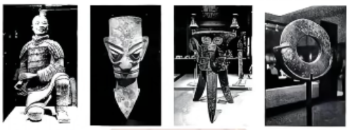
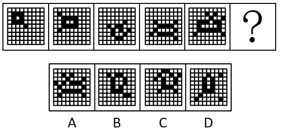
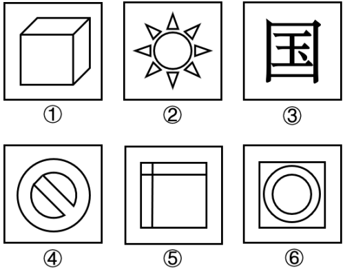
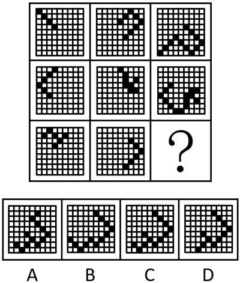
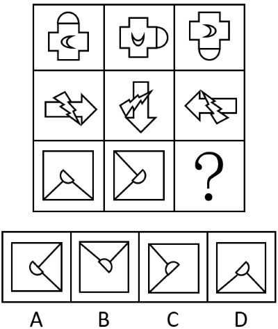
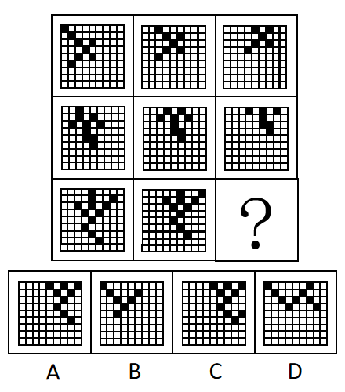
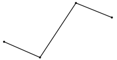
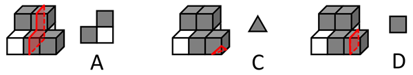

# 2026年辽宁省公务员录用考试《行测》题（网友回忆版）

> 候选采集稿。参考答案及解析来自粉笔页面，不代表官方答案或真实高分答卷；来源使用许可与原卷对应关系仍需人工核实。

## 题型与作答说明

政治理论

（15题）

根据题目要求，在四个选项中选出一个最恰当的答案。

常识判断

（15题）

根据题目要求，在四个选项中选出一个最恰当的答案。

言语理解与表达

（30题）

本部分包括表达与理解两方面的内容。请根据题目要求，在四个选项中选出一个最恰当的答案。

数量关系

（10题）

在这部分试题中，每道题呈现一段表述数字关系的文字，要求你迅速、准确地计算出答案。

判断推理

（30题）

本部分包括图形推理、定义判断、类比推理与逻辑判断四种类型的试题，在四个选项中选出一个最恰当的答案。

资料分析

（20题）

所给出的图、表、文字或综合性资料均有若干个问题要你回答。你应根据资料提供的信息进行分析、比较、计算和判断处理。

## 题目

### 第 1 题

习近平总书记强调，自我革命是党跳出治乱兴衰历史周期率的第二个答案。推进党的自我革命要做到“五个进一步到位”。关于“五个进一步到位”，下列表述正确的有（ ）。

①对党的自我革命认识要进一步到位

②党员干部增强党性要进一步到位

③权力规范运行要进一步到位

④从严监督执纪要进一步到位

⑤落实管党治党责任要进一步到位

A. 2项

B. 3项

C. 4项

D. 5项

### 第 2 题

习近平总书记指出，在中国建立什么样的政治制度，是近代以后中国人民面临的一个历史性课题。关于中国共产党领导人民对人民代表大会制度的探索，下列说法错误的是：

A. 毛泽东同志在《新民主主义论》中首次提出人民代表大会这一崭新概念

B. 具有临时宪法地位的《中国人民政治协商会议共同纲领》庄严宣告新中国实行人民代表大会制度

C. 党的八大讨论通过了《关于政治报告的决议》，标志着人民代表大会制度作为国家根本政治制度正式建立

D. 新时代以来，召开党的历史上首次中央人大工作会议，健全人大组织制度和工作制度，推动人大会议制度更加成熟和定型

### 第 3 题

习近平总书记指出，在干部干好工作所需的各种能力中，政治能力是第一位的，对于政治能力这一重要概念，下列理解正确的有几项？

①提高政治能力，首先要把握正确政治方向

②政治自制力、政治定力是最基础的政治能力

③政治判断力、政治领悟力、政治执行力是最关键的政治能力

④政治领导力是最基本的政治能力

A. 1项

B. 2项

C. 3项

D. 4项

### 第 4 题

习近平总书记强调，要坚持走中国特色社会主义法治道路，建设中国特色社会主义法治体系。关于中国特色社会主义法治体系，下列说法正确的是：

①合宪性审查制度的确立是依法治国、依法执政的重要举措

②我国的立法体制机制主要是通过《中华人民共和国宪法》规定的

③建设中国特色社会主义法治体系是全面依法治国的总抓手

④党内法规体系是中国特色社会主义法治体系的有机组成部分

A. ①②③

B. ①②④

C. ①③④

D. ②③④

### 第 5 题

在2025年召开的中央经济工作会议上，习近平总书记以“五个必须”概括了做好新形势下经济工作新的认识和体会。关于“五个必须”，下列表述正确的有几项？

①必须充分挖掘经济潜能，强调要用好我国产业体系完整、市场规模巨大、人才资源丰富的优势

②必须坚持政策支持和改革创新并举，强调既要加大宏观政策逆周期调节力度，又要不失时机深化改革，激发创新活力

③必须做到既“放得活”又“管得好” ，强调“放”的目的是破除影响生产力发展的体制机制障碍，“管”的本质要求是坚持政府在资源配置中的决定作用

④必须坚持投资于物和投资于人紧密结合，强调既要扩大对实体经济和科技创新的有效投资，又要加强人力资源开发

⑤必须以苦练内功来应对外部挑战，强调面对国际风云变幻和各种风险挑战，要保持战略定力，坚定不移把自己的事情办好

A. 2项

B. 3项

C. 4项

D. 5项

### 第 6 题

新时代以来，领导给各界群众回信，激励他们奋斗逐梦，积极投身现代化强国建设。下列回信嘱托与回信对象对应正确的是：

①共建和谐美丽城市，共创幸福美好生活——上海市“老杨树宣讲汇”全体同志

②祖国疆域上的一草一木，我们都要看好守好——西藏玉麦乡牧民卓嘎、央宗姐妹

③坚定文化自信，扎根生活沃土，努力创作更多讴歌时代精神、抒发人民心声的精品佳作——银龄行动老年志愿者代表

④到祖国和人民最需要的地方发光发热，为中国式现代化建设贡献青春力量——新疆谢依特小学戍边支教西部计划志愿者服务队队员

A. ①②③

B. ①②④

C. ①③④

D. ②③④

### 第 7 题

为有效应对人类面临的安全挑战，建设一个普遍安全的世界，习近平主席提出树立共同、综合、合作、可持续的全球安全观，对此下列理解错误的是（ ）。

A. 共同，要尊重和保障每个国家的安全

B. 综合，要统筹维护传统领域和非传统领域安全

C. 合作，就是要通过对话合作促进各国和本地区安全

D. 可持续，就是要和平与稳定并重，以实现持久安全

### 第 8 题

习近平总书记指出，如果种树的只管种树，治水的只管治水，护田的单纯护田，容易顾此失彼，造成生态系统性破坏。下列表述与这句话蕴含相同哲理的是：

A. 抓任何工作，给群众办任何事情，都要实事求是

B. 按规律办事，按规矩做事是党员干部必须坚守的原则

C. 对长期任务要保持战略定力和耐心，坚持一张蓝图绘到底，滴水穿石，久久为功

D. 把国家安全贯穿到党和国家工作各方面全过程，同经济社会发展一起谋划

### 第 9 题

领导强调，扎扎实实落实促进民营经济发展的政策指标，是当前促进民营经济发展的工作重点，下列符合促进民营经济发展的政策措施有几项？

（1）坚定不移走高质量发展之路，加强自主创新

（2）要按照中国特色现代企业制度要求，完善企业治理结构

（3）坚持诚信守法经营，树立正确的价值观和道德观

（4）要坚持公平竞争，效率第一的基本准则

（5）要积极履行社会责任，积极构建和谐劳动关系

A. 2项

B. 3项

C. 4项

D. 5项

### 第 10 题

习近平总书记强调，新时代新征程精神文明建设要有新气象新作为。下列精神文明建设品牌均反映了当地文化自身特色，其中与创造省份对应错误的是：

A. 打造红色舞剧《乳娘》等文艺精品，讲好爱国主义故事——山东

B. 打造雷锋家乡学雷锋活动品牌，推动学雷锋活动常态化——湖南

C. 打造石家河文化，状元文化，陆羽茶文化等名片，营造文明新风尚——福建

D. 打造六尺巷小课堂，六尺巷剧社，传播以和为贵文明理念——安徽

### 第 11 题

领导指出，贯彻新发展理念是新时代我国发展壮大的必由之路，新发展理念即创新、协调、绿色、开放、共享的发展理念，下列没有体现协调发展理念的是（ ）。

A. 工业互联网+园区，强化区域间、城乡间、产业间协同合作

B. C919国产大飞机带动多个省市参与，促进东中西部的优势互补

C. 百县千镇万村高质量发展工程，推动城乡互补，打造新村新镇

D. 中国主办进博会、服贸会等大型国际级展会，搭建资源对接平台

### 第 12 题

习近平总书记指出，中国人民抗日战争胜利是中国共产党发挥中流砥柱作用的大胜利。关于中国共产党中流砥柱作用，下列说法正确的有（ ）。

①确定了建立抗日民族统一战线的基本政策

②系统完整地提出了持久战的战略总方针

③战略相持阶段形成以主动战为主，游击战为辅的战略战术

④从战略相持阶段开始，承担起全国抗战主战场的重担

⑤创立的抗日民族根据地覆盖到华中和华南地区

A. 2项

B. 3项

C. 4项

D. 5项

### 第 13 题

《中共中央关于制定国民经济和社会发展第十五个五年规划的建议》指出，十五五时期是基本实现社会主义现代化的关键时期，要奋力开创中国式现代化建设新局面。关于中国式现代化，下列表述错误的是：

A. 广阔国际市场是中国式现代化的战略依托

B. 现代化产业体系是中国式现代化的物质技术基础

C. 高水平社会主义市场经济体制是中国式现代化的重要保障

D. 实现人民对美好生活的向往，是中国式现代化的出发点和落脚点

### 第 14 题

在极为艰难的环境条件下，我们之所以能取得新的重大成就，我们党战胜各种风险挑战、创造一个又一个奇迹，“根本在于掌握了马克思主义科学理论，并不断结合新的实际推进理论创新，使党掌握了强大的真理力量”。党的创新理论，从不是“书斋哲学”，而是为了有效解决实践中的矛盾问题。  
下列表述与这段话意义最相近的是：

A. 哲学家们只是用不同的方式解释世界，问题在于改变世界

B. 批判的武器当然不能代替武器的批判，物质力量只能用物质力量来摧毁

C. 如果斗争只是在机会绝对有利的条件下才着手进行，那么创造世界历史未免就太容易了

D. 理论只要说服人，就能掌握群众，而理论只要彻底，就能说服人，所谓彻底，就是抓住事物的根本

### 第 15 题

中国向全世界做出碳达峰，碳中和的宣示以来推动绿色低碳转型取得历史性成就，对此，下列说法正确的有几项？

①构建了全球最系统完备的碳减排政策体系

②建成了全球最大、发展最快的可再生能源体系

③形成了全球最大、最完整的新能源产业链

④实现了全球规模最大、速度最快的新能源汽车推广应用

⑤建成了全球湿地面积最大、水质改善最快的湿地生态系统

A. 2项

B. 3项

C. 4项

D. 5项

### 第 16 题

根据《中华人民共和国治安管理处罚法》，对下列违反治安管理的行为归类错误的是：

A. 非法生产用于制造毒品的原料——妨害公共安全的行为

B. 任意占用损毁公私财物——扰乱公共秩序的行为

C. 违反规定出售公民个人信息——侵犯人身权利、财产权利的行为

D. 饲养动物干扰他人正常生活——妨害社会管理的行为

### 第 17 题

下列划线的公文常用词在句子中使用错误的是：

A. 马克思主义学说的核心内容不容窜改，这个材料的原委已被别人篡改了好几处

B. 调查人员今天开始查看这些财务，组织决定对他的错误给予留党察看的处分

C. 对这些为非作歹的恶徒，必须严加处治，这个突发事件，因处置得当而很快平息了

D. 过去流行的一些陈规陋习必须破除，对这样的情况，可以按照已有成规进行处理

### 第 18 题

下列假设与其可能形成的效应对应错误的是：

A. 制度的生命力在执行，若建立了良好制度却没有严格执行——破窗效应

B. 各方面协调发展才能实现社会进步，若其中一个方面滞后——短板效应

C. 人才是第一资源，若人才从小城市陆续向一个大城市流动——虹吸效应

D. 下载一个文件，若网络随之推荐给我们无数相关联的文件——场域效应

### 第 19 题

文史爱好者小刘于假期先后游览了四座博物馆（院），分别欣赏了以下四件代表性文物藏品。小刘先后游览的博物馆（院）最有可能是：

A. 殷墟博物馆、三星堆博物馆、良渚博物院、秦始皇帝陵博物院

B. 良渚博物院、殷墟博物馆、三星堆博物馆、秦始皇帝陵博物院

C. 秦始皇帝陵博物院、三星堆博物馆、殷墟博物馆、良渚博物院

D. 秦始皇帝陵博物院、三星堆博物馆、良渚博物院、殷墟博物馆

### 第 20 题

人们日常使用的橄榄油，是由新鲜的油橄榄果实直接冷榨而成的食用油。下列关于油橄榄说法正确的是（ ）。

A. 油橄榄树原产于南美洲，树龄可达数百年甚至上千年

B. 油橄榄树在我国长江流域以北地区亦有大面积栽培

C. 油橄榄果的颜色愈深，果实的成熟度愈高，油脂也愈丰富

D. 油橄榄树与橄榄树是同一科的植物，都属于木犀科木犀榄属的油料作物

### 第 21 题

小行星是太阳系形成与演化的“活化石”。关于小行星，下列说法错误的是（ ）。

A. 主带小行星位于火星与木星轨道之间

B. 金属质类小行星富含的主要金属资源是铜和锌

C. 硅酸盐质类小行星富含硅酸盐矿物，可作为太空建筑的原材料

D. 碳质类小行星蕴藏水资源，可用于推进剂、生保物资的原位生产和补给

### 第 22 题

关于乐器的发声原理，下列说法错误的是（ ）。

A. 古筝可以通过调整弦的弹奏力度来调节音调

B. 笛子可以通过调整空气柱有效长度来调节音高

C. 小提琴可以通过调整琴弦的振动幅度来调节响度

D. 萨克斯可以通过调整喇叭口气流、反射特性来调节音色

### 第 23 题

下列植物病原体与其对植物的致病机理对应错误的是（ ）。

A. 真菌——通过吸器或菌丝入侵，分泌酶类破坏细胞壁

B. 细菌——经伤口或气孔侵入，释放毒素破坏组织结构

C. 病毒——借媒介或接触进入活细胞，利用宿主系统复制

D. 线虫——由昆虫传播，寄生于植物韧皮部干扰物质运输

### 第 24 题

食品防腐剂的主要作用是延长食品的保质期。下列食品防腐剂中，主要通过降低食品pH值打造不利于微生物生存环境，从而达到防腐效果的是：

A. 酸性防腐剂，如苯甲酸

B. 无机盐防腐剂，如硝酸盐

C. 生物防腐剂，如乳酸链球菌素

D. 酯型防腐剂，如对羟基苯甲酸酯类

### 第 25 题

中华民族有深厚的文教传统，很多帝王都兴文教，倡导读书。下列帝王与其文教主张对应正确的是：

A. 唐太宗李世民——开卷有益

B. 宋太祖赵匡胤——宰相须用读书人

C. 明太祖朱元璋——以武威克敌，以文教治世

D. 清圣祖玄烨——男儿欲遂平生志，六经勤向窗前读

### 第 26 题

晒过的被子会有一股“阳光味”。关于“阳光味”，下列说法正确的是（ ）。

A. 被子上的螨虫被阳光杀死后，蛋白质焦化尸体分解的味道

B. 多种有机物在紫外线作用下发生光化学反应形成的味道

C. 信号经神经系统传递到人大脑皮质中枢系统产生的幻觉

D. 由细菌分解被子上残留的汗液皮质等物质产生的味道

### 第 27 题

中国古代建筑是充满智慧的建筑形式，蕴含朴素深广的建筑哲理。下列说法错误的是：

A. 黄土高原的穴居与长江流域的木构技术产生了双向文化交流与渗透，形成了“土木共济”的建造体系

B. 羌族、傣族的“穹庐为室、旃为墙”的宜移居建筑，展现了“因天材、就地利”的根植地域风土的建筑风貌

C. 古代建筑中屋顶、梁柱、台基三部分对应了天、人、地的自然现象，反映了“制器尚象”的设计思想

D. 徽州民居以“堂”为中心，堂前的院落或天井是人们观察昼夜变化的窗口，显示了“人室相扶，感通天地”的和合秩序

### 第 28 题

下列诗词与描写的岛屿对应正确的是：

A. 忽闻钟磬响，鹤驭下层霄——海南岛

B. 十丈珊瑚映日红，珍珠捧着水晶宫——舟山群岛

C. 琼海无波连远天，青山有影入平湖——南海诸岛

D. 烽火蓬瀛尽，风涛海国平——台湾岛

### 第 29 题

如果要拍摄一部反映中华文明源远流长演进历程的纪录片，下列可作为第一个奴隶制王朝解说词的是：

A. 这是中国历史上第一个有文献可考，并为考古学和甲骨文所证实的都城遗址

B. 制礼作乐旨在使社会保持稳定，充满和谐之美，华夏文明由此进入以礼乐文明为代表符号的时代

C. 无论在西安的汉唐都城宫殿遗址，还是迄今保留最为完整的北京故宫，我们都能发现它们与二里头相似的宫殿建筑机制，二里头宫殿无疑是他们的祖先

D. 铁农具开始出现，耕作能力大大提高，很多人在公田劳动之外开垦荒地，成为私田。私田的收获物归自己支配，还可以用来交换

### 第 30 题

“治未病”理念倡导科学养生、预防疾病，关于健康养生的相关说法，错误的是（ ）。

A. 人参需辨证使用，体质偏热者盲目服用可能加重上火症状

B. 穴位按摩力度以产生酸胀感为宜，并非用力越大调理效果越好

C. 食用药食同源的苦瓜时，脾胃虚寒者宜熟食，避免生食损伤脾阳

D. 拔罐后皮肤颜色越深说明体内毒素越多，需通过多次拔罐彻底排毒

### 第 31 题

针对“违章指挥、违规作业、违反劳动纪律”多发频发问题，市应急管理部门从5月起在全市范围内部署开展“三违”专项整治工作，重点整治“违章指挥”15项内容、“违规作业”13项内容、“违反劳动纪律”11项内容，从源头严防各类生产安全事故发生。宁可未雨绸缪，不做            ，这是筑牢“安全之基”，全力提升应急管理水平的一个缩影。

填入画横线部分最恰当的一项是：

A. 临渴掘井

B. 临阵磨枪

C. 亡羊补牢

D. 涸辙之鲋

### 第 32 题

作为拉动经济的新增长引擎，低空经济凭借其创新业态和丰富场景，精准        消费者对个性化、沉浸式旅游体验的市场所需，逐步成为驱动文旅产业转型升级的重要力量。目前，低空技术与文旅产业的深度融合，不断        新消费场景：从载人飞行观光解锁空中视野，到无人机编队互动演绎科技浪漫；从低空主题营地开辟特色消费场景，到极限运动项目激活感官体验······多元立体的文旅消费新生态逐渐确立。

依次填入画横线部分最恰当的一项是：

A. 契合 衍生

B. 满足 开发

C. 引领 创造

D. 挖掘 派生

### 第 33 题

治理医疗信息泄露面临诸多困难，尽管我国已针对医疗信息建立了民事、行政、刑事“三合一”法律保护机制，但在落实过程中还存在短板漏洞。不少单位对医疗信息的保护意识薄弱，缺乏清晰的隐私界定标准，在员工培训教育、内控管理、技术防范等环节存在        。由于医疗信息泄露          强，相关部门查处的难度大、概率低。

依次填入画横线部分最恰当的一项是：

A. 缺失 复杂性

B. 疏漏 隐秘性

C. 不足 隐蔽性

D. 缺陷 潜伏性

### 第 34 题

徐渭深受王阳明弟子王畿哲学的影响，主张为人处世要从心上立根，以无挂碍的“真我”为最高真实。他认为绘画的关键，不在于“临摹”，即与客观物象            、锱铢必较，而在于“寄兴”，以直抒胸臆、表达真我、寄托自己情怀为目的。在他看来，近来天道都颇有“        ”，被打乱季节顺序，将四时花草绘于一处，重建超越时令的生命秩序，不仅自有道理，也是合理存在。

依次填入画横线部分最恰当的一项是：

A. 不差毫厘 轮换

B. 寸积铢累 流变

C. 严丝合缝 差错

D. 肤寸而合 差池

### 第 35 题

“构建网络空间命运共同体”理念的提出，正是对全球互联网向何处去、网络空间如何治理时代之问的答案。它深刻揭示，网络空间是人类共同的活动空间，其前途命运应由世界各国共同掌握。各国在网络空间            、利益交融，任何国家都无法            ，也无法凭一己之力应对所有风险。必须摒弃零和博弈、赢者通吃的旧思维，树立合作共赢、共建共享的新理念。

依次填入画横线部分最恰当的一项是：

A. 风雨同舟 独辟蹊径

B. 休戚与共 独善其身

C. 桴鼓相应 自行其是

D. 同气连枝 置身事外

### 第 36 题

我国的非遗            ，凝聚着广大人民群众生产生活的技艺、经验与智慧。过去，认为非遗“又老又土”的不在少数，只见其形、不见其神的更是            。如今，不论是线上还是线下，3D建模、全息投影、AI、AR等新技术的发展，让非遗倍增流行范、更加有意蕴。

依次填入画横线部分最恰当的一项是：

A. 异彩纷呈 不计其数

B. 五花八门 比比皆是

C. 琳琅满目 不乏其人

D. 丰富多彩 大有人在

### 第 37 题

“敬”指的是对事物发自内心的尊重与崇尚，“畏”则包含戒惧和省思之意，敬与畏是一体的。倘若有敬无畏，就容易表面崇敬、内心无惧，进而萌生私心，做事            ，假作为、乱作为；反之，如果有畏无敬，就可能举棋不定、优柔寡断，难免抵触厌战，做事            ，不敢为、不作为。

依次填入画横线部分最恰当的一项是：

A. 心猿意马 畏首畏尾

B. 竭泽而渔 拈轻怕重

C. 急功近利 瞻前顾后

D. 唯利是图 舍本逐末

### 第 38 题

汞存在生物放大效应，即由初级生产者通过生物富集而积累的汞，沿食物网       并放大，不仅给高营养级海洋生物带来潜在风险，还        人类健康。海洋浮游植物作为重要的初级生产者，具有极强的汞富集能力，是生物放大作用的       环节，决定着汞从沉积物进入食物网的量。

依次填入画横线部分最恰当的一项是：

A. 输送 损害 源头

B. 传播 危害 开端

C. 流转 影响 初始

D. 传递 危及 起始

### 第 39 题

当前，中国汽车产业技术成果大量涌现，创新活力与迭代速度令全球同行瞩目。更重要的是，源自中国市场的优秀技术与产品的应用场景具有          ，不仅满足了中国本土消费者的多样化需求，也给全球用户带来更丰富、更经济、更绿色的出行选择，生动诠释了“中国智造”的世界意义。在超大规模市场中        、成长的中国汽车产业，有信心、有条件也有能力为实现高水平科技自立自强            ，为全球汽车产业的技术演进贡献更多中国智慧。

依次填入画横线部分最恰当的一项是：

A. 通用性 锤炼 增光添彩

B. 普适性 淬炼 添砖加瓦

C. 先进性 历练 保驾护航

D. 适用性 锻造 锦上添花

### 第 40 题

实现不贰过，应当从破除三种心态做起。其一是            的“鸵鸟心态”。当错误被发现时，一些党员干部不是正视问题、剖析问题、改正问题，而是像鸵鸟一样把头埋起来，以为“看不见”就“不存在”。其二是            的“看客心态”。有人把反面教材当作是别人的事，认为与自己无关；有人对警示教育的态度是听过了就通过了、看完了就完事了。其三是            的“过关心态”。一些党员干部明面上“照单全收”，表态“问题不整改不放过”，却只局限于就错论错、就错改错，没有举一反三，疏于分析问题滋生的土壤，不从制度上去堵塞漏洞，看似“过关”却未“通关”。

依次填入画横线部分最恰当的一项是：

A. 避重就轻 作壁上观 安于现状

B. 掩耳盗铃 敷衍了事 自暴自弃

C. 讳疾忌医 事不关己 得过且过

D. 自欺欺人 隔岸观火 听天由命

### 第 41 题

“三不朽”是先秦时期兴起的一种价值追求，这种不朽观与以前的“世禄”即追求“保姓受氏”“世不绝祀”的观念有明显不同。“世禄”以实现种族延续为手段，以“世不绝祀”为表征，而“三不朽”是借助立德、立功、立言来确证生命的价值，实现精神生命的永存与不朽。这种不朽观超脱了生命的自然性，与儒家重名思想结合，深刻地影响了古代士人的人生选择，催生了碑志文的产生，并影响了碑志文的书写。

这段文字意在说明：

A. “三不朽”是先秦士人的主流价值追求

B. “三不朽”以践行道德思想为重要目标

C. “三不朽”是儒家重名价值观下的产物

D. “三不朽”与碑志文的出现有直接关联

### 第 42 题

粤剧与粤曲是许多人时常容易混淆的概念，二者在艺术属性和表演形式上存在明显区别。粤剧是一种综合性舞台艺术，集“唱、念、做、打”于一体，强调视觉与听觉的双重呈现。粤曲更注重“唱”的艺术表现，多以坐唱、清唱、弹唱等形式进行。但在口传艺术方面，粤剧和粤曲难分彼此。它们以粤方言为载体，依靠艺人口耳相传的方式传承技艺、传递情感和文化记忆，共同成为岭南口传文化的典型代表。

下列选项表述正确的是：

A. 粤剧和粤曲存在口传艺术上的差异

B. 粤方言成为粤剧和粤曲的共同载体

C. 粤剧是岭南综合舞台艺术典型代表

D. 粤曲是集唱和听的双重表现于一体

### 第 43 题

免密支付本质是技术进步对消费体验的重塑，但其健康发展必须建立在尊重消费者权利的基础之上。从多次跳转到“一键取消”，从信息隐蔽到公开透明，这不仅关乎每一位消费者的切身利益，更关系到市场健康与消费信心的可持续。只有构建起“事前告知—事中控制—事后补救”的全链条保障机制，才能使免密支付真正成为便利生活的工具，而非侵害权益的陷阱。

对上述文段主旨概括准确的是：

A. 免密技术的主要风险是消费者信息不透明

B. 免密技术健康发展需要兼顾技术进步与用户权益

C. 一键取消功能是保障免密支付安全的核心

D. 健全的全链条保障机制决定了免密支付的成败

### 第 44 题

在植物茎顶端、根尖等“生长中枢”，分布着一群活跃的植物干细胞，通过精确的分裂与分化，绘制出植物生长的蓝图。随着深入研究，科学家发现植物茎顶端干细胞区域，细胞壁的主要成分果胶呈现独特的“二元分布”模式。新形成的细胞壁偏“软”，富含去甲酯化果胶；而成熟的细胞壁则更“硬”，以高度甲酯化的果胶为主。果胶成分的去甲酯化过程，使其变得较为柔软、易调整，从而帮助细胞灵活确定分裂的方向和位置。在成熟的细胞壁中，果胶保持高甲酯化状态，则有利于维持干细胞持续分裂的能力及组织的稳定。

根据这段文字，下列说法正确的是：

A. 果胶能够同时呈现两种截然不同的修饰状态

B. 果胶需要在更软的细胞壁中保持高甲酯化

C. 果胶成分的去甲酯化过程控制干细胞的开关

D. 果胶成分的去甲酯化过程使成熟细胞壁变柔软

### 第 45 题

作家藏书中常常留有很多痕迹，具体表现为“藏书者有题跋，作者有签赠，阅读者有批注”，其中题跋与签赠常有落款，来源较为明确，而眉批往往出现在书内文字旁，没有专门的落款，唯一可以确定的是读者留下的。然而，阅读者何人，难以“一目了然”，需要通过公藏背书、二重证据、字迹比对、口述咨询等方式展开比对确认。眉批的内容丰富多样，有的是对文本内容的评价，有的是对作者观点的呼应或批评，还有的是读者的即兴发挥。这些不同时期的批注共同构成一个多维的对话空间，展现这一经典著作在不同时代的接受与解读情况。

下列可做文段标题的是：

A. 藏书中的眉批：历史研究的碎片化重构

B. 藏书中的眉批：读者与文本的对话痕迹

C. 藏书中的眉批：书稿流传轨迹，时代证明

D. 藏书中的眉批：文体研究到文化实践转向

### 第 46 题

现代宇宙学对极早期宇宙提出了多种可能的图景，例如：暴胀宇宙——宇宙在诞生后极短时间内经历了一次指数级的超快膨胀；反弹宇宙——宇宙在经历一次收缩后反弹；循环宇宙——宇宙在膨胀和收缩之间周而复始地循环等。不同的理论模型对原初引力波的产生机制和强度也做出了不同的预言，因此，探测出原初引力波的存在与否、测量出原初引力波的强度，就如同获得了解开宇宙诞生奥秘的钥匙。此外，原初引力波是时空量子涨落被暴胀放大到可观尺度的直接证据。探测到它，将是人类首次探测到引力的量子效应，为证实引力子的存在提供有力的证据，关乎时空的本质。

这段文字意在说明：

A. 原初引力波承载着宇宙诞生的核心秘密

B. 现代宇宙学提出了多种早期宇宙图景

C. 原初引力波是验证时空量子涨落的直接证据

D. 探测原初引力波是区分不同宇宙模型的关键

### 第 47 题

当前，文化出海正迎来从“单品输出”向“生态构建”的转变。比如，有的文化产业公司将国内成熟的平台机制移植到海外，通过在地化运营，形成“内容付费—作者签约—读者互动”的完整生态链，同时借助IP授权、合作开发等，创新IP海外开发推广模式。“生态化”，既要着力构建线上线下融合、实体数字并重的对外传播网络，把“单向传播”升级为“全球共创”；也要积极拓展国际文化“朋友圈”，聚合优质资源，构建多元协同的全球文化传播网络，开创文明对话新格局。

最适合做这段文字标题的是：

A. 文化出海：以生态促共创

B. 文化出海：从输出到共创

C. 文化出海：生态构建新阶段

D. 文化出海：构建文明对话新格局

### 第 48 题

明初进入贵州地区的屯堡先民形成了以“卫”“所”为单位、功能完备的“微缩社会”。通过卫所制度，完成了对人口的整建制重组、对资源的制度性再分配及对社会的结构性再造，为后续600余年的文化融合提供了坚实的物质与社会基础。卫所的选址并非随机散落，而是通过精准的地理布点，构成了一张控制交通要道、扼守战略咽喉的军事网络，使屯堡之间能够守望相助，形成强大的区域联合体，也使其与周边本土村寨形成了互嵌式的居住格局，开启了长达数百年的、与周边各民族的共生关系，为日后黔中地区多元一体文化生态的形成奠定了空间基础。

根据这段文字，下列无法推出的是：

A. 明代卫所制度塑造了屯堡早期的共同体意识

B. 屯堡的选址为黔中地区形成军事要道奠定了基础

C. 屯堡与周边村落的互嵌格局是其文化长期共生的空间前提

D. 屯堡的历史是一部各民族交往交流交融的“互嵌史”

### 第 49 题

面对不断涌现的科技新名词和新说法，公众可能出现选择困难，科普热词的发布，在一定程度上找到了或者说调整了公众关注的锚点，校准了科普工作的焦点，有助于让更多的科普工作者集中精力做好相关领域的科普工作。这在一定程度上来说，也是提高公民科学素质的应有之义；同时从科技创新的角度来说，以热词为代表的新技术、新知识科普可能引导相关公共决策与资源分配，进而推动相关领域的科技创新。

这段文字意在说明：

A. 遴选和发布科普热词利于开展科普工作

B. 科普热词可能引导资源分配和公共决策

C. 发布的科普热词是公众认知的集体投射

D. 科普热词帮助公众理解科学理念精神

### 第 50 题

“休闲”一词在中国渊源极早。“休”指人劳后而息，与天命、道德、审美相关；“闲”字在古汉语中有“閒”、“閑”两个渊源。“閒”从空间缝隙演化为时间闲暇，象喻着沐浴月光的静美居家生活；“閑”喻示着闭门成德与优游自如的统一。在汉语哲学视域中，与繁忙、勤苦、忧怖、压抑的劳作状态以及无所事事、心无所寄的空虚无聊相反，休闲喻示着人超脱约束性因素而获得相对自由美好的生活，它浸透着人对自然乃至天命的体悟与对身心状态的关照，是氤氲着道德、审美与诗性气息的人的理想存在方式与生命境界。

这段文字主要说明了：

A. “休闲”在传统社会的表现

B. “休闲”所代表的生活态度

C. “休闲”对中国文化的影响

D. “休闲”的概念内涵及渊源

### 第 51 题

在智能医疗与机器人感知领域，柔性温度传感器的超薄化是实现高贴合度与集成度的核心前提。超薄柔性温度传感器需要通过高温材料工艺来实现高灵敏度，但其柔性基底却难以耐受高温。这导致器件在柔性温度传感器超薄形态下往往难以同时兼顾高灵敏度、优异柔韧性及长期稳定性。针对这一技术瓶颈，某研究团队采用“水溶性牺牲层辅助转移”策略，成功解决了高性能敏感材料与柔性基底之间的工艺兼容性难题，制备出总厚度仅为40微米的超薄柔性温度传感器。

这段文字接下来最可能介绍的是：

A. 超薄柔性温度传感器的问世意义

B. 超薄柔性温度传感器的制备工艺

C. 柔性温度传感器与智能医疗的关系

D. 传感器的柔性基底难耐高温的原因

### 第 52 题

斑点钝口螈与藻类的互动远比最初认识的“互利共生”更为复杂，这种奇妙的生命协作始于繁殖季节。成年斑点钝口螈会回到出生地的季节性池塘进行交配，雌性产下卵后，藻类在卵内安家，利用胚胎代谢产生的二氧化碳和含氮废物生长，并改变代谢方式，从光合作用转为发酵产能，为发育中的胚胎供氧。这种细胞内共生现象在脊椎动物中绝无仅有。经过1-2个月孵化期后，幼体斑点钝口螈破卵而出，带着这些特殊的“房客”开始新的生命旅程。斑点钝口螈的这一特性为科学家提供了宝贵的研究模型：它不仅揭示了脊椎动物与微生物共生的新形式，更展现了生命在能量获取方式上的惊人可塑性。

根据这段文字，下列关于斑点钝口螈的说法错误的是：

A. 是唯一有细胞内共生能力的脊椎动物

B. 藻类在其胚胎发育时直接进入细胞内

C. 发育中的胚胎需要藻类提供含氮物质

D. 幼体出生后与藻类共生过程持续进行

### 第 53 题

查干湖冬捕节的免费公交，能让更多人得以走进冰雪世界，既带动了当地文旅消费，也让渔猎文化得到广泛的传播；杭州灵隐寺取消飞来峰门票，降低公众接触文化遗产门槛的同时，更能够以文化普惠激活文旅产业发展的内生动力；泉州在春节期间300多条公交线路免费开放，182.74万人次的客运总量背后，不仅是游客出行成本的降低，最重要的是传递“城市温度”，塑造城市形象。一方面，这些小举措打破了地域与身份的壁垒，使异地游客与本地居民享有同等公共服务权益，在共同的文化体验与民生共享中增进了社会认同、凝聚了发展向心力。另一方面，也实现了“小投入‘撬动’大产出”的效应。

这段文字意在强调：

A. 公共服务免费化是文旅产业发展的核心动力

B. 降低出行成本可有效提升城市形象与吸引力

C. 民生小举措能促进文旅融合与社会效益提升

D. 取消景区门票成为保护文化遗产的关键路径

### 第 54 题

“                    。”生逢其时、重任在肩，新时代中国青年要矢志创新创造，有敢为人先的锐气、有上下求索的执著，努力在改革开放中闯新路、创新业，在科技创新中挑大梁、当主角，让青春在创新创造中闪光；要勇于砥砺奋斗，做走在时代前列的奋进者、开拓者、奉献者，让青春在实现民族复兴的赛道上奋勇争先；要坚持知行合一，注重在实践中学真知、悟真谛，在经风雨、见世面中长才干、壮筋骨，练就担当作为的硬脊梁、铁肩膀、真本事，让青春在党和人民最需要的地方绽放绚丽之花。

填入画横线部分最恰当的一项是：

A. 人生万事须自为，跬步江山即寥廓

B. 雄关漫道真如铁，而今迈步从头越

C. 长风破浪会有时，直挂云帆济沧海

D. 千磨万击还坚劲，任尔东西南北风

### 第 55 题

①没有超导材料、没有经验可循、没有标准可依，超大电流、超强磁场、超高真空成为“卡脖子”难题，让人看不清前路

②没有路，就用自己的脚印走成路

③造“太阳”的第一步，是造一个强大的容器，能够承载超高温和超低温，受得了“一米之外，冰火两重天”，让等离子体稳态运行并产生核反应

④造“太阳”这条无人之路的开端，就荆棘遍布

⑤这份炙热，源自数十年的科研热情、四代人的薪火相传

⑥19年超过15万次放电，如今的全超导托卡马克核聚变实验装置（EAST）能够在1亿摄氏度实现1066秒稳态运行，比太阳更炙热

将以上6个句子重新排列，语序正确的一项是：

A. ③④①②⑥⑤

B. ④①②③⑤⑥

C. ⑤④①②③⑥

D. ①②③⑥④⑤

## 材料 1

古代两河流域的界碑是一种石碑，一般上半部刻着宗教题材的浮雕，如各种神灵的形象和武器等，下半部以楔形文字刻写着各类文献。界碑主要存在于公元前16世纪至公元前12世纪的加喜特巴比伦时期，但界碑的起源可追溯至早王朝时期，一直存在于加喜特王朝之后的伊新第二王朝和新巴比伦王朝时期。①

目前，全世界收藏的界碑及残片约有160余块，其中保存较好的约有100块。两河流域80%以上界碑的制作材料为石灰岩，除此之外还有闪长岩和花岗岩。从造型上看，界碑的形制主要是长方体的石碑造型，圆柱形、圆锥形、椭圆形（蛋形）、方柱形、金字塔形、方尖碑形等也较为常见。从规模大小上来看，界碑最高不超过1米，最小的只有10厘米左右。②

两河流域的神灵和象征主要有三种类型：一是各种天体符号。太阳、月亮和星星等天体对人们的生活和生产具有至关重要的作用，因此在两河流域，人们对这些天体进行崇拜。二是各种动植物形象。人们崇拜的动物主要有蛇龙、狮子、龟、蝎子、蛇、狗等，人们崇拜的植物主要是谷穗。三是人的形象。在一些情况下，神也会以人的形象出现。这些拟人化了的神灵主要是一些地位较高并且与人类具有密切关系的神灵，比如在创世史诗中创造了世界万物和人类的马尔杜克神，经常以一位智慧老人的形象出现。③

铭文是界碑上最重要和最宝贵的部分，大多数界碑都刻有记载土地交易行为的铭文。根据铭文内容中的参与者，我们可以把铭文划分为两大类。一类铭文有国王（或王室成员）参与，内容多为土地的授予、土地所有权的重新认定、祭司圣职俸禄的授予以及赋役的豁免等。这类活动可定义为公共活动，记载这些活动的铭文称之为“公共事务铭文”。刻写“公共事务铭文”的界碑多放置在田间地头或者神庙的公共场所。另一类铭文没有国王参与，可以定义为私人活动。在这类“私人事务铭文”中，交易双方多为普通自由民。刻写“私人事务铭文”的界碑通常体积较小，为扁平的泥板状石碑。这些界碑一般由个人保管，并不放置在公共场所。“私人事务铭文”主要记载土地房屋等不动产买卖活动、私人土地授予活动、神庙俸禄的授予活动以及私人交易活动纠纷。④

两河流域从早王朝时期就出现了在石头上刻写土地交易的行为。这种石碑被命名为“古代界碑”。加喜特人应该是在“古代界碑”的影响之下形成了自己更加复杂的界碑。长期以来，学界认为加喜特巴比伦王朝是两河流域历史上的“黑暗时代”，一是因为该王朝的实力相对较弱，缺乏耀眼功绩；二是因为加喜特王朝遗留下来的史料相对较少，对该王朝的认识依旧如“雾里看花”。

### 第 56 题

下面这段文字，最适合填入文中的哪个位置？

浮雕是界碑上最为显眼的一部分，也是界碑的重要组成部分。界碑浮雕图案中最为重要的是各种神灵的形象或象征，刻画神灵的目的是祈求神灵的保护和赐福，希望神灵对界碑记载的交易活动给予保护。

A. ①

B. ②

C. ③

D. ④

### 第 57 题

下列说法与这篇文章相符的是：

A. 加喜特人在界碑上刻画有神灵和国王形象的浮雕

B. 界碑的历史最早可追溯至两河流域的加喜特王朝

C. 界碑铭文按参与者分成公共事务和私人事务两类

D. 记载国王对土地授予活动的界碑通常由王室保管

### 第 58 题

文章接下来最有可能讨论的是：

A. 两河流域界碑与其他地域界碑的特征比较

B. 界碑铭文对研究加喜特王朝所产生的影响

C. 加喜特王朝的界碑对“古代界碑”的传承

D. 巴比伦文明对世界历史发展所做出的贡献

### 第 59 题

关于界碑，这篇文章没有提及：

A. 材质

B. 形制

C. 功能

D. 象征

### 第 60 题

下列选项中，最适合做这篇文章标题的是：

A. 界碑上的王朝兴衰史

B. 界碑——刻在石头上的历史

C. 界碑与两河流域的历史兴替

D. 界碑的故事：加喜特巴比伦王朝

### 第 61 题

某研究机构跟踪一种商品的价格变化，发现每天的价格相较前一天增长10%，问几天之后价格会大于最初价格的1.5倍？

A. 3

B. 4

C. 5

D. 6

### 第 62 题

某初中生每个月的学习计划是每周一、三、五进行语文学习，每周二、四进行数学学习，周六、周日进行英语学习。已知某月该学生共进行了14次语文学习、9次数学学习、8次英语学习，问该月1日可能为：

A. 星期一或星期三

B. 星期二或星期四

C. 星期一或星期五

D. 星期三或星期日

### 第 63 题

小明假期计划每周学习滑雪的天数不少于2天，学习乒乓球1天，周六、周日休息，且不能连续两天学习同一项运动，每天至多学习一项。问其每周的学习计划有多少种不同安排？

A. 10

B. 14

C. 20

D. 26

### 第 64 题

一个长方形出口，高为2米，宽为1米。若想将圆形零件从此出口运出，圆形零件的厚度可以忽略不计，问该出口可以通过的圆形零件的最大直径在以下哪个范围内？

A. 0~2米之间

B. 2~4米之间

C. 4~6米之间

D. 6~8米之间

### 第 65 题

甲乙同向而行，甲的速度是乙的速度的2倍，同向行走了一段时间后，乙将速度提高到原来的4倍，再用时10秒追上甲，问乙提速前用时多少秒?

A. 5

B. 10

C. 15

D. 20

### 第 66 题

有一种停车入位益智游戏，有4排模拟停车位，每排5个。现有6台相同玩具车需要停进车位，若要求每一排至少停进1台且同一排两车不相邻。问有多少种停车方案？

A. 1440

B. 1850

C. 5400

D. 5900

### 第 67 题

某工厂接到一批订单，预计交付周期为28天，全自动生产线生产19天后，部分设备出现故障，效率降为原来的。为保证交货周期，公司紧急加开临时生产线，其效率为全自动生产线正常效率的，这批订单最终交付时间比预计时间？

A. 快1.5天

B. 慢1.5天

C. 快2.5天

D. 慢2.5天

### 第 68 题

某学龄前儿童艺术培训学校现有儿童100人，共有舞蹈、美术、声乐、书法4个兴趣班，参加人数比为4：3：2：1，只参加2个培训班的人数是40人，只参加3个培训班的人数和参加全部培训班的人数一样多。参加声乐培训班的人数比参加舞蹈培训班的人数少40人，问只参加一个培训班的有多少人？

A. 36

B. 40

C. 52

D. 60

### 第 69 题

小明和爸爸一起玩积木玩具，小明拼装小轿车，每辆小轿车需要5个座椅和4个轮子，爸爸拼装大卡车，每辆大卡车需要2个座椅和6个轮子。若小明和爸爸拼装的车辆数均为整数，小轿车和大卡车的零件可共用。问以下哪项可能是小明和父亲使用的座椅数量和轮子数量？

A. 24，12

B. 32，52

C. 26，84

D. 36，26

### 第 70 题

冰雪游持续升温，南方某学校组织学生去东北旅游，学校共有212名学生，报名人数已达3~4成。根据目前报名的学生人数，若再招2名学生，可将其平均分成3或4组。问目前可能有多少学生报名？

A. 76

B. 80

C. 82

D. 90

### 第 71 题

从所给的四个选项中，选择最合适的一个填入问号处，使之呈现一定的规律性：

A. A

B. B

C. C

D. D

### 第 72 题

把下面的六个图形分为两类，使每一类图形都有各自的共同特征或规律，分类正确的一项是：

A. ①②③，④⑤⑥

B. ①③④，②⑤⑥

C. ①④⑤，②③⑥

D. ①②⑥，③④⑤

### 第 73 题

从所给的四个选项中，选择最合适的一个填入问号处，使之呈现一定的规律性：

A. A

B. B

C. C

D. D

### 第 74 题

从所给的四个选项中，选择最合适的一个填入问号处，使之呈现一定的规律性：

A. A

B. B

C. C

D. D

### 第 75 题

把下面的六个图形分为两类，使每一类图形都有各自的共同特征或规律，分类正确的一项是：

A. ①②③，④⑤⑥

B. ①③④，②⑤⑥

C. ①④⑤，②③⑥

D. ①②⑥，③④⑤

### 第 76 题

左图为3个白色正方体和4个灰色正方体粘接而成的多面体，将其从任一方向剖开，下面哪一项不可能是该立体图形的截面？

A. A

B. B

C. C

D. D

### 第 77 题

从所给的四个选项中，选择最合适的一个填入问号处，使之呈现一定的规律性：

A. A

B. B

C. C

D. D

### 第 78 题

左图的立体图形，将其展开后，右边哪一项可能是该立体图形的展开图？

A. A

B. B

C. C

D. D

### 第 79 题

动词可以分为以下几类：断言类，表示说话人对某事做出一定程度上的表态，对话语所表达的命题内容做出真假判断；指令类，表示说话人不同程度地指使听话人做某事；承诺类，指说话人对未来的行为做出不同程度的承诺；表达类，指说话人在表达话语命题内容的同时所表达的某种心理状态；宣告类，指话语所表达的命题内容与客观现实之间的一致。

根据上述内容，下列选项表述错误的是：

A. “否认”是断言类，“要求”是指令类

B. “保证”是承诺类，“宣布”是宣告类

C. “请求”“敦促”“命令”都是指令类

D. “道歉”“夸耀”“通知”都是表达类

### 第 80 题

半公开信息源是指需要特定权限或身份认证等才可以获得相应信息的信息源。半公开信息源只能在一定范围内公开、共享、使用，大多数是在机构内部。

根据上述内容，不属于半公开信息源的是：

A. 党政机关不公开发行的内部刊物

B. 公司内网发布的公司内部财务状况报告

C. 高校内部传达的有关重点实验室管理的文件

D. 研究所内部仅涉密人员知晓的科学技术秘密

### 第 81 题

竞技运动情景中的运动决策是运动员做出反应的过程。在竞技运动情景中主要存在两种类型的决策，分别是认知决策和直觉决策。认知决策是指以逻辑思维为基础的决策，类似于一般情景中的活动，通过概率或决策策略进行。直觉决策是指以运动直觉为基础，是在快速运动、时间压力大或结果不确定的复杂运动情景中，运动员作出具有快速、直接、或然性特点的决策。

下列哪个选项属于认知决策？

A. 在棒球比赛中，球一出手，击球员就能通过球的缝线旋转模式瞬间判断出这是快速球还是曲球

B. 篮球比赛中，外线球员接到球后，将球传给背身单打能力强的内线球员，助其篮下投篮得分

C. 在拳击比赛中，拳击手凭借对攻防节奏的感知，瞬间做出低头、偷袭或后退等闪避动作，以避开对方的重拳

D. 在足球比赛中场时，足球教练根据对方球队的防守特点和对方球员状态制定下一轮进攻战术，并布置给队员

### 第 82 题

在统计学中，总体是客观存在的，具有某种共同性质的许多个别事物构成的整体，构成总体的个别事物叫总体单位。总体和总体单位都是客观存在的事物，是统计研究的客体。

根据上述定义，若要了解某省高校仪器设备情况，则总体单位是：

A. 该省每一所高校

B. 该省高校的全部仪器设备

C. 该省高校的每一台仪器设备

D. 该省每一所高校的全部仪器设备

### 第 83 题

注意力经济是指商家最大限度地吸引用户或消费者的注意力，通过培养潜在的消费群体，以期获得最大的未来商业利益的经济模式。

根据上述定义，不涉及注意力经济的是：

A. 某汽车品牌在新品发布前，连续在社交媒体平台发布“新品悬念海报”，每天公布一个产品核心功能亮点，积累潜在购买用户

B. 某用户在社交平台晒出的自家萌娃的一则短视频吸引了大量关注，视频中萌娃的同款玩具在购物平台爆火

C. 某超市为处理临期食品，不定期在门口设置“特价区”，通过低价吸引周边居民抢购

D. 某美妆品牌在短视频平台发起“素颜”挑战，邀约网红达人分享使用该品牌的素颜霜的前后对比视频，引导用户了解信息

### 第 84 题

射孔弹按弹体承压结构分为有枪身射孔弹和无枪身射孔弹。射孔弹型号命名表示方法如下所示：

说明：1—射孔弹的工作压力（无枪身射孔弹适用，有枪身射孔弹此项空缺），单位为兆帕（MPa）；2—射孔弹穿孔性能，用DP表示深穿透射孔弹，用BH表示大孔径射孔弹，用GH表示大孔径深穿透射孔弹，用EH表示等孔径射孔弹；3—药型罩开口直径，单位为毫米（mm）；4—主炸药类型；5—射孔弹单发装药量，单位为克（g）；6—产品改进型号。

根据上述定义，对于型号为BH36RDX33-1的射孔弹，下列说法错误的是：

A. 为大孔径射孔弹

B. 主炸药类型为RD

C. 为有枪身射孔弹

D. 单发装药量为33克

### 第 85 题

自我异化是指个体在与外部世界的互动中，逐渐丧失主体性、自主性和本质属性，被自身创造的对象或异己力量所控制、支配，最终导致自我与自身、他人、社会以及本质相分离的状态。

下列不属于自我异化的是：

A. 沉迷剧本杀、桌游等沉浸式游戏，削弱了对现实生活的参与感

B. 过度依赖线上社交，削弱了现实中与亲人、朋友等的情感联系

C. 网络空间中的多重虚拟身份造成难以区分现实身份与网络身份

D. 由长期加班导致的身体疲惫，使得自己无法集中精神处理工作中的问题

### 第 86 题

包装色彩效应是指商品包装色彩对消费者心理的影响，其主要表现为两方面：（1）吸引与诱发作用，即容易引起消费者的联想，诱发消费者的情感，并在一定程度上左右消费者对商品的印象。（2）强化商品的特征，提高商品色彩效应。

根据上述定义，下列体现包装色彩效应的是：

A. 将白色商品装在底衬较暗的盒子里会更醒目

B. 深色衣服会比浅色衣服给人更暖和的感觉

C. 方形和矩形包装给人以稳重可靠的感觉

D. 黑色或深色的电子产品可能会令人感觉更高级

### 第 87 题

与“因特网：国际互联网”在逻辑关系上最相近的是：

A. 拙荆：妻子

B. 瑶琴：古琴

C. 姑爷：女婿

D. 巴士：公共汽车

### 第 88 题

与“制片主任：剧组人员”在逻辑关系上最相近的是：

A. 科长：科员

B. 花瓣：花束

C. 语文书：教科书

D. 发电机：发电机组

### 第 89 题

有机物：氯气：化合物

A. 冲压液压机：挤压液压机：液压机

B. 流动负债：流动资产：流动资金

C. 落叶阔叶林：温带常绿林：落叶林

D. 化学能武器：橡胶子弹：动能武器

### 第 90 题

教师人数：生师比：学生人数

A. 产品总数：合格率：合格产品数

B. 溶剂质量：浓度：溶质质量

C. 租金：租售比：售价

D. 税额：利润率：利润总额

### 第 91 题

算法偏见 对于（ ）相当于（ ）对于 动脉堵塞

A. 歧视：静脉堵塞

B. 信息茧房：心梗

C. 数据污染：肺功能

D. 不公平：血栓脱落

### 第 92 题

如果用圆圈表示概念的外延，下列符合上述概念外延关系的是：

A. 陶瓷器皿（①）耐热性强，易于清洗，陶瓷餐具（③）是餐桌上常见的餐具（②），很多茶具（④）也是用陶瓷制成的

B. 弦鸣乐器（①）通过琴弦振动发声，气鸣乐器（②）依赖气流振动发声，中国传统乐器（③）既有弦鸣乐器也有气鸣乐器，唢呐（④）即是一种气鸣乐器

C. 热带植物（①）适应高温高湿的环境。在热带地区，常绿乔木（②）较多，可可树（③）即是其中之一，冷杉（④）也是一种常绿乔木，但其主要生长在亚寒带地区

D. 法学（①）和历史学（②）分别属于社会科学和人文科学的范畴，法律史学（③）是法学和历史学的交叉学科。它不同于刑法等部门法学（④），主要研究法律的产生及其演变规律

### 第 93 题

一直以来，科学界认为微计算机断层扫描（micro-CT）技术是非破坏性的，不会对化石造成损伤。研究人员使用标准设置的micro-CT扫描仪，对动物骨骼、牙齿（包括现代样本和化石）进行扫描，重点测定扫描前后胶原蛋白的含量变化。研究显示，尽管扫描后样本的放射性碳年龄未受影响，但胶原蛋白含量显著下降35%。研究人员认为，这意味着micro-CT技术会对化石承载信息造成不可逆损伤。

以下哪项如果为真，最能支持上述论证？

A. 胶原蛋白作为化石研究的关键物质，在放射性碳测年等技术中不可或缺

B. 对于不规则形状或大尺寸化石，使用micro-CT技术扫描过程较为繁琐

C. 已发展出更先进的对化石进行非破坏性扫描技术，可替代micro-CT技术

D. micro-CT技术会使化石在电子自旋共振测年中出现“加速老化”的现象

### 第 94 题

历史和实践充分证明，只有高质量精神生产与高质量精神消费都搞好，才能提升人民群众的精神世界。一方面，精神生产决定精神消费，充分享有高质量的精神产品是人民群众进行高质量精神消费的必要前提，也是使人民群众精神获得感成色更足、幸福感品位更高、安全感更可持续的重要条件。另一方面，精神消费反作用于精神生产，高质量的精神消费有利于激发人民群众更深层次的精神需求，并推动更高质量的精神生产。

由此一定可以推出的是：

A. 有了高质量的精神消费，说明有了高质量的精神产品

B. 有了高质量的精神消费，就能激发人民群众更深层次的精神需求

C. 高质量精神生产与高质量精神消费都搞好了，人民群众的精神世界就能提升

D. 没有高质量的精神产品，就不能使人民群众精神获得感成色更足、幸福感品位更高、安全感更可持续

### 第 95 题

近期某国北部地区暴雨不断，较常年同期偏多近三成。对此，有专家表示，北部地区强降水过程与副热带高气压带活动紧密相关，这主要是因为西太平洋副热带高压势力偏强且位置偏北，其边缘的暖湿气流向北部地区输送大量水汽，为强降水提供了充足的水汽条件。

以下哪项如果为真，最能削弱上述专家的论证？

A. 副热带高气压带大气不稳定性强，导致降水对流性特征突出，局部地区降雨量大、持续时间长

B. 自20世纪90年代后，科学家根据气候模式就预测出，随着气候变暖，全球极端降水的强度将有可能增大

C. 历史数据显示，每当西太平洋副热带高压位置偏北且势力偏强时，该国北部地区的降水量往往显著高于常年同期

D. 此次极端强降雨主要发生在北方山区，山地对降水有明显的增幅效应，在副热带高压和地形的共同作用下形成了强降雨

### 第 96 题

为定位人脑特定区域的功能，在一项新研究中，研究人员使用了损伤缺陷映射法。他们对247名患者进行了研究，发现大脑左或右额叶存在单侧局灶性脑损伤。此外，81名健康个体作为对照组。研究人员使用两种方法评估患者推理能力：一种是语言类比推理任务，参与者需找出单词关系解决问题；另一种是非语言演绎推理任务，参与者需使用图片、形状或数字找出逻辑模式解决问题。测试后，研究人员认为右前脑区域在推理中发挥关键作用。

上述论证的成立需要补充以下哪项作为前提？

A. 这项研究所采用的损伤缺陷映射法，是目前医学界定位人脑功能的最有效方法

B. 若大脑右前区受损，空间认知与方向感、直觉和整体感知能力都会受影响

C. 无论在哪项测试中，大脑右或左额叶受损的患者都比对照组健康个体得分低

D. 与大脑其他区域受损的患者相比，右前额叶受损患者在这两种测试中的表现更差

### 第 97 题

有研究表明，20世纪80年代以来，沙漠新月形沙丘的移动速度持续下降。对于沙丘移动速度下降的原因，有学者认为是风速下降导致的，因为从理论上说，风速下降能减弱风蚀作用，减缓沙丘移动，并降低沙尘暴频率，但也有学者反对上述观点，他们认为输沙率持续减弱才是沙丘移动速度下降的真正原因。从分析来看，近40年来沙尘在沙丘不同部位的迁移和堆积速度有显著降低的趋势，单位时间内能够搬运的沙粒数量减少。

以下哪项如果为真，最能削弱第二种观点？

A. 气候变暖导致全球风速都有下降的趋势

B. 沙漠地区风速下降是输沙率持续减弱的原因

C. 风速下降能够减弱风蚀作用，并降低沙尘暴频率

D. 输沙率减弱意味着沙丘被侵蚀的部分无法得到足够补充

### 第 98 题

某研究团队将某市受蟑螂侵害的多单元公寓分为两组：一组没有除蟑螂，一组接受专业的灭蟑螂服务。经过对比最开始、三个月和六个月后的沉降灰尘、空气灰尘样本与昆虫样本，研究人员发现：出现蟑螂但从未接受灭蟑螂服务的公寓自始至终都保持很高的过敏原及内毒素水平；相比之下，大多数经过灭蟑处理的公寓再没出现过蟑螂，过敏原和内毒素水平均显著下降。因此，研究团队认为，灭蟑螂或有助于防过敏。

以下哪项如果为真，最能支持上述研究团队的论证？

A. 过敏原和内毒素可以悬浮在空气中

B. 已有研究表明，蟑螂会通过粪便排放出大量内毒素

C. 两组公寓最开始检测到的过敏原及内毒素水平基本一致

D. 已有迹象表明，过敏原与内毒素的相互作用可能加重哮喘

### 第 99 题

黄斑变性是导致老年人失明常见的原因之一。在一项临床试验中，6名几乎完全失明的患者在接受眼部干细胞移植治疗后，突然又能辨认出视力表上的字母了。因此，研究人员认为移植干细胞能让黄斑变性失明的人重见光明。

以下哪项如果为真，无法支持上述论证？

A. 黄斑变性疾病的自然病程通常会导致视力进一步丧失

B. 在当前研究中，移植的干细胞活性能保持多久是未知的

C. 在当前研究中，移植的干细胞材料保持稳定，未出现炎症或排异反应

D. 移植的干细胞能替代已死亡的细胞，并与其上方的感光细胞重新建立通信

### 第 100 题

某学校组织开展象棋、围棋、五子棋比赛的初赛，初赛为淘汰赛，且每人仅比赛一场，获胜者即可进入复赛，甲班中张、李、王、赵报名参加了比赛。已知：

（1）如果张进入象棋复赛，那么赵进入五子棋复赛；

（2）只有李进入围棋复赛，王才不会进入象棋复赛；

（3）除非赵没进入五子棋复赛，否则李不进入围棋复赛。

由此可以推出（ ）。

A. 张进入象棋复赛，或者王进入象棋复赛

B. 张进入象棋复赛，或者王没进入象棋复赛

C. 张没进入象棋复赛，或者王进入象棋复赛

D. 张没进入象棋复赛，或者王没进入象棋复赛

## 材料 2

2025年10月全国规模以上互联网和相关服务企业（以下简称“互联网企业”）营业收入1769亿元，实现利润总额201亿元，研发费用98亿元。

2025年1-10月，全国互联网企业实现营业收入16189亿元，同比增长9.6%，增速较上一年度同期提升4.4个百分点，较2025年1-9月减少3.9个百分点，实现利润总额1237亿元，同比下降1.9%，增速较上一年度同期减少19.3个百分点，较2025年1-9月提升8.1个百分点，研发费用累计支出862亿元，同比增长9.7%，增速较上一年度同期提升5.6个百分点，较2025年1-9月提升1.1个百分点。

2025年10月东部地区互联网企业实现营业收入1566亿元，同比下降18.6%；中部地区互联网企业实现营业收入62亿元，同比增长36.3%；西部地区互联网企业实现营业收入138亿元，同比增长53.9%；东北地区互联网企业实现营业收入2亿元，同比下降14.3%。

2025年1-10月东部地区互联网企业实现营业收入14523亿元，同比增长9.6%；中部地区互联网企业实现营业收入612亿元，同比下降1.7%；西部地区互联网企业实现营业收入1024亿元，同比增长18.1%；东北地区互联网企业实现营业收入30亿元，同比下降6.9%。

### 第 101 题

2023年1-10月，全国互联网企业实现利润总额在以下哪个范围内？

A. 不到900亿元

B. 900亿-1000亿元之间

C. 1000亿-1100亿元之间

D. 超过1100亿元

### 第 102 题

2024年1-9月，全国互联网企业实现营业收入在以下哪个范围内？

A. 不到1.2万亿元

B. 1.2万亿-1.3万亿元之间

C. 1.3万亿-1.4万亿元之间

D. 超过1.4万亿元

### 第 103 题

2025年1-9月，全国互联网企业利润率（利润率=利润总额/营业收入）在以下哪个范围内？

A. 不到7%

B. 7%-7.5%之间

C. 7.5%-8%之间

D. 超过8%

### 第 104 题

2025年1-10月四个地区互联网企业实现营业收入占全国的比重较2024年同期上升的有几个地区？

A. 0

B. 1

C. 2

D. 3

### 第 105 题

能够从上述资料中推出的是：

A. 2025年1-10月，东部地区互联网企业实现营业收入同比增速较1-9月有所增加

B. 2024年1-10月，西部地区互联网企业月平均实现营业收入超过88亿元

C. 2025年10月，中部地区互联网企业实现营业收入同比增量超过15亿元

D. 2024年1-10月，全国互联网企业研发费用占营业收入的比重较2023年同期有所提高

## 材料 3

### 第 106 题

2025年第二季度C市城市轨道交通客运总量的环比增速在下面哪个范围内？

A. 不到20%

B. 20%～25%

C. 25%～30%

D. 超过30%

### 第 107 题

2024年3月C市城市轨道交通当期进站量在下面哪个范围内？

A. 不到1300万人次

B. 1300万~1400万人次

C. 1400万~1500万人次

D. 超过1500万人次

### 第 108 题

2025年4月份C市城市轨道交通客运强度（客运强度）在下面哪个范围内？

A. 不到0.5万人次/公里·日

B. 0.5万~0.55万人次/公里·日

C. 0.55万~0.6万人次/公里·日

D. 超过0.6万人次/公里·日

### 第 109 题

2025年1-11月C市城市轨道交通当期换乘量（换乘量=客运总量-进站量）超过750万人次的月份有多少个？

A. 4

B. 5

C. 6

D. 7

### 第 110 题

2025年1-11月C市城市轨道交通客运强度最高与最低的月份，其当期进站量相差多少万人次？

A. 110

B. 395

C. 428

D. 500

## 材料 4

### 第 111 题

2025年3-11月全国商品当期网上零售额最高月份的网上零售额约是最低月份的几倍？

A. 超过1.5倍

B. 1.4倍-1.5倍之间

C. 1.3倍-1.4倍之间

D. 不到1.3倍

### 第 112 题

2025年6月全国商品当期网上零售额同比增量在以下哪个范围内？

A. 不到5百亿元

B. 5百亿-10百亿元之间

C. 10百亿-15百亿元之间

D. 超过15百亿元

### 第 113 题

2025年3-11月全国实物商品当期网上零售额同比增速高于累计网上零售额同比增速的月份有几个？

A. 5

B. 6

C. 7

D. 8

### 第 114 题

2025年第三季度，各月全国实物商品当期网上零售额占全国商品当期网上零售额的比重由高到低排序正确的是：

A. 7月、8月、9月

B. 7月、9月、8月

C. 9月、7月、8月

D. 9月、8月、7月

### 第 115 题

以下折线图反映了2025年哪4个月全国实物商品当期网上零售额环比增速的变化趋势？

A. 5-8月

B. 6-9月

C. 7-10月

D. 8-11月

## 材料 5

### 第 116 题

2024年3月-11月，全国手机当期产量同比增速最高的是哪个月？

A. 4月

B. 6月

C. 8月

D. 9月

### 第 117 题

2023年7月，全国手机当期产量在以下哪个范围内？

A. 不到1.2亿部

B. 1.2亿-1.25亿部之间

C. 1.25亿-1.3亿部之间

D. 超过1.3亿部

### 第 118 题

2025年3-11月，全国智能手机当期产量同比增量超过700万部的有几个月？

A. 1

B. 2

C. 3

D. 4

### 第 119 题

2025年第三季度各月全国非智能手机当期产量由高到低排序正确的是：

A. 7月、8月、9月

B. 8月、9月、7月

C. 9月、7月、8月

D. 9月、8月、7月

### 第 120 题

2025年8月，全国智能手机当期产量比重较上一年度同期：

A. 上升不到10个百分点

B. 上升超过10个百分点

C. 下降不到10个百分点

D. 下降超过10个百分点

## 答案与解析

第 1 题

**参考答案（粉笔题库参考内容）**

D

**解析**

本题考查新思想。

2025年12月1日，《求是》杂志发表习近平总书记重要文章《推进党的自我革命要做到“五个进一步到位”》。文章指出：“围绕党的自我革命，这些年我讲了不少话，党中央采取了很多措施，思路要求都是明确的，关键在于抓落实要真正到位。下面，我着重强调一下这个问题。第一，对党的自我革命认识要进一步到位······第二，党员干部增强党性要进一步到位······第三，权力规范运行要进一步到位······第四，从严监督执纪要进一步到位······第五，落实管党治党责任要进一步到位······”

故①②③④⑤表述正确，共5项。

故正确答案为D。

第 2 题

**参考答案（粉笔题库参考内容）**

C

**解析**

本题考查新思想。

A项正确，1940年1月，毛泽东同志在《新民主主义论》中首次提出人民代表大会这一崭新概念，指出“没有适当形式的政权机关，就不能代表国家。中国现在可以采取全国人民代表大会、省人民代表大会、县人民代表大会、区人民代表大会直到乡人民代表大会的系统，并由各级代表大会选举政府”。

B项正确，1949年9月，中国人民政治协商会议第一届全体会议通过具有临时宪法地位的《中国人民政治协商会议共同纲领》，庄严宣告新中国实行人民代表大会制度，为该制度的确立提供了法律依据。

C项错误，1954年9月，第一届全国人民代表大会第一次会议召开并通过《中华人民共和国宪法》，标志着人民代表大会制度作为国家根本政治制度正式建立。党的八大召开于1956年，此时人民代表大会制度早已正式确立，该会议并非其正式建立的标志。

D项正确，2021年10月13日至14日，党的历史上首次中央人大工作会议于北京召开，会议系统部署了新时代人大工作；同时通过修改全国人大组织法、议事规则等，健全人大组织制度和工作制度，推动人民代表大会制度更加成熟、更加定型。

本题为选非题，故正确答案为C。

第 3 题

**参考答案（粉笔题库参考内容）**

C

**解析**

本题考查新思想。

2025年10月27日， 人民日报第9版发表了文章《政治能力是第一位的能力》，以下简称文章。

①正确，文章在“政治自制力、政治定力是最基础的政治能力”部分提到：“习近平总书记指出，政治方向是党生存发展第一位的问题，事关党的前途命运和事业兴衰成败。提高政治能力，首先要把握正确政治方向，坚守共产主义远大理想和中国特色社会主义共同理想，坚持中国共产党领导和我国社会主义制度”。

②③正确，④错误。文章提到：“政治能力，最根本的是政治领导力，最关键的是政治判断力、政治领悟力、政治执行力，最基础的是政治自制力、政治定力。”故“政治领导力是最基本的政治能力”表述错误，应为“政治领导力是最根本的政治能力”。

故①②③表述正确，共3项。

故正确答案为C。

第 4 题

**参考答案（粉笔题库参考内容）**

C

**解析**

本题考查新思想。

①正确，合宪性审查是保障宪法全面实施、维护宪法权威的核心制度安排，是推进依法治国、依法执政的重要举措。通过对各类规范性文件进行合宪性审查，能够纠正违宪违法的规定，确保国家治理的各项活动都在宪法框架内运行。

②错误，我国立法体制的根本框架由宪法确立，例如宪法明确了全国人大及其常委会行使国家立法权、划分了中央与地方的立法权限等。但立法的具体运行机制（如立法程序、法律冲突解决、备案审查、授权立法规则等），主要由《中华人民共和国立法法》细化规范。该项将 “体制” 与 “机制” 混为一谈，片面强调宪法的作用，忽略了《立法法》对具体立法机制的核心规范作用，表述不准确。

③④正确，2025年11月，习近平总书记在中央全面依法治国工作会议上指出：“要坚持建设中国特色社会主义法治体系。中国特色社会主义法治体系是推进全面依法治国的总抓手。要加快形成完备的法律规范体系、高效的法治实施体系、严密的法治监督体系、有力的法治保障体系，形成完善的党内法规体系。”

故①③④说法正确。

故正确答案为C。

第 5 题

**参考答案（粉笔题库参考内容）**

C

**解析**

本题考查新思想。

2025年12月13日，新华社刊发文章《锚定新目标 奋力开新局——2025年中央经济工作会议侧记》。

①正确，文章指出：“必须充分挖掘经济潜能”，强调要进一步用好我国产业体系完整、市场规模巨大、人才资源丰富等优势。

②正确，文章指出：“必须坚持政策支持和改革创新并举”，强调既要加大宏观政策逆周期调节力度，又要不失时机深化改革，激发创新活力。

③错误，文章指出：“必须做到既‘放得活’又‘管得好’”，强调“放”的目的是破除影响生产力发展的体制机制障碍，“管”的本质要求是建设法治经济。故“坚持政府在资源配置中的决定作用”表述错误，应为“建设法治经济”。

④正确，文章指出：“必须坚持投资于物和投资于人紧密结合”，强调既要扩大对实体经济和科技创新的有效投资，又要加强人力资源开发。

⑤正确，文章指出：“必须以苦练内功来应对外部挑战”，强调面对国际风云变幻和各种风险挑战，要保持战略定力，坚定不移把自己的事情办好。

故①②④⑤表述正确，共4项。

故正确答案为C。

第 6 题

**参考答案（粉笔题库参考内容）**

B

**解析**

本题考查新思想。

①正确，2024年11月4日，习近平总书记给上海市杨浦区“老杨树宣讲汇”全体同志回信强调：“人民城市人民建，人民城市为人民。希望你们继续讲好身边的生动故事，带动更多市民深入践行人民城市理念，积极参与城市建设和治理，共建和谐美丽城市，共创幸福美好生活。”

②正确，2017年10月28日，习近平总书记给西藏隆子县玉麦乡牧民卓嘎、央宗姐妹回信强调：“家是玉麦，国是中国，放牧守边是职责，你们这些话说得真好。有国才能有家，没有国境的安宁，就没有万家的平安。祖国疆域上的一草一木，我们都要看好守好。希望你们继续传承爱国守边的精神，带动更多牧民群众像格桑花一样扎根在雪域边陲，做神圣国土的守护者、幸福家园的建设者。”

③错误，2025年7月10日，习近平总书记给田华等8位电影艺术家回信强调：“新征程上，希望你们继续在崇德尚艺上作表率，带动广大电影工作者坚定文化自信，扎根生活沃土，努力创作更多讴歌时代精神、抒发人民心声的精品佳作，为繁荣发展文艺事业、建设文化强国作出新贡献。”故“银龄行动老年志愿者代表”表述错误，应为“田华等8位电影艺术家”。

④正确，2025年5月2日，习近平总书记给新疆谢依特小学戍边支教西部计划志愿者服务队队员回信强调：“这些年，越来越多年轻人选择到西部、到乡村、到基层志愿服务，无私奉献，展现了新时代中国青年昂扬向上的精神风貌和强国有我的责任担当。希望广大青年坚定理想信念，厚植家国情怀，练就过硬本领，发扬奋斗精神，到祖国和人民最需要的地方发光发热，为中国式现代化建设贡献青春力量。”

综上，①②④表述正确。

故正确答案为B。

第 7 题

**参考答案（粉笔题库参考内容）**

D

**解析**

本题考查新思想。

A、B、C三项正确，D项错误，2025年5月12日，国务院新闻办公室发布《新时代的中国国家安全》白皮书，其中“五、践行全球安全倡议，推进国际共同安全”部分指出：“全球安全倡议的核心理念与原则，是坚持共同、综合、合作、可持续的安全观······共同，就是要尊重和保障每一个国家的安全；综合，要统筹维护传统领域和非传统领域安全，协调推进安全治理；合作，要通过对话合作促进各国和本地区安全；可持续，要发展和安全并重以实现持久安全。”故D项“和平与稳定并重”表述错误，应为“发展和安全并重”。

本题为选非题，故正确答案为D。

第 8 题

**参考答案（粉笔题库参考内容）**

D

**解析**

本题考查马克思主义。

题干强调种树、治水、护田不能各自为政，否则会破坏生态系统的整体性，其核心哲理是：事物是普遍联系的有机整体，必须坚持系统观念，立足整体、统筹全局，用全面、联系的观点看问题，反对孤立、片面的形而上学思维。

A项错误，“抓任何工作，给群众办任何事情，都要实事求是”体现的核心哲理是坚持实事求是、一切从实际出发，属于唯物论中主观与客观相统一的范畴，与题干体现的系统整体、普遍联系哲理无关。

B项错误，“按规律办事，按规矩做事是党员干部必须坚守的原则”核心哲理是尊重客观规律、按规律办事，侧重唯物论中规律的客观性原理，与题干体现的整体系统观无关。

C项错误，“对长期任务要保持战略定力和耐心，坚持一张蓝图绘到底，滴水穿石，久久为功”强调持之以恒、坚持不懈的精神，体现了量变引起质变的道理，以及用发展的眼光看问题，而非事物之间的相互联系和系统思维。因此，这句话与题干哲理不符。

D项正确，“把国家安全贯穿到党和国家工作各方面全过程，同经济社会发展一起谋划”要求将国家安全与经济社会发展的各方面结合起来，统筹谋划，体现了全局观念和系统思维，强调各项工作相互关联、不可分割。这与题干中“种树、治水、护田”需协同推进，避免顾此失彼的思想一致，都蕴含了普遍联系和整体性的哲理。

故正确答案为D。

第 9 题

**参考答案（粉笔题库参考内容）**

C

**解析**

本题考查新思想。

2025年2月17日，习近平总书记在北京出席民营企业座谈会时强调，企业是经营主体，企业发展内生动力是第一位的······要坚定不移走高质量发展之路，坚守主业、做强实业，加强自主创新，转变发展方式，不断提高企业质量、效益和核心竞争力，努力为推动科技创新、培育新质生产力、建设现代化产业体系、全面推进乡村振兴、促进区域协调发展、保障和改善民生等多作贡献。要按照中国特色现代企业制度要求完善企业治理结构，规范股东行为、强化内部监督、健全风险防范机制，不断完善劳动、人才、知识、技术、资本、数据等生产要素的使用、管理、保护机制，重视企业接班人培养。要坚持诚信守法经营，树立正确价值观和道德观，以实际行动促进民营经济健康发展。要积极履行社会责任，积极构建和谐劳动关系，抓好生态环境保护，力所能及参与公益慈善事业，多向社会奉献爱心。故（4）“要坚持公平竞争，效率第一的基本准则”不属于促进民营经济发展的政策措施。

综上，（1）（2）（3）（5）表述正确，共4项。

故正确答案为C。

第 10 题

**参考答案（粉笔题库参考内容）**

C

**解析**

本题考查新思想。

A项正确，红色舞剧《乳娘》以1942年中共胶东区党委在乳山组建胶东育儿所的真实历史为背景，展现300多名乳娘在日军扫荡中哺育1223名革命后代的群体事迹，采用《生》《离》《死》《别》四幕结构并融入山东民间舞蹈元素。截至2025年已在国家大剧院等地演出140余场，被列为山东省重点红色文化题材作品，并纳入教育部高校原创文化精品推广行动计划。

B项正确，长沙是雷锋的家乡，是雷锋精神的孕育地、传承地。近年来，长沙将“雷锋家乡学雷锋”作为精神文明建设的重要抓手，紧扣时代脉搏，创新载体形式，持续推动学雷锋活动制度化、常态化、品牌化，让雷锋精神在星城大地深深扎根、代代相传，形成了“人人学雷锋、时时做雷锋、处处有雷锋”的生动局面。

C项错误，湖北天门作为茶圣陆羽故里、内陆侨乡，同时也是名闻遐迩的“状元故里”“文化之乡”。2024年，天门市委九届八次全会明确提出，要用好石家河文化、陆羽茶文化、状元文化、侨乡文化“四张名片”，精心打造“全省文旅融合体验基地”。故该项对应省份应为湖北，并非福建。

D项正确，2024年10月17日，习近平总书记来到安庆桐城市考察，了解六尺巷历史及其传承。在2025年新年贺词中，总书记又提到“六尺巷礼让家风代代相传”。安徽桐城深入挖掘“六尺巷”典故的文化内涵，成立六尺巷剧社，为游客演绎六尺巷礼让文化；依托“六尺巷·德邻社”党群服务站，开设国学小课堂；组织志愿服务队伍，解读六尺巷背后“以和为贵”的礼让文化。

本题为选非题，故正确答案为C。

第 11 题

**参考答案（粉笔题库参考内容）**

D

**解析**

本题考查新思想。

协调发展理念强调发展的系统性、整体性和协同性，致力于解决发展不平衡不充分问题。我国发展不协调是一个长期存在的问题，突出表现在区域、城乡、经济和社会、物质文明和精神文明、经济建设和国防建设等关系上。

A项正确，选项明确提到了“区域间”“城乡间”“产业间”的协同合作，符合协调发展理念中强调的协同性。

B项正确，选项直接提到了C919国产大飞机的生产带动了多个省市的参与，并促进了东中西部的优势互补，体现了协调发展理念中强调的促进区域协调共进。

C项正确，选项明确提到了通过百县千镇万村高质量发展工程，推动城乡互补发展，体现的是城乡协调发展，即协调发展理念。

D项错误，新发展理念中的开放发展注重解决内外联动的问题。选项主要涉及的是中国通过主办大型国际级展会来搭建资源对接平台，这体现的是开放发展理念，即通过国际交流与合作来促进经济发展，而并非体现协调发展理念。

本题为选非题，故正确答案为D。

第 12 题

**参考答案（粉笔题库参考内容）**

C

**解析**

本题考查毛中特。

①正确，1935年12月，中共中央在瓦窑堡召开政治局扩大会议。会议从理论和政策上正式确立了中国共产党关于建立抗日民族统一战线的基本政策，提出“党的任务就是把红军的活动和全国的工人、农民、学生、城市小资产阶级、民族资产阶级的一切活动汇合起来，成为一个统一的民族革命战线”。这一政策积极倡导、促成、维护抗日民族统一战线，凝聚了全民族抗战力量，是党发挥中流砥柱作用的重要政治基础。

②正确，抗战初期，国内存在“亡国论”和“速胜论”两种错误论调，严重扰乱抗战思想与民众信心。1938年5月，毛泽东同志集中全党智慧，发表《论持久战》，科学分析中日双方的经济、军事、国际环境等基本特点，系统完整地提出了持久战的战略总方针，清晰预见抗战将经过战略防御、战略相持、战略反攻三个阶段，为全国抗战指明了正确方向和胜利道路，坚定了全民族坚持长期抗战的信心。

③错误，抗日战争进入战略相持阶段后，中国共产党领导的人民军队始终坚持《论持久战》中明确的“基本的是游击战，但不放松有利条件下的运动战”战略方针，实行游击战为主、运动战为辅的战略战术，而非“主动战为主，游击战为辅”。

④正确，抗日战争进入战略相持阶段后，日军逐渐将主要兵力用于打击中国共产党领导的敌后抗日根据地，国民党正面战场消极抗日、积极反共倾向日益增长。在此背景下，党领导的敌后游击战争成为主要的对日作战方式，敌后战场逐步成为全国抗战的主战场，党领导的抗日军民承担起抗击约60%侵华日军和95%伪军的重任，支撑起全民族持久抗战的大局。

⑤正确，中国共产党坚持独立自主的敌后游击战争，广泛开辟敌后战场，创立了一大批抗日民主根据地。这些根据地不仅覆盖华北地区，还逐步拓展到华中、华南地区（如华中的新四军抗日根据地、华南的东江和琼崖抗日游击根据地），形成了相互配合的敌后抗战格局，成为坚持持久抗战、打击日伪军的坚强战略基地。

故①②④⑤表述正确，共4项。

故正确答案为C。

第 13 题

**参考答案（粉笔题库参考内容）**

A

**解析**

本题考查新思想。

2025年10月28日，《中共中央关于制定国民经济和社会发展第十五个五年规划的建议》（以下简称《建议》）发布。

A项错误，《建议》在“五、建设强大国内市场，加快构建新发展格局”中指出：“强大国内市场是中国式现代化的战略依托。坚持扩大内需这个战略基点，坚持惠民生和促消费、投资于物和投资于人紧密结合，以新需求引领新供给，以新供给创造新需求，促进消费和投资、供给和需求良性互动，增强国内大循环内生动力和可靠性。”故“广阔国际市场是中国式现代化的战略依托”表述错误，应为“强大国内市场是中国式现代化的战略依托”。

B项正确，《建议》在“三、建设现代化产业体系，巩固壮大实体经济根基”中指出：“现代化产业体系是中国式现代化的物质技术基础。坚持把发展经济的着力点放在实体经济上，坚持智能化、绿色化、融合化方向，加快建设制造强国、质量强国、航天强国、交通强国、网络强国，保持制造业合理比重，构建以先进制造业为骨干的现代化产业体系。”

C项正确，《建议》在“六、加快构建高水平社会主义市场经济体制，增强高质量发展动力”中指出：“高水平社会主义市场经济体制是中国式现代化的重要保障。坚持和完善社会主义基本经济制度，更好发挥经济体制改革牵引作用，完善宏观经济治理体系，确保高质量发展行稳致远。”

D项正确，《建议》在“十一、加大保障和改善民生力度，扎实推进全体人民共同富裕”中指出：“实现人民对美好生活的向往是中国式现代化的出发点和落脚点。坚持尽力而为、量力而行，加强普惠性、基础性、兜底性民生建设，解决好人民群众急难愁盼问题，畅通社会流动渠道，提高人民生活品质。”

本题为选非题，故正确答案为A。

第 14 题

**参考答案（粉笔题库参考内容）**

A

**解析**

本题考查马克思主义。

题干蕴含的核心哲理为：实践是认识的最终目的和归宿，科学理论必须与实践深度结合、服务于实践，坚持理论与实践相统一，反对脱离实践空谈理论的形而上学倾向。

A项正确，“哲学家们只是用不同的方式解释世界，问题在于改变世界”出自马克思《关于费尔巴哈的提纲》，是马克思主义哲学区别于一切旧哲学的标志性核心命题。其核心要义是：以往的旧唯物主义哲学大多只停留在理论层面解释世界，而马克思主义哲学的核心特质，是强调理论不能止步于认识层面，最终要落脚于实践，通过科学理论指导实践去改造世界。这一内涵与题干强调的理论必须结合实践、服务实践的核心主旨高度契合。

B项错误，“批判的武器当然不能代替武器的批判，物质力量只能用物质力量来摧毁”出自马克思《〈黑格尔法哲学批判〉导言》。其核心要义是：区分理论批判与物质实践的本质界限，强调思想层面的理论斗争不能替代现实的、物质性的革命实践，侧重阐释实践的物质性与客观现实性。与题干主旨不符。

C项错误，“如果斗争只是在机会绝对有利的条件下才着手进行，那么创造世界历史未免就太容易了”出自1871年马克思致路・库格曼的书信。其核心要义是：社会历史发展具有曲折性，革命斗争具有复杂性，创造历史必须充分发挥主观能动性主动开展斗争，而非被动等待绝对有利的完美条件，侧重阐释历史发展规律与主观能动性的辩证关系。与题干主旨不符。

D项错误，“理论只要说服人，就能掌握群众；而理论只要彻底，就能说服人。所谓彻底，就是抓住事物的根本”出自马克思《〈黑格尔法哲学批判〉导言》。其核心要义是：理论自身的科学性、彻底性，是其能够掌握群众、转化为改造世界现实力量的核心前提，侧重阐释理论本身的质量要求。与题干主旨不符。

故正确答案为A。

第 15 题

**参考答案（粉笔题库参考内容）**

C

**解析**

本题考查新思想。

2025年11月8日，国务院新闻办公室发布《碳达峰碳中和的中国行动》白皮书。

①②③④正确，《碳达峰碳中和的中国行动》指出：“中国一向重信守诺、言出必行。作出碳达峰碳中和重大宣示五年来，中国牢固树立和践行绿水青山就是金山银山的理念，采取有力行动、付出艰苦努力，推动绿色低碳转型取得历史性成就，构建了全球最系统完备的碳减排政策体系，建成了全球最大、发展最快的可再生能源体系，形成了全球最大、最完整的新能源产业链，实现了全球规模最大、速度最快的新能源汽车推广应用，贡献了全球约四分之一的新增绿化面积，成为全球能耗强度下降最快的国家之一，探索出一条发展中国家绿色低碳发展的有效路径，为应对全球气候变化、实现人类可持续发展作出重要贡献。”

⑤错误，《碳达峰碳中和的中国行动》在“四、重点降碳路径全面落地见效”部分指出：“（三）自然生态固碳增汇效能提升······统筹水资源、水环境、水生态开展河湖生态治理，推动海洋生态综合治理。截至2024年底，中国湿地面积稳定在8亿亩以上，居亚洲第一、世界第四。”故“全球湿地面积最大”表述错误，应为“截至2024年底，中国湿地面积稳定在8亿亩以上，居亚洲第一、世界第四”。

综上，①②③④表述正确，共4项。

故正确答案为C。

第 16 题

**参考答案（粉笔题库参考内容）**

A

**解析**

本题考查法律常识。

A项错误，根据《中华人民共和国治安管理处罚法》第四节“妨害社会管理的行为和处罚”的第八十六条规定：“违反国家规定，非法生产、经营、购买、运输用于制造毒品的原料、配剂的，处十日以上十五日以下拘留；情节较轻的，处五日以上十日以下拘留。”因此，非法生产用于制造毒品的原料属于妨害社会管理的行为而非妨害公共安全的行为。

B项正确，根据《中华人民共和国治安管理处罚法》第一节“扰乱公共秩序的行为和处罚”的第三十条规定：“有下列行为之一的，处五日以上十日以下拘留或者一千元以下罚款；情节较重的，处十日以上十五日以下拘留，可以并处二千元以下罚款：（一）结伙斗殴或者随意殴打他人的；（二）追逐、拦截他人的；（三）强拿硬要或者任意损毁、占用公私财物的；（四）其他无故侵扰他人、扰乱社会秩序的寻衅滋事行为。”因此，任意占用损毁公私财物属于扰乱公共秩序的行为。

C项正确，根据《中华人民共和国治安管理处罚法》第三节“侵犯人身权利、财产权利的行为和处罚”的第五十六条规定：“违反国家有关规定，向他人出售或者提供个人信息的，处十日以上十五日以下拘留；情节较轻的，处五日以下拘留。窃取或者以其他方法非法获取个人信息的，依照前款的规定处罚。”因此，违反规定出售公民个人信息属于侵犯人身权利、财产权利的行为。

D项正确，根据《中华人民共和国治安管理处罚法》第四节“妨害社会管理的行为和处罚”的第八十九条第一款规定：“饲养动物，干扰他人正常生活的，处警告；警告后不改正的，或者放任动物恐吓他人的，处一千元以下罚款。”因此，饲养动物干扰他人正常生活属于妨害社会管理的行为

本题为选非题，故正确答案为A。

第 17 题

**参考答案（粉笔题库参考内容）**

A

**解析**

本题考查公文写作与处理。

A项错误，“窜改”指对文字、文件、古籍等进行改动、删改，多适用于具体文字材料；“篡改”指用作伪的手段改动、曲解经典、理论、政策等，适用于抽象、重大内容。本项两处词语用反，故错误。

B项正确，“查看”指检查、观察事物的情况，适用于调查、查阅资料等具体行为；“察看”指为了解情况而细看，也用于纪律处分中的“留党察看”，二者用法恰当。

C项正确，“处治”侧重处分、惩治，多用于对人、对恶徒的惩处；“处置”侧重处理、安排，适用于事件、问题、事务，二者用法恰当。

D项正确，“陈规”指陈旧过时、不合理的规矩、制度，常搭配“陋习”；“成规”指现成的、通行的规则、办法，常搭配“已有”，二者用法恰当。

本题为选非题，故正确答案为A。

第 18 题

**参考答案（粉笔题库参考内容）**

D

**解析**

本题考查管理常识。

A项正确，破窗效应指如果有人打坏了一幢建筑物的窗户，而这扇窗户又得不到及时的维修，别人就可能受到某些示范性的纵容去打烂更多的窗户。久而久之，这些破窗户就给人造成一种混乱无序的心理感觉，结果在这种公众麻木不仁的氛围中，犯罪就会滋生、猖獗。“若建立了良好制度却没有严格执行”就好像打破了窗户却不及时修补，可能会引发更多违反制度的行为，体现了破窗效应。

B项正确，短板效应又称水桶效应，指一只水桶想盛满水，必须每块木板都一样平齐且无破损，如果这只桶的木板中有一块不齐或者某块木板下面有破洞，这只桶就无法盛满水。即一只水桶能盛多少水，并不取决于最长的那块木板，而是取决于最短的那块木板。“若其中一个方面滞后”说明存在短板，体现了短板效应。

C项正确，虹吸效应指区域中心城市在发展壮大过程中大量吸纳周边中小城市的人口、资金、产业等资源，产生聚集效应的现象。“若人才从小城市陆续向一个大城市流动”体现了虹吸效应。

D项错误，场域效应指人的行为或事物会被其所处的环境影响，“场域”相当于一个网络或一个独立的社会空间。“下载一个文件，若网络随之推荐给我们无数相关联的文件”体现的是关联性，而非环境对人的行为或事物的影响。

本题为选非题，故正确答案为D。

第 19 题

**参考答案（粉笔题库参考内容）**

C

**解析**

本题考查人文常识。

图1是秦始皇陵兵马俑中的跪射俑，出土于二号坑弩兵方阵核心，其左腿曲蹲、右膝着地的持弓姿态生动再现了秦军作战场景，现收藏于秦始皇帝陵博物院。

图2是三星堆青铜人头像，1986年于四川广汉三星堆一、二号祭祀坑首次发现，2021至2022年新出土于三号、八号祭祀坑，现收藏于三星堆博物馆。

图3是商代青铜斝，青铜斝是商代典型青铜礼器、酒器，特征为三足、两柱、一鋬，纹饰以兽面纹为主，是商晚期都城殷墟文化的核心器物之一，主要收藏于殷墟博物馆。

图4是良渚玉璧，玉璧是良渚文化中最重要的礼器，以精美的玉质、规整的形制为特征，是长江下游新石器时代良渚文明的代表性器物，现收藏于良渚博物院。

综上，依次是秦始皇帝陵博物院、三星堆博物馆、殷墟博物馆、良渚博物院。

故正确答案为C。

第 20 题

**参考答案（粉笔题库参考内容）**

C

**解析**

本题考查地理国情。

A项错误，油橄榄树并非原产于南美洲，其可能原产于小亚细亚，后广栽于地中海地区，现全球亚热带地区都有栽培。油橄榄树寿命较长，树龄可达数百年甚至上千年。

B项错误，油橄榄树典型的生长习性是喜温暖、喜光、不耐寒，适宜在亚热带气候区域种植，我国主要集中在长江流域以南的部分地区栽培，长江流域以北地区因冬季气温较低无法满足其生长需求，不能大面积栽培。

C项正确，油橄榄果实在成熟过程中，表皮颜色会由青绿色逐渐转变为紫红色乃至黑紫色，随着颜色变深，果实成熟度愈高，果肉中的含油率也随之增加，出油率也愈高。而青果虽然多酚含量高但出油率相对较低。

D项错误，油橄榄树属于木犀科木犀榄属，而我们日常食用的橄榄（青橄榄、黄榄）属于橄榄科橄榄属，二者并非同一科植物，亲缘关系很远，只是名称相近。

故正确答案为C。

第 21 题

**参考答案（粉笔题库参考内容）**

B

**解析**

本题考查地理国情。

A项正确，太阳系的主带小行星，绝大多数分布在火星与木星轨道之间的小行星主带内，该区域是太阳系小行星最密集的分布区，也是人类小行星探测的核心目标区域之一。

B项错误，金属质类小行星（M型小行星）是太阳系早期星核分化的残留天体，其富含的主要金属资源为铁、镍，部分还含有铂族等贵金属，并非以铜和锌为主要富集的金属资源。

C项正确，硅酸盐质类小行星（S型小行星）以硅酸盐岩石矿物为核心成分，质地稳定、储量丰富，是未来深空探测与原位资源利用中，太空建筑、结构构件的重要潜在原材料。

D项正确，碳质类小行星（C型小行星）是太阳系中数量最多的小行星类型，占太阳系小行星总数的75%以上，其岩体中含有大量水合矿物与结合水，可通过原位资源利用技术提取水资源，既可以电解为氢、氧作为火箭推进剂，也可处理后作为航天员生命保障系统的补给物资。

本题为选非题，故正确答案为B。

第 22 题

**参考答案（粉笔题库参考内容）**

A

**解析**

本题考查科技常识。

A项错误，不同的弹奏力度改变的是琴弦的不同振动振幅，而振幅决定的是响度，即声音大小，并非决定音调。对同一根固定的古筝弦而言，无论用多大力度弹奏，琴弦的有效长度、张力、粗细均未发生变化，其振动频率固定不变，音调不会有改变，仅会改变声音的强弱。若要改变音调，可在演奏前通过拧动弦轴调整琴弦张力、移动琴码改变弦的有效振动长度。

B项正确，笛子的核心发声机制是管内封闭空气柱的振动。音高，即物理定义中的音调，由空气柱的振动频率直接决定，二者为负相关：空气柱的有效振动长度越短，振动频率越高，音高越高；反之空气柱越长，振动频率越低，音高越低。笛子的演奏方式就是按住或放开笛身上不同位置的音孔，直接改变管内能够参与振动的空气柱的有效长度，从而发出不同音高的乐音。

C项正确，响度的决定因素是发声体的振动振幅，二者为正相关：振动幅度越大，声音的响度音量越大；振幅越小，响度越低。小提琴的琴弦是核心发声体，琴弦的振动通过琴码传递至琴箱，经共鸣放大后形成可闻乐音。演奏者通过改变运弓的压力、速度、琴弦接触点、拨弦的力度，可直接控制琴弦的振动幅度：运弓力度越大，琴弦振动幅度越大，响度越高；反之力度越小，振幅越小，响度越低。

D项正确，萨克斯喇叭口通过改变气流扩散、声波反射与辐射效率，直接影响泛音比例、共鸣强度与音色明暗，是调节音色的关键声学结构。喇叭口的扩张角度与口径，决定管内气流的流速、压力分布与出口扩散效率，影响振动稳定性与泛音激发。管内声波在喇叭口内壁反射、叠加，形成驻波与共鸣；反射特性直接改变各频段泛音的强度与比例。两者都可以改变音色。

【注】演奏者的上述操作没有改变喇叭口本身的物理结构，即无法调整其本身的声波反射特性。但综合A、D两项，A项为绝对错误，本题优选A项。

本题为选非题，故正确答案为A。

第 23 题

**参考答案（粉笔题库参考内容）**

D

**解析**

本题考查科技常识。

A项正确，真菌多通过植物叶片吸器等部位侵入，或以菌丝直接穿透植物表皮入侵，入侵后会分泌纤维素酶、果胶酶等酶类物质，分解破坏植物细胞壁与细胞结构，进而引发植物病害。

B项正确，细菌通常无法直接穿透植物完整表皮，多经由植物伤口、自然气孔等通道侵入植物体内，随后在植物组织内大量繁殖，并分泌毒素、胞外酶等物质，破坏植物细胞与组织结构，导致植物出现腐烂、萎蔫等病状。

C项正确，病毒无细胞结构，自身无法独立繁殖，需借助蚜虫等昆虫媒介或植株间摩擦接触等方式进入植物活细胞，之后利用植物宿主细胞内的细胞器、营养物质与遗传系统完成自身核酸复制和蛋白质合成，不断增殖后破坏宿主细胞。

D项错误，线虫多数通过土壤、流水等直接侵染植物根系，并非由昆虫传播，且多数植物线虫主要寄生于植物根部组织，通过穿刺取食破坏根系细胞，或引发根部畸形、腐烂，而寄生于植物韧皮部干扰物质运输的多是部分细菌、病毒类病原体。

本题为选非题，故正确答案为D。

第 24 题

**参考答案（粉笔题库参考内容）**

A

**解析**

本题考查科技常识。

A项正确，酸性防腐剂（如苯甲酸、山梨酸等）的防腐机理为：通过解离出的氢离子降低食品体系的pH值，破坏绝大多数腐败菌、致病菌（最适生长pH为6.5至7.5）的生存繁殖环境，从而达到防腐效果。

B项错误，硝酸盐等无机盐防腐剂分解产生的一氧化氮与细菌酶蛋白结合，阻断细菌电子传递链、抑制能量代谢，从而抑制肉毒梭状芽孢杆菌等致病菌繁殖。无机盐防腐剂防腐效果几乎不受食品pH值影响，也没有降低食品pH值的作用。

C项错误，乳酸链球菌素等生物防腐剂可以破坏细菌细胞膜、抑制细胞壁肽聚糖合成，导致细菌细胞内的钾离子、氨基酸、ATP等小分子物质会泄漏出来，从而造成细菌迅速死亡。生物防腐剂利用“生物攻击”机制防腐，直接破坏细胞结构，与改变环境pH值无关。

D项错误，对羟基苯甲酸酯类等酯型防腐剂与酸性防腐剂的本质区别在于，酯型防腐剂防腐效果受pH值影响极小，在pH为4至8的宽范围内均有良好防腐效果，无需依赖酸性环境，也无降低食品pH值的作用。其防腐机理是破坏细菌细胞膜结构，从而抑制微生物的生长，达到防腐效果。

故正确答案为A。

第 25 题

**参考答案（粉笔题库参考内容）**

B

**解析**

本题考查人文常识。

A项错误，“开卷有益”出自北宋王辟之《渑水燕谈录·卷六·文儒》，原文为“太宗日阅《御览》三卷，因事有阙，暇日追补之，尝曰：‘开卷有益，朕不以为劳也’。”大意为宋太宗政务再忙也坚持读书，曾说“打开书就有收获，我不觉得累。”故“开卷有益”为宋太宗赵光义的主张，而非唐太宗。

B项正确，“宰相须用读书人”是北宋开国皇帝宋太祖赵匡胤提出的治国理念。该俗语起源于太祖发现铸有前蜀年号的铜镜时，宰相赵普未能解答其来历，后经学士窦仪指出后才知缘由，太祖由此感叹“宰相须用读书人”。

C项错误，“以武威克敌，以文教治世”出自《清史稿·太宗本纪一》，原文为“自古及今，俱文武并用，以武威克敌，以文教治世。”大意为用武力和军威去战胜敌人，用文化教育来治理国家、安定天下。这是清太宗皇太极提出的，而非明太祖朱元璋。

D项错误，“男儿欲遂平生志，六经勤向窗前读”出自宋真宗赵恒的《劝学诗》，意思为男子汉要想实现一生的志向，就得勤奋苦读儒家经典。故“清圣祖玄烨”对应错误。

故正确答案为B。

第 26 题

**参考答案（粉笔题库参考内容）**

B

**解析**

本题考查科技常识。

A项错误，螨虫体型微小，被紫外线杀死后，尸体并不会产生明显气味，更不存在“蛋白质焦化”的味道，且蛋白质焦化需高温，而阳光暴晒通常无法达到此温度，即便达到，蛋白质烧焦也是刺鼻的“烧羽毛味”。

B项正确，被子中含有纺织品纤维、人体残留的皮脂、汗液、洗涤剂残留物等多种有机物，这些有机物在紫外线作用下发生光化学反应，生成包括醛类、酮类、羧酸类等低分子量挥发性有机物，具有清新或略带甜味的特征，形成“阳光味”。

‌C项错误，人脑通过嗅觉神经感知气味，“阳光味”是客观存在的物理现象，其本质是光化学反应产生的挥发性有机物，可通过科学仪器检测，并非主观幻觉，而是外界化学物质刺激嗅觉受体细胞的结果。

D项错误，细菌分解有机物通常需要较长时间和适宜湿度，通常是不晾晒时产生的“霉味”或“酸味”等令人不悦的异味，而非清新的“阳光味”。阳光中的紫外线具有杀菌作用，会抑制细菌活性，减少细菌分解产物的生成。

故正确答案为B。

第 27 题

**参考答案（粉笔题库参考内容）**

B

**解析**

本题考查人文常识。

A项正确，黄土高原早期因地质条件，发展出了穴居（如地坑院、横穴），对“土”的利用极为擅长。长江流域因林木茂盛、水系发达，发展出了干栏式建筑和榫卯木构技术，对“木”的利用极为擅长。随着文明交融，北方的夯土技术与南方的木构技术双向交流渗透，形成了中国古典建筑最核心的“土木混合结构”，即“土木共济”建造体系。

B项错误，“穹庐为室、旃为墙”出自《汉书·匈奴传下》，描述的是匈奴、蒙古族等北方游牧民族的可移动毡帐（蒙古包），而非羌族和傣族的建筑。羌族的传统建筑以碉楼和石砌民居为主，利用当地的石材和黄土建造，坚固耐久，并非宜移居的“穹庐”；傣族的传统建筑以干栏式竹楼为主，适配云南湿热地区的通风防潮需求，也非游牧式毡帐。

C项正确，“制器尚象”出自《易传·系辞》，指制造器物时效法自然界的形象和规律。中国木构建筑常被视为一个微观宇宙：屋顶像天，有“反宇向阳”的舒缓曲线，象征覆盖与庇护；梁柱/屋身像人，挺拔直立，象征活力和秩序；台基像地，厚重平稳，象征承载与稳固。这种三段式的划分，充分体现了“天人合一”“制器尚象”的传统哲学与设计思想。

D项正确，徽州民居为典型的天井式建筑，以堂屋为核心，是供奉祖先、接待宾客的核心空间。堂前的天井不仅是采光、通风、“四水归堂”式排水的物理窗口，更是连接室内外、观察昼夜、日月等天象变化的精神窗口。人在堂中坐，可见天象运行，体现了人与建筑、人与自然的和谐共生，即“人室相扶，感通天地”的和合秩序。

本题为选非题，故正确答案为B。

第 28 题

**参考答案（粉笔题库参考内容）**

C

**解析**

本题考查人文常识。

A项错误，“忽闻钟磬响，鹤驭下层霄”是道教、仙游题材的诗句组合，描绘仙人驾鹤降临、听闻钟磬之声的仙境场景，无特定对应岛屿，并非描写海南岛。

B项错误，“十丈珊瑚映日红，珍珠捧着水晶宫”，以珊瑚、珍珠、水晶宫等意象展现了神话里海底龙宫的景象，无特定对应的岛屿，并非描写舟山群岛。

C项正确，“琼海无波连远天，青山有影入平湖”中“琼海”是南海的别称，诗句描绘了南海海面辽阔、水天相接，远处青山倒映在平静海面的景象，对应南海诸岛。

D项错误，“烽火蓬瀛尽，风涛海国平”里的“蓬瀛”是传说中的蓬莱、瀛洲仙山，并非指代台湾岛，该句多用来抒发对海疆局势的感慨，无特定对应台湾岛的指向。

故正确答案为C。

第 29 题

**参考答案（粉笔题库参考内容）**

C

**解析**

本题考查人文常识。

中国历史上第一个奴隶制王朝是夏朝。

A项错误，殷墟是商朝后期都城遗址，位于河南安阳，是中国历史上第一个有文献可考、并为考古学和甲骨文所证实的都城遗址，对应的是商朝，与夏朝无关。而商朝是继夏朝之后的奴隶制王朝，并非中国历史上第一个奴隶制王朝。

B项错误，“制礼作乐”是西周时期周公为维护等级制度、规范社会秩序所推行的文化与政治制度。礼乐制度的确立，标志着华夏文明进入礼乐文明阶段，但西周属于奴隶制王朝的鼎盛与后期阶段，远晚于第一个奴隶制王朝夏朝。

C项正确，二里头遗址位于河南洛阳，被学术界主流认定为夏代中晚期都城遗址，是夏朝的重要考古实证。二里头宫殿开创了中国古代宫殿建筑的基本规制与布局机制，对后世汉唐都城、北京故宫等宫殿建筑都产生了深远影响，对应第一个奴隶制王朝夏朝。

D项错误，铁农具开始出现、私田大量开垦是春秋战国时期生产力发展与土地制度变革的重要表现。这一时期，随着铁器牛耕的普及，井田制逐步瓦解，土地私有制开始发展，标志着奴隶制社会逐渐解体，封建社会逐步形成。春秋战国时期远晚于第一个奴隶制王朝夏朝。

故正确答案为C。

第 30 题

**参考答案（粉笔题库参考内容）**

D

**解析**

本题考查科技常识。

A项正确，人参属于温补类中药材，使用时需结合自身体质辨证论治，体质偏热者本身内热较盛，盲目服用人参会进一步助长内热，容易加重口干、咽喉肿痛、心烦等上火症状。

B项正确，穴位按摩的核心是刺激穴位以疏通经络，力度以“得气”（酸、麻、胀、痛）为宜，并非力度越大效果越好。过度用力反而可能造成肌肉、软组织损伤，违背温和调理的养生理念。

C项正确，苦瓜性寒，属于药食同源食材，脾胃虚寒人群本身脾胃功能较弱，生食苦瓜易损伤脾阳，引发腹痛、腹泻等不适，熟食可在一定程度上缓和其寒性，更适合此类体质。

D项错误，拔罐后皮肤出现紫黑、红印等颜色变化，主要是局部毛细血管破裂、淤血等原因所致，与体内毒素多少并无直接关联，颜色深浅多受个人体质、拔罐力度、留罐时间等影响，且频繁过度拔罐会损伤皮肤和正气。

本题为选非题，故正确答案为D。

第 31 题

**参考答案（粉笔题库参考内容）**

A

**解析**

根据“市应急管理部门”“这是筑牢‘安全之基’，全力提升应急管理水平的一个缩影”可知，文段围绕“应急管理”展开论述，且根据“宁可未雨绸缪，不做”可知，文段表达应急管理应该做在前面，提前从源头上预防生产安全事故的发生，而不是事故发生之时再做应急处理，故横线处所填成语应该体现事故突然发生时再做处理之意，A项“临渴掘井”比喻事先没有准备，事到临头才想办法，与“未雨绸缪”意思相对，且与文段主题词“应急管理”相契合，当选。

B项“临阵磨枪”指到了上阵打仗的时候才去磨枪，比喻事到临头才匆忙准备，比较A项“临渴掘井”常用于突发且无准备的语境，“临阵磨枪”更多适用于有既定日程安排的活动，侧重于短期内进行准备，比如各类考试、比赛等，与文段“应急管理”的语境不符，排除；

C项“亡羊补牢”比喻出了问题以后想办法补救，可以防止继续受损失，侧重事后补救，虽然能与“未雨绸缪”构成语义相反，但是与文段“应急管理”的语境不符，应急管理是事故发生之时就要做应急处理，而非事后再去补救，排除；

D项“涸辙之鲋”比喻在困境中急待援救的人，与文意无关，排除。

故正确答案为A。

【文段出处】青海日报《守红线保底线 筑牢安全生产“生命线”——2024年青海省“安全生产月”活动综述》

第 32 题

**参考答案（粉笔题库参考内容）**

A

**解析**

第一空，横线前后分别搭配“精准”和“市场所需”，且由“精准”可知，横线处强调低空经济与市场所需高度匹配，A项“契合”指符合、投合，B项“满足”指通过行动使他人需求得以实现，均符合文意，保留。C项“引领”指引导、带领，多搭配方向、潮流等，与“精准”搭配不当，排除；D项“挖掘”指从深处发掘出来，一般用于开发潜在需求，而文中“消费者对······的市场所需”是已存在的需求，与文意不符，排除。

第二空，结合前后文可知，横线处需体现低空技术与文旅产业融合之后不断产生新的消费场景之意，A项“衍生”指演变而产生，从母体物质中分化出来，能够体现低空技术与文旅产业的深度融合之后产生新的消费场景之意，当选。B项“开发”指开拓、发掘，侧重于人为主动地进行创造，“新消费场景”是“低空技术与文旅产业的深度融合”之后自然产生的，并非人为主动创造的，与文意不符，排除。

故正确答案为A。

【文段出处】光明网《为低空文旅蓬勃发展护航》

第 33 题

**参考答案（粉笔题库参考内容）**

C

**解析**

第一空，根据“不少单位对医疗信息的保护意识薄弱，缺乏清晰的隐私界定标准”可知，文段强调部分单位在员工培训教育、内控管理、技术防范等环节存在问题，B项“疏漏”指疏忽遗漏之处，C项“不足”指不够完备的地方，D项“缺陷”指欠缺或不够完备的地方，均符合文意，保留。A项“缺失”指丧失，而大多数医疗机构通常具有员工培训教育、内控管理、技术防范等环节，只是做得不够好、不到位，置于此处程度过重，排除。

第二空，搭配“信息泄露”，根据“相关部门查处的难度大、概率低”可知，文段强调医疗信息泄露不易发现，C项“隐蔽性”指被掩盖、不易被发现，符合文意，当选。B项“隐秘性”强调秘密、不公开，与文意不符，排除；D项“潜伏性”指隐藏在内部，暂时不表现出来的性质，多用于形容疾病、病毒，与“信息泄露”搭配不当，排除。

故正确答案为C。

【文段出处】光明网《病历成商品？织密医疗信息保护机制刻不容缓》

第 34 题

**参考答案（粉笔题库参考内容）**

D

**解析**

第一空，根据“即”“、”可知，横线处所填成语是对前文“临摹”的解释说明，且与“锱铢必较”语义相近，应体现临摹要求严苛，需模仿得非常精准之意。A项“不差毫厘”指不差一毫一厘，形容精确度极高，没有一点误差，D项“肤寸而合”指云气逐渐集合，也可形容两者贴合紧密，均符合文意，保留。B项“寸积铢累”形容点点滴滴地积累，与文意不符，排除；C项“严丝合缝”指缝隙密合，也可用来形容言行周密，没有一点儿漏洞，无法形容临摹得非常精准之意，排除。

第二空，根据“被打乱季节顺序”可知，横线处所填词语应体现天道出现了错乱、不正常之意。D项“差池”指差错、意外，符合文意，当选。A项“轮换”指轮流替换，与“打乱顺序”语义相反，排除。

故正确答案为D。

【文段出处】光明网《中国文化里的冬天》

第 35 题

**参考答案（粉笔题库参考内容）**

B

**解析**

第一空，根据“‘构建网络空间命运共同体’理念的提出”以及“网络空间是人类共同的活动空间，其前途命运应由世界各国共同掌握”，结合顿号引导的近义并列关系可知，横线处所填成语应与“利益交融”构成对应，体现各国在网络空间命运与共、密切相关之意。A项“风雨同舟”比喻在艰难困苦的条件下，互相帮助，齐心协力，战胜困难，B项“休戚与共”指彼此之间祸福、忧喜都共同承担，侧重在利害方面紧密相连，均符合文意，保留。C项“桴鼓相应”本义为用鼓槌击鼓，鼓即发声，比喻相互应和，配合紧密，强调动作上的配合，与文意无关，排除；D项“同气连枝”比喻同胞的兄弟姐妹，不能用以形容国家间的关系，与文意不符，排除。

第二空，根据“也无法凭一己之力应对所有风险······树立合作共赢、共建共享的新理念”可知，横线处应体现任何国家都无法只顾自己，不管别国。B项“独善其身”指只顾自己好，不关心身外之事，符合文意，当选。A项“独辟蹊径”比喻独自开创一种新风格或新方法，文中强调不能“独自应对，只顾自己”，而非不能“创新方法”，且感情色彩与文段不符，排除。

故正确答案为B。

【文段出处】《共筑网络家园 迈向数字未来》

第 36 题

**参考答案（粉笔题库参考内容）**

D

**解析**

第一空，搭配“非遗”，根据文意可知，横线处所填成语形容非遗的多样性和丰富性，且与后文“技艺、经验与智慧”相呼应，A项“异彩纷呈”比喻突出的成就或表现纷纷呈现，侧重多样化，D项“丰富多彩”形容内容丰富，花色繁多，均符合文意，保留。B项“五花八门”比喻事物变幻莫测，也比喻事物花样繁多，侧重杂乱，与文段赞美非遗蕴含智慧的语境不符，排除；C项“琳琅满目”比喻眼前珍贵、美好的事物很多，多形容商品、工艺品、书籍等具体实物，而“非遗”多为技艺、经验等抽象概念，搭配不当，排除。

第二空，根据前文“认为非遗‘又老又土’的不在少数”及横线前“更是”可知，横线处所填成语应形容持“只见其形不见其神”这种错误观点的人非常多，D项“大有人在”形容某一种人为数不少，符合文意，当选。A项“不计其数”形容极多，侧重数量极多无法计算，程度过重，排除。

故正确答案为D。

【文段出处】人民日报《科技赋能 让非遗更炫酷（人文茶座）》

第 37 题

**参考答案（粉笔题库参考内容）**

C

**解析**

第一空，根据“萌生私心”可知，横线处所填成语应体现带着私心做事之意，B项“竭泽而渔”比喻只图眼前利益，不作长远打算，C项“急功近利”指急于求得成效，贪求眼前利益，D项“唯利是图”指自私自利，只图有利，其他一切都置于一旁，均能体现出为了利益做事，与前文“萌生私心”对应恰当，符合文意，保留。A项“心猿意马”指心思不专，变化不定，文段并无不专心之意，与文意不符，排除。

第二空，根据“举棋不定、优柔寡断”“不敢为、不作为”可知，横线处所填成语应体现做事犹豫不决、不果断之意，C项“瞻前顾后”指顾虑太多，犹豫不定，符合文意，当选。B项“拈轻怕重”指拣取轻松的工作干，怕苦怕累，怕挑重担，侧重回避繁重工作，与文意不符，排除；D项“舍本逐末”指做事舍弃根本的部分，却过多地追求细枝末节，文段并非强调追求细枝末节，而是做事犹豫不决，与文意不符，排除。

故正确答案为C。

【文段出处】人民网《知敬畏是价值观也是方法论》

第 38 题

**参考答案（粉笔题库参考内容）**

D

**解析**

第一空，搭配“汞”，且根据“由初级生产者通过生物富集而积累”及“不仅给高营养级海洋生物带来潜在风险”可知，横线处应体现汞在食物网中传导之意，A项“输送”指从一处运到另一处，C项“流转”指流动转移，D项“传递”指由一方交给另一方，辗转递送，均符合文意，保留。B项“传播”指广泛散布，多搭配信息、声音、文化等，与“汞”搭配不当，排除。

第二空，搭配“健康”，且根据“风险”可知，横线处体现对健康的消极影响。A项“损害”、D项“危及”均符合文意，且与“健康”搭配恰当，保留。C项“影响”为中性词，不如“损害”和“危及”更能体现消极感情色彩，排除。

第三空，搭配“环节”，且根据“海洋浮游植物作为重要的初级生产者”可知，横线处应体现海洋浮游植物是生物放大作用最开始的环节之意，D项“起始”指开始，符合文意，且与“环节”搭配得当，当选。A项“源头”指事物的来源，与“环节”搭配不当，排除。

故正确答案为D。

【文段出处】生态毒理学报《海洋食物网中汞生物放大效应研究进展》

第 39 题

**参考答案（粉笔题库参考内容）**

B

**解析**

第一空，根据“不仅满足了中国本土消费者的多样化需求，也给全球用户带来更丰富、更经济、更绿色的出行选择”可知，横线处词语应强调中国技术与产品的应用场景不只适用于中国，也能适配全球，体现出应用场景的广泛适配性。A项“通用性”、B项“普适性”均符合文意，保留。C项“先进性”侧重技术领先、超越同类，与文意不符，排除；D项“适用性”强调适合、可以使用，只体现“能用”，无法体现适用范围广、可推广至全球的含义，排除。

第二空，横线处词语与“成长”构成并列，体现中国汽车产业在超大规模市场中经受磨炼、不断发展之意。A项“锤炼”指反复、持久地打磨，B项“淬炼”比喻在复杂环境中深度磨砺、实现质的提升，均可表达磨炼之意，保留。但相较而言B项“淬炼”更加侧重通过严峻考验或特殊环境实现质变与升华，与文段“在超大规模市场中······”的语境更加契合，如果纠结可继续对比第三空。

第三空，根据“为······为······”可知，相同句式之间表示并列，故横线处成语应与后文“贡献更多中国智慧”对应，体现出对实现高水平科技自立自强的贡献作用，B项“添砖加瓦”比喻为某项事业贡献力量，助力建设，符合文意，当选。A项“增光添彩”指增加荣誉和光彩，使事物看起来更美好、更耀眼，侧重提升名声与形象，与文意不符，排除。

故正确答案为B。

【文段出处】光明网《中国汽车创新迈入新阶段》

第 40 题

**参考答案（粉笔题库参考内容）**

C

**解析**

第一空，搭配“鸵鸟心态”，根据“像鸵鸟一样把头埋起来，以为‘看不见’就‘不存在’”可知，横线处应体现面对错误回避掩饰，不愿正视、改正问题的自我麻痹的心理。B项“掩耳盗铃”比喻欺骗不了别人，只能欺骗自己，C项“讳疾忌医”比喻掩饰缺点和错误，不愿接受批评、不愿改正，D项“自欺欺人”指不但欺骗自己，也欺骗他人，均符合文意，保留。A项“避重就轻”指回避主要问题，只谈无关紧要的方面，与文意不符，排除。

第二空，搭配“看客心态”，根据“反面教材当作是别人的事，认为与自己无关”可知，横线处应体现将问题置身事外、与己无关的态度。C项“事不关己”指认为事情与自身无关，不予关心，D项“隔岸观火”侧重置身事外、观望事态发展，均符合文意，保留。B项“敷衍了事”指办事责任心不强，将就应付，与文意不符，排除。

第三空，搭配“过关心态”，根据“只局限于就错论错、就错改错，没有举一反三，疏于分析问题滋生的土壤，不从制度上去堵塞漏洞”可知，横线处应体现对待事情很敷衍，对待问题剖析的片面、不深入，C项“得过且过”指只要能够过得去，就这样过下去，做事马马虎虎，敷衍了事，符合文意，当选。D项“听天由命”指完全顺从天命与命运安排，与文意不符，排除。

故正确答案为C。

【文段出处】人民日报《不贰过，须破“三种心态”》

第 41 题

**参考答案（粉笔题库参考内容）**

D

**解析**

文段开篇引出“三不朽”这一话题，并指出这种不朽观与“世禄”观念不同，接着介绍了二者的区别，尾句通过指代词“这种”总结前文，指出“三不朽”观念深刻地影响了古代士人的人生选择，催生并影响了碑志文的产生与书写。故文段重点在尾句，强调“三不朽”观念对碑志文的影响，对应D项。

A项，“先秦士人的主流价值追求”对应首句，非重点，且缺少主题词“碑志文”，排除；

B项，“以践行道德思想为重要目标”文段并未提及，无中生有，且缺少主题词“碑志文”，排除；

C项，“儒家重名价值观下的产物”说法错误，文段尾句指出“三不朽”观念与儒家重名思想结合，并非儒家重名价值观下的产物，且缺少主题词“碑志文”，排除。

故正确答案为D。

【文段出处】光明日报《三不朽价值追求与碑志文》

第 42 题

**参考答案（粉笔题库参考内容）**

B

**解析**

A项，根据“但在口传艺术方面，粤剧和粤曲难分彼此”可知，“存在口传艺术上的差异”与文意相悖，选项表述错误，排除；

B项，根据“粤剧和粤曲难分彼此。它们以粤方言为载体，依靠艺人口耳相传的方式传承技艺、传递情感和文化记忆”可知，选项表述正确，当选；

C项，根据“粤剧和粤曲······共同成为岭南口传文化的典型代表”可知，粤剧为“岭南口传文化的典型代表”而非“岭南综合舞台艺术典型代表”，选项偷换概念，排除；

D项，根据“粤剧是一种综合性舞台艺术，集‘唱、念、做、打’于一体，强调视觉与听觉的双重呈现。粤曲更注重‘唱’的艺术表现”可知，注重“唱和听的双重表现”的是“粤剧”而非“粤曲”，选项偷换概念，排除。

故正确答案为B。

【文段出处】光明日报 《从岭南到世界：粤剧粤曲的口传文化之旅》

第 43 题

**参考答案（粉笔题库参考内容）**

B

**解析**

文段开篇引出“免密支付”话题，说明其本质是技术进步对消费体验的重塑，随后通过“但”转折提出观点，即免密支付的健康发展必须建立在尊重消费者权利的基础上。接着论述尊重消费者权利的举措对消费者、市场健康及消费信心的正向作用，并通过“只有······才······”进一步论证，指出构建消费者权利全链条保障机制是免密支付健康发展的关键。故文段重点在转折后，强调免密支付的健康发展在保障技术进步的同时，还需要尊重消费者权利，对应B项。

A项，文段仅提及信息隐蔽是免密支付的问题之一，并未说明“消费者信息不透明”是主要风险，无中生有，排除；

C项，“一键取消功能”对应文段中保障消费者权利的举例内容，并非保障免密支付安全的核心，排除；

D项，文段仅强调全链条保障机制能让免密支付发挥便利作用、避免权益侵害，并未说明其健全与否能决定免密支付成败，选项表述绝对，且夸大了全链条保障机制的作用，与文段主旨不符，排除。

故正确答案为B。

【文段出处】人民网《人民热评：给“免密支付”上好“安全锁”》

第 44 题

**参考答案（粉笔题库参考内容）**

A

**解析**

A项，根据“科学家发现植物茎顶端干细胞区域，细胞壁的主要成分果胶呈现独特的‘二元分布’模式。新形成的细胞壁偏‘软’，富含去甲酯化果胶；而成熟的细胞壁则更‘硬’，以高度甲酯化的果胶为主”可知，果胶在干细胞区域可同时呈现去甲酯化、高度甲酯化两种截然不同的修饰状态，该项表述准确，当选；

B项，根据“新形成的细胞壁偏‘软’，富含去甲酯化果胶；而成熟的细胞壁则更‘硬’，以高度甲酯化的果胶为主”可知，高甲酯化果胶存在于成熟的硬细胞壁中，软细胞壁中为去甲酯化果胶，该项与文意相悖，排除；

C项，文中仅阐述了果胶去甲酯化过程可让细胞壁变柔软，帮助细胞确定分裂的方向和位置，并未提及该过程控制干细胞的开关，该项无中生有，排除；

D项，根据“新形成的细胞壁偏‘软’，富含去甲酯化果胶”以及“果胶成分的去甲酯化过程，使其变得较为柔软、易调整”可知，去甲酯化过程使新形成的细胞壁变柔软，而不是使成熟细胞壁变柔软，该项偷换概念，排除。

故正确答案为A。

【文段出处】中国科学报微信公众号《细胞壁竟然是“指挥官”！植物干细胞研究刷新认知》

第 45 题

**参考答案（粉笔题库参考内容）**

B

**解析**

文段开篇指出作家藏书中有多种痕迹，并通过与“题跋与签赠”的对比，引出“眉批”这一话题。后文通过转折标志词“然而”说明眉批来源难确定，需多种方式确认阅读者，随后指出眉批内容丰富多样并进行具体介绍。文段尾句通过指代词“这些”重点强调不同时期的批注构成多维对话空间，展现出经典著作在不同时代的接受与解读情况，即眉批构建了一个“对话空间”，展现了读者对文本的“接受与解读”，对应B项。

A项，“历史研究的碎片化重构”文段未提及，无中生有，排除；

C项，文段重在通过眉批展现读者与文本的互动，而非书稿如何流传，“书稿流传轨迹”非重点，排除；

D项，“文体研究到文化实践转向”文段未提及，无中生有，排除。

故正确答案为B。

【文段出处】光明网《便条、残片和眉批也“大有学问”——作家手稿研究新动向》

第 46 题

**参考答案（粉笔题库参考内容）**

A

**解析**

文段开篇介绍现代宇宙学对极早期宇宙提出多种图景，并列举了暴胀宇宙、反弹宇宙、循环宇宙等例子，接着指出不同理论模型对原初引力波有不同预言，之后通过“因此”进行总结，指出探测原初引力波的存在及强度，对解开宇宙诞生奥秘很关键，接下来通过“此外”介绍探测到引力波可证实引力子的存在，有利于探索时空本质。故文段重点围绕原初引力波的核心价值展开，A项虽然仅能对应“此外”之前的内容，但与其他选项对比，仍与文段重点契合度最高，当选。

B项，对应文段开篇内容，为结论之前的内容，非重点，且缺少主题词“原初引力波”，排除；

C项，根据文意可知，“此外”之后强调原初引力波对探索时空本质的重要性，“验证时空量子涨落”并非文段“此外”之后强调的重点，故不如A项与文段契合度高，排除；

D项，文段并未介绍“区分不同宇宙模型”，无中生有，排除。

故正确答案为A。

【文段出处】人民日报《聆听138亿年前的“第一声婴啼”（唠“科”）》

第 47 题

**参考答案（粉笔题库参考内容）**

C

**解析**

文段开篇指出文化出海正从“单品输出”向“生态构建”转变，接着通过“比如”进行举例论证，后文通过“既要······也要······”的并列形式阐述“生态化”的具体做法，故文段重点围绕“文化出海”与“生态构建”来展开，对应C项。

A项，“共创”仅对应文段并列中的一部分内容，表述片面，排除；

B项，缺少文段核心话题“生态构建”，排除；

D项，缺少文段核心话题“生态构建”，且“文明对话新格局”仅对应文段并列中的一部分内容，表述片面，排除。

故正确答案为C。

【文段出处】人民网—人民日报《三个视角看文化出海》

第 48 题

**参考答案（粉笔题库参考内容）**

B

**解析**

A项，根据“使屯堡之间能够守望相助，形成强大的区域联合体，也使其与周边本土村寨形成了互嵌式的居住格局，开启了长达数百年的、与周边各民族的共生关系”可知，卫所制度塑造了“共同体意识”，表述正确，排除；

B项，根据“卫所的选址并非随机散落，而是通过精准的地理布点，构成了一张控制交通要道、扼守战略咽喉的军事网络”可知，卫所选址在军事交通要道，而非卫所选址之后才形成的军事要道，表述错误，当选；

C项，根据“也使其与周边本土村寨形成了互嵌式的居住格局，开启了长达数百年的、与周边各民族的共生关系，为日后黔中地区多元一体文化生态的形成奠定了空间基础”可知，“互嵌格局”是屯堡与周边村落文化长期共生的空间基础，表述正确，排除；

D项，根据“也使其与周边本土村寨形成了互嵌式的居住格局，开启了长达数百年的、与周边各民族的共生关系”可知，屯堡促进了各民族长期的交往交流交融，表述正确，排除。

本题为选非题，故正确答案为B。

【文段出处】人民日报《汇聚跨界智慧 激发屯堡文化时代价值——2025屯堡文化大会发言摘登》

第 49 题

**参考答案（粉笔题库参考内容）**

A

**解析**

文段开篇指出面对科技新名词和新说法，公众可能出现选择困难，科普热词的发布在一定程度上校准了科普工作焦点，有助于相关领域科普工作的开展，接着以“同时”引导并列的两个方面，具体论述其带来的积极效果，即一方面能够提高公民科学素质，另一方面以热词为代表的新技术、新知识科普能引导公共决策与资源分配，推动科技创新。故整个文段重在强调发布科普热词对科普工作开展的积极作用，对应A项。

B项，“引导资源分配和公共决策”对应结尾论证部分，非重点，且仅对应并列分述的一方面，表述片面，排除；

C项“公众认知的集体投射”、D项“帮助公众理解科学理念精神”文段均未提及，无中生有，且偏离文段核心话题“科普工作”，排除。

故正确答案为A。

【文段出处】光明网《从“热词”到“真知”：科普热词的价值与边界》

第 50 题

**参考答案（粉笔题库参考内容）**

D

**解析**

文段开篇引出“休闲”的话题，并指出“休闲”一词在中国的渊源极早，接着分别介绍了“休”“闲”二字在古汉语中的关联与渊源，然后介绍了在汉语哲学视域中休闲的喻示超脱、自由等内涵以及休闲所代表的存在方式与生命境界。故全文围绕“休闲”的话题展开，前半部分具体介绍了休闲一词的渊源，后半部分具体介绍了休闲的本质属性，即内涵，对应D项。

A项，文段并未提及“‘休闲’在传统社会的表现”，无中生有，排除；

B项，“生活态度”对应文段后半部分内容，表述片面，排除；

C项，文段并未提及休闲如何影响了“中国文化”，无中生有，排除。

故正确答案为D。

【文段出处】光明日报《中国传统休闲观念与生活追求》

第 51 题

**参考答案（粉笔题库参考内容）**

B

**解析**

本题为接语选择题，需通读全文，重点关注文段最后论述的核心话题。文段开篇指出在智能医疗与机器人感知领域，超薄柔性温度传感器存在难以兼顾高灵敏度、优异柔韧性及长期稳定性的技术瓶颈，接着介绍了某研发团队采用的“水溶性牺牲层辅助转移”策略成功解决了这一难题，并制备出了总厚度仅为40微米的超薄柔性温度传感器。故后文应围绕“超薄柔性温度传感器的制备”的话题展开具体论述，从行文逻辑看，通常先提出问题，然后给出解决方案，然后详细介绍解决方案或结果。这里解决方案已经提及，但未详细说明，所以接下来可能会展开介绍这个策略的具体步骤或原理，对应B项。

A项，“问世意义”即超薄柔性温度传感器的重要性或应用价值，相比B项，其与前文衔接不够紧密，排除；

C项，“柔性温度传感器与智能医疗的关系”前文已经提及，且与文段最后论述的核心话题不一致，排除；

D项，“传感器的柔性基底难耐高温的原因”为对问题的分析表述，而下文应围绕对策展开具体论述，排除。

故正确答案为B。

【文段出处】新疆理化技术研究所《高灵敏超薄温度传感器研究取得进展》

第 52 题

**参考答案（粉笔题库参考内容）**

C

**解析**

A项，根据“这种细胞内共生现象在脊椎动物中绝无仅有”可知，表述正确，排除；

B项，根据“成年斑点钝口螈会回到出生地的季节性池塘进行交配，雌性产下卵后，藻类在卵内安家······这种细胞内共生现象在脊椎动物中绝无仅有”可知，表述正确，排除；

C项，根据“雌性产下卵后，藻类在卵内安家，利用胚胎代谢产生的二氧化碳和含氮废物生长，并改变代谢方式，从光合作用转为发酵产能，为发育中的胚胎供氧”可知，胚胎产生含氮废物供藻类使用，而非藻类给胚胎提供含氮物质，此处逻辑错误，当选；

D项，根据“经过1-2个月孵化期后，幼体斑点钝口螈破卵而出，带着这些特殊的‘房客’开始新的生命旅程”可知，表述正确，排除。

本题为选非题，故正确答案为C。

【文段出处】湖北日报《听说TA们早就会用太阳能，比人类早多了！》

第 53 题

**参考答案（粉笔题库参考内容）**

C

**解析**

文段开篇列举查干湖冬捕节的免费公交、杭州灵隐寺取消飞来峰门票、泉州春节期间免费开放多条公交线路三个事例，具体介绍民生小举措在带动文旅消费、传播文化、传递“城市温度”等方面的积极影响，随后通过“这些小举措”指代上文得出结论，强调其可以打破壁垒，使游客享受公共服务，在体验文化中增进社会认同，并实现了“小投入‘撬动’大产出”的效应。故文段重点强调民生小举措对促进文旅融合、提升社会效益的重要意义，对应C项。

A项，“核心动力”文段并未提及，无中生有，排除；

B项，“降低出行成本”对应文段开篇的“泉州”事例，非重点，排除；

D项，“取消景区门票”对应文段开篇的“杭州灵隐寺”事例，非重点，排除。

故正确答案为C。

【文段出处】吉林日报《“免费”举措里蕴藏发展智慧》

第 54 题

**参考答案（粉笔题库参考内容）**

A

**解析**

横线位于文段开头，需结合后文内容进行分析。后文从“创新创造”、“砥砺奋斗”、“知行合一”三方面并列论述青年应如何担当作为。横线处应体现新时代中国青年要积极行动、逐步奋斗、实干成长的核心要求，A项“人生万事须自为，跬步江山即寥廓”意思是人生的许多事情都要靠自己去做，只要迈步向前，日积月累，就可以进入一个无比广阔的世界，与后文三方面要求高度契合，当选。

B项，“雄关漫道真如铁，而今迈步从头越”意思是不要说娄山关坚硬如铁难以逾越，而今让我们重振旗鼓向前，突出的是克服困难后重新出发的豪情，后文未体现“已经克服困难”的语境，衔接不当，排除；

C项，“长风破浪会有时，直挂云帆济沧海”意思是尽管前路障碍重重，但仍将有一天会乘长风破万里浪，挂上云帆，横渡沧海，到达理想的彼岸，侧重的是对未来必定成功的信念，与后文具体的行动要求衔接不够紧密，排除；

D项，“千磨万击还坚劲，任尔东西南北风”意思是经历成千上万次的折磨和打击，它依然那么坚强，不管是酷暑的东南风，还是严冬的西北风，它都能经受得住，还会依然坚韧挺拔，强调面对挫折时的坚韧，与后文主动创新、知行合一的导向不符，排除。

故正确答案为A。

【文段出处】人民日报《为推进中国式现代化贡献青春力量》

第 55 题

**参考答案（粉笔题库参考内容）**

A

**解析**

对比选项，确定首句。①句列举了诸多难题，③句介绍造“太阳”的第一步是要造一个强大的容器，④句说明造“太阳”的开端就十分困难，按照逻辑顺序，应先指出造“太阳”很难，再列举具体的难题，故①句不适合作首句，排除D项。⑤句出现指代词“这份炙热”，不适合作首句，排除C项。③④两句均可作首句，保留A、B两项。

继续观察发现，⑤句出现指代词“这份炙热”，故⑤句之前应围绕“炙热”展开论述，观察A、B两项，⑤句前分别为③句和⑥句，③句介绍造“太阳”的第一步，无法与⑤句构成指代词捆绑，排除B项。⑥句指出EAST比太阳更炙热，可与⑤句构成指代词捆绑，A项当选。

故正确答案为A。

【文段出处】人民日报《让我们的“太阳”经久燃烧》

第 56 题

**参考答案（粉笔题库参考内容）**

B

**解析**

本题为语句填空题，首先分析所给文段，该文段主要围绕界碑上的浮雕展开，指出界碑浮雕图案中最为重要的是神灵的形象或象征，接着分析了刻画神灵的目的，故文段的核心话题是界碑浮雕上的神灵的形象或象征，文章第三段详细介绍了神灵和象征，故题干文字置于②处可以承上启下，引出下文关于“神灵和象征”的话题，对应B项。

A项，第一段引出界碑话题，第二段介绍了界碑的数量、材质、外形等特征，与题干文字话题不一致，无法衔接，排除；

C项，第三段已详细阐述神灵和象征，第四段主要话题为铭文，置于此处与下文话题衔接不当，排除；

D项，第四段主要介绍界碑的铭文，第五段主要介绍古代界碑，与题干文字话题不一致，无法衔接，排除。

故正确答案为B。

【文段出处】光明日报《界碑上的两河流域文明》

第 57 题

**参考答案（粉笔题库参考内容）**

C

**解析**

A项，根据第一段“古代两河流域的界碑是一种石碑，一般上半部刻着宗教题材的浮雕，如各种神灵的形象和武器等，下半部以楔形文字刻写着各类文献”可知，文章虽提到界碑上有神灵形象浮雕，但未提及刻画有国王形象的浮雕，无中生有，排除；

B项，根据第一段“界碑主要存在于公元前16世纪至公元前12世纪的加喜特巴比伦时期，但界碑的起源可追溯至早王朝时期，一直存在于加喜特王朝之后的伊新第二王朝和新巴比伦王朝时期”可知，文中明确指出界碑起源可追溯至早王朝时期，并非加喜特王朝，表述与原文不符，排除；

C项，根据第四段“根据铭文内容中的参与者，我们可以把铭文划分为两大类。一类铭文有国王（或王室成员）参与······记载这些活动的铭文称之为‘公共事务铭文’。······另一类铭文没有国王参与······这类‘私人事务铭文’······”可知，界碑铭文按参与者分成公共事务和私人事务两类，表述与原文相符，当选；

D项，根据第四段“内容多为土地的授予、土地所有权的重新认定、祭司圣职俸禄的授予以及赋役的豁免等······刻写‘公共事务铭文’的界碑多放置在田间地头或者神庙的公共场所”可知，国王对土地授予活动属于“公共事务铭文”记载的范畴，而刻写这类铭文的界碑多被放置在田间地头或者神庙的公共场所，并非由王室保管，表述与原文不符，排除。

故正确答案为C。

【文段出处】光明日报《界碑上的两河流域文明》

第 58 题

**参考答案（粉笔题库参考内容）**

B

**解析**

文章首先介绍了古代两河流域界碑的基本情况，包括形制、材料、神灵象征和铭文分类等。最后一段指出，加喜特王朝的界碑是在早王朝时期“古代界碑”的影响下形成的，并提到学界因史料稀少而对加喜特王朝的认识模糊不清。根据行文逻辑，前面已详细介绍了界碑的形制、图案、铭文分类等内容，下文应该围绕“界碑”以及“加喜特王朝”展开论述，对应B项。

A项“两河流域界碑与其他地域界碑的特征比较”、D项“巴比伦文明”均偏离文章最后论述的核心话题，衔接不当，排除；

C项，“加喜特王朝的界碑对‘古代界碑’的传承”前文已提及，下文不会再展开论述，排除。

故正确答案为B。

【文段出处】光明日报《界碑上的两河流域文明》

第 59 题

**参考答案（粉笔题库参考内容）**

D

**解析**

A项，根据第二段“两河流域80%以上界碑的制作材料为石灰岩，除此之外还有闪长岩和花岗岩”可知，文章介绍了界碑的材质，排除；

B项，根据第二段“从造型上看，界碑的形制主要是长方体的石碑造型，圆柱形、圆锥形、椭圆形（蛋形）、方柱形、金字塔形、方尖碑形等也较为常见”可知，文章介绍了界碑的各种形制，排除；

C项，根据第四段“大多数界碑都刻有记载土地交易行为的铭文······一类铭文有国王（或王室成员）参与，内容多为土地的授予、土地所有权的重新认定、祭司圣职俸禄的授予以及赋役的豁免等······‘私人事务铭文’主要记载土地房屋等不动产买卖活动、私人土地授予活动、神庙俸禄的授予活动以及私人交易活动纠纷”可知，文段介绍了界碑具有记录功能，排除；

D项，根据第三段“两河流域的神灵和象征主要有三种类型：一是各种天体符号······二是各种动植物形象······三是人的形象”可知，文段仅提及两河流域的象征，并未提及界碑的象征，当选。

本题为选非题，故正确答案为D。

【文段出处】光明网《界碑上的两河流域文明》

第 60 题

**参考答案（粉笔题库参考内容）**

C

**解析**

第①段引出了古代“两河流域界碑”的话题，并介绍了其雕刻内容及存在时期；第②段阐述了界碑的现存状况及“两河流域界碑”的制作材料、形制、规模大小；第③段说明两河流域神灵和象征主要有三种类型；第④段对界碑铭文按参与者分类，并介绍两类铭文的不同特点；第⑤段指出“古代界碑”的起源与“两河流域”在石头上刻写土地交易的行为有关，并提到加喜特人受“古代界碑”的影响形成了自己更加复杂的界碑。故文章围绕“两河流域”和“界碑”两个话题展开，对应C项。虽然“历史兴替”也有无中生有之嫌，但相较于其他主题词尚不准确的选项而言，C项已为最优，当选。

A项“王朝兴衰史”、B项“历史”相较于“两河流域”均为概念扩大，排除；

D项，“加喜特巴比伦王朝”概念缩小，也不够准确，排除。

故正确答案为C。

【文段出处】光明日报-《界碑上的两河流域文明》

第 61 题

**参考答案（粉笔题库参考内容）**

C

**解析**

赋值这种商品的最初价格为1，每天的价格较前一天增长10%，即每天的价格是前一天的1×（1+10%）=1.1倍，第n天后的价格为，需满足，代入选项，逐个验证如下：

A项：，不符合；

B项：，不符合；

C项：，符合题意，当选。

故正确答案为C。

第 62 题

**参考答案（粉笔题库参考内容）**

A

**解析**

一个月最少有四个完整星期，则至少有12天学习语文，8天学习数学，8天学习英语。根据题干“某月该学生共进行了14次语文学习、9次数学学习、8次英语学习”，则还需要2天学习语文，1天学习数学，故该月一共31天。令该月1、2、3号学习2天语文和1天数学，可能的情况有：星期一、星期二、星期三学习语文、数学、语文，或星期三、星期四、星期五学习语文、数学、语文。综上该月1日可能为星期一或星期三。

故正确答案为A。

第 63 题

**参考答案（粉笔题库参考内容）**

C

**解析**

根据题意，周六、周日休息，则每周需在周一至周五这5天中学习乒乓球和滑雪，分类讨论如下：

①滑雪2天，乒乓球1天：先从周一至周五中选出不相邻的2天学习滑雪，有（1，3）、（1，4）、（1，5）、（2，4）、（2，5）、（3，5）共6种情况；再从剩余的3天中选1天学习乒乓球，有种情况。分步相乘，共有6×3=18种情况。

②滑雪3天，乒乓球1天：先从周一至周五中选出不相邻的3天学习滑雪，只有（1，3，5）一种情况；再从剩余的2天中选1天学习乒乓球，有种情况。分步相乘，共有1×2=2种情况。

分类相加，小明每周的学习计划共有18+2=20种不同安排。

故正确答案为C。

第 64 题

**参考答案（粉笔题库参考内容）**

B

**解析**

根据题意，要让圆形零件能通过长方形出口，最大直径就是长方形的对角线长度。根据长方形的高为2米，宽为1米，则对角线长度为米，在B项范围内。

故正确答案为B。

第 65 题

**参考答案（粉笔题库参考内容）**

D

**解析**

根据题意，赋值甲速度为2m/s，乙初始速度为1m/s，则乙提速后速度变为1×4＝4m/s。设乙提速前用时为t。

方法一：根据追及公式：，可列式：（2-1）t＝（4-2）×10，解得t＝20s。

方法二：因甲、乙行进的总路程相同，可列式：1×t+4×10=2×（t+10），解得t＝20s。

故正确答案为D。

第 66 题

**参考答案（粉笔题库参考内容）**

D

**解析**

6台相同玩具车停进4排车位，每排至少停进1台，可分类讨论如下：

（一）有1排停3台，另外3排各停1台。先从4排中选1排，有种情况。由于每排5个车位，且同一排两车不相邻，则该排停3台只有1种情况。其余3排各停1台，每排有种情况，则3排共有5×5×5=125种情况。则总情况数为4×1×125=500种情况；

（二）有2排各停2台，另外2排各停1台。先从4排中选2排，有种情况。根据插空法，每排停2台且不相邻有种情况，则2排共有6×6=36种情况。其余2排各停1台，每排有种情况，则2排共有5×5=25种情况。则总情况数为6×36×25=5400种情况。

分类用加法，故共有500+5400=5900种情况。

故正确答案为D。

第 67 题

**参考答案（粉笔题库参考内容）**

B

**解析**

赋值全自动生产线的正常效率为7，则工作总量为28×7=196。全自动生产线生产19天完成的工作量为19×7=133，剩余工作量为196-133=63。效率降为原来的后的效率为，临时生产线的效率为，二者效率和为5+1=6。剩余工作量所需时间为天，即这批订单最终共用时19+10.5=29.5天，比预计时间慢29.5-28=1.5天。

故正确答案为B。

第 68 题

**参考答案（粉笔题库参考内容）**

A

**解析**

根据题干“舞蹈、美术、声乐、书法4个兴趣班，参加人数比为4：3：2：1”，设参加舞蹈、美术、声乐、书法4个兴趣班的人数分别为4a人、3a人、2a人、a人，可列方程：2a=4a-40，解得：a=20，则参加舞蹈班的有4a=80人，参加美术班的有3a=60人，参加声乐班的有2a=40人，参加书法班的人有20人。故参加兴趣班儿童的总人次数为80+60+40+20=200人次。设只参加一个培训班的有x人，只参加3个培训班的人数和参加全部培训班的人数均为y人，则可列式：x+40×2+y×3+y×4=200······①，x+40+y+y=100······②，联立①②两式，解得：x=36，y=12，即只参加一个培训班的有36人。

故正确答案为A。

第 69 题

**参考答案（粉笔题库参考内容）**

B

**解析**

方法一：设小明拼装小轿车x辆，爸爸拼装大卡车y辆。根据题意可得小明和爸爸共使用座椅数量为5x+2y，共使用轮子数量为4x+6y，代入选项验证：

代入A项可得：5x+2y=24······①，4x+6y=12······②，联立①②，x、y无整数解，排除；

代入B项可得：5x+2y=32······①，4x+6y=52······②，联立①②，解得x=4，y=6，满足题干所有条件，当选。

方法二：根据题意，小轿车使用座椅和轮子数量之比，大卡车使用座椅和轮子数量之比，根据混合比例结论“混合后整体比例居中”，则小明和爸爸共使用座椅和轮子总数之比应满足：，代入选项验证：

代入A项：；

代入B项：；

代入C项：；

代入D项：。

故只有B项满足。

故正确答案为B。

第 70 题

**参考答案（粉笔题库参考内容）**

C

**解析**

根据“若再招2名学生，可将其平均分成3或4组”，则“报名人数+2”是3或4的倍数。代入选项验证：

A项，76+2=78，不是4的倍数，排除；

B项，80+2=82，既不是3的倍数也不是4的倍数，排除；

C项，82+2=84，满足是3或4的倍数，符合条件，保留；

D项，90+2=92，不是3的倍数，排除。

故正确答案为C。

第 71 题

**参考答案（粉笔题库参考内容）**

A

**解析**

元素组成不同，且无明显属性规律，考虑数量规律。观察发现，题干每幅图黑块包围的白块数量依次递增，故“？”处的白块数应为6，排除B、D两项；继续观察发现，其余没有包围白块的黑块数依次递增，故“？”处应选择一个没有包围白块的黑块数为6的图形，只有A项符合。

故正确答案为A。

第 72 题

**参考答案（粉笔题库参考内容）**

C

**解析**

本题为分组分类题目。元素组成不同，且属性规律无答案，考虑数量规律。观察发现，图④、图⑥为圆相切的变形图，图①、图⑤为“田”字变形图，考虑笔画数。图①④⑤为两笔画图形，图②③⑥笔画数依次为9、8（汉字笔画数）、3，为非两笔画图形。即①④⑤一组，②③⑥一组。

故正确答案为C。

第 73 题

**参考答案（粉笔题库参考内容）**

C

**解析**

元素组成相似，优先考虑样式规律。九宫格优先看横行，观察发现，第一行图形中，图一和图二先相加，再将相加后的图形向下翻转得到图三；经验证，第二行符合此规律；第三行应用此规律，只有C项符合。

故正确答案为C。

第 74 题

**参考答案（粉笔题库参考内容）**

B

**解析**

元素组成相同，优先考虑位置规律。九宫格优先横向看，第一行中，内部的图形依次逆时针旋转，外圈的图形依次顺时针旋转，第二行中，上层的图形依次逆时针旋转，下层的图形依次顺时针旋转。第三行应用此规律，内部的半圆依次逆时针旋转，其余线条依次顺时针旋转，对应B项。

故正确答案为B。

第 75 题

**参考答案（粉笔题库参考内容）**

C

**解析**

本题为分组分类题目。元素组成不同，优先考虑属性规律。观察发现，题干图形均较为规整，考虑对称性。图①④⑤均为既轴对称又中心对称的图形，图②③⑥均为仅轴对称图形，即图①④⑤为一组，图②③⑥为一组。

故正确答案为C。

第 76 题

**参考答案（粉笔题库参考内容）**

B

**解析**

本题考查截面图，如下图所示，A、C、D三项均可截出，只有B项无法截出。

本题为选非题，故正确答案为B。

第 77 题

**参考答案（粉笔题库参考内容）**

A

**解析**

元素组成相似，但无明显样式规律，考虑位置规律。九宫格优先看横行，观察发现，第一行图形中，黑块均向右上角平移一格，且去除移出框外的黑块；经验证，第二行符合此规律；第三行应用此规律，对应A项。

故正确答案为A。

第 78 题

**参考答案（粉笔题库参考内容）**

B

**解析**

本题考查多面体的空间重构。

观察发现，若将题干多面体展开成平面图，应该合计有13个黑色方块面、11个白色方块面。A项展开图中有12个黑色方块面、12个白色方块面，排除；对比B、C、D三项，发现仅左右两侧的“十字形”结构不同，该“十字形”结构共5个方块面，说明展开图中左右两侧的“十字形”结构，折叠后分别对应立体图形左右两侧的单独突出小方块。观察题干立体图形，左侧单独突出的小方块为纯白色，对应展开图左侧“十字形”的5个方块面也应为纯白色；右侧单独突出的小方块为纯黑色，对应展开图右侧“十字形”的5个方块面也应为纯黑色，排除C、D两项。

故正确答案为B。

第 79 题

**参考答案（粉笔题库参考内容）**

D

**解析**

第一步：找出定义关键词。

断言类：“表态”、“真假判断”；

指令类：“指使”；

承诺类：“对未来的行为做出承诺”；

表达类：“表达某种心理状态”；

宣告类：“话语所表达的命题内容与客观现实之间的一致”。

第二步：逐一分析选项。

A项：“否认”指不承认，符合“表态”、“真假判断”，属于断言类；“要求”指提出具体愿望或条件，希望得到满足或实现，符合“指使”，属于指令类，说法正确，排除；

B项：“保证”指确保既定的要求和标准，不打折扣，符合“对未来的行为做出承诺”，属于承诺类；“宣布”指向听众宣读某个决定、信息，符合“话语所表达的命题内容与客观现实之间的一致”，属于宣告类，说法正确，排除；

C项：“请求”指提出要求，希望得到满足，“敦促”指催促，“命令”指上级对下级有所指示，均符合“指使”，均属于指令类，说法正确，排除；

D项：“道歉”指表示歉意，特指认错，“夸耀”指向他人显示自己的长处或优势，均符合“表达某种心理状态”，均属于表达类；“通知”指把事项告诉人知道，符合“话语所表达的命题内容与客观现实之间的一致”，属于宣告类，并非表达类，说法错误，当选。

本题为选非题，故正确答案为D。

第 80 题

**参考答案（粉笔题库参考内容）**

D

**解析**

第一步：找出定义关键词。

“需要特定权限或身份认证等才可以获得相应信息”、“只能在一定范围内公开、共享、使用”。

第二步：逐一分析选项。

A项：党政机关不公开发行的内部刊物，仅对党政机关内部的工作人员公开，符合“需要特定权限或身份认证等才可以获得相应信息”、“只能在一定范围内公开、共享、使用”，符合定义，排除；

B项：公司内网发布的公司内部财务状况报告，仅对公司内部的工作人员公开，符合“需要特定权限或身份认证等才可以获得相应信息”、“只能在一定范围内公开、共享、使用”，符合定义，排除；

C项：高校内部传达的有关重点实验室管理的文件，仅对高校内部相关人员公开，符合“需要特定权限或身份认证等才可以获得相应信息”、“只能在一定范围内公开、共享、使用”，符合定义，排除；

D项：研究所内部仅涉密人员知晓的科学技术秘密，该科学技术秘密为涉密信息，需要严格保密，不能公开、共享，不符合“只能在一定范围内公开、共享、使用”，不符合定义，当选。

本题为选非题，故正确答案为D。

第 81 题

**参考答案（粉笔题库参考内容）**

B

**解析**

第一步：找出定义关键词。

认知决策：“运动员以逻辑思维为基础的决策”、“通过概率或决策策略进行”；

直觉决策：“运动员以运动直觉为基础”、“在快速运动、时间压力大或结果不确定的复杂运动情景中”、“快速、直接、或然性特点”。

第二步：逐一分析选项。

A项：棒球比赛中，球一出手，击球员瞬间判断出球的类型，但并未做出相应的决策，不符合“运动员以逻辑思维为基础的决策”， 不符合“认知决策”定义，排除；

B项：篮球比赛中，外线球员接到球后传给背身单打能力强的内线球员，说明在接到球之后，外线球员做出了一定的判断，符合“运动员以逻辑思维为基础的决策”、“通过概率或决策策略进行”，符合“认知决策”定义，当选；

C项：拳击比赛中，拳击手瞬间做出低头、偷袭或后退等闪避动作，符合“以运动直觉为基础”、“在快速运动、时间压力大或结果不确定的复杂运动情景中”、“快速、直接、或然性特点”，符合“直觉决策”定义，不符合“认知决策”定义，排除；

D项：足球比赛中场时，教练根据对方防守特点和球员状态制定下一轮进攻战术，教练不是“运动员”，不符合“运动员以逻辑思维为基础的决策”，排除。

故正确答案为B。

第 82 题

**参考答案（粉笔题库参考内容）**

C

**解析**

第一步：找出定义关键词。

总体：“具有某种共同性质的许多个别事物构成的整体”；

总体单位：“构成总体的个别事物”。

第二步：逐一分析选项。

A项：想要了解某省高校仪器设备情况，“该省高校的全部仪器设备”为总体，构成总体的个别事物并非高校，因此该省每一所高校，不符合“构成总体的个别事物”，不符合定义，排除；

B项：该省高校的“全部”仪器设备，不属于个别事物，不符合“构成总体的个别事物”，不符合定义，排除；

C项：想要了解某省高校仪器设备情况，“该省高校的全部仪器设备”为总体，“该省高校的每一台仪器设备”是组成“该省高校的全部仪器设备”的个别事物，符合“构成总体的个别事物”，符合定义，当选；

D项：该省每一所高校的“全部”仪器设备，不属于个别事物，不符合“构成总体的个别事物”，不符合定义，排除。

故正确答案为C。

第 83 题

**参考答案（粉笔题库参考内容）**

B

**解析**

第一步：找出定义关键词。

“商家最大限度地吸引用户或消费者的注意力”、“培养潜在的消费群体，以期获得最大的未来商业利益的经济模式”。

第二步：逐一分析选项。

A项：某汽车品牌发布“新品悬念海报”用来吸引、积累潜在购买用户，符合“商家最大限度地吸引用户或消费者的注意力”、“培养潜在的消费群体，以期获得最大的未来商业利益的经济模式”，符合定义，排除；

B项：某用户晒萌娃视频被广泛关注，主体并非是商家，不符合“商家最大限度地吸引用户或消费者的注意力”、“培养潜在的消费群体，以期获得最大的未来商业利益的经济模式”，不符合定义，当选；

C项：某超市设置特价区，用低价吸引居民来购物，符合“商家最大限度地吸引用户或消费者的注意力”、“培养潜在的消费群体，以期获得最大的未来商业利益的经济模式”，符合定义，排除；

D项：某美妆品牌发起挑战并邀请网红达人使用该品牌产品后分享视频，引导用户了解信息，符合“商家最大限度地吸引用户或消费者的注意力”、“培养潜在的消费群体，以期获得最大的未来商业利益的经济模式”，符合定义，排除。

本题为选非题，故正确答案为B。

第 84 题

**参考答案（粉笔题库参考内容）**

B

**解析**

第一步：找出定义关键词。

1：“射孔弹的工作压力（无枪身射孔弹适用，有枪身射孔弹此项空缺）”；

2：“射孔弹穿孔性能，用DP表示深穿透射孔弹，用BH表示大孔径射孔弹，用GH表示大孔径深穿透射孔弹，用EH表示等孔径射孔弹”；

3：“药型罩开口直径”；

4：“主炸药类型”；

5：“射孔弹单发装药量”；

6：“产品改进型号”。

第二步：逐一分析选项。

A项：该射孔弹型号为BH36RDX33-1，BH符合“2”中的“用BH表示大孔径射孔弹”，符合定义，排除；

B项：该射孔弹型号为BH36RDX33-1，BH符合“2”中的“用BH表示大孔径射孔弹”，36则对应“3”中的“药型罩开口直径”，故RDX对应“4”中的“主炸药类型”，所以该射孔弹的主炸药类型为RDX，不符合定义，当选；

C项：该射孔弹型号为BH36RDX33-1，开头直接用BH表示大孔径射孔弹，说明该射孔弹无工作压力，符合“1”中的“有枪身射孔弹此项空缺”，所以该射孔弹为有枪身射孔弹，符合定义，排除；

D项：该射孔弹型号为BH36RDX33-1，结合上述选项分析，33对应“5”中的“射孔弹单发装药量”，符合定义，排除。

本题为选非题，故正确答案为B。

第 85 题

**参考答案（粉笔题库参考内容）**

D

**解析**

第一步：找出定义关键词。

“个体在与外部世界的互动中”、“逐渐丧失主体性、自主性和本质属性，被自身创造的对象或异己力所控制、支配”、“导致自我与自身、他人、社会以及本质相分离的状态”。

第二步：逐一分析选项。

A项：沉迷剧本杀、桌游等沉浸式游戏，削弱了对现实生活的参与感，说明在游戏的虚拟情境中受游戏规则和设定所控制，并投入了大量时间，忽视真实生活，符合“个体在与外部世界的互动中”、“逐渐丧失主体性、自主性和本质属性，被自身创造的对象或异己力所控制、支配”、“导致自我与自身、他人、社会以及本质相分离的状态”，符合定义，排除；

B项：过度依赖线上社交，削弱现实中与亲友联系，说明个体在网络环境中逐渐疏离真实人际关系，符合“个体在与外部世界的互动中”、“导致自我与自身、他人、社会以及本质相分离的状态”，符合定义，排除；

C项：网络空间多重虚拟身份造成难以区分现实身份与网络身份，说明个体在多重身份中迷失，导致主体性混乱，符合“个体在与外部世界的互动中”、“逐渐丧失主体性、自主性和本质属性，被自身创造的对象或异己力所控制、支配”、“导致自我与自身、他人、社会以及本质相分离的状态”，符合定义，排除；

D项：由长期加班导致的身体疲惫，使得自己无法集中精神处理工作中的问题，加班往往是外在压力的结果，不是人被“自身创造的对象或异己力”控制，不符合“逐渐丧失主体性、自主性和本质属性，被自身创造的对象或异己力所控制、支配”，不符合定义，当选。

本题为选非题，故正确答案为D。

第 86 题

**参考答案（粉笔题库参考内容）**

A

**解析**

第一步：找出定义关键词。

“商品包装色彩对消费者心理的影响”、“引起消费者的联想，诱发情感并左右对商品的印象”、“强化商品的特征”。

第二步：逐一分析选项。

A项：将白色商品装在底衬暗的盒子里，让商品更加醒目，是利用包装的色彩来强化商品白色的特征，从而让消费者更容易看到，符合“商品包装色彩对消费者心理的影响”、“强化商品的特征”，符合定义，当选；

B项：深色的衣服给人更暖和的感觉，但深色是衣物本身的颜色，并非包装的颜色，不符合“商品包装色彩对消费者心理的影响”，不符合定义，排除；

C项：方形和矩形的包装给人稳重可靠的感觉，仅涉及包装的形状，并未提及包装的颜色，不符合“商品包装色彩对消费者心理的影响”，不符合定义，排除；

D项：黑色或深色的电子产品会让人感觉更高级，其中黑色和深色只是电子产品本身的颜色，并非包装的颜色，不符合“商品包装色彩对消费者心理的影响”，不符合定义，排除。

故正确答案为A。

第 87 题

**参考答案（粉笔题库参考内容）**

D

**解析**

第一步：判断题干词语间逻辑关系。

“因特网”即“国际互联网”，二者为全同关系，且“因特网”为音译词。

第二步：判断选项词语间逻辑关系。

A项：“拙荆”是对“妻子”的谦称，二者为全同关系，但“拙荆”不是音译词，与题干逻辑关系不一致，排除；

B项：“瑶琴”是“古琴”的别称，二者为全同关系，但“瑶琴”不是音译词，与题干逻辑关系不一致，排除；

C项：“姑爷”是对“女婿”的口语化称谓，二者为全同关系，但“姑爷”不是音译词，与题干逻辑关系不一致，排除；

D项：“巴士”即“公共汽车”，二者为全同关系，且“巴士”为音译词，与题干逻辑关系一致，当选。

故正确答案为D。

第 88 题

**参考答案（粉笔题库参考内容）**

C

**解析**

第一步：判断题干词语间逻辑关系。

制片主任是剧组人员的一种，二者为种属关系。

第二步：判断选项词语间逻辑关系。

A项：科长与科员是两个不同的职位，二者为并列关系，与题干逻辑关系不一致，排除；

B项：花瓣是花束的组成部分，二者为组成关系，与题干逻辑关系不一致，排除；

C项：语文书是教科书的一种，二者为种属关系，与题干逻辑关系一致，当选；

D项：发电机是发电机组的组成部分，二者为组成关系，与题干逻辑关系不一致，排除。

故正确答案为C。

第 89 题

**参考答案（粉笔题库参考内容）**

C

**解析**

第一步：判断题干词语间逻辑关系。

有机物是有机化合物的简称，属于化合物，第一词与第三词构成种属关系；氯气是单质，不属于化合物，第二词与第三词构成反向种属关系。

第二步：判断选项词语间逻辑关系。

A项：冲压液压机与挤压液压机均属于液压机，前两词与第三词均构成种属关系，与题干逻辑关系不一致，排除；

B项：流动资金=流动资产-流动负债，三者为对应关系，与题干逻辑关系不一致，排除；

C项：落叶阔叶林是温带最常见的森林类型，属于落叶林，第一词与第三词构成种属关系；温带常绿林是由终年保持绿叶的树种组成的森林植被体系，不属于落叶林，第二词与第三词构成反向种属关系，与题干逻辑关系一致，当选；

D项：化学能武器与动能武器是按造成杀伤的能量来源划分的两类武器，第一词与第三词构成并列关系，与题干逻辑关系不一致，排除。

故正确答案为C。

第 90 题

**参考答案（粉笔题库参考内容）**

A

**解析**

第一步：判断题干词语间逻辑关系。

生师比，三词为分子分母比率的对应关系。

第二步：判断选项词语间逻辑关系。

A项：合格率，与题干逻辑关系一致，当选；

B项：浓度，与题干逻辑关系不一致，排除；

C项：租售比=租金÷售价，第一词和第三词顺序与题干相反，与题干逻辑关系不一致，排除；

D项：税额与利润率、利润总额无关系，与题干逻辑关系不一致，排除。

故正确答案为A。

第 91 题

**参考答案（粉笔题库参考内容）**

D

**解析**

逐一代入选项。

A项：算法偏见会导致歧视，二者为因果关系，静脉堵塞和动脉堵塞为并列关系，前后逻辑关系不一致，排除；

B项：算法偏见会导致信息茧房，二者为因果关系，动脉堵塞会导致心梗，二者为因果关系，但前后顺序不一致，前后逻辑关系不一致，排除；

C项：数据污染指在数据采集、传输、存储等环节中，因人为失误、系统误差、恶意篡改或噪声干扰，导致数据出现错误、失真、缺失、重复、偏差或被无关信息干扰，使其质量下降、失去真实性与可用性的现象，数据污染会导致算法偏见，二者为因果关系，肺功能和动脉堵塞无明显逻辑关系，前后逻辑关系不一致，排除；

D项：算法偏见易导致不公平，血栓脱落易导致动脉堵塞，前后均为因果关系，前后逻辑关系一致，当选。

故正确答案为D。

第 92 题

**参考答案（粉笔题库参考内容）**

C

**解析**

第一步：判断题干元素间逻辑关系。

根据题干图形可知，①和②是交叉关系；③属于①，③和①是种属关系；④不属于①，④和①是反向种属关系；③属于②，③和②是种属关系；④属于②，④和②是种属关系；③和④是并列关系。

第二步：判断选项词语间逻辑关系。

A项：“陶瓷器皿”（①）与“茶具”（④）是交叉关系，与题干逻辑关系不一致，排除；

B项：“弦鸣乐器”（①）与“气鸣乐器”（②）是并列关系，与题干逻辑关系不一致，排除；

C项：“热带植物”（①）与“常绿乔木”（②）是交叉关系，“可可树”（③）属于“热带植物”（①），③和①是种属关系，“冷杉”（④）不属于“热带植物”（①），④和①是反向种属关系，“可可树”（③）属于“常绿乔木”（②），③和②是种属关系，“冷杉”（④）属于“常绿乔木”（②），④和②是种属关系，“可可树”（③）和“冷杉”（④）是并列关系，与题干逻辑关系一致，当选；

D项：“部门法学”（④）属于“法学”（①），④和①是种属关系，与题干逻辑关系不一致，排除。

故正确答案为C。

第 93 题

**参考答案（粉笔题库参考内容）**

A

**解析**

第一步：找出论点和论据。

论点：micro-CT技术会对化石承载信息造成不可逆损伤。

论据：尽管扫描后样本的放射性碳年龄未受影响，但胶原蛋白含量显著下降35%。

本题论点说的是“micro-CT技术”对“化石承载信息”的影响，论据说的是“micro-CT技术”使得“胶原蛋白”含量下降，二者话题不一致，加强优先考虑搭桥，即建立“胶原蛋白”和“化石承载信息”之间的关系。

第二步：逐一分析选项。

A项：选项指出胶原蛋白是化石研究的关键物质，在放射性碳测年等技术中不可或缺，即建立了“胶原蛋白”和“化石承载信息”之间的关系，搭桥项，可以加强，保留；

B项：选项指出micro-CT技术在部分场景下扫描过程繁琐，与论点话题不一致，无关选项，无法加强，排除；

C项：选项指出存在更先进的扫描技术，但不清楚micro-CT技术是否会对化石承载信息造成不可逆损伤，无法加强，排除；

D项：选项指出micro-CT技术会使化石加速老化，说明micro-CT技术可能会对化石承载信息造成损伤，补充论据，可以加强，保留。

比较A、D两项，A项为搭桥项，D项为补充论据，搭桥的力度更大，因此择优选择A项。

故正确答案为A。

第 94 题

**参考答案（粉笔题库参考内容）**

A

**解析**

第一步：翻译题干。

①提升人民群众的精神世界高质量精神生产搞好 且 高质量精神消费搞好；

②人民群众进行高质量精神消费充分享有高质量的精神产品。

第二步：逐一分析选项。

A项：翻译为：有了高质量的精神消费有了高质量的精神产品，是对②的肯前，肯前必肯后，可以推出，当选；

B项：翻译为：有了高质量的精神消费激发人民群众更深层次的精神需求，题干中二者无推出关系，无法推出，排除；

C项：翻译为：高质量精神生产搞好 且 高质量精神消费搞好提升人民群众的精神世界，是对①的肯后，肯后得不到确定性结论，无法推出，排除；

D项：翻译为：-高质量的精神产品使人民群众精神获得感成色更足、幸福感品位更高、安全感更可持续，题干中二者无推出关系，无法推出，排除。

故正确答案为A。

第 95 题

**参考答案（粉笔题库参考内容）**

D

**解析**

第一步：找出论点和论据。

论点：北部地区强降水过程与副热带高气压带活动紧密相关。

论据：西太平洋副热带高压势力偏强且位置偏北，其边缘的暖湿气流向北部地区输送大量水汽，为强降水提供了充足的水汽条件。

本题论点和论据均在讨论北部地区强降水与副热带高压之间的关系，二者话题一致，且论点中存在因果关系，削弱可以考虑削弱论点、因果倒置和他因削弱。

第二步：逐一分析选项。

A项：指出副热带高气压带大气不稳定性强，导致局部地区降雨量大、持续时间长，解释了副热带高气压带活动导致北部地区强降水的原因，加强选项，无法削弱，排除；

B项：指出随着气候变暖，全球极端降水的强度将有可能增大，与论点讨论的副热带高气压带活动是否导致北部地区强降水无关，无关选项，无法削弱，排除；

C项：指出副热带高压位置偏北且势力偏强时，北部地区的降水量显著高于常年同期，用历史数据印证专家观点，加强选项，无法削弱，排除；

D项：指出北方山区的山地对降水有明显的增幅效应，在副热带高压和地形的共同作用下形成了强降雨，说明降雨的形成并非主要因为副热带高压作用，是副热带高压和地形的共同作用，直接削弱论点，可以削弱，当选。

故正确答案为D。

第 96 题

**参考答案（粉笔题库参考内容）**

D

**解析**

第一步：找出论点和论据。

论点：右前脑区域在推理中发挥关键作用。

论据：研究人员对247名患者进行了研究，发现大脑左或右额叶存在单侧局灶性脑损伤。此外，81名健康个体作为对照组。研究人员使用两种方法评估患者推理能力：一种是语言类比推理任务，参与者需找出单词关系解决问题；另一种是非语言演绎推理任务，参与者需使用图片、形状或数字找出逻辑模式解决问题。

本题论点和论据都在讨论人脑特定区域损伤和推理能力之间的关系，二者话题一致，且提问方式为“前提”，优先考虑必要条件。

第二步：逐一分析选项。

A项：这项研究采用的是目前最有效的方法，而论点讨论的是右前脑区域在推理中发挥关键作用，不需要“最有效”作前提，只要“有效”就行，不是论点成立的必要条件，排除；

B项：大脑右前区受损影响空间认知与方向感、直觉和整体感知能力，而论点讨论的是右前脑区域在推理中发挥关键作用，话题不一致，不是论点成立的必要条件，排除；

C项：左右额叶受损的患者都比健康个体得分低，无法证明右前脑区域在推理中发挥关键作用，不是论点成立的必要条件，排除；

D项：右前额叶受损患者比其他区域受损患者表现更差，将该项否定代入，如果右前额叶受损患者不比其他区域受损患者表现更差，那么说明右前脑区域在推理中没有发挥关键作用，说明否定该项后论点不能成立，则该项是论点成立的必要条件，当选。

故正确答案为D。

第 97 题

**参考答案（粉笔题库参考内容）**

B

**解析**

第一步：找出论点和论据。

论点：沙丘移动速度下降并不是风速下降导致的，输沙率持续减弱才是沙丘移动速度下降的真正原因。

论据：从分析来看，近40年来沙尘在沙丘不同部位的迁移和堆积速度有显著降低的趋势，单位时间内能够搬运的沙粒数量减少。

本题论点和论据都在说沙丘不同部位的迁移和堆积速度有显著降低的趋势，所以输沙率持续减弱才是沙丘移动速度下降的真正原因，论点与论据话题一致，削弱优先考虑削弱论点，即指出输沙率持续减弱不是沙丘移动速度下降的真正原因。

第二步：逐一分析选项。

A项：指出气候变暖导致全球风速都有下降的趋势，而论点讨论的是沙丘移动速度下降的原因，话题不一致，无法削弱，排除；

B项：指出沙漠地区风速下降是输沙率持续减弱的原因，说明沙丘移动速度下降的真正原因不是输沙率持续减弱，而是风速下降，削弱论点，可以削弱，保留；

C项：指出风速下降能够减弱风蚀作用，并降低沙尘暴频率，是对于第一种观点分析部分的重复，加强了第一种观点，间接否定了第二种观点，可以削弱，保留；

D项：指出输沙率减弱意味着沙丘被侵蚀的部分无法得到足够补充，而论点讨论的是沙丘移动速度下降的原因，话题不一致，无法削弱，排除。

对比B、C两项，B项是对于第二种观点中的内容直接削弱，话题更为紧密，而C项仅为第一种观点分析部分的重复，所以B项的削弱力度要强于C项，当选。

故正确答案为B。

第 98 题

**参考答案（粉笔题库参考内容）**

B

**解析**

第一步：找出论点和论据。

论点：灭蟑螂或有助于防过敏。

论据：出现蟑螂但从未接受灭蟑螂服务的公寓自始至终都保持很高的过敏原及内毒素水平；相比之下，大多数经过灭蟑处理的公寓再没出现过蟑螂，过敏原和内毒素水平均显著下降。

本题论点和论据均在强调蟑螂和过敏之间的关系，二者话题一致，加强优先考虑补充论据。

第二步：逐一分析选项。

A项：指出过敏原和内毒素可悬浮在空气中，仅说明其存在形式，并没有说明灭蟑螂是否有助于防过敏，为无关项，无法加强，排除；

B项：指出了蟑螂会排放内毒素，说明蟑螂与内毒素之间确实存在关联，补充论据，可以加强，当选；

C项：指出两组公寓初始的过敏原、内毒素水平基本一致，但题干研究的是不同时间段单个公寓与其自身情况的比较，不需要保持两组公寓初始情况一致，没有B项好，排除；

D项：说明过敏原和内毒素会加重哮喘，仅仅是阐述过敏原与内毒素相互作用的危害，但对于灭蟑螂能否防过敏却并不明确，无法加强，排除。

故正确答案为B。

第 99 题

**参考答案（粉笔题库参考内容）**

B

**解析**

第一步：找出论点和论据。

论点：移植干细胞能让黄斑变性失明的人重见光明。

论据：在一项临床试验中，6名几乎完全失明的患者在接受眼部干细胞移植治疗后，突然又能辨认出视力表上的字母了。

本题论点讨论的是移植干细胞对黄斑变性失明患者视力恢复的作用，论据是部分患者接受干细胞移植后的视力改善情况，论点和论据话题一致，加强优先考虑补充论据。本题为选非题，排除可以加强的选项即可。

第二步：逐一分析选项。

A项：该项指出黄斑变性疾病的自然病程通常会导致视力进一步丧失，这意味着在正常疾病发展情况下，患者视力会更差，但接受干细胞移植后的患者却能辨认视力表字母，通过对比突出了干细胞移植对视力的积极影响，补充论据，可以加强，排除；

B项：该项指出在当前研究中，移植的干细胞活性能保持多久是未知的，由于不确定干细胞活性的持续时间，就无法确定其能否持续有效地帮助患者重见光明，不明确选项，无法加强，当选；

C项：该项指出在当前研究中，移植的干细胞材料保持稳定，未出现炎症或排异反应，这为干细胞移植成功发挥恢复视力的作用提供了保障，因为稳定且无不良反应有助于干细胞正常发挥功能，补充论据，可以加强，排除；

D项：该项指出移植的干细胞能替代已死亡的细胞，并与其上方的感光细胞重新建立通信，从原理层面解释了干细胞移植为什么能让患者重见光明，补充论据，可以加强，排除。

本题为选非题，故正确答案为B。

第 100 题

**参考答案（粉笔题库参考内容）**

C

**解析**

第一步：翻译题干。

（1）张进入象棋复赛赵进入五子棋复赛；

（2）-王进入象棋复赛李进入围棋复赛；

（3）李进入围棋复赛赵进入五子棋复赛；

（4）初赛为淘汰赛，且每人仅比赛一场，获胜者即可进入复赛。

第二步：根据题干条件进行推理。

题干没有确定信息，但条件和选项中反复出现了“象棋复赛”，可以优先考虑从此入手进行推理。将条件（2）（3）逆否后与条件（1）进行串联，可得：张进入象棋复赛赵进入五子棋复赛李进入围棋复赛王进入象棋复赛。即张进入象棋复赛王进入象棋复赛，根据，可得：张没进入象棋复赛或者王进入象棋复赛，对应C项。

故正确答案为C。

第 101 题

**参考答案（粉笔题库参考内容）**

C

**解析**

根据题干“2023年1-10月······利润总额在以下哪个范围内”，结合材料时间为2025年1-10月，可判定本题为间隔基期问题。定位文字材料第二段可得：2025年1-10月，全国互联网企业实现利润总额1237亿元，同比下降1.9%（），增速较上一年度同期减少19.3个百分点。则2024年1-10月全国互联网企业实现利润总额的同比增速（）=-1.9%+19.3%=17.4%。根据公式：间隔增长率，可得间隔增长率。根据公式：基期量，可得所求亿元，在C项范围内。

故正确答案为C。

第 102 题

**参考答案（粉笔题库参考内容）**

B

**解析**

根据题干“2024年1-9月······在以下哪个范围内”，结合材料时间为2025年10月及1-10月，可判定本题为基期计算问题。定位文字材料第一、二段可得：2025年10月全国规模以上互联网和相关服务企业（以下简称“互联网企业”）营业收入1769亿元；2025年1-10月，全国互联网企业实现营业收入16189亿元，同比增长9.6%，较2025年1-9月减少3.9个百分点。则2025年1-9月全国互联网企业实现营业收入为16189-1769=14420亿元，同比增速为9.6%+3.9%=13.5%。根据公式：基期量，则2024年1-9月全国互联网企业实现营业收入亿元万亿元，在B项范围内。

故正确答案为B。

第 103 题

**参考答案（粉笔题库参考内容）**

B

**解析**

根据题干“2025年1-9月······利润率（利润率=利润总额/营业收入）在以下哪个范围内”，结合材料时间为2025年10月及2025年1-10月，可判定本题为基期比重问题。定位文字材料第一段可得：2025年10月全国规模以上互联网和相关服务企业（以下简称“互联网企业”）营业收入1769亿元，实现利润总额201亿元；定位文字材料第二段可得：2025年1-10月，全国互联网企业实现营业收入16189亿元，实现利润总额1237亿元。则2025年1-9月，全国互联网企业利润总额=1237-201=1036亿元、营业收入=16189-1769=14420亿元。根据公式：利润率，可得所求利润率，在B项范围内。

故正确答案为B。

第 104 题

**参考答案（粉笔题库参考内容）**

B

**解析**

根据题干“2025年1-10月······占全国的比重较2024年同期上升的有几个地区”，可判定本题为两期比重问题。定位文字材料第二段可知：2025年1-10月，全国互联网企业实现营业收入同比增长9.6%（b）；定位文字材料第四段可知：2025年1-10月东部地区互联网企业实现营业收入同比增长9.6%（），中部地区同比下降1.7%（），西部地区同比增长18.1%（），东北地区同比下降6.9%（）。根据两期比重结论：a>b，比重上升。则2025年1-10月四个地区互联网企业实现营业收入占全国的比重较2024年同期上升的只有西部地区，即1个。

故正确答案为B。

第 105 题

**参考答案（粉笔题库参考内容）**

C

**解析**

A项：定位文字材料第三段可得：2025年10月东部地区互联网企业实现营业收入同比下降18.6%；定位文字材料第四段可得：2025年1-10月东部地区互联网企业实现营业收入同比增长9.6%。根据混合增长率口诀“混合后居中但不正中”可得，2025年10月增长率（-18.6%）＜2025年1-10月增长率（9.6%）＜2025年1-9月增长率，并非增加，错误；

B项：定位文字材料第四段可得：2025年1-10月，西部地区互联网企业实现营业收入1024亿元，同比增长18.1%。根据公式：基期量、平均数，可得所求为亿元，没有超过88亿元，错误；

C项：定位文字材料第三段可得：2025年10月，中部地区互联网企业实现营业收入62亿元，同比增长36.3%。根据公式：增长量，可得所求为亿元＞15亿元，正确；

D项：定位文字材料第二段可得：2025年1-10月，全国互联网企业实现营业收入同比增长9.6%，增速较上一年度同期提升4.4个百分点；2025年1-10月，全国互联网企业研发费用同比增长9.7%，增速较上一年度同期提升5.6个百分点。则2024年1-10月，全国互联网企业实现营业收入同比增长9.6%-4.4%=5.2%（b），全国互联网企业研发费用同比增长9.7%-5.6%=4.1%（a），根据两期比重比较结论：若部分增长率（a）>整体增长率（b），则比重上升，比较可知4.1%（a）＜5.2%（b），并非上升，而是下降，错误。

故正确答案为C。

第 106 题

**参考答案（粉笔题库参考内容）**

B

**解析**

根据题干“2025年第二季度······环比增速······”，可判定本题为一般增长率问题。定位统计表可得：2025年1-6月各月C市城市轨道交通客运总量分别为1869万人次、1826万人次、2336万人次、2388万人次、2594万人次、2435万人次。2025年C市第一季度客运总量=1869+1826+2336=6031万人次；第二季度客运总量=2388+2594+2435=7417万人次。根据公式：增长率，则2025年第二季度C市城市轨道交通客运总量的环比增速，在B项范围内。

故正确答案为B。

第 107 题

**参考答案（粉笔题库参考内容）**

C

**解析**

根据题干“2024年3月······进站量在下面哪个范围内”，结合材料时间为2025年1-11月，可判定本题为基期计算问题。定位统计图可得：2025年3月，C市城市轨道交通当期进站量1635万人次，同比增速12.5%。根据公式：基期量，则所求为万人次，在C项范围内。

故正确答案为C。

第 108 题

**参考答案（粉笔题库参考内容）**

C

**解析**

根据题干“2025年4月份······交通客运强度（客运强度）······”，可判定本题为比值计算问题。定位统计表可得：2025年4月份C市城市轨道交通运营里程为140.8公里，当期客运总量为2388万人次。则2025年4月份C市城市轨道交通日均客运总量万人次/日，2025年4月份C市城市轨道交通客运强度万人次/公里·日，在C项范围内。

故正确答案为C。

第 109 题

**参考答案（粉笔题库参考内容）**

A

**解析**

定位表格材料可知2025年1-11月各月的客运总量；定位柱形图可知2015年1-11月各月的进站量。根据换乘量=客运总量-进站量，可计算出2025年1-11月各月的换乘量：

1月：万人次；

2月：万人次；

3月：2336-1635＝701万人次；

4月：万人次；

5月：万人次；

6月：万人次；

7月：万人次；

8月：万人次；

9月：万人次；

10月：万人次；

11月：万人次。

综上，2025年1-11月C市城市轨道交通当期换乘量超过750万人次的月份为5月、7月、8月、9月，共4个月份。

故正确答案为A。

第 110 题

**参考答案（粉笔题库参考内容）**

B

**解析**

根据题干“2025年1-11月······客运强度最高与最低的月份，其当期进站量相差多少万人次”，结合客运强度，可判定本题为比值比较问题。定位统计表可得2025年1-11月C市城市轨道交通当期客运总量和期末运营里程；定位统计图可得2025年1-11月C市城市轨道交通当期进站量。因2025年1-8月每月运营里程相同、9-11月每月运营里程相同，可先分别比较1-8月、9-11月日均客运总量的大小，再对两时间段日均客运总量最高的月份及日均客运总量最低的月份进行比较。

1-8月的日均客运总量分别为：1月：，2月：，3月：，4月：，5月：，6月：，7月：，8月：。观察发现，7月日均客运总量（）大于100，其余均小于100，则7月日均客运总量最高，1月分子小于3-6月及8月，分母大于或等于3-6月及8月，则1月日均客运总量小于3-6月及8月，1月日均客运总量为，2月为，则1月日均客运总量最小。

9-11月的日均客运总量分别为：9月：，10月：，11月：，则9月日均客运总量最高，11月最低。

比较7月与9月的客运强度，7月为，9月为，前者分子大、分母小，则前者分数大，即7月客运强度最高。比较1月与11月的客运强度，1月为，11月为，则1月客运强度最低。1月当期进站量与7月相差1697-1302=395万人次。

故正确答案为B。

第 111 题

**参考答案（粉笔题库参考内容）**

B

**解析**

根据题干“2025年3-11月······是······的几倍”，结合材料给出2025年2-11月全国商品累计网上零售额，可判定本题为现期倍数问题。定位统计图1可知2025年2-11月全国商品累计网上零售额。则2025年3-11月全国商品当期网上零售额分别为：

3月，百亿元；

4月，百亿元；

5月，百亿元；

6月，百亿元；

7月，百亿元；

8月，百亿元；

9月，1128.3-998.3=130百亿元；

10月，百亿元；

11月，百亿元。

比较发现，2025年11月当月全国商品网上零售额最高：1445.8-1279.2=166.6百亿元，4月当月全国商品网上零售额最低：474.2-362.4=111.8百亿元。则所求倍数为，在B项范围内。

故正确答案为B。

第 112 题

**参考答案（粉笔题库参考内容）**

C

**解析**

根据题干“2025年6月······同比增量在以下哪个范围内”，可判定本题为增长量计算问题。定位图1可得：2025年5月全国商品累计网上零售额为604.0百亿元，同比增长8.5%；6月为743.0百亿元，同比增长8.5%。则2025年6月全国商品当期网上零售额为743.0-604.0=139百亿元。

因为1-5月零售额+6月零售额=1-6月累计零售额，满足部分与整体的关系，且1-5月累计增长率与1-6月累计增长率均为8.5%，所以6月的增长率必然也为8.5%（在混合增长率中，若两个部分增长率相同，则整体增长率与部分增长率一致）。

根据公式：增长量，则题干所求百亿元，在C项范围内。

故正确答案为C。

第 113 题

**参考答案（粉笔题库参考内容）**

B

**解析**

根据题干“2025年3-11月······同比增速高于累计······同比增速的月份有几个”，结合材料给出2025年2-11月全国实物商品累计网上零售额的同比增速，可判定本题为混合增长率问题。定位图2可得2025年2-11月各月全国实物商品累计网上零售额的同比增速。当月累计网上零售额=上月累计网上零售额+当月网上零售额，要求当月网上零售额的同比增速高于当月累计网上零售额的同比增速，根据混合增长率口诀“混合后居中”，则所求月份应满足当月网上零售额的同比增速>当月累计网上零售额的同比增速>上月累计网上零售额的同比增速，即当月累计网上零售额的同比增速>上月累计网上零售额的同比增速。故满足题意的有3月、4月、5月、7月、8月、9月，共6个月份。

故正确答案为B。

第 114 题

**参考答案（粉笔题库参考内容）**

D

**解析**

根据题干“2025年第三季度······占······的比重由高到低排序正确的是”，结合材料时间为2025年2-11月，可判定本题为现期比重问题。定位图1可得2025年6-9月全国商品累计网上零售额；定位图2可得2025年6-9月全国实物商品累计网上零售额。根据公式：当期零售额=当期累计零售额-上期累计零售额、比重，则2025年7-9月全国实物商品当期网上零售额占全国商品当期网上零售额的比重分别为：

7月，；

8月，；

9月，。

比较可知，2025年第三季度，各月全国实物商品当期网上零售额占全国商品当期网上零售额的比重由高到低排序为9月、8月、7月。

故正确答案为D。

第 115 题

**参考答案（粉笔题库参考内容）**

D

**解析**

根据题干“以下折线图反映了······环比增速的变化趋势”，可判定本题为一般增长率问题。定位统计图2可得2025年3-8月全国实物商品累计网上零售额。根据公式：当期零售额=当期累计零售额-上期累计零售额，则2025年4-8月全国实物商品当期网上零售额分别为：4月，392.7-299.5=93.2百亿元；5月，498.8-392.7=106.1百亿元；6月，611.9-498.8=113.1百亿元；7月，707.9-611.9=96百亿元；8月，809.6-707.9=101.7百亿元。根据公式：增长率，可得2025年5-8月全国实物商品当期网上零售额环比增速分别为：；；；。

A项：，不符合折线图中第二个点低于第三个点的趋势，排除；

B项：（7%）（6%），不符合折线图中第一个点低于第三个点的趋势，排除；

C项：，不符合折线图中第一个点高于第二个点的趋势，排除。

故正确答案为D。

第 116 题

**参考答案（粉笔题库参考内容）**

C

**解析**

根据题干“2024年3月-11月······同比增速最高的是哪个月”，可判定本题为一般增长率问题。定位统计表可知2025年3月-11月各月全国手机当期产量同比增速及增速较上一年度同期减少的百分点。则2024年选项各月全国手机当期产量同比增速分别为：4月，-13.3%+19.8%=6.5%；6月，0.9%+4.6%=5.5%；8月，-8.4%+15.4%=7.0%；9月，-11.8%+18.7%=6.9%。比较可知，同比增速最高的是8月。

故正确答案为C。

第 117 题

**参考答案（粉笔题库参考内容）**

B

**解析**

根据题干“2023年7月······产量在以下哪个范围内”，结合材料给出2025年7月相关数据，可判定本题为间隔基期问题。定位统计表可知，2025年7月全国手机当期产量为12074万部，同比增速为-5.9%（），增速较上一年度同期减少11.9个百分点。则2024年7月全国手机当期产量同比增速（）=-5.9%+11.9%=6%。根据公式：，则2025年7月全国手机当期产量较2023年7月的增长率。根据公式：间隔基期量，则题干所求亿部，在B项范围内。

故正确答案为B。

第 118 题

**参考答案（粉笔题库参考内容）**

A

**解析**

根据题干“2025年3-11月······同比增量超过700万部······”，可判定本题为增长量计算问题。定位统计图可得2025年3-11月全国智能手机当期产量及同比增速。根据公式：增长量，可得2025年3-11月，全国智能手机当期产量的同比增量情况：

4月、5月、11月增速均为负，则增长量均为负，10月增速为0，则增长量为0，均无需计算；

3月：万部；

6月：万部；

7月：万部；  
8月：万部；

9月：万部；

综上，2025年3-11月全国智能手机当期产量同比增量超过700万部的只有6月。

故正确答案为A。

第 119 题

**参考答案（粉笔题库参考内容）**

C

**解析**

定位统计表、统计图分别可得2025年7-9月全国手机当期产量、全国智能手机当期产量。2025年第三季度（7-9月）全国非智能手机当期产量分别为：

7月：万部；

8月：万部；

9月：万部。

综上，由高到低排序为9月、7月、8月。

故正确答案为C。

第 120 题

**参考答案（粉笔题库参考内容）**

A

**解析**

根据题干“2025年8月······比重较上一年度同期”，结合选项为上升/下降+百分点，可判定本题为两期比重问题。定位统计表可得：2025年8月，全国手机当期产量为12501万部（B），同比增速为-8.4%（b）；定位统计图可得：2025年8月，全国智能手机当期产量为10040万部（A），同比增速为3.4%（a）。根据公式：两期比重差，可得所求为，即上升约9.6个百分点，在A项范围内。

故正确答案为A。

