# 2008年重庆市公务员录用考试《行测》题

<!-- gwy:overview:start -->
> **重庆 · 2008 · 行测 · 统考** ｜ 100 题 · 图片 13 处 · 答案随题折叠

| 题型模块 | 题量 | 题号 |
| --- | ---: | ---: |
| 数量关系 | 16 | 1–16 |
| 言语理解与表达 | 29 | 17–45 |
| 判断推理 | 30 | 46–75 |
| 常识判断 | 10 | 76–85 |
| 资料分析 | 15 | 86–100 |
| **合计** | **100** | |

导航：[题型与作答说明](#题型与作答说明) · [题目](#题目) · [材料 1](#材料-1)
<!-- gwy:overview:end -->

> 候选采集稿。参考答案及解析来自粉笔页面，不代表官方答案或真实高分答卷；来源使用许可与原卷对应关系仍需人工核实。

## 题型与作答说明

数量关系

（16题）

本部分包括数字推理与数学运算两种类型的试题。

言语理解与表达

（29题）

本部分包括选词填空、语句表达与阅读理解三种类型的试题。

判断推理

（30题）

本部分包括事件排序、常识判断、图形推理与演绎推理四种类型的试题。

常识判断

（10题）

根据题目要求，在四个选项中选出一个最恰当的答案。

资料分析

（15题）

所给出的图、表或一段文字均有5个问题要你回答。你应根据资料提供的信息进行分析、比较、计算和判断处理。

## 题目

### 第 1 题

5，4，10，8，15，16，（  ），（  ）。

A. 20，18

B. 18，32

C. 20，32

D. 18，64

第 1 题 · 答案与解析

**参考答案（粉笔题库参考内容）**

C

**解析**

数列项数较多，优先考虑多重数列。先交叉找规律，奇数项：5、10、15、（  ），构成公差为5的等差数列，下一项为15+5=20；偶数项：4、8、16、（  ），构成公比为2的等比数列，下一项为16×2=32。则所求两项分别为20、32。

故正确答案为C。

**来源**：2008年重庆市公务员录用考试《行测》题第1题

### 第 2 题

34，35，69，104，（  ）。

A. 138

B. 139

C. 173

D. 179

第 2 题 · 答案与解析

**参考答案（粉笔题库参考内容）**

C

**解析**

观察数列，相邻三项之间存在加和关系，即：34+35=69，35+69=104。由此可得：第一项+第二项=第三项，则所求项为69+104=173。

故正确答案为C。

**来源**：2008年重庆市公务员录用考试《行测》题第2题

### 第 3 题

0，1/9，2/27，1/27，（  ）。

A. 27

B. 7/9

C. 5/8

D. 4/243

第 3 题 · 答案与解析

**参考答案（粉笔题库参考内容）**

D

**解析**

将原分数数列反约分变形为0/3、1/9、2/27、3/81，分子构成公差为1的等差数列，下一项为4；分母构成公比为3的等比数列，下一项为81 × 3 = 243，故所求项为4/243。

故正确答案为D。

**来源**：2008年重庆市公务员录用考试《行测》题第3题

### 第 4 题

2，5，10，50，（  ）。

A. 100

B. 200

C. 250

D. 500

第 4 题 · 答案与解析

**参考答案（粉笔题库参考内容）**

D

**解析**

观察可得，数列相邻三项之间存在乘积关系，2×5=10，5×10=50，即第一项×第二项=第三项，则所求项为10×50=500。

故正确答案为D。

**来源**：2008年重庆市公务员录用考试《行测》题第4题

### 第 5 题

100，50，2，25，（  ）。

A. 1

B. 3

C. 2/25

D. 2/5

第 5 题 · 答案与解析

**参考答案（粉笔题库参考内容）**

C

**解析**

数列相邻两项之间存在明显的倍数关系，优先考虑作商数列。前项除以后项后发现，100 ÷ 50 = 2，50 ÷ 2 = 25，即第一项÷第二项=第三项，则所求项为2÷25=2/25。

故正确答案为C。

**来源**：2008年重庆市公务员录用考试《行测》题第5题

### 第 6 题

1/2 + (1/2)^2 + (1/2)^3 + (1/2)^4的值是：

A. 1/16

B. 7/8

C. 15/16

D. 1

第 6 题 · 答案与解析

**参考答案（粉笔题库参考内容）**

C

**解析**

对原式进行展开，原式=1/2+1/4+1/8+1/16= (8 + 4 + 2 + 1)/16 = 15/16。

故正确答案为C。

**来源**：2008年重庆市公务员录用考试《行测》题第6题

### 第 7 题

999×778 + 333×666的值是：

A. 99000

B. 9990000

C. 999000

D. 990000

第 7 题 · 答案与解析

**参考答案（粉笔题库参考内容）**

C

**解析**

原式= 999 × 778+333 × 3 × 222 =999 × (778 + 222)= 999 × 1000=999000。

故正确答案为C。

**来源**：2008年重庆市公务员录用考试《行测》题第7题

### 第 8 题

某移动通信公司在周一到周五的晚上八点到早上八点以及周六、周日全天，实行长途通话的半价收费，那么一周内有多少小时长话是半价收费：

A. 108

B. 100

C. 112

D. 118

第 8 题 · 答案与解析

**参考答案（粉笔题库参考内容）**

B

**解析**

一周的时间从周一0时至周日24时进行计算。根据题意，从周一晚八点到周二早八点共12小时，从周一到周五共4天，共有12 × 4 = 48小时；周五晚上8点到12点共计4小时；周六、周日两天共计24 × 2 = 48小时，则半价时长总计为48+4+48=100小时。

故正确答案为B。

**来源**：2008年重庆市公务员录用考试《行测》题第8题

### 第 9 题

某市一条大街长10080米，从起点到终点共设有9个公交车站，那么每两个车站之间的平均距离是多少米：

A. 1120

B. 1210

C. 1260

D. 1320

第 9 题 · 答案与解析

**参考答案（粉笔题库参考内容）**

C

**解析**

根据植树问题公式，间隔段数=植树棵数-1，则9个公交车站应有8个间隔。平均每两个车站之间的距离= 10080/8 = 1260米。

故正确答案为C。

**来源**：2008年重庆市公务员录用考试《行测》题第9题

### 第 10 题

在一次测验中，5个学生得了95分，9个学生得了85分，4个学生得了80分，2个学生得了70分，这20个学生的平均分是多少分：

A. 80

B. 84

C. 85

D. 86

第 10 题 · 答案与解析

**参考答案（粉笔题库参考内容）**

C

**解析**

根据题意可知，20个学生的总分= 5 × 95 + 9 × 85 +4 × 80 + 2 × 70 =475 + 765 + 320+140=1700分，则20个学生的平均分=1700/20=85分。

故正确答案为C。

**来源**：2008年重庆市公务员录用考试《行测》题第10题

### 第 11 题

某地的房产税率为8%，如果一套两居室从220000元升值到275000元，那么房产税需要增加：

A. 4000元

B. 4400元

C. 4800元

D. 5000元

第 11 题 · 答案与解析

**参考答案（粉笔题库参考内容）**

B

**解析**

根据题意，需要增加的房产税为(275000 − 220000) × 8%=55000×8%=4400元。

故正确答案为B。

**来源**：2008年重庆市公务员录用考试《行测》题第11题

### 第 12 题

一本数学辅导书共有200页，编上页码后，问数字“1”在页码中出现了多少次：

A. 100

B. 121

C. 130

D. 140

第 12 题 · 答案与解析

**参考答案（粉笔题库参考内容）**

D

**解析**

分数位进行讨论：

（1）“1”出现在百位上，则此时十位与个位均可以取0到9，个数合计10 × 10 = 100个；

（2）“1”出现在十位上，则此时百位可能为0或1（为0时表示为两位数），个位可以取0到9，个数合计2 × 10 = 20个；

（3）“1”出现在个位上，则此时百位可能为0或1，十位可以取0到9，个数合计2 × 10 = 20个。

综上所述，总共出现了100+20+20=140个数字“1”。

故正确答案为D。

陷阱提示：看题的时候一定要仔细，不少考生将题目错误理解成在多少页码中出现过1，题干短，理解量大，重在想，题干长，阅读量大，重在找。

**考点**：基础排列组合

**来源**：2008年重庆市公务员录用考试《行测》题第12题

### 第 13 题

一项工作，按原计划完成1/4时，将工效提高1/8，每天的工作时间增加1/3，结果共用18天完工，原计划工作时间是：

A. 24天

B. 27天

C. 30天

D. 36天

第 13 题 · 答案与解析

**参考答案（粉笔题库参考内容）**

A

**解析**

假设工作效率为x，原计划工作时间为t天。提高后工作效率为x × 9/8 × 4/3 = 3/2 x，得出提高后工作时间为原时间的2/3，1/4 t + 3/4 t × 2/3 = 18，t=24。

故正确答案为A。

**考点**：给效率比例型

**来源**：2008年重庆市公务员录用考试《行测》题第13题

### 第 14 题

有一列数，第一个数为8，第二个数为4，从第二个数起，它们的每个数都比它前后相邻的两数的和少5，从第一个数到第2003个数的和是：

A. 10001

B. 10000

C. 10011

D. 11000

第 14 题 · 答案与解析

**参考答案（粉笔题库参考内容）**

C

**解析**

根据题意，第二项=第一项+第三项-5，则数列规律应为8、4、1、2、6、9、8、4、1、2······，观察发现，从第一项起，每6个数字为一个周期，和为8+4+1+2+6+9=30。2003/6=333......5，即比334个完整周期少一个数字，少的数字应为9，则所求总和为334×30-9=10011。

故正确答案为C。

**考点**：周期余数问题

**来源**：2008年重庆市公务员录用考试《行测》题第14题

### 第 15 题

在数列1/1，2/1，1/2，3/1，2/2，1/3，4/1，3/2，2/3，1/4，5/1······中，9/19居于第几项：

A. 270

B. 370

C. 470

D. 570

第 15 题 · 答案与解析

**参考答案（粉笔题库参考内容）**

B

**解析**

观察数列可知，数列的规律为：

1/1

2/1   1/2

3/1   2/2   1/3

4/1   3/2   2/3   1/4

······

27/1  26/2  25/3  24/4  23/5······9/19

分析数列规律可知，9/19应该位于第1+2+3+4+5+···+26+19=(27×26)/2+19=370项。

故正确答案为B。

**考点**：数列问题

**来源**：2008年重庆市公务员录用考试《行测》题第15题

### 第 16 题

最近发表的一项报告表明，拉美1994年出口额比1993年增长16%，达到1681亿美元。由这句话可以计算出，拉美1993年的出口额是多少美元：

A. 267亿

B. 681亿

C. 1449亿

D. 1600亿

第 16 题 · 答案与解析

**参考答案（粉笔题库参考内容）**

C

**解析**

根据公式：基期量=现期量/(1+增长率)，则1993年拉美出口额为1681/(1+16%)≈1681/1.2≈1400亿美元，与C项最接近。

故正确答案为C。

**考点**：和差倍比问题

**来源**：2008年重庆市公务员录用考试《行测》题第16题

### 第 17 题

企业不再直接受各级政府主管部门和财政机关的管理，并不等于企业的经营活动不受各级政府主管部门和财政机关的＿＿＿和＿＿＿：

A. 管理　限制

B. 领导　控制

C. 引导　控制

D. 引导　管理

第 17 题 · 答案与解析

**参考答案（粉笔题库参考内容）**

C

**解析**

此题考查近义实词的语境搭配。

由“企业不再直接受各级政府主管部门和财政机关的管理”可知，空格用“管理”不符合句意。

第一空：“领导”是领导者为实现组织的目标而运用权力向其下属施加影响力的一种行为或行为过程，侧重于组织内部。“引导”广义上来说是指通过用某种手段或方法去带动某事物的发展。政府和企业不同属，用“引导”更为恰当。

第二空：“限制”指（将行为）局限在范围里，偏重于行为、结果的不越界。“控制”指主体按照给定的条件和目标，对控制客体施加影响的过程和行为。由文段中“不再把企业置于直接管理之下”可知，政策主管部门要改“直接”为“间接”，而并不是完全放弃。选择“控制”更符合政府的经济职能定义。

故正确答案为C。

**考点**：实词填空、词的辨析-词义侧重

**来源**：2008年重庆市公务员录用考试《行测》题第17题

### 第 18 题

个人的能力是有限的，我们只不过是＿＿＿，因此我们在处理和解决问题时不能犯“个人主义”和“英雄主义”的错误，应该发扬团队合作精神：

A. 微不足道

B. 沧海一粟

C. 微乎其微

D. 谨小慎微

第 18 题 · 答案与解析

**参考答案（粉笔题库参考内容）**

B

**解析**

根据“个人的能力是有限的，我们只不过是”可知，横线处所填成语应体现渺小之意，且应为名词词性。B项“沧海一粟”是指大海里的一粒谷子，比喻非常渺小，符合文意，且词性为名词，当选。

A项“微不足道”形容意义、价值等小得不值得一提；C项“微乎其微”形容非常小或非常少；D项“谨小慎微”形容过分小心谨慎，缩手缩脚，不敢放手去做。三项均非名词，排除。

故正确答案为B。

**考点**：对应关系-前后呼应、成语填空

**来源**：2008年重庆市公务员录用考试《行测》题第18题

### 第 19 题

在科学技术飞速发展的今天，我们的企业经营＿＿＿也要不断更新：

A. 观念

B. 理念

C. 理想

D. 观点

第 19 题 · 答案与解析

**参考答案（粉笔题库参考内容）**

B

**解析**

此题考查近义实词的辨析和语境搭配。

由句子结构可知，括号内的词语应与“经营”相对应，“经营理念”为固定搭配。

因此，结合选项应该选择B。

A项为干扰项，“观念”与“理念”的区别在于感情色彩的不同。“观念”是中性词，可以用来形容正确的事情，也可以用来形容错误的事情；“理念”是指绝对正确的观点，可以作为真理、道理来形容。根据句意，括号内填入“理念”会更加恰当；C项“理想”是指对未来事物的想象或希望（多指有根据的、合理的，跟空想、幻想不同）；D项“观点”指一个人对事或对人的看法，均不合句意。

故正确答案为B。

**考点**：实词填空、词的辨析-感情色彩、词的辨析-搭配对象、词的辨析-词义侧重

**来源**：2008年重庆市公务员录用考试《行测》题第19题

### 第 20 题

一位年迈的妇女带着孙子，＿＿＿在北京西客站前，眺望着这充满民族风格的宏伟建筑群，嘴里不住地啧啧称赞：

A. 屹立

B. 矗立

C. 伫立

D. 挺立

第 20 题 · 答案与解析

**参考答案（粉笔题库参考内容）**

C

**解析**

本题考查实词的对象搭配。

由题干可知，括号内的词语所形容的对象是人，并且需要和“眺望”相搭配。选项中只有“伫立”符合要求。“伫立”指人长时间地站着。

因此，结合选项应该选择C。

A项“屹立”是指像山峰一样高耸挺立，常比喻坚定不可动摇；B项“矗立”形容高耸地立着，一般指某一建筑物立在某一个位置很牢固的样子；D项“挺立”多指持身正直，可与人搭配，“挺立不屈”、“盎然挺立”、“傲然挺立”。A、B、D都不恰当。

故正确答案为C。

**考点**：实词填空、词的辨析-词义侧重

**来源**：2008年重庆市公务员录用考试《行测》题第20题

### 第 21 题

古代的明君都喜欢自己的臣民直言上谏，而今天有些领导则不然，总是＿＿＿，相比之下，实在不应该：

A. 知错就改

B. 讳疾忌医

C. 刚愎自用

D. 好大喜功

第 21 题 · 答案与解析

**参考答案（粉笔题库参考内容）**

B

**解析**

此题考查易用错语境的成语的辨析和填空。

根据语境转折词“而”可知，空格处的语义与“直言上谏”构成相反关系，选项中符合要求的只有B。“讳疾忌医”是指自己有过失，却不喜欢接受别人的规劝。

因此，结合选项应该选择B。

A项“知错就改”是指知道自己的过错后立即改正，明显与句意不合，排除；C项为干扰项，“刚愎自用”形容十分固执自信，不考虑别人的意见。根据题干可知今天的领导们不喜欢别人指出自己的错误，并非表示不肯倾听他人意见，排除；D项“好大喜功”是指不管条件是否许可，一心想做大事立大功，多用以形容浮夸的作风，放在此处不合语境，排除。

故正确答案为B。

**考点**：关联关系-转折关系、成语填空

**来源**：2008年重庆市公务员录用考试《行测》题第21题

### 第 22 题

有些干部对自己的下属颐指气使，对自己的上司＿＿＿，唯唯诺诺，一副奴才的嘴脸，这都是要不得的：

A. 阳奉阴违

B. 醍醐灌顶

C. 顶礼膜拜

D. 耳提面命

第 22 题 · 答案与解析

**参考答案（粉笔题库参考内容）**

C

**解析**

本题考查易用错语境的成语的辨析和填空。

根据句意可知，括号里的成语应该与“颐指气使”构成反义、与“唯唯诺诺”近义，讽刺有些干部的“奴才嘴脸”。“顶礼膜拜”形容虔诚地跪拜，比喻对人特别崇敬。因此，括号内填入“顶礼膜拜”最为恰当。

因此，结合选项应该选择C。

A项为干扰项，“阳奉阴违”指玩弄两面派手法，表面上遵从，暗地里违背。但题干中主要是说有些干部对上司唯唯诺诺，没有说暗地里会违背命令，因此A项不选；B、D两项不合语境，“醍醐灌顶”指灌输智慧，使人彻底觉悟，比喻听了高明的意见使人受到很大启发；也形容清凉舒适。“耳提面命”指不仅是当面告诉他，而且是提着他的耳朵向他讲，形容长辈教导热心恳切。

故正确答案为C。

**考点**：关联关系-并列关系、成语填空

**来源**：2008年重庆市公务员录用考试《行测》题第22题

### 第 23 题

由于凶手的残忍和狠毒，村民们面对公安人员的调查都＿＿＿，生怕给自己酿下大祸：

A. 讳莫如深

B. 轻言细语

C. 三言两语

D. 耳鬓厮磨

第 23 题 · 答案与解析

**参考答案（粉笔题库参考内容）**

A

**解析**

本题考查易用错语境的成语的辨析和填空。

根据句意，括号内填入“讳莫如深”最为恰当。

A项“讳莫如深”原意为事件重大，讳而不言，后指把事情隐瞒得很紧。

C项“三言两语”是指只有几句话，形容话很少；D项“耳鬓厮磨”形容亲密相处的情景（多指小儿女）。

故正确答案为A。

**考点**：对应关系-前后呼应、成语填空

**来源**：2008年重庆市公务员录用考试《行测》题第23题

### 第 24 题

下列依次填入横线处的词语，恰当的一组是：

要坚持权为民所＿＿＿，情为民所＿＿＿，利为民所＿＿＿，＿＿＿倾听群众呼声，＿＿＿反映群众愿望，＿＿＿关心群众疾苦，多为群众办好事、办实事。

A. 用，系，谋，真诚，真实，真情

B. 谋，系，用，真诚，真实，真情

C. 用，系，谋，真心，真诚，真实

D. 用，系，谋，真实，真心，真诚

第 24 题 · 答案与解析

**参考答案（粉笔题库参考内容）**

A

**解析**

第一空，搭配“人民”，权力“来之于民，用之于民”，权力要为人民服务、为人民行使，即应该做到“权为民所用”，A、C、D符合文意，排除B项。

第四空，搭配“倾听群众呼声”，横线处体现真心实意的态度。A项“真诚”指真实诚恳，不虚伪，C项“真心”指内心的真诚，均符合文意，保留。D项“真实”指跟客观事实相符合，多形容内容或情况，与“倾听”搭配不当，排除。

第五空，搭配“反映群众愿望”，反映群众愿望应该力求真实，不能扭曲群众心愿。A项“真实”指符合实际情况，符合文意，保留。C项“真诚”已搭配“倾听群众呼声”，排除。

第六空，代入验证。搭配“关心群众疾苦”，横线处体现真挚的情感投入。A项“真情”指真挚的感情，符合文意，当选。

故正确答案为A。

【文段出处】材料出自胡锦涛在中央党校省部级干部进修班发表的重要讲话

**考点**：实词填空、词的辨析-搭配对象

**来源**：2008年重庆市公务员录用考试《行测》题第24题

### 第 25 题

下列依次填入横线处的词语，恰当的一组是：

（1）进入这个单位后，他勤奋工作，每次都保质保量地完成任务，很快就得到领导及同事的＿＿＿。

 （2）由于父亲是美国人，母亲是韩国人，比起其他同年龄的中学生来说，她很难自我＿＿＿。

A. 认同，认可

B. 赞同，认可

C. 认可，认同

D. 赞同，认同

第 25 题 · 答案与解析

**参考答案（粉笔题库参考内容）**

C

**解析**

本题考查近义实词词义侧重的辨析和填空。

“认可”是指承认、许可。“赞同”是指对观点或看法的赞赏、同意。“认同”为心理学名词，指体认与模仿他人或团体之态度行为，使其成为个人人格一个部分的心理历程。

第一空，他凭借自己的努力，让领导和同事承认了自己的工作能力和成绩，横线处应填入“认可”；

第二空，说的是文化差异下的一种心理状态，应选择“认同”。

故正确答案为C。

**考点**：实词填空、词的辨析-词义侧重

**来源**：2008年重庆市公务员录用考试《行测》题第25题

### 第 26 题

下列句子中存在歧义的是：

A. 假冒伪劣产品严重危害着消费者的身体健康

B. 经过几天的奋战，我们终于取得了抗洪的胜利

C. 受台风的影响，江西和湖南的部分地区下了大到暴雨

D. 我们要重视古代的艺术研究

第 26 题 · 答案与解析

**参考答案（粉笔题库参考内容）**

C

**解析**

本题考查辨析歧义的能力。

C句中的“部分地区”结合语境可以理解为“江西和湖南两省的部分地区”，也可以理解为“江西全省和湖南的部分地区”，存在歧义。

A、B、D三项都没有歧义，句子表达通顺。

故正确答案为C。

**来源**：2008年重庆市公务员录用考试《行测》题第26题

### 第 27 题

下列句子中存在歧义的是：

A. 他迅速地脱掉衣服，钻进被窝里睡了

B. 他连我们局长都不认识

C. 去不去你们自己决定

D. 你等我一下，咱们一起走

第 27 题 · 答案与解析

**参考答案（粉笔题库参考内容）**

B

**解析**

本题考查辨析歧义的能力。

B项可以理解为“他不认识我们局长”，也可以理解为“我们局长不认识他”，存在歧义。

其他三项语句表达通顺，没有歧义。

故正确答案为B。

**来源**：2008年重庆市公务员录用考试《行测》题第27题

### 第 28 题

下列句子中存在歧义的一句是：

A. 请打针的在门外等着

B. 他们也许都已经准备好了

C. 我似乎在哪儿见过他

D. 坐在后排的那位是新来的科长

第 28 题 · 答案与解析

**参考答案（粉笔题库参考内容）**

A

**解析**

本题考查辨析歧义的能力。

A项可以理解为“来打针的是医护人员”，也可以理解为“来打针的是患者”，存在歧义。

其他三项语句表达通顺，没有歧义。

故正确答案为A。

**来源**：2008年重庆市公务员录用考试《行测》题第28题

### 第 29 题

下列语句中数量表示有误的一句是：

A. 他差一个月才满十七岁

B. 水泥生产的窖外分解法可以节约能源三分之一以上

C. 从价格上看，煤可比石油便宜一倍，而且运输、使用都方便

D. 我们厂要求今年比去年压缩烧油1000吨左右

第 29 题 · 答案与解析

**参考答案（粉笔题库参考内容）**

C

**解析**

本题考查数量短语的运用。

C项中，“便宜”与“一倍”搭配错误。倍数通常只能用“翻了”或“增长了”一类的词语来搭配，分数只能与“降低”、“减少”一类的词语搭配。本题将“一倍”改为“一半”即可。

其他三项中数量表示正确。

故正确答案为C。

**来源**：2008年重庆市公务员录用考试《行测》题第29题

### 第 30 题

“他们两人真是没话说”表达的意思不正确的是：

A. 他们两个真够意思，对我真好

B. 他们两人在一起没话可说

C. 他们两人好得无法形容

D. 他们两人关系真好

第 30 题 · 答案与解析

**参考答案（粉笔题库参考内容）**

A

**解析**

本题逆向考查语句的歧义辨析能力。

题干可以理解为他们两人在一起没有话可说，他们两人的关系很好，也可以理解为他们两人对人很好，但不能特指对谁。故A项不正确。

因此，结合选项应该选择A。

有的同学可能觉得比较难以理解，那么可以尝试另一种方法：排除法。B项比较直观，两个很不善言词的人在一起就这种状态，B项容易排除；再来看C项，如果暂时觉得C应选，再看一下D项，就会发现，如果排除了C，就必须排除D，因为这两项是同样的意思；那么，就再好好看看A，就会发现它的不同之处了。

本题为选非题，故正确答案为A。

**来源**：2008年重庆市公务员录用考试《行测》题第30题

### 第 31 题

下列句子中存在歧义的一句是：

A. 我知道我现在说什么她都不会答应的

B. 小王早上和小李说过他下午有事

C. 我觉得他这几天有点不对劲

D. 小马一个箭步冲过去，一把抓住小李和小王的包

第 31 题 · 答案与解析

**参考答案（粉笔题库参考内容）**

D

**解析**

本题考查歧义的辨析能力。

D项既可以理解为“小马一把抓住小李的衣服（或者手）和小王的包”，也可以理解为“小马一把抓住小李的包和小王的包”，存在歧义。

其他三项语句表达通顺，没有歧义。

故正确答案为D。

**来源**：2008年重庆市公务员录用考试《行测》题第31题

### 第 32 题

下列句子中存在歧义的一句是：

A. 她留了一个极新潮的运动头

B. 几十位遇难矿工的家属“哗”地就把矿长的小车围住了

C. 我只认识这三个人中的两个

D. 我们正在研究解决问题的方法

第 32 题 · 答案与解析

**参考答案（粉笔题库参考内容）**

B

**解析**

本题考查应试者的歧义辨析能力。

B项既可以理解为“遇难矿工有几十位”，也可以理解为“遇难矿工的家属有几十位”，存在歧义。

其他三项语句表达通顺。

故正确答案为B。

**来源**：2008年重庆市公务员录用考试《行测》题第32题

### 第 33 题

下列句子中存在歧义的一句是：

A. 上级要求我们按时完成任务

B. 老师满意地朝他看了一眼

C. 她的一句话说得大家都笑了

D. 我看见你那年才十岁

第 33 题 · 答案与解析

**参考答案（粉笔题库参考内容）**

D

**解析**

本题考查应试者的歧义辨析能力。

D项既可以理解为 “我十岁那年看见你”，也可以理解为“那年我看见你时，你十岁”，存在歧义。

其他三项语句表达通顺，没有歧义。

故正确答案为D。

**来源**：2008年重庆市公务员录用考试《行测》题第33题

### 第 34 题

“这个电影不但我看过”作为前一个分句，它的后一个分句正确的是：

A. 其他电影我也看过

B. 其他同学也都看过

C. 而且还为它写过一篇影评

D. 这个电影的剧本我也看过

第 34 题 · 答案与解析

**参考答案（粉笔题库参考内容）**

B

**解析**

本题解题思路是看已知部分关联词表达的关系及其后面强调的内容是什么。题干中，“不但”表示递进关系，后面接的是“我”，由此可推断，后面的句子应该是与“我”构成递进关系的同类主体（即除了我之外的其他人）。结合选项，只有B项符合要求。

A项强调的是“电影”，C项强调的是“影评”，D项强调的是“剧本”，均不符合要求，故排除。

故正确答案为B。

**来源**：2008年重庆市公务员录用考试《行测》题第34题

### 第 35 题

以下句子语序不正确的是：

A. 桌上放着一个小茶叶纸盒

B. 但对于党的事业，对于需要领导关心、爱护的广大人民来说，非但没有好处，还会带来损害

C. 不少与我同时入伍或晚几年入伍的同志，都已经干出一番事业来了

D. 发言人公布的材料，改变了南北朝鲜当初的说法

第 35 题 · 答案与解析

**参考答案（粉笔题库参考内容）**

D

**解析**

此题考查病句辨析。

D项中应将“当初”放在“南北朝鲜”前面。多项定语同时存在的情况下，一般的次序是：①表属性的或时间、处所的，②指称或数量的短语，③动词或动词短语，④形容词或形容词短语，⑤名词或名词短语。另外，带“的”的定语放在不带“的”的定语之前。

其他句子语句通顺，表意正确。

本题为选非题，故正确答案为D。

**来源**：2008年重庆市公务员录用考试《行测》题第35题

### 第 36 题

在青年期，我们通过与同伴的来往，表露各自的喜、怒、哀、乐，促进情感交流，使自己能为别人所接受、理解、关心、喜爱，尤其是亲密的交往，使人感到自己有朋友，有可以依恋的人，由此而产生发自内心的慰藉，免于内心孤独感、失落感的产生。

这段话主要描述的是：

A. 人际交往对青年心理上的重要作用

B. 人际交往对青年身体上的重要作用

C. 人际交往对青年身心健康所起的重要作用

D. 人际交往能促进青年的情感交流

第 36 题 · 答案与解析

**参考答案（粉笔题库参考内容）**

A

**解析**

根据提问“主要描述”可知本题为中心理解题。

材料提到我们通过与同伴的来往，可以“使自己能为别人所接受、理解、关心、喜爱”，“由此而产生发自内心的慰藉，免于内心孤独感、失落感的产生”。由此可知，文段主要讲述的是人际交往对于青年心理上的作用。

因此，结合选项应该选择A。

C项为干扰项。C选项说得很全面，但实际上文段并没有提到人际交往对青年身体产生的作用；同理，B选项的表述也不恰当；D项以偏概全，没有提到青年情感交流所产生的作用。

故正确答案为A。

**考点**：关联词-因果

**来源**：2008年湖北省公务员录用考试《行测》题（A类）第19题

### 第 37 题

自去年12月在迈阿密举行美洲首脑会议后，拉美国家加快了建立自由贸易区的步伐，一体化进程已进入了一个新的时期。这段话不能反映的是：

A. 美洲首脑会议举行的地点

B. 美洲首脑会议的作用

C. 拉美一体化进程进入新时期

D. 拉美一体化形成

第 37 题 · 答案与解析

**参考答案（粉笔题库参考内容）**

D

**解析**

据提问可知，此题属于细节判断题。

A项正确，“在迈阿密举行”点出了首脑会议的地点；

B项正确，会议之后，拉美地区一体化进程进入新的时期，体现了会议的作用；

C项正确，表述在材料中有原文出现；

D项错误，材料中提到“一体化进程已进入了一个新的时期”，并没有说“一体化”已经形成，所以D项表述错误。

本题为选非题，故正确答案为D。

**考点**：细节判断题

**来源**：2008年湖北省公务员录用考试《行测》题（B类）第21题

### 第 38 题

今天的幸福生活是先辈们用血汗换来的，我们不能忘记他们的＿＿＿之功。

A. 来之不易

B. 开天辟地

C. 翻天覆地

D. 筚路蓝缕

第 38 题 · 答案与解析

**参考答案（粉笔题库参考内容）**

D

**解析**

此题考查成语的语境搭配。

“今天的幸福生活是先辈们用血汗换来的”这句话强调先辈们付出了艰辛努力，括号处填入D项“筚路蓝缕”最合语境。“筚路蓝缕”是指驾着柴车，穿着破衣去开辟山林，形容创业的艰辛。

因此，结合选项应该选择D。

A项“来之不易”表示财物的取得或事物的成功是不容易的，B项“开天辟地”现在常用来比喻开创某种事业，C项“翻天覆地”形容变化之大，也指闹得很凶，均不符合文意，排除。

故正确答案为D。

**考点**：对应关系-前后呼应、成语填空

**来源**：2008年重庆市公务员录用考试《行测》题第38题

### 第 39 题

我在排排石碑间踽踽独行，中国文人的命运，在这里裸裎。

句中“踽踽独行”的意思是：

A. 一个人很伤感地行走

B. 一个人孤零零地行走

C. 一个人很高兴地行走

D. 一个人很自由地行走

第 39 题 · 答案与解析

**参考答案（粉笔题库参考内容）**

B

**解析**

此题考查语境中词语理解的能力。

踽踽：孤零的样子。踽踽独行，孤零零地独自走着，形容非常孤独。

结合题干中的“我”“排排石碑”，体现了孤独、冷寂的氛围。

故正确答案为B。

【出处】《文化苦旅》：余秋雨《柳侯祠》

**考点**：实词

**来源**：2008年重庆市公务员录用考试《行测》题第39题

### 第 40 题

真正的开拓型人才，不但工作时间内基本满负荷，而且业余时间内的工作效率更高，并且在紧张阶段还要占去一定的正常休息时间；而淘汰型人才不但不利用业余时间学习研究问题，而且正常工作时间也利用得少，不能产生对社会有益的价值效应。区别之大，何其明显。

这段话主要说明了：

A. 勤奋是成功之母

B. 各类人才对时间的利用率不一样

C. 开拓型人才善于利用时间

D. 淘汰型人才不善于利用时间

第 40 题 · 答案与解析

**参考答案（粉笔题库参考内容）**

B

**解析**

由提问标志词“主要说明”可知本题为中心理解题。

材料先分别说明“真正的开拓型人才”和“淘汰型人才”是怎样利用时间的，这一点从标点符号分号的使用中一眼就可以看出。文段最后，用“区别之大”来做总结。可以判定材料为分—分—总的结构，主旨在于“总”的部分，即两类人才对时间的利用率不同。

因此，结合选项应该选择B。

A项并不是文段的主要意思，C、D两项以偏概全，均予以排除。

故正确答案为B。

**考点**：分述句特征-引入铺垫

**来源**：2008年重庆市公务员录用考试《行测》题第40题

## 材料 1

阅读下面短文，完成各题。

        那是一个初春的下午，乍暖还寒最难将息的时候。一个瘦瘦的男子走进来。他华贵的变色镜由于屋内昏暗的光线逐渐变得清澈透明，更显出脸色的苍白。

        他张了张嘴，没有出声。像一个剜去了肉的河蚌，干燥地敞着唇。

        院长回答说：“没有，还没有。”

        他每天都在这个时候走进来，问同样的话。院长都有同样的答案使他转身出去。相似的过程使院长先不好意思，抢先说。

        “可是，到底还要多长时间?”小伙子问。好像空气中有一条鞭子抽了他的脸，脸稀薄地红了。

        “不知道。你明白这不是天气预报。就是天气预报也常常搞错，在预报晴天的时候下雨。”院长鸟瞰着这个已不算年轻的年轻人。成天接触的都是垂垂老矣之人，院长觉得自己足有几百岁了。她比所有的人都要老，比那些将要死去的人老，比他们的子女更要老上几辈。

        “但是你们应该知道，没有人比你们更有经验的了。”年轻人固执地说。他平日没有说过这么多的话。院长知道这种人一旦开始说了，他就会问个水落石出。

        “是的。我们是比一般的医院有些经验，但它毕竟不是定律。生孩子是有规律的，比如月份减三加七，但死没有。你母亲的各项生命指征都正常。就是说，她虽然是架旧马车了，可还在缓缓地运行。等着吧。有些时候我们所做的唯一事情，就是等待。”院长很体谅面前的年轻人。当家属把他们的亲人送到临终关怀医院来以后，院长就觉得同他们有一种亲属关系。

        “等到什么时候？”小伙子急切地问。

        “等她的精神突然好起来，眼睛会像涂了油似的发亮，说话充满感情。假如你的母亲是个文化人，还会有诗意。她会突然说她想吃某种东西，嗅觉突出的好，会听见很遥远的声音······到这种时候，就快了。依我们无数次的经验，从那时候起，大约还有一天的时间。”院长谆谆告诫。

        “那就是······”小伙子思索。

        “是的，那就是回光返照。”

        “可是我刚看了，她昏昏沉沉的，好像完全失去了知觉。我叫她，摇她，她什么表情也没有，只把睫毛闪了一下。”小伙子失望地说。

        “那是她在同你打招呼。别埋怨她，她只有这么多的劲，全使出来，只能动一动睫毛。你记住我的话，将来你老的时候，就知道这是什么滋味了。提眼皮的那块股肉，距大脑最近又最轻巧。它是人类随意活动最后的屏障。”院长解释。

        “院长，不要同我说我老了以后的事情，我不愿意听这个。我会老，我们每个人都会老。在老到来之前，让我们抓紧时机干点事。既然我们都会摊上那个结局，没有必要说来说去。我们的道德总是太注意结局而忽视过程。我还没有向您介绍过我自己······”年轻人激动起来。

        “我认识你，你不是21床的儿子吗?”院长道。

        “我是博士。在英语里博士和医生是一个词，可我不是医生是博士，是我的母亲把我培养成博士的。我马上要到德国去学习，这也是我母亲清醒时非常引以为豪的一件事。这是我的护照、签证，喏，还有一星期以后飞往法兰克福的机票······”小伙子把一大摊东西铺在桌面上，棕色的护照像一大块巧克力饼，斜插其中。

        院长不由自主地向后躲闪了半步。东西太杂乱，要是碰掉一星半点，说不清。

### 第 41 题

文章记述的对话发生的地点是：

A. 综合性医院

B. 儿童医院

C. 康复医院

D. 临终关怀医院

第 41 题 · 答案与解析

**参考答案（粉笔题库参考内容）**

D

**解析**

此题是细节判断题。

从文中“院长很体谅面前的年轻人。当家属把他们的亲人送到临终关怀医院来以后，院长就觉得同他们有一种亲属关系”可知，文章记述的对话应该发生在临终关怀医院。

故正确答案为D。

**来源**：2008年重庆市公务员录用考试《行测》题第41题

### 第 42 题

男子向院长询问的是：

A. 他母亲什么时候去世

B. 他母亲的精神状况

C. 他母亲的生活情况

D. 他母亲的经济状况

第 42 题 · 答案与解析

**参考答案（粉笔题库参考内容）**

A

**解析**

此题是细节判断题。

从文中“可是，到底还要多长时间”“等到什么时候”以及“是的，那就是回光返照”等对话可知，男子向院长询问的是他的母亲什么时候去世。

故正确答案为A。

**来源**：2008年重庆市公务员录用考试《行测》题第42题

### 第 43 题

男子迫切地希望：

A. 医院治好他母亲

B. 他母亲在他出国之前去世

C. 带他母亲回家

D. 带他母亲出国

第 43 题 · 答案与解析

**参考答案（粉笔题库参考内容）**

B

**解析**

此题是细节判断题。

从第42题的分析及最后一段男子摊出自己的护照、签证等可知，男子迫切希望自己的母亲在他出国前去世。

故正确答案为B。

**来源**：2008年重庆市公务员录用考试《行测》题第43题

### 第 44 题

男子的母亲：

A. 神志不清

B. 精神好起来了

C. 回光返照

D. 毫无知觉

第 44 题 · 答案与解析

**参考答案（粉笔题库参考内容）**

D

**解析**

此题属于细节判断题。

从文中“可是我刚看了，她昏昏沉沉的，好像完全失去了知觉。我叫她，摇她，她什么表情也没有，只把睫毛闪了一下”以及下文院长的分析，可知男子的母亲毫无知觉。

故正确答案为D。

**来源**：2008年重庆市公务员录用考试《行测》题第44题

### 第 45 题

文中“不算年轻的年轻人”意指：

A. 这个人显老，其实很年轻

B. 这个人显年轻，其实不年轻

C. 这个人其实不年轻，院长觉得自己老，所以认为他年轻

D. 这个人其实很年轻，院长觉得自己老，所以认为他也不年轻

第 45 题 · 答案与解析

**参考答案（粉笔题库参考内容）**

C

**解析**

此题属于语句理解题。

材料中提到“院长鸟瞰着这个已不算年轻的年轻人。成天接触的都是垂垂老矣之人，院长觉得自己足有几百岁了，她比所有的人都要老，比那些将要死去的人老，比他们的子女更要老上几辈”。 由此得知院长觉得自己老，才把眼前的男子当做年轻人看的。

故正确答案为C。

**来源**：2008年重庆市公务员录用考试《行测》题第45题

### 第 46 题

①不该办的事情坚决不能办，不该拿的东西坚决不能拿，不该去的地方坚决不能去。

②交友有度。君子之交淡如水，为政之道清似茶。

③朋友交往要注意把握分寸，领导干部交友必须讲原则。

④不要把个人交往与行使公权混在一起，感情用事。

⑤少数领导干部在交友中不善于把握分寸，讲关系、不讲原则，讲交情、不讲纪律，甚至在“为朋友两肋插刀”的哥们义气面前，丧失党性原则，突破应当坚守的道德和法律底线。

A. ②③④①⑤

B. ④①②③⑤

C. ⑤④①②③

D. ③①②④⑤

第 46 题 · 答案与解析

**参考答案（粉笔题库参考内容）**

A

**解析**

题干描述的是交友和为政的原则。

首先②是交友为政的总原则，接着③描述什么样的交友为政方式是正确的，④①描述什么事情不能做，接着⑤举例说明什么样的做法是错误的。

故正确答案为A。

**考点**：确定顺序、确定首句-首句特征

**来源**：2008年重庆市公务员录用考试《行测》题第46题

### 第 47 题

①无论一个人在哪儿，只要他在一扇关着的门的后面，他就能使自己不受拘束。

②没有门的屋子不是屋子，而是走廊。

③在关着的门内，头脑的工作最为有效。

④人不是在一起放牧的马群。

⑤门是隐秘、回避的象征，是心灵躲进极乐的静谧或悲伤的秘密搏斗的象征。

A. ②①③④⑤

B. ④①③②⑤

C. ①③④⑤②

D. ⑤②①③④

第 47 题 · 答案与解析

**参考答案（粉笔题库参考内容）**

D

**解析**

本题描述的是门的象征意义。

首先必须先总的描述门的象征意义⑤句，并且⑤句是对“门”的解释，其他语句是以“门”做的阐述，所以⑤句应该作为开头，排除A、B、C项。

故正确答案为D。

**考点**：确定首句-首句特征

**来源**：2008年重庆市公务员录用考试《行测》题第47题

### 第 48 题

①旧日的方志上说“长林郁郁，幽涧泠泠”。如今，没有了长林，哪还有泠泠之水？没树、没水，那白鹤不肯合作，也就选择了远离。

②假如我能像以前一样，看到原来的景色，我也会像普里什文笔下的别连杰耶娃那样：“就会跪下来······”。

③看来，我应友人之嘱，题写的“鹤池”二字，也只成了一种虚假的点缀。

④尽管，山岙还有鹤池，池上再也没有群集的白鹤；天上也没有飞翔的影子，“白云千载空悠悠”。

⑤在20世纪的60年代，村里村外的劳力都上山了，把长了几百年甚至上千年的松树都砍光了，开山种粮。

A. ⑤①②③④

B. ④⑤①②③

C. ⑤①④③②

D. ①④③⑤②

第 48 题 · 答案与解析

**参考答案（粉笔题库参考内容）**

C

**解析**

本题描述的是环境破坏，无法再勾起“诗情画意”的情怀，围绕一个线索，山上的树被砍——没有树——白鹤远离——只剩“鹤池”——感叹。

故正确答案为C。

**考点**：确定顺序

**来源**：2008年重庆市公务员录用考试《行测》题第48题

### 第 49 题

①每当普希金诗情洋溢时，形象便在脑海里缤纷涌现。

②这是他独有的一种绘画状态。

③绘画是普希金的一种表达方式。

④所以普希金的画大多画得很快，是他瞬间形象想象的灵性记录。

⑤他大量的画，是绘在他诗作的手稿上。

A. ③⑤①②④

B. ①②③⑤④

C. ②①③④⑤

D. ①④③②⑤

第 49 题 · 答案与解析

**参考答案（粉笔题库参考内容）**

A

**解析**

看①句是描述普希金独特的绘画状态的，所以必须和②相衔接，只有A、B两项符合，第③句话必须是首句。

故正确答案为A。

**考点**：确定首句-非首句特征、确定首句-首句特征

**来源**：2008年重庆市公务员录用考试《行测》题第49题

### 第 50 题

①另一方面，据有关数据表明，目前仍有至少20％的网民集中在网吧中，网民们在网吧里浏览网页、收发邮件、交友聊天、游戏娱乐，人们在对互联网产生依赖的同时也产生了对网吧的依赖。

②一方面网吧是连接人们与互联网的重要纽带，也是网上文化传播的重要途径之一。

③由于网吧特殊的社会角色，可以对它进行管理整治的部门也包括了文化、工商、公安、消防、通信管理、税务、教育、财政、法制办、精神文明办、团委、广电等十几个部门。

④网吧作为互联网上网服务营业的场所之一，在社会中扮演着特殊的角色。

⑤由于缺少严格的管理，网吧多数处于“散乱小差”的状态，且有数万的黑网吧在违规营业，造成市场秩序的混乱，也将网吧业经营逐渐逼向微利时代。

A. ③④⑤②①

B. ⑤④②①③

C. ④⑤③②①

D. ④②①③⑤

第 50 题 · 答案与解析

**参考答案（粉笔题库参考内容）**

D

**解析**

题干主要是描述网吧的作用。

所以首先④应该作为首句，②和①是对网吧的特殊角色的解释，应该紧跟在④的后面，所以④②①应该是相连接的，后面的③⑤分别对②①中所阐述的角色进行详细的解释。

故正确答案为D。

**考点**：确定顺序、确定首句-首句特征

**来源**：2008年重庆市公务员录用考试《行测》题第50题

### 第 51 题

①交通事故

②扣工资

③迟到

④起床

⑤吃早饭

A. ①③②⑤④

B. ④②①③⑤

C. ⑤④①②③

D. ④⑤①③②

第 51 题 · 答案与解析

**参考答案（粉笔题库参考内容）**

D

**解析**

起床为每天生活习惯的第一步，所以第一步为④，起床后吃早饭，所以④在⑤前面，交通事故引起迟到，进而导致扣工资，所以这三者的顺序是①③②。

故正确答案为D。

**来源**：2008年重庆市公务员录用考试《行测》题第51题

### 第 52 题

①大量降水

②大坝倒塌

③植被破坏

④灾民成群

⑤洪水泛滥

A. ③②①⑤④

B. ④②①③⑤

C. ④①⑤②③

D. ③①②⑤④

第 52 题 · 答案与解析

**参考答案（粉笔题库参考内容）**

D

**解析**

“洪水泛滥”才能造成“灾民成群”，而“大坝倒塌”的原因只能是“植被破坏”。

故正确答案为D。

**来源**：2008年重庆市公务员录用考试《行测》题第52题

### 第 53 题

①法庭判决

②单方违约

③提起诉讼

④支付违约金

⑤订合同

A. ⑤④①③②

B. ⑤④①②③

C. ⑤②③①④

D. ⑤②①③④

第 53 题 · 答案与解析

**参考答案（粉笔题库参考内容）**

C

**解析**

从民事诉讼的程序顺序看，首先提出诉讼必须先有原因，即⑤“订合同”，②“单方违约”，因此③“提出诉讼”，之后就是①“法庭判决”，最后判决结果是④“支付违约金”。

故正确答案为C。

**来源**：2008年重庆市公务员录用考试《行测》题第53题

### 第 54 题

①研制成功

②确定目标

③申请科研经费

④刻苦钻研

⑤投入生产

A. ①③②⑤④

B. ②①④③⑤

C. ④①⑤②③

D. ②③④①⑤

第 54 题 · 答案与解析

**参考答案（粉笔题库参考内容）**

D

**解析**

本题干描述的是一个研究过程，首先④刻苦钻研的前提是要②确定目标③申请科研经费，然后④刻苦钻研才能①研制成功，最后才能⑤投入生产。

故正确答案为D。

**来源**：2008年重庆市公务员录用考试《行测》题第54题

### 第 55 题

①钱包丢失

②报案

③逛街

④信用卡挂失

⑤返回寻找

A. ③①⑤④②

B. ④②①③⑤

C. ③④①⑤②

D. ①④⑤②③

第 55 题 · 答案与解析

**参考答案（粉笔题库参考内容）**

A

**解析**

从日常行为看，信用卡挂失的原因必须是信用卡丢失，而信用卡是装在钱包里的，所以须丢失钱包在前，丢失钱包必须逛街在前。

故正确答案为A。

**来源**：2008年重庆市公务员录用考试《行测》题第55题

### 第 56 题

从所给四个选项中，选择最合适的一个，使之呈现一定的规律性：

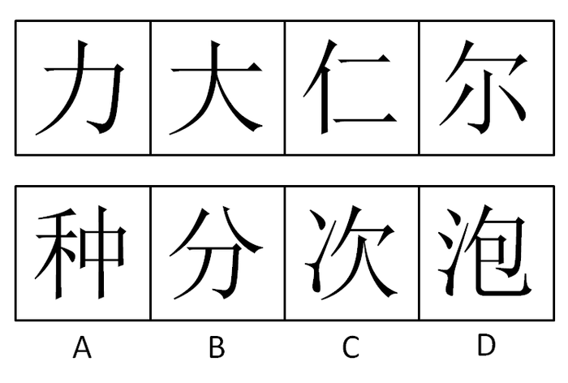

A. A

B. B

C. C

D. D

第 56 题 · 答案与解析

**参考答案（粉笔题库参考内容）**

C

**解析**

数汉字笔画，每个图形中汉字的笔画数依次为2、3、4、5、（6），选项中汉字笔画数量分别为9、4、6、8。

故正确答案为C。

**考点**：数量规律-线、文字/字母/数字类

**来源**：2008年重庆市公务员录用考试《行测》题第56题

### 第 57 题

从所给四个选项中，选择最合适的一个填入问号处，使之呈现一定的规律性：

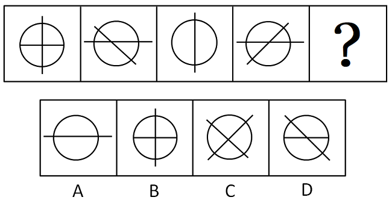

A. A

B. B

C. C

D. D

第 57 题 · 答案与解析

**参考答案（粉笔题库参考内容）**

B

**解析**

元素组成相同，考查位置规律。据观察，长线在已知图形中的的变化规律为每次旋转90度，短线每次旋转45度。

故正确答案为B。

**考点**：位置规律-旋转

**来源**：2008年重庆市公务员录用考试《行测》题第57题

### 第 58 题

从所给四个选项中，选择最合适的一个填入问号处，使之呈现一定的规律性：

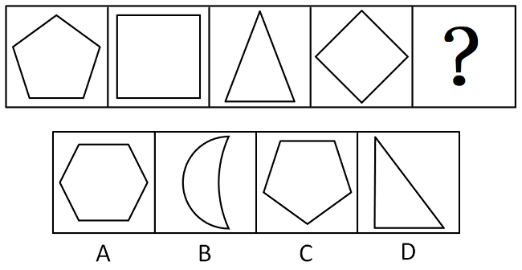

A. A

B. B

C. C

D. D

第 58 题 · 答案与解析

**参考答案（粉笔题库参考内容）**

C

**解析**

数线段，各图形分别由5、4、3、4、（5）条线段组成，呈现线段数量上的对称，选项中的线段数是6、2、5、3 。

故正确答案为C。

**考点**：数量规律-线

**来源**：2008年重庆市公务员录用考试《行测》题第58题

### 第 59 题

左边给定的是正方体的外表面展开图，右边哪一项能由它折叠而成？

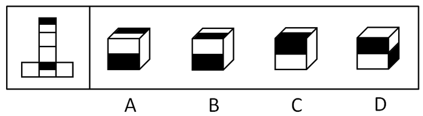

A. A

B. B

C. C

D. D

第 59 题 · 答案与解析

**参考答案（粉笔题库参考内容）**

B

**解析**

本题的突破点是两个不一样的面的位置关系，首先两个带有黑色的面不可能是左右相邻的，排除D；由于两个黑色的部分在平面状态下是同一位置，折叠后黑色部分不可能相接，排除C；两个不一样的面的接触方式应该是一个面的白色部分和另一个面的黑色部分相接。

故正确答案为B。

**考点**：空间类-空间重构-六面体

**来源**：2008年重庆市公务员录用考试《行测》题第59题

### 第 60 题

从所给四个选项中，选择最合适的一个填入问号处，使之呈现一定的规律性：

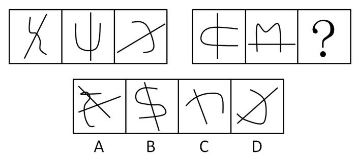

A. A

B. B

C. C

D. D

第 60 题 · 答案与解析

**参考答案（粉笔题库参考内容）**

D

**解析**

图形中直线和曲线的交点数目相同，第一组图均为一个，第二组图均为两个。

故正确答案为D。

**考点**：数量规律-点

**来源**：2008年重庆市公务员录用考试《行测》题第60题

### 第 61 题

从所给四个选项中，选择最合适的一个，使之呈现一定的规律性：

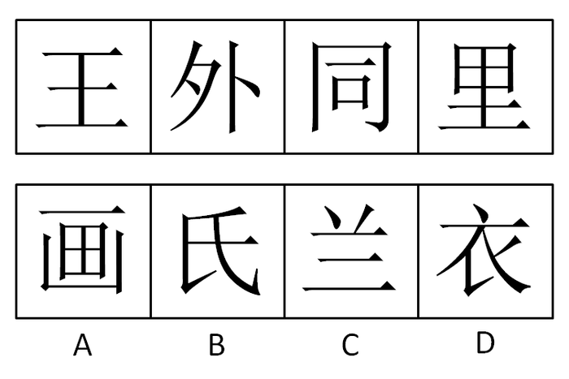

A. A

B. B

C. C

D. D

第 61 题 · 答案与解析

**参考答案（粉笔题库参考内容）**

A

**解析**

题干汉字笔画分别为4、5、6、7，依次递增，故待选文字笔画应为8。选项笔画数分别是8、4、5、6。

故正确答案为A。

**考点**：数量规律-线

**来源**：2008年重庆市公务员录用考试《行测》题第61题

### 第 62 题

从所给四个选项中，选择最合适的一个，使之呈现一定的规律性：

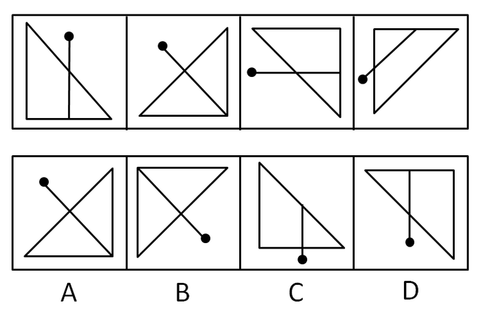

A. A

B. B

C. C

D. D

第 62 题 · 答案与解析

**参考答案（粉笔题库参考内容）**

C

**解析**

元素组成相同，考查位置规律。

图形中两个组成元素分开看，箭头逆时针旋转45度，三角形逆时针旋转90度。

故正确答案为C。

**考点**：位置规律-旋转

**来源**：2008年重庆市公务员录用考试《行测》题第62题

### 第 63 题

从所给四个选项中，选择最合适的一个，使之呈现一定的规律性：

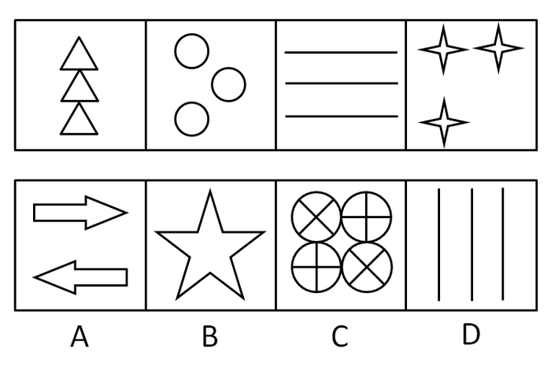

A. A

B. B

C. C

D. D

第 63 题 · 答案与解析

**参考答案（粉笔题库参考内容）**

D

**解析**

本题考查元素数量。

前一串每个图形均包含3个相同的元素，选项中D项也是唯一含有3个相同元素的选项。

故正确答案为D。

**考点**：数量规律-素

**来源**：2008年重庆市公务员录用考试《行测》题第63题

### 第 64 题

从所给四个选项中，选择最合适的一个，使之呈现一定的规律性：

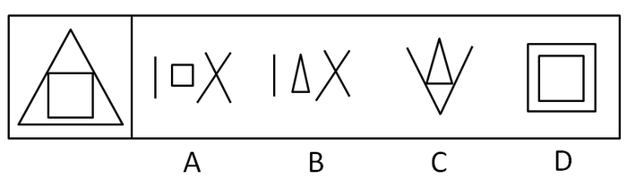

A. A

B. B

C. C

D. D

第 64 题 · 答案与解析

**参考答案（粉笔题库参考内容）**

A

**解析**

本题考查图形拆分。选项中的线条组合可以形成题干。

故正确答案为A。

**来源**：2008年重庆市公务员录用考试《行测》题第64题

### 第 65 题

从所给四个选项中，选择最合适的一个填入问号处，使之呈现一定的规律性：

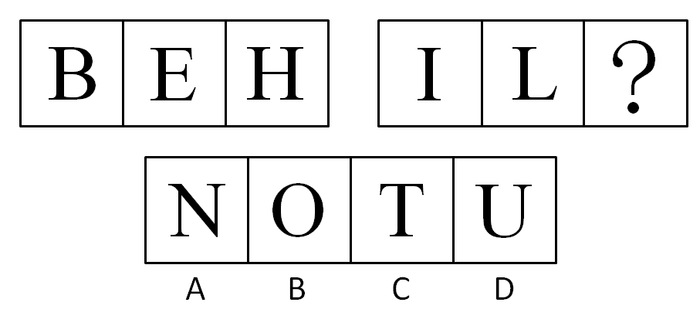

A. A

B. B

C. C

D. D

第 65 题 · 答案与解析

**参考答案（粉笔题库参考内容）**

B

**解析**

根据26个字母顺序，第一组字母的序号是2、5、8，第二组字母的序号就是9、12、（15）。

故正确答案为B。

**考点**：文字/字母/数字类

**来源**：2008年重庆市公务员录用考试《行测》题第65题

### 第 66 题

《读书报》准备推出一种订报有奖的促销活动。如果你订了下半年的《读书报》的话，就可以免费获赠下半年的《广播电视周报》。推出这个活动之后，报社每天都在统计新订户的情况，结果令人非常失望。

以下哪项如果为真，最能够解释这项促销活动没能成功的原因：

A. 根据邮局发行部门统计，《广播电视周报》并不是一份十分有吸引力的报纸

B. 根据一项调查的结果，《读书报》的订户中有些已经同时订了《广播电视周报》

C. 《广播电视周报》的发行渠道很广，订户比《都市青年报》还要多一倍

D. 《读书报》没有考虑很多人的订阅习惯。大多数报刊订户在去年年底已经订了今年一年的《广播电视周报》

第 66 题 · 答案与解析

**参考答案（粉笔题库参考内容）**

D

**解析**

第一步：找到论点和论据。

本题论点是《读书报》的促销活动没能成功，论据是如果你订了下半年的《读书报》的话，就可以免费获赠下半年的《广播电视周报》。

第二步：逐一判断选项的作用。

A、C都与《读书报》无直接关系，属于无关选项；

B是说以往的订户，题干中说的是新订户，已经成为《读书报》的订户不能说明问题；

D项：大多数报刊订户在去年年底已经订了今年一年的《广播电视周报》，解释了免费获赠下半年的《广播电视周报》没有增加新订户的原因，当选。

故正确答案为D。

**考点**：补充论据

**来源**：2008年重庆市公务员录用考试《行测》题第66题

### 第 67 题

孕妇很容易出现维生素缺乏症状，有人认为这不是由于饮食中缺乏维生素造成的，而通常是由于腹内婴儿生长时对维生素的大量需求造成的。

为了评价上述结论的确切程度，以下哪项操作最为重要？

A. 对某个缺乏维生素的孕妇的日常饮食进行检测，确定其中维生素的含量

B. 对某个不缺乏维生素的孕妇的日常饮食进行检测，确定其中维生素的含量

C. 对孕妇的科学食谱进行研究，以确定有利于孕妇摄入足量维生素的最佳食谱

D. 对日常饮食中维生素足量的一个孕妇和一个非孕妇进行检测，并分别确定她们是否缺乏维生素

第 67 题 · 答案与解析

**参考答案（粉笔题库参考内容）**

D

**解析**

第一步：找到论点和论据。

本题论点是“孕妇维生素缺乏症状的原因是婴儿生长时对维生素的大量需求，不是由于饮食中缺乏维生素”，没有论据。

第二步：判断加强方式。

本题只有论点，没有论据，所以需加强论点。

第三步：逐一判断选项的作用。

A调查点在日常饮食，不能判断症状的原因；

B中“不缺乏维生素的孕妇”首先就不满足主体条件；

C说的是怎么解决这个问题，是无关选项；

D两组对象分别是孕妇和非孕妇，其他条件均相同，分别检测她们是否缺乏维生素，实验结果是证明论点的最有力论据，同时可以评价上述结论的确切程度。

故正确答案为D。

**来源**：2008年重庆市公务员录用考试《行测》题第67题

### 第 68 题

有人认为，高水平的睾丸激素荷尔蒙是导致男性心脏病发作的主要原因。不过，这种观点是错误的，因为有心脏病男性的睾丸激素水平一般比没有心脏病的男性低。

上面的论述是基于下列哪一个假设的？

A. 从未患过心脏病的许多男性通常有低水平的睾丸激素

B. 患心脏病不会显著降低男性的睾丸激素的水平

C. 除了睾丸激素以外的荷尔蒙水平显著影响一个人患心脏病的可能性

D. 男性的心脏病和降低睾丸激素是一个相同原因的结果

第 68 题 · 答案与解析

**参考答案（粉笔题库参考内容）**

B

**解析**

第一步：找到论点和论据。

本题论点是“高水平的睾丸激素荷尔蒙不是导致男性心脏病发作的主要原因”，是错误的，论据是“有心脏病男性的睾丸激素水平一般比没有心脏病的男性低”。

第二步：判断加强方式。

本题论点与论据间存在因果关系，所以需加强论点。

第三步：逐一判断选项的作用。

A只说明了没患心脏病的男性，没有对比，不能说明问题；

B说明患有心脏病的男性睾丸激素水平低，而这个低不是心脏病导致的，可能是这些男性的睾丸激素水平在得病前就很低，那么更多的情况是男性的睾丸激素水平低也会有心脏病出现，所以高水平的睾丸激素荷尔蒙不是导致男性心脏病发作的主要原因；

C说的是荷尔蒙，与题干无关；

D说男性的心脏病和降低睾丸激素是一个相同原因的结果，那么男性心脏病的情况和睾丸激素的水平没有直接关系，属于无关选项。

故正确答案为B。

**考点**：必要条件

**来源**：2008年重庆市公务员录用考试《行测》题第68题

### 第 69 题

为了打破过去电影节上只有一部最佳影片的限制，今年的电影节准备按历史片、爱情片等几种专门的类型分别评选最佳影片，这样就可以使电影工作者的工作能够得到更为公平的对待，也可以使观众和电影爱好者对电影的优劣有更多的发言权。

以下哪项假设最可能是上述评比制度改革所隐含的前提？

A. 划分影片类型，对于规范影片拍摄有重要的引导作用

B. 每一部影片都可以按照这几种专门的类型来进行分类

C. 观众和电影爱好者在进行电影评论时喜欢进行类型的划分

D. 按照类型来进行影片的划分，不会使有些冷门题材的影片被忽视

第 69 题 · 答案与解析

**参考答案（粉笔题库参考内容）**

B

**解析**

本题展示的论证过程简略描述是：单一的最佳影片不能保证对电影工作者的公平对待，所以应当依照不同门类产生最佳影片才能保证对电影工作者的公平对待，这里省略了一个重要的前提条件，即这些门类能够包含所有的影片。否则，如果有某些影片不能按照设想的门类分类，那么这些影片将不能参加评比，从而导致了比原先更大的不公平。

故正确答案为B。

**考点**：必要条件

**来源**：2008年重庆市公务员录用考试《行测》题第69题

### 第 70 题

在一次国际会议上，来自四个国家的五位代表被安排坐在一张圆桌。为了使他们能够自由交谈，事先了解到以下情况：甲是中国人，还会说英语；乙是德国人，还会说汉语；丙是英国人，还会说法语；丁是日本人，还会说法语；戊是日本人，还会说德语。

请问如何安排？

A. 甲丙戊乙丁

B. 甲丁丙乙戊

C. 甲乙丙丁戊

D. 甲丙丁戊乙

第 70 题 · 答案与解析

**参考答案（粉笔题库参考内容）**

D

**解析**

第一步：抄信息于表中，即将题干信息放在一个表中。

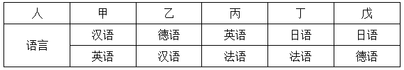

从表格中可以看出，甲和丙或乙、乙和甲或戊、丙和甲或丁、丁和丙或戊、戊和乙或丁一定要坐在一起，由于每个选项均给出完整排列组合情况，所以本题可以采用排除法。

第二步：进行排列组合

A中丙、戊不能自由交谈，A错；

B中甲、丁不能自由交谈，B错；

C中乙、丙不能自由交谈，C错；

故正确答案为D。

**考点**：排除法

**来源**：2008年重庆市公务员录用考试《行测》题第70题

### 第 71 题

网络已经逐步成为求职者获取信息的主要渠道，但也给各种网络诈骗提供了可乘之机。目前网络招聘广告最大的弊病就是缺乏真实性。

因此：

A. 应当避免在网上应聘工作

B. 对网上招聘信息的真实性要持警惕态度

C. 网上的招聘广告都是不可信的

D. 国家应当加强对商业性网站的控制

第 71 题 · 答案与解析

**参考答案（粉笔题库参考内容）**

B

**解析**

第一步：抓住每句话中的对象及其关系。

第一句强调网络求职的利弊，第二句说明网络招聘广告最大的弊病就是缺乏真实性，两句间是因果关系。

第二步：逐一判断选项的作用。

A项：表达绝对化，题干说网络求职缺乏真实性，但是同时不能否认其优点，不能因为有缺点就要避免，错误；

B项：题干说网络招聘广告最大的弊病就是缺乏真实性，所以为了避免受到不利因素的影响，对网上招聘信息的真实性要持警惕态度，正确；

C项：歪曲题意，题干只说由于网络招聘缺乏真实性，给各种网络诈骗提供了可乘之机，但并不说明网上的招聘广告都是不可信的，错误；

D项：题干中并没有提到商业性网站的内容，属于无中生有，干扰性极强，应该仔细审题，错误。

故正确答案为B。

**考点**：日常结论

**来源**：2008年重庆市公务员录用考试《行测》题第71题

### 第 72 题

文学作品离不开现实生活，没有深入体验生活的人是不可能写出优秀作品的。

因此：

A. 诗人、小说家不可能年轻

B. 创作小说都是老人们的事

C. 要创作小说必须有足够的生活经验

D. 创作小说要靠运气

第 72 题 · 答案与解析

**参考答案（粉笔题库参考内容）**

C

**解析**

第一步：翻译题干。

写出优秀的作品→深入体验生活。

第二步：逐一翻译选项并判断选项的正确。利用逆否规则。

A项，诗人、小说家→不可能年轻，年龄和能否写出优秀的作品无关，属于无关选项；

B项，创作小说→老人们的事，年龄和能否写出优秀的作品无关，属于无关选项；

C项，写出优秀的作品→足够的生活经验，和题干中的观点一致；

D项，创作小说→运气，运气和能否写出优秀的作品无关，属于无关选项。

故正确答案为C。

**考点**：常规翻译

**来源**：2008年重庆市公务员录用考试《行测》题第72题

### 第 73 题

根据马克思主义辩证法，内因才是事物发展的根本原因，在于事物内部的矛盾性。任何事物内部都具有矛盾性。

因此：

A. 任何事物都处在不断的运动和发展之中

B. 有一部分事物可以处于静止状态

C. 处于运动和发展中的事物都以同样的速度前进

D. 当一个社会处于封闭状态时，这个社会就是一个静止的社会

第 73 题 · 答案与解析

**参考答案（粉笔题库参考内容）**

A

**解析**

第一步：抓住每句话中的对象及其关系。

第一句强调矛盾是事物发展的原因，第二句说明任何事物内部都具有矛盾性。

第二步：逐一判断选项的作用。

B项：根据题干给出的信息说明任何事物都是发展的，错误；

C项：其中的“速度”题干没有提及，属于无关选项，错误；

D项：其中的“社会处于封闭状态”，不能说明事物内部没有矛盾，也就不能说明社会是一个静止的社会，错误。

故正确答案为A。

**考点**：日常结论

**来源**：2008年重庆市公务员录用考试《行测》题第73题

### 第 74 题

自然界的水因与大气、土壤、岩石等接触，所以含有多种“杂质”，如钙、镁、钾、钠、铁、氟等。现代人趋向于饮用越来越纯净的水，如蒸馏水、纯净水、太空水等。殊不知，长期饮用这种超纯净的水，将不利于健康。

下列选项最能支持上述论断的是：

A. 人们对饮食卫生越注重，人体的健康就会越脆弱

B. 只有未经处理的自然界的水，才符合人体健康的需要

C. 超纯净水之所以大受欢迎，是因为它更加卫生、口感更好

D. 自然界水中的所谓“杂质”，可能是人体必需微量元素的重要来源

第 74 题 · 答案与解析

**参考答案（粉笔题库参考内容）**

D

**解析**

第一步：找到论点和论据。

本题论点是长期饮用超纯净的水，将不利于健康；论据是自然界的水含有多种“杂质”。

第二步：判断加强方式。

论点强调不利于健康，论据强调杂质，所以论点与论据间不存在明显因果关系，需加强论证，在论点和论据间搭桥。

第三步：逐一判断选项的作用。

A项与杂质无直接关系；

B项未经处理的自然界的水，属于无关选项；

C项超纯净水更加卫生、口感更好，属于无关选项；

D项即在不利于健康和杂质间搭桥，自然界水中的所谓“杂质”，可能是人体必需微量元素的重要来源，说明自然界的水中所含的杂质是人体健康的重要因素，进一步说明长期饮用超纯净的水，将不利于健康。

故正确答案为D。

**考点**：搭桥

**来源**：2008年重庆市公务员录用考试《行测》题第74题

### 第 75 题

大家都公认交响乐是高雅音乐，通过对交响乐作家的了解有助于理解交响乐。但你如果不能与之产生真正的共鸣，则会感到乏味。如此下去，你对一个作家的了解当然无从深入。

由此可以推出的是：

A. 只要深入地了解一个作家，就一定能与之产生共鸣

B. 感之愈深，自然爱之愈切

C. 爱之愈切，才越喜爱交响乐

D. 越喜爱交响乐，你就会越喜欢那个作家

第 75 题 · 答案与解析

**参考答案（粉笔题库参考内容）**

A

**解析**

对题干进行翻译：不能共鸣→感到乏味→无法深入了解，根据逆否等价推理可知：深入了解→共鸣，正是A项表达的意思。

故正确答案为A。

**考点**：常规翻译

**来源**：2008年重庆市公务员录用考试《行测》题第75题

### 第 76 题

我国义务教育的本质特征是：

A. 国家强制性

B. 国家免费性

C. 社会普遍性

D. 公民自觉性

第 76 题 · 答案与解析

**参考答案（粉笔题库参考内容）**

A

**解析**

义务教育的国家强制性是它的最本质特征，在我国除义务教育和扫盲教育外，其他任何教育制度都不具备强制性。义务教育在我国不仅是受教育者的权利，也是国家的义务。

故正确答案为A。

**考点**：中国地理

**来源**：2008年重庆市公务员录用考试《行测》题第76题

### 第 77 题

南京大屠杀发生于：

A. 1935年12月13日

B. 1936年12月13日

C. 1937年12月13日

D. 1938年12月13日

第 77 题 · 答案与解析

**参考答案（粉笔题库参考内容）**

C

**解析**

南京大屠杀发生在抗日战争初期的1937年末，侵华日军于12月13日攻陷南京之后展开的屠杀行动。这一时期也是国共二度合作的开始。

故正确答案为C。

**考点**：中国历史

**来源**：2008年重庆市公务员录用考试《行测》题第77题

### 第 78 题

国务院总理温家宝3月5日在十届全国人大五次会议上作政府工作报告时指出，实现今年经济社会发展的目标和任务，必须把握好的政策原则之一是：

A. 更加重视社会发展和改善民生

B. 稳定发展粮食生产

C. 切实提高农业综合生产能力

D. 大力加强农村基础设施建设

第 78 题 · 答案与解析

**参考答案（粉笔题库参考内容）**

A

**解析**

2007年3月5日，国务院总理温家宝在十届全国人大五次会议上作政府工作报告时指出，实现当年经济社会发展的目标和任务，必须把握好五大政策原则：

一是稳定、完善和落实政策；二是加强和改善宏观调控；三是大力提高经济增长质量和效益；四是更加重视社会发展和改善民生；五是以改革开放为动力推进各项工作。粮食生产和农业相关内容并未在此处提到。

故正确答案为A。

**考点**：重要文件

**来源**：2008年重庆市公务员录用考试《行测》题第78题

### 第 79 题

“竹子开花喽，咪咪躺在妈妈的怀里数星星。星星啊星星多美丽，明天的早餐在哪里？请让我来帮助你，就像帮助我自己，这世界会变得更美丽······”这首有关竹子开花的童谣揭示了我国自然保护区面临的一个问题是：

A. 自然保护区不应是自然保护的“孤岛”

B. 应该加快自然保护区的建设进程

C. 自然保护区对保存丰富的自然资源有着特殊作用和重要贡献

D. 自然保护区是实现可持续发展的必要途径

第 79 题 · 答案与解析

**参考答案（粉笔题库参考内容）**

A

**解析**

竹子开花后会成片枯死，大面积竹林开花，会造成很大损失。自然保护区建立后，居民和保护区动植物的接触被严格限制，导致竹林老鞭纵横，最终开花而死。所以自然保护区不应是自然保护的孤岛，不能把自然保护区与周边环境隔绝。绝对保护、禁止一切人为活动，并非最佳手段。人类活动本身也是大自然的一部分，将自然保护区和周边人类活动有机结合，才是最真实的自然。

故正确答案为A。

**考点**：自然地理

**来源**：2008年重庆市公务员录用考试《行测》题第79题

### 第 80 题

构建“社会主义和谐社会”概念的首次完整提出，是在什么会议的《中共中央关于加强党的执政能力建设的决定》中？

A. 十六届一中全会

B. 十六届二中全会

C. 十六届三中全会

D. 十六届四中全会

第 80 题 · 答案与解析

**参考答案（粉笔题库参考内容）**

D

**解析**

《中共中央关于加强党的执政能力建设的决定》是在2004年9月19日中国共产党第十六届中央委员会第四次全体会议中通过的，也正是在此决定中，构建“社会主义和谐社会”的概念被首次完整提出。

故正确答案为D。

**来源**：2008年重庆市公务员录用考试《行测》题第80题

### 第 81 题

在我国的社会保障体系中处于核心部分的是：

A. 社会福利

B. 社会救助

C. 社会保险

D. 优抚安置

第 81 题 · 答案与解析

**参考答案（粉笔题库参考内容）**

C

**解析**

本题考查新思想。

社会保险在社会保障体系中居于核心地位，它是社保体系的重要组成，是实现社会保障的基本纲领。一是社会保险的目的在于保障被给予者基本的生活需要，属于基本性的社会保障；二是社会保险的对象是法定范围内的社会劳动者；三是社会保险的基本特征是补偿劳动者的收入损失；四是社会保险的资金主要来源于用人单位、劳动者依法缴费以及国家资助和社会募集。

故正确答案为C。

**考点**：社会建设

**来源**：2008年重庆市公务员录用考试《行测》题第81题

### 第 82 题

下列法系中对世界法影响最大的是：

A. 印度法系

B. 中华法系

C. 大陆法系

D. 非洲法系

第 82 题 · 答案与解析

**参考答案（粉笔题库参考内容）**

C

**解析**

世界五大法系分别为大陆法系、英美法系、伊斯兰法系、印度法系和中华法系。

印度法系是公元5-7世纪以前古印度奴隶制法和以其为基础的古缅甸、暹罗、锡兰、菲律宾等国法律的统称。当今印度法系已经成为历史名词，但在习惯中有部分遗迹可循。

中华法系是中国古代封建法律和亚洲一些仿效这种法律的国家，如日本、朝鲜等国家法律的总称。它始于秦代，到隋唐时期成熟。清末由于现代司法制度的引入而解体。

大陆法系，又称民法法系、罗马—日尔曼法系或成文法系。在西方法学著作中多称民法法系，它是包括欧洲大陆大部分国家从19世纪初以罗马法为基础建立起来的、以1804年《法国民法典》和1896年《德国民法典》为代表的法律制度以及其他国家或地区效仿这种制度而建立的法律制度，也是西方国家中与英美法系并列的渊源久远和影响较大的法系，C项正确。

D项并不存在，属于干扰项。

故正确答案为C。

**考点**：法理学

**来源**：2008年重庆市公务员录用考试《行测》题第82题

### 第 83 题

用于发布经会议讨论通过并要求贯彻执行的事项的一种下行公文是：

A. 决议

B. 决定

C. 通知

D. 批复

第 83 题 · 答案与解析

**参考答案（粉笔题库参考内容）**

A

**解析**

根据《党政机关公文处理工作条例》第八条规定：决议，适用于会议讨论通过的重大决策事项。

具体说来，此处也考查了决议和决定的异同点。

决议“适用于会议讨论通过的重大决策事项”；决定“适用于对重要事项作出决策部署、奖惩有关单位和人员、变更或撤销下级机关不适当的决定事项”。具体来说，决议和决定的文体性质相同、它们都是决策指导性公文，再者，它们都属于下行公文，属于上对下的指导。

但决议和决定的制作程序不同，决议必须产生于会议，它所贯彻的决策事项，是会议集体讨论通过的，而决定不然，有的是会议产生的，有的是表决结果，有的也可能是领导机关直接作出的。

两者性质用途也不同。决议内容多是比较重大关系全局的事项，宏观、原则性强。此外，决议比决定使用范围相对窄一些，决议一般由会议讨论通过并正式公布，事关重大。决定使用范围较宽，不限于会议通过，也可以是某个单位、组织或个人决定的。

故正确答案为A。

**来源**：2008年重庆市公务员录用考试《行测》题第83题

### 第 84 题

邓小平坚持马克思主义的思想路线，把“解放思想”和“实事求是”联系起来表述，更鲜明地体现了马克思主义思想体系的开放性，体现了它的什么的统一？

A. 科学性、理论性和实践性

B. 科学性、理论性和革命性

C. 理论性、实践性和革命性

D. 实践性、科学性和革命性

第 84 题 · 答案与解析

**参考答案（粉笔题库参考内容）**

D

**解析**

实践性、革命性和科学性的统一是马克思主义哲学的根本特征。

同时，邓小平对实事求是思想路线的贡献主要表现为：从世界观和方法论的统一上升华了“实事求是”；率先倡导重新确立了党的实事求是的思想路线；把实事求是的思想路线上升为一个完整的系统；提出并论证了实事求是与解放思想的辩证统一；阐明了思想路线同政治路线、组织路线的关系；强调了实事求是的思想路线与群众路线的统一；坚持了系统的实事求是的思想方法和工作方法；身体力行，为全党树立了坚持实事求是的榜样。

故正确答案为D。

**考点**：哲学-其他

**来源**：2008年重庆市公务员录用考试《行测》题第84题

### 第 85 题

下列权利中属于法人应该享有的权利是：

A. 生命健康权

B. 亲权

C. 肖像权

D. 商标权

第 85 题 · 答案与解析

**参考答案（粉笔题库参考内容）**

D

**解析**

法人是具有民事权利能力和民事行为能力，依法独立享有民事权利和承担民事义务的组织。简言之，法人是具有民事权利主体资格的社会组织，不是指具体的个体。故其享有的权利不包括生命健康权、亲权、肖像权。

故正确答案为D。

**考点**：民法典

**来源**：2008年湖北省公务员录用考试《行测》题（B类）第108题

## 材料 2

以下是2006年农村实用人才现状：从区域分布看，我国东部地区231.4万人、中部地区201.7万人、西部地区145.9万人。从年龄分布看，40岁以下的247.9万人。从学历看，中专以上的22.7万人。

        农村实用人才中，生产能手占总数的56.7%，经营能人占27.8%，能工巧匠占15.5%。其中，农民高级技师1.5万人，农民技师7万人，农民助理技师6.5万人，农民技术员35.3万人。

### 第 86 题

2006年我国农村实用人才中，东部地区人数占总人数的：

A. 40%

B. 34.8%

C. 42.8%

D. 25.2%

第 86 题 · 答案与解析

**参考答案（粉笔题库参考内容）**

A

**解析**

根据题干“2006年······占······的”，结合选项为百分数，可判定本题为现期比重计算问题。定位文字材料第一段“以下是2006年农村实用人才现状：从区域分布看，我国东部地区231.4万人、中部地区201.7万人、西部地区145.9万人”可知，东部地区所占比重为231.4/(231.4 + 201.7 + 145.9)≈231.4/580≈40%。

故正确答案为A。

**考点**：文字资料、现期比重

**来源**：2008年重庆市公务员录用考试《行测》题第86题

### 第 87 题

2006年我国农村实用人才中，学历在中专以下人数和中专以上人数的比例约为：

A. 33:1

B. 25:1

C. 29:1

D. 27:1

第 87 题 · 答案与解析

**参考答案（粉笔题库参考内容）**

B

**解析**

根据题干“2006年······和······的比例约为”，可判定本题为比值计算问题。定位文字材料第一段“以下是2006年农村实用人才现状：从区域分布看，我国东部地区231.4万人、中部地区201.7万人、西部地区145.9万人。······从学历看，中专以上的22.7万人”可知，2006年农村实用人才总人数为231.4+201.7+145.9=579万人，中专以下学历的为579-22.7=556.3万人，所求比值为556.3 : 22.7 ≈ 24.5 : 1，与B项最接近。

故正确答案为B。

**考点**：文字资料、比值计算

**来源**：2008年重庆市公务员录用考试《行测》题第87题

### 第 88 题

2006年我国农村实用人才中，生产能手的人数比经营能人多多少万人？

A. 177.3

B. 184.6

C. 167.3

D. 198.2

第 88 题 · 答案与解析

**参考答案（粉笔题库参考内容）**

C

**解析**

根据题干“2006年我国农村实用人才中，生产能手的人数比经营能人多多少万人”，结合材料给出全部实用人才及各类能人占比，可判定本题为现期比重计算问题。根据本篇资料第2题计算可知，2006年农村实用人才总人数为579万人；定位文字材料第二段“农村实用人才中，生产能手占总数的56.7%，经营能人占27.8%”可知，生产能手的人数比经营能人多= 579 × (56.7% − 27.8%)= 579 × 28.9% =579×(30%-1.1%)≈ 173.7-6.37 = 167.33万人，与C项最接近。

故正确答案为C。

**考点**：文字资料、现期比重

**来源**：2008年重庆市公务员录用考试《行测》题第88题

### 第 89 题

2006年我国农村实用人才中，能工巧匠有多少万人？

A. 90

B. 89.5

C. 89.7

D. 89.8

第 89 题 · 答案与解析

**参考答案（粉笔题库参考内容）**

C

**解析**

根据题干“2006年我国农村实用人才中，能工巧匠有多少万人”，结合材料给出全部实用人才及各类能人占比，可判定本题为现期比重计算问题。根据本篇资料第2题计算可知，2006年农村实用人才总人数为579万人；定位文字材料第二段“农村实用人才中，生产能手占总数的56.7%，经营能人占27.8%，能工巧匠占15.5%”可知，能工巧匠共有579 × 15.5% =579 × (10% + 5% + 0.5%)= 57.9 + 28.95 +2.895=89.745万人，与C项最接近。

故正确答案为C。

**考点**：文字资料、现期比重

**来源**：2008年重庆市公务员录用考试《行测》题第89题

### 第 90 题

上述材料中不能推出的是：

A. 2006年我国农村实用人才中，年龄在40岁以上的人占总人口的57.2%

B. 2006年我国农村实用人才中，从区域分布看东部的人数最多

C. 2006年我国农村实用人才中，中专以上学历的人不到5%

D. 在我国农村实用人才中，能工巧匠指的是农民高级技术师、农民技师、农民助理、农民助理技师和农民技术员

第 90 题 · 答案与解析

**参考答案（粉笔题库参考内容）**

D

**解析**

A项：根据本篇资料第2题可知，2006年农村实用人才总人数为579万人；定位文字材料第一段“从年龄分布看，40岁以下的247.9万人”可知，40岁以上人员占比为1 − 247.9/579 ≈ 1 −42.8%=57.2%，正确；

B项：定位文字材料第一段“从区域分布看，我国东部地区231.4万人、中部地区201.7万人、西部地区145.9万人”可知，东部的人数最多，正确；

C项：根据本篇资料第2题可知，2006年农村实用人才总人数为579万人；定位文字材料第一段“从学历看，中专以上的22.7万人”可知，中专以上占比为22.7/579≈4%＜5%，正确；

D项：根据材料可知，在我国农村实用人才中，生产能手、经营能人、能工巧匠中包括农民高级技术师、农民技师、农民助理技师和农民技术员，而非单指能工巧匠，错误。

本题为选非题，故正确答案为D。

**考点**：文字资料、综合分析

**来源**：2008年重庆市公务员录用考试《行测》题第90题

## 材料 3

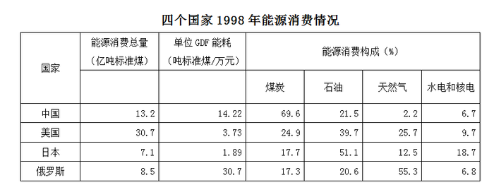

| 国家 | 能源消费总量（亿吨标准煤） | 单位 GDF 能耗（吨标准煤/万元） | 能源消费构成（%） 煤炭 | 能源消费构成（%） 石油 | 能源消费构成（%） 天然气 | 能源消费构成（%） 水电和核电 |
| --- | ---: | ---: | ---: | ---: | ---: | ---: |
| 中国 | 13.2 | 14.22 | 69.6 | 21.5 | 2.2 | 6.7 |
| 美国 | 30.7 | 3.73 | 24.9 | 39.7 | 25.7 | 9.7 |
| 日本 | 7.1 | 1.89 | 17.7 | 51.1 | 12.5 | 18.7 |
| 俄罗斯 | 8.5 | 30.7 | 17.3 | 20.6 | 55.3 | 6.8 |

### 第 91 题

列表数据表明：

A. 中国的能源消费以煤为主，核电消费量最大

B. 美国矿物能源消费构成较均衡，石油消费量最大

C. 日本以石油为主，石油消费量在四国中居首位

D. 俄罗斯以天然气为主，天然气消费量在四国中居首位

第 91 题 · 答案与解析

**参考答案（粉笔题库参考内容）**

B

**解析**

A项：定位表格可知，中国能源消费以煤为主，且煤炭消费量最大，错误；

B项：定位表格可知，美国矿物能源消费构成较均衡，且石油消费量最大，正确；

C项：定位表格可知，日本能源消费以石油为主，但石油消费量在四国中并不居首位，错误；

D项：定位表格可知，俄罗斯能源消费以天然气为主，但天然气消费量在四国中不居首位，错误。

故正确答案为B。

**考点**：统计表、综合分析

**来源**：2008年重庆市公务员录用考试《行测》题第91题

### 第 92 题

美国1998年消费煤炭总量为多少万吨？

A. 85723

B. 91503

C. 76443

D. 101163

第 92 题 · 答案与解析

**参考答案（粉笔题库参考内容）**

C

**解析**

根据题干“美国1998年消费煤炭总量为多少万吨”，结合材料给出各国能源消费总量及各项占比，可判定本题为现期比重计算问题。定位统计表可得，1998年美国能源消费总量为30.7亿吨，其中煤炭占的比例为24.9%，则煤炭消费总量为30.7 × 24.9% ≈30.7 × 25%亿吨≈77000万吨，与C项最接近。

故正确答案为C。

**考点**：现期比重、统计表

**来源**：2008年重庆市公务员录用考试《行测》题第92题

### 第 93 题

1998年，下列四个国家中，哪个国家水电和核电消费量最小？

A. 中国

B. 美国

C. 日本

D. 俄罗斯

第 93 题 · 答案与解析

**参考答案（粉笔题库参考内容）**

D

**解析**

根据题干“哪个国家水电和核电消费量最小”，结合材料给出各国能源消费总量及水电和核电占比，可判定本题为现期比重计算问题。定位统计表可得，1998年中国水电和核电消费量为13.2×6.7%≈13.2 × 1/15 = 0.88亿吨；美国为30.7 × 9.7% ≈30.7×10%=3.07亿吨；日本为7.1×18.7%≈7.1×1/5.5≈1.29亿吨；俄罗斯为8.5 × 6.8% ≈8.5×7% ≈ 0.6亿吨。比较可知，俄罗斯的水电和核电消费量最小。

故正确答案为D。

**考点**：现期比重、统计表

**来源**：2008年重庆市公务员录用考试《行测》题第93题

### 第 94 题

1998年，下列四个国家中，哪个国家石油消费量最小？

A. 中国

B. 美国

C. 日本

D. 俄罗斯

第 94 题 · 答案与解析

**参考答案（粉笔题库参考内容）**

D

**解析**

根据题干“哪个国家石油消费量最小”，结合材料给出各国能源消费总量及石油占比，可判定本题为现期比重计算问题。定位统计表可得，1998年中国石油消费量为13.2×21.5%≈13.2×0.22≈2.9亿吨；美国为30.7×39.7%≈30.7×0.4≈12亿吨；日本为7.1 × 51.1% ≈7.1×1/2 = 3.55亿吨；俄罗斯为8.5 × 20.6% ≈8.5 × 1/5 = 1.7亿吨。比较可知，俄罗斯的石油消费量最小。

故正确答案为D。

**考点**：现期比重、统计表

**来源**：2008年重庆市公务员录用考试《行测》题第94题

### 第 95 题

1998年，上面四个国家天然气消费总量为多少亿吨：

A. 12.7391

B. 13.7683

C. 15.6492

D. 13.8247

第 95 题 · 答案与解析

**参考答案（粉笔题库参考内容）**

B

**解析**

根据题干“上面四个国家天然气消费总量为多少亿吨”，结合材料给出各国能源消费总量及天然气占比，可判定本题为现期比重计算问题。定位统计表可得，1998年表中四个国家天然气消费总量=13.2×2.2%+30.7×25.7%+7.1×12.5%+8.5 × 55.3% ≈13.2 × 2/90 +30.7 × 1/4 + 7.1 × 1/8+8.5 × 5/9 ≈ 0.29+7.7 + 0.89 + 4.72 = 13.6亿吨，与B项最接近。

故正确答案为B。

**考点**：现期比重、统计表

**来源**：2008年重庆市公务员录用考试《行测》题第95题

## 材料 4

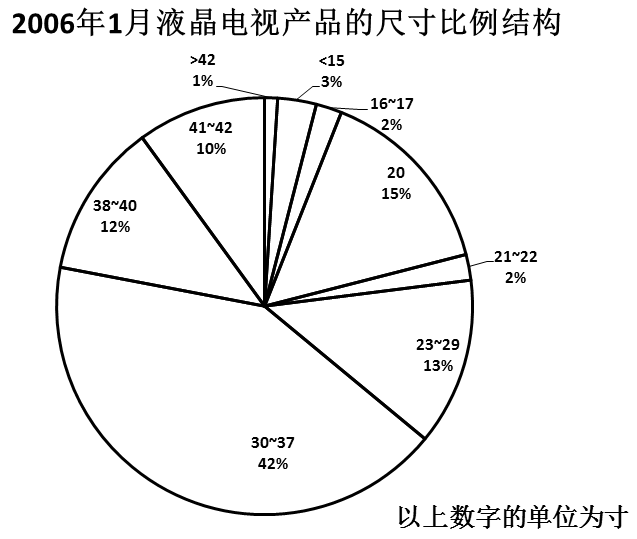

### 第 96 题

以上所列的各个尺寸的液晶电视的市场占有率中，尺寸为20寸的排名第几？

A. 第二

B. 第三

C. 第四

D. 第五

第 96 题 · 答案与解析

**参考答案（粉笔题库参考内容）**

A

**解析**

定位饼状图可得，尺寸为20寸的液晶电视市场占有率排名第二。

故正确答案为A。

**考点**：直接找数、统计图

**来源**：2008年重庆市公务员录用考试《行测》题第96题

### 第 97 题

市场占有率前三的尺寸的液晶电视占整个市场的：

A. 60%

B. 70%

C. 69%

D. 67%

第 97 题 · 答案与解析

**参考答案（粉笔题库参考内容）**

B

**解析**

定位饼状图可得，市场占有率前三的尺寸的液晶电视依次为30～37寸、20寸、23～29寸，市场占有率分别为42%、15%、13%，占比之和为42%+15%+13%=70%。

故正确答案为B。

**考点**：简单加减计算、统计图

**来源**：2008年重庆市公务员录用考试《行测》题第97题

### 第 98 题

尺寸为20寸的液晶电视的市场占有率约是尺寸为16~17寸的液晶电视市场占有率的多少倍？

A. 7.5

B. 7

C. 15

D. 5

第 98 题 · 答案与解析

**参考答案（粉笔题库参考内容）**

A

**解析**

根据题干“······约是······的多少倍”，可判定本题为现期倍数计算问题。定位饼状图可得，尺寸为20寸的液晶电视的市场占有率为15%，16～17寸的液晶电视的市场占有率为2%，所求倍数为15%/2% = 7.5倍。

故正确答案为A。

**考点**：现期倍数、统计图

**来源**：2008年重庆市公务员录用考试《行测》题第98题

### 第 99 题

在液晶电视机中主导地位的产品的尺寸是多少寸？

A. 23~29

B. 20

C. 30~37

D. &lt;15

第 99 题 · 答案与解析

**参考答案（粉笔题库参考内容）**

C

**解析**

定位饼状图可知，市场占有率最高的为30～37寸的液晶电视，则在液晶电视机中主导地位的产品的尺寸是30～37寸。

故正确答案为C。

**考点**：直接找数、统计图

**来源**：2008年重庆市公务员录用考试《行测》题第99题

### 第 100 题

下列推论中最缺乏根据的是：

A. 液晶电视机的多数产品还是集中在30～37寸产品上

B. 大于37寸的产品，由于等离子电视机的竞争，很难取得优势

C. 低于30寸的产品，又在与显像管电视机的争夺中处于劣势

D. 30～37寸液晶电视机是目前电视机市场上的主力产品

第 100 题 · 答案与解析

**参考答案（粉笔题库参考内容）**

D

**解析**

A项：定位饼状图可得，30～37寸液晶电视占比最高，市场占有率接近一半，正确；

B项：定位饼状图可得，大于37寸的产品市场占有率为12%+10%+1%=23%，占比较低，正确；

C项：定位饼状图可得，低于30寸的产品市场占有率为3%+2%+15%+2%+13%=35%，则30寸及以上产品市场占有率为1-35%=65%，30寸以下产品占比低于30寸以上产品，正确；

D项：根据饼状图仅能得出30～37寸液晶电视机是液晶电视机市场的主力产品，而不是整个电视机市场的主力产品，错误。

本题为选非题，故正确答案为D。

**考点**：统计图、综合分析

**来源**：2008年重庆市公务员录用考试《行测》题第100题

