# 2013年重庆市公务员录用考试《行测》题（下半年）（网友回忆版）

<!-- gwy:overview:start -->
> **重庆 · 2013 · 行测 · 统考** ｜ 120 题 · 图片 76 处 · 答案随题折叠

| 题型模块 | 题量 | 题号 |
| --- | ---: | ---: |
| 常识判断 | 20 | 1–20 |
| 言语理解与表达 | 30 | 21–50 |
| 数量关系 | 15 | 51–65 |
| 判断推理 | 35 | 66–100 |
| 资料分析 | 20 | 101–120 |
| **合计** | **120** | |

导航：[题型与作答说明](#题型与作答说明) · [题目](#题目) · [材料 1](#材料-1)
<!-- gwy:overview:end -->

> 候选采集稿。参考答案及解析来自粉笔页面，不代表官方答案或真实高分答卷；来源使用许可与原卷对应关系仍需人工核实。

## 题型与作答说明

常识判断

（20题）

根据题目要求，在四个选项中选出一个最恰当的答案。

言语理解与表达

（30题）

本部分包括表达与理解两方面的内容。请根据题目要求，在四个选项中选出一个最恰当的答案。

数量关系

（15题）

在这部分试题中，每道题呈现一段表述数字关系的文字，要求你迅速、准确地计算出答案。

判断推理

（35题）

本部分包括图形推理、定义判断、类比推理与逻辑判断四种类型的试题，在四个选项中选出一个最恰当的答案。

资料分析

（20题）

所给出的图、表、文字或综合性资料均有若干个问题要你回答。你应根据资料提供的信息进行分析、比较、计算和判断处理。

## 题目

### 第 1 题

近年来我国载人航天事业迅速发展，下列说法不正确的是：

A. 我国第一次载人航天飞行是由神舟五号完成的

B. 我国第一次舱外行走是由神舟七号实现的

C. 天宫一号与神舟十号飞船完成了首次载人空间交会对接任务

D. 我国第一位女宇航员是由神舟九号搭载的

第 1 题 · 答案与解析

**参考答案（粉笔题库参考内容）**

C

**解析**

本题考查科技常识。

A项正确，神舟五号是中国载人航天工程发射的第五艘飞船，也是中华人民共和国发射的第一艘载人航天飞船。神舟五号飞船搭载航天员杨利伟于北京时间2003年10月15日9时整在酒泉卫星发射中心发射，在轨运行14圈，历时21小时23分，其返回舱于北京时间2003年10月16日6时23分返回内蒙古主着陆场。

B项正确，神舟七号是中国载人航天工程发射的第七艘飞船，是中国的第三次载人航天飞行任务，于2008年9月25日发射升空，进入预定轨道，2008年9月27日航天员翟志刚进行出舱活动，完成中国人首次太空行走。

C项错误，神舟十号是中国载人航天工程发射的第十艘飞船，也是中国的第五次载人航天飞行任务，于2013年6月11日发射升空并进入预定轨道，2013年6月23日与天宫一号目标飞行器实现交会对接。天宫一号与神舟九号飞船完成了首次载人空间交会对接任务。

D项正确，神舟九号是中国载人航天工程发射的第九艘飞船，是中国的第四次载人航天飞行任务，也是中国首次载人空间交会对接任务，于2012年6月16日发射升空，进入预定轨道，2012年6月18日与天宫一号完成自动交会对接工作。神州九号飞行乘组由景海鹏、刘旺、刘洋组成，其中刘洋是我国第一位女航天员。

本题为选非题，故正确答案为C。

**考点**：科技理论与成就

**来源**：2013年重庆市公务员录用考试《行测》题（下半年）（网友回忆版）第1题

### 第 2 题

关于中国工农红军长征，下列表述不正确的是：

A. 朱德、彭德怀、陈毅参加过红军长征

B. 中央红军长征经过贵州、甘肃等十余个省

C. 六盘山是红军长征途中翻越的最后一座大山

D. 飞夺泸定桥是发生在长征中的一次战役

第 2 题 · 答案与解析

**参考答案（粉笔题库参考内容）**

A

**解析**

本题考查毛中特。

A项错误，红军长征的领导人有毛泽东、周恩来、朱德、彭德怀、张闻天等。陈毅没有参加长征，而是在红军开始长征后，留在江西苏区，领导了南方三年游击战争。

B项正确，红军长征经过了福建、江西、广东、湖南、广西、贵州、四川、云南、西康、甘肃、陕西共十一个省。

C项正确，中国工农红军在毛泽东指挥下，于1935年10月7日一鼓作气翻越了六盘山。之后，于10月19日到达陕北保安县吴起镇与陕北红军胜利会师，完成了震惊世界的二万五千里长征。六盘山是红军长征途中翻越的最后一座大山。毛泽东慷慨激昂地写下气势磅礴的词章《清平乐·六盘山》。

D项正确，飞夺泸定桥是中国工农红军长征中的一场重要战役，发生于1935年5月29日。中央红军部队在四川省中西部强渡大渡河成功，沿大渡河东岸北上，主力由安顺场沿大渡河西岸北上，红四团战士在天下大雨的情况下，在崎岖陡峭的山路上跑步前进，一昼夜奔袭竟达240里，在5月29日凌晨6时许按时到达泸定桥西岸。第2连连长和22名突击队员沿着枪林弹雨和火墙密布的铁索踩着铁链夺下桥头，并与东岸部队合围占领了泸定桥。

本题为选非题，故正确答案为A。

**考点**：党的历史

**来源**：2013年重庆市公务员录用考试《行测》题（下半年）（网友回忆版）第2题

### 第 3 题

甲现任某市环保局局长，根据公务员法的规定，与之不存在任职回避的亲属是：

A. 甲的妻子

B. 甲的养女

C. 甲堂兄的儿子

D. 甲的儿媳

第 3 题 · 答案与解析

**参考答案（粉笔题库参考内容）**

C

**解析**

本题考查法律常识。

根据《公务员法》第七十四条第一款规定：“公务员之间有夫妻关系、直系血亲关系、三代以内旁系血亲关系以及近姻亲关系的，不得在同一机关双方直接隶属于同一领导人员的职位或者有直接上下级领导关系的职位工作，也不得在其中一方担任领导职务的机关从事组织、人事、纪检、监察、审计和财务工作。”

A项错误，甲的妻子与甲是夫妻关系，需要回避。

B项错误，根据《民法典》第一千一百一十一条规定：“自收养关系成立之日起，养父母与养子女间的权利义务关系，适用本法关于父母子女关系的规定；养子女与养父母的近亲属间的权利义务关系，适用本法关于子女与父母的近亲属关系的规定。养子女与生父母以及其他近亲属间的权利义务关系，因收养关系的成立而消除。”甲的养女虽不是甲亲生，但与甲属于法律拟制的直系血亲关系，需要回避。

C项正确，甲堂兄的儿子不属于应当回避的情形，无需回避。

D项错误，根据《公务员回避规定》第五条第一款第四项规定：“（四）近姻亲关系，包括配偶的父母、配偶的兄弟姐妹及其配偶、子女的配偶及子女配偶的父母、三代以内旁系血亲的配偶。”甲的儿媳与甲是近姻亲关系，需要回避。

故正确答案为C。

**考点**：行政法

**来源**：2013年重庆市公务员录用考试《行测》题（下半年）（网友回忆版）第3题

### 第 4 题

下列经营者的行为中，为我国法律所允许的是：

A. 甲药品公司称，其生产的保健品可以将人的寿命延长至少十年

B. 乙服装厂在春节前以低于成本的价格销售积压的库存服装

C. 丙品牌专卖店为鼓励消费者消费，进行抽奖式的有奖销售，最高奖的金额高达6666元

D. 丁广告公司获知某制药厂一款镇痛药品的成分仅为淀粉后拒绝为该药品设计广告，但同意帮助发布该厂自己设计的广告

第 4 题 · 答案与解析

**参考答案（粉笔题库参考内容）**

BC

**解析**

本题考查法律常识。

A项错误，根据《中华人民共和国广告法》第十八条第一款规定：“保健食品广告不得含有下列内容：（一）表示功效、安全性的断言或者保证；······”甲药品公司称其生产的保健品可以将人的寿命延长至少十年，属于表示功效的断言，是保健食品广告所禁止的，不符合法律规定。

B项正确，根据《中华人民共和国价格法》第十四条规定：“经营者不得有下列不正当价格行为：······（二）在依法降价处理鲜活商品、季节性商品、积压商品等商品外，为了排挤竞争对手或者独占市场，以低于成本的价格倾销，扰乱正常的生产经营秩序，损害国家利益或者其他经营者的合法权益；······”乙服装厂在春节前以低于成本的价格销售积压的库存服装不属于低价倾销的不正当价格行为，符合法律规定。

C项正确，根据《中华人民共和国反不正当竞争法》第十条规定：“经营者进行有奖销售不得存在下列情形：······（三）抽奖式的有奖销售，最高奖的金额超过五万元。”丙品牌专卖店的进行抽奖式的有奖销售，最高金额6666元，符合法律规定。

D项错误，根据《中华人民共和国广告法》第四条第一款规定：“广告不得含有虚假或者引人误解的内容，不得欺骗、误导消费者。”　第二十八条规定：“广告以虚假或者引人误解的内容欺骗、误导消费者的，构成虚假广告。广告有下列情形之一的，为虚假广告：（一）商品或者服务不存在的；······”某制药厂一款镇痛药品的成分仅为淀粉，为其制作的广告属于虚假广告，丁广告公司仍为其发布广告，不符合法律规定。

故正确答案为BC。

**考点**：其他法律法规

**来源**：2013年重庆市公务员录用考试《行测》题（下半年）（网友回忆版）第4题

### 第 5 题

甲意图到乙家中行窃，晚上趁乙熟睡翻窗进入乙家中，正欲盗窃屋内物品时被乙发现并抓获，甲的行为属于：

A. 犯罪未遂

B. 犯罪既遂

C. 犯罪中止

D. 犯罪预备

第 5 题 · 答案与解析

**参考答案（粉笔题库参考内容）**

A

**解析**

本题考查法律常识。

A项正确，B、C、D三项错误，根据《中华人民共和国刑法》第二十三条第一款规定：“已经着手实行犯罪，由于犯罪分子意志以外的原因而未得逞的，是犯罪未遂。”甲意图到乙家中行窃，并已翻窗进入乙家中，此时甲已经着手实行犯罪，但因为被乙发现而停止犯罪，属于意志以外的原因，构成盗窃罪的犯罪未遂。

故正确答案为A。

**考点**：刑法

**来源**：2013年重庆市公务员录用考试《行测》题（下半年）（网友回忆版）第5题

### 第 6 题

关于我国的人口现状，下列说法不正确的是（    ）。

A. 目前我国已完成第六次人口普查

B. 农村常住人口多于城镇常住人口

C. 我国的老年人口数量已超过一亿

D. 我国出生人口性别比明显高于国际公认的正常范围

第 6 题 · 答案与解析

**参考答案（粉笔题库参考内容）**

B

**解析**

本题考查政治常识。

A项正确，第六次人口普查是指第六次有关全国人口信息的调查，于2010年开展，2011年4月完成。

B项错误，2011年，中国城镇人口达到6.91亿，城镇化率首次突破50%关口，达到了51.27%，城镇常住人口超过了农村常住人口，这表明中国已经结束了以乡村型社会为主体的时代，开始进入到以城市型社会为主体的新的城市时代。

C项正确，《中国老龄事业发展报告（2013）》于2013年2月27日在北京发布。该报告指出，截至2012年底，中国老年人口数量达到1.94亿，比上年增加891万，占总人口的14.3％。

D项正确，联合国将出生人口性别比的正常值设定为103—107：100（即每出生100个女孩，相应出生103—107个男孩），其他值域则被视为异常。20世纪80年代中期以来，中国出生人口性别比偏离正常值且不断升高，2004年达到最高峰121.18，2008年后连续小幅下降，2015年卫计委指出，中国是世界上出生人口性别结构失衡最严重、持续时间最长、波及人口最多的国家。2019年中国出生人口性别比为110.14，仍然高于国际公认的正常范围。

本题为选非题，故正确答案为B。

**考点**：社会建设、重要事件

**来源**：2013年重庆市公务员录用考试《行测》题（下半年）（网友回忆版）第6题

### 第 7 题

关于三沙市，下列说法不正确的是：

A. 为地级市，隶属于广东省

B. 是我国面积最大，人口最少的地级市

C. 其人民政府驻地位于永兴岛

D. 管辖西沙群岛、中沙群岛、南沙群岛的岛礁及其海域

第 7 题 · 答案与解析

**参考答案（粉笔题库参考内容）**

A

**解析**

本题考查地理国情。

A项错误，D项正确，三沙市是海南省地级市，地处中国南海中南部，海南省南部，管辖西沙群岛、中沙群岛、南沙群岛的岛礁及其海域。

B项正确，三沙市是中国最南端的地级行政区，陆地面积20多平方公里，陆海面积200多万平方公里。根据第七次人口普查数据，截至2020年11月1日零时，三沙市常住人口为2333人。三沙市是全国总面积最大、陆地面积最小、人口最少的城市。

C项正确，三沙市设有西沙区、南沙区，管辖10个社区。市人民政府驻地西沙区永兴岛。

本题为选非题，故正确答案为A。

**考点**：中国地理

**来源**：2013年重庆市公务员录用考试《行测》题（下半年）（网友回忆版）第7题

### 第 8 题

战国时期的墓葬中不可能出土：

A. 简牍

B. 漆器

C. 铁制农具

D. 宣纸

第 8 题 · 答案与解析

**参考答案（粉笔题库参考内容）**

D

**解析**

本题考查人文常识。

A项正确，简牍，中国古代书写用的竹简和木片，在纸发明以前，简牍是中国书籍的最主要形式。根据《尚书·多士》：“惟殷先人，有册有典”的记载，可以看出早在商代，人们已利用竹木制简，用绳编连成册。到了战国时期，竹简的使用变得十分广泛。战国时期的墓葬可能出土简牍。

B项正确，漆器指涂漆的器物。生漆是从漆树割取的天然液汁，主要由漆酚、漆酶、树胶质及水分构成。中国从新石器时代起就认识了漆的性能并用以制器。战国时期的墓葬可能出土漆器。

C项正确，春秋战国时期，随着冶炼铁业的兴起，中国农具史上出现一次大的变革，铁制农具代替了木、石等材料的农具，从而使农业生产力发生了质的飞跃。战国时期的墓葬可能出土铁制农具。

D项错误，宣纸是安徽省宣城市所出产的书画用纸。史籍对宣纸的记载，最早见于唐。唐乾符年间，书画评论家张彦远著《历代名画泪》中云：“好事家宜置宣纸百幅；用法腊之，以备摹写。”因此战国时期的墓葬不可能出土宣纸。

本题为选非题，故正确答案为D。

**考点**：中国历史

**来源**：2013年重庆市公务员录用考试《行测》题（下半年）（网友回忆版）第8题

### 第 9 题

下列诗句与作者的对应，不正确的是：

A. 欲穷千里目，更上一层楼——王之涣

B. 庄生晓梦迷蝴蝶，望帝春心托杜鹃——李商隐

C. 红豆生南国，春来发几枝——李白

D. 无边落木萧萧下，不尽长江滚滚来——杜甫

第 9 题 · 答案与解析

**参考答案（粉笔题库参考内容）**

C

**解析**

本题考查人文常识。

A项正确，“欲穷千里目，更上一层楼”出自唐代王之涣的《登鹳雀楼》，意思是要想看到无穷无尽的美丽景色，应当再登上一层楼。比喻想要取得更大的成功，就要付出更多的努力。

B项正确，“庄生晓梦迷蝴蝶，望帝春心托杜鹃”出自唐代李商隐的《锦瑟》，意思是庄周翩翩起舞睡梦中化为蝴蝶，望帝把自己的幽恨托身于杜鹃。

C项错误，“红豆生南国，春来发几枝”出自唐代王维的《相思》，又名《江上赠李龟年》，意思是红豆树生长在南方，春天到了它将生出多少新枝呢？

D项正确，“无边落木萧萧下，不尽长江滚滚来”出自唐代杜甫的《登高》，意思是无边无际的树木萧萧地飘下落叶，望不到头的长江水滚滚奔腾而来。

本题为选非题，故正确答案为C。

**考点**：文学常识

**来源**：2013年重庆市公务员录用考试《行测》题（下半年）（网友回忆版）第9题

### 第 10 题

下列河流与所注入的海洋，对应关系不正确的是：

A. 多瑙河——红海

B. 尼罗河——地中海

C. 亚马逊河——大西洋

D. 密西西比河——墨西哥湾

第 10 题 · 答案与解析

**参考答案（粉笔题库参考内容）**

A

**解析**

本题考查地理国情。

A项错误，多瑙河是欧洲第二长河，在欧洲河流中长度仅次于伏尔加河。它发源于德国西南部，自西向东流，流经奥地利、斯洛伐克、匈牙利、克罗地亚、塞尔维亚、保加利亚、罗马尼亚、摩尔多瓦、乌克兰，最后注入黑海。

B项正确，尼罗河是一条流经非洲东部与北部的河流，自南向北注入地中海。与中非地区的刚果河以及西非地区的尼日尔河并列非洲最大的三个河流系统，长6670公里，是世界上最长的河流。

C项正确，亚马孙（逊）河位于南美洲北部，是世界上流量、流域最大、支流最多的河流。亚马孙（逊）河流经秘鲁、厄瓜多尔、哥伦比亚、委内瑞拉、圭亚那、苏里南、玻利维亚和巴西等国，最终在巴西流入大西洋。

D项正确，密西西比河是美国最大的河流，同时也是北美洲最长的河流，是世界第四长河（通常以发源于美国西部落基山脉的密苏里河支流红石溪为河源）。密西西比河流域范围很广，众多的支流，联系着大半个美国的经济区域，最终注入墨西哥湾。

本题为选非题，故正确答案为A。

**考点**：世界地理

**来源**：2013年重庆市公务员录用考试《行测》题（下半年）（网友回忆版）第10题

### 第 11 题

月球上有四座环形山是以中国古代科学家的名字命名的，关于这四位科学家，下列说法不正确的是：

A. 石申是著名的天文学家

B. 张衡发明了地动仪

C. 郭守敬编制的《授时历》在当时世界上最为先进

D. 祖冲之第一次将圆周率（π）值计算到小数点后二位

第 11 题 · 答案与解析

**参考答案（粉笔题库参考内容）**

D

**解析**

本题考查人文常识。

A项正确，石申，战国中期魏国天文学家、占星学家，是以其姓名命名月球背面的环形山的中国人之一。著有《天文》八卷（西汉以后此书被尊为《石氏星经》）等。《天文》八卷与甘德的《星占》八卷，合称《甘石星经》，《甘石星经》在中国和世界天文学史上都占有重要地位。

B项正确，张衡，东汉时期杰出的天文学家、数学家、发明家、地理学家、文学家，为中国天文学、机械技术、地震学的发展作出了杰出的贡献，发明了浑天仪、地动仪，是东汉中期浑天说的代表人物之一，后人誉为“木圣”（科圣），由于他的贡献突出，联合国天文组织将月球背面的一个环形山命名为“张衡环形山”，太阳系中的1802号小行星命名为“张衡星”。

C项正确，郭守敬，元朝著名的天文学家、数学家、水利工程专家，在天文、历法、水利和数学等方面都取得了卓越的成就。自至元十三年（1276年）起，他与许衡、王恂等奉命修订新历法，历时四年，制订出《授时历》，成为当时世界上最先进的一种历法，通行三百六十多年。为修订历法，郭守敬还改制、发明了简仪、高表等十二种新仪器。

D项错误，祖冲之，南北朝时期杰出的数学家、天文学家。一生钻研自然科学，其主要贡献在数学、天文历法和机械制造三方面。他在刘徽开创的探索圆周率的精确方法的基础上，首次将“圆周率”精算到小数第七位，即在3.1415926和3.1415927之间，他提出的“祖率”对数学的研究有重大贡献。

本题为选非题，故正确答案为D。

**考点**：文化常识

**来源**：2013年重庆市公务员录用考试《行测》题（下半年）（网友回忆版）第11题

### 第 12 题

关于我国古代税制，下列说法不正确的是：

A. 西周井田制中的公田收获全部交给周王

B. 春秋时期鲁国开始实行的初税亩是我国田赋制度的开始

C. 明朝曾经实施“一条鞭法”的税收制度

D. 清朝的“摊丁入亩”税制是把丁税摊入地亩之中统一征收

第 12 题 · 答案与解析

**参考答案（粉笔题库参考内容）**

A

**解析**

本题考查人文常识。

A项错误，井田制是把耕地划分为多块一定面积的方田，周围有经界，中间有水沟，阡陌纵横，像一个井字。一人耕种大约100亩（约合今70公亩）。100亩为一个方块，称为“一田”。一井分为9个方块，周围的8块田由8户耕种，谓之私田，私田收成全部归耕户所有；中间是公田，由8户共耕，收入全归封邑贵族所有。井田属周王所有，分配给庶民使用，但并不是收获全部交给周王。

B项正确，初税亩，是中国古代春秋时期，鲁国在鲁宣公十五年（公元前594年）实行的按亩征税的田赋制度，它是承认土地私有合法化的开始，也是是我国田赋制度的开始。

C项正确，“一条鞭法”是明代嘉靖时期确立的赋税及徭役制度，由桂萼在嘉靖十年（1530）提出，之后张居正于万历九年（1581）推广到全国。新法规定：把各州县的田赋、徭役以及其他杂征总为一条，合并征收银两，按亩折算缴纳。

D项正确，摊丁入亩，又称作摊丁入地、地丁合一，中国封建社会后期赋役制度的一次重要改革，是清朝政府将历代相沿的丁银并入田赋征收的一种赋税制度，标志着中国实行两千多年人头税（丁税）的废除。

本题为选非题，故正确答案为A。

**考点**：文化常识

**来源**：2013年重庆市公务员录用考试《行测》题（下半年）（网友回忆版）第12题

### 第 13 题

某商船由重庆运送一批货物到上海，按顺序依次经过的港口城市为：

A. 宜昌→九江→武汉→芜湖

B. 武汉→九江→南京→芜湖

C. 宜昌→武汉→九江→南京

D. 九江→武汉→芜湖→南京

第 13 题 · 答案与解析

**参考答案（粉笔题库参考内容）**

C

**解析**

本题考查地理国情。

C项正确，A、B、D三项错误，长江三峡沿岸主要港口城市从重庆至上海顺序为：涪陵--万州--奉节--秭归--宜昌--都宜--江陵--城陵矶（岳阳）--武汉--黄石--武穴--九江--湖口--安庆--大通--芜湖--南京--镇江--江阴--天生港--海门--吴淞。

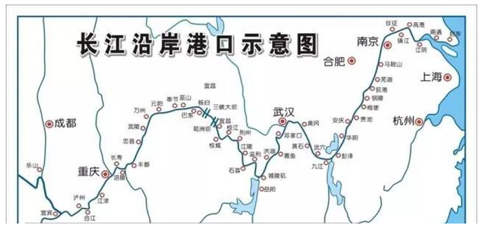

故正确答案为C。

**考点**：中国地理

**来源**：2013年重庆市公务员录用考试《行测》题（下半年）（网友回忆版）第13题

### 第 14 题

关于中国古代的科技成就，下列说法不正确的是：

A. 《甘石星经》是世界上最早的天文学著作

B. 《千金方》是中国最早介绍药材的专著

C. 《天工开物》被称为“中国17世纪的工艺百科全书”

D. 《周髀算经》是中国现存最早的数学专著

第 14 题 · 答案与解析

**参考答案（粉笔题库参考内容）**

B

**解析**

本题考查人文常识。

A项正确，《甘石星经》是一部天文学专著，甘经、石经各八卷，共十六卷，大致成书于战国时期。《甘石星经》是两书的合称，作者为当时的齐国人甘德和魏国人石申。甘德著有《天文星占》八卷，石申著有《天文》八卷，两书合称《甘石星经》。它是世界上最早的恒星表，比希腊天文学家伊巴谷在公元前二世纪测编的欧洲第一个恒星表还早约200年。

B项错误，《千金方》是中国古代中医学经典著作之一，作者孙思邈，是综合性临床医著，被誉为中国最早的临床百科全书。《神农本草经》是我国乃至世界上最早的草药专著。

C项正确，《天工开物》是世界上第一部关于农业和手工业生产的综合性著作，是中国古代一部综合性的科学技术著作，有人也称它是一部百科全书式的著作，作者是明朝科学家宋应星。外国学者称它为“中国17世纪的工艺百科全书”。

D项正确，《周髀算经》原名《周髀》，是算经的十书之一，中国最古老的天文学和数学著作，约成书于公元前1世纪，主要阐明当时的盖天说和四分历法。

本题为选非题，故正确答案为B。

**考点**：文化常识

**来源**：2013年重庆市公务员录用考试《行测》题（下半年）（网友回忆版）第14题

### 第 15 题

关于牛顿在科学界的贡献，下列说法不正确的是：

A. 提出了惯性定律

B. 发表了《自然哲学的数学原理》

C. 揭示了光的波粒二象性

D. 创建了微积分

第 15 题 · 答案与解析

**参考答案（粉笔题库参考内容）**

C

**解析**

本题考查科技常识。

A、B、D三项正确，艾萨克·牛顿（1643年1月4日—1727年3月31日），英国皇家学会会长，英国著名的物理学家、数学家，百科全书式的“全才”。著有《自然哲学的数学原理》、《光学》等著作；在伽利略等人工作的基础上进行深入研究，总结出了物体运动的三个基本定律（牛顿三定律），其中牛顿第一定律即惯性定律；在数学方面创建了微积分学；在光学方面创立了光的“微粒说”，并发现了光的色散现象。

C项错误，光的波粒二象性是指光既具有波动特性，又具有粒子特性。1905年3月，爱因斯坦在德国《物理年报》上发表了题为《关于光的产生和转化的一个推测性观点》的论文，他认为对于时间的平均值，光表现为波动；对于时间的瞬间值，光表现为粒子性。这是历史上第一次揭示微观客体波动性和粒子性的统一，即波粒二象性。

本题为选非题，故正确答案为C。

**考点**：科技理论与成就

**来源**：2013年重庆市公务员录用考试《行测》题（下半年）（网友回忆版）第15题

### 第 16 题

下列事物或作品产生时代大致相近的是（    ）。

A. 火药、司南

B. 紫禁城、埃及金字塔

C. 《最后的晚餐》《向日葵》

D. 《牡丹亭》《罗密欧与朱丽叶》

第 16 题 · 答案与解析

**参考答案（粉笔题库参考内容）**

D

**解析**

本题考查人文常识。

A项错误，火药是一种黑色或棕色的炸药，由硝酸钾、木炭和硫磺机械混合而成。火药的研究开始于古代道家的炼丹术，黑色火药在唐代（9世纪末）时候正式出现；司南是古代用于辨别方向的一种仪器，是指南针的始祖，据《古矿录》记载最早出现于战国时期的磁山一带。

B项错误，北京故宫于明成祖永乐四年（1406年）开始建设，以南京故宫为蓝本营建，到永乐十八年（1420年）建成，是中国明清两代的皇家宫殿，旧称为紫禁城，位于北京中轴线的中心。埃及金字塔是古埃及奴隶制国王的陵寝，产生时代远早于北京故宫。

C项错误，《最后的晚餐》是意大利艺术家达·芬奇所创作，以《圣经》中耶稣跟十二门徒共进最后一次晚餐为题材，创作于1494年~1498年；《向日葵》是1888年2月梵高在法国南部小城阿尔创作的作品，现藏于伦敦国家画廊。

D项正确，《牡丹亭》也称《还魂梦》或《牡丹亭梦》，是明代剧作家汤显祖创作的传奇（剧本），刊行于明万历四十五年（1617年），与《西厢记》《窦娥冤》《长生殿》合称中国四大古典戏剧；《罗密欧与朱丽叶》是英国剧作家威廉·莎士比亚的戏剧作品，约创作于1595年。二者产生时间只相差二十几年。

故正确答案为D。

**考点**：文化常识

**来源**：2013年重庆市公务员录用考试《行测》题（下半年）（网友回忆版）第16题

### 第 17 题

下列说法不正确的是：

A. 国际日期变更线不穿过任何国家

B. 经度每差1度，时间相差约4分钟

C. 一年中全球都是昼夜平分的有一天

D. 全球共划分为24个时区

第 17 题 · 答案与解析

**参考答案（粉笔题库参考内容）**

C

**解析**

本题考查地理国情。

A项正确，为了避免日期上的混乱，1884年国际经度会议规定了一条国际日期变更线。这条变更线位于太平洋中的180°经线上，为避免在一个国家中同时存在着两种日期，日界线并不是一条直线，而是折线。它北起北极，通过白令海峡、太平洋，直到南极。国际日期变更线不穿过任何国家。

B项正确，经度，就是地球上一个地点离本初子午线的南北方向走线以东或以西的度数。公元1884年，国际上规定以通过英国伦敦近郊的格林尼治天文台旧址的经线作为计算经度的起点，即经度零度零分零秒，每15个经度便相差一个小时。也即经度每差1度，时间相差约4分钟。

C项错误，全球昼夜平分日是春分和秋分。春分和秋分时太阳直射赤道，全球昼夜等长。春分以后，太阳直射点由赤道向北半球推移，北半球各地白昼开始长于黑夜。秋分以后，太阳直射点由赤道向南半球推移，北半球各地开始昼短夜长；南半球相反。因此一年中全球都是昼夜平分的有两天。

D项正确，为了克服时间上的混乱，1884年在华盛顿召开的一次国际经度会议上，规定将全球划分为24个时区，规定英国（格林尼治天文台旧址）为中时区（零时区），东、西各12个时区。

本题为选非题，故正确答案为C。

**考点**：世界地理

**来源**：2013年重庆市公务员录用考试《行测》题（下半年）（网友回忆版）第17题

### 第 18 题

下列动物中，全部属于鱼类的是：

A. 章鱼、鲨鱼

B. 鳝鱼、鳗鲡

C. 娃娃鱼、海马

D. 鲸鱼、鱿鱼

第 18 题 · 答案与解析

**参考答案（粉笔题库参考内容）**

B

**解析**

本题考查科技常识。

鱼类，是最古老的脊椎动物。它们几乎栖居于地球上所有的水生环境，从淡水的湖泊、河流到咸水的大海和大洋。大多数鱼类是终年生活在水中，用鳃呼吸，用鳍辅助身体平衡与运动的变温脊椎动物。

A项错误，章鱼为章鱼科26属252种海洋软体动物的通称，因此不属于鱼类。鲨鱼属于脊椎动物门软骨纲，板鳃亚纲，海生，少数种类进入淡水，为一群游速快的中大型海洋鱼类。

B项正确，黄鳝又名鳝鱼，为热带及暖温带鱼类，营底栖生活的鱼类，适应能力强。生活于水体底层，主要栖息于稻田、湖泊、池塘、河流与沟渠等泥质地的水域，甚至沼泽、被水淹的田野或湿地等皆可见其踪迹。鳗鲡是鳗鲡科、鳗鲡属鱼类，为暖温性降河性洄游鱼类，平时栖息于江河、湖泊、水库和静水池塘的土穴、石缝里，昼伏夜出，有时从水中游上陆地以皮肤呼吸，经潮湿草地移居到别的水域。

C项错误，大鲵又名娃娃鱼，是隐腮鲵科、大鲵属有尾两栖动物，因此不属于鱼类。成鲵一般常栖息在海拔1000米以下的溪河深潭内的岩洞、石穴之中，以滩口上下的洞穴内较为常见，食性很广，主要以蟹、蛙、鱼、虾以及水生昆虫，及其幼虫等为食。海马是刺鱼目海龙科暖海生数种小型鱼类的统称，是一种小型海洋动物，身长5～30厘米，因头部弯曲与体近直角而得名。

D项错误，鲸目，是哺乳纲下设的一个传统分类单元，包含现存约90种体态似鱼、皮肤裸露的水生哺乳动物和它们已灭绝的早期亲族，统称鲸类或鲸豚类。大部分栖息于浅海，少数几种栖息于淡水。鱿鱼也称柔鱼、枪乌贼，是软体动物门头足纲鞘亚纲十腕总目管鱿目开眼亚目的动物。因此二者均不属于鱼类。

故正确答案为B。

**考点**：生物常识

**来源**：2013年重庆市公务员录用考试《行测》题（下半年）（网友回忆版）第18题

### 第 19 题

关于传染病，下列说法不正确的是：

A. 霍乱是一种烈性肠道传染病

B. 艾滋病病毒可由蚊子传播

C. 禽流感患者康复后不再具有传染性

D. 狂犬病患者会出现恐水、怕光、怕声等症状

第 19 题 · 答案与解析

**参考答案（粉笔题库参考内容）**

B

**解析**

本题考查科技常识。

A项正确，霍乱是因摄入的食物或水受到霍乱弧菌污染而引起的急性腹泻性传染病。霍乱患者前期最典型的表现是腹泻，随后大量丢失水分和电解质，引起脱水。患者皮肤干皱、缺乏弹性，声音嘶哑、眼眶下陷、两颊深凹，神志不清，最终死亡。

B项错误，艾滋病是一种危害性极大的传染病，由感染艾滋病病毒（HIV）引起。HIV是一种能攻击人体免疫系统的病毒，它把人体免疫系统中最重要的CD4T淋巴细胞作为主要攻击目标，大量破坏该细胞，使人体丧失免疫功能。艾滋病病毒在蚊子体内既不发育也不繁殖，所以不可能通过生物性的方式进行传播。另外，蚊子在吸血前，先由唾液管吐出唾液（作为其润滑剂以便吸血），然后由食管吸入血液，而血液的吸入是单向的，吸入后不会再吐出，并且蚊子嘴上残留的血液极其微量。目前，世界范围内尚未发现蚊子叮咬而感染艾滋病的报道，因此人们不必担心蚊子传播艾滋病。

C项正确，禽流感是由禽流感病毒引起的人类急性呼吸道传染病，患者发病初期表现为流感样症状，包括发热、咳嗽，可伴有头痛、肌肉酸痛和全身不适，也可以出现流涕、鼻塞、咽痛等。部分患者肺部病变较重或病情发展迅速时，出现胸闷和呼吸困难等症状。重症患者病情发展迅速，多在5～7天出现重症肺炎，体温大多持续在39 °C以上，呼吸困难，可伴有咳血痰；可快速进展为急性呼吸窘迫综合征、脓毒血症、感染性休克，部分患者可出现纵隔气肿、胸腔积液等。禽流感患者康复后病毒核酸检测为阴性，不再具有传染性。

D项正确，狂犬病是狂犬病毒所致的急性传染病，人兽共患，多见于犬、狼、猫等肉食动物，人多因被病兽咬伤而感染。临床表现为特有的恐水、怕风、怕亮光、怕声、咽肌痉挛、进行性瘫痪等。因恐水症状比较突出，故本病又名恐水症。

本题为选非题，故正确答案为B。

**考点**：化学常识

**来源**：2013年重庆市公务员录用考试《行测》题（下半年）（网友回忆版）第19题

### 第 20 题

关于下图所示的战役，下列说法正确的是：

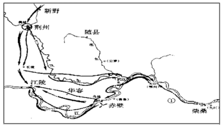

A. 这次战役略早于官渡之战

B. 图中①是曹操军队的进攻路线

C. 可在《左传》中找到相关文献记载

D. “折戟沉沙铁未销”咏叹的是这段历史

第 20 题 · 答案与解析

**参考答案（粉笔题库参考内容）**

D

**解析**

本题考查人文常识。

图示战役为赤壁之战，是东汉末年孙权、刘备联军于建安十三年（公元208年）在长江赤壁一带大破曹操大军的战役。这是中国历史上著名的以少胜多、以弱胜强的战役之一。

A项错误，官渡之战是东汉末年“三大战役”之一，是中国历史上著名的以弱胜强的战役之一。建安五年（公元200年），曹操军与袁绍军相持于官渡，在此展开战略决战。曹操奇袭袁军在乌巢的粮仓，继而击溃袁军主力。此战奠定了曹操统一中国北方的基础。赤壁之战晚于此战。

B项错误，①为孙权进军的路线，路线为：柴桑-樊口-赤壁-乌林-江陵。

C项错误，《左传》是中国古代一部叙事完备的编年体史书，更是先秦散文著作的代表，它起自鲁隐公元年（公元前722年），迄于鲁哀公二十七年（公元前468年）。而赤壁之战发生在东汉末年，在《左传》中是不可能有记载的。

D项正确，“折戟沉沙铁未销”出自唐朝杜牧的《赤壁》，这首诗是作者经过古战场赤壁，有感于三国时代的赤壁之战而写下的，咏叹的正是这段时间的历史。

故正确答案为D。

**考点**：中国历史

**来源**：2013年重庆市公务员录用考试《行测》题（下半年）（网友回忆版）第20题

### 第 21 题

民主是联合国的核心价值，是人权的关键。民主为解决各种分歧提供了渠道，给边缘人群带来希望。但民主并非＿＿＿＿＿＿，需要培养和捍卫。

填入划横线部分最恰当的一项是：

A. 唾手可得

B. 纸上谈兵

C. 一劳永逸

D. 近在咫尺

第 21 题 · 答案与解析

**参考答案（粉笔题库参考内容）**

A

**解析**

横线处所填成语搭配“民主”，且根据“并非”可知，横线处所填成语与“需要培养和捍卫”语义相反，需体现不付出努力，就能轻易获得之意。A项“唾手可得”比喻非常容易得到，符合文意，当选。

B项“纸上谈兵”比喻只凭书本知识空发议论，不能解决实际问题，D项“近在咫尺”形容距离很近，均不符合文意，排除；C项“一劳永逸”指辛苦一次，把事情办好，以后就可以不再费力了，通常搭配具体的事情，与“民主”这一名词搭配不当，排除。

故正确答案为A。

**考点**：关联关系-并列关系、成语填空、词的辨析-搭配对象

**来源**：2013年重庆市公务员录用考试《行测》题（下半年）（网友回忆版）第21题

### 第 22 题

投资也好，理财也好，并不只有股票一个品种。期货、债券、基金、保险、钱币、邮票、收藏、古玩、艺术品······多花一点时间去关注一下，总会有收获。但一定要“＿＿＿＿＿＿”，根据本人的资金实力和风险承受情况决定投资的品种和方式。

填入划横线部分最恰当的一项是：

A. 削足适履

B. 量体裁衣

C. 慧眼识珠

D. 披沙拣金

第 22 题 · 答案与解析

**参考答案（粉笔题库参考内容）**

B

**解析**

由后文“根据本人的资金实力和风险承受情况决定投资的品种和方式”可知，横线处需体现应该根据个人的具体情况来决定投资的品种和方式之意。B项“量体裁衣”比喻根据实际情况办事，对应横线处双引号，置于此处生动形象，符合文意，当选。

A项“削足适履”比喻不合理的牵就凑合或不顾具体条件，生搬硬套，与文意不符，排除；

C项“慧眼识珠”泛指敏锐的眼力，称赞人善于识别人才，文段并无“善于识别人才”之意，排除；

D项“披沙拣金”比喻从大量的东西中选取精华，文段并无“选取精华”之意，排除。

故正确答案为B。

【文段出处】《2008年：理财之计在于春 房地产投资是否可行？》

**考点**：对应关系-前后呼应、对应关系-形象表达、成语填空

**来源**：2013年重庆市公务员录用考试《行测》题（下半年）（网友回忆版）第22题

### 第 23 题

任何评奖都会面临众口难调的现实问题，奖项能否具备社会＿＿＿＿＿，确实离不开评奖过程的公开透明，但归根结底取决于评奖结果对设奖本质的极致＿＿＿＿，而文化奖项的本质在于推动文化事业的健康发展。

填入划横线部分最恰当的一项是：

A. 价值观 升华

B. 示范性 诠释

C. 公信力 尊崇

D. 认可度 维系

第 23 题 · 答案与解析

**参考答案（粉笔题库参考内容）**

C

**解析**

第一空，根据“面临众口难调的现实问题”可知，奖项面临着能否让社会公众信服、认可的问题，C项“公信力”、D项“认可度”均符合文意，保留。A项“价值观”指人认识事物、辨别是非的一种思维或取向，B项“示范性”指某种可供学习、参照的典范，均不符合文意，排除。

第二空，根据“文化奖项的本质在于推动文化事业的健康发展”可知，评奖结果应遵照设奖的初衷、重视设奖本质，C项“尊崇”指尊敬、推崇，填入横线处可体现遵照之意，符合文意，当选。D项“维系”指维持并联系，与文意不符，排除。

故正确答案为C。

【文段出处】《文化奖项需要更多人文关怀》

**考点**：实词填空、对应关系-前后呼应

**来源**：2013年重庆市公务员录用考试《行测》题（下半年）（网友回忆版）第23题

### 第 24 题

所有能见和不能见，所有在场和不在场，所有障眼法和真相的困惑，就＿＿＿＿在一场场文化表演中。所以，凡是杂技和魔术盛行的时代，大多生活平和、琐碎、物质发达，人们有太多的闲情去纠结日常的表象和价值观的困惑，去期待一点违背常理的惊喜，作为现实的小小＿＿＿＿。

填入划横线部分最恰当的一项是：

A. 浓缩 点缀

B. 凝练 花絮

C. 蕴含 注脚

D. 预设 调剂

第 24 题 · 答案与解析

**参考答案（粉笔题库参考内容）**

A

**解析**

本题可以从第二空入手，根据“人们有太多的闲情去纠结日常的表象和价值观的困惑，去期待一点违背常理的惊喜”可知，横线处应体现出“惊喜”对现实的作用。A项“点缀”指加以衬托或装饰，使原有的事物更加美好，D项“调剂”指把多和少、忙和闲等加以适当的调整，均符合文意，保留。 B项“花絮”指各种有趣的零碎新闻，如“大会花絮”“赛场花絮”等，与文意不符，排除；C项“注脚”指解释字句的文字，文段并未强调对“现实”进行具体解释，与文意不符，排除。

第一空，根据 “所有能见和不能见，所有在场和不在场，所有障眼法和真相的困惑”及“在一场场文化表演中”可知，横线处应体现出把所有的事物都包含在一场场文化表演中呈现出来之意。A项“浓缩”指用一定的方法使物体中不需要的部分减少，从而使需要部分的相对含量增加，符合文意，当选。D项“预设”指说话者为保证句子或语段的合适性而必须满足的前提，文段并无此意，排除。

故正确答案为A。

【文段出处】《“魔术热”传递怎样的文化隐喻》

**考点**：实词填空、对应关系-前后呼应

**来源**：2013年重庆市公务员录用考试《行测》题（下半年）（网友回忆版）第24题

### 第 25 题

古人常将“道德文章”连用，文以载道是＿＿＿＿＿＿的传统。如何高扬道德之善也是文学的永恒主题。这样的道理早已为人们所熟知，但熟知并非真知，我们恰恰常在这些＿＿＿＿＿＿的问题上陷入迷津。

填入横线处的词语最恰当的一项是：

A. 源远流长 老生常谈

B. 根深蒂固 似是而非

C. 妇孺皆知 见仁见智

D. 至高无上 细枝末节

第 25 题 · 答案与解析

**参考答案（粉笔题库参考内容）**

A

**解析**

第一空，前文指出古人就有了“文以载道”的传统，故横线处应体现出“文以载道”的传统由来已久。A项“源远流长”比喻历史悠久，根底深厚，B项“根深蒂固”比喻基础稳固，不容易动摇，均符合文意，保留。C项“妇孺皆知”指妇女、小孩全都知道，程度过重，排除；D项“至高无上”意思是高到顶点，再也没有更高的了，形容地位很高，程度过重，排除。

第二空，横线前的“这些”指代前文，根据“早已为人们所熟知”可知，这些问题是人们非常熟悉的。A项“老生常谈”比喻听惯了的没有新鲜意思的话，符合语境，当选。D项“似是而非”意思是好像是对的，实际上不对，文中并无此意，排除。

故正确答案为A。

【文段出处】《从审美到审善》

**考点**：对应关系-前后呼应、成语填空、词的辨析-程度轻重

**来源**：2013年重庆市公务员录用考试《行测》题（下半年）（网友回忆版）第25题

### 第 26 题

文化体现在一个人如何对待他人、对待自己、如何对待自己所处的自然环境。在一个文化厚实的社会里，人懂得尊重自己，不苟且，所以有品位；人懂得尊重别人，不＿＿＿＿，所以有道德；人懂得尊重自然，不＿＿＿＿，所以有永续的智能。

填入横线处的词语最恰当的一项是：

A. 卑微 贪婪

B. 野蛮 索取

C. 势利 强求

D. 霸道 掠夺

第 26 题 · 答案与解析

**参考答案（粉笔题库参考内容）**

D

**解析**

第一空，根据“人懂得······，不······”可知，横线处所填词语应与“尊重别人”语义相反，体现不尊重他人之意，B项“野蛮”指蛮横残暴，粗鲁，D项“霸道”指强横不讲理，蛮横，二者均可体现出不尊重他人，符合文意，保留。A项“卑微”指地位低下，与文意不符，排除；C项“势利”形容看地位、财产分别对待人的表现，文段并未体现地位不同、财产不同，与文意不符，排除。

第二空， 根据“人懂得······，不······”可知，横线处所填词语应与“尊重自然”语义相反，体现对自然不尊重之意，D项“掠夺”指抢劫、夺取，符合文意，当选。B项“索取”指向人索要（钱或东西），填入文段也可以体现出不尊重自然，但程度较轻，对比而言，不如D项符合文意，排除。

故正确答案为D。

【文段出处】《文化是什么？》

**考点**：关联关系-并列关系、实词填空、词的辨析-程度轻重

**来源**：2013年重庆市公务员录用考试《行测》题（下半年）（网友回忆版）第26题

### 第 27 题

艺术不是象牙塔里的＿＿＿＿＿＿，所谓的“为艺术而艺术”，说到底不过是唯美主义＿＿＿＿＿＿的志向。自古以来，艺术就是与政治、经济、信仰等种种意识形态因素甚至流行时尚有着千丝万缕的关系。

填入横线处的词语最恰当的一项是：

A. 闭门造车 虚无缥缈

B. 孤芳自赏 一厢情愿

C. 顾影自怜 孜孜以求

D. 自命清高 遥不可及

第 27 题 · 答案与解析

**参考答案（粉笔题库参考内容）**

B

**解析**

本题可从第二空入手，根据“为艺术而艺术”“自古以来，艺术就是与政治、经济、信仰等种种意识形态因素甚至流行时尚有着千丝万缕的关系”可知，艺术并不是单独存在的，是与其他因素有着密切联系的。故横线处成语应体现出“单独”之意，B项“一厢情愿”意为只是单方面的意愿，不考虑对方是否同意或条件是否许可，符合文意，保留。A项“虚无缥缈”形容空虚茫然，没有着落，不可捉摸，C项“孜孜以求”形容勤勉、不懈怠的样子，D项“遥不可及”指非常遥远而不可到达，均无法体现“单独”之意，排除。

第一空，代入验证，B项“孤芳自赏”比喻自命清高，自我欣赏，也比喻脱离群众，自命不凡。可与“一厢情愿”形成对应，体现出“单独”之意，当选。

故正确答案为B。

**考点**：对应关系-前后呼应、成语填空

**来源**：2013年重庆市公务员录用考试《行测》题（下半年）（网友回忆版）第27题

### 第 28 题

当人类还没有发明文字时，岩画可能就已经诞生了。如今古人记载在绢帛、纸张、器物上的文字多已＿＿＿＿＿＿，而凿刻、绘制在石头之上的岩画却被完整地保存了下来。不要小看这些粗放的线条、简单的图形、晦涩的符号，也不要说那些“跃然”石上的羊、牛、马、虎、豹、驼等动物图案过于＿＿＿＿，更不要忽略那些狩猎、祭祀、争战、歌舞、交媾的画面，那里面可能都有极为丰富的内涵。

填入横线处的词语最恰当的一项是：

A. 化为乌有 抽象

B. 不翼而飞 粗糙

C. 荡然无存 直白

D. 踪迹难觅 普通

第 28 题 · 答案与解析

**参考答案（粉笔题库参考内容）**

C

**解析**

第一空，根据转折词“却”可知，横线处成语与“被完整地保存了下来”语义相反，体现没有被完整保存下来、消失不见之意。A项“化为乌有”形容全部丧失、全部落空，或全部没有了，C项“荡然无存”指彻底消失，D项“踪迹难觅”指寻找不到踪迹，均可体现没有被完整保存下来、消失不见之意，保留。B项“不翼而飞”比喻东西突然不见了或形容消息、言论等传布迅速，文段并无文字突然不见了或传播迅速之意，排除。

第二空，根据“不要小看这些粗放的线条、简单的图形”和“那里面可能都有极为丰富的内涵”可知，横线处词语应体现动物图案比较简单之意。C项“直白”指直率明白，置于此处可体现图案表意直接简单，当选。A项“抽象”指不能具体体验到的，笼统的，空洞的，D项“普通”指平常的、一般而不突出的，均不能体现动物图案简单之意，与文意不符，排除。

故正确答案为C。

【文段出处】《宁夏出台第一个专门针对岩画的地方性法规》

**考点**：关联关系-转折关系、对应关系-前后呼应、混搭填空

**来源**：2013年重庆市公务员录用考试《行测》题（下半年）（网友回忆版）第28题

### 第 29 题

原始森林的主要成分是树木，但如果没有缠绕在树木之间的藤蔓，没有那些＿＿＿＿空间的灌木和杂草，没有那些＿＿＿＿或蹲守于茂密丛林中的走兽飞禽，这个原始森林也就＿＿＿＿＿＿了。

填入横线处的词语最恰当的一项是：

A. 抢夺 飞越 名存实亡

B. 抢夺 栖息 徒有虚名

C. 争夺 穿梭 名不副实

D. 争夺 寄居 朝不保夕

第 29 题 · 答案与解析

**参考答案（粉笔题库参考内容）**

C

**解析**

本题可从第二空入手，横线处搭配“走兽飞禽”，且通过“或”表示并列关系，表达除了“蹲守”这种静态之外的动态，C项“穿梭”形容来往、走动频繁，与“走兽飞禽”搭配恰当，且符合文意，保留。A项“飞越”指从上空飞行越过，仅可与“飞禽”搭配，与“走兽”搭配不当，排除；B项“栖息”指止息、隐居、暂住，另有寄居之所之意，D项“寄居”指在外地或在别人家居住，均体现不出动态，排除。

第一空，代入验证，C项“争夺”指争斗、夺取，争着夺取进而占有，“争夺空间”搭配恰当，保留。

第三空，代入验证，C项“名不副实”指徒有虚名，与实际不相符合，形容没有灌木、杂草和飞禽走兽的原始森林，符合文意，当选。

故正确答案为C。

【文段出处】《像藤蔓一般缠绕的亲情》

**考点**：关联关系-并列关系、混搭填空、词的辨析-搭配对象

**来源**：2013年重庆市公务员录用考试《行测》题（下半年）（网友回忆版）第29题

### 第 30 题

紫藤很适合作花架、绿廊，可形成满架浓叶、繁花浩荡的美景，也可制作成盆景，造型千姿百态，甚为优美。紫藤长长的花序都是上面的先＿＿＿＿，下面的待放，花的颜色便是上浅下深，好像那紫色是＿＿＿＿下来的；唐代诗人李白“紫藤挂云木，花蔓宜阳春，密叶隐歌鸟，香风流美人”的诗句，生动地＿＿＿＿出紫藤迷人的姿态。

填入横线处的词语最恰当的一项是：

A. 绽放 积累 勾勒

B. 生长 浸润 描摹

C. 萌发 流淌 表达

D. 盛开 沉淀 刻画

第 30 题 · 答案与解析

**参考答案（粉笔题库参考内容）**

D

**解析**

第一空，根据“上面的先”“下面的待放”“花的颜色便是上浅下深”等可知，紫藤的花序应该是从上到下，所以横线处要体现出“开放”之意，A项“绽放”、D项“盛开”均有开放之意，符合文意，保留。B项“生长”指不断长大成熟的过程，C项“萌发”指种子发芽，均不能表达“开放”之意，排除。

第二空，根据“好像”以及“花的颜色便是上浅下深”可知，横线要用比喻的方式体现出颜色由上到下的变化，D项“沉淀”指难溶解的物质沉到溶液的底层，可形象体现出颜色由上向下的变化，可与“上浅下深”对应，当选。A项“积累”有逐渐聚集之意，但不能体现颜色自上而下的变化，不符合语境，排除。

第三空，代入验证，“刻画姿态”搭配得当，且对李白的诗句解释合理，符合文意，D项当选。

故正确答案为D。

【文段出处】《等待花开的紫藤》

**考点**：实词填空、对应关系-前后呼应、词的辨析-搭配对象

**来源**：2013年重庆市公务员录用考试《行测》题（下半年）（网友回忆版）第30题

### 第 31 题

我国淡水资源日益短缺，人均淡水资源仅为世界水平的四分之一，但海水资源却很丰富，海水淡化展现出广阔的前景。海水淡化“十二五”规划和海水淡化产业专项规划等政策已陆续出台，其中“加快海水利用装备产品自主制造的步伐”和“推进海水淡化材料国产化”等将成为政策扶持的重点。

这段文字意在说明：

A. 我国水资源短缺的现状

B. 海水淡化“十二五”规划

C. 海水淡化产业的发展前景

D. 海水淡化政策支持的重要性

第 31 题 · 答案与解析

**参考答案（粉笔题库参考内容）**

C

**解析**

文段开篇指出我国淡水资源日益短缺，接着通过转折关联词“但”指出海水资源丰富，海水淡化有广阔的前景，然后通过“十二五”规划和专项规划政策说明海水淡化目前受到了国家政策扶持，进一步证明了前文观点，故文段重点强调海水淡化前景广阔，对应C项。

A项，缺少文段核心话题“海水淡化”，偏离文段中心，排除；

B项，“‘十二五’规划”对应文段解释说明的部分，非重点且表述片面，排除；

D项，“政策”对应文段解释说明的部分，非重点，排除。

故正确答案为C。

**考点**：关联词-转折

**来源**：2013年重庆市公务员录用考试《行测》题（下半年）（网友回忆版）第31题

### 第 32 题

要写出好论文，技巧只是锦上添花，当你理解了写论文的必要性，用心写作的意识便会油然而生。那么我们究竟为什么要写论文？首先研究者需要把优秀的研究成果公之于众，并希望在学术圈制造自己的影响，也极大地提升了分享的效率。其次写论文可以极大地帮助自己提炼想法，把粗略的想法精细化。本来思路上也许有盲点，但当你必须考虑如何让他人接受自己的观点时，几行论点的草稿自然是不够的，将所有材料重新进行有机整合是十分必要的。

这段文字主要介绍的是：

A. 写好论文的技巧

B. 写论文的目的

C. 好论文是如何炼成的

D. 什么样的论文才是好论文

第 32 题 · 答案与解析

**参考答案（粉笔题库参考内容）**

B

**解析**

文段开篇引出话题“写出好论文，技巧只是锦上添花”，随后提出问题，即“我们究竟为什么要写论文”，后文通过“首先”“其次”两个方面进行了详细的阐述，故文段主要介绍的是写论文的目的，对应B项。

A项，对应文段开头“技巧只是锦上添花”，文段重在介绍写论文的目的，非重点，排除；

C、D两项，文段并未提及“好论文是如何炼成的”及“什么样的论文才是好论文”，无中生有，排除。

故正确答案为B。

【文段出处】《好论文是如何炼成的》

**考点**：关联词-并列

**来源**：2013年重庆市公务员录用考试《行测》题（下半年）（网友回忆版）第32题

### 第 33 题

天下太平的时候，朝廷是要推崇文化和学术的，考量文官的标准，不但要看他的政绩，也要关注他的文化修养如何。因为按照正常的逻辑，做官要有“经略之才”，那么“知识就是力量”，文化修养就自然成了政绩的铺垫和补充。从上到下，应该都难以相信，一个“大老粗”会成为一个“治世能臣”。所以，在官场的圈子中，官员们的出身、门第、谈吐、书法、词章、风度、名望、口碑等等，都是评价的标准。那么既然这样的比较成为了一种“风气”，古代官员的“读书热”也自然是水到渠成。

这段文字主要说明的是：

A. 古代官员“读书热”的原因

B. 古代官员加强自身文化修养的重要性

C. 古代太平时期对文官的评价标准过于单一

D. 古代很多官员读书带有一定的功利性

第 33 题 · 答案与解析

**参考答案（粉笔题库参考内容）**

A

**解析**

文段首先介绍天下太平时朝廷考量文官要看政绩和文化修养的大背景，接着通过“因为”进行原因分析，并通过“所以”引出了考量官员的具体评价标准。尾句通过指代词“这”指代前文，进行总结，强调比较官员的出身、门第、谈吐等成为一种“风气”，促成了古代官员的“读书热”。由此可知，文段为分总结构，重在介绍古代官员“读书热”现象背后的原因，对应A项。

B项，文段并非强调加强自身文化修养的重要性，而是在强调由此引出的“读书热”，排除；

C项，“评价标准过于单一”与文意不符，古代官员的评价标准包括出身、门第、谈吐等多种，并不单一，排除；

D项，“读书带有一定的功利性”表述不明确，排除。

故正确答案为A。

【文段出处】《古代官员的读书风气》

**考点**：主题词、关联词-因果

**来源**：2013年重庆市公务员录用考试《行测》题（下半年）（网友回忆版）第33题

### 第 34 题

在圆明园被烧毁之前，气势最恢弘的是长春园和绮春园，圆明园因为此二园被称为“万园之园”。但与欧洲石式建筑不同，此二园中古建筑多采用砖木结构，火烧后主体部分就荡然无存，只剩下台基和夯土层。如今，原来并不如前二园出名的大水法因为采用石材而保留下来，现在反而成了园中最胜之景。

这段文字意在说明：

A. 中西方建筑的不同

B. 砖木结构建筑不易完整保存的原因

C. 圆明园遗址保护面临的主要困难

D. “大水法”成为圆明园胜景的原因

第 34 题 · 答案与解析

**参考答案（粉笔题库参考内容）**

D

**解析**

文段开篇介绍圆明园中最负盛名的是“长春园和绮春园”，接下来阐述了因为二园采用砖木结构而在大火中主体部分荡然无存，大水法却因为采用石材而保留下来，现在反而成了园中最胜之景。故文段采用了古今对比的表达方式，重点强调“大水法”成为园中最胜之景的原因，对应D项。

A项，文段未提及“西方建筑”，无中生有，排除；

B项，未提及文段主题词“大水法”，偏离核心话题，排除；

C项，文段未提及“圆明园遗址保护困难”，无中生有，排除。

故正确答案为D。

**考点**：主题词

**来源**：2013年重庆市公务员录用考试《行测》题（下半年）（网友回忆版）第34题

### 第 35 题

传播学中有个名词“议程设置”，认为大众媒介不能决定人们对某一事件或意见的具体看法，但可以通过提供信息和安排相关的议题来有效地左右人们的意见，新闻媒介提供给公众的是议程。不过，媒体却极少反思，他们自身的选择又受到哪些因素的影响？为什么会关注某些问题，而忽视另外一些问题？这样的反思媒体应该时常进行，对于这些问题我们应该深入思考，慎之又慎。

这段文字意在说明：

A. 大众媒体不能决定人们对事件的具体看法

B. 公众应客观冷静地对待某些热点问题

C. 大众媒体应对自身影响舆论的方式进行反思

D. 大众媒体应在议程设置上持慎重态度

第 35 题 · 答案与解析

**参考答案（粉笔题库参考内容）**

D

**解析**

文段开篇提出“议程设置”的概念，接着说明媒体提供的议程会影响大众，再通过转折关联词“不过”引出媒体在“议程设置”中存在的问题，最后通过“应该”提出对策，故文段为“分—总”结构，意在强调媒体对于议程设置应该时常反思且慎之又慎，对应D项。

A项，“不能决定人们对事件的具体看法”对应首句内容，为引出话题部分，非重点，排除；

B项，缺少主题词“大众媒体”，排除；

C项，缺少主题词“议程设置”，且“影响舆论的方式”无中生有，排除。

故正确答案为D。

**考点**：主题词、关联词-对策

**来源**：2013年重庆市公务员录用考试《行测》题（下半年）（网友回忆版）第35题

### 第 36 题

信用不是从诚信产生的，信用作为特定的经济交易行为，是经济发展到一定阶段的产物，是为了实现高效交易而建立的一种正式制度，具有强制性和规范性。信用未必依赖于诚信，经济活动的交易双方讲信用，可能只是因为契约的强制，并不是出于诚信。因此，我们讲现代经济是信用经济，但从来不讲现代经济是诚信经济。

这段文字意在说明：

A. 信用与诚信的关系

B. 现代经济的基础

C. 契约的不同作用

D. 现代经济正常运行的制度保证

第 36 题 · 答案与解析

**参考答案（粉笔题库参考内容）**

A

**解析**

文段开篇先指出“信用不是从诚信产生的”，紧接着阐释其产生的背景、条件及自身特性，接下来进一步分析“信用”与“诚信”的关系，尾句通过“因此”进行总结，强调“现代经济”其实是“信用经济”，而非“诚信经济”。故全文主要围绕“信用”和“诚信”两个主题词展开论述，对应A项。

B、C、D三项均未包含“信用”和“诚信”两个主题词，排除。

故正确答案为A。

**考点**：主题词、关联词-因果

**来源**：2013年重庆市公务员录用考试《行测》题（下半年）（网友回忆版）第36题

### 第 37 题

在古代中国，徽州是传统教育最为发达的地区之一，从汉代起直至元代，外地名族从各地不断迁入徽州定居，他们非常重视文化教育，希望走读书仕进之路，同时“贾而好儒”的徽商也凭借财力优势，多方位地资助各类教育机构，此外，徽州当地集聚了一大批名儒硕士，他们著书立说、讲学书院、编写教材、改进教学方法，从而形成了颇具特色的教育思想，保证了高质量的教育。

这段文字意在：

A. 剖析中国古代传统教育模式的优势

B. 探讨徽商“贾而好儒”的根源所在

C. 分析徽州人文气息浓厚的历史渊源

D. 阐述徽州传统教育繁荣发展的原因

第 37 题 · 答案与解析

**参考答案（粉笔题库参考内容）**

D

**解析**

文段开篇引出了徽州传统教育比较发达的话题，接着说明外地名族迁入徽州，比较重视文化教育，并列词“同时”后说明徽商资助各类教育机构，接着又通过并列词“此外”说明徽州当地的名儒硕士保证了教育的质量，故文段从三个方面说明徽州传统教育发达的原因，对应D项。

A项，文段重点论述的是徽州传统教育，“中国古代传统教育”范围扩大，排除；

B项，“贾而好儒”仅对应“同时”之后的内容，表述片面，排除；

C项，文段并未论述“徽州人文气息”，无中生有，排除。

故正确答案为D。

【文段出处】《简论徽州传统教育发达的原因》

**考点**：关联词-并列

**来源**：2013年重庆市公务员录用考试《行测》题（下半年）（网友回忆版）第37题

### 第 38 题

早在2004年，欧盟就发布了《关于报废电子电器设备指令》，该指令又被人们形象地称为“欧盟绿色指令”，要求产品的生产商、进口商和经销商必须负责回收、处理进入欧盟市场的废弃电器和电子产品，从而建立了完善的“生产者/经销商延伸责任”体制。电器制造商、经销商有义务对电子垃圾的回收处理承担“延伸责任”和处理成本，消费者也必须承担相应的法律责任。遗憾的是，我国目前对电子垃圾的回收处理几乎完全处于失控和无序状态。假如我们只是被动地面对电子垃圾高峰，就不可能解决越来越多的电子垃圾。

根据这段文字，什么才是应对电子垃圾高峰的可行之道？

A. 教育公众提高环保意识和责任意识

B. 出台具有强制力的电子垃圾处理法律

C. 制定电子垃圾回收处理的规范流程

D. 开发和研制符合环保要求的绿色电子产品

第 38 题 · 答案与解析

**参考答案（粉笔题库参考内容）**

B

**解析**

文段开篇表明在2004年欧盟就已发布《关于报废电子电器设备指令》，并介绍该指令的具体内容——明确电器制造商、经销商、消费者的法律责任。随后通过“遗憾的是”强调我国目前电子垃圾的回收处理的漏洞。尾句通过反面论证，指出我们必须主动采取措施，才能解决电子垃圾问题。故“应对电子垃圾高峰的可行之道”为借鉴欧盟经验，主动出击制定相关政策，明确法律责任，对比选项，B项当选。

A项，“教育公众”无中生有，文段并未提及通过“教育”的手段解决问题，排除；

C项，“规范流程”仅对应“电器制造商、经销商”，无法体现“消费者”应承担相应的法律责任，表述片面，故不足以解决问题，排除；

D项，“符合环保要求的绿色电子产品”无中生有，文段未提及开发新产品，排除。

故正确答案为B。

【文段出处】《让“绿色指令”为电子垃圾指明出路》

**考点**：特殊问法

**来源**：2013年重庆市公务员录用考试《行测》题（下半年）（网友回忆版）第38题

### 第 39 题

法国人为什么会把雄鸡作为本国的象征？流行的说法是在拉丁语中“高卢人”与“雄鸡”两词书写和发音正好相同，于是以高卢人为祖先的法国人自然地将雄鸡当作本国的象征。这种把法国象征的来源简单地归为文字游戏的说法非常值得怀疑。其实，最早将法国比喻为雄鸡的是法国的敌人。在中世纪，雄鸡的形象往往是负面的：自负、愚蠢、易怒、好斗、淫荡、爱听恭维话、爱虚荣。即使是在法国人自己的作品中，如《列那狐传奇》，雄鸡也常常遭到狐狸的欺骗或成为动物们的口中之食。因此，法国的敌人巧妙地将法国国王和他的臣民比喻为雄鸡。

这段文字是一篇文章的引言，文章接下来最可能讲述的是：

A. 法国人为什么喜欢雄鸡

B. 雄鸡形象负面意义产生的原因

C. 法国文学作品中的雄鸡形象

D. 法国人如何赋予雄鸡新的含义

第 39 题 · 答案与解析

**参考答案（粉笔题库参考内容）**

D

**解析**

本题为接语选择题，重点关注文段最后谈论的核心话题。文段开篇提出问题，法国人为何将雄鸡作为本国的象征，然后指出把法国象征的来源简单地归为文字游戏的说法非常值得怀疑，最后介绍因为雄鸡的形象往往是负面的，法国的敌人将法国国王和他的臣民比喻为雄鸡。文段开篇提出法国人自身将雄鸡作为本国的象征，文段最后体现的却是雄鸡的负面形象，故接下来应介绍法国人如何改变雄鸡的负面形象，使其成为本国的象征，对应D项。

A项，“喜欢雄鸡”文段并未提及，文段侧重分析的是“雄鸡的含义”，排除；

B、C两项，“负面意义产生的原因”“法国文学作品中的雄鸡形象”均为前文已经具体论述过的内容，后文不会再论述，排除。

故正确答案为D。

【文段出处】《三色旗和高卢雄鸡——法兰西国家象征符号的历史解读》

**考点**：接语选择题

**来源**：2013年重庆市公务员录用考试《行测》题（下半年）（网友回忆版）第39题

### 第 40 题

研究经常上网的人和从未上网的人的大脑在使用搜索引擎和读书时的不同反应，结果发现，当阅读书面文字时，上网高手与上网生手没有表现出任何区别。而当在搜索引擎上搜索时，两组实验对象的大脑神经激活表现则明显不同——上网高手在大脑左前区的一个特定网络，即被称为背外侧前额叶皮层的区域（其功能是控制我们的决策和整合复杂信息的能力）很活跃，而上网生手的大脑在这一区域的活动甚微。但是，在互联网上仅活动5天之后（每天1小时），搜索引擎就在他们的大脑中激活了这一区域。

从这段文字，可以知道：

A. 上网并不能有效提高人的阅读能力

B. 与上网生手比，上网高手大脑左半球更加发达

C. 书本阅读和网络搜索引起的大脑活动区域不同

D. 过一段时间之后，网络对人脑的刺激作用就不明显了

第 40 题 · 答案与解析

**参考答案（粉笔题库参考内容）**

C

**解析**

A项，文段并未提及上网能否提高人的阅读能力，无中生有，排除；

B项，根据“而当在搜索引擎上搜索时，两组实验对象的大脑神经激活表现则明显不同——上网高手在大脑左前区的一个特定网络······”可知，上网生手与上网高手在搜索引擎上搜索时大脑左前区神经激活表现不同，无法得出二者大脑左半球发达程度的差异，偷换概念，排除；

C项，根据“结果发现，当阅读书面文字时······没有表现出任何区别。而当在搜索引擎上搜索时······则明显不同——上网高手在大脑左前区的一个特定网络，即被称为背外侧前额叶皮层的区域（其功能是控制我们的决策和整合复杂信息的能力）很活跃，而上网生手的大脑在这一区域的活动甚微”可知，表述正确，当选；

D项，“过一段时间之后，网络对人脑的刺激作用是否明显”文段并未提及，无中生有，排除。

故正确答案为C。

【文段出处】《你患有大脑“肥胖症”吗》

**考点**：细节判断题

**来源**：2013年重庆市公务员录用考试《行测》题（下半年）（网友回忆版）第40题

### 第 41 题

科研机构对一首歌曲进行了研究，发现它以3.6秒为一个周期将五个音节重复4次，而整首歌中五个音节的核心节奏重复了100次以上，这样的节拍和人在慢跑半小时后的心率几乎同步——这也正是感觉最为兴奋的瞬间。这一说法，解释了为什么大多数人都会不自觉地跟着这首歌摇晃起身体的原因。而另一个激发人们生理反应的元素则是其朗朗上口的旋律和节奏——科学研究发现，当一个人对一段音乐的旋律和节奏产生共鸣时，这段音乐就会在其脑中不断重复，科学界把这称为“耳虫”现象。虽然引发“耳虫”现象的音乐因人而异，但显然“耳虫”更偏爱那些容易上口的作品。

这段文字主要介绍的是：

A. 流行歌曲之所以流行的生理学依据

B. 影响音乐流行程度的决定因素

C. “耳虫”现象的成因及表现形式

D. 音乐节奏和人的心率之间的内在联系

第 41 题 · 答案与解析

**参考答案（粉笔题库参考内容）**

A

**解析**

文段首先指出在对歌曲的研究中发现，歌曲节拍和人感觉最为兴奋瞬间的心率同步时，歌曲则会流行。接着介绍了另一个歌曲流行的生理原因，歌曲朗朗上口的旋律和节奏会在人脑中不断重复，即“耳虫”现象。文段为并列结构，从两方面介绍了歌曲流行的生理因素，对应A项。

B项，文段只分析了歌曲流行的生理原因，“流行程度”无中生有，且未体现出文段核心“生理因素”，排除；

C项，“‘耳虫’现象”仅对应文段后半部分内容，表述片面，排除；

D项，“音乐节奏和人的心率之间的内在联系”仅对应文段前半部分内容，表述片面，排除。

故正确答案为A。

【文段出处】《神曲&lt;江南style>一夜爆红 各路高手破解密码》

**考点**：关联词-并列

**来源**：2013年重庆市公务员录用考试《行测》题（下半年）（网友回忆版）第41题

### 第 42 题

一直到十九世纪，地球上速度的极限才得到根本性的改变。在这个世纪的头十年和二十年里，各族人民、国家与国家间的相互往来的速度就已超过了以往几个世纪。从前需要数天的路程，现在有了火车和轮船，一天之内就能完成。不过，尽管当时人们以无比自豪的心情感受到这种由火车和轮船所带来的新速度，但这种发明毕竟还是属于可以理解的范围之内。然而，当第一批电气设备出现的时候，人们对它们所产生的效果就完全意想不到了。由于电的发现，空间和时间的关系才有了创世以来最具决定性的改变。

这段文字意在说明：

A. 电气设备的诞生是近代科技革命的标志

B. 科学技术的发展常常是普通人难以理解的

C. 新型交通工具的发明改变了人们的生活方式

D. 电给人类的交流速度带来根本性的改变

第 42 题 · 答案与解析

**参考答案（粉笔题库参考内容）**

D

**解析**

文段开篇指出直到十九世纪，地球上速度的极限才被突破，随后介绍了这个世纪头二十年各族人民、国家与国家间的往来速度比以往都要快，并进行了具体解释，接着通过转折词“但”指出这种发明属于可以理解的范围之内，最后通过转折词“然而”引出文段重点：电的发现给空间和时间的关系带来了最具决定性的改变，故文段主题词为“电”，重点强调电对速度极限的影响，对应D项。

A项，“近代科技革命”文段并未提及，无中生有，排除；

B、C两项，均缺少文段主题词“电”，排除。

故正确答案为D。

【文段出处】《人类群星闪耀时》

**考点**：主题词、关联词-转折

**来源**：2013年重庆市公务员录用考试《行测》题（下半年）（网友回忆版）第42题

### 第 43 题

心理学家让94名大学生进行一次模拟学生法庭，对一起大学生案件进行判断。不过在开庭前，一半学生受到了正面情绪的熏陶，心情愉悦；另一半学生则心态适中，结果两组学生审理案件的结论大为不同，后者做出的判断更符合事实。过于快乐的情绪往往容易让人陷入固定模式，更急于做出判断，其中夹杂着复杂的其他因素，从而在判断时出现偏差。而人在情绪低落时，更注重细节，也容易受到外在因素影响，人们往往以更系统化的方式进行思考。

对这段文字主旨概括最准确的是：

A. 个人情绪会影响执法的公正性

B. 情绪会对系统化思维产生影响

C. 过多正面情绪会使人的判断出现偏差

D. 大学生的认知判断能力还未达到成熟阶段

第 43 题 · 答案与解析

**参考答案（粉笔题库参考内容）**

C

**解析**

文段开篇通过大学生模拟法庭的例子来引出话题，即人们在不同的情绪下，对案件所做出的判断也不相同，接着通过“从而”得出结论，强调过于快乐的情绪下容易让人陷入固定模式，进而导致在判断时出现偏差。之后继续论述人们在情绪低落时思考方式更系统化，即从反面的角度进一步解释说明，加强论证前文结论，故文段重点强调“人在过于快乐的情绪下会导致判断产生偏差”，对应C项。

A项，文段并未提及“执法”，无中生有，排除；

B项，根据“而人在情绪低落时······人们往往以更系统化的方式进行思考”可知，文段仅论述了“人在情绪低落时对系统化思维的影响”，故“情绪”范围扩大，且属于文段解释说明部分内容，非重点，排除；

D项，“大学生”为文段话题引入部分内容，非重点，且文段并未论述与“大学生的认知判断能力是否成熟”相关的内容，无中生有，排除。

故正确答案为C。

【文段出处】《正面情绪过多也有害 快乐时更易受骗》

**考点**：关联词-因果

**来源**：2013年重庆市公务员录用考试《行测》题（下半年）（网友回忆版）第43题

### 第 44 题

当前，“弃风”已经成为制约我国风电发展的一个主要瓶颈。所谓“弃风”，是指在风电发展初期，风机处于正常情况下，由于当地电网接纳能力不足、风电场建设工期不匹配和风电不稳定等自身特点导致的部分风电场风机暂停的现象。部分地区风电开发规划、建设时序不断调整，风电项目规模和进度远超规划，使得电网规划无法统筹考虑风电送出。同时，风电项目建设周期短，而相应配套送出电网工程建设周期长，区域内风电消纳空间有限，输送通道能力不足，直接影响了风电消纳。

这段文字意在说明，解决“弃风”问题需要：

A. 加快风电输送通道建设，提高电网输送能力

B. 积极建设中小型风电项目，实现就地消纳

C. 理性规划，调控风电项目进度

D. 提高风电稳定性

第 44 题 · 答案与解析

**参考答案（粉笔题库参考内容）**

B

**解析**

由提问方式可知，本题需根据文段内容选出正确的对策。文段开篇提出问题，即“弃风”已经成为制约我国风电发展的主要瓶颈，随后介绍了“弃风”的定义及引发“弃风”现象的具体原因，后文通过“同时”引出“弃风”产生的两方面原因，一方面是电网规划跟不上风电项目规模的发展；另一方面是对外输送能力不足，大量电力无法被消纳。因此，应改善规划并提高风电消纳能力，对应B项。

A项，仅针对“同时”之后的原因提出的对策，无法解决“风电项目规模和进度远超规划”的问题，排除；

C项，仅针对“同时”之前的原因提出的对策，无法解决“区域内风电消纳空间有限，输送通道能力不足”的问题，排除；

D项，对策不具有针对性，无法解决问题，排除。

故正确答案为B。

【文段出处】《风电如何做到“风尽其用”》

**考点**：关联词-对策

**来源**：2013年重庆市公务员录用考试《行测》题（下半年）（网友回忆版）第44题

### 第 45 题

①自以为聪明是一种愚蠢，而自以为愚蠢却可以是一种智慧

②然而，真正的大智若愚不是借以达到目的的方法、手段，更不是虚伪的掩饰，而是一种真诚的人生态度——把自己摆在愚者的位置上，把他人、大众看作智者

③老子说过：大智若愚。许多人把它理解为一种方法，甚至是一种伪装

④每个人都希望自己成为智者，没有人愿意被冠以“愚者”之名

⑤在人的思想行为领域，愚和智看似对立，实则有相互转化的关系

⑥但是从辩证法“两极相通”的角度来看，真正的智慧，其中天然地蕴含着某种意义上的“愚”

将以上六个句子重新排列，语序正确的是：

A. ①②④⑤⑥③

B. ③①②④⑤⑥

C. ④⑥⑤①③②

D. ⑤④⑥③①②

第 45 题 · 答案与解析

**参考答案（粉笔题库参考内容）**

C

**解析**

对比选项，发现首句不好判断。

观察题干，寻找线索。②句中出现转折关联词“然而”，对比选项判断②句前是①句还是③句。②句强调真正的“大智若愚”不是方法、手段、虚伪的掩饰，而是真诚的人生态度，①句介绍自以为聪明和自以为愚蠢的本质，无法与②句构成转折关系，排除A、B、D三项。③句介绍有些人把“大智若愚”理解为方法、伪装，故③②两句可以构成转折关系，C项当选。

故正确答案为C。

【文段出处】《关于智与愚的辩证法》

**考点**：确定捆绑

**来源**：2013年重庆市公务员录用考试《行测》题（下半年）（网友回忆版）第45题

### 第 46 题

①3D模拟海啸袭击、解析肝癌细胞样本、大幅提高石油勘探效率······近几个月来，超级计算机的应用成果正日渐走入大众视野

②国民经济、科学技术和国防领域的重大应用需求不断引领着超级计算机的发展

③超级计算机是指计算速度最快、处理能力最强的计算机，旨在解决一些特别复杂的科学工程挑战性问题

④超级计算机和高性能应用需求相伴相生

⑤超级计算机的重大技术进步往往会对应用领域的创新产生深刻的影响，催生一大批重大前沿科学突破与新技术变革，从而衍生出新的超级计算应用发展需求

⑥当然这个“超级”的概念是相对的，一个时代的超级计算机到下一时代可能成为普通的计算机，其技术也可能转化为通用的计算机技术

将以上六个句子重新排列，语序正确的是：

A. ②③④①⑥⑤

B. ③②⑥①⑤④

C. ④⑤③⑥①②

D. ①③⑥④②⑤

第 46 题 · 答案与解析

**参考答案（粉笔题库参考内容）**

D

**解析**

对比选项，判断首句。①句引出“超级计算机”话题，②句指出哪些需求引领超级计算机的发展，③句是对“超级计算机”下定义，④句提出超级计算机和需求的相互关系。按照逻辑顺序，应当先引出“超级计算机”话题并进行介绍，再详细说明“超级计算机”与“需求”之间的关系，故②句和④句不适合作为首句，排除A、C两项。对比①③两句，按照逻辑顺序，应先通过①句引出超级计算机“日渐走入大众视野”，再介绍超级计算机的定义，故①句在③句前，排除B项。

故正确答案为D。

【文段出处】《超级计算机走向大众》

**考点**：确定顺序、确定首句-首句特征

**来源**：2013年重庆市公务员录用考试《行测》题（下半年）（网友回忆版）第46题

### 第 47 题

人文关怀是儒学精神的重要体现。孟子曰“仁者爱人”“恻隐之心，仁也”，反映出“仁”的核心意义即自爱、爱人、互爱。儒家思想主张人与人之间应互爱互助，而晋商尤其注重行义举、做善事。他们在积累一定财富之后往往会以购义田、建学校、办赈灾等形式行义举、做善事，也会在灾荒时平价售粮或捐建粮库，还对当地官学、私学予以慷慨捐赠或不惜巨资办学兴教。从晋商乐善好施的种种行为中我们可以深切体会到他们经营理念中“仁”的存在。

这段文字意在说明：

A. 晋商的财富观念秉承了儒学精神

B. 仁爱是儒家的核心理念

C. 回馈社会使财富更有意义

D. 晋商对当地社会发展做出了贡献

第 47 题 · 答案与解析

**参考答案（粉笔题库参考内容）**

A

**解析**

文段开篇阐述了人文关怀是儒学精神的重要体现以及儒家的思想主张“仁”，接着引出“晋商”的话题，并进一步指出晋商注重行义举、做善事，后文通过举例说明其行义举、做善事的行为。尾句对晋商的行为进行总结，指出晋商的经营理念中“仁”的存在。故文段为分总结构，强调晋商的经营理念中“仁”的存在，对应A项。

B项，“仁爱是儒家的核心理念”缺少核心话题“晋商”，偏离文段核心，排除；

C项，“回馈社会”为举例论证的内容，非重点，且“使财富更有意义”文段未提及，无中生有，排除；

D项，“晋商对当地社会发展做出了贡献”为举例论证的内容，非重点，排除。

故正确答案为A。

【文段出处】《儒家思想与晋商经营伦理》

**考点**：分述句特征-引入铺垫

**来源**：2013年重庆市公务员录用考试《行测》题（下半年）（网友回忆版）第47题

### 第 48 题

蒸汽机、电、核能、计算机，理工科领域的每一次突破都带来了世界的巨变。然而，它是否必然造福于人类？理工科知识本身并不能自动提供价值判断。火药可以用于放焰火也可以用于制造炸弹，指南针可以用于航海也可以用于看风水，核电站与核弹头预示了核能的迥异用途，生化武器、生物医学或者植物培育的生物技术表明了生物学的各种不同远景，互联网既可能是文化空间、娱乐空间，也可能是赌博空间乃至战争空间。每一种理工科知识的评价、掌控以及如何利用，必须与人类社会的各种意愿联系起来。

这段文字最可能批评以下哪种论点？

A. 人文知识对社会发展的贡献甚微

B. 自然科学的成果是衡量国家发展的程度和文明水平的指标

C. 社会的进步关键在于自然科学技术的进步

D. 纯粹的理论研究是科学技术发展的动力

第 48 题 · 答案与解析

**参考答案（粉笔题库参考内容）**

A

**解析**

文段开篇指出理工科领域的每一次突破都带来了世界巨变，随后通过转折词“然而”提出疑问，即理工科的突破“是否必然造福人类”，并给出了答案，即理工科知识本身并不能自动提供价值判断，随后通过火药、指南针等进行举例论证，尾句指出理工科知识的评价掌控及利用，必须与人类社会的各种意愿联系起来，故文段讨论了学科知识对社会贡献的影响，强调理工科领域之外，人类社会相关知识的重要性，反驳了A项观点，当选。

B、C两项强调“自然科学”对国家、社会发展的重要性，仅对应文段中间举例论证的部分内容，且文段并没有否认“自然科学”对国家社会发展的重要作用，均排除；

D项，强调“理论研究”对科技发展的作用，与文段讨论的话题无关，排除。

故正确答案为A。

**考点**：分述句特征-引入铺垫、特殊问法

**来源**：2013年重庆市公务员录用考试《行测》题（下半年）（网友回忆版）第48题

### 第 49 题

所谓科学精神，是科学家们在科学活动中形成的并与科学活动的本性和要求相一致的意识和态度。默顿曾专门研究过“科学的精神气质”。在他看来，＿＿＿＿＿＿＿＿＿＿，而普遍性、公有性、无私利性和有条理的怀疑性是现代科学精神气质的四个主要方面。

填入画横线部分最恰当的一句是：

A. 科学精神是从事科学研究的基础和前提

B. 科学的精神气质在科学的活动中具有指导作用

C. 科学精神在不同性格气质的科学家身上的表现有所不同

D. 科学的精神气质在不同时代具有不同的内涵和具体内容

第 49 题 · 答案与解析

**参考答案（粉笔题库参考内容）**

D

**解析**

横线位于文段中间，故横线处所填句子应起到承上启下的作用，需结合上下文进行分析。横线前先引出科学精神的定义，之后介绍默顿曾经研究过“科学的精神气质”。横线后指出现代科学精神气质的四个主要方面。故横线处也应围绕“科学的精神气质”展开，D项“科学的精神气质在不同时代具有不同的内涵和具体内容”，既顺承横线前“科学的精神气质”，又对应横线后所强调的“现代”，起到承上启下的作用，当选。

A、C两项，“科学精神”与前文论述的话题“科学的精神气质”不一致，衔接不当，均排除；

B项，“在科学的活动中具有指导作用”文段中没有体现，无中生有，且不能与后文“现代科学精神气质”进行衔接，排除。

故正确答案为D。

【文段出处】《莫顿规范的现代解析》

**考点**：横线在中间

**来源**：2013年重庆市公务员录用考试《行测》题（下半年）（网友回忆版）第49题

### 第 50 题

为了与电子书抗衡，传统出版商想尽了各种办法，他们不断提升纸质书的整体质量，从内容选择到价值定位，再到装帧设计甚至赠送的礼品，每一项都尽可能做到尽善尽美。这使得图书制作整体趋向高端，制作精美、权威性高、兼具收藏价值和学术价值的图书不断涌现。因此，有业内人士提出，＿＿＿＿＿＿＿＿＿＿。

填入画横线部分最恰当的一句是：

A. 精装纸质书成为出版商对抗电子书的有力武器

B. 电子书的出现对于纸质书来说既是生存压力也是发展动力

C. 目前的图书市场读者更加重视收藏和增值功能

D. 电子书简单的阅读功能已不能满足读者多样化的阅读需求

第 50 题 · 答案与解析

**参考答案（粉笔题库参考内容）**

B

**解析**

横线出现在文段的末尾，且通过结论词“因此”可知，横线处起到总结前文的作用。文段开篇指出传统出版商为了与电子书抗衡的一系列做法，接着通过“这”指代前文得出结论，指出这一系列的做法让纸质图书的内容质量等方面得以提升，故横线处应体现与电子书的竞争给纸质图书带来改变的动力，对应B项。

A项，“精装纸质书”对应文段中的“制作精美”，仅为纸质图书改变的一方面，表述片面，排除；

C项“读者更加重视”、D项“不能满足读者多样化的阅读需求”文段均未提及，无中生有，排除。

故正确答案为B。

【文段出处】《精装纸质书重受热捧 业内：与电子书对抗最后阵地》

**考点**：横线在结尾

**来源**：2013年重庆市公务员录用考试《行测》题（下半年）（网友回忆版）第50题

### 第 51 题

有两个三口之家一起出行去旅游，他们被安排坐在两排相对的座位上，每排有3个座位，小孩只能安排在靠窗或过道的位置，一共有多少种坐法？

A. 32

B. 16

C. 18

D. 19

第 51 题 · 答案与解析

**参考答案（粉笔题库参考内容）**

A

**解析**

由于座位每排有3个座位，其中靠窗或过道的位置有2个。若每个家庭的小孩只能在靠窗或者过道的位置，有2种坐法，剩余2个位置应为大人，有A_2^2=2种坐法，则每个家庭有2×2=4种坐法。两个家庭被安排在两排相对的座位上，有2种情况，则这两组家庭一共有2×4×4=32种坐法。

故正确答案为A。

**考点**：基础排列组合

**来源**：2013年重庆市公务员录用考试《行测》题（下半年）（网友回忆版）第51题

### 第 52 题

某人为一次会议录制视频，一共录制了3个视频，这三个视频的容量分别为2.2G、1.6G、1G，这三种视频分别要刻录20个、10个、10个，这些视频不能切割存储，问这个人至少要用多少个4.3G的光盘才能存储完毕？

A. 17

B. 18

C. 19

D. 20

第 52 题 · 答案与解析

**参考答案（粉笔题库参考内容）**

D

**解析**

若1个光盘刻录了容量为2.2G的视频，则这个光盘刻录2.2G视频的个数最多只能是1个，则要刻录20个2.2G的视频至少需要20个光盘，结合选项可排除A、B、C三项。

故正确答案为D。

备注：具体的分配方案为：10个光盘储存2.2G、1.6G的组合，10个光盘储存2.2G、1G的组合。

**考点**：统筹规划问题

**来源**：2013年重庆市公务员录用考试《行测》题（下半年）（网友回忆版）第52题

### 第 53 题

一正方形铁片面积为1平方米，用其剪出一个最大的圆，然后在圆中剪出一个最大的正方形，问新正方形的面积比原正方形的面积小多少？

A. 1/4平方米

B. 1/2平方米

C. 平方米

D. π/16平方米

第 53 题 · 答案与解析

**参考答案（粉笔题库参考内容）**

B

**解析**

如图所示，正方形ABCD剪出的最大圆为其内接圆，且圆与正方形ABCD的四条边相切，切点E、F、G、H分别为正方形ABCD四条边的中点。圆中剪出最大的正方形为其内接正方形，连接四个切点得到的四边形EFGH即为其内接正方形（四边形EFGH的四条边长度相等，且EG、HF为圆的直径，直径所对的圆周角为90°）。因为正方形是特殊的菱形，所以正方形EFGH的面积为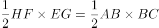，故正方形EFGH的面积为正方形ABCD的一半，即新正方形的面积比原正方形的面积小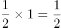平方米。

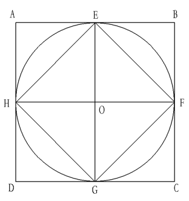

故正确答案为B。

**考点**：几何公式类-平面图形

**来源**：2013年重庆市公务员录用考试《行测》题（下半年）（网友回忆版）第53题

### 第 54 题

4名英国留学生、6名法国留学生、8名德国留学生和12名意大利留学生，参加了孔子学院的活动，现随机抽取3人演出一个汉语节目，问3名学生不都来自同一个国家的概率是多少？

A. 46/51

B. 97/102

C. 188/203

D. 190/203

第 54 题 · 答案与解析

**参考答案（粉笔题库参考内容）**

C

**解析**

留学生的总人数为4+6+8+12=30人，从中随机抽取3人的情况数有种。3名学生不都来自同一个国家，则3名学生来自2个国家或3个国家，正面考虑情况较多，反面考虑。3名学生来自同一个国家的情况数有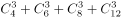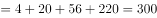种。则3名学生不都来自同一个国家的概率=1-3名学生来自同一个国家的概率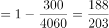。

故正确答案为C。

**考点**：给情况求概率

**来源**：2013年重庆市公务员录用考试《行测》题（下半年）（网友回忆版）第54题

### 第 55 题

甲、乙两个烧杯装有一些盐水，甲杯中盐水的质量是乙杯的2倍，但甲杯盐水的浓度是乙杯的1/2，则将两个烧杯中的盐水混合后得到的盐水浓度为甲杯浓度的多少倍？

A. ‍3/2

B. 4/3

C. 6/5

D. 

第 55 题 · 答案与解析

**参考答案（粉笔题库参考内容）**

B

**解析**

题干为给比例求比例形式，故可赋值。赋值甲杯中盐水质量为20克，浓度为10%，则乙杯中盐水质量为20÷2=10克，浓度为。根据浓度=溶质/溶液，则甲、乙两个烧杯中的盐水混合后得到的盐水浓度为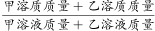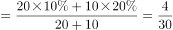，题目所求为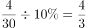倍。

故正确答案为B。

**来源**：2013年重庆市公务员录用考试《行测》题（下半年）（网友回忆版）第55题

### 第 56 题

俄罗斯实行夏令时后，北京和俄罗斯的时差是4小时，例如北京时间12点时，莫斯科是8点。某日当北京时间8：25时，李同学和张老师分别从北京和俄罗斯同时出发去对方所在地，张老师于北京时间15：46到达北京，李同学和张老师在途中所花时间之比是6：7，那李同学到达莫斯科时，当地时间为：

A. 10：25

B. 10：39

C. 10：43

D. 11：51

第 56 题 · 答案与解析

**参考答案（粉笔题库参考内容）**

C

**解析**

张老师北京时间8：25出发，于当日北京时间15：46到达，途中所花时间为7小时21分。根据“李同学和张老师在途中所花时间之比是6：7”，可得李同学在途中所花时间为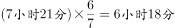，故李同学到达俄罗斯时的北京时间为8：25+6小时18分=14：43，此时俄罗斯时间为10：43。

故正确答案为C。

**考点**：和差倍比问题

**来源**：2013年重庆市公务员录用考试《行测》题（下半年）（网友回忆版）第56题

### 第 57 题

将一个长方体切去一个角后得到的多面体，正好有两个面是三角形，问新得到的多面体有几个顶点？

A. 8

B. 9

C. 10

D. 11

第 57 题 · 答案与解析

**参考答案（粉笔题库参考内容）**

A

**解析**

要使新得到的多面体正好有两个面是三角形，则切面必须要经过两个顶点且仅经过两个顶点。如图所示，切面DQC_1符合条件，即新得到的多面体只有面DQC_1和面CDC_1是三角形。新得到的多面体顶点有A、B、C、D、A_1、B_1、、Q，共8个顶点。

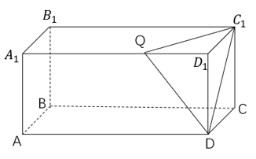

故正确答案为A。

**考点**：几何公式类-立体图形、几何其他题型

**来源**：2013年重庆市公务员录用考试《行测》题（下半年）（网友回忆版）第57题

### 第 58 题

为了保持赛道清洁，每隔10分钟会有一辆清扫车从起点出发，匀速清扫赛道。甲、乙两名车手分别驾驶电动车和自行车考察赛道，甲每隔5分钟追上一辆清扫车，每隔20分钟有一辆清扫车追上乙，问甲的速度是乙的多少倍？

A. 3

B. 4

C. 5

D. 6

第 58 题 · 答案与解析

**参考答案（粉笔题库参考内容）**

D

**解析**

设清扫车速度为1，甲、乙驾驶的两车速度分别为v_甲、v_乙，则相邻两清扫车之间的距离为10×1=10，根据“甲每隔5分钟追上一辆清扫车，每隔20分钟有一辆清扫车追上乙”，可列式：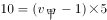，，解得：v_甲=3，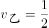，则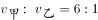，即甲的速度是乙的6倍。

故正确答案为D。

**考点**：相遇追及

**来源**：2013年重庆市公务员录用考试《行测》题（下半年）（网友回忆版）第58题

### 第 59 题

一个数有6个约数，其最小的3个约数之和为11，满足条件的所有数之和是多少？

A. 210

B. 343

C. 798

D. 840

第 59 题 · 答案与解析

**参考答案（粉笔题库参考内容）**

A

**解析**

任何数字的最小约数都为1，因此最小3个约数中另外两个约数之和一定是11-1=10。满足条件的数字有（2、8），（3、7），（4、6）三种情况。若是（2、8），则必然会有约数4；若是（4、6），必然会有约数2，均不满足和1组成三个最小约数的要求，因此最小的三个约数只能为1、3、7。

设此数为M，M是3的倍数，也是7的倍数，必为21的倍数，则M=21n，这个数的约数为1、3、7、21、n、3n、7n、21n，共8个约数。而条件说明M只有6个约数，则其中有2个约数应是重复的，即n应是1、3、7、21中的一个：

若n=1，约数为1、3、7、21，共4个约数，排除；

若n=3，约数为1、3、7、21、9、63，共6个约数，符合题意，此数为63；

若n=7，约数为1、3、7、21、49、147，共6个约数，符合题意，此数为147；

若n=21，约数为1、3、7、21、63、147、441，共7个约数，排除；

故n=3或7，这个数为63或147，所求为63+147=210。

故正确答案为A。

**考点**：公倍数与公约数问题

**来源**：2013年重庆市公务员录用考试《行测》题（下半年）（网友回忆版）第59题

### 第 60 题

100份编号为1—100的文件，交给10名文秘进行录入工作，第一个文秘拿走了编号为1的文件，往后每个人都按编号顺序拿走一定数量的文件，且后边每一个人总是比前一个多拿两份，第10个人拿走的文件编号之和比第5个人拿到的文件编号之和大多少？

A. 1282

B. 1346

C. 1458

D. 1540

第 60 题 · 答案与解析

**参考答案（粉笔题库参考内容）**

D

**解析**

根据题意，第1—10人拿走的文件数量分别为1份、3份、5份、7份、9份、11份、13份、15份、17份、19份。前4人拿走的文件数量和为1+3+5+7=16份，则第5人从编号17开始拿走的9份文件编号之和为17+18+19+20+21+22+23+24+25=21×9=189。同理，前9人拿走的文件数量和为1+3+5+7+9+11+13+15+17=9×9=81份，则第10人从编号82开始拿走的19份文件中编号之和为82+83+84+······+91+······+98+99+100=19×91=1729，则所求为1729-189=1540。

故正确答案为D。

**考点**：数列问题

**来源**：2013年重庆市公务员录用考试《行测》题（下半年）（网友回忆版）第60题

### 第 61 题

某工厂共有160名员工，该厂在7月的平均出勤率是85%，其中女员工的出勤率为90%，男员工的出勤率为70%，问该厂男员工共有多少人？

A. 40

B. 50

C. 70

D. 120

第 61 题 · 答案与解析

**参考答案（粉笔题库参考内容）**

A

**解析**

方法一：设该厂男员工有x人，则女员工有(160-x)人。根据题意可得：，解得x=40，即该厂男员工有40人。

方法二：根据线段法画线段：

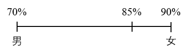

距离之比为（85%-70%）：（90%-85%）=15%：5%=3：1，根据线段法口诀“距离与量成反比”，可得量之比为1：3。设男员工有a人，则女员工有3a人，则a+3a=160，解得a=40，即该厂男员工有40人。

故正确答案为A。

**考点**：和差倍比问题

**来源**：2013年重庆市公务员录用考试《行测》题（下半年）（网友回忆版）第61题

### 第 62 题

今年某高校机械学院、材料学院和经管学院获得拨款的平均额是550万，材料学院、经管学院和外语学院获得拨款的平均额是630万，机械学院和外语学院获得拨款的平均额是670万，则机械学院的拨款额是多少万元？

A. 430

B. 450

C. 520

D. 550

第 62 题 · 答案与解析

**参考答案（粉笔题库参考内容）**

D

**解析**

设机械学院、材料学院、经管学院和外语学院获得的拨款额分别为a万元、b万元、c万元、d万元。根据题意可得：a+b+c=550×3=1650······①，b+c+d=630×3=1890······②，a+d=670×2=1340······③。②-①可得：d-a=240······④，③-④可得：2a=1100，解得a=550，即机械学院的拨款额是550万元。

故正确答案为D。

**考点**：和差倍比问题

**来源**：2013年重庆市公务员录用考试《行测》题（下半年）（网友回忆版）第62题

### 第 63 题

A、B两单位之间的距离为1100米，上午9时甲从A单位前往B单位，乙从B单位前往A单位，两人到达对方单位后分别用5分钟办事，然后原路返回，甲的速度是每小时5千米，乙的速度为每小时6千米，则两人第二次相遇时是上午：

A. 9：17

B. 9：22

C. 9：23

D. 9：30

第 63 题 · 答案与解析

**参考答案（粉笔题库参考内容）**

C

**解析**

题中求两人第二次相遇时间，若不考虑5分钟办事，根据直线两端出发多次相遇公式：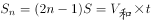，可得：3×1.1=（5+6）×t，解得t=0.3小时，即18分钟。考虑5分钟办事时间，两人第二次相遇需要18+5=23分钟，则两人第二次相遇时间为9：00+23min=9：23。

故正确答案为C。

**考点**：相遇追及

**来源**：2013年重庆市公务员录用考试《行测》题（下半年）（网友回忆版）第63题

### 第 64 题

甲、乙、丙三人共同完成一项工程用了6小时，如果甲与乙的效率之比为1：2，乙与丙的效率之比为3：4，则乙单独完成这项工程需要多少小时？

A. 10

B. 17

C. 24

D. 31

第 64 题 · 答案与解析

**参考答案（粉笔题库参考内容）**

B

**解析**

将题干比例进行统一，可得甲、乙、丙三人的效率之比为3：6：8。赋值甲的效率为3，乙的效率为6，丙的效率为8。则这项工程的工作总量=6×（3+6+8）=102，乙单独完工时间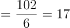小时。

故正确答案为B。

**考点**：给效率比例型

**来源**：2013年重庆市公务员录用考试《行测》题（下半年）（网友回忆版）第64题

### 第 65 题

农场有大型和小型联合收割机7台，一台大型收割机每小时能收割14亩麦田，一台小型收割机每小时能收割10亩麦田，周一至周五两种收割机都工作8小时，周六和周日只有小型收割机每天工作4小时，正好一个星期内将全部3520亩麦田收割完毕，问该农场有小型收割机多少台？

A. 3

B. 4

C. 5

D. 6

第 65 题 · 答案与解析

**参考答案（粉笔题库参考内容）**

C

**解析**

设该农场有小型收割机x台，则大型收割机有（7-x）台。分析题意可知，大型收割机只有周一至周五共5天工作，小型收割机一个星期共7天都工作，则可列式：5×8×14×(7-x)+(5×8+2×4)×10×x=3520，解得x=5，即该农场有小型收割机5台。

故正确答案为C。

**考点**：给具体单位型

**来源**：2013年重庆市公务员录用考试《行测》题（下半年）（网友回忆版）第65题

### 第 66 题

从所给的四个选项中，选择最合适的一个填入问号处，使之呈现一定的规律性：

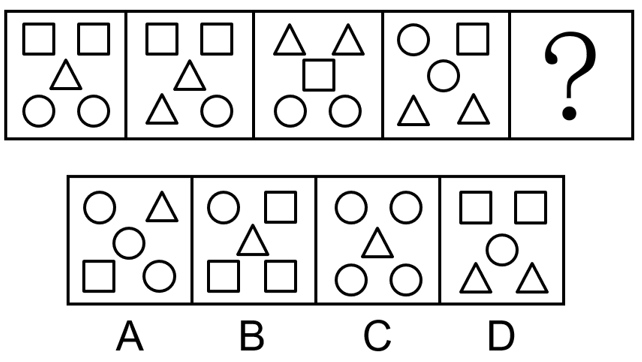

A. A

B. B

C. C

D. D

第 66 题 · 答案与解析

**参考答案（粉笔题库参考内容）**

D

**解析**

观察发现，题干图形均由小元素组成，优先考虑元素的种类和个数。题干图形的元素个数均为5，元素种类均为3，排除C项；继续观察发现，题干每个图形中三种元素的个数分别为1、2、2，只有D项符合规律。

故正确答案为D。

**考点**：数量规律-素

**来源**：2013年重庆市公务员录用考试《行测》题（下半年）（网友回忆版）第66题

### 第 67 题

从所给的四个选项中，选择最合适的一个填入问号处，使之呈现一定的规律性：

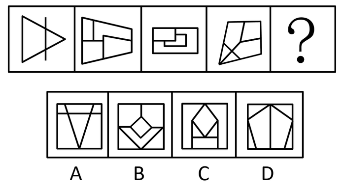

A. A

B. B

C. C

D. D

第 67 题 · 答案与解析

**参考答案（粉笔题库参考内容）**

B

**解析**

元素组成不同，且无明显属性规律，优先考虑数量规律。观察发现，题干图形内部被线条分割，优先考虑数面。题干图形的面数量依次为2、4、3、5，没有规律。考虑面的细化考法，观察面的形状，发现题干每幅图中均有一个面和图形外框的形状相同，因此？处图形应含有一个与外框形状相同的面，只有B项满足规律。

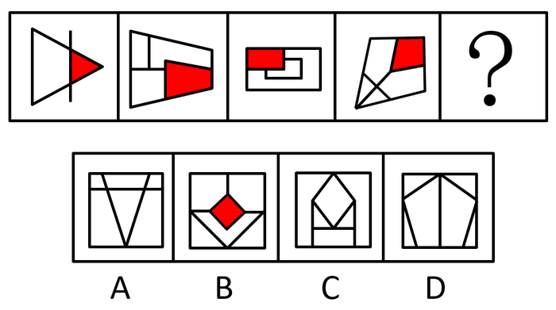

故正确答案为B。

**考点**：数量规律-面

**来源**：2013年重庆市公务员录用考试《行测》题（下半年）（网友回忆版）第67题

### 第 68 题

从所给的四个选项中，选择最合适的一个填入问号处，使之呈现一定的规律性：

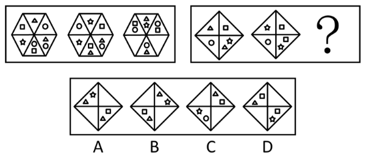

A. A

B. B

C. C

D. D

第 68 题 · 答案与解析

**参考答案（粉笔题库参考内容）**

A

**解析**

元素组成相似，且相同小元素重复出现，优先考虑样式规律。观察发现，第一组图形中，图1和图2内部的小元素去同存异之后得到图3；第二组图形应用此规律，图1和图2内部的小元素去同存异之后得到A项。

故正确答案为A。

**考点**：样式规律-加减同异

**来源**：2013年重庆市公务员录用考试《行测》题（下半年）（网友回忆版）第68题

### 第 69 题

从所给的四个选项中，选择最合适的一个填入问号处，使之呈现一定的规律性：

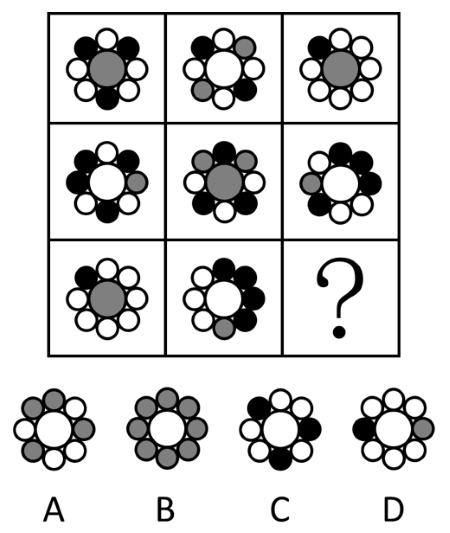

A. A

B. B

C. C

D. D

第 69 题 · 答案与解析

**参考答案（粉笔题库参考内容）**

D

**解析**

元素组成相似，优先考虑样式规律。观察发现，题干每幅图形均出现了白、黑、灰三种颜色的圆，故？处图形应含有这三种颜色的圆，只有D项满足规律。

故正确答案为D。

**考点**：样式规律-遍历

**来源**：2013年重庆市公务员录用考试《行测》题（下半年）（网友回忆版）第69题

### 第 70 题

以下图形序列，将哪两个调换位置后，可以呈现出一定的规律性？

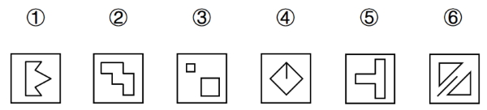

A. ①和②

B. ③和④

C. ④和⑤

D. ⑤和⑥

第 70 题 · 答案与解析

**参考答案（粉笔题库参考内容）**

B

**解析**

元素组成不同，考虑属性规律。题干图形比较规整，且出现明显的等腰元素，优先考虑对称性。画出图形对称轴后发现，将③和④调换位置后，每幅图的对称轴依次逆时针旋转45°。

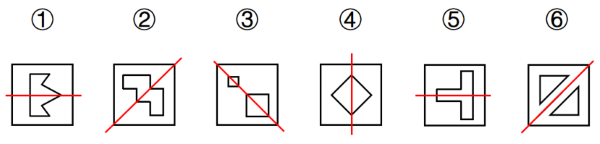

故正确答案为B。

**考点**：属性规律-对称性

**来源**：2013年重庆市公务员录用考试《行测》题（下半年）（网友回忆版）第70题

### 第 71 题

把下面的六个图形分为两类，使每一类图形都有各自的共同特征或规律，分类正确的一项是：

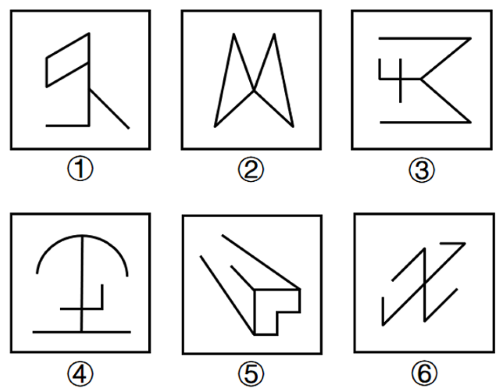

A. ①②③，④⑤⑥

B. ①④⑤，②③⑥

C. ①②⑤，③④⑥

D. ①③⑤，②④⑥

第 71 题 · 答案与解析

**参考答案（粉笔题库参考内容）**

C

**解析**

本题为分组分类题目。图形元素组成不同，优先考虑属性规律。观察题干图形发现，图①②⑤均为带有封闭区域的图形，图③④⑥均为全开放图形，即①②⑤为一组，③④⑥为一组。

故正确答案为C。

**考点**：属性规律-开闭性

**来源**：2013年重庆市公务员录用考试《行测》题（下半年）（网友回忆版）第71题

### 第 72 题

把下面的六个图形分为两类，使每一类图形都有各自的共同特征或规律，分类正确的一项是：

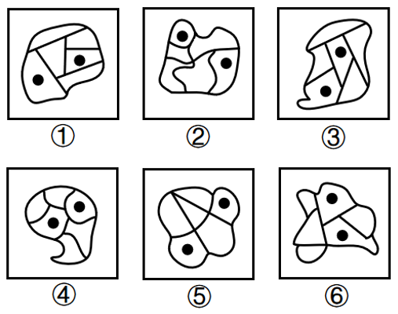

A. ①②⑤，③④⑥

B. ①③⑥，②④⑤

C. ①②③，④⑤⑥

D. ①⑤⑥，②③④

第 72 题 · 答案与解析

**参考答案（粉笔题库参考内容）**

A

**解析**

本题为分组分类题目。题干每幅图形中均有两个黑点，考虑功能元素的标记作用。观察发现，图①②⑤中黑点标记的两个面不连接，图③④⑥中黑点标记的两个面连接，存在公共边。即图①②⑤为一组，图③④⑥为一组。

故正确答案为A。

**考点**：特殊规律-功能元素

**来源**：2013年重庆市公务员录用考试《行测》题（下半年）（网友回忆版）第72题

### 第 73 题

把下面的六个图形分为两类，使每一类图形都有各自的共同特征或规律，分类正确的一项是：

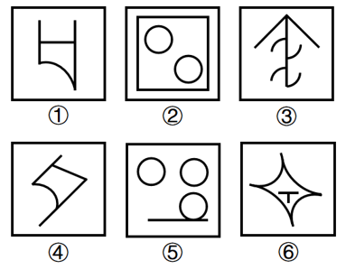

A. ①②③，④⑤⑥

B. ①②④，③⑤⑥

C. ①③⑤，②④⑥

D. ①②⑤，③④⑥

第 73 题 · 答案与解析

**参考答案（粉笔题库参考内容）**

B

**解析**

本题为分组分类题目。元素组成不同，均为有曲有直图形，但无法分组，考虑数量规律。观察发现，题干图形出现多边形和全曲线图形圆，故考虑数直线和曲线，题干图形直线数分别为3、4、3、3、1、2，曲线数分别为：1、2、4、1、3、4。图①②④中，直线数大于曲线数，图③⑤⑥中，直线数小于曲线数，即图①②④为一组，图③⑤⑥为一组。

故正确答案为B。

**考点**：数量规律-复合

**来源**：2013年重庆市公务员录用考试《行测》题（下半年）（网友回忆版）第73题

### 第 74 题

把下面的六个图形分为两类，使每一类图形都有各自的共同特征或规律，分类正确的一项是：

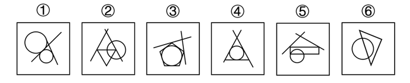

A. ①②④，③⑤⑥

B. ①③⑥，②④⑤

C. ①②③，④⑤⑥

D. ①③④，②⑤⑥

第 74 题 · 答案与解析

**参考答案（粉笔题库参考内容）**

D

**解析**

图形元素组成不同，无明显属性规律，优先考虑数量规律。题干每幅图形都有直线与圆，观察发现，图①③④中的直线与圆之间只有切点，图②⑤⑥中的直线均有穿过圆的交点，即图①③④为一组，图②⑤⑥为一组。

故正确答案为D。

**考点**：数量规律-点

**来源**：2013年重庆市公务员录用考试《行测》题（下半年）（网友回忆版）第74题

### 第 75 题

把下面的六个图形分为两类，使每一类图形都有各自的共同特征或规律，分类正确的一项是：

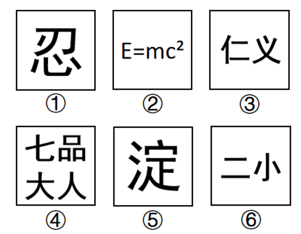

A. ①②④，③⑤⑥

B. ①③④，②⑤⑥

C. ①②⑥，③④⑤

D. ①④⑥，②③⑤

第 75 题 · 答案与解析

**参考答案（粉笔题库参考内容）**

A

**解析**

元素组成不同，且无明显属性规律，优先考虑数量规律。观察发现，题干中出现黑色粗线条、生活化图形，考虑部分数，图①②④的部分数为6，图③⑤⑥的部分数为5，故图①②④为一组，图③⑤⑥为一组。

故正确答案为A。

**考点**：数量规律-素、文字/字母/数字类

**来源**：2013年重庆市公务员录用考试《行测》题（下半年）（网友回忆版）第75题

### 第 76 题

学习有两种形式：同化是指个体在与外界互动中以已有的知识体系和技能经验为基础，形成对当前信息的认识；顺应是指个体在与外界互动中，对自己原有的体系和经验进行调整，以适应当前信息，从而不断完善。

根据上述定义，以下最能体现同化这种学习形式的是：

A. 触类旁通

B. 循序渐进

C. 集思广益

D. 融会贯通

第 76 题 · 答案与解析

**参考答案（粉笔题库参考内容）**

A

**解析**

第一步：找出定义关键词。

同化：“以已有的知识体系和技能经验为基础”、“形成对当前信息的认识”；

顺应：“对自己原有的体系和经验进行调整”、“以适应当前信息，从而不断完善”。

第二步：逐一分析选项。

A项：“触类旁通”的意思是掌握了关于某一事物的知识，进而推知同类中其他事物，其中根据已经掌握的某一事物的知识来推理，符合“以已有的知识体系和技能经验为基础”，进而推知同类中其他事物，符合“形成对当前信息的认识”，符合“同化”的定义，当选；

B项：“循序渐进”的意思是按照一定的步骤逐渐深入或提高，其中并未提及已有的知识体系和技能经验，不符合“以已有的知识体系和技能经验为基础”，不符合“同化”的定义，排除；

C项：“集思广益”的意思是集中众人的智慧，广泛吸收有益的意见，其中并未提及已有的知识体系和技能经验以及对当前信息的认识，不符合“以已有的知识体系和技能经验为基础”、“形成对当前信息的认识”，不符合“同化”的定义，排除；

D项：“融会贯通”的意思是参考并综合多方面的知识或道理，得到全面的、透彻的领悟，是对所掌握的信息得到全面、透彻的理解，并未提及对当前信息的认识，不符合“形成对当前信息的认识”，不符合“同化”的定义，排除。

故正确答案为A。

**考点**：常规问法

**来源**：2013年重庆市公务员录用考试《行测》题（下半年）（网友回忆版）第76题

### 第 77 题

感觉适应是指感觉系统（如视觉、听觉等）对持续作用的刺激输入的反应逐渐减少的现象。感觉对比是指同一刺激因背景不同而产生的感觉差异的现象。

根据上述定义下列属于感觉对比的是：

A. 生活在垃圾场旁边的人，开始可能觉得很臭，时间久了就没什么感觉了

B. 当从黑暗的环境到光照很好的室外时，会觉得光线特别刺眼，但过个几分钟就不会有这种感觉了

C. 同一件衣服放在不同的光线下，所看到的颜色会有差别

D. 南方人初到北方，会觉得菜比较咸，但过几个月就觉得很合口味了

第 77 题 · 答案与解析

**参考答案（粉笔题库参考内容）**

C

**解析**

第一步：找出定义关键词。

感觉适应：“感觉系统（如视觉、听觉等）对持续作用的刺激输入的反应逐渐减少”；

感觉对比：“同一刺激”、“因背景不同而产生的感觉差异”。

第二步：逐一分析选项。

A项：生活在垃圾场旁边的人时间久了闻不到臭味，属于刺激持续作用后反应减少的现象，符合“感觉系统（如视觉、听觉等）对持续作用的刺激输入的反应逐渐减少”，符合“感觉适应”的定义，不符合“感觉对比”的定义，排除；

B项：从黑暗的环境到光照很好的室外时，过几分钟就可以适应室外的光线，属于刺激持续作用后反应减少的现象，符合“感觉系统（如视觉、听觉等）对持续作用的刺激输入的反应逐渐减少”，符合“感觉适应”的定义，不符合“感觉对比”的定义，排除；

C项：同一件衣服属于同一刺激，不同的光线下颜色有差别属于在不同背景下感觉有差异，符合“同一刺激”、“因背景不同而产生的感觉差异”，符合“感觉对比”的定义，当选；

D项：南方人到北方几个月后适应了北方饭菜的口味，属于刺激持续作用后反应减少的现象，符合“感觉系统（如视觉、听觉等）对持续作用的刺激输入的反应逐渐减少”，符合“感觉适应”的定义，不符合“感觉对比”的定义，排除。

故正确答案为C。

**考点**：常规问法

**来源**：2013年重庆市公务员录用考试《行测》题（下半年）（网友回忆版）第77题

### 第 78 题

获致身份是指一个人经历某种公开的、具有竞争性的活动或因具备某种特殊的本领而获得的社会地位。

根据上述定义，以下属于获致身份的是：

A. 爱国者

B. 书法家

C. 董事长

D. 环保人士

第 78 题 · 答案与解析

**参考答案（粉笔题库参考内容）**

B

**解析**

第一步：找出定义关键词。

“经历某种公开的、具有竞争性的活动”、“具备某种特殊的本领”。

第二步：逐一分析选项。

A项：爱国者指热爱国家的人，热爱国家既不是公开的、竞争性的活动，也不是特殊本领，不符合“经历某种公开的、具有竞争性的活动”、“具备某种特殊的本领”，不符合定义，排除；

B项：书法家指擅长书法并在书法上造诣颇深的人，擅长书法属于特殊本领，符合“具备某种特殊的本领”，符合定义，当选；

C项：董事长指公司或机构的最高管理者，不明确其是否经历了公开的、竞争性的活动，也无法体现特殊本领，不符合“经历某种公开的、具有竞争性的活动”、“具备某种特殊的本领”，不符合定义，排除；

D项：环保人士指尽心于环保事业的人，保护环境既不是公开的、竞争性的活动，也不是特殊本领，不符合“经历某种公开的、具有竞争性的活动”、“具备某种特殊的本领”，不符合定义，排除。

故正确答案为B。

**考点**：单定义-其他句式

**来源**：2013年重庆市公务员录用考试《行测》题（下半年）（网友回忆版）第78题

### 第 79 题

金融租赁是指由出租人根据承租人的请求，按双方事先合同的约定，购买承租人指定的固定资产，在出租人拥有该固定资产所有权的前提下，以承租人支付所有租金为条件，将一个时期的该固定资产的占有、使用和收益权让渡给承租人。

根据上述定义，下列属于金融租赁的是：

A. 某科研院所为了提高科研水平，与某金融机构合作，贷款购入大型实验设备，合同规定需要在5年内偿还所有的款项，并以设备作为抵押

B. 某医院为了购进大型检查设备，与某金融机构合作，该机构替医院购入检查设备，承诺医院使用期为10年，收益共享，10年后设备归该金融机构所有

C. 某航运公司为快速建立船队，与某金融机构合作，该机构购买船只供航运企业使用，租期12年，逐年交付租金

D. 某民用航空公司处于增长扩张期，与某金融机构合作，该机构替航空公司购买飞机一架，合同规定航空公司转让25%的股份给该金融机构

第 79 题 · 答案与解析

**参考答案（粉笔题库参考内容）**

C

**解析**

第一步：找出定义关键词。

“出租人根据承租人的请求”、“在出租人拥有该固定资产所有权的前提下”、“将一个时期的该固定资产的占有、使用和收益权让渡给承租人”。

第二步：逐一分析选项。

A项：科研院所向金融机构贷款购入了实验设备，贷款购入说明该实验设备由科研院所购买，不是租赁关系，故不涉及出租人、承租人，不符合“出租人根据承租人的请求”，同时该设备的所有权属于科研院所，不符合“在出租人拥有该固定资产所有权的前提下”，不符合定义，排除；

B项：金融机构根据医院的请求替医院购买了检查设备，其中金融机构是出租人，医院是承租人，符合“出租人根据承租人的请求”，检查设备所有权属于金融机构，符合“在出租人拥有该固定资产所有权的前提下”，但医院在租赁期间与金融机构共享收益，说明收益权并没有完全让渡给医院，不符合“将一个时期的该固定资产的占有、使用和收益权让渡给承租人”，不符合定义，排除；

C项：金融机构根据航运公司的请求替公司购买了船只，其中金融机构是出租人，航运公司是承租人，符合“出租人根据承租人的请求”，有租期、租金说明设备所有权属于金融机构，符合“在出租人拥有该固定资产所有权的前提下”，同时金融机构只收取船只的固定租金，没有收取其他的费用，符合“将一个时期的该固定资产的占有、使用和收益权让渡给承租人”，符合定义，当选；

D项：金融机构替航空公司购买了一架飞机，而航空公司向其转让了25%的股份，但转让的股份是作为支付飞机的购买费用还是租赁费用并不明确，即飞机的所有权属于谁并不确定，不符合“在出租人拥有该固定资产所有权的前提下”，不符合定义，排除。

故正确答案为C。

**考点**：大前提

**来源**：2013年重庆市公务员录用考试《行测》题（下半年）（网友回忆版）第79题

### 第 80 题

能量代谢指的是生物体与周围环境能量交换和存在于生物体内的物质代谢所产生的机械能、化学能、热能及光、电等能量的相互转化和代谢变化的总称。

根据上述定义，以下哪项属于能量代谢？

A. 在海边或者空旷地带建立风力发电站

B. 将鸟类的粪便收集起来，建造沼气池

C. 有些水果含糖量较高，吃多了容易导致肥胖

D. 宇宙间万物不停地进行着物质和能量的交换

第 80 题 · 答案与解析

**参考答案（粉笔题库参考内容）**

C

**解析**

第一步：找出定义关键词。

“生物体与周围环境能量交换”、“生物体内的物质代谢”。

第二步：逐一分析选项。

A项：风力发电站是人类建立的发电装置，并不是生物体，不符合“生物体与周围环境能量交换”、“生物体内的物质代谢”，不符合定义，排除；

B项：利用鸟粪为沼气池提供原料，是用鸟粪来进行能量转换，但鸟粪并不是生物体，不符合“生物体与周围环境能量交换”，同时产生的能量是在沼气池中反应的，而非在生物体内进行的物质代谢，不符合“生物体内的物质代谢”，不符合定义，排除；

C项：水果吃多了容易导致肥胖，说明人体吸收了水果的能量，发胖是吸收能量后的结果，该过程是在人体内完成的，符合“生物体与周围环境能量交换”、“生物体内的物质代谢”，符合定义，当选；

D项：宇宙间万物进行物质和能量的交换，但宇宙万物太过于宽泛，不能确定是否发生在“生物体与周围环境”之间或“生物体内”，不符合“生物体与周围环境能量交换”、“生物体内的物质代谢”，不符合定义，排除。

故正确答案为C。

**考点**：单定义-其他句式

**来源**：2013年重庆市公务员录用考试《行测》题（下半年）（网友回忆版）第80题

### 第 81 题

角色紧张是指某人因为接受外界提出的不同要求而产生的冲突，导致自己承受巨大的心理压力。

根据上述定义，下列不属于角色紧张的是：

A. 电影中汉奸张某既对汪伪政权的指派绝对服从，又感到这样做会被人戳脊梁骨，日后有可能身败名裂，弄得整天惶恐不安

B. 王医生技术精湛，某家医院欲高薪聘请他，但现在医院的领导对他也很重视，王医生思来想去，真是左右为难

C. 李先生对自己的孩子十分溺爱，什么事都依着孩子，结果孩子任性骄横，好逸恶劳，搞得李先生不知道如何是好

D. 小赵因为偷窃被警方抓获，警方要求他交代以往罪行及有无同伙，小赵答应下来，但想到他对同伴的保证，心里七上八下

第 81 题 · 答案与解析

**参考答案（粉笔题库参考内容）**

C

**解析**

第一步：找出定义关键词。

“因为接受外界提出的不同要求而产生的冲突”、“导致自己承受巨大的心理压力”。

第二步：逐一分析选项。

A项：张某一方面对汪伪政权的指派绝对服从，另一方面又觉得会被人戳脊梁骨，说明张某面对汪伪政权和他人的不同要求产生了自我冲突，符合“因为接受外界提出的不同要求而产生的冲突”，最后张某惶恐不安，说明张某承受了很大的心理压力，符合“导致自己承受巨大的心理压力”，符合定义，排除；

B项：王医生一方面对高薪聘请有些心动，另一方面又觉得现在的领导对自己很重视，说明王医生面对高薪聘请和现领导的不同要求产生了自我冲突，符合“因为接受外界提出的不同要求而产生的冲突”，最后王医生左右为难，说明王医生承受了很大的心理压力，符合“导致自己承受巨大的心理压力”，符合定义，排除；

C项：李先生因为十分溺爱孩子导致孩子好逸恶劳，并没有体现出李先生接受了外界提出的不同要求，不符合“因为接受外界提出的不同要求而产生的冲突”，不符合定义，当选；

D项：小赵一方面答应了警方坦白罪行和同伙的要求，另一方面又觉得会违反对同伴的保证，说明小赵面对警方和同伴的不同要求产生了自我冲突，符合“因为接受外界提出的不同要求而产生的冲突”，最后小赵心里七上八下，说明小赵承受了很大的心理压力，符合“导致自己承受巨大的心理压力”，符合定义，排除。

本题为选非题，故正确答案为C。

**考点**：原因结果

**来源**：2013年重庆市公务员录用考试《行测》题（下半年）（网友回忆版）第81题

### 第 82 题

“两不可”指的是一种违反排中律的错误，排中律要求，在同一时间，对同一对象、同一方面，相互否定的思想必有一真。对前述相互否定的思想均加以否定，则犯了“两不可”的错误。

根据上述定义，以下哪项犯了“两不可”的错误?

A. 没人能爬上那座山峰，上去了也没有见回来的

B. 没有什么东西是完全真实的，也没有什么东西是完全虚幻的

C. 不是全班同学都来上课了，也不是全班同学都没来上课

D. 并非有人来上课了，也并非没人来上课

第 82 题 · 答案与解析

**参考答案（粉笔题库参考内容）**

D

**解析**

第一步：找出定义关键词。

排中律：“在同一时间，对同一对象、同一方面”、“相互否定的思想必有一真”；

两不可：“对排中律中相互否定的思想均加以否定”。

第二步：逐一分析选项。

A项：“没人能爬上那座山峰”，谈论的是有没有人能爬上山峰，而“上去了也没有见回来的”，谈论的是爬上山峰后是否有人回来，两句话谈论的话题不同，并不是相互否定的思想，既不符合排中律，也不符合“对排中律中相互否定的思想均加以否定”，不符合“两不可”定义，排除；

B项：“没有什么东西是完全真实的”，谈论的是东西是否可以完全真实，而“没有什么东西是完全虚幻的”，谈论的是东西是否可以完全虚幻，但这两句话并不是相互否定的思想，既不符合排中律，也不符合“对排中律中相互否定的思想均加以否定”，不符合“两不可”定义，排除；

C项：“不是全班同学都来上课了”与“不是全班同学都没来上课”这两句话并不是相互否定的思想，实际上存在两句都错误的可能性，因此既不符合排中律，也不符合“对排中律中相互否定的思想均加以否定”，不符合“两不可”定义，排除；

D项：“有人来上课了”与“没人来上课”这两句话是相互否定的思想，符合排中律，而选项在这两句话前均加了否定词“并非”，符合“对排中律中相互否定的思想均加以否定”，符合“两不可”定义，当选。

故正确答案为D。

**考点**：常规问法

**来源**：2013年重庆市公务员录用考试《行测》题（下半年）（网友回忆版）第82题

### 第 83 题

刑法规定，一种行为要构成正当防卫，必须是为了保护合法权益，这种合法权益可以是国家、公共利益，也可以是本人或他人的合法权利，与此同时，所欲保护的合法权益正在遭受不法侵害。而所谓假想防卫，是指行为人基于认识上的错误，误认为有不法侵害存在，实施防卫行为，造成其想象中的“侵害人”受到损害的行为。

根据上述定义，以下哪项属于假想防卫？

A. 小明认为小方故意欺骗他导致生意失败，将不会游泳的小方推入河中

B. 一老人不慎摔倒在马路上，司机张某下车查看时被路人贾某认为是肇事者，抓住扭打

C. 李某看到儿子痛苦地躺在地上，误以为旁边站着的两人在殴打儿子，于是对这两人拳打脚踢

D. 公交车司机陈某从后观镜看到有一乘客正在行窃，突然猛踩刹车，造成该乘客摔伤

第 83 题 · 答案与解析

**参考答案（粉笔题库参考内容）**

C

**解析**

第一步：找出定义关键词。

正当防卫：“为了保护合法权益”、“所欲保护的合法权益正在遭受不法侵害”；

假想防卫：“行为人基于认识上的错误”、“误认为有不法侵害存在”、“实施防卫行为”、“造成其想象中的‘侵害人’受到损害的行为”。

第二步：逐一分析选项。

A项：小明认为小方故意欺骗他导致生意失败，是否基于认识上的错误并不明确，小方是否真的欺骗过小明也不明确，不符合“行为人基于认识上的错误”、“误认为有不法侵害存在”，不符合“假想防卫”定义，排除；

B项：老人不慎摔倒在马路上，司机张某被路人贾某认为是肇事者，是否基于认识上的错误并不明确，司机张某是否真的撞过老人也不明确，不符合“行为人基于认识上的错误”、“误认为有不法侵害存在”，不符合“假想防卫”定义，排除；

C项：李某看到儿子痛苦地躺在地上，误以为旁边站着的两人在殴打儿子，符合“行为人基于认识上的错误”、“误认为有不法侵害存在”，于是对这两人拳打脚踢，李某进行拳打脚踢是为了保护自己儿子的合法权益，符合“实施防卫行为”、“造成其想象中的‘侵害人’受到损害的行为”，符合“假想防卫”定义，当选；

D项：公交车司机陈某从后观镜看到有一乘客正在行窃，说明该不法侵害是真实存在的，不是基于认识上的错误而误认为有不法侵害存在，不符合“行为人基于认识上的错误”、“误认为有不法侵害存在”，不符合“假想防卫”定义，排除。

故正确答案为C。

**考点**：常规问法

**来源**：2013年重庆市公务员录用考试《行测》题（下半年）（网友回忆版）第83题

### 第 84 题

商业秘密是指不为公众所知悉、能为权利人带来经济利益，具有实用性并经权利人采取保密措施的技术信息或经营信息。

根据上述定义，下列不属于商业秘密的是：

A. 某外语培训机构的专利教材

B. 某碳酸饮料公司招牌产品的配方

C. 某房屋中介机构的客户资料

D. 某软件公司的核心数据库信息

第 84 题 · 答案与解析

**参考答案（粉笔题库参考内容）**

A

**解析**

第一步：找出定义关键词。

“不为公众所知悉、能为权利人带来经济利益”、“具有实用性”、“经权利人采取保密措施的技术信息或经营信息”。

第二步：逐一分析选项。

A项：某外语培训机构的专利教材，既然是教材，很多人会拿到教材，则不符合“不为公众所知悉”，不符合定义，当选；

B项：某碳酸饮料公司招牌产品的配方，配方是该产品的技术信息，且能为公司带来经济利益、不为公众所知悉，符合“不为公众所知悉、能为权利人带来经济利益”、“具有实用性”、“经权利人采取保密措施的技术信息或经营信息”，符合定义，排除；

C项：某房屋中介机构的客户资料，客户资料属于经营信息，且能为该机构带来经济利益、不为公众所知悉，符合“不为公众所知悉、能为权利人带来经济利益”、“具有实用性”、“经权利人采取保密措施的技术信息或经营信息”，符合定义，排除；

D项：某软件公司的核心数据库信息，核心数据库信息属于技术信息，且能为该公司带来经济利益、不为公众所知悉，符合“不为公众所知悉、能为权利人带来经济利益”、“具有实用性”、“经权利人采取保密措施的技术信息或经营信息”，符合定义，排除。

本题为选非题，故正确答案为A。

**考点**：单定义-其他句式

**来源**：2013年重庆市公务员录用考试《行测》题（下半年）（网友回忆版）第84题

### 第 85 题

黑箱是指人们一时无须或无法直接观测其内部结构，只能从外部的输入和输出去认识的现实系统。黑箱方法则是控制论的认识方法。黑箱服务是指经过服务提供者的努力，使服务对象不必了解服务的全过程，直接应用黑箱方法，就可以得到满意的服务。

根据上述定义，下列不属于黑箱服务的是：

A. 银行的理财服务

B. 网络销售服务

C. 股票买卖服务

D. 人工洗车服务

第 85 题 · 答案与解析

**参考答案（粉笔题库参考内容）**

D

**解析**

第一步：找出定义关键词。

黑箱：“无须或无法直接观测其内部结构”、“只能从外部的输入和输出去认识的现实系统”；

黑箱方法：“控制论的认识方法”；

黑箱服务：“经过服务提供者的努力，使服务对象不必了解服务的全过程”、“直接应用黑箱方法，就可以得到满意的服务”。

第二步：逐一分析选项。

A项：银行的理财服务不需要客户了解理财的全过程，只需直接购入理财，就可以得到理财相应的受益或亏损，符合“经过服务提供者的努力，使服务对象不必了解服务的全过程”、“直接应用黑箱方法，就可以得到满意的服务”，符合黑箱服务的定义，排除；

B项：网络销售服务不需要客户了解销售的全过程，如制作流程、供货商等等，只需直接付账，就可以购买到需要的物品，符合“经过服务提供者的努力，使服务对象不必了解服务的全过程”、“直接应用黑箱方法，就可以得到满意的服务”，符合黑箱服务的定义，排除；

C项：股票买卖服务不需要客户了解股票买卖的全过程，只需买入股票，就可以得到股票相应的受益或亏损，符合“经过服务提供者的努力，使服务对象不必了解服务的全过程”、“直接应用黑箱方法，就可以得到满意的服务”，符合黑箱服务的定义，排除；

D项：人工洗车服务过程中客户可以看到洗车的全过程，不符合“经过服务提供者的努力，使服务对象不必了解服务的全过程”、“直接应用黑箱方法，就可以得到满意的服务”，不符合黑箱服务的定义，当选。

本题为选非题，故正确答案为D。

**考点**：常规问法

**来源**：2013年重庆市公务员录用考试《行测》题（下半年）（网友回忆版）第85题

### 第 86 题

辩论：争吵

A. 责备：诋毁

B. 抱怨：埋怨

C. 干扰：骚扰

D. 支持：破坏

第 86 题 · 答案与解析

**参考答案（粉笔题库参考内容）**

C

**解析**

第一步：判断题干词语间逻辑关系。

“辩论”指彼此用一定的理由来说明自己对事物或问题的见解，揭露对方的矛盾；“争吵”指因意见不合大声争辩，互不相让。二者都是在“争道理”，是近义关系，且“争吵”的程度更深。

第二步：判断选项词语间逻辑关系。

A项：“责备”指埋怨他人或自责；“诋毁”指毁谤、污蔑。二者无明显逻辑关系，与题干逻辑关系不一致，排除；

B项：“抱怨”指心中怀有不满，责怪别人；“埋怨”指因为事情不如意而对造成结果的人或事表示不满，指责备，抱怨。二者是近义关系，但并无程度轻重之分，与题干逻辑关系不一致，排除；

C项：“干扰”指打扰，妨碍；“骚扰”意指扰乱他人，使之不得安宁，多用于消极语境，如性骚扰、电话骚扰、短信骚扰等。二者是近义关系，且“骚扰”的程度更深，与题干逻辑关系一致，当选；

D项：“支持”指鼓励或援助；“破坏”指摧毁、毁坏。二者无明显逻辑关系，与题干逻辑关系不一致，排除。

故正确答案为C。

**考点**：语义-其他、语义关系-近义关系

**来源**：2013年重庆市公务员录用考试《行测》题（下半年）（网友回忆版）第86题

### 第 87 题

天空：跳伞

A. 草原：放牧

B. 跑步机：跑步

C. 冬天：滑雪

D. 麦田：收割

第 87 题 · 答案与解析

**参考答案（粉笔题库参考内容）**

A

**解析**

第一步：判断题干词语间逻辑关系。

在天空中跳伞，天空是跳伞的场所，且通常跳伞都在天空中。

第二步：判断选项词语间逻辑关系。

A项：在草原上放牧，草原是放牧的场所，且通常放牧都在草原上，与题干逻辑关系一致，当选；

B项：在跑步机上跑步，但跑步机是一种器械而非一个场所，且跑步通常也在其他地方进行，如公园、操场等，与题干逻辑关系不一致，排除；

C项：在冬天滑雪，但冬天是一个季节而非一个场所，与题干逻辑关系不一致，排除；

D项：在麦田里收割，麦田是收割的场所，但收割通常也可在其他地方进行，如稻田、菜地等，与题干逻辑关系不一致，排除。

故正确答案为A。

**考点**：逻辑关系-对应关系

**来源**：2013年重庆市公务员录用考试《行测》题（下半年）（网友回忆版）第87题

### 第 88 题

果酒：发酵：水果

A. 书桌：组合：木材

B. 米酒：磨制：糯米

C. 照片：显示：屏蔽

D. 玉玺：雕刻：玉石

第 88 题 · 答案与解析

**参考答案（粉笔题库参考内容）**

D

**解析**

第一步：判断题干词语间逻辑关系。

果酒是由水果经过发酵得到的，三者是成品、工艺、原材料的对应关系。

第二步：判断选项词语间逻辑关系。

A项：木材需要经过加工后才能组合成书桌，不能直接组合木材，与题干逻辑关系不一致，排除；

B项：糯米磨制后得到的是糯米粉，不是米酒，与题干逻辑关系不一致，排除；

C项：显示照片是动宾关系，屏蔽照片也是动宾关系，与题干逻辑关系不一致，排除；

D项：玉玺是由玉石经过雕刻得到的，三者是成品、工艺、原材料的对应关系，与题干逻辑关系一致，当选。

故正确答案为D。

**考点**：逻辑关系-对应关系

**来源**：2013年重庆市公务员录用考试《行测》题（下半年）（网友回忆版）第88题

### 第 89 题

画商：经纪人：佣金

A. 股东：出资人：红利

B. 演员：表演者：片酬

C. 律师：执业人员：诉讼费

D. 教师：学者：课时费

第 89 题 · 答案与解析

**参考答案（粉笔题库参考内容）**

B

**解析**

第一步：判断题干词语间逻辑关系。

“画商”是“经纪人”的一种，二者构成种属关系；“佣金”是“经纪人”的收入，二者构成对应关系。

第二步：判断选项词语间逻辑关系。

A项：股东指股份制公司的出资人或投资人，“股东”是“出资人”的一种，二者构成种属关系；“红利”是“出资人”的收入，二者构成对应关系，与题干逻辑关系一致，保留；

B项：“演员”是“表演者”的一种，二者构成种属关系；“片酬”是“表演者”的收入，二者构成对应关系，与题干逻辑关系一致，保留；

C项：“律师”是“执业人员”的一种，二者构成种属关系；诉讼费指当事人为向人民法院提起诉讼程序应当缴纳的费用，“诉讼费”不是“执业人员”的收入，与题干逻辑关系不一致，排除；

D项：学者指专门从事某种学术体系研究的人，包括思想家、哲学家、法学家、文学家、史学家和各类文化的理论或学术专家。有的“教师”是“学者”，有的“教师”不是“学者”，有的“学者”是“教师”，有的“学者”不是“教师”，二者构成交叉关系；“课时费”是“教师”的收入，而不是“学者”的收入，与题干逻辑关系不一致，排除。

对比A、B两项，“画商”和“演员”都是职业，而“股东”不是职业，因此B项与题干逻辑关系更为一致，当选。

故正确答案为B。

**考点**：逻辑关系-包容关系、逻辑关系-对应关系

**来源**：2013年重庆市公务员录用考试《行测》题（下半年）（网友回忆版）第89题

### 第 90 题

（    ） （    ） 对于 司机 相当于 （    ） （    ） 对于 农民

A. 汽车 汽油；土地 山村

B. 路况 出租车；气候 播种机

C. 刹车 方向盘；铁锹 水塘

D. 驾驶 汽车；推销 蔬菜

第 90 题 · 答案与解析

**参考答案（粉笔题库参考内容）**

B

**解析**

逐一代入选项。

A项：“司机”驾驶“汽车”需要“汽油”，三者构成对应关系；“农民”在“土地”上耕种，二者构成对应关系，“农民”和“山村”没有必然联系，前后逻辑关系不一致，排除；

B项：“司机”开车时需要关注“路况”，二者构成对应关系，“司机”开“出租车”，二者构成主宾关系；“农民”耕种时需要关注“气候”，二者构成对应关系，“农民”开“播种机”，二者构成主宾关系，前后逻辑关系一致，当选；

C项：刹车也称为制动，指使运行中的机车、车辆及其他运输工具或机械等停止或减低速度的动作，“刹车”是“司机”驾驶中的动作，二者构成主谓关系，“司机”和“方向盘”没有必然联系；“农民”使用“铁锹”下田劳作，二者构成对应关系，“农民”和“水塘”没有必然联系，前后逻辑关系不一致，排除；

D项：“司机驾驶汽车”，三者构成主谓宾关系，且“司机”和“汽车”构成职业和工具的对应关系；“农民推销蔬菜”，三者构成主谓宾关系；但“农民”和“蔬菜”不构成职业和工具的对应关系，前后逻辑关系不一致，排除。

故正确答案为B。

**考点**：语法关系、逻辑关系-对应关系

**来源**：2013年重庆市公务员录用考试《行测》题（下半年）（网友回忆版）第90题

### 第 91 题

与城市本地学生相比，农民工随迁子女的学习基础大多较差，家庭教育缺失，对学习缺乏主动性和自觉性，比较封闭和缺乏自信。在这一情况下只有吸纳这一群体的学校和老师承担巨大的义务教育责任，并付出相当大的时间和精力，才能保证农民工随迁子女跟上教学进度，从而有效地融入班级学校乃至城市社会。

由此可以推出：

A. 有的农民工随迁子女学习基础扎实，学习有充分的主动性和自觉性

B. 城市中也有些学生家庭教育严重缺失，比较封闭和缺乏自信

C. 如果城市学校和老师能够承担巨大的义务教育责任，并付出相当大的时间和精力，农民工随迁子女就会有效地融入班级、学校和城市社会

D. 如果城市学校和老师不付出相当大的时间和精力，农民工随迁子女就跟不上教学进度

第 91 题 · 答案与解析

**参考答案（粉笔题库参考内容）**

D

**解析**

第一步：翻译题干。

保证农民工随迁子女跟上教学进度→学校和老师承担巨大的义务教育责任 且 付出相当大的时间和精力。

第二步：逐一分析选项。

A项：题干说的是农民工随迁子女的学习基础大多较差，并未提到有的农民工随迁子女学习基础扎实，无法得出此结论，无法推出，排除；

B项：题干说的是农民工随迁子女的教育情况，并未提到城市学生的家庭教育缺失，无法得出此结论，无法推出，排除；

C项：翻译为学校和老师承担巨大的义务教育责任 且 付出相当大的时间和精力→农民工随迁子女就会有效地融入班级、学校和城市社会，是对题干的肯后，但肯后得不到确定性的结论，无法推出，排除；

D项：翻译为-学校和老师付出相当大的时间和精力→-农民工随迁子女跟上教学进度，是对题干的否后，否后必否前，可以推出，当选。

故正确答案为D。

**考点**：常规翻译

**来源**：2013年重庆市公务员录用考试《行测》题（下半年）（网友回忆版）第91题

### 第 92 题

多年以来，教育界所流行的理论是提高学生的自尊心、自信心能给人带来成功，这个理论使老师们倾向于在学生所取得的任何成功上都给予表扬和肯定，以此来建立学生的自信心。然而现在越来越多的老师认识到，一些过多的、模糊的“空表扬”并不能给学生带来长远的好处。

以下哪项如果为真，最能支持上述结论？

A. 调查发现，类似“你真聪明”的表扬具有负面影响，那些经常因聪明而被称赞的学生更容易逃避复杂而困难的任务

B. 研究发现，对于教师们模糊的表扬，很多孩子并不真正在意，他们更愿意获得同伴的肯定

C. 相比含糊的“空表扬”，真实的赞扬更能激发孩子们的进取心，让他们感到自己的聪慧并不是与生俱来的

D. 历史研究表明，相比外向的学生，内向的学生更容易从教师真实的表扬中获得动力，从而建立自信

第 92 题 · 答案与解析

**参考答案（粉笔题库参考内容）**

A

**解析**

第一步：找出论点和论据。

论点：一些过多的、模糊的“空表扬”并不能给学生带来长远的好处。

本题只有论点没有论据，加强优先考虑补充论据。

第二步：逐一分析选项。

A项：该项说经常因聪明而被称赞的学生更容易逃避复杂而困难的任务，说明过多的、模糊的“空表扬”确实不能给学生带来长远的好处，补充论据，可以加强，当选；

B项：该项说很多孩子不在意教师们模糊的表扬，更在意同伴的肯定，与论点说的“空表扬”能否给学生带来长远的好处话题不一致，无法加强，排除；

C项：该项说真实的赞扬更能激发孩子们的进取心，与论点说的“空表扬”能否给学生带来长远的好处话题不一致，无法加强，排除；

D项：该项说内向的学生更容易从教师真实的表扬中获得动力，与论点说的“空表扬”能否给学生带来长远的好处话题不一致，无法加强，排除。

故正确答案为A。

**考点**：补充论据

**来源**：2013年重庆市公务员录用考试《行测》题（下半年）（网友回忆版）第92题

### 第 93 题

有研究表明，已婚成年人接受心脏手术后三个月的生存率是单身人士接受相同手术生存率的三倍。整体而言，单身患病者接受手术后的死亡危险是已婚者的两倍。专家由此认为，已婚人士的婚姻提高了他们手术后的生存率，对于心脏病患者，结婚也许是支有效的强心剂。

以下哪项如果为真，最能反驳上述专家的观点？

A. 家庭生活提高了心脏病患者的体质

B. 对于成年人而言，结婚者比例远高于单身

C. 高危心脏病患者中单身人士居多

D. 很多心脏病严重的患者由于结婚而导致猝死

第 93 题 · 答案与解析

**参考答案（粉笔题库参考内容）**

C

**解析**

第一步：找出论点和论据。

论点：已婚人士的婚姻提高了他们手术后的生存率，对于心脏病患者，结婚也许是支有效的强心剂。

论据：已婚成年人接受心脏手术后三个月的生存率是单身人士接受相同手术生存率的三倍。整体而言，单身患病者接受手术后的死亡危险是已婚者的两倍。

本题的论点和论据均在讨论婚姻会提高心脏病患者的术后生存率，话题一致，优先考虑否定论点。

第二步：逐一分析选项。

A项：该项指出家庭生活提高了心脏病患者的体质，而论点讨论的是婚姻对于心脏病患者的术后生存率的影响，二者话题不一致，无法削弱，排除；

B项：该项指出在成年人中结婚者的比例远高于单身，而论点讨论的是婚姻对于心脏病患者的术后生存率的影响，二者话题不一致，无法削弱，排除；

C项：该项指出高危心脏病患者中单身人士居多，即单身的人士相对于结婚人士在接受手术后的生存率本身就会偏低，故单身并非是影响手术后生存率的唯一因素，因此婚姻不是提高心脏病患者生存率的因素，直接否定论点，当选；

D项：该项指出心脏病患者猝死的原因，而论点讨论的是已婚的心脏病患者术后生存率提高的原因，二者话题不一致，无法削弱，排除。

故正确答案为C。

**考点**：削弱论点

**来源**：2013年重庆市公务员录用考试《行测》题（下半年）（网友回忆版）第93题

### 第 94 题

一项调查显示，长期食用鱼类的孕妇中，有近四分之一的人其血液和头发中水银含量超出标准，而这些水银将会在胎儿脑部堆积，且胎儿出生后水银不易被排出，从而导致智力发育迟缓，因此，孕妇吃鱼不一定能让未来的宝宝变聪明。

以下得出上述结论，隐含的前提不包括：

A. 水银会经胎盘传给胎儿

B. 与常人相比，水银更容易在孕妇体内蓄积

C. 鱼类食品大多含有一定量的水银

D. 水银能在一定程度上损害神经系统

第 94 题 · 答案与解析

**参考答案（粉笔题库参考内容）**

B

**解析**

第一步：找出论点和论据。

论点：孕妇吃鱼不一定能让未来的宝宝变聪明。

论据：长期食用鱼类的孕妇中，有近四分之一的人其血液和头发中水银含量超出标准，而这些水银将会在胎儿脑部堆积，且胎儿出生后水银不易被排出，从而导致智力发育迟缓。

本题的论点和论据都在讨论孕妇长期食用鱼类会导致胎儿智力发育迟缓，论点和论据讨论的话题一致，加强优先考虑必要条件或补充论据，且本题为加强选非题，找到可证明孕妇长期食用鱼类确实会影响胎儿智力发育的三个选项排除即可。

第二步：逐一分析选项。

A项：如果水银不会经胎盘传给胎儿，那么孕妇体内的水银就不会影响到胎儿的智力发育，选项为论点成立的必要条件，可以加强，排除；

B项：该项指出和常人相比水银更容易在孕妇体内蓄积，但并未提及水银是否会影响胎儿，为不明确选项，无法加强，当选；

C项：如果鱼类食品不含有一定量的水银，那么孕妇长期食用鱼类就是安全的，不会导致体内水银含量增加，选项为论点成立的必要条件，可以加强，排除；

D项：如果水银不能在一定程度上损害神经系统，那么孕妇吃鱼就不会影响到胎儿的智力发育，选项为论点成立的必要条件，可以加强，排除。

本题为选非题，故正确答案为B。

**考点**：加强选非题

**来源**：2013年重庆市公务员录用考试《行测》题（下半年）（网友回忆版）第94题

### 第 95 题

关于氨气，众所周知它是一种无色有刺激性臭味的气体，这使得人们对之退避三舍。但鲜为人知的是，氨气确实是一种清洁的可燃气体，氨气在完全燃烧后只会产生水和氮气两种化学物质，这两种都不是污染性物质，不会危及人和其他生物的健康。因此，科学家相信，氨气有望取代氢气，成为新一代绿色能源。

以下哪项如果为真，能够质疑科学家的观点？

A. 氢气燃点低、易爆炸，且很难液化存储和运输

B. 氨气的合成需要氢气，氢气本身也可以燃烧

C. 氨气本身是一种污染性气体，泄露的话会危及人体健康

D. 液氨需要在纯氧环境中才能燃烧，在空气中更为安全

第 95 题 · 答案与解析

**参考答案（粉笔题库参考内容）**

C

**解析**

第一步：找出论点和论据。

论点：氨气有望取代氢气，成为新一代绿色能源。

论据：氨气是一种清洁的可燃气体，氨气在完全燃烧后只会产生水和氮气两种化学物质，这两种都不是污染性物质，不会危及人和其他生物的健康。

论点和论据都在讨论氨气是否为绿色能源，论点论据话题一致，削弱可以考虑削弱论点或者削弱论据。

第二步：逐一分析选项。

A项：该项说的是氢气的缺点，和论点讨论的氨气有望取代氢气，成为新一代绿色能源无关，无关项，无法削弱，排除；

B项：该项说的是氨气的合成需要氢气，和论点讨论的氨气有望取代氢气，成为新一代绿色能源无关，无关项，无法削弱，排除；

C项：该项说的是氨气本身是一种污染性气体，说明氨气不是绿色能源，直接削弱论点，可以削弱，当选；

D项：该项说的是液氨的燃烧条件，和论点讨论的氨气有望取代氢气，成为新一代绿色能源无关，无关项，无法削弱，排除。

故正确答案为C。

**考点**：削弱论点

**来源**：2013年重庆市公务员录用考试《行测》题（下半年）（网友回忆版）第95题

### 第 96 题

有人认为计算机科学发展到现在，还没有出现像“牛顿三大定律”或者“相对论”一样重要的基础理论，甚至是基本的守恒定律也没有，这就是说计算机科学还处于比较初级的阶段，但是另一方面，计算机技术应用面很广，似乎已相当成熟。计算机技术几十年的发展过程中的许多时候，技术跑到了科学的前面。

以下哪项如果为真，最有助于解释上述现象？

A. 计算机企业发展技术时，为了降低成本，首先考虑的是技术的兼容性，至于市场上的主流技术是否合理，往往不是很重视

B. 一门科学必须最先做基础科学研究，再做应用科学研究。发展科学技术的道路，就是这样一条从上游到下游流水线式的模式

C. 计算机技术无需在基础理论的指导下，也能获得发展

D. 计算机的发展往往是从应用需求开始的，发展技术的动力是解决需求中要解决的问题

第 96 题 · 答案与解析

**参考答案（粉笔题库参考内容）**

D

**解析**

第一步：找出题干矛盾。

计算机科学还没有出现像“牛顿三大定律”或者“相对论”一样重要的基础理论，但是计算机技术应用面很广，似乎已相当成熟。

第二步：逐一分析选项。

A项：该项指出计算机企业发展技术时首先考虑技术的兼容性，只能说明计算机技术应用比较广泛，但是没有解释为什么计算机科学没有重要的基础理论但是技术应用面很广，似乎已相当成熟，不能解释题干矛盾，排除；

B项：该项指出发展科学技术是什么模式，但是没有解释为什么计算机科学没有重要的基础理论但是技术应用面很广，似乎已相当成熟，不能解释题干矛盾，排除；

C项：该项指出计算机技术无需基础理论的指导也能发展，可以解释为什么计算机科学没有重要的基础理论也能发展，但是无法解释为什么计算机技术应用面很广，似乎已相当成熟，不能解释题干矛盾，排除；

D项：该项指出计算机的发展是从应用需求开始的，发展技术的动力是解决需求中要解决的问题，因此能解释为什么计算机科学没有重要的基础理论但是技术应用面很广，似乎已相当成熟，能解释题干矛盾，当选。

故正确答案为D。

**考点**：原因解释

**来源**：2013年重庆市公务员录用考试《行测》题（下半年）（网友回忆版）第96题

### 第 97 题

克罗地亚、德国、意大利、西班牙、英国、法国六个国家即将进行足球比赛，球迷小明、小雷、小敏对谁会获得比赛冠军进行了一番讨论，小雷认为：冠军不是法国就是德国；小敏认为：冠军绝不是意大利；小明则认为：法国和克罗地亚都不可能取得冠军。

比赛结束后，三人发现他们中只有一个人是对的，那么以下哪个国家的球队可能获得冠军？

A. 法国

B. 德国

C. 意大利

D. 英国

第 97 题 · 答案与解析

**参考答案（粉笔题库参考内容）**

C

**解析**

第一步：分析题干条件。

（1）小雷：冠军不是法国就是德国；

（2）小敏：冠军不是意大利；

（3）小明：法国和克罗地亚都不可能取得冠军。

第二步：根据题干条件进行推理。

提问方式为“可能”，优先使用代入法。

代入A项：如果法国获得冠军，那么小雷、小敏说法均正确，不符合“只有一个人是对的”，不满足题干条件，排除；

代入B项：如果德国获得冠军，那么小雷、小敏、小明说法均正确，不符合“只有一个人是对的”，不满足题干条件，排除；

代入C项：如果意大利获得冠军，那么小雷、小敏说法错误，小明说法正确，符合“只有一个人是对的”，满足题干条件，当选；

代入D项：如果英国获得冠军，那么小敏、小明说法均正确，不符合“只有一个人是对的”，不满足题干条件，排除。

故正确答案为C。

**考点**：代入法

**来源**：2013年重庆市公务员录用考试《行测》题（下半年）（网友回忆版）第97题

### 第 98 题

根据以往的规定，A股大宗交易最低门槛为50万股或300万人民币的额度，这样的大宗交易一旦进入二级市场，无疑将对个股股价产生冲击。为了稳定市场价格，上交所发布新政，将大宗交易的门槛大幅降低，旨在避免批量的买卖交易影响个股股价。

以下哪项如果为真，最能削弱上述新政的作用？

A. 交易门槛降低后，为避免损失而集中抛售个股的大宗交易明显增多

B. 随着交易门槛降低，通过大宗交易而获利的投资者越来越少

C. 没有降低门槛之前，大宗交易的数量一直保持在较为稳定的范围内

D. 交易门槛降低后，基金经理更乐于使用大宗交易的方式

第 98 题 · 答案与解析

**参考答案（粉笔题库参考内容）**

A

**解析**

第一步：找出论点和论据。

论点：大宗交易的门槛大幅降低，旨在避免批量的买卖交易影响个股股价。

论据：无。

本题只有论点，没有论据，削弱优先考虑削弱论点。

第二步：逐一分析选项。

A项：该项指出交易门槛降低后，集中抛售会带来批量的大宗交易，带来批量的买卖交易则无法避免批量的买卖交易影响个股股价，削弱论点，当选；

B项：该项指出新政实施后从大宗交易中获利的投资者变少，获利的投资者变少，不明确具体的交易数量是否变少，也不明确是否会影响个股股价，不明确项，无法削弱，排除；

C项：该项指出降低门槛之前的情况，但是无法得知新政实施后也就是降低门槛之后交易数量的变化，不明确项，无法削弱，排除；

D项：该项指出交易门槛降低后，基金经理更乐于使用大宗交易的方式，但是基金经理的选择是否会避免批量的买卖交易影响个股股价并不明确，不明确项，无法削弱，排除。

故正确答案为A。

**考点**：削弱论点

**来源**：2013年重庆市公务员录用考试《行测》题（下半年）（网友回忆版）第98题

### 第 99 题

科学家在北极地区的一个岛——埃尔斯米尔岛上发现了一片5500万年前的森林化石，化石中，有长度大约1米的树根，也有长度超过10米的树干。因此研究人员推断，这里原来应该是一片巨大茂密的森林，并且曾经和北极、欧洲、北美是一片统一的大陆。

以下哪项如果为真，不能支持上述结论？

A. 北极地区在5500万年前气候比现在要暖和得多，可见今天的北极地区在当时是没有冰雪的

B. 这片化石中发现了不同的植物种类，其中最多的是大红杉。尽管大红杉是耐寒植物，但它的原产地都在今天的美国西部

C. 这片森林与今天大西洋两岸的植物之间有很大的生物相似性，可以推断它们曾经是一片连续的森林

D. 埃尔斯米尔岛所在地区在最近一次冰川期地形发生变化之前，冰川的压力使其与欧洲和北美连接的部分陆地沉到海平面以下，形成了今天的北极群岛

第 99 题 · 答案与解析

**参考答案（粉笔题库参考内容）**

A

**解析**

第一步：找出论点和论据。

论点：埃尔斯米尔岛原来应该是一片巨大茂密的森林，并且曾经和北极、欧洲、北美是一片统一的大陆。

论据：埃尔斯米尔岛上发现了一片5500万年前的森林化石，化石中，有长度大约1米的树根，也有长度超过10米的树干。

本题为选非题，故排除可以加强的选项，选择不能加强的选项即可。

第二步：逐一分析选项。

A项：该项指出北极地区在5500万年前气候暖和、没有冰雪，但是不明确该地是否为森林，也不明确该地和北极、欧洲、北美是否为统一的大陆，为不明确项，不能加强，当选；

B项：该项指出化石中发现了不同的植物种类，其中大红杉原产地在今天的美国西部，说明该地曾经确实有很多植物出现，并且与北美是统一的大陆，补充论据，能够加强，排除；

C项：该项指出这片森林与今天大西洋两岸的植物之间有很大的生物相似性，可以推断它们曾经是一片连续的森林。这片森林能和大西洋两岸的森林连续，说明这里原来是一片巨大茂密的森林，补充论据，能够加强，排除；

D项：该项指出北极群岛是埃尔斯米尔岛与欧洲、北美连接的部分陆地下沉所形成的，说明埃尔斯米尔岛曾经和欧洲、北美是一片统一的大陆，补充论据，能够加强，排除。

本题为选非题，故正确答案为A。

**考点**：加强选非题

**来源**：2013年重庆市公务员录用考试《行测》题（下半年）（网友回忆版）第99题

### 第 100 题

近日一项研究显示，男性与女性在视觉能力上有较大区别：女性在对颜色的识别上要强于男性，而男性的视觉优势则体现在对远处物体的细节敏感度以及对快速移动物体的追踪能力上。研究人员称，这种区别的出现是因为男性与女性长期社会分工角色的不同。

以下哪项如果为真，最能支持上述结论？

A. 在一项对美术习作的调查中，男性作者在作品中对物体形状的把握要优于女性，而女性对于作品色彩的对比运用则要略胜一筹

B. 有研究发现，由于男性更喜欢观看对抗性强的足球比赛，因此男性对足球赛场的观察力优于女性

C. 长期以来“女主内，男主外”的社会观念，促使男性更具有全局观，女性则更关注细节

D. 远古时代，发现猎物并对猎物进行定位，捕杀是男性的主要工作，而女性负责采集野果，这一过程训练了她们对颜色的敏感性

第 100 题 · 答案与解析

**参考答案（粉笔题库参考内容）**

D

**解析**

第一步：找出论点和论据。

论点：男性与女性视觉能力上的区别是因为男性与女性长期社会分工角色的不同。

论据：男性与女性在视觉能力上有较大区别：女性在对颜色的识别上要强于男性，而男性的视觉优势则体现在对远处物体的细节敏感度以及对快速移动物体的追踪能力上。

本题论据在讨论男女在视觉能力上的区别，论点在讨论男女视觉能力上的区别是否是因为男性与女性长期社会分工角色的不同，论点与论据话题不一致，加强优先考虑搭桥。

第二步：逐一分析选项。

A项：该项指出在美术习作中，男女擅长的方面有所不同，但未说明具体原因，不明确和社会分工角色有何关系，不明确项，不能加强，排除；

B项：该项指出男性对足球赛场的观察力优于女性，但未说明具体原因，不明确和社会分工角色有何关系，不明确项，不能加强，排除；

C项：该项指出“女主内，男主外”的社会观念促使男性更具有全局观，女性更关注细节，但是题干论点讨论的是男女视觉能力上的区别是否是因为男性与女性长期社会分工角色的不同，全局观和关注细节与论点讨论的话题不一致，无关项，不能加强，排除；

D项：该项指出远古时期男女分工角色有所不同，是因为男女分工角色不同导致了男女在视觉能力上有较大区别，建立了论点与论据之间的关系，搭桥项，可以加强，当选。

故正确答案为D。

**考点**：搭桥

**来源**：2013年重庆市公务员录用考试《行测》题（下半年）（网友回忆版）第100题

## 材料 1

2011年来华留学生（不含港、澳、台地区，下同）总人数比上年增加27521名，增幅为10.38%，其中自费生总人数266924名，比上年增长24224名，其余为中国政府奖学金生，共计25687名。

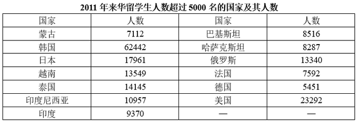

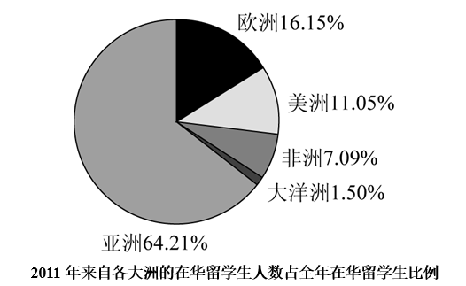

### 第 101 题

2011年来华的留学生中，中国政府奖学金生比上年增加了多少人?

A. 2857

B. 3297

C. 3737

D. 4177

第 101 题 · 答案与解析

**参考答案（粉笔题库参考内容）**

B

**解析**

根据题干“2011年······比上年增加······人”，可判定本题为增长量计算问题。定位文字材料可得：2011年来华留学生（不含港、澳、台地区，下同）总人数比上年增加27521名，增幅为10.38%，其中自费生总人数266924名，比上年增长24224名，其余为中国政府奖学金生，共计25687名。则中国政府奖学金生人数同比增长量=来华留学生人数同比增长量-自费生人数同比增长量=27521-24224=3297人。

故正确答案为B。

**考点**：增长量计算、综合资料

**来源**：2013年重庆市公务员录用考试《行测》题（下半年）（网友回忆版）第101题

### 第 102 题

2011年来自亚洲的留学生人数约为（    ）。

A. 152340

B. 164320

C. 187900

D. 202010

第 102 题 · 答案与解析

**参考答案（粉笔题库参考内容）**

C

**解析**

根据题干“2011年来自亚洲的留学生人数约为”，结合图形材料给出2011年来自亚洲的在华留学生人数占全年在华留学生的比例为64.21%，可判定本题为现期比重问题。

方法一：定位文字材料可得：2011年来华留学生总人数比上年增加27521名，增幅为10.38%。根据公式：基期量=增长量/增长率、现期量=基期量+增长量，可得2011年在华留学生总人数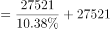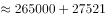≈293000名。根据公式：部分量=整体量×比重，可得2011年来自亚洲的留学生人数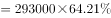≈188000名，与C项最接近。

方法二：定位文字材料可得：2011年来华留学生自费生总人数266924名，其余为中国政府奖学金生，共计25687名，则2011年在华留学生总人数=266924+25687=292611名。根据公式：部分量=整体量×比重，可得2011年来自亚洲的留学生人数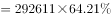≈188000名，与C项最接近。

故正确答案为C。

备注：题干表述不严谨，结合材料数据，本题所求应为2011年来自亚洲的“在华留学生”人数。

**考点**：现期比重、综合资料

**来源**：2013年重庆市公务员录用考试《行测》题（下半年）（网友回忆版）第102题

### 第 103 题

按国家统计，2011年在华留学生人数从多到少排序正确的是（    ）。

A. 美国—俄罗斯—印度

B. 俄罗斯—泰国—法国

C. 印度—巴基斯坦—印度尼西亚

D. 越南—日本—俄罗斯

第 103 题 · 答案与解析

**参考答案（粉笔题库参考内容）**

A

**解析**

定位表格材料可知，2011年来华留学生人数超过5000名的国家及其人数。代入选项验证：

A项：美国（23292）＞俄罗斯（13340）＞印度（9370），正确；

B项：俄罗斯（13340）＜泰国（14145），错误；

C项：巴基斯坦（8516）＜印度尼西亚（10957），错误；

D项：越南（13549）＜日本（17961），错误。

故正确答案为A。

**考点**：排序类、综合资料

**来源**：2013年重庆市公务员录用考试《行测》题（下半年）（网友回忆版）第103题

### 第 104 题

若2011年来华的韩国留学生均为自费生，则其他国家留学生中中国政府奖学金生的比例约为（    ）。

A. 9%

B. 11%

C. 15%

D. 20%

第 104 题 · 答案与解析

**参考答案（粉笔题库参考内容）**

B

**解析**

根据题干“若2011年······其他国家留学生中中国政府奖学金生的比例约为”，可判定本题为现期比重问题。定位文字材料可得：2011年来华留学生自费生总人数266924名，其余为中国政府奖学金生，共计25687名。定位表格材料可得：2011年来华韩国留学生62442人。则2011年其他国家留学生中中国政府奖学金生的比例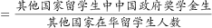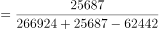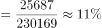。

故正确答案为B。

**考点**：现期比重、综合资料

**来源**：2013年重庆市公务员录用考试《行测》题（下半年）（网友回忆版）第104题

### 第 105 题

关于2011年来华留学生状况，下列说法正确的是（    ）。

A. 德国是来华留学生人数最多的欧洲国家

B. 来华留学生人数排名前五的都是亚洲国家

C. 越南来华留学生人数超过非洲各国的总和

D. 美洲来华留学生中，美国来华留学生占一半以上

第 105 题 · 答案与解析

**参考答案（粉笔题库参考内容）**

D

**解析**

A项：定位表格材料可知：2011年俄罗斯来华留学生人数为13340名，德国来华留学生人数为5451名。故德国并不是来华留学生人数最多的欧洲国家，错误；

B项：定位表格材料可知：来华留学生人数排名前五的国家依次为：韩国、美国、日本、泰国和越南，美国并非亚洲国家，错误；

C项：定位表格材料可知：2011年，越南来华留学生人数为13549名；定位饼形图可知：2011年非洲来华留学生人数占全年来华留学生的比例为7.09%。结合本篇材料第2题计算可知：2011年来华留学生共约293000名。根据公式：部分=整体×比重，则非洲各国来华留学生共有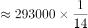=20000+名＞13549名，错误；

D项：定位表格材料可知：2011年美国来华留学生为23292名。定位饼形图可知：2011年，美洲来华留学生人数占全年来华留学生的比例为11.05%。结合本篇材料第2题计算可知：2011年来华留学生共约293000名。根据公式：部分=整体×比重，则美洲来华留学生共有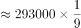= 32000+名，而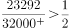，正确。

故正确答案为D。

**考点**：综合分析、综合资料

**来源**：2013年重庆市公务员录用考试《行测》题（下半年）（网友回忆版）第105题

## 材料 2

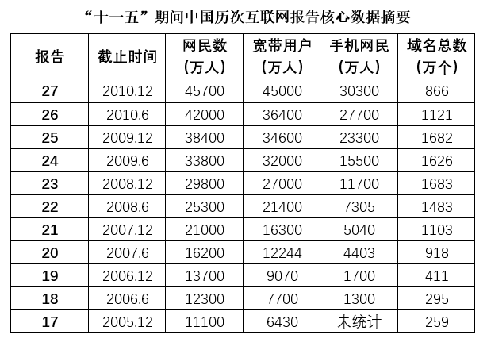

### 第 106 题

第几次报告中，我国宽带用户数首次超过网民数的80%？

A. 20

B. 21

C. 22

D. 23

第 106 题 · 答案与解析

**参考答案（粉笔题库参考内容）**

C

**解析**

根据题干“······超过······的80%”，可判定本题为现期比重问题。定位表格可知，第20次至第23次报告中，我国宽带用户数及网民数。根据公式：部分=整体×比重，则有：

第20次报告：12244万人＜16200×80%=12960万人；

第21次报告：16300万人＜21000×80%=16800万人；

第22次报告：21400万人＞25300×80%=20240万人，即第22次报告中，我国宽带用户数首次超过网民数的80%。

故正确答案为C。

**考点**：现期比重、统计表

**来源**：2013年重庆市公务员录用考试《行测》题（下半年）（网友回忆版）第106题

### 第 107 题

“十一五”期间，我国网民平均每年增长（    ）。

A. 3460万人

B. 6920万人

C. 9140万人

D. 12300万人

第 107 题 · 答案与解析

**参考答案（粉笔题库参考内容）**

B

**解析**

根据题干“‘十一五’期间······平均每年增长”，结合选项有单位，可判定本题为年均增长量问题。定位表格可知：截止到2005年12月我国网民人数为11100万人，截止到2010年12月我国网民人数为45700万人。根据公式：年均增长量，则“十一五”期间，我国网民平均每年的增长量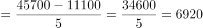万人。

故正确答案为B。

**考点**：年均增长量、统计表

**来源**：2013年重庆市公务员录用考试《行测》题（下半年）（网友回忆版）第107题

### 第 108 题

“十一五”期间，我国手机网民人数增长最多的年份是（    ）。

A. 2007年

B. 2008年

C. 2009年

D. 2010年

第 108 题 · 答案与解析

**参考答案（粉笔题库参考内容）**

C

**解析**

根据题干“······增长最多的年份是”，可判定本题为增长量比较问题。定位统计表可得：截止到2006年12月、2007年12月、2008年12月、2009年12月、2010年12月，我国手机网民人数分别为1700万人、5040万人、11700万人、23300万人、30300万人。根据公式：增长量=现期量-基期量，可得“十一五”期间，我国手机网民人数增长量分别为：

2007年：5040-1700=3340万人；

2008年：11700-5040=6660万人；

2009年：23300-11700=11600万人；

2010年：30300-23300=7000万人。

综上，“十一五”期间，我国手机网民人数增长最多的年份是2009年。

故正确答案为C。

**考点**：增长量比较、统计表

**来源**：2013年重庆市公务员录用考试《行测》题（下半年）（网友回忆版）第108题

### 第 109 题

在域名总数最多的报告中，宽带用户数约是手机网民人数的多少？

A. 2.9倍

B. 2.3倍

C. 2.0倍

D. 1.5倍

第 109 题 · 答案与解析

**参考答案（粉笔题库参考内容）**

B

**解析**

根据题干“······是······的多少”，结合选项带单位“倍”，可判定本题为现期倍数问题。定位统计表可知，域名总数最多的报告为第23次报告（1683万个），该次报告中宽带用户数为27000万人，手机网民人数为11700万人，则所求倍数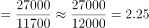倍，与B项最接近。

故正确答案为B。

**考点**：现期倍数、统计表

**来源**：2013年重庆市公务员录用考试《行测》题（下半年）（网友回忆版）第109题

### 第 110 题

关于“十一五”期间，我国互联网的发展，下列说法正确的是（    ）。

A. 宽带用户数增加了6倍左右

B. 手机网民人数增加了3亿以上

C. 域名总数逐年上升

D. 宽带用户数占网民人数的比重逐年上升

第 110 题 · 答案与解析

**参考答案（粉笔题库参考内容）**

A

**解析**

A项：定位统计表，截止到2005年12月、2010年12月，我国宽带用户数分别为6430万人、45000万人。根据公式：增长率，可得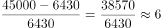倍，即宽带用户数增加了6倍左右，正确；

B项：材料中没有给出截止到2005年12月我国手机网民人数的数据，故无法求出手机网民人数的增长量，错误；

C项：定位统计表，截止到2008年12月、2009年12月，我国域名总数分别为1683万个、1682万个，1682万个＜1683万个，则域名总数并非逐年上升，错误；

D项：定位统计表可得“十一五”期间我国宽带用户数和网民数。根据公式：比重=部分/整体，可得截止到2008年12月宽带用户数占网民人数的比重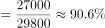，截止到2009年12月宽带用户数占网民人数的比重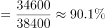，90.1%＜90.6%，则比重并非逐年上升，错误。

故正确答案为A。

**考点**：统计表、综合分析

**来源**：2013年重庆市公务员录用考试《行测》题（下半年）（网友回忆版）第110题

## 材料 3

2010年，全年社会固定资产投资278140亿元，同比增长了23.8%，比上年回落了6.2个百分点。其中，城镇固定资产投资完成241415亿元，同比增长24.5%，比上年回落了5.9个百分点。

        在城镇固定资产投资中，全年工业完成投资额98716亿元，同比增长了22.8%，比上年回落了3.4个百分点，其中，制造业投资74528亿元，同比增长27%。比上年加快了0.2个点。

         全年六大高耗能产业完成投资额34754亿元，同比增长了14.8%，比上年回落了7个百分点，其中，非金属矿物制造业、化学原料及化学制品制造业和电力、热力的生产与供应业分别增长28%和14.8%和6.6%，比上年回落15.5、12.1和16.2个百分点。石油加工炼焦及核燃料加工业、有色金属冶炼及压延加工业投资分别增长12.9%和35.8%，比上年加快12.5个和19个百分点；黑色金属冶炼及压延加工业投资由上年下降1.3%转为增长6.1%。

         轻工行业投资增幅回落，其中农副食品加工和食品制造业分别增长28.1%和28.8%，比上年回落10.1个和3.6个百分点；纺织行业投资增速加快，其中纺织业增长26.4%，比上年加快11.6个百分点；纺织服装、鞋、帽制造业增长34.4%，比上年加快17.4个百分点；化学纤维制造业由上年下降6.4%转为增长42.2%；烟草行业投资216亿元，由上年同比增长63.7%转为下降0.4%。

### 第 111 题

2010年全社会固定资产投资额比2008年上升了（    ）。

A. 17.6%

B. 23.8%

C. 53.8%

D. 60.9%

第 111 题 · 答案与解析

**参考答案（粉笔题库参考内容）**

D

**解析**

根据题干“2010年······比2008年上升了”，结合选项为百分数，可判定本题为间隔增长率计算问题。定位文字材料第一段：2010年，全年社会固定资产投资278140亿元，同比增长了23.8%，比上年回落了6.2个百分点。可知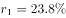，。根据公式：，可得2010年全社会固定资产投资额比2008年上升。

故正确答案为D。

**考点**：文字资料、间隔增长率

**来源**：2013年重庆市公务员录用考试《行测》题（下半年）（网友回忆版）第111题

### 第 112 题

在城镇固定资产投资中，2009年和2010年制造业投资额占工业完成投资额的比重（    ）。

A. 比上年均有上升

B. 比上年均有下降

C. 2009年比上年下降，2010年比上年上升

D. 2009年比上年上升，2010年比上年下降

第 112 题 · 答案与解析

**参考答案（粉笔题库参考内容）**

A

**解析**

根据题干“······2009年和2010年······占······的比重”，结合选项为比上年上升/下降，可判定本题为两期比重比较问题。定位文字材料第二段：（2010年）在城镇固定资产投资中，全年工业完成投资额98716亿元，同比增长了22.8%（b_1），比上年回落了3.4个百分点，其中，制造业投资74528亿元，同比增长27%（a_1），比上年加快了0.2个点。根据两期比重比较结论：当部分增长率（a）大于整体增长率（b）时，比重上升，反之下降。2010年：a_1（27%）＞b_1（22.8%），比重上升；2009年，a_2（27%-0.2%=26.8%）＞b_2（22.8%+3.4%=26.2%），比重上升。故在城镇固定资产投资中，2009年和2010年制造业投资额占工业完成投资额的比重比上年均有上升。

故正确答案为A。

**考点**：两期比重、文字资料

**来源**：2013年重庆市公务员录用考试《行测》题（下半年）（网友回忆版）第112题

### 第 113 题

对高能耗产业2009年完成投资的同比增长率描述正确的是（    ）。

A. 化学原料及化学制品制造业＞非金属矿物制造业

B. 非金属矿物制造业＞有色金属冶炼及压延加工业

C. 黑色金属冶炼及压延加工业＞电力、热力的生产与供应业

D. 石油加工炼焦及核燃料加工业＞有色金属冶炼及压延加工业

第 113 题 · 答案与解析

**参考答案（粉笔题库参考内容）**

B

**解析**

根据题干“对······2009年完成投资的同比增长率描述正确的是”，可判定本题为一般增长率问题。定位文字材料第三段：（2010年）非金属矿物制造业、化学原料及化学制品制造业和电力、热力的生产与供应业分别增长28%和14.8%和6.6%，比上年回落15.5、12.1和16.2个百分点。石油加工炼焦及核燃料加工业、有色金属冶炼及压延加工业投资分别增长12.9%和35.8%，比上年加快12.5个和19个百分点；黑色金属冶炼及压延加工业投资由上年下降1.3%转为增长6.1%。可知2009年完成投资的同比增长率分别为：

非金属矿物制造业：28%+15.5%=43.5%；

化学原料及化学制品制造业：14.8%+12.1%=26.9%；

电力、热力的生产与供应业：6.6%+16.2%=22.8%；

石油加工炼焦及核燃料加工业：12.9%-12.5%=0.4%；

有色金属冶炼及压延加工业：35.8%-19%=16.8%；

黑色金属冶炼及压延加工业：-1.3%。

综上，描述正确的是B项，即非金属矿物制造业（43.5%）＞有色金属冶炼及压延加工业（16.8%）。

故正确答案为B。

**考点**：一般增长率、文字资料

**来源**：2013年重庆市公务员录用考试《行测》题（下半年）（网友回忆版）第113题

### 第 114 题

2009年烟草行业固定资产投资额约为多少亿元？

A. 137

B. 215

C. 217

D. 339

第 114 题 · 答案与解析

**参考答案（粉笔题库参考内容）**

C

**解析**

根据题干“2009年烟草行业固定资产投资额约为多少亿元”，结合材料所给时间为2010年，可判定本题为基期计算问题。定位文字材料第四段可得：2010年，烟草行业投资216亿元，同比下降0.4%。根据公式：基期，则2009年烟草行业固定资产投资额亿元，与C项最接近。

故正确答案为C。

**考点**：基期计算、文字资料

**来源**：2013年重庆市公务员录用考试《行测》题（下半年）（网友回忆版）第114题

### 第 115 题

下列说法与材料相符的是（    ）。

A. 2009年农副食品加工投资额比上年下降10.1%

B. 2010年城镇固定资产投资额同比增速慢于2009年

C. 2010年化学纤维制造业投资额比上年增加了48.6%

D. 2010年城镇固定资产投资额占全社会固定资产投资额的比重接近80%

第 115 题 · 答案与解析

**参考答案（粉笔题库参考内容）**

B

**解析**

A项：定位材料第四段可得：2010年，轻工行业投资增幅回落，其中农副食品加工和食品制造业分别增长28.1%和28.8%，比上年回落10.1个和3.6个百分点，则2009年农副食品加工投资额比上年增长28.1%+10.1%=38.2%，错误；

B项：定位材料第一段可得：2010年，城镇固定资产投资完成241415亿元，同比增长24.5%，比上年回落了5.9个百分点。则2009年城镇固定资产投资额同比增速=24.5%+5.9%=30.4%，故2010年城镇固定资产投资额同比增速慢于2009年，正确；

C项：定位材料第四段可得：2010年，化学纤维制造业由上年下降6.4%转为增长42.2%。则2010年化学纤维制造业投资额比上年增加了42.2%，错误；

D项：定位材料第一段可得：2010年，全年社会固定资产投资278140亿元，其中，城镇固定资产投资完成241415亿元。则2010年城镇固定资产投资额占全社会固定资产投资额的比重，即比重超过80%，错误。

故正确答案为B。

**考点**：文字资料、综合分析

**来源**：2013年重庆市公务员录用考试《行测》题（下半年）（网友回忆版）第115题

## 材料 4

我国近岸海域面积为279225平方千米，2010年，按照监测点位计算，水质良好的一、二类海水占62.7%，比上年下降10.2个百分点；三类海水占14.1%，比上年上升8.1个百分点；四类和劣四类海水占23.2%，比上年上升2.1个百分点。而2009年发生赤潮已达68次，44.6%的入海河流水质为五类和劣五类。

        图为2010年四大海区近岸海域一、二类和四类、劣四类海水年际比较，其中渤海是中国唯一的内海，面积为77000平方千米。

### 第 116 题

2010年我国海域监测为一、二类海水的面积约为多少万平方千米？

A. 13.5

B. 15.5

C. 17.5

D. 19.5

第 116 题 · 答案与解析

**参考答案（粉笔题库参考内容）**

C

**解析**

根据题干“2010年我国海域监测为一、二类海水的面积约为多少万平方千米”，结合材料时间为2010年，同时给出我国按照监测点位计算，水质良好的一、二类海水占近岸海域面积比重，可判定本题为现期比重问题。定位文字材料第一段可得：我国近岸海域面积为279225平方千米，2010年，按照监测点位计算，水质良好的一、二类海水占62.7%。根据公式：部分量=总体量×比重，故所求==176400平方千米=17.64万平方千米，与C项最接近。

故正确答案为C。

**考点**：现期比重、综合资料

**来源**：2013年重庆市公务员录用考试《行测》题（下半年）（网友回忆版）第116题

### 第 117 题

按监测点位计算，2009年我国近岸海域四类和劣四类海水的比例为（    ）。

A. 14.1%

B. 21.1%

C. 25.3%

D. 44.6%

第 117 题 · 答案与解析

**参考答案（粉笔题库参考内容）**

B

**解析**

定位文字材料第一段可得：2010年我国近岸海域四类和劣四类海水占23.2%，比上年上升2.1个百分点。则2009年我国近岸海域四类和劣四类海水的比例为23.2%-2.1%=21.1%。

故正确答案为B。

**考点**：简单加减计算、综合资料

**来源**：2013年重庆市公务员录用考试《行测》题（下半年）（网友回忆版）第117题

### 第 118 题

四大海区近岸海域2010年一、二类海水比例较2009年降幅最低的是（    ）。

A. 渤海

B. 黄海

C. 东海

D. 南海

第 118 题 · 答案与解析

**参考答案（粉笔题库参考内容）**

B

**解析**

定位图一可得2010年和2009年四大海区近岸海域一、二类海水所占比例。渤海近岸海域2010年一、二类海水比例较2009年下降71.4%-55.1%=16.3%，即下降16.3个百分点；黄海下降90.7%-87%=3.7%，即下降3.7个百分点；东海下降45.2%-30.6%=14.6%，即下降14.6个百分点；南海下降90.1%-84%=6.1%，即下降6.1个百分点，故黄海近岸海域2010年一、二类海水比例较2009年降幅最低。

故正确答案为B。

**考点**：简单加减计算、综合资料

**来源**：2013年重庆市公务员录用考试《行测》题（下半年）（网友回忆版）第118题

### 第 119 题

若近岸海域监测面积包括整个渤海，那么2010年渤海一、二类海水比2009年减少了多少平方千米？

A. 7854

B. 9756

C. 10450

D. 12551

第 119 题 · 答案与解析

**参考答案（粉笔题库参考内容）**

D

**解析**

根据题干“2010年渤海一、二类海水比2009年减少了多少平方千米”，可判定本题为增长量计算问题。结合文字材料第二段和图形材料可得：渤海面积为77000平方千米，2010年、2009年渤海一、二类海水占比分别为55.1%、71.4%。则2010年渤海一、二类海水比2009年减少了77000×（71.4%-55.1%）=77×163=12551平方千米。

故正确答案为D。

**考点**：增长量计算、综合资料

**来源**：2013年重庆市公务员录用考试《行测》题（下半年）（网友回忆版）第119题

### 第 120 题

能够从材料中推出的是（    ）。

A. 2010年我国近岸海域发生赤潮次数较2009年增多

B. 2010年四大海区近岸南海与黄海水质较好，东海、渤海水质较差

C. 2010年四类、劣四类面积与四大海区监测到的四类、劣四类面积与上年相比均有所上升

D. 2010年监测到的四类与劣四类海水面积比上年增加5万余平方千米

第 120 题 · 答案与解析

**参考答案（粉笔题库参考内容）**

B

**解析**

A项：定位文字材料第一段可得：仅给出2009年发生赤潮已达68次，无2010年发生赤潮次数，无法判定是否比2009年增多，错误；

B项：定位图形材料可得：2010年，四大海区近岸海域中一、二类海水占比从高到低依次是黄海（87%）、南海（84%）、渤海（55.1%）、东海（30.6%），南海与黄海水质较好，东海、渤海水质较差，正确；

C项：定位图形材料可得：2009年、2010年，南海四类、劣四类海水占比依次为6.9%、6%，总量一致，比重下降，则部分量少于上年水平，则2010年南海四类、劣四类海水面积低于2009年，错误；

D项：定位文字材料第一段可得：我国近岸海域面积为279225平方千米，2010年，按照监测点位计算，四类和劣四类海水占23.2%，比上年上升2.1个百分点。则2010年监测到的四类与劣四类海水面积比上年增加平方千米，并非5万余平方千米，错误。

故正确答案为B。

**考点**：综合分析、综合资料

**来源**：2013年重庆市公务员录用考试《行测》题（下半年）（网友回忆版）第120题

