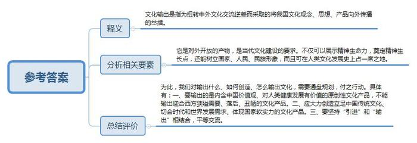
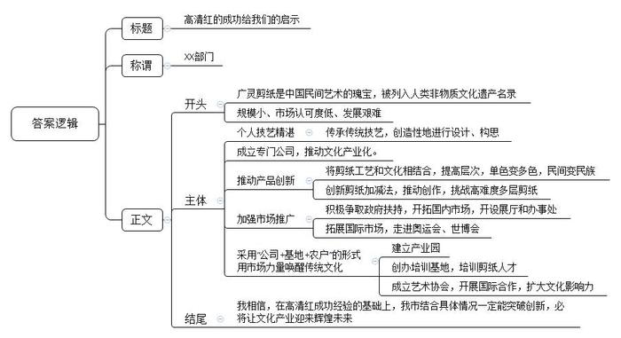
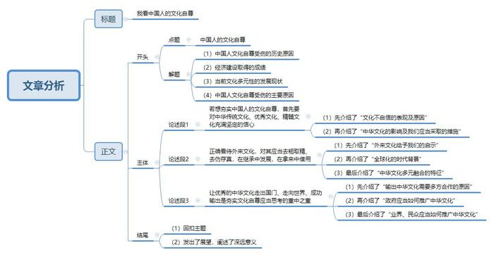

# 2014年公务员多省联考《申论》题（重庆上半年卷）

<!-- gwy:overview:start -->
> **重庆 · 2014 · 申论 · 上半年** ｜ 3 题 · 图片 3 处 · 答案随题折叠

导航：[题目](#题目) · [材料 1](#材料-1)
<!-- gwy:overview:end -->

> 候选采集稿。参考答案及解析来自粉笔页面，不代表官方答案或真实高分答卷；来源使用许可与原卷对应关系仍需人工核实。

## 给定材料

### 材料 1

“真的太美了！能把它送给我吗？”

“天哪，这是用剪刀剪出来的吗？太神奇了！”

这样的赞美，几乎不用打草稿，每一个看到高清红剪纸的人，都会不由自主的发出这样的惊叹！

人群中的高清红与普通的中年妇女并无二致，但只要给她一张纸、一把剪刀，她仿佛顷刻间就拥有了化腐朽为神奇的魔力。

“我是为剪纸而生的。”因为有了剪纸，高清红的人生道路从此不同。

广灵剪纸作为中国民间剪纸三大流派之一，以彩色剪纸为特色，每件作品经二十余道工序成形，是集绘画、色彩、镂雕于一体的手工艺术品，被誉为“中华民间艺术一绝”。2009年广灵剪纸作为中国剪纸的部分申报项目，被联合国教科文组织列入人类非物质文化遗产代表作名录。

广灵剪纸传到高清红这里，已经是第六代了。也许是广灵的青山绿水赋予了她灵巧的心思，也许是祖祖辈辈的匠心造就了她杰出的基因，4岁起高清红跟着外祖母和母亲学剪窗花，年纪轻轻就已经能独立完成设计巧妙、构思独特的剪纸作品了。

和身边很多同龄人一样，高中毕业后高清红走上了工作岗位，然而1996年她所在的县水泥厂因企业效益滑坡，她只得被迫下岗。回到家一次偶然的机会，她听说上世纪80年代广灵剪纸的主要创作生产基地广灵工艺美术厂倒闭了，她心底埋藏多年的那个儿时的“剪纸梦”突然萌动了，于是，追随梦想的召唤，青红剪纸艺术有限公司应运而生。作为广灵民间剪纸艺术的带头人，高清红开始带领广灵剪纸走上民间文化产业化的道路。

从“一年一枯荣、岁岁上窗棂”的窗花做起，青红的公司规模越做越大，层次越做越高，单色的变成了多彩的，民间的变成了民族的。由高清红创新的“剪纸加减法”让构图跃然纸上，出图力透纸背，把传统的广灵剪纸艺术推到了创作新阶段，在众多形式的剪纸中独成一家。据了解，广灵剪纸中难度最大的多层剪纸，高清红目前已经可以剪到八层，这在全世界也是绝无仅有的。而在民间，她的多幅作品的市场价值已达数万元。

不再是传统福禄寿禧和飞禽走兽，高清红的剪纸瞄准了更广的文化经典：历时半年完工的长达数米的《清明上河图》以精湛的刀工艺术将北宋时期的繁华市井刻画得惟妙惟肖；色彩明艳的《醉迷红楼十二金钗》让曹雪芹笔下的十二位古典美人生动传神。2013年，当联合国秘书长潘基文收到高清红为其创作的剪纸肖像礼品时赞不绝口，连连说：“太神奇了，比我本人还漂亮。”

青红剪纸愈剪愈美，作品也愈传愈远。如今的广灵青红剪纸公司被山西省大同市指定为“民间手工艺术专业公司”和旅游产品定点生产公司，在全国各地开设了10余个展厅和办事处，而青红剪纸不仅走进了北京奥运会、上海世博会，也随着中国的文化开放走向了国际舞台，每年实现产能1500万元，出口创汇100万美元。

产品走出了国门，高清红的心却在广灵。“中国剪纸是中国民间文化的一部分，但发展道路却很艰难，多年来难登大雅之堂。为了保护传统文化，让传统文化焕发出新的活力，我们采用‘公司+基地+农户’的形式，带领全县上万农民从事剪纸产业，还专门建立了广灵县剪纸产业文化园，用市场的力量唤醒传统文化。”高清红告诉记者，前不久，她们与国际生态安全合作组织和联合国青年技术培训组织共同创办了“国际青年就业技能培训基地”，组织培训剪纸人才1万多人；同时还成立了剪纸民间艺术协会，与多个国际组织合作，力图将中国民间艺术推向国际市场。2013年7月，高清红带着剪纸作品《清明上河图》全卷走入联合国，受到联合国秘书长潘基文和联合国教科文组织总干事伊丽娜·博科娃的高度赞赏。

“事实证明，中国传统文化是能在市场上占据一席之地的，但是这条路并不好走，规模也比较小，市场认可度仍有待提升。”高清红呼吁社会更多地关注民间文化，为传统文化与现代市场创造更多的对接平台，只有这样，传统文化才能真正走向市场、发扬光大。

### 材料 2

随着网络和电视制造业的发展，全球电视剧市场已经进入了“大航海时代”，随意按动鼠标就能看到世界另一端同样在看的剧集，观众可以坐在家中尽享顶级剧集的极致体验，“追剧”俨然成为都市白领的一种生活方式。

有观众看完《纸牌屋》后表示对于美国政治产生了浓厚的兴趣，对权利与爱情更有了新的认识，甚至翻出以往讲述美国政治历史的书籍、影片观看，参与到这部剧的讨论。2012年在法国播出美剧多达数十部，其中30多部单集观众超过百万，《超感神探》还一举成为当年的电视剧收视冠军。在德国，美剧基本处于垄断地位，占据约90%以上的播出份额。

美剧、韩剧在全球热播并非偶然。“以受众为导向，创新电视剧制作、播出模式，直接对接市场，接受评判。全新的制作模式给了电视剧全新的生命。”S大学新闻传播学李教授认为，与中国电视剧传统意义上的播出模式不同，美剧大都按“季”播出，通常一星期只播一集，边拍边播。由于美国电视剧播放平台不多，每年能在季播期黄金时间段播出的不到2000集，因此竞争异常激烈。近年来韩剧也采取边拍边播的模式，《来自星星的你》每周播出两集，每次网上更新剧集都会引发下载热。

专家认为，电视文化产品的价值日益凸显，中国应从中借鉴经验，提升电视剧制作水平，同时加强文化产品对外输出能力。这种开放的模式可以使制作方充分感受到观众对剧集的关注程度，根据每周更新的收视率和观众的反映，及时调整制作方向。更值得关注的是，这些热播剧大多高水准、大投入，保证质量精良，季播和周播的模式本身就拉高了电视剧制作成本，面对制作团队、剧本、导演、演员、道具等精益求精的追求，使得热播剧拍摄成本很高。

这些热播剧还有一个特点，就是不同于中国的“武侠剧”“清宫剧”“名著剧”，而以现实为题材，用写实手法描述生活中的酸甜苦辣，与观众不疏远。除科幻剧外，美剧大多务求内容真实、不虚构，有时涉及技术层面还要请顾问或相关专家亲自操刀。《生活大爆炸》剧组甚至拥有一个真正的“科学顾问”，专门负责剧本中关于科学部分的内容创作。

现实题材的电视剧制播能最充分地反映电视剧生产流程的市场化属性。《来自星星的你》尽管有科幻成分，但人物感情进展、尊老爱幼优良传统贯穿其中。

李教授说，美剧和韩剧都通过简单的日常生活与谈话交流传递价值趋向，剧中对生活中可能遇到的情感问题、生活细节问题的揭示，让人觉得真实可信，贴近生活中的文化输出才容易被外国观众认同。

在国产电视剧产量猛增的背景下，专家建议中国加强对产品质量把关，积极探索并生产出既承载中国文化价值观，又符合国际主流“文化经验”和“感觉结构”的电视产品。政协委员G在2014年3月2日接受记者采访时称：“韩剧热潮，已经不仅是韩剧的问题了，这让我们的文化自尊受到伤害，文化自尊的伤害是由于文化自信的缺失。”

韩潮来袭，韩迷们自然是喜不胜收，来者不拒，多多益善。而如同G这样的文化人士则不免有些心存疑虑，担心韩流损害我们的文化自尊。从某种程度上说，观众所看中的更多是韩剧的娱乐功能而非文化入侵。有人认为，韩剧逻辑性较差，观看时无需动脑子，可以单纯地“感情发泄”。换而言之，观众在看韩剧的时候，绝不会去想韩国文化怎么就伤害了中国传统文化这样的宏大命题，在他们看来，只要故事足够精彩就足够了。

任何一种文化的体现都需要一定的载体。韩国的电视剧、美国好莱坞的电影，这些都是外来文化的表现形式，同时也是外来的“文化鲶鱼”。从某种意义上讲，我们的文化自尊受到伤害并非是从韩剧或者好莱坞电影开始。因为自西方人用坚船利炮打开清政府的大门开始，无论是洋务运动，还是新文化运动，我们的传统文化可以说一直在与西方文化的斗争中不断地延续和发展。可以说，现在中国传统文化式微，有些好的传统，好的习惯，好的做法都被抛弃了，但中国文化或者说华夏文明依然在一脉相承。

不可否认，韩剧是韩国文化的一种体现，韩剧热无形之中会带来韩国文化的影响，给中国文化带来一定的伤害。韩剧的影响当然是客观存在的，但说伤害了我们的文化自尊则未免太高估韩国文化的影响。看看韩剧，天不会塌下来，文化自尊也不一定会受到伤害。换个角度说，我们正视韩流的影响，可更应该思考如何让中华文化走向世界。

### 材料 3

大批赴美志愿者汉语教师在美国校园和社区内担当着文化使者的角色。高中教师小玉就是其中之一。为期一年的赴美教学经验给她、她的美国学生乃至美国的“街坊邻居”都留下了珍贵记忆。

小玉在俄克拉荷马州一座小城执教，借住在一对老夫妇家中。小城只有一家沃尔玛超市。用男主人加里的话说，“全镇的人几乎都相互认识”。她每次出门都被当地人认出来，很多人都会友善地同她打招呼。文化交流归根到底是人的交流、感情的交融。

和其他汉语教师一样，小玉也配备了介绍中国文化的“资源包”，内容从神话故事、历史名人到古典名著不一而足。不过，在和孩子们的接触中，她本身也是当地人了解中国的一个“资源包”。“你们也有手机么？”“家中有电视吗？”一个个问题背后是美国孩子对中国的不了解。当然，在打开“资源包”的同时也不可避免引发价值观碰撞。“美国老师不加班、中国老师爱加班”“中国人爱储蓄”，甚至小玉想起万里之外家人时充盈的泪水，都让孩子们乃至大人们真切的感知着“中国人”的家庭观念，碰撞后带来的是了解和欣赏。

“我们觉得她是最好的‘中国制造’。”加里对记者幽默道，“如果你们国家要派出中国文化大使，选我们的玉准没错。”

当记者在世界各地问起：“提起中国文化，您会想到什么？”在赤道边春城内罗毕，中非关系专业在读研究生瑟库拉这样告诉记者：“孔子，我会想到他。我上过不少有关中国外交、非中关系的课，每次遇到理解不了思想时，我们就开玩笑说‘这是孔子的思想’。每次辩论会上找论据时，我们最后总会找到‘孔子曰……’。西方也有很多先贤，但中国先贤似乎我只了解孔子。”

在内罗毕CBD地区一家大排档餐厅，28岁的顾客贝利对记者说：“我通过在内罗毕工作的中国人了解中国文化。我觉得要想让肯尼亚人了解中国文化，最重要的是生活在本地的中国人的态度，希望中国人能同当地人交流。中国政府也应在非洲多办一些展览，比如饮食展览、传统服饰展览，这样我们才能了解更多中国文化。”

记者在采访过程中最深刻的体悟是：在融合流动的地球村里，每个人都是一国最生动的“文化名片”，你传达什么，对方就感受什么，提高中国文化软实力，扩大中国文化的国际影响力，看似工程浩大，却始于足下。建设社会主义文化强国，政府需要做的还很多，而民间交流、业界合作也亟待进化升级。

### 材料 4

2011年10月审议通过的《中共中央关于深化文化体制改革，推动社会主义文化大发展大繁荣若干重大问题的决定》提出，文化在综合国力竞争中的地位和作用更加凸显，维护国家文化安全任务更加艰巨，增强国家文化软实力、中华文化国际影响力要求更加紧迫。文化输出已被提升至前所未有的高度，并具备了明晰的政策导向。

回顾2011年，我国文化产业在海外市场“遍地开花”。9月至10月，“中国文化月”在美国举办，一批作品上演；11月，原创杂技芭蕾舞剧《胡桃夹子·海上梦》亮相后，与多家海外演出商签订为期5年的欧洲巡演合同；12月，土耳其中国文化年拉开序幕；截至2011年年底，我国已正式运营巴黎、柏林、东京等9处海外中国文化中心……

在中国国际图书贸易集团的M看来，近年来，伴随着与世界各国经贸领域的合作日渐深入，我国文化市场的开拓氛围在不断加强。“不仅出口企业数量在增加，输出产品的种类也日渐繁多。”他以自己所在的企业为例说，国图出口业务已经从图书、报刊、音像制品等实物出口领域，扩展至数据加工和物理加工为一体的增值服务贸易出口，并开展了国外展览业务。

“经济发展态势良好，文化产业才有走出去的资本和空间。”某大学文化创意产业研究所所长J说。

“在世界各地，都能看到中国公司、中国人的身影，是文化输出的‘经济和人文基础’。”J说，“从另一个角度看，日渐增多的国际间经贸合作也在倒逼文化输出加速。”

当前，在中国企业迅速增加海外投资的过程中，一个不容回避的问题是：面对思维方式、价值取向迥异，文化背景天壤之别的海外合作者，我们如何实现无障碍交流?

“经济合作归根结底是人与人的合作。随着合作深入，我们必然要与不同人群进行深层次交流。文化产业有义务承担起建立沟通、化解误会的责任。”J说，“文化输出不仅具备了经济基础，也成为经贸深度合作的必然需要。”

英国女孩娜姆说：“在没来到中国之前，我对中国的印象主要是：美食、长城、秀水街等，基本都是些片面的概念。但在北京生活了3年后，我反而不知该怎么概括对这里的印象了。因为了解越深，越觉得有很多文化是我不知道的。”

“这是对中国文化理解片面化的个例。如果本土文化产品没有大量投入海外市场，当地消费者只能面对极有限的选择，而这部分产品由于不具备生产规模，难免存在内容片面等问题，传递给国外消费者的‘中国印象’也不可能完美。”J说。

于是，真正的中国文化精髓没有畅通的输出渠道，反而一些细枝末节的文化枝桠被广泛认知。比如，伴随着海外华人数量的急剧增长，养生、菜谱等种类书藉因与生活密切相关而广泛传播。

“但这些枝节根本无法还原中国文化的全貌。久而久之，就导致了一些外国人对中国印象的片面化、表面化。更严重的是，文化领域的误解会伴随着人与人的交往，辐射至各个领域。”J说。

“当别人不了解，甚至选择性误解你时，你更需要澄清自己。但为何我们屡次遭遇误解却难以澄清?因为长期以来，我国在文化传播领域仍处于弱势地位。”J说，“目前，国际舆论导向仍牢牢把握在欧美媒体手中，我们难以呈现一个全面而真实的形象。”

“近年来，中国文化作品、艺术展演在海外亮相，无论从频率、水准和反响看，都是前所未有的。这一方面满足了艺术爱好者的需求，另一方面也纠正了部分人对中国文化的误读。”J说。

“文化输出的本质，是传递真实、全面的中国文化，获得公平的话语权、化解误会。从这个角度看，我们仍有很多需要改善之处。”某新闻学院院长Y说。

“我国文化产业仍处于起步阶段，因此市场经验缺乏，优质品牌不多，版权意识不成熟仍是普遍存在的问题，这都属于软件上的缺失。”中国知识产权律师网的许律师说。

“种种政策导向都在释放信号：文化输出必须接受市场规则，顺应海外市场特点，以此提高本土企业的软实力。”J说，“有一些地区因为发展心态浮躁，出现了‘揠苗助长’的现象。比如，一些地区盲目设立发展目标，导致政策制定和发展现状脱节。”

“要真正实现文化输出的目标，文化企业不仅得学会运用资本手段武装企业硬件，更应创造出多元化、理念先进的文化产品。”Y说。

“日本动漫、韩国偶像剧等，都是营造良好国家形象的手段和符号。在通往国际市场的文化快车上，我们虽然起步晚了点，但中国文化底蕴深厚，又有很强的创新意识，一定能赶上世界的步伐。”J说。

### 材料 5

当前，中国在中外文化交流中存在着逆差，中国优秀文化走向世界和外国文化涌入中国，在数量质量上都难成比例。为了扭转这种逆差，有学者提出了中国文化输出问题。

这个问题的提出不是偶然的，而是中国对外开放发展到一定程度后的必然产物。

随着中国对外开放的水平的进一步的提高，人们认识到中国当代文化建设不仅要“引进”，而且要“输出”。有学者认为：“在最初的挪用套用之后，必须有自己的创造性输出，否则这个民族就会丧失真正的精神生命力。”“中国当代文化需要进一步奠定自己的文化精神生长点，藉此从中西文化交流的逆差中走出来，真正开始自己的文化创生性，走向中西文化平等对话和文化输出。”

从1934年鲁迅提出拿来主义到当前我们提出文化输出，已经整整过去80年了。科学发展观要求我们对外开放要坚持“引进”和“输出”相结合。拓展发展空间，增强发展后劲，不仅是对经济建设提出的要求，而且也适合文化建设。这就是说，我们的文化建设要坚持“拿来主义”与“文化输出”相结合。

学者指出，中国当代文化建设拿来主义到文化输出虽然是巨大转变，但是，我们的文化输出不能为输出而输出，而是应在人类文化发展史上占有一席之地，正如我们拿来的是人类所创造的一切优秀文化成果，我们的文化输出也必须输出的是中国当代文化中对人类健康向上发展有价值的东西。我们的文化输出应以我们的原创作品为主，即能够代表中国的国家形象，代表中国人民的形象，代表中国民族文化的形象。过去，我们也有一些文化产品输出，我们也输出了不少优秀的文化产品。但是，不可否认，我们输出的有些文化产品却是迎合西方一些人的狭隘需要，贩卖的是一些中国文化落后的、丑陋的东西，这种文化输出损害了中国的国家形象，损害了中国人民的形象，损害了中国民族文化的形象。这是我们必须坚决反对的。

因此，中国当代文化解决中外文化交流中存在的“逆差”现象，就必须在努力解决现存冲突的过程中大力创造有价值的文化产品。这样，中华民族才能在人类的健康向上的发展中做出自己应有的独特的贡献。这种“有价值的文化产品”，首先就内含着中国人自己的价值观。因此，有学者套用法国前总统德斯坦的话说：“中国在能够输出价值观之前，是不会成为一个真正的大国的。”

鉴于有人提出从文化拿来主义走向文化输出主义的理念，有学者也发表了自己的意见：一是少提“主义”，一提主义往往会走向极端；二是在文化上还是要“拿来”和“输出”并举。文化上的平等交流应该是互通的，一手进一手出，不应该只进不出或者只出不进。现在没有哪个国家愿意只做进口生意不做出口生意的，文化上也如此，否则根本不符合世贸协定。“拿来”拿的是我们没有的，而且是必要的；“拿来”也不是全盘西化，囫囵吞枣，而是咀嚼消化，为我所用。“输出”也不是不分好歹的“倾销”，文化上的伪产品应该杜绝出口，以次充好必然败坏名声，后患无穷。即使是中国优秀的传统文化，尽管资源十分丰富，也需要经过现代的阐释，方能切合现时代世界的需要。最能体现中国当今文化软实力的，应该是经过中西会通又从现实需要出发，体现时代特点的原创性的文化观念、文化思想和文化产品。所以在输出什么、创造什么文化产品和怎样输出等方面，还需要做通盘的规划，并付之行动。

## 题目

### 第 1 题

**请根据给定资料**5**，谈谈你对“文化输出”的理解。（20分）**

关联材料：材料 5

作答要求：

要求：全面、准确、有概括力。不超过300字。

第 1 题 · 答案与解析

**参考答案（粉笔题库参考内容）**

文化输出是指为扭转中外文化交流逆差而采取的将我国文化观念、思想、产品向外传播的举措。

它是对外开放的产物，是当代文化建设的要求。不仅可以展示精神生命力，奠定精神生长点，还能树立国家、人民、民族形象，而且可在人类文化发展史上占一席之地。

为此，我们对输出什么、如何创造、怎么输出文化，需要通盘规划，付之行动。具体有：一、要输出的是内含中国价值观、对人类健康发展有价值的原创性文化产品，不能输出迎合西方狭隘需要、落后、丑陋的文化产品。二、应大力创造立足中国传统文化、切合时代和世界发展需求、体现国家软实力的文化产品。三、要坚持“引进”和“输出”相结合，平等交流。

**参考答案说明**：思路方面，本答案按照词句解释题“释义+分析相关要素+总结评价（对策）”的一般答题思路展开。内容方面，本参考答案先对“文化输出”的含义进行了解释；“分析相关要素”部分先分析了“背景”，接着分析了“影响”，最后进行了总结评价：即“文化输出”的对策。词句表达方面，本参考答案加上了“为此”“具体有”等连接词来承接上下文。

**解析状态：unknown（来源未提供）**

### 第 2 题

**请根据“给定资料**1**”，以“高清红的成功给我们的启示”为题写一份材料，供有关部门参考。（30分）**

关联材料：材料 1

作答要求：

要求：

（1）内容具体，符合实际；

（2）目的明确，切合主题；

（3）条理清楚，有概括性；

（4）不超过500字。

第 2 题 · 答案与解析

**参考答案（粉笔题库参考内容）**

高清红的成功给我们的启示

XX部门：

广灵剪纸是中国民间艺术的瑰宝，被列入人类非物质文化遗产名录。但其规模小、市场认可度低、发展艰难，高清红克服困难，积极创新，开拓市场，带领其走上文化产业化道路。具体启示如下：

一、个人技艺精湛。传承传统技艺，创造性地进行设计、构思。二、成立专门公司，推动文化产业化。三、推动产品创新。将剪纸工艺和文化相结合，提高层次，单色变多色，民间变民族，创新剪纸加减法，推动创作，挑战高难度多层剪纸。四、加强市场推广。积极争取政府扶持，开拓国内市场，开设展厅和办事处，拓展国际市场，走进奥运会、世博会。五、采用“公司+基地+农户”的形式，用市场力量唤醒传统文化。建立产业园，创办培训基地，培训剪纸人才，成立艺术协会，开展国际合作，扩大文化影响力。

我相信，在高清红成功经验的基础上，我市结合具体情况一定能突破创新，必将让文化产业迎来辉煌未来。

**参考答案说明：**（1）格式方面，本参考答案按照总结材料的一般格式写到了“标题”“称谓”和“正文”。（2）正文部分，一方面从内容来看，围绕着“高清红的成功事例”，本参考答案的开头部分首先介绍了广灵剪纸的地位、价值，以及面临的发展问题，并对高清红的经验做法进行适当概括；主体部分分别从“个人技艺精湛”“推动文化产业化”“推动产品创新”“开拓市场”“采用‘公司+基地+农户’的形式”五个方面介绍了高清红的成功经验。另一方面，形式上，本参考答案做到了分段、分条撰写，整体上条理较为清晰。

**解析状态：unknown（来源未提供）**

### 第 3 题

**请参考“给定资料”，以“我看中国人的文化自尊”为题写一篇文章。（50分）**

关联材料：材料 1、材料 2、材料 3、材料 4、材料 5

作答要求：

要求：

（1）自选角度，立意明确；

（2）联系实际，不拘泥于“给定资料”；

（3）思路清晰，语言流畅；

（4）总字数1000~1200字。

第 3 题 · 答案与解析

**参考答案（粉笔题库参考内容）**

**参考范文一**

**我看中国人的文化自尊**

文化，是一个民族的血脉，是一个国家的名片，文化自觉是对文化的自我觉醒、自我反思和理性审视。我国的传统文化，更是华夏民族积淀数千年的瑰宝。前段时间在国内热播的韩剧《来自星星的你》受到不少韩剧迷的追捧，韩剧热体现了我国部分年轻人对于外来文化的认同，同时也反映出外来文化对于国人的影响，甚至引发了关于外来文化是否伤及国人文化自尊的不同思考。因此，我们必须从思想意识上予以高度重视，从维护文化自尊出发，大力继承和发展传统文化，坚持“不忘本来、吸收外来、面向未来”的文化发展战略。

**不忘本来，提升文化自知。**如果失去自知、抛弃传统、丢掉根本，就改变了文化基因，丧失了文化特质，忘记了“我们是谁”“我们来自何处”。韩剧美剧的来袭，有人认为让我们的文化自尊受到了严重的伤害，其根源在于文化自信的缺失。要增强文化自信，就要为文化输入鲜活的力量。中华优秀文化是一个和而不同、博厚开放的基因谱系。例如从殷商时期文化基因的曙光，到“百家争鸣”时代文化基因格局的初成，从汉唐至明清时期文化基因的殷实和重组，再到鸦片战争、“五四”的新文化运动以及新中国建立以来中国文化基因的批判反思、重大改组和承传鼎新，绵延了上下五千年。叶茂源于根深，只有提升文化的内在素养，才能为文化的发展输送源动力。

**吸收外来，促进文化相融。**守正之外，也要以开放的心态去汲取外来文化滋养，实现共享交流。中华文明之所以经久不息、绵延长存，就在于其有海纳百川的文化胸襟，有兼收并蓄的开放传统。对待外来文化采取何种态度，考验着一个国家的文化自信。吸收外来文化即要学习和借鉴人类文明的一切优秀成果，如果没有足够的文化自信，将外来文化视为异类，自我封闭思想僵化，煌煌中华文明不可能历经五千年而弦歌不辍。开放包容不会削弱中华文化的优秀内核，反而会使中华文化的主流多元丰富。越是自信就越能够以积极态度对待外来文化，越是自信就越能在百舸争流中红旗不湿。在经济全球化时代，只有积极参与全球文明的对话交流，兼纳百家精华，才能更好地促进中国文化的繁荣发展。

**面向未来，推动文化走出国门。**习近平总书记指出，“提高国家文化软实力，要努力展示中华文化独特魅力”。随着外来文化的涌入，我国文化交流出现了交流逆差，这些实际性问题都倒逼着中国文化需要加大输出，同时提升文化的输出价值。为此，中华文化必须进一步奠定自己的文化生长点，要把跨越时空、超越国度、富有永恒魅力、具有当代价值的文化精神弘扬起来，把继承传统优秀文化又弘扬时代精神、立足本国又面向世界的当代中国文化创新成果传播出去。要想让中国人的文化自尊不受伤害，要想让中华文化在世界享有良好的声誉，只有提升文化输出的价值，才能提高文化的认可度，让传统文化真正地走向市场，发扬光大。

每到重大历史关头，文化都能感国运之变化、发社会之先声。建设社会主义文化强国，只有不忘本来、吸收外来、面向未来，才能更好构筑中国精神、中国价值、中国力量，为早日实现中华民族伟大复兴的中国梦提供强大精神力量。

**参考范文二**

**我看中国人的文化自尊**

一百多年前，西方人用坚船利炮敲开了中国的大门，自此我们大力抓物质、抓经济、抓建设，虽然取得了举世瞩目的硕果，但是精神的创面尚未愈合，中国人的文化自尊受到了强烈的冲击，阴霾直到今天仍尚未消散殆尽。当前，形式多样、内容丰富的外来文化源源不断地涌入中华大地，尽管这会产生一定的客观影响，但还不至于削弱中华民族的文化自尊，而中国人的文化自尊之所以还很脆弱，主要是因为文化自信的缺失。

**若想夯实中国人的文化自尊，首先要对中华传统文化、优秀文化、精髓文化充满坚定的信心。**由于历史与现实的原因，西方价值观一度为部分中国人顶礼膜拜，他们鄙夷、排斥，甚至否定本土文化，长此以往必然失去对中华文化的信心。然而，无论是具有千年历史积淀的传统优秀文化，还是当代社会主义文化，无不表现出熠熠生辉的闪光点，成为指引我们前行的灯塔，我们毫无理由拒绝如此伟大的文明，我们应该珍惜并热爱着中华文化。作为推动政治、经济、社会发展的内核力量，中华文化值得被每一个华夏儿女爱护、坚守和尊崇。

**除了要坚定文化自信，还要正确看待外来文化，对其应当去粗取精、去伪存真，在继承中发展，在拿来中借用。**韩剧、美剧走进中国，不仅让中国观众享受了一场又一场的视觉盛宴，也让我们见识到了西方文化产品的可取之处、可敬之处。在全球化的今天，想要闭关锁国发展本土文化无异于天方夜谭、痴人说梦，而敞开大门、兼容并蓄才是对待外来文化的正确态度。中华文化本身是建立在多民族文化融合的基础之上，是一个开放多元的综合体、大熔炉，因此融入外来文化也具有充分的可行性。

**不仅如此，让优秀的中华文化走出国门、走向世界、成功输出是夯实文化自尊应当思考的重中之重。**文化输出是一项系统工程，艰辛且漫长。俗话说：众人拾柴火焰高。政府作为文化输出的有力推动者，应当首先承担起领头羊的责任，凭借强大的政治、外交、经济实力，增加海外文化展览、展演、展播活动的频次，让世界了解中国。与此同时，相关非政府组织、民间组织、企业也应发挥余热，积极参与到中华文化传播的事业中，尤其是海外华人、华侨，作为行走的文化“资源包”，更要增进与本地居民的情感交流与互动。

文化自尊源于文化自信、强于文化建设、夯实于文化传播与弘扬，让我们齐心协力、携手同行，在面对外来文化冲击时，用坚毅的决心、果断的行动弘扬中华优秀文化，让中国人生活得更加体面，让中华文化发展得更有尊严。

**文章分析**

我看中国人的文化自尊

【**标题的优点：**严格按照题目的要求，以“我看中国人的文化自尊”为标题。】

（1）一百多年前，西方人用坚船利炮敲开了中国的大门，自此（2）我们大力抓物质、抓经济、抓建设，虽然取得了举世瞩目的硕果，但是精神的创面尚未愈合，中国人的文化自尊受到了强烈的冲击，阴霾直到今天仍尚未消散殆尽。当前，（3）形式多样、内容丰富的外来文化源源不断地涌入中华大地，尽管这会产生一定的客观影响，但还不至于削弱中华民族的文化自尊，而（4）中国人的文化自尊之所以还很脆弱，主要是因为文化自信的缺失。

【**开头的优点：**★内容方面。范文的开头是紧扣题目给定的“中国人的文化自尊”这一主题展开的。首先，开头第一句话点出主题，做到了主题明确。其次，对“中国人的文化自尊”这一主题进行了分析阐述，指出了（1）中国人文化自尊受伤的历史原因。（2）经济建设取得的成绩。（3）当前文化多元性的发展现状。（4）中国人文化自尊受伤的主要原因。注意以上四个方面的阐述在逻辑上有先后顺序：先写“中国人文化自尊受伤的历史原因”，再写“经济建设成绩”，接着写“文化多元性的现状”，最后写“中国人文化自尊受伤的主要原因”。★文字表达方面：使用了“虽然……但是……”“尽管……但……”等关联词，使语言表达有逻辑性。此外，使用了排比、比喻等修辞手法，使文字表达更加形象生动。】

**若想夯实中国人的文化自尊，首先要对中华传统文化、优秀文化、精髓文化充满坚定的信心。**由于（1）历史与现实的原因，西方价值观一度为部分中国人顶礼膜拜，他们鄙夷、排斥，甚至否定本土文化，长此以往必然失去对中华文化的信心。然而，（2）无论是具有千年历史积淀的传统优秀文化，还是当代社会主义文化，无不表现出熠熠生辉的闪光点，成为指引我们前行的灯塔，我们毫无理由拒绝如此伟大的文明，我们应该珍惜并热爱着中华文化。作为推动政治、经济、社会发展的内核力量，中华文化值得被每一个华夏儿女爱护、坚守和尊崇。

【**论述段****1****的优点：**★观点句：范文的观点句是紧扣“中国人的文化自尊”这一文章主题提出的。形式上，它在段首处直接写出，位置突出，容易发现。内容上，关键词突出，内容要点明确，可以明显看出它是从“文化自信”入手，指出了“如何夯实中国人的文化自尊”。★论述内容：（1）先介绍了“文化不自信的表现及原因”；（2）再介绍了“中华文化的影响及我们应当采取的措施”。注意：以上两个方面的内容都是紧扣“若想夯实中国人的文化自尊，首先要对中华传统文化、优秀文化、精髓文化充满坚定的信心”这个观点句进行分析论述的，论述的针对性强，内容层次丰富。最后，在论述方法和论据的选取上做到了讲道理、打比方相结合，做到了丰富生动。】

**除了要坚定文化自信，还要正确看待外来文化，对其应当去粗取精、去伪存真，在继承中发展，在拿来中借用。**（1）韩剧、美剧走进中国，不仅让中国观众享受了一场又一场的视觉盛宴，也让我们见识到了西方文化产品的可取之处、可敬之处。（2）在全球化的今天，想要闭关锁国发展本土文化无异于天方夜谭、痴人说梦，而敞开大门、兼容并蓄才是对待外来文化的正确态度。（3）中华文化本身是建立在多民族文化融合的基础之上，是一个开放多元的综合体、大熔炉，因此融入外来文化也具有充分的可行性。

【**论述段****2****的优点：**★观点句：范文的观点句是紧扣“中国人的文化自尊”这一文章主题提出的。形式上，它在段首处直接写出，位置突出，容易发现。内容上，关键词突出，内容要点明确，可以明显看出它是从“正确看待外来文化”入手，指出了“如何夯实中国人的文化自尊”。★论述内容：（1）先介绍了“外来文化给予我们的启示”；（2）再介绍了“全球化的时代背景”；（3）最后介绍了“中华文化多元融合的特征”。注意：以上三个方面的内容都是紧扣“正确看待外来文化，对其应当去粗取精、去伪存真，在继承中发展，在拿来中借用”这个观点句进行分析论述的，论述的针对性强，内容层次丰富。最后，在论述方法和论据的选取上做到了讲道理、举例子相结合，做到了丰富多样。】

**不仅如此，让优秀的中华文化走出国门、走向世界、成功输出是夯实文化自尊应当思考的重中之重。**（1）文化输出是一项系统工程，艰辛且漫长。俗话说：众人拾柴火焰高。（2）政府作为文化输出的有力推动者，应当首先承担起领头羊的责任，凭借强大的政治、外交、经济实力，增加海外文化展览、展演、展播活动的频次，让世界了解中国。与此同时，（3）相关非政府组织、民间组织、企业也应发挥余热，积极参与到中华文化传播的事业中，尤其是海外华人、华侨，作为行走的文化“资源包”，更要增进与本地居民的情感交流与互动。

【**论述段****3的优点**：★观点句：范文的观点句是紧扣“中国人的文化自尊”这一文章主题提出的。形式上，它在段首处直接写出，位置突出，容易发现。内容上，关键词突出，内容要点明确，可以明显看出它是从“文化输出”入手，指出了“如何夯实中国人的文化自尊”。★论述内容：（1）先介绍了“输出中华文化需要多方合作的原因”；（2）再介绍了“政府应当如何推广中华文化”；（3）最后介绍了“业界、民众应当如何推广中华文化”。注意：以上三个方面的内容都是紧扣“让优秀的中华文化走出国门、走向世界、成功输出是夯实文化自尊应当思考的重中之重”这个观点句进行分析论述的，论述的针对性强，内容层次丰富。最后，在论述方法和论据的选取上做到了讲道理、举例子相结合，做到了丰富多样。】

【**论述段之间的关系：**★内容的内在逻辑：范文的论述段之间是依照“并列”逻辑展开的。论述段1先写了“文化自信”，论述段2再写了“正确看待外来文化”，论述段3最后写了“文化输出”。★段与段的外在衔接：论述段2段首处的过渡句“除了要坚定文化自信，还要正确看待外来文化，对其应当去粗取精、去伪存真，在继承中发展，在拿来中借用”，起到了承接论述段1、引出了论述段2的作用。论述段3段首处的过渡句“不仅如此，让优秀的中华文化走出国门、走向世界、成功输出是夯实文化自尊应当思考的重中之重”，起到了承接论述段2、引出了论述段3的作用。】

（1）文化自尊源于文化自信、强于文化建设、夯实于文化传播与弘扬，（2）让我们齐心协力、携手同行，在面对外来文化冲击时，用坚毅的决心、果断的行动弘扬中华优秀文化，让中国人生活得更加体面，让中华文化发展得更有尊严。

【**结尾的优点：**范文的结尾回扣了“中国人的文化自尊”这一主题。（1）再次提到“文化自尊”；（2）发出了呼吁，阐述了深远意义。】

**解析状态：unknown（来源未提供）**

