# 2015年重庆市公务员录用考试《行测》题（下半年）

<!-- gwy:overview:start -->
> **重庆 · 2015 · 行测 · 统考** ｜ 120 题 · 图片 85 处 · 答案随题折叠

| 题型模块 | 题量 | 题号 |
| --- | ---: | ---: |
| 言语理解与表达 | 40 | 1–40 |
| 常识判断 | 15 | 41–55 |
| 数学运算 | 10 | 56–65 |
| 判断推理 | 35 | 66–100 |
| 资料分析 | 20 | 101–120 |
| **合计** | **120** | |

导航：[题型与作答说明](#题型与作答说明) · [题目](#题目) · [材料 1](#材料-1)
<!-- gwy:overview:end -->

> 候选采集稿。参考答案及解析来自粉笔页面，不代表官方答案或真实高分答卷；来源使用许可与原卷对应关系仍需人工核实。

## 题型与作答说明

言语理解与表达

（40题）

根据题目要求，在每个选项中选出一个正确答案。

常识判断

（15题）

根据题目要求，在每个选项中选出一个正确答案。

数学运算

（10题）

根据题目要求，在每个选项中选出一个正确答案。

判断推理

（35题）

根据题目要求，在每个选项中选出一个正确答案。

资料分析

（20题）

根据题目要求，在每个选项中选出一个正确答案。

## 题目

### 第 1 题

说到底，把好事办实，＿＿＿＿出领导干部的政绩观。“些小吾曹州县吏，一枝一叶总关情。”雨天积不积水、看病容不容易，看似“家常小事”，实则民生大事。解决这些问题，不仅是为了政绩，更是为了造福群众。老百姓心中有杆秤，说一百句大话不如办成一件小事，说一万句空话，不如办成一件实事。

填入画横线部分最恰当的一项是：

A. 展现

B. 折射

C. 反射

D. 表现

第 1 题 · 答案与解析

**参考答案（粉笔题库参考内容）**

B

**解析**

根据语境“把好事办实”其实反映出“领导干部的政绩观”，横线处要表达反映之意。

B项“折射”比喻把事物的表象或实质表现出来，符合语义，且 “折射政绩观”也为常见搭配，当选；

A项“展现”为直接展示，语义不符，且与“政绩观”搭配不当，排除；

C项“反射”语义不符，排除；

D项“表现”与“政绩观”搭配不当，排除。

故正确答案为B。

### 第 2 题

网络群体有时很少对主观和客观加以区分，他们把头脑中产生的景象也当做现实，尽管这个景象同观察到的事实几乎总是只有＿＿＿＿＿＿的关系。

填入画横线部分最恰当的一项是：

A. 大相径庭

B. 显而易见

C. 不足挂齿

D. 微乎其微

第 2 题 · 答案与解析

**参考答案（粉笔题库参考内容）**

D

**解析**

前文阐述了网络群体对主客观不能分清界限，由空格前的“尽管”和“只有”可知，文段前后语意相反，故后文表达的应当是主客观之间的关系不大。A项“大相径庭”比喻相差很远，大不相同，B项“显而易见”形容事情或道理很明显，极容易看清楚，均与文意相反，排除；C项“不足挂齿”指不值得一提，比喻自己做的事不够重大，常用在自谦的语境中，与文段语境不符，排除；D项“微乎其微”形容非常小或非常少，符合语意，当选。

故正确答案为D。

### 第 3 题

大海如果失去巨浪的翻滚，也就失去了＿＿＿＿；沙漠如果失去了飞沙的狂舞，也就失去了＿＿＿＿；人生如果失去了真实的历程，也就失去了意义。

依次填入画横线部分最恰当的一项是：

A. 雄浑 壮美

B. 雄健 美丽

C. 雄伟 壮丽

D. 雄厚 美好

第 3 题 · 答案与解析

**参考答案（粉笔题库参考内容）**

A

**解析**

第一空，搭配的名词为“大海”，B项“雄健”指勇武强壮、刚健有力，C项“雄伟”指体貌勇壮魁梧，常用来形容人和建筑物，D项“雄厚”指雄健浑厚或充足、丰富，均不能形容大海，排除。A项“雄浑”指雄壮浩瀚，常用来形容大海和天空，故放在此处合适，保留。

第二空，代入验证，A项“壮美”指雄壮美丽，可以修饰沙漠，符合语境，当选。

故正确答案为A。

### 第 4 题

全球化带来的时空压缩和混杂性极大地消解了传统场所的认同维系功能，使人们的生活＿＿＿＿＿＿＿和更加不确定，媒介成为＿＿＿＿身份的重要文化机构。

依次填入画横线部分最恰当的一项是：

A. 变化多端 解构

B. 风云变幻 建构

C. 变化多端 建构

D. 风云变幻 解构

第 4 题 · 答案与解析

**参考答案（粉笔题库参考内容）**

C

**解析**

第一空，根据空格后的“和”可知，填入成语应和“更加不确定”语意相近，“风云变幻”意思为像风云那样变化不定，比喻时局变化迅速，动向难以预料，用在此处语意过重，排除B、D两项。“变化多端”指变化很大，此处适用，保留A、C两项。

第二空，根据文意，人们的生活变化很大，故需要媒介建立身份，“解构”是欧陆哲学与文学批评中的一种批评方法，与文意不符，排除A项，“建构”指构建、建立，用在此处合适，C项当选。

故正确答案为C。

### 第 5 题

当你去商场买东西时，往往看得眼花缭乱，结果却什么也没买成就回家了。由于你＿＿＿＿＿＿，所以想买的东西，能很快地选出来。但是，在付账的过程中，如果你又看到了同样种类的其他东西，你就会＿＿＿＿＿＿了。不仅在购物时，在人际关系上，决心也是非常重要的。如果在最后的瞬间你突然产生迷惑，无法决定的感觉的话，这是相当糟糕的事情。

依次填入画横线部分最恰当的一项是：

A. 立场坚定 毫不犹豫

B. 旗帜鲜明 坚持己见

C. 暧昧不明 进退两难

D. 爱憎分明 左右为难

第 5 题 · 答案与解析

**参考答案（粉笔题库参考内容）**

D

**解析**

先看第二空，前文阐述了买东西很快能够选定，根据横线前“但是”可知，文段前后语意相反，故第二空意思应为买东西难以决定，故可以排除A项“毫不犹豫”和B项“坚持己见”。C项“进退两难”比喻事情无法决定，因而难以行动，处境困难，D项“左右为难”指左也不好，右也不是，形容无论怎样做都有难处，均可用在此处，保留。

第一空，C项“暧昧不明”与横线后的“能很快地选出来”语意相悖，排除；D项“爱憎分明”形容立场、态度明确，符合语意，且相比“左右为难”，“进退两难”语意过重，当选。

故正确答案为D。

### 第 6 题

有史之初，人类的记载，大多＿＿＿，不甚清晰，和史前时代也相差不远。例如他们的战争、迷信、魔术、宗教、婚姻、医药等事，也常见原始的色彩，所谓＿＿＿＿的文明典籍中，仅有野蛮的原料为我们人类所欣赏。

依次填入画横线部分最恰当的一项是：

A. 天方夜谭 文山书海

B. 天马行空 卷帙浩繁

C. 荒渺难稽 浩如烟海

D. 天花乱坠 左图右史

第 6 题 · 答案与解析

**参考答案（粉笔题库参考内容）**

C

**解析**

第一空，根据横线后逗号可知，填入词语意思和“不甚清晰”相近，B项“天马行空”多比喻诗文气势豪放，不受拘束，D项“天花乱坠”形容人说话巧妙动听，但虚妄、空洞不着边际，均不符合语境，排除；A项“天方夜谭”为名词，本空应填入形容词，排除；C项“荒渺难稽”指说法荒诞不经，符合有史之初人类记载的特点，保留。

第二空，代入验证，C项“浩如烟海”形容文献、资料等非常丰富，符合文意，当选。

故正确答案为C。

### 第 7 题

根据论文被引用次数与重要性的关系，研究者萌生了一个网络排序的思路。就是通过网页之间的相互＿＿＿来确定排序，即一个网页被其他网页引用得越多，越多地被排序靠前的网页所引用，其排序就越靠前。所以想知道一个网页的排序，不仅要知道有多少网页引用了它，还要知道那些网页各自的排序——因为排序越靠前的网页的引用就越“＿＿＿＿”。

依次填入画横线部分最恰当的一项是：

A. 引用 重要

B. 顺序 隆重

C. 衔接 宝贵

D. 链接 值钱

第 7 题 · 答案与解析

**参考答案（粉笔题库参考内容）**

D

**解析**

第一空，根据后文由网页被引用数决定排名，可排除B项“顺序”；C项“衔接”是指用某个物体连接两个分开的物体，把事物首尾连接，与文意不符，排除；A项“引用”、D项“链接”均可用在此处，保留。

第二空，所填词语被双引号修饰，表特殊含义，A项“重要”用在此处无需使用双引号，排除；D项“值钱”表面意思为价格高，用双引号后代表其价值很高，符合文意，当选。

故正确答案为D。

### 第 8 题

考据文化的本质是不能把想象当做事实的，不可把＿＿＿当做结论，必须凭证据说话，进行符合逻辑的分析。训诂、考证中研究“治学严谨”，其实是逻辑严谨。中国数学教育能够很顺利地接受西方的公理化的逻辑演绎思想。今日中国数学教育能够以逻辑推断见长，是和考据文化的＿＿＿＿分不开的。当然，数学的逻辑要求，较之考据的要求还要高。

依次填入画横线部分最恰当的一项是：

A. 观感 支撑

B. 印象 严谨

C. 感想 存在

D. 所见 逻辑

第 8 题 · 答案与解析

**参考答案（粉笔题库参考内容）**

A

**解析**

第一空，由后文“必须凭证据说话”可知，该空填入的词不能作为证据，故可排除“所见”。第二空，根据文意，本空应填入能表达数学教育和考据文化之间关系的词，B项“严谨”仅仅是考据文化自身的特征，C项“存在”仅能表达考据文化的状态，均无法反映出两者的关系，排除；A项“支撑”能说明考据文化为数学教育提供基础，为最佳选项。

故正确答案为A。

### 第 9 题

十九世纪中叶，英国发生工业革命，机械化大生产给经济带来了活力。手工制品经过了人们反复的＿＿＿＿，造型接近完美。传统的手工文化形成的精细、优雅风格在欧洲由来已久，粗糙的机械制品与此格格不入，即便机械化生产带来了时代的进步，但由此带来的对传统美德的＿＿＿＿，也为人们所不能忍受。

依次填入画横线部分最恰当的一项是：

A. 设计 蹂躏

B. 打磨 践踏

C. 创新 挑战

D. 更新 摧残

第 9 题 · 答案与解析

**参考答案（粉笔题库参考内容）**

B

**解析**

第一空，用“反复”一词形容，意为颠过来倒过去的做，那么“创新”“更新”重在强调每次都是新突破新创作，不能与“反复”连用，排除C、D项。

第二空，B项“践踏”，意为摧残、压迫。A项“蹂躏”指用暴力侵害、侮辱。“蹂躏”比“践踏”更加残暴凶恶，带有侮辱的行为，置于此处程度过重，排除A项。

故正确答案为B。

### 第 10 题

改革开放30年来，我国城市化进程不断加快，越来越多农村用地被＿＿＿为城市用地。与此同时，失地农民的养老保险制度也引起了社会的广泛关注。从理论上分析，该制度的建立充分考虑了土地对农民的＿＿＿＿和保障两大职能，解决了失地农民进入法定退休年龄之后的基本生存，对促进社会和谐稳定具有积极的意义。

依次填入画横线部分最恰当的一项是：

A. 征用 生存

B. 占用 升值

C. 征用 升值

D. 占用 生存

第 10 题 · 答案与解析

**参考答案（粉笔题库参考内容）**

A

**解析**

第一空，文意指国家为了实现城市化建设，将原先农村用地转作城市用地，则只能选择“征用”，表示国家为某种目的征集使用，而非占据使用，首先排除B、D选项。

第二空，强调土地对农民的职能，与“保障”构成并列关系，且与后文的“解决了基本生存”构成对应，可以选择“生存”，而非“升值”，且土地本就不是私有，对农民也没有升值可言。

故正确答案为A。

### 第 11 题

宇宙自身的运行方式是它存在的基础。宇宙永恒地运动着，永恒地变化着。但它绝不会自己堵死它继续运动、＿＿＿＿的道路。说穿了，就是宇宙是它自身的永恒地演化。在这里并不需要什么新“物质”粒子的＿＿＿＿且在演化中不存在什么为人类意识所不能捉摸的其他因素之推动。

依次填入画横线部分最恰当的一项是：

A. 前进 出现

B. 改革 诞生

C. 演化 创生

D. 存在 驱动

第 11 题 · 答案与解析

**参考答案（粉笔题库参考内容）**

C

**解析**

第一空，文段客观陈述宇宙的运动与变化，而“前进”“改革”都有向积极方向发展的含义，与文段的感情色彩不符，排除A、B两项；且横线处应与“运动”构成并列或者递进，而D项“存在”是运动之前的基本状态，排除；C项“演化”指生物在不同世代之间具有差异的现象，有运动变化含义，且与后文对应，符合文意，保留。

第二空，代入验证，C项“创生”指创造产生，置于此处搭配得当，且与后文构成递进关系，则相较于递进后“推动”，此处语境也符合，当选。

故正确答案为C。

### 第 12 题

中国人对于外来文化，不但要求变压，还有强烈的选择性。二道手的佛教传播很广。本来没有什么特殊了不起的阿弥陀佛，只是众佛之一，在中国＿＿＿＿＿＿，名声竟在创教的释迦牟尼之上。观世音菩萨也是到中国化为女性才＿＿＿＿＿＿。

依次填入画横线部分最恰当的一项是：

A. 家喻户晓 大显神通

B. 人人皆知 名声大噪

C. 声名鹊起 赫赫有名

D. 众所周知 声名显赫

第 12 题 · 答案与解析

**参考答案（粉笔题库参考内容）**

A

**解析**

第一空，根据后文可知，佛教在中国，名声在创教的释迦牟尼之上，故应填入表示名声非常高的词语。A项“家喻户晓”指每家每户都知道，B项“人人皆知”指所有人都知道，均符合文意，保留。C项“声名鹊起”指知名度迅速提高，意在强调知名度上升得快，无法体现知名度高，排除；D项“众所周知”指大家全都知道，通常作为过渡词使用，用于此处语法错误，排除。

第二空，根据“也是”表并列可知，需填入与前文表意相近的词语，根据前文可知，佛教在传入中国前没有什么特殊了不起的，故应填入表示了不起意思的词语。A项“大显神通”指充分显示出高明的本领，符合文意，且在当今“菩萨”的形象给大家的印象就是非常有本领，当选。B项“名声大噪”指名声广泛地传播开去，只能体现名声传播的范围广，无法体现了不起之意，排除。

故正确答案为A。

【文段出处】《人生与读书》

### 第 13 题

产气霉属于内生真菌，不仅对病原真菌具有抑制作用，而且也能够＿＿＿病原细菌的生长与繁殖。病原细菌的群体效应在其侵染和定植过程中起了极为重要的作用。群体效应是指细菌通过分泌和感知自诱导物来＿＿＿种群密度的菌体细胞间的交流过程。群体效应对病原细菌致病因子的表达十分关键，因此许多研究试图通过破坏群体效应来减轻病原细菌的危害。

依次填入画横线部分最恰当的一项是：

A. 阻止 改变

B. 克制 影响

C. 抑制 调节

D. 防止 控制

第 13 题 · 答案与解析

**参考答案（粉笔题库参考内容）**

C

**解析**

第一空，可知需填入与“抑制”表意相近的词语，A项“阻止”指使停止行动，C项“抑制”指约束、压制，D项“防止”指预先设法制止，均符合文意；B项“克制”指克服、制服，适用于不好的或不应有的情感、思想，与“病原细菌”搭配不当，排除。

第二空，搭配“种群密度”，可知群体效应能够影响种群密度的菌体细胞的交流过程，C项“调节”指从数量上或程度上调整，与“密度”搭配合适，当选；A项“改变”指变化，文段未表明种群密度发生了改变，故不符合文意，排除；D项“控制”指掌握住不使任意活动或越出范围，语意程度过重，排除。

故正确答案为C。

【文段出处】生态学专题—对病原真菌的抑制作用

### 第 14 题

面向未来，在中西文化的相遇中，要建构出理想形态的中国文学史理论，必须切实建立中国文学的主体意识，达成现代视野与传统资源之间的良性＿＿＿＿，使中国不再是以自在的形态而潜隐，而要在＿＿＿＿的理论自觉中成为自为的学术追求，在充分地成就中国文学史理论自觉意识中推进中西理论互诠互释、共生共荣。

依次填入画横线部分最恰当的一项是：

A. 传承 开化

B. 互动 明确

C. 交接 现实

D. 磨合 确实

第 14 题 · 答案与解析

**参考答案（粉笔题库参考内容）**

B

**解析**

本题可从第二空入手。横线处所填词语与“潜隐”构成反义对应，B项“明确”符合文意；A项“开化”应对应“愚昧”；C项“现实”与“理想”对应；D项“确实”对应“虚假”，均与文意无关，排除。

第一空代入验证，“良性互动”属于常见搭配，符合文意，当选。

故正确答案为B。

### 第 15 题

民间童话比作家童话生命更加旺盛、个性更为突出。但是如果民间的个性能转化出国民个体的个性，所谓个性也就有\_\_\_\_\_\_\_\_的危险。格林兄弟使西方浪漫主义智识资源对民间进行了创造性的建构和转化，一方面运用母体和谚语营造民间氛围，另一方面加强形象的个人特色和人物的\_\_\_\_\_\_\_\_，产生了现代性意味的民间童话。

依次填入画横线部分最恰当的一项是：

A. 泯灭 性格

B. 难产 特殊

C. 弱化 本质

D. 架空 个性

第 15 题 · 答案与解析

**参考答案（粉笔题库参考内容）**

D

**解析**

第一空，根据“但”表转折可知，需填入与“个性突出”表意相反的词语，即如果民间的个性能转化出国民个体的个性，则个性可能不会特别突出。C项“弱化”指使某种事物变弱，符合文意；D项“架空”指没有基础、没有实际的根据的东西，也可体现不突出之意，符合文意；A项“泯灭”指灭绝、消失，可知个性只是发生了转化，故消失表述程度过重，不符合文意，排除；B项“难产”指著作不易完成，计划、方案不易制订，与“个性”搭配不当，排除。

第二空，搭配人物，可知与“个人特色”并列，表意相近。D项“个性”指个人的精神面貌或心理面貌，也指性格或人格，人与人间的性格均有所不同，故与“特色”表意相近，搭配合适，符合文意，当选。C项“本质”指事物本身所固有的根本的属性，用于此处一般指人内在的根本，体现不出特色、与别人不同之意，排除。

故正确答案为D。

### 第 16 题

热力学第一定律认为能量守恒不变，只能从一种形式转变到另一种形式。这是不是说我们可以高枕无忧地滥用物质和能源呢？答案是否定的，因为热力学第二定律表明，能量只能不可逆转地沿一个方向转化，即从可利用到不可利用、从有效到无效的状态转化。这种无效能量已从人类那里＿＿＿＿地失去了，尽管它并没有＿＿＿＿。

依次填入画横线部分最恰当的一项是：

A. 一点一滴 磨灭

B. 无可挽回 湮灭

C. 彻彻底底 破灭

D. 确确实实 毁灭

第 16 题 · 答案与解析

**参考答案（粉笔题库参考内容）**

B

**解析**

第一空，解释类对应，前文明确阐释能量转化是“不可逆转地沿一个方向转化”，即可对应“无可挽回（不可挽回）”，表示无法恢复原状，没有可能再挽留回来；C项“彻彻底底”、D项“确确实实”均侧重强调失去的程度，A项“一点一滴”则侧重形容失去的过程，都不能与前文对应，排除。

第二空代入验证，“湮灭”具有淹没，消失，毁灭的含义，表示着一种东西的完全消失，且本身词语就带有其专有物理含义，用于文段陈述的物理问题更加合适，B项当选。
故正确答案为B。

### 第 17 题

相传约在公元前6世纪到前5世纪，古北印度迦毗罗卫国（今尼泊尔南部）净饭王的儿子释迦牟尼＿＿＿＿了佛教。那个年代，是一个民族矛盾和阶级矛盾十分尖锐、社会＿＿＿不安、新旧思想＿＿＿＿＿和宗教生活盛行的时代。

依次填入画横线部分最恰当的一项是：

A. 发明 动荡 出现

B. 发明 变迁 交替

C. 创立 变迁 出现

D. 创立 动荡 交替

第 17 题 · 答案与解析

**参考答案（粉笔题库参考内容）**

D

**解析**

第一空，横线处所填词语与宗教流派搭配，对应“创立”，“发明”一般指具体事物，置于此处搭配不当，排除A、B两项。

第二空，“动荡不安”是固定搭配，C项“变迁不安”是错误用法，排除。

第三空，新旧思想之间应该用“交替”，“出现”不能体现新思想代替旧思想的意思，排除。

故正确答案为D。

### 第 18 题

当被冠以“聪明人”称号时很多都会认为那些难题到你手里便会＿＿＿＿。如果遇到难题，周围的人便会将目光集中到你身上，并将你看做那只“会下金蛋的鹅”。只要你＿＿＿＿流露出一丝为难之情，人们就会说：“哎呦我还以为你很聪明呢！”如果你失败了，人们也会更容易流露＿＿＿＿之情。

依次填入画横线部分最恰当的一项是：

A. 迎刃而解 稍微 失望

B. 势如破竹 略微 绝望

C. 一蹴而就 严重 同情

D. 不攻自破 轻微 扫兴

第 18 题 · 答案与解析

**参考答案（粉笔题库参考内容）**

A

**解析**

第一空，“难题迎刃而解”属于常见搭配。B项“势如破竹”比喻作战或工作节节胜利，毫无阻碍，与“难题”无关，排除；C项“一蹴而就”比喻事情轻而易举，一下子就成功，常见用法为“不能一蹴而就”，而不能说“难题一蹴而就”，置于此处用法不当，排除；D项“不攻自破”形容防御薄弱，不堪一击，也指论点和情节漏洞百出，经不起反驳，置于此处与“难题”搭配不当，排除。

第二空、第三空代入验证，“稍微流露”为难之情，人民就流露“失望之情”，均搭配得当且符合文意，当选。

故正确答案为A。

### 第 19 题

林黛玉的破碎，在于她＿＿＿＿的爱情；三毛的破碎，源于她经历＿＿＿＿后一刹那的超脱和明彻；梵高的破碎，是太阳用黄金的刀子让他在光明中不断剧痛；贝多芬的破碎，则是灵性至极的黑白撞击生命的＿＿＿＿乐章。

依次填入画横线部分最恰当的一项是：

A. 轰轰烈烈 痛苦 悲伤

B. 刻骨铭心 沧桑 悲壮

C. 平平常常 磨炼 凄美

D. 惊天动地 磨难 壮美

第 19 题 · 答案与解析

**参考答案（粉笔题库参考内容）**

B

**解析**

第一空，横线处所填词语用以形容“林黛玉的爱情”，A项“轰轰烈烈”形容事业的兴旺，也形容声势浩大，气魄宏伟；B项“刻骨铭心”形容留下的印象极其深刻；D项“惊天动地”形容声势浩大或事业伟大，置于此处均可；C项“平平常常”指普普通通，与文意无关，排除。

第二空，横线处所填词语与后文的“超脱和明彻”构成对应，只有经历沧桑或者磨难后才会有超脱和明彻，B项“沧桑”、D项“磨难”符合文意。A项的“痛苦”语义过轻，排除。

第三空，前文说了是贝多芬的“破碎”，“破碎”语境下的乐章肯定带有悲壮的色彩，对应B项；既然“破碎”，则不可能是雄壮美丽的乐章，因此排除D项。

故正确答案为B。

### 第 20 题

专家咨询可以提高决策的＿＿＿＿程度，提高公共危机管理的水平。但是长期以来，我国在这方面做得不够，一些行政领导习惯于凭＿＿＿＿或者在行政系统内部研究寻找解决危机的答案，不善于利用由专家组成的智库，更难谈到建立＿＿＿＿的专家咨询组织。

依次填入画横线部分最恰当的一项是：

A. 法制化 直觉 专业化

B. 规范化 魅力 法制化

C. 科学化 经验 制度化

D. 程序化 感觉 现代化

第 20 题 · 答案与解析

**参考答案（粉笔题库参考内容）**

C

**解析**

第一空，专家咨询可以让决策更加科学，也能让决策更加规范，B项“规范化”、C项“科学化”均符合文意；A项“法制化”搭配不当，专家咨询与法制之间没有关系；D项“程序化”搭配也不恰当，“提高决策的程序化程度”这样的表达方式不常见，一般搭配为“决策的程序”，而非“决策程序化”。

第三空，“建立制度化的组织”语义恰当。但文段并没有提及专家组织与法制的关系，因此“建立法制化的专家咨询组织”与文段缺乏对应，排除B项。

第二空，代入验证，行政领导凭经验解决问题，这是常见用法，当选。

故本题正确答案为C。

### 第 21 题

地质科学界近日宣布，中国已经建立了涵盖81个化学指标（含78种元素）的地球化学基准网，以此为基准，不仅对镉、汞、砷、锑、铅、铬、镍等重金属元素的自然背景和区分人类污染注入量有了较为明确的答案，从一个侧面透视地球环境变化，而且对圈定成矿元素的巨量聚集区，预测某些种类矿产资源靶区，提供了找矿新途径。

对这段文字概括恰当的是：

A. 我国地质科学开发取得了很大成就

B. 地质科学界把元素周期表绘在地球上

C. 地球化学对所有化学元素的开发及监控

D. 地球化学基准网对环境及矿资源利用的作用

第 21 题 · 答案与解析

**参考答案（粉笔题库参考内容）**

D

**解析**

文段开头首先指出中国已建立化学基准网，接着论述基准网的作用，由表示递进关系的关联词“不仅······而且······”可知，文段重在强调基准网对于预测资源靶区提供了找矿的新途径，即强调其对环境及矿资源利用的作用，对应D项。A项表述不明确，没有提及地质科学中取得了哪些成就，排除。B项“元素周期表”文段并未提及，无中生有，排除。C项“所有”过于绝对，排除。

故正确答案为D。

### 第 22 题

20世纪中期，美国首先研制出淀粉型保水剂并在玉米、大豆涂层和造林应用取得效果后，世界各国竞相研制。日本发展最快，成为世界上最大的超强吸水性树脂生产国。英国研制出防止土壤侵蚀和保证作物需水的防蚀聚合物和保水聚合物。法国研制出能吸收自身水500~700倍的“水合土”，用于改良沙特阿拉伯干旱地区的土壤结构。我国土壤保水剂研制和应用始于20世纪80年代中期，发展较快。

对这段文字概括恰当的是：

A. 各国竞相研制淀粉型保水剂

B. 土壤保水剂发展越来越快

C. 土壤保水剂在多国的研发与应用进展

D. 中国土壤保水剂开发晚，但发展快

第 22 题 · 答案与解析

**参考答案（粉笔题库参考内容）**

C

**解析**

文段开篇指出美国研制出淀粉型保水剂并取得效果后，世界各国竞相研制，接着分别论述日本、英国、法国以及我国在研制土壤保水剂方面的研发情况及具体的应用，文段并无侧重，故需对文段进行全面概括，对应C项。

A项，淀粉型保水剂为美国研制内容，其他国家研制内容并非淀粉型保水剂，排除；

B项，“发展越来越快”文段并未提及，无中生有，排除；

D项，“中国土壤保水剂”仅为文段论述的一个方面，表述片面，排除。

故正确答案为C。

### 第 23 题

我国与其他国家地区体育文化的交流历史悠久。汉朝从中亚一带传入中国的舞狮，最终成为中国民俗活动中的重要支柱内容。唐朝从西域传入中国的马球，曾经对中国的民族体育产生了极大的推动作用，一时间成为宫廷和民众的重要生活内容，又演变出各类型的马球、驴鞠，以及流传至今的骑竹竿打球等内容。

对这段文字概括恰当的是：

A. 体育文化交流对中国古代的体育发展必不可少

B. 中国古代体育文化起源于其他国家的体育文化

C. 中国古代的体育文化在传承和演变中不断发展

D. 中国古代体育文化发展接受了大量的异国文化

第 23 题 · 答案与解析

**参考答案（粉笔题库参考内容）**

D

**解析**

文段开头首先指出我国与其他国家地区体育文化的交流历史悠久，接着通过舞狮和马球两个具体事例进行论证，故文段重在强调我国古代的体育文化在对外交流的过程中如何接受异国文化并逐步为我所用，对应D项。A项“必不可少”、B项“起源”文段并未提及，无中生有，均排除；C项未包含文段的核心话题“文化交流”，偏离文段中心，排除。

故正确答案为D。

### 第 24 题

石蒜系自花授粉植物，蒴果背裂，种子多数，一般以鳞茎3-4年繁殖一次。由于花和叶子不能见面的特性被称为彼岸花。红花石蒜能消肿，杀虫，治淋巴结核、疔疮疖肿、风湿关节痛、蛇咬伤、水肿、灭蛆、灭鼠、防瘟疫等，所以又被称为健康的“守护神”。

这段文字主要介绍：

A. 红花石蒜的繁殖特点和医用功能

B. 红花石蒜的繁殖和健康的功能

C. 红花石蒜的繁殖特点和药物作用

D. 红花石蒜的繁殖和疗效

第 24 题 · 答案与解析

**参考答案（粉笔题库参考内容）**

C

**解析**

整个文段分为两句话，第一句介绍红花石蒜的繁殖特点，第二句则论述其药物作用，全面概括，对应C项。A项“医用功能”与文意不符，文段重在强调红花石蒜作为药物所体现出来的作用，排除；B项“健康的功能”表意不够清楚明确，排除；D项“疗效”仅指治疗效果，而文段还指出红花石蒜可以“灭蛆、灭鼠、防瘟疫灭”，表述片面，排除。

故正确答案为C。

### 第 25 题

碳纳米管是由石墨中一层或若干层碳原子卷曲而成的笼状“纤维”，内部是空的，外部直径只是几到几十纳米，比重只有钢的六分之一，而强度却是钢的100倍。轻而柔软又非常结实的材料，是做防弹背心的最佳选择。如果用碳纳米管做绳索，是从月球上挂到地球表面，而唯一不被自身重量所拉断的绳索。如果用它做成地球—月球乘人的电梯，人们在月球定居就很容易了。

最适合这段文字的标题是：

A. 奇妙的碳纳米管

B. 碳纳米管的功用

C. 最轻的月梯

D. 神奇的“纤维”

第 25 题 · 答案与解析

**参考答案（粉笔题库参考内容）**

A

**解析**

文段首先引出“碳纳米管”的话题，并介绍其特性，之后通过其具体应用，即“碳纳米管”可以制作“防弹背心”及连接月球与地球的“电梯”，进行进一步论述。故文段重点论述“碳纳米管”的特性，与众不同，对应A项。

B项“功用”及C项“月梯”均为后文解释说明的内容，非文段重点，故排除。

D项，与A项对比，“碳纳米管”较“纤维”更为明确，更为准确，故排除。

故正确答案为A。

### 第 26 题

然而，当牛顿派自己的理论处于事实批评的烈火之中时，他们就摆出老练的若无其事的样子，似乎很少担忧。按照牛顿的规定：如果现象中没有出现例外，就可以宣布得出了一般的结论。但是如果在其后的任何时间内实验中出现了例外，那么，宣布结论时要连带宣布所出现的例外。

从这段话中可以得出的结论是：

A. 牛顿的理论遭到了其他理论家的批判

B. 牛顿派相信自己的理论是符合牛顿的科学规则的

C. 牛顿派并没有真正按照牛顿的科学规则处理一般结论与例外之间的关系

D. 牛顿派相信不符合牛顿一般结论的例外是不存在的

第 26 题 · 答案与解析

**参考答案（粉笔题库参考内容）**

C

**解析**

文段首先说当牛顿派自己的理论遭到质疑和批评时，他们采取的态度是若无其事，不予应对。接着文段按照牛顿的规定，如果没有例外可以宣布得出了结论。然后转折“但”指出在以后任何时间内实验中出现例外，宣布结论时需要宣布出现的例外。由此可知，牛顿派对于理论出现例外时若无其事的态度是与牛顿的规定不一致的，对应C项。
A项偷换主体，遭到批判的是牛顿派的理论，排除；B项文段只说明了牛顿派对批评的态度，未涉及是否相信符合牛顿的科学规则，排除；D项无中生有，牛顿派并没有认为例外不存在，排除。

故正确答案为C。

### 第 27 题

与元素周期表这一区域中金属的抗氧化性相比多少有些不寻常的是，金属锇的细微粉末在空气中会缓慢氧化，形成四氧化锇。对于重金属氧化物而言更为不寻常的是，四氧化锇是挥发性的，在室温下会升华为高毒性的蒸汽。

从这段话中得出的正确结论是：

A. 金属锇是不寻常的

B. 重金属氧化物一般不是挥发性的

C. 金属锇在室温下会升华成蒸汽

D. 四氧化锇会慢慢氧化

第 27 题 · 答案与解析

**参考答案（粉笔题库参考内容）**

B

**解析**

文段首先说金属锇与其他这一区域的金属不同，它会氧化，接着又说“对于重金属氧化物而言更为不寻常的是”，“更”表示递进，后面更重要。后面指出这一更不寻常的地方是氧化后的金属锇是挥发性的。既然会挥发是不寻常之处可知其他重金属氧化物没有这一特点，即没有挥发性，由此可知，得出的结论应为B项。

A项是递进前的内容，非文段重点，排除；C项偷换主体，室温下会升华的是四氧化锇，排除；D项偷换主体，会慢慢氧化的是金属锇，排除。

故正确答案为B。

### 第 28 题

我们西方社会只是最近才把人当做一个“经济动物”。但是我们还不都是这类动物。在我们的群众与精英中，完全非理性的浪费是很流行的：它还是我们贵族阶层中某些守旧的人的缺点。“经济人”并不在我们身后，而是在我们的面前。

根据以上文字，可以推断出：

A. 早期社会的人并不是“经济动物”

B. 西方人最近才全变成“经济动物”

C. 我们前面的人是“经济人”

D. 群众与精英都是“经济人”

第 28 题 · 答案与解析

**参考答案（粉笔题库参考内容）**

C

**解析**

文段首先说西方社会最近才把人当作“经济动物”，转折“但”之后说我们还不都是这类动物，并通过非理性的浪费很流行举例说明，最后得出结论，“经济人”不在身后，而在面前，即我们之前并未达到“经济人”这一境界，这一目标在我们前方，C项符合文意。

A项，文段只提及最近把人“当做”成“经济动物”，但并非意味着以前的人就不是，偷换概念；B项全变成“经济动物”与D项都是“经济人”与文意不符，文段明确告诉目前还不都是“经济动物”，排除。

故正确答案为C。

### 第 29 题

河的两岸风光旖旎，西岸草原一望无际：绿色的波浪逶迤而去，在天际同蓝天连成一片。三四千头一群的野牛在广阔无垠的草原上漫游。有时，一头年迈的野牛劈开波涛，游到河心小岛上，卧在高深的草丛里。看它头上的两弯新月，看它沾满淤泥的飘拂的长髯，你可能把它当成河神。它踌躇满志，望着那壮阔的河流和繁茂而荒野的两岸。

作者接下来最有可能讲的是：

A. 叙述“河神”野牛的传说

B. 描写草原上的其他野生动物

C. 描写位于河岸上自己的家乡

D. 描写河另一岸的美丽风光

第 29 题 · 答案与解析

**参考答案（粉笔题库参考内容）**

D

**解析**

文段首先说河的两岸风光旖旎，西岸草原一望无际，接着是对西岸草原风光的描述，文段末尾以野牛的视角把画面引向两岸，“它踌躇满志，望着那壮阔的河流和繁茂而荒野的两岸。”前面说两岸风光，描述完西岸之后又转向两岸说明接下来应该描述的是另一岸的风光，对照选项可知D项符合题意。

A项“河神”只是文段描述的可能产生的错觉，传说属于无中生有，排除；B项开篇只说了一群野牛，并未提到其他生物，衔接不当，排除；C项文段没有提到主人公，更没有主人公的家乡，过于突兀，排除。

故正确答案为D。

### 第 30 题

①在大比例尺的地图上有详细的地理背景资料时

②在小比例尺的地图上很难做到真正意义上的定位布点

③可以准确地布点以反映其实际分布

④定位布点的精确程度取决于地图比例尺和资料的详细程度

将以上几个句子重新排列，语序正确的是：

A. ④①③②

B. ③①②④

C. ①②③④

D. ②①③④

第 30 题 · 答案与解析

**参考答案（粉笔题库参考内容）**

A

**解析**

先从选项入手，判断首句。第④句说的是定位布点精确度与比例尺和资料详细程度的关系，③句说可以反映“其”实际分布，作为首句，指代不明，排除B项；①句说在大比例尺的地图上有详细背景资料时，后面还应继续围绕大比例尺的地图展开，②句说在小比例尺的地图上很难真正实现定位布点，可知①②不能衔接，①③句应放在一起，排除D项；而①②句是对④句观点进行的阐述，可知④为首句，A项符合文段顺序，当选。

故正确答案为A。

### 第 31 题

外科手术和放、化疗对癌症治疗的效果可以肯定，但不满意。由于存在对自身的损伤，加剧了正不胜邪的矛盾，给癌细胞复活繁殖以可乘之机，一旦复活，卷土重来，而自身正气削弱殆尽，无力抵挡，导致复发率高、存活率低的结果。若能与中医在理、法、方、药实际内涵上切实融合，杜绝形式上的凑合，定能弥补这种不满意，使正不胜邪转化为邪不胜正，则可望获得圆满结果。

这段文字意在说明：

A. 癌症有着复发率高、存活率低的特点

B. 中医可能会对癌症的治疗起到意想不到的效果

C. 外科手术等西医的方法并不能从根本上治疗癌症

D. 运用中西医结合的方法可能会从根本上治愈癌症

第 31 题 · 答案与解析

**参考答案（粉笔题库参考内容）**

D

**解析**

文段首句指出西医的效果不能完全令人满意，接着论述西医治疗癌症的弊端，即“复发率高、存活率低”，尾句“若”表示假设，指出如果能将中、西医结合起来，弥补西医的欠缺，就可能获得圆满的治疗效果，文段结构为“提出问题-分析问题-解决问题”，重点在于解决问题的部分，即中、西医结合可能从根本上治疗癌症，对应D项。

A项“复发率高、存活率低”属于西医治疗癌症后的特点，非重点，排除；

B项“中医”仅强调一方面，文段强调“中、西医”，为两方面，表述片面，排除；

C项“并不能”与文段表述相反，文段尾句指出可以运用中、西医结合的方式治疗癌症，排除。

故正确答案为D。

【文段出处】《浅谈攻克癌症指南，难在不得其“术”》

### 第 32 题

东施固然丑拙，但她为什么不学南施、北施，单学西施？这至少可以说明，她的心目中对于什么是美是很清楚的。在这一点上，东施至少比生活中那些不知美丑，甚至以丑为美、以美为丑的人要好得多。

这段话意在说明：

A. 东施实际上很美

B. 东施不如西施美

C. 东施效颦，也不必完全非议

D. 东施并不比西施丑

第 32 题 · 答案与解析

**参考答案（粉笔题库参考内容）**

C

**解析**

文段首先指出东施固然丑拙，但她选择学习西施，说明她对于美的概念是清楚的，接着文段指出，在这一点上，东施比不知美丑，颠倒美丑的人好得多，转折前说东施丑，之后说东施能够学习西施，说明她至少比某些人好，因为她明白美的概念，也就是说东施效颦并不是完全错误，没有可取之处的。由此可知，C项符合文意。

A项与文意相悖，“东施固然丑拙”，排除；B项转折前内容，非文段重点，排除；D项非文段重点且无端比较，排除。

故正确答案为C。

### 第 33 题

许多领导者不会和下属成为朋友，只追求合作伙伴的关系，其原因是担心掺杂了太多的情感因素会导致管理效率降低。没错，职场最终是一个拼实力的地方，即使你的个性不受人欢迎、没什么资历和背景，只要有足够的能力，一样会赢得他人的尊敬和信任。职场中的信任，仅靠好感和感情认同是无法长期维系下去的，而是要靠实力去印证的客观事实。

这段文字意在说明：

A. 许多领导不愿意和下属成为朋友是怕掺杂太多的情感因素

B. 职场中下属对领导者信任是要靠领导者的实力去印证的

C. 职场中的信任仅靠下属对领导者的好感是维持不下去的

D. 下属对管理者的信任会对管理者的效能产生影响

第 33 题 · 答案与解析

**参考答案（粉笔题库参考内容）**

B

**解析**

由文段可知，主题词是职场信任，可排除AD；由反义并列“不是...而是...”可知要实现职场信任要靠实力，因此选B；而C项若要实现也正指向了B。

故正确答案为B。

### 第 34 题

一些大学生在职业选择上存在着思想误区，对薪酬、职位、地域等工作条件的要求过高，导致职业定位存在偏差。有的大学毕业生对一、二线城市的期望过高，而忽略中小城市，存在“扎堆”现象。同时，许多大学生的职业规划意识较为薄弱，更加剧了就业问题。

这段文字重在说明：

A. 大学生自身职业定位的偏差加剧了就业问题

B. 一些大学生在职业选择存在着思想误区

C. 许多大学生的职业规划意识较为薄弱

D. 一些大学生职业定位存在偏差

第 34 题 · 答案与解析

**参考答案（粉笔题库参考内容）**

A

**解析**

文段首先指出，一些大学生在职业选择上存在一些误区，从而导致职业定位存在偏差。后文从“在大城市的扎堆现象”和“职业规划意识比较薄弱”这两个方面对“职业定位存在偏差”加以解释说明，而后给出最终和结论，即“加剧就业问题”，故全文重点强调大学生对职业定位的偏差最终导致就业问题，对应A项。

B项“职业选择存在着思想误区”出现在首句，非重点，排除；C项“职业规划意识”是解释说明部分，非重点且片面，排除；D项未提到最终的结论“就业问题”，排除。

故正确答案为A。

【文段出处】论文《促进大学生就业的税收政策建议》

### 第 35 题

与叶部相比，根部具有更大更完善的吸收系统，尤其是对大量元素，根部营养才是作物吸收养分的主要形式。叶面施肥只是根部营养的一种辅助手段，并且是在特殊情况下为特殊目的进行的一种补充措施。

这段话意在强调：

A. 根部吸收系统更完善

B. 叶面施肥不应是主要的

C. 根部施肥是在特殊情况下为特殊目的进行的

D. 叶面施肥优点多

第 35 题 · 答案与解析

**参考答案（粉笔题库参考内容）**

B

**解析**

由文段可知，主题词为“叶面施肥”，且强调其是辅助手段和补充措施，即不是主要的，故选B项。而A项、C项都没有主题词，且A项只是第一句开头非重点，C项在并且之后，片面表述，故排除A项和C项。D项与文意相悖，排除。

故正确答案为B。

### 第 36 题

“世界文学”的概念是动态的，世界文学不是各个民族文化经典的总和，＿＿＿＿＿＿＿＿。世界文学课程不能仅仅局限于文本的分析，更应该追问作品的经典化过程，召唤一种更加精细的方法来解释阶级、性别、地域、族群、教育、年龄、职业等变量在多样化和不断变动的世界文学结构的话语中是如何运作的。

填入画横线部分最恰当的一句是：

A. 世界文学是以源语言或者通过翻译在世界范围传播文学作品

B. 全世界在文学的审美标准上基本已经达成了共识，有了共同评判标准

C. 学者应具体分析一部作品从民族文学体系进入到世界文学体系的运作过程

D. 世界文学旨在通过文学形式对抗民族主义，并传播世界大同主义

第 36 题 · 答案与解析

**参考答案（粉笔题库参考内容）**

C

**解析**

画线部分在文段中间，前面提到世界文学是动态，不是各民族文化总和，横线后文段讲运作。空格处应承上启下，因此表示具体每一民族文化的动态运作。故选C项。而A项、B项、D项都不能体现世界文学的动态运作，排除。

故正确答案为C。

### 第 37 题

五四研究也成为打通历史、哲学、文学等多学科的显学。相关的著作已有很多很多，今后还会印出更多。政府拨给“社会科学”的“科研”经费又增加了，即使出版费随成本指数的提高而涨价，也不会影响更多“成果”问世。

对“成果”理解最准确的是：

A. 讽刺五四研究所得出的各种观点

B. 讽刺功利的、低质量的五四研究文章和著作

C. 研究五四的著作和论文

D. 五四研究的科研结果

第 37 题 · 答案与解析

**参考答案（粉笔题库参考内容）**

B

**解析**

“成果”一词本是褒义词，加上引号表示特殊的贬义色彩。由文段可知，五四研究著作很多很多，哪怕费用、成本增加它也不会与之减少，故这个“成果”就是指具有贬义色彩的五四研究文章、著作，B项当选。

而A项“观点”文段并未提及，C项、D项都无贬义色彩的倾向，排除。

故正确答案为B。

### 第 38 题

实际上，现阶段大多数吸引眼球的3D打印新应用都还只是演示或单件产品，其成本与实用性往往被忽略。而无论是作为先进制造技术中的一部分，还是一个很有意思的补充生产工具，3D打印的发展都不可能脱离原有的技术基础和应用市场的考验。对于3D打印的未来，或许哥本哈根未来研究学院（CIFS）的名誉主任约翰·彼得·帕鲁坦的一句话值得深思：我们的社会通常会高估新技术的可能性，同时却又低估它们的长期发展潜力。

这段文字意在说明：

A. 人们高估了3D打印可能会带来的对整个社会的变化

B. 3D打印技术和市场制约着3D打印的未来

C. 3D打印不会带来第三次工业革命

D. 我们应该理性对待3D打印热潮

第 38 题 · 答案与解析

**参考答案（粉笔题库参考内容）**

D

**解析**

文段开头“实际上”引导弱转折，表示3D打印的成本和实用性被忽略。最后以这位名誉主任的话进行补充说明，高估新技术可能性、低估发展潜力。因此告诉我们应理性对待，即选D项。A项、B项属片面表述，C项无中生有，排除。

故正确答案为D。

### 第 39 题

在气象部门，对于雾和霾都有严格的科学界定。雾是指在相对高的空气湿度情况下，在贴近地面的空气中形成的微小水滴（或冰晶）的悬浮体。实际上，雾就是接近地面的云，是自然的天气现象，而霾则是悬浮在大气中的大量细小颗粒物的结合体，也就是说，霾是由空气中大量的细微粒物质引起的。通常把在湿度大于90%的低能见度天气现象称之为雾，而湿度小于80%时称之为霾，湿度在80-90%之间则形成雾霾。

根据这段文字，以下说法正确的是：

A. 雾和霾都是自然界的天气现象

B. 雾是自然现象，霾是人类活动频繁的产品

C. 雾和霾的区别只是湿度不同

D. 雾和霾是由细颗粒物引起的

第 39 题 · 答案与解析

**参考答案（粉笔题库参考内容）**

B

**解析**

“实际上”引导的弱转折后明确说明“雾就是接近地面的云，是自然的天气现象，而霾则是悬浮在大气中的大量细小颗粒物的结合体，是由空气中大量的细微粒物质引起的”，故选B项。

A项“都是”表述太绝对，且只说雾是自然的天气现象，排除。C项表述片面，还与组成物相关，排除。D项表述错误，只有霾是由细微粒物质引起的，排除。

故正确答案为B。

### 第 40 题

埃及人避免采用希腊人的风俗习惯，而一般说来，也就避免采用任何其他民族的风俗习惯。可是，虽然其他埃及人都很小心地遵循这一点，但是在迪比斯诺姆涅阿渡里司附近的一个很大的城市凯姆米司，有一座奉祀达纳耶的儿子培尔塞欧斯的方形神殿。

根据上述文字，以下说法正确的是：

A. 埃及与希腊为敌

B. 埃及与希腊没有任何关系

C. 凯姆米司是埃及的一个城市

D. 培尔塞欧斯是埃及本土的神

第 40 题 · 答案与解析

**参考答案（粉笔题库参考内容）**

C

**解析**

由第二句转折意思可知，转折前埃及是主语，转折后主语仍然是埃及，故迪比斯诺姆涅阿渡里司附近的凯姆米司是埃及的，选C项。

A项无中生有，B项表述太绝对，且由原文最后一句可知，并非没有任何联系。D项也不能得出，排除。

故正确答案为C。

### 第 41 题

习近平同志在全国政法工作电视电话会议上要求，全国政法机关要坚持依法治国基本方略，以党和国家工作大局为重。以最广大人民利益为念，切实肩负起中国特色社会主义事业建设者、捍卫者的职责使命，努力让人民群众在每个司法案件中都能感受到公平正义，把促进社会公平正义作为核心价值追求，把保障人民安居乐业作为根本目标，坚持严格执法公正司法，积极深化改革，加强和改进政法工作，维护人民群众切身利益。从社会主义法治理念的角度来看，下面理解错误的是：

A. 依法治国基本方略要求以法律作为国家治理和管理的唯一手段和方式

B. 以党和国家工作大局为重是服务大局的社会主义法制理念的要求

C. 立法机关的立法活动，行政机关的执法活动，司法机关的司法活动等社会主义法治实践活动，都必须以广大人民的根本利益为出发点

D. 努力让人民群众在每个司法案件中都能感受到公平正义，是树立和强化法治权威的必要前提与保证

第 41 题 · 答案与解析

**参考答案（粉笔题库参考内容）**

A

**解析**

A项错误，依法治国就是依照法律来治理国家，是中国共产党领导人民治理国家的基本方略。该项中的“唯一”表述错误，依法治国基本方略要求以法律作为国家治理和管理的手段和方式之一，而不是“唯一”。

B项正确，服务大局是社会主义法治的重要使命，这是社会主义法律的本质和法治工作的性质所决定的，是社会主义国家建设和法治实践的经验总结。

C项正确，执法为民是社会主义法治的本质特征。执法为民的内涵：以人为本、保障人权、文明执法。

D项正确，公平正义是社会主义法治理念的价值追求。公平正义是政法工作的生命线，是和谐社会的首要任务，是社会主义法治的首要目标。

本题为选非题，故正确答案为A。

### 第 42 题

下列关于中国民族的表述中，错误的是：

A. 少数民族中壮族人口最多

B. 汉族是世界上人口最多的民族

C. 民族的地区分布呈现出大杂居小聚居的特点

D. 广西壮族自治区是少数民族种类最多的省级行政区

第 42 题 · 答案与解析

**参考答案（粉笔题库参考内容）**

D

**解析**

A项正确，壮族在全国各地均有分布，主要聚居在南方，广西壮族自治区是壮族的主要分布区。壮族是我国第二大民族、人口最多的少数民族；

B项正确，汉族人口约为13亿，是全世界上人口最多的民族；

C项正确，大杂居小聚居是指的我国各民族居住的状况，是民族分布的显著特点；

D项错误，云南是我国少数民族种类最多的省份，根据云南省人民政府网站，2017年，云南有少数民族52个，其中人口在6000人以上的少数民族有25个。

本题为选非题，故正确答案为D。

### 第 43 题

书法艺术史是汉字独具魅力的书写艺术，魏初钟繇擅长真书，又与胡昭同传汉末刘德升行书。魏晋间行书、真书流行，是汉字书法的一种进步。这里说的真书，指的是：

A. 隶书

B. 楷书

C. 草书

D. 行书

第 43 题 · 答案与解析

**参考答案（粉笔题库参考内容）**

B

**解析**

A项错误，隶书是汉字中常见的一种庄重的字体，书写效果略微宽扁，横画长而直画短，呈长方形状，讲究“蚕头雁尾”“一波三折”。隶书起源于秦朝，由程邈整理而成，在东汉时期达到顶峰，对后世书法有不可小觑的影响，书法界有“汉隶唐楷”之称。

B项正确，真书是汉字主要书体之一。亦称“今隶”“楷书”“正书”。产生于汉末，系汉隶省改波磔、增加钩趯而成，至魏钟繇、晋王羲之改变体势、创制法则，隶、楷遂完全分流，别为两体。

C项错误，草书是汉字的一种字体，特点是结构简省、笔画连绵。形成于汉代，是为了书写简便在隶书基础上演变出来的。有章草、今草、狂草之分，在狂乱中觉得优美。

D项错误，行书是在隶书的基础上发展起源的，介于楷书、草书之间的一种字体，是为了弥补楷书的书写速度太慢和草书的难于辨认而产生的。根据题干要求也可知不可能选行书。

故正确答案为B。

### 第 44 题

甲机关是行政赔偿义务机关，但后来被乙机关撤销，其职权由丙机关继续行使。甲的行政赔偿责任应当由哪个机关承担:

A. 甲机关的上一级机关

B. 乙机关

C. 丙机关

D. 乙机关和丙机关

第 44 题 · 答案与解析

**参考答案（粉笔题库参考内容）**

C

**解析**

本题考查法律常识。《国家赔偿法》第七条第五款规定：“赔偿义务机关被撤销的，继续行使其职权的行政机关为赔偿义务机关；没有继续行使其职权的行政机关的，撤销该赔偿义务机关的行政机关为赔偿义务机关。”该题中，甲机关作为赔偿义务机关，被撤销后其职权由丙机关继续行使，故甲的行政赔偿责任应由丙机关承担，因此，ABD项不符合题意。

故正确答案为C。

### 第 45 题

下列说法不符合我国社会保险法规定的是:

A. 国家通过税收优惠政策支持社会保险事业

B. 城镇居民基本医疗保险实行个人缴费和政府补贴相结合

C. 工伤的康复费用可从工伤保险中支出

D. 失业人员在领取失业保险金期间需缴纳基本医疗保险费

第 45 题 · 答案与解析

**参考答案（粉笔题库参考内容）**

D

**解析**

本题考查法律常识。

A项正确，《社会保险法》第五条规定：“县级以上人民政府将社会保险事业纳入国民经济和社会发展规划。国家多渠道筹集社会保险资金。县级以上人民政府对社会保险事业给予必要的经费支持。国家通过税收优惠政策支持社会保险事业。”

B项正确，《社会保险法》第十一条规定：“基本养老保险实行社会统筹与个人账户相结合。基本养老保险基金由用人单位和个人缴费以及政府补贴等组成。”

C项正确，《社会保险法》第三十八条规定：“因工伤发生的下列费用，按照国家规定从工伤保险基金中支付：（一）治疗工伤的医疗费用和康复费用。”

D项错误，《社会保险法》第四十八条规定：“失业人员在领取失业保险金期间，参加职工基本医疗保险，享受基本医疗保险待遇。失业人员应当缴纳的基本医疗保险费从失业保险基金中支付，个人不缴纳基本医疗保险费。”

本题为选非题，故正确答案为D。

### 第 46 题

“那些曾经以为念念不忘的事，却慢慢地被我们遗忘在时间的角落里。”以下哪种描述符合艾宾浩斯遗忘曲线对于遗忘规律的描述？

A. 先快后慢

B. 先慢后快

C. 不快不慢

D. 先后一致

第 46 题 · 答案与解析

**参考答案（粉笔题库参考内容）**

A

**解析**

遗忘曲线由德国心理学家艾宾浩斯研究发现，描述了人类大脑对新事物遗忘的规律。人体大脑对新事物遗忘的循序渐进的直观描述，人们可以从遗忘曲线中掌握遗忘规律并加以利用，从而提升自我记忆能力。这条曲线告诉人们在学习中的遗忘是有规律的，遗忘的进程很快，并且先快后慢。

故正确答案为A。

### 第 47 题

人们常说“一俊遮百丑”这指的是社会知觉中的：

A. 首因效应

B. 刻板印象

C. 晕轮效应

D. 期望效应

第 47 题 · 答案与解析

**参考答案（粉笔题库参考内容）**

C

**解析**

A项错误，首因效应由美国心理学家洛钦斯首先提出，指交往双方形成的第一次印象对今后交往关系的影响，也即是“先入为主”带来的效果。题干没有说明是否第一次印象；

B项错误，刻板印象主要是指人们对某个事物或物体形成的一种概括固定的看法，并把这种看法推而广之，认为这个事物或者整体都具有该特征，而忽视个体差异。不符合题干表述。

C项正确，晕轮效应又称“光环效应”，属于心理学范畴，是指当认知者对一个人的某种特征形成好或坏的印象后，他还倾向于据此推论该人其他方面的特征；

D项错误，期望效应又叫“皮格马利翁效应”也叫“罗森塔尔效应”。积极的期望促使人们向好的方向发展，消极的期望则使人向坏的方向发展。不符合题干表述。

故正确答案为C。

### 第 48 题

《红楼梦》中林黛玉进贾府初次见到王熙凤时，第一笔描述的是王熙凤的朗朗笑声，可谓“未见其人，先闻其声”。这在物理上可用以下哪种原理进行解释：

A. 声波的直线传播

B. 声波的衍射效应

C. 声波的反射效应

D. 声波的折射效应

第 48 题 · 答案与解析

**参考答案（粉笔题库参考内容）**

B

**解析**

A项错误，光是直线传播的，而声音不是；

B项正确，衍射现象是指波在传播时，如果被一个大小接近于或小于波长的物体阻挡，就绕过这个物体，继续进行。“未见其人，先闻其声”是因为两者之间受到某种物体阻挡，因此“未见其人”，但声音可以绕过物体进行，所以“先闻其声”；

C、D两项错误，当声波从一种媒质入射到声学特性不同的另一种媒质时，会发生折射或者反射的现象。题干不涉及两种不同介质。

故正确答案为B。

### 第 49 题

下列选项中，导弹与其发明研制国家搭配错误的是：

A. “东风”系列导弹——中国

B. “飞鱼”反舰导弹——法国

C. “爱国者”导弹——俄罗斯

D. “烈火—5”导弹——印度

第 49 题 · 答案与解析

**参考答案（粉笔题库参考内容）**

C

**解析**

A项正确，“东风”系列导弹是中国一系列近程、中远程和洲际弹道导弹；

B项正确，“飞鱼”反舰导弹是一款由法国研发制造的反舰导弹，拥有舰射、潜射、空射等多种不同的发射方式，包括潜射型版本，“飞鱼”导弹可以接近音速在接近水面5米不到的高度飞行但不接触水面；

C项错误，“爱国者”导弹是美国雷神公司制造的中程地对空导弹系统；

D项正确，“烈火—5”导弹是印度自主研制的远程弹道导弹。

本题为选非题，故正确答案为C。

### 第 50 题

下列关于体育比赛规则的说法正确的是：

A. 田径跳远比赛中裁判举白旗表示运动员试跳失败

B. 排球比赛中每方的六名球员按逆时针方向轮流发球

C. 国际田径赛事中所有800米或以下的竞赛项目必须采用蹲踞式起跑

D. 奥运会4×100米混合泳接力的顺序依次为仰泳、蛙泳、蝶泳、自由泳

第 50 题 · 答案与解析

**参考答案（粉笔题库参考内容）**

D

**解析**

A项错误，在跳远比赛中，裁判员举红旗说明犯规，白旗表示成绩有效；

B项错误，排球比赛中，每方的六名球员按顺时针方向轮流发球。每次本队获得发球权后由发球球员在本方半场的右后角将球发入对方半场重新开始比赛；

C项错误，在国际赛事中，所有400米或以下的径赛项目，必须采用蹲踞式起跑及使用起跑器；

D项正确，4×100米混合泳接力的顺序依次为仰泳、蛙泳、蝶泳、自由泳。

故正确答案为D。

### 第 51 题

亚马孙河平原被称为“地球之肺”，其原因主要是：

A. 拥有世界上流量和流域最大的河流

B. 拥有世界上最大的热带雨林区

C. 平原形状酷似人的肺

D. 平原是地球上受污染最小的地区

第 51 题 · 答案与解析

**参考答案（粉笔题库参考内容）**

B

**解析**

森林通过绿色植物的光合作用，不但能转化太阳能而形成各种各样的有机物（森林每年提供28.3亿吨有机物，占陆地植物生产有机物总产量53亿吨的53.4%），而且靠光合作用吸收大量的二氧化碳和释放出氧气，维系了大气中二氧化碳和氧气的平衡，净化了环境，使人类不断地获得新鲜空气，因此被誉为是“地球之肺”。故亚马孙河平原被称为“地球之肺”的最大原因是其拥有世界上最大的热带雨林区。

故正确答案为B。

### 第 52 题

最早以种子繁殖的植物是：

A. 裸子植物

B. 被子植物

C. 藻类植物

D. 蕨类植物

第 52 题 · 答案与解析

**参考答案（粉笔题库参考内容）**

A

**解析**

本题考查科技常识。

A项正确，裸子植物是原始的种子植物，其发生发展历史悠久。最初的裸子植物出现在古生代，在中生代至新生代它们是遍布各大陆的主要植物。现代生存的裸子植物有不少种类出现于第三纪，后又经过冰川时期而保留下来，并繁衍至今。裸子植物是地球上最早用种子进行有性繁殖的，在此之前出现的藻类和蕨类则都是以孢子进行有性生殖；

B项错误，被子植物是植物界最高级的一类，是地球上最完善、适应能力最强、出现的最晚的植物；

C项错误，藻类植物的生殖有营养体生殖、无性生殖和有性生殖等方式，不以种子繁殖；

D项错误，蕨类植物多进行孢子生殖，不以种子繁殖。

故正确答案为A。

### 第 53 题

下列关于天文知识的说法正确的是：

A. 发现行星运动定律的是意大利天文学家伽利略

B. 黑洞是由质量足够大的行星在核聚变反应的燃料耗尽“死亡”后产生的

C. 人们平常看见的明亮耀眼的太阳盘面是太阳大气层的光球层

D. 1975年美国在全球首次成功发射了人造地球卫星

第 53 题 · 答案与解析

**参考答案（粉笔题库参考内容）**

C

**解析**

A项错误，行星运动的三大定律是德国天文学家开普勒提出的，又称为开普勒定律；

B项错误，黑洞是由质量足够大的恒星在核聚变反应的燃料耗尽而死亡后，发生引力坍缩产生的；

C项正确，人们平常看见的明亮耀眼的太阳盘面是太阳大气层的光球层；

D项错误，1957年苏联在全球首次成功发射了人造地球卫星，而非美国。

故正确答案为C。

### 第 54 题

下列说法错误的是：

A. 东坡肉是江南地区传统名菜，以猪肉为主要食材

B. 孔明灯自古以来就是用于祈福的手工艺品

C. 六七十年代我国国家领导人会穿着中山装出席重大活动

D. 鲁班锁是中国古代传统的土木建筑固定接合器

第 54 题 · 答案与解析

**参考答案（粉笔题库参考内容）**

B

**解析**

A项正确，东坡肉，又名滚肉、东坡焖肉，是眉山和江南地区特色传统名菜，在浙菜、川菜、鄂菜等菜系中都有。东坡肉的主料都是半肥半瘦的猪肉；

B项错误，孔明灯又叫天灯，俗称许愿灯，又称祈天灯，是一种古老的汉族手工艺品，在古代多做军事用途。现代人放孔明灯多作为祈福之用；

C项正确，中山装是孙中山先生设计出的一种立翻领有袋盖的四贴袋服装。20世纪50年代以后，中山装成为从国家领导人到普通老百姓的正式服装。20世纪80年代以后，中山装在民间逐渐被人们遗忘，但国家领导人在出席某些重大活动时，也时常穿着中山装；

D项正确，鲁班锁，也叫八卦锁、孔明锁，相传由春秋末期到战国初期的鲁班发明，是中国古代民族传统的土木建筑固定结合器，该锁不用钉子和绳子，完全靠自身结构的连接支撑，展现了一种看似简单，却凝结着不平凡的智慧。

本题为选非题，故正确答案为B。

### 第 55 题

结合生活常识，下列不同材质制成的餐具对人体健康最适宜的是：

A. 铝制餐具，无毒，轻巧耐用，不容易锈蚀

B. 瓷器餐具，色彩明亮，细腻光滑，便于清洗

C. 不锈钢餐具，不锈钢金属性能良好，比其他金属耐腐蚀

D. 银质餐具，材质是银或表面镀银，性质稳定，可杀菌消毒

第 55 题 · 答案与解析

**参考答案（粉笔题库参考内容）**

D

**解析**

本题考查生活常识。

A项错误，铝制餐具不能常用，铝在人体内积累过多，易引起智力下降、记忆力衰退和老年性痴呆等。因此，应尽量不要用铝制餐具。

B项错误，陶瓷餐具中的釉常含有铅，铅具有毒性，人体摄入过多会损害健康；陶瓷餐具要选素色的。

C项错误，不锈钢餐具能增强胆固醇分解和排泄，降低冠心病发生率。但不锈钢餐具具有微毒性，不锈钢中的镍、钛等对人体有害。

D项正确，银质餐具对人体无害，由于银是很稳定的，溶于水的银离子也是极其微量的，白银在水中可以构成微量的银离子，吸附细菌并使其赖以起呼吸作用的酶失去功能，使细菌很快死亡，能起到杀菌作用。

故正确答案为D。

### 第 56 题

已知某商品对价格的需求函数x＝12－0.5p，成本函数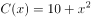，若生产的产品都能全部输出，则该商家的最大利润是：

A. 18

B. 25

C. 30

D. 38

第 56 题 · 答案与解析

**参考答案（粉笔题库参考内容）**

D

**解析**

已知商品对价格的需求函数x=12-0.5p，x为销量，p为价格，则商品价格p=24-2x，商家获得利润为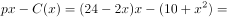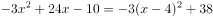。当销量x=4时，商家获得利润取最大值38。

故正确答案为D。

### 第 57 题

A、B两个方形的蓄水池，池底面积为7:5，A蓄水池水深5米，B蓄水池水深3米。往两个蓄水池注入同样多的水，使得两个蓄水池水深相等，这时水深多少米？

A. 10

B. 15

C. 20

D. 25

第 57 题 · 答案与解析

**参考答案（粉笔题库参考内容）**

A

**解析**

设注水后相等的水深为x，再设A、B池底面积分别为7y和5y，则向A池注水水量为7y(x-5)，向B池注水水量为5y(x-3)。由于往两个蓄水池注入水量相等，可列方程7y(x-5)=5y(x-3)，解得x=10米。

故正确答案为A。

### 第 58 题

一人爬有20个阶梯的楼梯，假定每次向上爬5个阶梯，又下走3个阶梯，问该人需几次能跑到楼梯顶部？

A. 7

B. 8

C. 9

D. 10

第 58 题 · 答案与解析

**参考答案（粉笔题库参考内容）**

C

**解析**

方法一：人每次上爬5个阶梯，又下走3个阶梯，故每次实际上爬2个阶梯，而当剩余阶梯数不足5时，再爬一次即可到顶部。由于第7次的时候到达第14个阶梯，剩余6个阶梯，而第8次到达第16个阶梯，只剩余4个阶梯，因而只需要再爬一次，就能到达顶部。所以8+1=9次后能到达顶部。

方法二：本题考查青蛙爬井的计算模型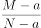，所以共需要跑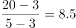次。需要8.5次才能到达顶部，由于次数为整数，8次并不能到达顶部，故取9次。

故正确答案为C。

### 第 59 题

一辆汽车从单位往机场接客人，通常以60公里/小时的速度行驶要2小时才能到达，有一次该车以这个速度去机场，行驶了1小时就坏了，之后停下来修理，花了15分钟才修好，问汽车要以多大的速度行驶才能准时到达机场？

A. 60公里/小时

B. 70公里/小时

C. 80公里/小时

D. 90公里/小时

第 59 题 · 答案与解析

**参考答案（粉笔题库参考内容）**

C

**解析**

根据题意可知，到机场的总路程S＝60×2＝120公里，1小时行驶了60公里，即离终点还有60公里处坏了。修了15分钟，即需要在60-15＝45分钟（小时）走完60公里。所以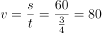公里/小时。

故正确答案为C。

### 第 60 题

用18厘米长的警戒线围成各种长方形，要求长和宽的长度都是厘米数。围成的长方形的面积最大是多少。

A. 18平方厘米

B. 20平方厘米

C. 25平方厘米

D. 40平方厘米

第 60 题 · 答案与解析

**参考答案（粉笔题库参考内容）**

B

**解析**

当长方形周长一定时，长和宽越接近，长方形面积越大。根据题意可知，周长为18厘米，则长＋宽＝9厘米，长、宽最接近时，长为5厘米、宽为4厘米，此时面积为20平方厘米。

故正确答案为B。

### 第 61 题

一停车场停了250辆车，包括四轮汽车、两轮摩托车、三轮摩托车，共有680个轮子，汽车比三轮摩托多30辆。问两轮摩托有多少辆？

A. 50

B. 75

C. 100

D. 140

第 61 题 · 答案与解析

**参考答案（粉笔题库参考内容）**

D

**解析**

设两轮摩托有x辆，三轮摩托有y辆，则四轮汽车有y+30辆，根据题意有：x+y+y+30=250，2x+3y+4y+120=680，联立两个方程解得x=140，y=40。

故正确答案为D。

### 第 62 题

有甲、乙、丙三根管子，甲管以每秒4克的流量流出含盐20%的盐水，乙管以每秒6克的流量流出含盐15%的盐水，丙管以每秒10克的流量流出水，但丙管打开后开始2秒不流，接着流5秒后又停了2秒，再流5秒，如此循环。现3根管同时打开通入一水池中，1分钟后关上。这时水池得到的混合溶液的浓度是：

A. 10%

B. 12%

C. 15%

D. 20%

第 62 题 · 答案与解析

**参考答案（粉笔题库参考内容）**

A

**解析**

因溶质=溶液×浓度可知，混合后的溶质（盐）质量为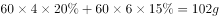。

丙管出水呈周期型，每7秒中，前2秒不出水，后5秒出水。所以1分钟内流水周期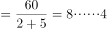，前8个周期流水秒，后4秒流水4-2＝2秒，合计流水时间为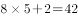秒。

故三管合计流出的溶液质量为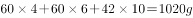，混合后的浓度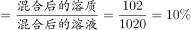。

故正确答案为A。

### 第 63 题

某单位员工总数是480人，在第一次体检中有320人合格，在第二次体检中有240人合格，若两次体检中都没合格的有40人，那么两次体检都合格的人数是：

A. 80

B. 100

C. 120

D. 140

第 63 题 · 答案与解析

**参考答案（粉笔题库参考内容）**

C

**解析**

根据容斥原理两集合公式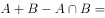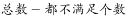，320＋240-两次体检都合格的人数＝480-40，得出两次体检都合格的人数＝120人。

故正确答案为C。

### 第 64 题

在某城市中，有60%的家庭订阅某种日报，有85%的家庭有电视机。假定这两个事件是独立的，今随机抽出一个家庭，所抽家庭既订阅该种日报又有电视机的概率是：

A. 0.09

B. 0.25

C. 0.36

D. 0.51

第 64 题 · 答案与解析

**参考答案（粉笔题库参考内容）**

D

**解析**

由于两个事件独立发生，所以家庭既订阅该种日报又有电视机的概率=订阅日报的概率有电视的概率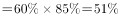。

故正确答案为D。

### 第 65 题

一个高为40厘米，直径为6厘米的空心圆桶，放入半径为2厘米的小铁球，如果铁球不能露出圆桶，最多放多少个？

A. 10

B. 11

C. 12

D. 13

第 65 题 · 答案与解析

**参考答案（粉笔题库参考内容）**

B

**解析**

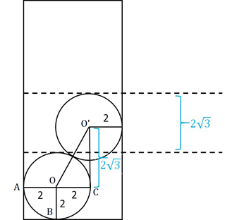

如图所示，AO=BO=CO=2厘米，OO'=4厘米，则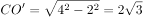厘米，所以从第二个小球开始，每放入一个小球，小球总高度便增加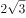厘米。放入x个小铁球时，总高度为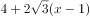厘米，由于桶高40厘米，故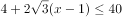，解得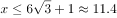，x为整数且不超过11.4，则x最大为11。

故正确答案为B。

### 第 66 题

请从四个选项中，选择最合适的一个填入问号处，使之呈现一定规律性：

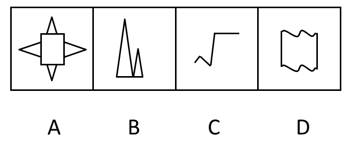

A. A

B. B

C. C

D. D

第 66 题 · 答案与解析

**参考答案（粉笔题库参考内容）**

C

**解析**

元素组成不同，优先考虑属性规律。题干图形中完全封闭图形与不完全封闭图形依次交替出现，故？处应该填入一个不完全封闭图形，选项中C选项为开放图形，属于不完全封闭图形，A、B、D三项均为完全封闭图形。

故正确答案为C。

注意：题干中第四个图形为半开半闭图形，因此本题考点为完全封闭与不完全封闭之间的区分。

### 第 67 题

请从四个选项中，选择最合适的一个填入问号处，使之呈现一定规律性：

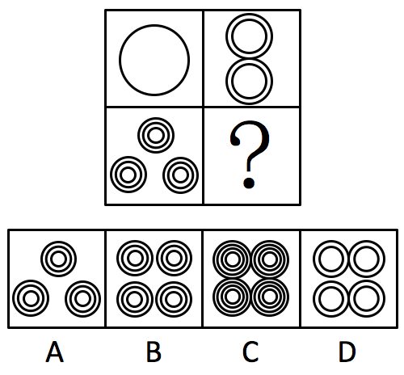

A. A

B. B

C. C

D. D

第 67 题 · 答案与解析

**参考答案（粉笔题库参考内容）**

C

**解析**

元素组成相同，但个数不同，考虑元素数量关系。

在“田字格”的三个方框内，观察发现圆圈数量依次为、、个，问号处应该选择含有个圆圈的选项，只有C项含有16个圆圈。

故正确答案为C。

### 第 68 题

一个正棱锥如图所示，正中被挖去一个圆锥体，然后从任意面剖开，下面哪一项不可能是该物体的截面：

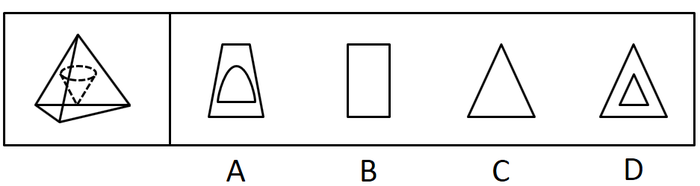

A. A

B. B

C. C

D. D

第 68 题 · 答案与解析

**参考答案（粉笔题库参考内容）**

D

**解析**

本题考查截面图，逐一分析选项。

A项：截面中含有弧线，剖开下刀必然经过圆锥的侧面，同时出现等腰梯形，则剖开下刀面必然与正棱锥的其中两个面存在相交，可从图1所示的剖开示意图得到A项中的截面；

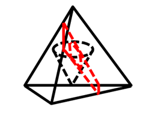（图1）

B项：截面为矩形，则从一个面向另一个面下刀切，不经过圆锥，如可从图2所示的剖开示意图得到B项中的截面；

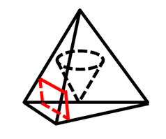（图2）

C项：截面为三角形，则从一条棱向另一面下刀切，不经过中间圆锥，如可以从图3所示的剖开示意图得到C项中的截面；

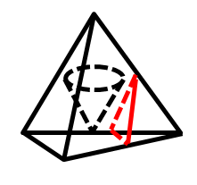（图3）

D项：如果要使内部剖开面出现正三角形，则只能经过四面体顶点往底面切，但此时内外三角形方向相反，如图4，因此D项不可能是该物体的截面。

（图4）

本题为选非题，故正确答案为D。

### 第 69 题

以下四个选项中哪个不可能由下图折叠而成？

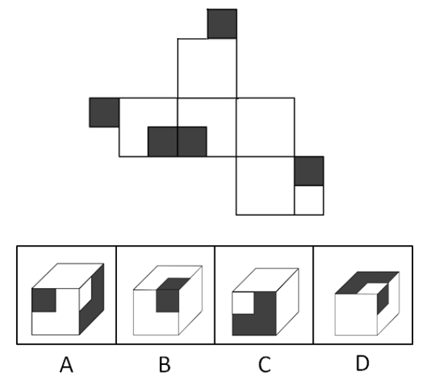

A. A

B. B

C. C

D. D

第 69 题 · 答案与解析

**参考答案（粉笔题库参考内容）**

D

**解析**

A、B、C三项均可折出，D项顶面中的白色小正方形不可能与右侧面中的黑色小正方形相连接，因此D选项不能折出。

本题为选非题，故正确答案为D。

### 第 70 题

把下面的六个图形分为两类，使每一类图形都有各自的共同特征或者规律，分类正确的一项是：

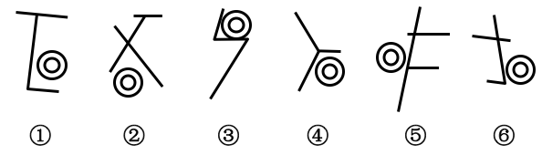

A. ①②⑥，③④⑤

B. ①⑤⑥，②③④

C. ①②④，③⑤⑥

D. ①④⑤，②③⑥

第 70 题 · 答案与解析

**参考答案（粉笔题库参考内容）**

B

**解析**

题干中所有图形都有两个圆，且两个圆为同心圆，此外图形中均存在三条线段，线段长短不一。

观察发现，①⑤⑥中含有两条平行线，且同心圆位于两条平行线之间，而②③④中不存在平行线，同心圆位于两条线段的夹角之中。因此，根据平行线和圆的相对位置进行分类。

故正确答案为B。

### 第 71 题

湿地通过提供行洪空间和减少地表径流，使洪峰水位大幅度下降，流速随之减缓。根据对沼泽率为45%的别拉洪河的典型年计算，湿地的自然调节系数是0.678，与天然湖泊调节系数相近。相同降水条件下，流域内沼泽率大者，径流小。

下列各项判断不能从上述文字推出的是：

A. 行洪空间缩小和地表径流加快会维持或加剧洪峰水位

B. 别拉洪河为沼泽性河流，多沼泽湿地

C. 天然湖也具有对洪水的调蓄作用

D. 流域内径流越大，该流域沼泽率一定越小

第 71 题 · 答案与解析

**参考答案（粉笔题库参考内容）**

D

**解析**

日常结论题，根据题干信息逐一分析选项。

A项：通过题干首句可知，行洪空间和地表径流二者均会影响到洪峰水位，如果行洪空间缩小和地表径流加快自然会影响到洪峰水位，会导致洪峰水位维持或加剧，可以推出，排除；

B项：根据题干第二句“沼泽率为45%的别拉洪河”可以推知“别拉洪河为沼泽性河流，多沼泽湿地”，可以推出，排除；

C项：根据题干第二句“湿地的自然调节系数是0.678，与天然湖泊调节系数相近”可以推知“天然湖也具有对洪水的调蓄作用”，可以推出，排除；

D项：题干是在“相同降水”的假设条件之下，才有“流域内沼泽率大者，径流小”，而选项中表述为“流域内径流越大，该流域沼泽率一定越小”，是脱离题干前提假设而做出的绝对化表达，属于夸大事实，无法推出，当选。

本题为选非题，故正确答案为D。

### 第 72 题

植被具有明显的年际变化和季节变化的特点，并且是连结土壤、大气和水分的自然纽带。在一定程度上能代表土地覆盖的变化。在全球变暖中充当“指示器”的作用。研究表明，在全球尺度和洲际尺度上，气温升高是导致全球特别是北半球植被活动增加的主导因素，由此可以通过植被活动的增加情况判断某一地区气温的变化趋势。

以下各项如果为真，能够成为上述结论的前提条件的是：

A. 植被本身的年际变化和季节变化特点受气温变化的影响小

B. 南半球植被活动还受到了植被类型、纬度等因素的主导

C. 植被覆盖类型等其他因素对当地植被活动影响不大

D. 植被活动是全球气温变化最佳的“指示器”

第 72 题 · 答案与解析

**参考答案（粉笔题库参考内容）**

C

**解析**

第一步：找到论点和论据。

论点：可以通过植被活动的增加情况判断某一地区气温的变化趋势。

论据：气温升高是全球特别是北半球植被活动增加的主导因素。

问法为前提条件，正确选项有两种，一种是搭桥，一种是必要条件。本题论点和论据都表明了气温和植被活动之间的关系，论点和论据话题一致，无法搭桥，故应选择一个必要条件的选项。

第二步：逐一分析选项。

A项：如果植被本身的特点变化受气温影响小，那么就没法通过植被活动的增加判断某一地区气温的变化趋势，可以削弱，排除；

B项：南半球的植被活动还受到其他因素的影响，那么就没法通过植被活动的增加判断某一地区气温的变化趋势，可以削弱，排除；

C项：如果还有其他因素对当地植被活动的影响很大，那么就不能够通过植被活动的增加来判断某一地区气温的变化趋势，所以植被覆盖类型等其他因素对当地植被活动影响不大，为论点成立的必要条件，当选；

D项：即使植被活动不是全球气温变化最佳的“指示器”，也可以通过植被活动的增加来判断某一地区气温的变化趋势，不是论点成立的必要条件，排除。

故正确答案为C。

### 第 73 题

如果土地价格提高或者商业银行钱荒加剧，则房地产价格就会暴涨，如果房地产价格暴涨，则中央银行要提高存款准备金率或者限制商业贷款规模；如果中央银行限制贷款规模，地产商就会对地产市场失去信心，中央银行不会提高存款准备金率且地产商也不会对地产市场失去信心。

如果上述都为真，则下述哪一项必然为真？

A. 中央银行限制商业银行的贷款规模

B. 房地产价格会暴涨

C. 土地价格会提高

D. 土地价格不会提高

第 73 题 · 答案与解析

**参考答案（粉笔题库参考内容）**

D

**解析**

第一步：翻译题干。

（1）土地价格提高或钱荒→房价暴涨；

（2）房价暴涨→提高存款准备金率或限制商业贷款规模；

（3）限制贷款规模→房地产商对地产市场失去信心；

（4）不会提高存款准备金率且地产商不会对地产市场失去信心。

条件（4）中，地产商不会对地产市场失去信心是对条件（3）后项的否定，否后必否前，所以可以得到，不限制贷款规模（5）；

由（5）和（4）可知，否定了（2）的后件，否后否前，即不会提高存款准备金率且不限制商业贷款规模→房价不会暴涨（6）；

由（6）可知，（6）否定了（1）的后件，否后否前，即房价不会暴涨→土地价格不会提高且不会出现钱荒（7）。

第二步：逐一分析选项。

A项：由（5）可知，中央银行不会限制商业银行的贷款规模，无法推出，排除；

B项：由（6）可知，房价不会暴涨，无法推出，排除；

C项：由（7）可知，土地价格不会提高，无法推出，排除；

D项：与（7）一致，必然为真，当选。

故正确答案为D。

### 第 74 题

通过随机询问5个城市的400名市民两个问题：他们是否经常食用某种小吃以及他们觉得这种小吃是否美味，某网站发布了一份国内小吃排行榜，排序的依据是小吃的普遍度和美味度。位居前32名均是绝大多数餐馆都供应的小吃，但是32种小吃的普遍度排名与美味度排名大相径庭，相反，其他一些小吃在普遍度和美味度的排序是一致的。

以下哪项如果为真，最能质疑该排名结果的公正性与准确性？

A. 去除了一些口味极其特殊，或者特殊偏好的受访者数据

B. 调查的小吃中，有一些是在调查所在地比较难以找到的

C. 询问的400名市民，均为对两个问题的回答一致的人

D. 5个城市并非随机抽取，而是在我国五大片区各抽取一个代表城市

第 74 题 · 答案与解析

**参考答案（粉笔题库参考内容）**

C

**解析**

第一步：找出论点和论据。

论点：32种小吃的普遍度排名与美味度排名大相径庭，相反，其他一些小吃在普遍度和美味度的排序是一致的。

论据：通过随机询问5个城市的400名市民两个问题：他们是否经常食用某种小吃以及他们觉得这种小吃是否美味，某网站发布了一份国内小吃排行榜，排序的依据即是根据小吃的普遍度和美味度。

第二步：逐一分析选项。

A项：该项说明对调查结果进行了修正，确保调查的科学性，保证了实验排名结果的公正性与准确性，加强论据，无法削弱，排除；

B项：该项说明调查具有广泛性，保证了实验排名结果的公正性与准确性，加强论据，无法削弱，排除；

C项：该项说明询问的市民回答情况一致，因此调查对象的选取是有一定的倾向性的，样本是不具备代表性的，质疑了调查结果的合理性，当选。

D项：该项说明此次调查对象是在我国五大片区各抽取一个代表城市选取的，所选取的样本是具有代表性的，证明了排名结果的合理性，加强了题干论点，排除。

故正确答案为C。

### 第 75 题

噬菌体的基因组比较小，复制迅速，使得对要在噬菌体中获得多重突变体的遗传分析来说是可控的。为了分离病毒复制的关键基因，在条件致死突变的基础上开发了许多筛选技术，例如：通过分离“温度敏感型噬菌体”使得其能在低温下生长，而不能在高温下生长。由于DNA复制，基因变大与重组的机制在各种生命体中高度保守，所以，即使是现在，在研究这些生物学的基本生命迹象时，噬菌体仍然是可以采用的系统。

下列各项判断中不能从上述文字推出的是：

A. 噬菌体提供了一个研究基本生命过程的系统

B. 多重突变体的遗传分析受到了基因组复杂性的影响

C. 噬菌体具备病毒特有的一些特性

D. 现有的探究系统的发展受到了DNA复制等因素保守的制约

第 75 题 · 答案与解析

**参考答案（粉笔题库参考内容）**

D

**解析**

日常结论题，根据题干信息逐一分析选项。

A项：由题干最后一句话“在研究这些生物学的基本生命迹象时，噬菌体仍然是可以采用的系统”，可以推出，排除；

B项：由题干第一句“噬菌体的基因组比较小，复制迅速，使得对要在噬菌体中获得多重突变体的遗传分析来说是可控的”，可以推出，排除；

C项：由题干第一句和第二句话可以推知噬菌体具备病毒特有的一些特性，比如“复制迅速”，可以利用“条件致死突变基础上开发的筛选技术”，可以推出，排除；

D项：分析题干最后一句，“由于DNA复制，基因变大与重组的机制在各种生命体中高度保守，噬菌体仍然是可以采用的系统”，说明噬菌体仍然是可以采用的系统得益于DNA复制等因素的保守，而不是受到了其保守因素的制约，无法推出，当选。

本题为选非题，故正确答案为D。

### 第 76 题

调查结果表明，口腔的老化程度与患认知障碍症之间存在一定关联：牙齿少于20颗的75岁以上老人与牙齿相对健全的同年龄段人相比，咀嚼能力要低50%～90%，嚼碎食物的力量也要低\-，咀嚼能力变差会加速大脑老化，患认知障碍症的风险也就相应加大。对70岁以上老人做的认知障碍程度测试显示，健康的人平均有14.9颗牙齿，而疑似患认知障碍症的参试者平均只有9.4颗牙齿。这表明牙齿健康的老人患认知障碍症的几率比较低。

如果下列哪项为真，最能反驳上述推论：

A. 为了克服老年人不识字或者不清楚等问题，研究者在调查过程中让参与者报告是否出现注意、记忆、信息整合、运动等方面的障碍并根据其程度来作为评价其认知障碍的依据

B. 随机抽取300人进行调查，结果发现健康的人和疑似患认知障碍症的人的牙齿颗数并没有太大的区别

C. 老年痴呆症是认知障碍症的一种，而目前没有研究表明口腔的老化程度和老年痴呆症之间存在着一定联系

D. 参与研究的老人年龄集中在70岁左右，60—65岁和85—90岁这两个年龄段的老人相对较少

第 76 题 · 答案与解析

**参考答案（粉笔题库参考内容）**

B

**解析**

第一步：找到论点和论据。

论点：牙齿健康的老人患认知障碍症的几率比较低。

论据：健康的人平均有14.9颗牙齿，而疑似患认知障碍症的参试者平均只有9.4颗牙齿。即不同牙齿颗数的老人患认知障碍的风险不同。

论点和论据都表明牙齿健康的老人患认知障碍症的几率比较低，话题一致，要想削弱优先考虑否定论点。

第二步：逐一分析选项。

A项：说明调查中如何有效评价认知障碍，保证了调查的可靠性，可以加强，排除；

B项：健康的人和疑似患认知障碍症的人的牙齿颗数并没有太大的区别，说明牙齿数量和认知障碍没有关系，否定论点，当选；

C项：没有研究表明口腔的老化程度和老年痴呆症之间存在着一定联系，并不等同于二者之间不存在联系，属于不明确选项，排除；

D项：说明调查样本的年龄分布情况，但60-65和85-90之间的老人牙齿健康的状况和患认知障碍的风险的具体情况并不清楚，属于不明确选项，排除。

故正确答案为B。

### 第 77 题

资料室选派小郑，小周谁去基层蹲点有三种不同的意见：只要小郑去，小周就不去；

只要小周不去，小郑就要去；小郑去基层蹲点。

资料室领导研究后，同意了一种意见，否定了两种意见，据此可以推出：

A. 小郑、小周都去

B. 小郑、小周都不去

C. 小郑去而小周不去

D. 小周去而小郑不去

第 77 题 · 答案与解析

**参考答案（粉笔题库参考内容）**

B

**解析**

第一步：分析题干条件。

（1）小郑小周

（2）-小周小郑

（3）小郑

第二步：根据题干条件进行推理。

由题干可知，三个人的话中有两句为假、一句为真。条件中没有明显的矛盾关系，考虑假设法，可以从三个条件中都提到的“小郑”开始假设。

①假设“小郑去”，此时条件（3）为真，那么条件（1）和条件（2）必为假，根据条件（1）为假可知，小郑和小周都去，根据条件（2）为假可知，小郑和小周都不去，此时出现矛盾，该假设不成立；

②假设“小郑不去”，此时条件（3）为假，条件（1）的矛盾“小郑去且小周去”一定为假，则条件（1）为真，那么条件（2）必为假，可以推出小郑和小周都不去，此时满足题干，该假设成立。

综上可知，小郑和小周都不去。

故正确答案为B。

注：积累小技巧（“A”和“AB”，两者必有一真）。在本题中条件（1）和条件（3）满足这种形式，两者必有一真，则条件（2）必为假，可以直接得出结论”-小周且-小郑”。

### 第 78 题

山西左云五路山与内蒙古凉城、和林格尔交界处一带，位于北魏盛乐和平城之间，更兼山势雄伟，丘陵起伏，南侧又有广袤的平川相连，从地理条件到相对位置，都是理想的陵区所在地。据此，有学者认为，在左云五路山和凉山境内山巅发现的高大封土堆，以及目前在五路山山麓地带发现的夯筑土墙等遗存，可以当做寻找北魏金陵的重要线索。

以下哪项如果为真，最能削弱该学者的说法？

A. 高大封土堆和夯筑土墙等并不属于北魏时期的遗存

B. 在左云五路山及其附近区域发现了其他朝代的陵墓

C. 在该地带出土了大量北魏时期的文物

D. 相关史料记载北魏陵墓四周区域都为平原

第 78 题 · 答案与解析

**参考答案（粉笔题库参考内容）**

A

**解析**

第一步：找到论点和论据。

论点：在左云五路山和凉山境内山巅发现的高大封土堆，以及目前在五路山山麓地带发现的夯筑土墙等遗存，可以当做寻找北魏金陵的重要线索。

论据：山西左云五路山与内蒙古凉城、和林格尔交界处一带，位于北魏盛乐和平城之间，更兼山势雄伟，丘陵起伏，南侧又有广袤的平川相连，从地理条件到相对位置，都是理想的陵区所在地。

论点和论据都表明左云五路山和凉山境内和北魏陵区的关系，话题一致，要想削弱优先考虑否定论点。

第二步：逐一分析选项。

A项：表明遗存并不属于北魏时期，因此不能作为寻找北魏金陵的重要线索，否定论点，当选；

B项：在左云五路山及其附近区域是否发现其他朝代的陵墓与论点无关，话题不一致，排除；

C项：在该地带出土了大量北魏时期的文物，说明此地可以作为寻找北魏金陵的线索，可以加强，排除；

D项：该项在讨论北魏陵墓所在位置的具体地形，但论点在讨论是否可以用相关遗存当做寻找北魏金陵的重要线索，没有讨论北魏金陵所在地的具体地形，所以该项与论点话题不一致，无关项，排除。

故正确答案为A。

### 第 79 题

梳理现代企业管理100余年的历史会发现，对管理贡献最大的不是企业，不是商学院，而是军队、军校。一方面，现代企业管理从军队管理中借鉴、汲取了许多营养；另一方面，现代企业管理中的许多方法与原则都直接取自军队。特别是两次世界大战后，军队的管理为现代企业组织管理提供了非常好的人员、实践和理论准备。

以下哪项如果为真，最能支持上述结论？

A. 军事化的管理原则和现代企业管理原则相一致

B. 军队高效，而管理理论的核心正是效率

C. 现代企业管理思想诞生于两次世界大战结束时期

D. 美国最优秀的“商学院”并非哈佛，而是西点军校

第 79 题 · 答案与解析

**参考答案（粉笔题库参考内容）**

B

**解析**

第一步：找到论点和论据。

论点：对管理贡献最大的不是企业，不是商学院，而是军队、军校。

论据：一方面，现代企业管理从军队管理中借鉴、汲取了许多营养；另一方面，现代企业管理中的许多方法与原则都直接取自军队。

本题论点和论据都表明军队对管理有巨大的贡献，话题一致，要想加强优先考虑补充论据。

第二步：逐一分析选项。

A项：与题干中原有论据“现代企业管理中的许多方法与原则都直接取自军队”表述一致，可以加强，保留；

B项：解释了企业管理为何借鉴军队，原因在于军队的高效管理正是管理理论的核心，可以加强，保留；

C项：管理思想的诞生时间仅说明时间的先后顺序，不能说明军队对管理的作用，无法加强，排除；

D项：最优秀的“商学院”是西点军校，不能说明军队对管理的作用，无法加强，排除。

A项为原有论据重复，而B项补充了新论据来证明论点，B项比A项的加强力度更强。

故正确答案为B。

### 第 80 题

经济发展是城镇建设用地大量扩张最根本、最直接的原因。经济发展水平越高，城市完善基础设施的能力就越强，就越能够吸引更多的企业和人口，从而加快土地利用结构转化速度。近20年来S市区建设用地扩张了近1倍，主要是由于城市经济发展带来的增加建设用地的需要，这足以证明经济发展对城市建设用地扩张的助推作用。

以下哪项如果为真，最能加强上述论证？

A. 随着城市经济发展，居民生活水平逐步提高，对舒适居住环境偏好增强促使住宅用地向城市边缘区扩张

B. 从2002年到2004年，S市建设用地增长尤其迅速，与该时期建设用地扩张主要受政策等其他因素的影响有关

C. 人口增长是城市建设用地扩张重要的驱动力，建设用地数量在增加的同时，推动了城市商业、工业与交通运输业的发展

D. 从2001年以来受其他因素的影响，S市人口的增长对城市建设用地扩张的作用逐渐削弱

第 80 题 · 答案与解析

**参考答案（粉笔题库参考内容）**

A

**解析**

第一步：找到论点和论据。

论点：经济发展是城镇建设用地大量扩张最根本、最直接的原因。

论据：经济发展水平越高，城市完善基础设施的能力就越强，就越能够吸引更多的企业和人口，从而加快土地利用结构转化速度。近20年来S市区建设用地扩张了近1倍，主要是由于城市经济发展带来的增加建设用地的需要，这足以证明经济发展对城市建设用地扩张的助推作用。

本题论点和论据都表明经济发展是城镇建设用地扩张的原因，话题一致，要想加强优先考虑补充论据。

第二步：逐一分析选项。

A项：说明经济发展促使住宅用地向城市边缘扩张，说明经济发展对城市建设用地扩张的确起到了助推作用，可以加强，当选；

B项：该时期建设用地扩张主要受政策等其他因素的影响，说明是政策等其他因素起主要作用，属于另有他因，不能加强，排除；

C项：说明是人口增长带来了建设用地的扩张，属于另有他因，不能加强，排除；

D项：说明人口增长对建设用地扩张的作用逐渐削弱，但并不能说明经济发展是否对建设用地扩张起作用，属于不明确选项，排除。

故正确答案为A。

### 第 81 题

了解：领略

A. 行走：徘徊

B. 怅惘：失落

C. 袒露：表达

D. 追求：痴迷

第 81 题 · 答案与解析

**参考答案（粉笔题库参考内容）**

D

**解析**

第一步：判断题干词语间逻辑关系。

了解指对学习材料有一定的认识和记忆，而领略侧重于理解并领会。题干二词之间为近义关系，且后者比前者程度更深。

第二步：判断选项词语间逻辑关系。

A项：徘徊，指在一个地方来回走动，是行走的一种状态，二者之间为种属关系，与题干逻辑关系不一致，排除；

B项：怅惘，指因失意而心事重重，与失落为近义关系，但前者比后者程度更深，与题干逻辑关系不一致，排除；

C项：袒露，是指毫无掩饰的表露，完全告诉别人某件事，袒露是表达的一种，二者之间为种属关系，与题干逻辑关系不一致，排除；

D项：追求和痴迷二者都体现了对喜爱之物的追逐之意，且后者比前者在语义上程度更深，与题干逻辑关系一致，当选。

故正确答案为D。

### 第 82 题

垃圾：环境

A. 雨水：庄稼

B. 紫外线：皮肤

C. 网络：学生

D. 根瘤菌：大豆

第 82 题 · 答案与解析

**参考答案（粉笔题库参考内容）**

B

**解析**

第一步：判断题干词语间逻辑关系。

垃圾必然会污染环境，对环境产生负面影响，二者之间为必然对应关系。

第二步：判断选项词语间逻辑关系。

A项：雨水可能对庄稼产生负面影响，二者之间为或然对应关系，与题干逻辑关系不一致，排除；

B项：紫外线必然会损害皮肤，对皮肤产生负面影响，二者之间为必然对应关系，与题干逻辑关系一致，当选；

C项：网络可能会对学生产生负面影响，二者之间为或然对应关系，与题干逻辑关系不一致，排除；

D项：根瘤菌与大豆之间为共生关系，互利互惠，不存在负面影响，与题干逻辑关系不一致，排除。

故正确答案为B。

### 第 83 题

视力表：眼镜

A. 电子称：食物

B. 跑步机：脂肪

C. 温度计：退烧药

D. CT机：肿瘤

第 83 题 · 答案与解析

**参考答案（粉笔题库参考内容）**

C

**解析**

第一步：判断题干词语间逻辑关系。

视力表的功能是测视力，眼镜的功能是改善、矫正视力，二者之间为同一事物的测试物和治疗物的对应关系。

第二步：判断选项词语间逻辑关系。

A项：电子称可以用来称量食物的重量，与题干逻辑关系不一致，排除；

B项：跑步机的功能是用于跑步，可以用于测步数，但脂肪并非治疗步数的物品，与题干逻辑关系不一致，排除；

C项：温度计的功能是测试体温，退烧药是治疗高烧（体温过高），二者之间为同一事物的测试物和治疗物的对应关系，与题干逻辑关系一致，当选；

D项：CT机是检测肿瘤的工具，与题干逻辑关系不一致，排除。

故正确答案为C。

### 第 84 题

偷工减料：诚信

A. 起早贪黑：勤奋

B. 逆来顺受：温和

C. 冥思苦想：愚笨

D. 目中无人：谦虚

第 84 题 · 答案与解析

**参考答案（粉笔题库参考内容）**

D

**解析**

第一步，判断题干词语间逻辑关系。

偷工减料是不诚信的表现，前者为后者的反面表现，二者之间为对应关系。

第二步：判断选项词语间逻辑关系。

A项：起早贪黑为勤奋的正面表现，与题干逻辑关系不一致，排除；

B项：逆来顺受指对恶劣的环境或无理的待遇采取顺从和忍受的态度，与温和之间不存在明显的逻辑关系，排除；

C项：冥思苦想是绞尽脑汁，苦思苦想，与愚笨之间不存在明显的逻辑关系，排除；

D项：目中无人为不谦虚的表现，前者为后者的反面表现，二者之间为对应关系，与题干逻辑关系一致，当选。

故正确答案为D。

### 第 85 题

电流：安培

A. 体积：立方

B. 动能：焦耳

C. 质量：千克

D. 电阻：伏特

第 85 题 · 答案与解析

**参考答案（粉笔题库参考内容）**

B

**解析**

第一步，判断题干词语间逻辑关系。

安培是电流的基本单位，为纪念物理学家安培而命名，二者之间为对应关系。

第二步：判断选项词语间逻辑关系。

A项：立方是体积单位，与题干逻辑关系不一致，排除；

B项：焦耳是动能的基本单位，为纪念物理学家焦耳而命名，二者之间为对应关系，与题干逻辑关系一致，当选；

C项：千克是质量的基本单位，但是千克并非人名，与题干逻辑关系不一致，排除；

D项：电阻的基本单位是欧姆，而伏特是电压的基本单位，与题干逻辑关系不一致，排除。

故正确答案为B。

### 第 86 题

勤劳：起早贪黑

A. 紧张：分秒必争

B. 朦胧：模模糊糊

C. 晴朗：万里无云

D. 压抑：日渐消瘦

第 86 题 · 答案与解析

**参考答案（粉笔题库参考内容）**

C

**解析**

第一步，判断题干词语间逻辑关系。

起早贪黑指起得早，睡得晚，形容人辛勤劳动，与勤劳是近义关系。

第二步：判断选项词语间逻辑关系。

A项：紧张是指精神处于高度准备状态，分秒必争比喻时间观念强，二者之间无明显的逻辑关系，排除；

B项：朦胧指物体的样子模糊，看不清楚，模模糊糊指看不清事物的状态或意志不清醒，与题干逻辑关系一致，保留；

C项：万里无云形容天气晴朗，没有一丝污染，与晴朗是近义关系，与题干逻辑关系一致，保留；

D项：压抑可能会导致日益消瘦，二者为或然因果对应，与题干逻辑关系不一致，排除；

比较B和C两项，B选项模模糊糊除了可以指看不清事物的状态，还可以指思想上不清晰，此时与朦胧就不是近义关系，因此C选项比B选项关系更一致。

故正确答案为C。

### 第 87 题

匕首：凶器：罪犯

A. 剪刀：衣服：裁缝

B. 树枝：画笔：学生

C. 单反：相机：摄影

D. 电影：片场：导演

第 87 题 · 答案与解析

**参考答案（粉笔题库参考内容）**

B

**解析**

第一步，判断题干词语间逻辑关系。

罪犯使用匕首当做凶器，有的匕首是凶器，有的匕首不是凶器，二者为交叉关系。罪犯和前两个词是对应关系，且罪犯是一种身份。

第二步：判断选项词语间逻辑关系。

A项：剪刀和衣服之间为工具对应关系，不是交叉关系，与题干逻辑关系不一致，排除；

B项：学生使用树枝当做画笔，有的树枝是画笔，有的树枝不是画笔，二者是交叉关系，学生和前两个词是对应关系，且学生是一种身份，与题干逻辑关系一致，当选；

C项：单反是相机，二者为种属关系，且摄影不是一种身份，摄影师才是，与题干逻辑关系不一致，排除；

D项：导演在片场导演电影，电影和片场之间为场所对应关系，非交叉关系，与题干逻辑关系不一致，排除。

故正确答案为B。

### 第 88 题

盖茨：微软：软件

A. 张朝阳：搜狐：股票

B. 乔布斯：苹果：商店

C. 李彦宏：百度：中文

D. 张瑞敏：海尔：电器

第 88 题 · 答案与解析

**参考答案（粉笔题库参考内容）**

D

**解析**

第一步，判断题干词语间逻辑关系。

盖茨是微软的创始人，软件是微软的主要产品，三者是对应关系。

第二步，判断选项词语间的逻辑关系。

A项：张朝阳是搜狐的创始人，但是股票并不是搜狐的主要产品，与题干逻辑关系不一致，排除；

B项：乔布斯是苹果的创始人，但是商店并不是苹果的主要产品，与题干逻辑关系不一致，排除；

C项：李彦宏是百度的创始人，但是中文并不是百度的主要产品，与题干逻辑关系不一致，排除；

D项：张瑞敏是海尔的创始人，电器是海尔的主要产品，与题干逻辑关系一致，当选。

故正确答案为D。

### 第 89 题

飞机 对于 （    ） 相当于 轮船 对于 （    ）

A. 升力；浮力

B. 乘客；海员

C. 机翼；锚链

D. 机场；大海

第 89 题 · 答案与解析

**参考答案（粉笔题库参考内容）**

A

**解析**

逐一代入选项。

A项：飞机依靠升力在空中停留，而轮船依靠浮力在水面停留，二者都是对应关系，前后逻辑关系一致，当选；

B项：乘客搭乘飞机，而海员在轮船上工作，前后逻辑关系不一致，排除；

C项：机翼是飞机的组成部分，二者为组成关系。但锚链是指连接锚和船体并传递锚抓力的专用链条，不是轮船的组成部分，前后逻辑关系不一致，排除；

D项：机场是飞机停靠的场所，不是飞行的场所。而大海是轮船航行的场所，前后逻辑关系不一致，排除。

故正确答案为A。

### 第 90 题

田园诗人 对于 （    ） 相当于 （    ） 对于 岑参

A. 卢照邻；初唐四杰

B. 屈原；豪放派

C. 陶渊明；边塞诗人

D. 苏东坡；婉约派

第 90 题 · 答案与解析

**参考答案（粉笔题库参考内容）**

C

**解析**

逐一代入选项。

A项：卢照邻不是田园诗人，初唐四杰是王勃、杨炯、卢照邻、骆宾王，岑参不是初唐四杰，前后逻辑关系不一致，排除；

B项：屈原不是田园诗人，且岑参不是豪放派，而是边塞诗人，前后逻辑关系不一致，排除；

C项：陶渊明是田园诗人，岑参是边塞诗人，前后逻辑关系一致，当选；

D项：苏东坡是豪放词派的代表人物，而岑参是边塞诗人，不属于婉约派，前后逻辑关系不一致，排除。

故正确答案为C。

### 第 91 题

航空航天材料按使用范围可分为结构材料与功能材料。结构材料用于制造飞行器各种结构部件，其作用主要是承受各种载荷；功能材料主要是指在光、声、电、磁、热等方面具有特殊功能的材料。

根据上述定义，下列选项属于结构材料的是：

A. 传感器件材料

B. 发动机壳材料

C. 热防护材料

D. 吸波材料

第 91 题 · 答案与解析

**参考答案（粉笔题库参考内容）**

B

**解析**

第一步：找出定义关键词。

结构材料——“用于制造飞行器各种结构部件”、“承受各种载荷”。

功能材料——“光、声、电、磁、热等方面具有特殊功能”。

第二步：逐一分析选项。

A、C、D三项均具有“特殊功能”，符合“光、声、电、磁、热等方面具有特殊功能”，属于功能材料，排除；

B项：发动机壳属于结构部件，符合“用于制造飞行器各种结构部件”，符合定义，当选。

故正确答案为B。

### 第 92 题

灵感思维是指凭借直觉而进行的快速、顿悟性的思维，即将长期思考的问题暂停搁置，或是受到某些事物的启发，忽然得到解决的心理过程。

根据上述定义，下列不属于灵感思维的是：

A. 中国有“三上”（床上、马上、厨上）文章，西方有“3B”（Bed、Bath、Bus）思考法

B. 英国某著名女作家年轻时在厨房劳动，她每次都带着纸和笔，随时把脑子里涌出来的想法记下来

C. 阿基米德在泡澡时发现浮力与物体的排水量有关，从而发现浮力原理

D. 王教授不断搜集与课题有关的资料，终于解决课题中的久思未决的难题

第 92 题 · 答案与解析

**参考答案（粉笔题库参考内容）**

D

**解析**

第一步：找出定义关键词。

“凭借直觉而进行的快速、顿悟性的思维”、“长期思考的问题暂停搁置”、“受到某些事物的启发，忽然得到解决的心理过程”。

第二步，逐一分析选项。

A项：“‘三上’文章和‘3B’思考法”均符合“凭借直觉而进行的快速、顿悟性的思维”，符合定义，排除；

B项：随时把脑子里涌出来的想法记下来，符合“凭借直觉而进行的快速、顿悟性的思维”，符合定义，排除；

C项：阿基米德泡澡时发现浮力原理，符合“受到某些事物的启发，忽然得到解决的心理过程”，符合定义，排除；

D项：不断搜集与课题有关的资料是一个累积的过程，不符合“凭借直觉而进行的快速、顿悟性的思维”，也不符合“受到某些事物的启发，忽然得到解决的心理过程”，不符合定义，当选。

本题为选非题，故正确答案为D。

### 第 93 题

转基因技术，是指将人工分离和修饰过的基因导入到生物体基因组中，以此引起生物体状可遗传的修饰。

根据上述定义，下列情况不属于转基因技术的是：

A. 把青椒种子送上天空，使其在完全失重状态下发生基因突变来培育“彩色青椒”

B. 将外源抗真菌基因导入小麦，防治小麦赤霉病、纹枯病、根腐病等真菌性病害

C. 用反转汞病毒作为载体，把腺苷脱氨酶基因转染至一名患DNA缺陷症女孩的淋巴细胞，使这个患者先天缺损的免疫系统趋于正常

D. 运用反转汞病毒为载体携带生长激素基因导入动物，相继培育出快速生长的转基因猪、羊、鸡、兔和牛等

第 93 题 · 答案与解析

**参考答案（粉笔题库参考内容）**

A

**解析**

第一步：找出定义关键词。

“人工分离和修饰过的基因”、“导入到生物体基因组中”、“生物体状可遗传的修饰”。

第二步：逐一分析选项。

A项：青椒种子送上太空未体现“人工分离和修饰过的基因”，不符合定义，当选；

B项：外源抗真菌基因导入小麦，符合“人工分离和修饰过的基因”，防治小麦赤霉病、纹枯病、根腐病等真菌性病害，符合“引起生物体状可遗传的修饰”，符合定义，排除；

C项：把腺苷脱氨酶基因转染至一名患DNA缺陷症女孩的淋巴细胞，符合“将人工分离和修饰过的基因导入到生物体基因组中”，患者先天缺损的免疫系统趋于正常，符合“引起生物体状可遗传的修饰”，符合定义，排除；

D项：反转汞病毒为载体携带生长激素基因导入动物，符合“将人工分离和修饰过的基因导入到生物体基因组中”，相继培育出快速生长的转基因猪、羊、鸡、兔和牛等，符合“引起生物体状可遗传的修饰”，符合定义，排除。

本题为选非题，故正确答案为A。

### 第 94 题

在化学概念中，描述一个物质的成分有两种表达方式，组成和构成。组成用于较大事物的个体部分，是相对于宏观描述的，是在分割的基础上表达宏观意向；构成常常用于微观角度分析物质。

根据上述定义，下列关于组成和构成的用法正确的是：

A. 空气是由几种物质和化合物构成的混合物

B. 水是由氢和氧两种元素构成的

C. 金刚石是由碳元素组成的单质

D. 原子核是由质子和中子组成的

第 94 题 · 答案与解析

**参考答案（粉笔题库参考内容）**

B

**解析**

第一步：找出定义关键词。

组成——“用于较大事物的个体部分”、“宏观描述”。

构成——“微观角度分析物质”。

第二步：逐一分析选项。

A项：几种物质和化合物属于“宏观描述”，应该用组成，而非构成，不正确，排除；

B项：氢和氧两种元素属于对物质进行“微观角度分析物质”，应用构成，用法正确，当选；

C项：碳元素属于对物质进行“微观角度分析物质”，应用构成，而非组成，不正确，排除；

D项：质子和中子属于对物质进行“微观角度分析物质”，应用构成，而非组成，不正确，排除。

故正确答案为B。

### 第 95 题

宗法观念，是指伴随着古代中国以血缘为纽带、以地缘为基础、以家族为基本结构的宗法社会的产生和发展而形成的观念，强调父权、血亲、家族至上。如今，仍以不同方式出现在社会生活中。

根据上述定义，下列不属于宗法观念的表现的是：

A. 王某留学回国后进入一家公司工作，后来得知，他的表哥与他同在一个部门工作

B. 刘某与孙某因琐事发生争执，并被孙某打伤，刘某回家后带领数十个亲戚到孙某家讨说法

C. 张某在镇上开了一家火锅店，因生意红火，他又陆续开了多家分店，并请来他的大部分亲朋好友打理生意

D. 某村农民修订族谱，订立家法族规，修建祠堂和祖坟，祭祀祖先

第 95 题 · 答案与解析

**参考答案（粉笔题库参考内容）**

A

**解析**

第一步：找出定义关键词。

“以血缘为纽带、以地缘为基础、以家族为基本结构的宗法社会的产生和发展而形成的观念”、“强调父权、血亲、家族至上”。

第二步：逐一分析选项。

A项：“后来得知”说明王某进入该公司之前与他的表哥并无任何关系，没有涉及到宗法观念，不符合“强调父权、血亲、家族至上”，不符合定义，当选；

B项：刘某回家后带领数十个亲戚到孙某家讨说法，符合“以家族为基本结构的宗法社会”和“家族至上”的观念，符合定义，排除；

C项：开了多家分店，并请来他的大部分亲朋好友打理生意，符合“以血缘为纽带、以家族为基本结构的宗法社会”和“家族至上”的观念，符合定义，排除；

D项：修订族谱、订立家法、族规，修建祠堂和祖坟、祭祀祖先均体现出了“以家族为基本结构的宗法社会的产生和发展而形成的观念”，强调“家族至上”，符合定义，排除。

本题为选非题，故正确答案为A。

### 第 96 题

质押也称质权，是担保的一种方式，指债权人与债务人或债务人提供的第三人以协商订立书面合同的方式，移转债务人或者债务人提供的第三人的动产或权利的占有，在债务人不履行合同时，债权人有权以该财产价款优先受偿。

根据上述定义，下列哪项不属于质押：

A. 某乙以其存折出质质押

B. 某甲以其所有的别墅出质质押

C. 某丙以其享有的专利权出质质押

D. 某丁以其购买的股票出质质押

第 96 题 · 答案与解析

**参考答案（粉笔题库参考内容）**

B

**解析**

第一步：找出定义关键词。

“担保的一种方式”、“移转债务人或者债务人提供的第三人的动产或权利的占有”。

第二步：逐一分析选项。

A项：以存折出质质押符合“移转债务人或者债务人提供的第三人的动产或权利的占有”，符合定义，排除；

B项：别墅属于不动产，不符合“移转债务人或者债务人提供的第三人的动产或权利的占有”，不符合定义，当选；

C项：专利权出质质押符合“移转债务人或者债务人提供的第三人的动产或权利的占有”，符合定义，排除；

D项：股票出质质押符合“移转债务人或者债务人提供的第三人的动产或权利的占有”，符合定义，排除。

本题为选非题，故正确答案为B。

### 第 97 题

文化例外指在国际自由贸易体制下，基于文化商品和服务的双重属性，而将文化商品排除在贸易自由化的谈判之外，不适用有关的自由贸易法律规则。

根据上述定义，下列属于文化例外的是：

A. 某国在与外国谈判过程中，将“文化产业豁免”写进正式的国际贸易协议

B. 文化商品和文化服务贸易都体现国家文化产业高层次竞争力，这成为很多国家战略政策的焦点

C. 文化贸易主要发生在少数发达国家之间，这些国家通过文化产品向其他国家渗透意识形态和价值观念

D. 一些国家之间可以通过电影配额的形式设立成维持对进口电影的数量上的限制​

第 97 题 · 答案与解析

**参考答案（粉笔题库参考内容）**

D

**解析**

第一步：找出定义关键词。

“在国际自由贸易体制下”、“将文化商品排除在贸易自由化的谈判之外”、“不适用有关的自由贸易法律规则”。

第二步：逐一分析选项。

A项：将“文化产业豁免”写进正式的国际贸易协议，不符合“不适用有关的自由贸易法律规则”，不符合定义，排除；

B项：只是陈述了文化商品和服务贸易成为战略政策的焦点，并未体现“将文化商品排除在贸易自由化的谈判之外”、“不适用有关的自由贸易法律规则”，不符合定义，排除；

C项：通过文化产品向其他国家渗透意识形态和价值观念，不符合“将文化商品排除在贸易自由化的谈判之外”，且发生在少数发达国家之间不符合“在国际自由贸易体制下”，不符合定义，排除；

D项：电影属于文化商品，并且“可通过电影配额的形式设立成维持对进口电影的数量上的限制”，符合“不适用有关的自由贸易法律规则”，符合定义，当选。

故正确答案为D。

### 第 98 题

最低工资标准是指劳动者在法定工作时间或依法签订的劳动合同约定的工作时间内提供了正常劳动的前提下，用人单位依法应支付的最低劳动报酬。

根据上述定义，下列没有执行最低工资标准的是：

A. 小王某月因缺勤5天被扣工资150元，当月实际所得低于当地的最低工资标准

B. 小李是单位非全日制员工，单位按照当地公布的小时最低工资标准计算其工资，但小李的月度所得工资低于当地的月最低工资标准

C. 小周每月全勤工作，所得工资加上高温补贴的总额正好达到当地的月最低工资标准

D. 小张是某企业销售员，约定基本工资是400元，另有数量不等的业务提成收入。某月，小张基本工资加业务提成收入正好达到当地的最低工资标准

第 98 题 · 答案与解析

**参考答案（粉笔题库参考内容）**

C

**解析**

第一步：找出定义关键词。

“法定工作时间”、“依法签订的劳动合同约定的工作时间”、“正常劳动”、“用人单位依法支付的最低劳动报酬”。

第二步：逐一分析选项。

A项：小王缺勤5天说明未“在法定工作时间或依法签订的劳动合同约定的工作时间内提供正常劳动”，不满足最低工资标准的前提，实际所得低于当地最低工资标准不能说明没有执行“最低工资标准”，不符合定义，排除；

B项：小李是非全日制员工，未“在法定工作时间或依法签订的劳动合同约定的工作时间内提供了正常劳动”，不满足最低工资标准的前提，月度所得工资低于当地的月最低工资标准不能说明没有执行“最低工资标准”，不符合定义，排除；

C项：高温补贴不属于工资，全勤工作满足“在法定工作时间或依法签订的劳动合同约定的工作时间内提供了正常劳动”，没有达到法定的工资，说明企业没有执行“最低工资标准”，符合定义，当选；

D项：小张基本工资加业务提成正好达到当地的“最低工资标准”，说明执行了“最低工资标准”，排除。

本题为选非题，故正确答案为C。

### 第 99 题

现有下列定义：

（1）推销：未经业主的预约同意，向客户销售商品，有一定无理的意思。

（2）促销：企业利用各种有效的方法和手段，使消费者注意和了解企业的产品、激发消费者的购买欲望，并促使其实现最终的购买行为。

（3）行销：个人或集体通过交易其创造的产品或价值，以获得所需之物，实现双赢或多赢的过程。

典型例证：

某国以低于生产成本的价格向他国销售大豆。

全球最大的皮鞋贸易商——美国布朗公司和中国普正控股有限公司签订经济合作协议；布朗公司委托普正控股产品检测中心，对浙江地区的鞋类产品出品统一进行质量检测。

王某每天七点到公园里向晨练的老人介绍他使用的保健品。

上述典型案例与定义存在相应关系的数目有：

A. 0个

B. 1个

C. 2个

D. 3个

第 99 题 · 答案与解析

**参考答案（粉笔题库参考内容）**

C

**解析**

第一步：找出定义关键词。

推销——“未经业主的预约同意，向客户销售商品”。

促销——“利用各种有效的方法和手段”、“激发消费者的购买欲望”。

行销——“交易其创造的产品或价值，以获得所需之物”、“实现双赢或多赢”。

第二步：逐一分析典型例证。

某国以低于生产成本的价格向他国销售大豆不满足题干中任意一个定义；

全球最大的皮鞋贸易商——美国布朗公司和中国普正控股有限公司签订经济合作协议；布朗公司委托普正控股产品检测中心，对浙江地区的鞋类产品出品统一进行质量检测——此例证表明二者达到了双赢，属于行销；

王某每天七点到公园里向晨练的老人介绍他使用的保健品——满足“未经业主的预约同意，向客户销售商品”，属于推销。

因此，典型案例与定义存在相应关系的数目为2。

故正确答案为C。

### 第 100 题

生态批评是在生态主义思想指导下探讨文学与自然之关系的文学批评。它揭示文学作品所反映出来的生态危机的思想文化根源，同时也探索文学的生态审美及其艺术表现。生态批评从生态主义思想和生态审美的角度重审和重评古往今来所有文学，其任务是要丰富文学的生活含义、揭示文学的生态局限，从而推动人们建立生态的文学观念和生态的审美观念，促使人们形成并强化生态意识，推动生态文明建设。

根据上述定义，下列属于生态批评的是：

A. 拯救环境，拯救地球，是当今时代的重大课题

B. 《周易》和《尚书》中不乏对“天人关系”的论述

C. 黑山羚由于在长期进化中获得身体运动的肌肉力量，能够优美的跳跃

D. 《寂静的春天》一书揭示现代社会所引发的环境污染问题

第 100 题 · 答案与解析

**参考答案（粉笔题库参考内容）**

D

**解析**

第一步：找出定义关键词。

“探讨文学与自然之关系的文学批评”、“揭示文学作品所反映出来的生态危机的思想文化根源”。

第二步：逐一分析选项。

A项：当今时代的重大课题不符合“文学批评”，不符合定义，排除；

B项：“天人关系”的论述不符合“揭示文学作品所反映出来的生态危机的思想文化根源”，不符合定义，排除；

C项：简述了黑山羚由于进化而能够优美的跳跃，未体现“文学批评”，不符合定义，排除；

D项：揭示现代社会所引发的环境污染问题，符合“揭示文学作品所反映出来的生态危机的思想文化根源”，同时《寂静的春天》一书说明是文学批评，符合定义，当选。

故正确答案为D。

## 材料 1

根据2010年第六次全国人口普查数据显示，东部地区中，北京市常住人口为1961.24万人，上海市常住人口为2301.91万人；中部地区河南省常住人口为9402.36万人，山西省常住人口为3571.21万人；西部地区中重庆市常住人口为2884.62万人，四川省常住人口为8041.82万人。下表是部分地区按迁移原因统计的户口登记在外省的人口情况。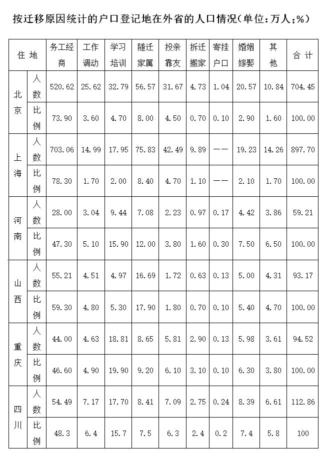

### 第 101 题

人口迁移最多的省（直辖市）是：

A. 北京市

B. 上海市

C. 河南省

D. 四川省

第 101 题 · 答案与解析

**参考答案（粉笔题库参考内容）**

B

**解析**

根据表格材料中最后一列数据可知，人口迁移最多的省（直辖市）为上海897.7万人。

故正确答案为B。

### 第 102 题

人口迁移向上海的最主要的原因是：

A. 务工经商

B. 工作调动

C. 学习培训

D. 婚姻嫁娶

第 102 题 · 答案与解析

**参考答案（粉笔题库参考内容）**

A

**解析**

根据表格材料中数据可知，务工经商占上海人口迁移人数的78.30%，占比最大，为主要原因。

故正确答案为A。

### 第 103 题

除务工经商原因以外，四川省人口流入的最主要原因是:

A. 随迁家属

B. 工作调动

C. 学习培训

D. 投亲靠友

第 103 题 · 答案与解析

**参考答案（粉笔题库参考内容）**

C

**解析**

根据表格材料中数据可知，四川省人口流入的最主要原因是务工经商占48.3%，其次为学习培训占15.7%。则除务工经商原因以外，四川省人口流入的最主要原因为学习培训。

故正确答案为C。

### 第 104 题

下列省（直辖市）中人口流入占常住人口比例最大的是：

A. 上海市

B. 北京市

C. 四川省

D. 河南省

第 104 题 · 答案与解析

**参考答案（粉笔题库参考内容）**

A

**解析**

由题目问“······占······比例最大”，判定本题为现期比重问题。结合表格材料和文字材料可知上海、北京、四川、河南四个省（直辖市）人口流入及常住人口数量，分别计算可得：

上海：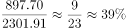；北京：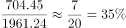；四川：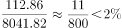；河南：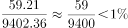，故上海市人口流入占常住人口比例最大。

故正确答案为A。

### 第 105 题

下列说法正确的是：

A. 河南省为最大的劳务输出省（直辖市）

B. 山西省人口流入的第一原因是随迁家属

C. 重庆市的学习培训流入人口要多于北京市

D. 北京市和上海市为劳务输入大省（直辖市）

第 105 题 · 答案与解析

**参考答案（粉笔题库参考内容）**

D

**解析**

A项：材料中没有提到劳务输出，故无法推出河南是否为最大的劳务输出省，错误；

B项：根据表格材料可知，山西省人口流入最大的原因是务工经商占59.30%。错误；

C项：根据表格材料可知，重庆市的学习培训流入人口为18.81万，北京市的学习培训流入人口为32.79万人，前者小于后者，错误；

D项：根据表格材料中最后一列，可得北京市和上海市为劳务输入大省（直辖市），正确。

故正确答案为D。

## 材料 2

截至2013年5月31日，某市农村外出从业人员规模达到68.34万人，比上年同期增加4.79万人。其中A、B、C、D、E、F、G、H八个县农村外出从业人员分别为6万人、12.38万人、15.08万人、12.11万人、7.25万人、13.24万人、1.39万人和0.88万人。全市外出从业人员出现了明显回升势头，其中，A、C、D、E县外出从业人员分别同比增加0.15万人、0.98万人、2.07万人和0.15万人。

        全市自发转移农村劳动力47.54万人，占该市农村外出从业人员总数的69.6%，通过政府组织转移的占11.1%，中介组织转移的占10.8%。其中，经政府有关部分组织转移7.6万人，中介组织转移介绍转移7.37万人，企业自行招收5.83万人。

        按地域看，在省内县外打工人数17.21万人，在省外打工人数41.21万人，在港、澳、台及境外打工人数0.17万人。按地点来看，在东部从业人数41.21万人，在中部从业的有29.92万人，在西部从业的有11.1万人。按行业分，在第一产业打工的有3.19万人，在第二产业打工的有39.79万人，在第三产业打工的有25.26万人。

### 第 106 题

2013年5月末该市农村外出从业人员规模约比上年同期增长：

A. 6.0%

B. 6.5%

C. 7.0%

D. 7.5%

第 106 题 · 答案与解析

**参考答案（粉笔题库参考内容）**

D

**解析**

由题目问“······约比上年同期增长”，选项为百分数，判定本题为一般增长率问题。定位文字材料第一段可得“截至2013年5月31日，该市农村外出从业人员规模达到68.34万人，比上年同期增加4.79万人”，则题目所求为：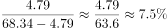。

故正确答案为D。

### 第 107 题

在以下各县中，2013年5月末，外出从业人员同比增速最高的是：

A. A县

B. C县

C. D县

D. E县

第 107 题 · 答案与解析

**参考答案（粉笔题库参考内容）**

C

**解析**

由题目问“······同比增速最高的是”，判定本题为增长率比较问题。定位文字材料第一段可得“截至2013年5月31日，A、C、D、E县农村外出从业人员分别为6万人、15.08万人、12.11万人、7.25万人；外出从业人员分别同比增加0.15万人、0.98万人、2.07万人和0.15万人”，则四个县同比增速分别为：A县：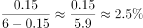；C县：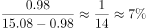；D县：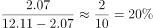；E县：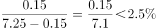。故D县同比增速最高。

故正确答案为C。

### 第 108 题

2013年5月末该市农村外出从业人员中，自发转移农村劳动力人数约是中介组织劳动力转移人员数的多少倍？

A. 3.5

B. 4.5

C. 5.5

D. 6.5

第 108 题 · 答案与解析

**参考答案（粉笔题库参考内容）**

D

**解析**

由题目问“2013年5月末，······约是······的多少倍”，判定本题为现期倍数问题。定位材料第二段可得“全市自发转移农村劳动力47.54万人，占该市农村外出从业人员总数的69.6%；中介组织转移介绍转移7.37万人，占该市农村外出从业人员总数的10.8%”，题目所求为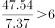倍，或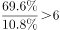倍，均只有D项符合。

故正确答案为D。

### 第 109 题

该市从地理位置上属于：

A. 东部地区

B. 中部省份

C. 西部省份

D. 无法推断

第 109 题 · 答案与解析

**参考答案（粉笔题库参考内容）**

A

**解析**

定位材料第三段“某市在省外打工人数41.21万人，在东部从业人数41.21万人”，可推断，东部不是省外，因为如果东部属于省外，那么省外打工人数必然超过41.21万人，因此东部是省内，即该市属于东部地区。

故正确答案为A。

### 第 110 题

关于2013年5月末该市农村外出从业人员，能从上述资料中推出：

A. C、D两县的外出从业人员同比增量占全市一半以上

B. 接近一成的外出农民工通过政府有关部门组织转移方式获得工作

C. 有超过5%的农村外出就业人员选择在第一产业打工

D. F县农村外出从业人员占全市农村外出从业人员的两成

第 110 题 · 答案与解析

**参考答案（粉笔题库参考内容）**

A

**解析**

A项：定位材料第一段可得“截至2013年5月31日，某市农村外出从业人员比上年同期增加4.79万人。C、D县外出从业人员分别同比增加0.98万人、2.07万人”，占比为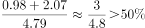，占比超过一半，正确；

B项：定位材料第一和二段可得“截至2013年5月31日，某市农村外出从业人员规模达到68.34万人，经政府有关部分组织转移7.6万人”，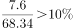，应为超过一成，错误；

C项：定位材料第一和三段可得“截至2013年5月31日，某市农村外出从业人员规模达到68.34万人，在第一产业打工的有3.19万人”，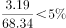，错误；

D项：定位材料第一段可得“截至2013年5月31日，某市农村外出从业人员规模达到68.34万人，F县农村外出从业人员13.24万人”，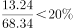，错误。

故正确答案为A。

## 材料 3

2013年全年，某市农业总产值412.36亿元，增长3.8%。其中，种植业产值217.16亿元，增长4.4%；林业产值3.09亿元，增长2.8%；畜牧业产值108.63亿元，增长2.4%；渔业产值73.20亿元，增长5.4%；农林牧渔服务业产值10.28亿元，增长0.4%。全年新增农民专业合作社2136家，总数达到5136家；国家级和市级龙头企业达到222个。

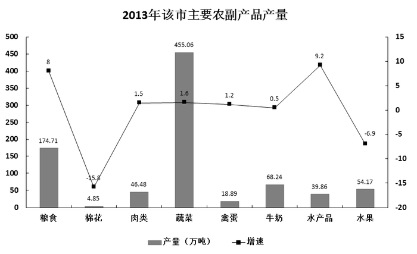

### 第 111 题

2013年该市农民专业合作社数量比上年同期增加了约：

A. 50%

B. 60%

C. 70%

D. 80%

第 111 题 · 答案与解析

**参考答案（粉笔题库参考内容）**

C

**解析**

由题干“······增加了······”且选项都是百分数，可判断本题是增长率计算问题。定位材料第一段：“······全年新增农民专业合作社2136家，总数达到5136家······”。根据公式：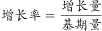，则2013年该市农民专业合作社数量比上年同期的增长率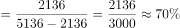。

故正确答案为C。

### 第 112 题

2013年该市下列产业，按产值从高到低：

A. 渔业、种植业、畜牧业、林业、农林牧渔服务业

B. 种植业、畜牧业、渔业、农林牧渔服务业、林业

C. 渔业、种植业、林业、畜牧业、农林牧渔服务业

D. 种植业、渔业、畜牧业、农林牧渔服务业、林业

第 112 题 · 答案与解析

**参考答案（粉笔题库参考内容）**

B

**解析**

材料第一段有2013年产业的产值，可判断本题是直接找数。材料第一段：“2013年······种植业产值217.16亿元，增长4.4%；林业产值3.09亿元，增长2.8%；畜牧业产值108.63亿元，增长2.4%；渔业产值73.20亿元，增长5.4%；农林牧渔服务业产值10.28亿元，增长0.4%······”，产值从高到低依次为：种植业、畜牧业、渔业、农林牧渔服务业、林业，B选项满足。

故正确答案为B。

### 第 113 题

该市2013年产量同比上升的主要农副产品有几类：

A. 4

B. 5

C. 6

D. 7

第 113 题 · 答案与解析

**参考答案（粉笔题库参考内容）**

C

**解析**

材料图形中有主要农副产品2013年的增速，可判断本题是直接找数。问题问：“该市2013年产量同比上升的主要农副产品有几类”，即只要增长率大于0即可。材料图形中查找数据增长率大于0的有：粮食（8%）、肉类（1.5%）、蔬菜（1.6%）、禽蛋（1.2%）、牛奶（0.5%）、水产品（9.2%），共6类。

故正确答案为C。

### 第 114 题

2013年蔬菜和粮食产量占该市同期主要农副产品产量的比重约为：

A. 73%

B. 78%

C. 83%

D. 88%

第 114 题 · 答案与解析

**参考答案（粉笔题库参考内容）**

A

**解析**

问题问：“2013年······占······的比重······”，可判断本题为现期比重问题。定位材料图形数据，根据，可得本题比重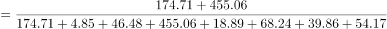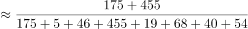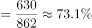，A项最接近。

故正确答案为A。

### 第 115 题

关于该市2013年农业生产，能够从上述材料当中推出的是：

A. 农业总产值比上年同期增长了20多亿元

B. 农民专业合作社数量是国家级和市级龙头企业的9倍多

C. 产量最高的主要农副产品其产量同比增速也是最高

D. 产量最低的主要农副产品其产量同比增速也是最低

第 115 题 · 答案与解析

**参考答案（粉笔题库参考内容）**

D

**解析**

A项：定位材料第一段 “2013年全年，某市农业总产值412.36亿元，增长3.8%······”。根据，可得：，错误；

B项：定位材料第一段：“······全年新增农民专业合作社2136家，总数达到5136家；国家级和市级龙头企业达到222个。”，错误；

C项：定位材料图形可得，主要农副产品中，产量最高的是蔬菜（455.06），而增速最高的是水产品（9.2%），错误；

D项：定位材料图形可得，主要农副产品中，产量最低的是棉花（4.85），其增速也是最低的（-15.8%），正确。

故正确答案为D。

## 材料 4

### 第 116 题

以下哪个季度中，上海证券交易所与深圳证券交易所成交量差值最小：

A. 2012年1季度

B. 2012年3季度

C. 2013年1季度

D. 2013年2季度

第 116 题 · 答案与解析

**参考答案（粉笔题库参考内容）**

D

**解析**

定位柱状图中材料可知，

A：2012年1季度差值为5105-3593=1512；

B：2012年3季度差值为4146-3361=785；

C：2013年1季度差值为6830-4840=1990；

D：2013年2季度差值为5330-4635=695。

由此可知，2013年2季度的差值最小。

故正确答案为D。

### 第 117 题

2013年2季度，上海证券交易所成交量占上半年沪、深证券交易所总成交量的比重为：

A. 21.4%

B. 24.6%

C. 43.8%

D. 56.2%

第 117 题 · 答案与解析

**参考答案（粉笔题库参考内容）**

B

**解析**

根据题干“2013年2季度，······占······的比重”，结合材料时间可判定本题为现期比重问题。根据公式。结合柱状图可知：，与B项最为接近。

故正确答案为B。

### 第 118 题

2012年1—6月份，深圳证券交易所单月成交金额超过1.3万亿元的月份有几个：

A. 1

B. 2

C. 3

D. 4

第 118 题 · 答案与解析

**参考答案（粉笔题库参考内容）**

C

**解析**

根据题干“2012年1—6月份······”，结合材料时间为2013年可判定本题为基期计算问题。根据公式，定位表格材料可知，2012年1—6月份深圳证券交易所单月成交金额分别为：1月： 、2月： 、3月： 、4月： 、5月： 、6月： 。2月和3月的值明显大于13000亿，4月的值小于13000亿。其他三个值进行计算可知：5月的值大于13000亿。因此共有3个月的值大于1.3万亿。

故正确答案为C。

### 第 119 题

2012年5月，上海证券交易所平均每股成交金额约为多少元：

A. 7.4

B. 9.7

C. 10.4

D. 12.5

第 119 题 · 答案与解析

**参考答案（粉笔题库参考内容）**

B

**解析**

根据题干“平均每股成交金额”结合材料时间为2013年，可判定本题为基期平均数问题。根据公式，定位表格数据代入可得，与B选项最接近。

故正确答案为B。

### 第 120 题

能够从上述材料中推出的是：

A. 2013年6月上海证券交易所成交金额同比增量低于深圳证券交易所

B. 2013年4月深圳证券交易所成交量同比增速高于成交金额同比增速

C. 2013年1季度上海证券交易所总成交金额低于深圳证券交易所

D. 2012年两证券交易所每季度的成交量均逐季递增

第 120 题 · 答案与解析

**参考答案（粉笔题库参考内容）**

A

**解析**

A项：根据增长量的比较大小的口诀，现期量大、增长率大则增长量大。定位表格材料可知2013年6月上海证券交易所成交金额和增长率都小于深圳证券交易所，即上海的增量低于深圳的增量，正确；

B项：定位表格材料可知，2013年4月深圳证券交易所成交量同比增速为2.8%，低于其成交金额的4.8%，错误；

C项：定位柱状图材料可知，2013年1季度上海证券交易所总成交金额为6830，深圳证券交易所为4840，上海的大于深圳，错误；

D项：定位柱状图材料可知，2012年2~3季度的成交量都低于上一季度，逐季递减，错误。

故正确答案为A。

