# 2015年重庆市选调优秀大学生到基层工作考试《行测》题

<!-- gwy:overview:start -->
> **重庆 · 2015 · 行测 · 选调** ｜ 100 题 · 图片 62 处 · 答案随题折叠

| 题型模块 | 题量 | 题号 |
| --- | ---: | ---: |
| 常识判断 | 15 | 1–15 |
| 言语理解与表达 | 30 | 16–45 |
| 数学运算 | 15 | 46–60 |
| 判断推理 | 30 | 61–90 |
| 资料分析 | 10 | 91–100 |
| **合计** | **100** | |

导航：[题型与作答说明](#题型与作答说明) · [题目](#题目) · [材料 1](#材料-1)
<!-- gwy:overview:end -->

> 候选采集稿。参考答案及解析来自粉笔页面，不代表官方答案或真实高分答卷；来源使用许可与原卷对应关系仍需人工核实。

## 题型与作答说明

常识判断

（15题）

根据题目要求，在四个选项中选出一个最恰当的答案。

言语理解与表达

（30题）

本部分包括表达与理解两方面的内容。请根据题目要求，在四个选项中选出一个最恰当的答案。

数学运算

（15题）

在这部分试题中，每道题呈现一段表述数字关系的文字，要求你迅速、准确地计算出答案。

判断推理

（30题）

本部分包括图形推理、定义判断、类比推理与逻辑判断四种类型的试题。

资料分析

（10题）

所给出的图、表、文字或综合性资料均有若干个问题要你回答。你应根据资料提供的信息进行分析、比较、计算和判断处理。

## 题目

### 第 1 题

十八届四中全会通过的《中共中央关于全面推进依法治国若干重大问题的决定》指出，完善以宪法为核心的中国特色社会主义法律体系，加强宪法实施。下列有关表述错误的是：

A. 宪法是国家的根本法，具有最高的法律效力

B. 坚持依法治国首先要坚持依宪治国，坚持依法执政首先要坚持依宪执政

C. 每年十二月五日为国家宪法日

D. 凡经人大及其常委会选举或者决定任命的国家工作人员正式就职时公开向宪法宣誓

第 1 题 · 答案与解析

**参考答案（粉笔题库参考内容）**

C

**解析**

本题考查法律常识。

A项正确，《宪法》序言规定：“本宪法以法律的形式确认了中国各族人民奋斗的成果，规定了国家的根本制度和根本任务，是国家的根本法，具有最高的法律效力。”

B项正确，党的十八届四中全会公报指出：“坚持依法治国首先要坚持依宪治国，坚持依法执政首先要坚持依宪执政。”

C项错误，2014年11月1日，第十二届全国人民代表大会常务委员会第十一次会议通过设立国家宪法日为12月4日。2014年12月4日是中国首个国家宪法日。

D项正确，《宪法》第二十七条第三款规定：“国家工作人员就职时应当依照法律规定公开进行宪法宣誓。”

本题为选非题，故正确答案为C。

**考点**：宪法

**来源**：2015年重庆市选调优秀大学生到基层工作考试《行测》题第1题

### 第 2 题

中小企业是我国最具活力的企业群体，在GDP中比重约为60%，提供了约70%的城镇就业岗位，但受需求不足、成本上升等不利因素的影响，中小企业的发展遇到较大困难，为此国家加大了对中小企业的扶持力度，这有利于：

A. 贯彻按劳分配原则

B. 优化我国所有制结构

C. 解决消费不足问题

D. 发挥中小企业的主导作用

第 2 题 · 答案与解析

**参考答案（粉笔题库参考内容）**

B

**解析**

本题考查经济常识。

A项错误，按劳分配是指按照劳动者提供给社会的劳动数量和质量来分配个人消费品的分配原则，多劳多得，少劳少得，有劳动能力而不参加社会劳动的人，没有权利向社会领取报酬。社会主义生产资料公有制是实行按劳分配的前提，中小企业绝大多数属于非公有制企业。

B项正确，中小企业是我国数量最大、最具创新活力的企业群体，国家加大对中小企业的扶持力度，有利于发挥中小企业在市场经济中的积极作用，优化我国所有制结构，促进多种所有制经济共同发展。

C项错误，我国消费不足的主要原因是居民人均收入水平偏低，收入分配不均，加大对中小企业的扶持力度不会直接改善居民的财产收入状况，因而不会直接解决消费不足问题。

D项错误，国有经济在国民经济中起主导作用。

故正确答案为B。

**考点**：市场经济

**来源**：2015年重庆市选调优秀大学生到基层工作考试《行测》题第2题

### 第 3 题

甲、乙、丙三人涉嫌共同故意伤害，在侦查过程中，丙突发心脏病死亡。审判阶段，被害人提起诉讼，将甲、乙以及丙的唯一继承人丁列为被告。如果丁宣布放弃继承，下列选项正确的是：

A. 将丁列为被告，丁承担赔偿责任

B. 将丁列为被告，丁不承担赔偿责任

C. 不将丁列为被告，赔偿责任由甲、乙承担

D. 不将丁列为被告，原告无法获得全额赔偿

第 3 题 · 答案与解析

**参考答案（粉笔题库参考内容）**

C

**解析**

本题考查法律常识。

根据《最高人民法院关于执行&lt;中华人民共和国刑事诉讼法>若干问题的解释》第八十六条第（四）项规定：“附带民事诉讼中依法负有赔偿责任的人包括：共同犯罪案件中，案件审结前已死亡的被告人的遗产继承人。”本题中，案件审结前丙已经死亡，且丙的唯一继承人丁放弃继承，则不应将丁列为被告，也不应判处丁承担赔偿责任。此外，根据《侵权责任法》第八条规定：“二人以上共同实施侵权行为，造成他人损害的，应当承担连带责任。”故本案中法院可以判处甲、乙承担相应的损失赔偿责任。因此，A、B、D三项不符合题意。

故正确答案为C。

**考点**：诉讼法

**来源**：2015年重庆市选调优秀大学生到基层工作考试《行测》题第3题

### 第 4 题

某政协委员公开展示了一幅包括103种常用证件、长达3.8米的“人在证途”图，并由衷感叹：中国人不是在办证，就是在去办证的路上。政府解决“人在证途”问题的根本方法是：

A. 提高行政效率

B. 简化办证程序

C. 实施简政放权

D. 推进集中办证

第 4 题 · 答案与解析

**参考答案（粉笔题库参考内容）**

C

**解析**

本题考查管理学。“人在证途”反映了当前我国国民办证难，办证烦的问题，背后主要原因则是行政审批制度不完善，行政部门之间信息交流不足，各自为政形成的行政壁垒。

A、B、D三项错误，提高行政效率、简化办证程序、集中办证，均能够降低行政成本，在一定程度解决办证难、办证烦的问题，但并不能从根本解决证书多的问题。

C项正确，简政放权，通俗来讲就是“该放的放，该管的管”，这样既可以理顺政府部门内部之间的关系，也可以理顺政府与社会之间的关系，简政放权不仅可以简化办证环节，还可以取消、合并一些“重复”的证书或审批事项，还权于民，从根本上解决“人在证途”的问题。

故正确答案为C。

**来源**：2015年重庆市选调优秀大学生到基层工作考试《行测》题第4题

### 第 5 题

辐射指的是能量在空间传播的过程，下列关于辐射的一些说法不成立的是：

A. 辐射包括电离辐射和非电离辐射，生活中经常接触的是非电离辐射

B. 人们就医时接触到的CT、X光、胸透等，属于电离辐射

C. 手机、电脑、无绳电话、微波炉、浴霸、冰箱等，均为非电离辐射

D. 电离辐射能量较大，但不必过度担心，高铁、地铁属于此类辐射

第 5 题 · 答案与解析

**参考答案（粉笔题库参考内容）**

D

**解析**

本题考查科技常识。

A项正确，辐射可依其能量的高低及电离物质的能力分为电离辐射和非电离辐射。电离辐射包括核辐射、X射线、中子辐射等，危害较大；非电离辐射包括紫外线、可见光、手机、电脑、高压线、家用电器、变电站、手机基站、电视广播等产生的电磁场，危害性较弱。

B项正确，电离辐射包括核辐射、X辐射、中子辐射等，危害较大，人们就医时接触到的CT、X光、胸透等，属于电离辐射。

C项正确，非电离辐射包括紫外线、可见光、手机、电脑、高压线、变电站、手机基站、电视广播等产生的电磁场，危害性较弱。生活中常见的手机、电脑、无绳电话、微波炉、浴霸、冰箱、复印机等，均为非电离辐射。

D项错误，电离辐射能量较大，危害也大，接触时要做好防护措施。高铁、地铁属于非电离辐射，能量较低，不必过度担心。

本题为选非题，故正确答案为D。

**考点**：物理常识

**来源**：2015年重庆市选调优秀大学生到基层工作考试《行测》题第5题

### 第 6 题

条形码作为一种及时、准确、可靠、经济的数据输入手段，已经在世界各国很多领域得到普及。它的使用，极大地提高了数据采集和信息处理的速度，提高了工作效率。下列不属于条形码的组成部分的是：

A. 商品代码

B. 产品流水编码

C. 制造厂商代码

D. 校验码

第 6 题 · 答案与解析

**参考答案（粉笔题库参考内容）**

B

**解析**

本题考查科技常识。条形码是商品包装上的一种标志：一般在一组黑色的粗细相间的线条下方排列一行阿拉伯数字，这组线条叫标志，数码叫编码，合称为条形码。

A、C、D三项正确，条形码的数码通常由13位数构成，第一组3位数是国家代码，第二组4位数是厂商代码，第三组5位是商品代码，第四组1位数是检验代码（校验码）。

B项错误，商品条形码中不包含产品流水编码。

本题为选非题，故正确答案为B。

**考点**：生活常识

**来源**：2015年重庆市选调优秀大学生到基层工作考试《行测》题第6题

### 第 7 题

钓鱼岛自古以来就是中国的领土，其正式名称应该叫钓鱼岛列岛，总面积约6.3平方公里，位于123°E～124°E、25°N～26°N，距我国台湾基隆约102海里，距日本那霸约230海里，其海域为沉积盆地，富藏石油。

据地理位置推断，下列关于钓鱼岛气候的叙述，正确的是：

A. 属于温带季风气候

B. 属于亚热带季风气候

C. 地球位于近日点时，高温多雨

D. 地处回归线附近，受副热带高压控制，降水较少

第 7 题 · 答案与解析

**参考答案（粉笔题库参考内容）**

B

**解析**

本题考查地理国情。

A项错误，钓鱼岛处于中国东海地区，属于亚热带季风气候。

B项正确，钓鱼岛属于亚热带季风气候，夏季气温高，降水多，冬季气温较低，降水较少。

C项错误，地球位于近日点时，北半球为冬季，钓鱼岛气候条件应是气温较低，降水较少。

D项错误，钓鱼岛地处北回归线附近，夏季，受西太平洋副热带高压控制，降水较多；冬季，副热带高压南移，降水较少。

故正确答案为B。

**考点**：自然地理

**来源**：2015年重庆市选调优秀大学生到基层工作考试《行测》题第7题

### 第 8 题

1898年的维新变法运动是一场思想启蒙运动，促成了近代中国社会的思想解放潮流，对中国的现代化进程产生了重要影响。下列文化现象是在维新变法的思想启蒙作用下发生的有：

①史学革命

②诗界革命

③清末小说繁荣

④京剧形成

A. ①②③

B. ②③④

C. ①③④

D. ①②④

第 8 题 · 答案与解析

**参考答案（粉笔题库参考内容）**

A

**解析**

本题考查人文常识。戊戌变法后，新式文化事业勃兴，以梁启超为代表的维新派继续提出“诗界革命”“小说界革命”“史学革命”“道德革命”等口号，在这些领域开展了文化革新运动。

①史学革命，梁启超首倡“新史学”，呼吁“史界革命”，是中国史学由传统转向近代的代表人物，主张历史要“叙述人群进化之现象而求得公理公例”，即研究历史要探求历史发展的规律。

②诗界革命，即戊戌变法前后的诗歌改良运动。诗界革命冲击了长期统治诗坛的拟古主义、形式主义倾向，要求作家努力反映新的时代和新的思想。代表人物包括黄遵宪、夏曾佑、谭嗣同、梁启超等。

③清末小说繁荣，维新派为了对人民进行“启蒙”，提倡白话文和“小说界革命”，促进了晚清小说创作的繁荣，在我国近代小说史上占有极为重要的地位。

④京剧形成，徽剧是京剧的前身。清代乾隆五十五年（1790年）起，原在南方演出的三庆、四喜、春台、和春，四大徽班陆续进入北京，他们与来自湖北的汉调艺人合作，同时又接受了昆曲、秦腔的部分剧目、曲调和表演方法，又吸收了一些民间曲调，通过不断的交流、融合，最终形成京剧。形成期在道光二十年至咸丰十年间（1840-1860）。

可知在维新变法的思想启蒙作用下发生的有①②③。

故正确答案为A。

**考点**：文化常识

**来源**：2015年重庆市选调优秀大学生到基层工作考试《行测》题第8题

### 第 9 题

将一株生长正常的绿色植物置于密闭的玻璃容器内，在适宜条件下光照培养，随着培养时间的延长，玻璃容器内CO_2浓度可出现的变化趋势是：

A. 一直降低，直至为零

B. 一直保持稳定，不变化

C. 降低至一定水平时保持相对稳定

D. 升高至一定水平时保持相对稳定

第 9 题 · 答案与解析

**参考答案（粉笔题库参考内容）**

C

**解析**

本题考查科技常识。

在适宜的光照条件下，密闭容器内培养的植物会同时进行光合作用和呼吸作用，光合作用消耗二氧化碳生成氧气，呼吸作用消耗氧气生成二氧化碳，一开始二氧化碳充足（此题默认条件：密闭容器内气体为空气），光合作用较强，但随着光合作用的持续进行，二氧化碳逐渐被消耗，浓度降低，进而光合作用强度跟着降低；当二氧化碳浓度降低到一定水平时，植物的光合作用和呼吸作用强度相等，则装置内的二氧化碳浓度就保持相对稳定。故容器内二氧化碳浓度是先降低，至一定水平后保持相对稳定。

故正确答案为C。

**考点**：生物常识

**来源**：2015年重庆市选调优秀大学生到基层工作考试《行测》题第9题

### 第 10 题

某市公安机关利用LED灯牌，在城市主要街道发布“东躲西藏，寝食难安。早日自首，争取从宽”的标语，督促在逃人员投案自首。关于公安机关的做法，下列说法正确的是：

A. 公安机关应当以社会管理职能代替政治统治职能

B. 公安机关有权对自首人员从轻或者减轻处罚

C. 公安机关可以利用有效的宣传方式，创新工作手段

D. 公安机关可以从实际工作出发，对法律作出行政解释

第 10 题 · 答案与解析

**参考答案（粉笔题库参考内容）**

C

**解析**

本题考查管理学。

A项错误，公安机关作为国家行政机关，应当依法行使自己的政治统治职能和社会管理职能，二者不可偏废。

B项错误，公安机关无权对自首人员从轻或者减轻处罚，应当交由审判机关审判处理。

C项正确，题干公安机关利用LED灯发布标语，是创新工作手段的直接体现，能够起到很好的宣传效果。

D项错误，解释法律的职权由全国人民代表大会常务委员会行使，公安机关作为行政机关，可以对不属于审判和检察工作中的其他法律的具体应用问题以及自己依法制定的法规进行行政解释。

故正确答案为C。

**来源**：2015年重庆市选调优秀大学生到基层工作考试《行测》题第10题

### 第 11 题

2013年3月19日，习近平在接受金砖国家媒体联合采访时提出，中国这样一个大国，领导者要深入了解国情，了解人民所思所盼，要有“治大国、如烹小鲜”的态度。以下最接近这种治国理念的是：

A. 尊重国情，尊重民心，尊重规律

B. 强化理论，强化技术，强化创新

C. 坚持改革，坚持开放，坚持发展

D. 维护稳定，维护传统，维护成规

第 11 题 · 答案与解析

**参考答案（粉笔题库参考内容）**

A

**解析**

本题考查管理学知识。

题干中“深入了解国情”，体现了尊重国情，从国情实际出发。“了解人民所思所盼”，体现了了解民情，尊重民心。“治大国、如烹小鲜”指做菜不能随意翻动，作料要恰到好处，火候要掌握得当，要尊重烹饪的规律，治理国家也是如此，不能朝令夕改乱折腾，不能操之过急求政绩，也不能懈怠马虎不负责任，要了解国情，体察民意，尊重规律，科学施政。故B、C、D三项错误，A项正确。

故正确答案为A。

**来源**：2015年重庆市选调优秀大学生到基层工作考试《行测》题第11题

### 第 12 题

十八届三中全会提出规范领导干部工作生活保障制度，探索实行官邸制度。“官邸制”在中国古已有之，也是世界上很多国家通行的制度。以下关于“官邸制”说法错误的是：

A. 配偶和子女通常不可以和官员一起居住官邸

B. 美国、法国、德国、韩国都实行“官邸制”

C. “官邸制”在我国秦汉时期就已经出现

D. 一般情况下，官员对官邸只有居住权，没有产权

第 12 题 · 答案与解析

**参考答案（粉笔题库参考内容）**

A

**解析**

官邸制，作为一种官员住房的制度，已在国外实施多年。简单来说，官邸是国家为一定级别的官员提供在任期间居住的住所，官员本人对此没有产权。

A项错误，“配偶和子女通常不可以和官员一起居住官邸”是错误的。

B项正确，目前世界上的很多国家都实行“官邸制”，例如美国、法国、德国、韩国、澳大利亚、印度、加拿大等。

C项正确，“官邸制”在我国秦汉时期就已经出现，王公大臣居住官邸。

D项正确，官邸是国家为一定级别的官员提供在任期间居住的住所，官员本人对此没有产权。

本题为选非题，故正确答案为A。

**来源**：2015年重庆市选调优秀大学生到基层工作考试《行测》题第12题

### 第 13 题

卢梭在《爱弥儿》一书中写道，妇女们应该在家中劳动，永远不要到需要讲话的公共集会上去······难道世界上还有比把家里收拾得井井有条的母亲更感人、更让人尊敬的吗？这表明卢梭反对妇女：

A. 争取人身自由权

B. 获得劳动权

C. 拥有教育权

D. 享有政治参与权

第 13 题 · 答案与解析

**参考答案（粉笔题库参考内容）**

D

**解析**

政治参与权，即公民参与制定、通过或贯彻公共制度的行为的权利。它也是人权的一项基本权利。在当代，民主被视为一个国家政府体制合法性的基础，政治参与的普遍性和有效性则是检验民主制度真伪的标准。题干中“到需要讲话的公共集会上去”明显表达了公民的政治参与权。

故正确答案为D。

**考点**：宪法

**来源**：2015年重庆市选调优秀大学生到基层工作考试《行测》题第13题

### 第 14 题

近年来，“民告官”案件时有发生，“民告官”的依据是：

A. 《中华人民共和国民法通则》

B. 《中华人民共和国刑事诉讼法》

C. 《中华人民共和国民事诉讼法》

D. 《中华人民共和国行政诉讼法》

第 14 题 · 答案与解析

**参考答案（粉笔题库参考内容）**

D

**解析**

民告官，是行政诉讼或行政官司的俗称。行政诉讼是官民矛盾的化解机制。行政法调整的行政主体和行政相对人构成的行政关系以及在此基础上产生的监督行政关系，而这两部分内容分别体现的就是“官管民”和“民告官”的关系，例如行政复议和行政诉讼就是监督行政关系。

故正确答案为D。

**考点**：行政法

**来源**：2015年重庆市选调优秀大学生到基层工作考试《行测》题第14题

### 第 15 题

国家级新区，是由国务院批准设立，承担国家重大发展和改革开放战略任务的综合功能区。下列是2014年设立的国家级新区的是：

A. 贵州贵安新区

B. 天津滨海新区

C. 浙江舟山群岛新区

D. 兰州新区

第 15 题 · 答案与解析

**参考答案（粉笔题库参考内容）**

A

**解析**

本题考查政治常识。

国家级新区，是由国务院批准设立，承担国家重大发展和改革开放战略任务的综合功能区。截至2018年6月，中国国家级新区总数共有19个。

A项正确，贵安新区是中国第八个国家级新区，位于贵州省贵阳市和安顺市结合部，区域范围涉及贵阳、安顺两市所辖4县（市、区）20个乡镇，规划控制面积1795平方公里。2014年1月6日由国务院批复同意设立。

B项错误，天津滨海新区，是天津市的市辖区、副省级区、国家级新区和国家综合配套改革试验区，1994年3月，天津市决定在天津经济技术开发区、天津港保税区的基础上建成滨海新区。2005年，滨海新区被写入“十一五”规划并纳入国家发展战略，成为国家重点支持开发开放的国家级新区。

C项错误，舟山群岛新区，是中国首个国家级群岛新区、长三角城市群组成部分。2011年6月30日，国务院正式批准设立。

D项错误，兰州新区，是甘肃省下辖的国家级新区，地处兰州、西宁、银川3个省会城市共生带的中间位置，是甘肃对外开放的重要窗口和门户。2012年8月国务院批复设立，是西北地区第一个国家级新区。

故正确答案为A。

**考点**：重要事件

**来源**：2015年重庆市选调优秀大学生到基层工作考试《行测》题第15题

### 第 16 题

强硬的紧缩政策和严重的失业问题，导致意大利社会不满情绪日益＿＿＿＿。就在莱塔内阁在总统府宣誓就职时，总理府外上演了一起因对政府不满而引发的枪击案。作为欧元区第三大经济体，意大利若因政治局势不稳而＿＿＿＿债务危机再度恶化，将给欧元区乃至整个欧盟带来沉重打击。

依次填入画横线部分最恰当的一项是：

A. 累积 导致

B. 增加 造成

C. 集聚 致使

D. 高涨 促进

第 16 题 · 答案与解析

**参考答案（粉笔题库参考内容）**

A

**解析**

从第二空入手，根据后文提示“债务危机再度恶化”，故横线处感情色彩为消极贬义，D项“促进”为积极褒义词语，感情色彩不符，排除；其余三项感情色彩均可，保留。

第一空，“集聚”有集中的意思，一般不与“情绪”搭配，排除C项。A项“累积”和B项“增加”对比，虽然搭配均可，但是“增加”只能体现数量上的增多，而“累积”既可以体现数量增多，也能体现出程度加重，纵观文段语境，A项“累积”更为合适，排除B项。

故正确答案为A。

**考点**：关联关系-因果关系、实词填空、词的辨析-感情色彩、词的辨析-搭配对象

**来源**：2015年重庆市选调优秀大学生到基层工作考试《行测》题第16题

### 第 17 题

只有把科学确立为社会的基本价值，才能使科学精神＿＿＿＿人们的精神血液中，＿＿＿＿到社会的制度规范中，＿＿＿＿在人们的日常生活中。

依次填入画横线部分最恰当的一项是：

A. 流入 贯彻 表现

B. 溶入 凝固 展现

C. 渗入 落实 呈现

D. 融入 固化 体现

第 17 题 · 答案与解析

**参考答案（粉笔题库参考内容）**

D

**解析**

第一空，横线处表示科学精神与人们的精神血液融合之意，A、C、D三项均符合文意。B项“溶入”指易溶解物体溶解于液体，通常搭配具体事物，与“科学精神”这一抽象概念搭配不当，排除。

第二空，搭配“到社会的制度规范中”，D项“固化”与“到社会的制度规范中”搭配恰当，保留。A项“贯彻”和C项“落实”经常连用且意思相近，通常搭配具体实践，如“把从严要求贯彻落实到管党治党的全过程”，而文段中“制度规范”是一种理论，故搭配不当，排除。

第三空，代入验证，科学精神“体现”在人们的日常生活中，符合语境，D项当选。

故正确答案为D。

【文段出处】《让科学精神融入人们的精神血液——访北京市中国特色社会主义理论体系研究中心副主任崔新建》

**考点**：实词填空、词的辨析-搭配对象

**来源**：2015年重庆市选调优秀大学生到基层工作考试《行测》题第17题

### 第 18 题

一个世界级的伟大作家当然先要有作品的＿＿＿＿，这一点，莫言毋庸置疑：近30年出版了10多部长篇小说、100多部中短篇小说，塑造出了＿＿＿＿＿＿的人物。

依次填入画横线部分最恰当的一项是：

A. 厚度 无与伦比

B. 高度 千奇百怪

C. 广度 形态各异

D. 深度 栩栩如生

第 18 题 · 答案与解析

**参考答案（粉笔题库参考内容）**

C

**解析**

第一空，根据横线后解释说明内容所述“10多部长篇小说、100多部中短篇小说”可知，横线处表达伟大作家的作品要很丰富，A项“厚度”、C项“广度”均符合文意，保留。B项“高度”、D项“深度”均强调作品分析透彻深入，与文意不符，排除。

第二空，搭配“人物”，根据“10多部长篇小说、100多部中短篇小说”可知，小说数量多，自然塑造人物相应的也会较多，故横线处表达人物多之意，C项“形态各异”指很多事物形状、姿态、形式不尽相同，各有特色，符合文意，当选。A项“无与伦比”指事物非常完美，没有能与它相比的东西，体现不出人物多之意，排除。

故正确答案为C。

**考点**：对应关系-解释说明、混搭填空

**来源**：2015年重庆市选调优秀大学生到基层工作考试《行测》题第18题

### 第 19 题

森林的大面积减少，水土流失、风沙弥漫，这可怕的景象绝不是＿＿＿＿＿＿，而是活生生的现实。不认真解决水害、沙害，土地资源流失与人口膨胀所造成的弊病，21世纪的可持续发展将成为空想。大自然的警告，足以＿＿＿＿＿＿。

依次填入画横线部分最恰当的一项是：

A. 虚张声势 当头棒喝

B. 危言耸听 醍醐灌顶

C. 空穴来风 振聋发聩

D. 耸人听闻 警钟长鸣

第 19 题 · 答案与解析

**参考答案（粉笔题库参考内容）**

D

**解析**

第一空，成语辨析。文段前面描述的是一系列可怕现状，下文“而是活生生的现实”说明前文说的可怕现状不是胡编乱造、夸大事实吓唬人的，而是真实存在的。C项“空穴来风”比喻消息和谣言的传播不是完全没有原因的，也比喻流言乘机会传开来，题中不是指流言，故排除。A项“虚张声势”指假造声势，借以吓人，与原文意思相符，保留；B项“危言耸听”指故意夸大事实，使人惊异震动，也与原文意思相符，保留；D项“耸人听闻”指夸大或捏造事实，使人听了感到惊异或震动，与原文意思相符，保留。

第二空，成语辨析，若想实现可持续发展，就要时刻警惕大自然发出的警告。A项“当头棒喝”比喻促人醒悟的打击或警告，多用于书面语，不符合文意，故排除。B项“醍醐灌顶”比喻听了高明的意见使人受到很大启发，也形容清凉舒适，明显不符合文意，故排除。D项“警钟长鸣”意思是警惕的钟声长久地响，比喻时刻保持警惕，符合文意，当选。

故正确答案为D。

**考点**：对应关系-前后呼应、成语填空

**来源**：2015年重庆市选调优秀大学生到基层工作考试《行测》题第19题

### 第 20 题

新近研究发现，人饥饿时胃黏膜中会出现一种激素，这种激素能够显著促进学习能力和记忆力。科学家解释说，这种激素在胃黏膜中\_\_\_\_\_\_后，借助血液循环进入大脑，能够引起反应，诸如激发脑垂体中许多不同的生长因子等，而这又将引起大脑其他区域内的\_\_\_\_\_\_反应，从而起到改善大脑功能的效果。

依次填入画横线部分最恰当的一项是：

A. 合成 辐射

B. 分泌 连锁

C. 产生 聚合

D. 形成 系列

第 20 题 · 答案与解析

**参考答案（粉笔题库参考内容）**

B

**解析**

本题可从第二空入手，根据“借助······引起反应”“而这又将引起”“从而”可知，文段强调激素引发的一系列连锁反应，B项“连锁”符合文意，且“连锁反应”为常见固定搭配，保留。A项“辐射”、C项“聚合”、D项“系列”均不能体现一系列连锁反应之意，排除。

第一空代入验证，B项“分泌”指从生物体的某些细胞、组织或器官里产生出某种物质，与“激素”搭配恰当，当选。

故正确答案为B。

【文段出处】《饥饿让人更聪明》

**考点**：实词填空、对应关系-前后呼应

**来源**：2015年重庆市选调优秀大学生到基层工作考试《行测》题第20题

### 第 21 题

随着电扇、空调的＿＿＿＿，炎炎夏日中人们手摇蒲扇纳凉的情景已经很难看到了，但＿＿＿＿＿＿、瑰丽多彩的中国扇文化，却一直传承至今，成为人们记忆中绚丽无比的一道风景。

依次填入画横线部分最恰当的一项是：

A. 出现 享誉中外

B. 普及 源远流长

C. 使用 喜闻乐见

D. 发明 异彩纷呈

第 21 题 · 答案与解析

**参考答案（粉笔题库参考内容）**

B

**解析**

第一空，根据文段语境和词语的含义，由文段“人们手摇蒲扇纳凉的情景已经很难看到”可知，电扇、空调的使用应该是经过了一段时间，而A项“出现”和D项“发明”指某事物刚刚出现，时间区域上较短，两者均不合语境，排除。

第二空，根据文段语境，由文段“扇文化······传承至今”“记忆”可知，扇文化历史悠久，且流传至今，只有“源远流长”能够对应恰当，B项当选。

故正确答案为B。

【知识拓展】《溽暑话扇》和北京晚报《扇乃“户”中之“羽”》中有说道，“扇子有风，拿在手中，有人来借，等到立冬。”这是老北京在民间广为流传的一首民谣。

**考点**：对应关系-前后呼应、混搭填空

**来源**：2015年重庆市选调优秀大学生到基层工作考试《行测》题第21题

### 第 22 题

在现代社会，公民能独立地表达自己的观点，却不傲慢，对政治表示服从，却不＿＿＿＿＿＿；看到弱者知道同情，看到邪恶知道＿＿＿＿。

依次填入画横线部分最恰当的一项是：

A. 卑躬屈膝 愤怒

B. 溜须拍马 愤慨

C. 阿谀奉承 悲愤

D. 趋炎附势 气愤

第 22 题 · 答案与解析

**参考答案（粉笔题库参考内容）**

A

**解析**

第一空，横线前出现转折词“却”，故横线前后语义相反，故空格处应填与“服从”意思相近的词，A项“卑躬屈膝”、C项“阿谀奉承”是近义词，均强调“曲意迎合别人的心思”，保留。B项“溜须拍马”强调的是讨好别人，而不屈从，D项“趋炎附势”指奉承和依附有权有势的人，均不符合语境，排除。

第二空，横线前后句式相近表示并列，横线处应填入与“同情”相对且用来形容情绪的词语，A项“愤怒”指气愤不平，C项“悲愤”指因极度不满而情绪激动。相较而言，“悲愤”的语气过重，用来形容公民的情绪过重，故排除C项。

故正确答案为A。

【文段出处】《看见》

**考点**：关联关系-并列关系、混搭填空

**来源**：2015年重庆市选调优秀大学生到基层工作考试《行测》题第22题

### 第 23 题

“查清中国海，进军三大洋，登上南极洲”是曾经的海洋梦想“老三样”，这个梦想也只是在本世纪初才得以＿＿＿＿实现。但限于当时的能力，主要做的是海洋的表面文章，对于海面之下隐藏的深海神秘世界，则只是＿＿＿＿＿＿。

依次填入画横线部分最恰当的一项是：

A. 完整 浅尝辄止

B. 部分 走马观花

C. 彻底 浮光掠影

D. 具体 蜻蜓点水

第 23 题 · 答案与解析

**参考答案（粉笔题库参考内容）**

A

**解析**

第一空，所填词语与“实现”搭配，D项“具体”与“抽象”相对，不能与“实现”搭配，排除。

第二空，根据语境提示“限于当时的能力，主要做的是海洋的表面文章”可知，此处表示对于海洋的探索和研究不够深入，A项“浅尝辄止”表示略微尝试一下就停止，指学习、研究不下功夫深入钻研，符合语境，当选。B项“走马观花”指大略地观看一下，通常与“风景”“艺术品”搭配；C项“浮光掠影”指水面上浮起的光，一掠而过的影子，比喻观察不细致，印象不深刻，通常与“印象”搭配，这两个成语均不能形容对海洋的探索和研究，排除。

故正确答案为A。

**考点**：对应关系-解释说明、混搭填空、词的辨析-搭配对象

**来源**：2015年重庆市选调优秀大学生到基层工作考试《行测》题第23题

### 第 24 题

国际市场疲软给中国经济带来了不确定性。面对外汇资产缩水风险、出口贸易受到影响和输入性通胀压力上升等＿＿＿＿，中国需要＿＿＿＿考量应对，谋定而后动。制定短期和中长期的、货币和财政的、战略和战术的、经济和政治的“中国政策”＿＿＿＿＿＿。

依次填入画横线部分最恰当的一项是：

A. 困境 郑重 迫在眉睫

B. 考验 审慎 刻不容缓

C. 局面 仔细 急如星火

D. 局势 认真 十万火急

第 24 题 · 答案与解析

**参考答案（粉笔题库参考内容）**

B

**解析**

本题可先从第三空入手，根据“考量应对，谋定而后动”“制定······‘中国政策’”可知，文段表述规范、正式，A项“迫在眉睫”、B项“刻不容缓”表述规范，均匹配文段语境，保留。C项“急如星火”、D项“十万火急”表述较为口语化，不匹配文段正式规范的语境，均排除。

再看第二空，所填词语搭配“考量应对”，B项“审慎”指极为周密谨慎，符合文意，保留。A项“郑重”指严肃、认真，侧重主观的态度，一般的搭配为“郑重宣布”“郑重宣誓”等，与横线后的“考量”搭配不当，排除。

第一空代入验证，“面对考验”搭配恰当，B项当选。

故正确答案为B。

【文段出处】《疲软世界的中国对策》

**考点**：对应关系-前后呼应、混搭填空

**来源**：2015年重庆市选调优秀大学生到基层工作考试《行测》题第24题

### 第 25 题

想法或假说的产生，来源于研究者＿＿＿＿的思想，用来解释事物的成因，寻找或构造相关的＿＿＿＿，以便揭示所观察到的事实的真相。因而，假说完全有可能是＿＿＿＿的。知道这一点，养成产生想法时保留判断的习惯就非常重要。

依次填入画横线部分最恰当的一项是：

A. 自由 证据 错误

B. 主观 定律 歪曲

C. 特别 学说 荒谬

D. 独立 理论 虚假

第 25 题 · 答案与解析

**参考答案（粉笔题库参考内容）**

A

**解析**

第一空，根据“想法或假说的产生，来源于研究者······的思想”可知，横线处强调假说源于研究者自身的自主思考，并非被客观条件、既定结论所局限。A项“自由”指不受拘束、不受限制，符合假说产生时思想不受刻板束缚的特点，保留；B项“主观”指属于自我意识方面的，与客观相对，也可体现研究者自身思想，保留；D项“独立”指不依靠他人，侧重思想不依附他人，也可体现出研究者思想的“主观性”特点，保留。C项“特别”指与众不同、不普通，文段并未强调思想的特殊性，与文意不符，排除。

第二空，搭配“寻找或构造”且对应“用来解释事物的成因”“以便揭示所观察到的事实的真相”可知，假说产生的目的是解释成因、揭示真相，需要寻找支撑依据。A项“证据”指能够证明某事物真实性的有关事实或材料，符合“揭示真相”的文意，保留。B项“定律”是对客观规律的科学概括，具有确定性，与“构造”搭配不当，排除；D项“理论”指由实践概括出来的科学知识的有系统的结论，假说的目的是用依据解释事实，而非去构造成型理论，排除。

第三空，代入验证，根据“养成产生想法时保留判断的习惯就非常重要”可知，假说不一定正确，有可能不正确。A项“错误”指不正确、与客观实际不符合，符合文意，当选。

故正确答案为A。

【文段出处】《批判性思维与思维基本功》

**考点**：关联关系-因果关系、实词填空、对应关系-前后呼应、词的辨析-搭配对象

**来源**：2015年重庆市选调优秀大学生到基层工作考试《行测》题第25题

### 第 26 题

新闻媒介是沟通社会与政府的重要桥梁，在政务信息传输系统中具有＿＿＿＿＿＿的作用。但体制转型的压力，加之巨大利益的诱惑及制度缺失，给记者的职业操守带来巨大＿＿＿＿，各种虚假报道不时见诸报端，成为小道消息的渊薮。因此我们必须不断完善新闻从业人员资格准入制度及新闻评估核实制度。

依次填入画横线部分最恰当的一项是：

A. 独一无二 冲击

B. 独树一帜 影响

C. 无与伦比 挫折

D. 无可厚非 挑战

第 26 题 · 答案与解析

**参考答案（粉笔题库参考内容）**

A

**解析**

第一空，根据前文“重要桥梁”可知，横线处词语有“重要”的含义，A项“独一无二”指没有相同的，没有可以比得上的，C项“无与伦比”指事物非常完美，没有东西能够与它相比，这两个词都可以用来形容重要作用，保留。B项“独树一帜”比喻自成一家，多用来形容风格独特，不能用来修饰“作用”，排除；D项“无可厚非”指不可过分指责，表示虽有缺点，但是可以原谅，不符合语境，排除。

第二空，根据“体制转型的压力，加之巨大利益的诱惑及制度缺失”可知，横线处词语应表示记者因外界压力和诱惑而被“影响”，A项“冲击”比喻干扰或打击使受到影响，搭配合理，符合语境，当选。C项“挫折”与“记者的职业操守”不能搭配，排除。

故正确答案为A。

**考点**：对应关系-前后呼应、混搭填空、词的辨析-搭配对象

**来源**：2015年重庆市选调优秀大学生到基层工作考试《行测》题第26题

### 第 27 题

对于一个经历过贫困童年的富翁来说，他的消费行为有时显得＿＿＿＿＿＿。对于大金额的支出，他会随随便便，甚至显得有些铺张浪费；而对于小金额的支出，他则不得不与自己＿＿＿＿＿＿的吝啬性作斗争。

依次填入画横线部分最恰当的一项是：

A. 出人意料 与生俱来

B. 变幻莫测 积重难返

C. 不可思议 始终如一

D. 反复无常 根深蒂固

第 27 题 · 答案与解析

**参考答案（粉笔题库参考内容）**

D

**解析**

第一空，根据后文的解释可知，对经历过贫困童年的富翁来说，消费行为有两种情况：大金额支出随随便便，小金额支出过于吝啬，这已经是被人们了解的特点，B项“变幻莫测”指事物变化多端，难以预测，D项“反复无常”指常常变化，一会儿是这样，一会儿又是那样，变动不定，均符合文意，保留。A项“出人意料”意思是事物的好坏、情况的变化、数量的大小等出乎人们的意料，C项“不可思议”多指无法想象，难以理解，均强调想不到，感到非常意外，与文意不符，排除。

第二空，搭配“吝啬性”，D项“根深蒂固”比喻基础深厚，不容易动摇，可以搭配“吝啬性”，且与文段“经历过贫困童年”形成对应，当选。B项“积重难返”指长期形成的不良的风俗、习惯不易改变，与“吝啬性”搭配不当，排除。

故正确答案为D。

**考点**：对应关系-前后呼应、成语填空、词的辨析-搭配对象

**来源**：2015年重庆市选调优秀大学生到基层工作考试《行测》题第27题

### 第 28 题

雾霾当然不是一天形成的，雾霾也绝不是我国工业化、城市化过程的“独生子”——伦敦、洛杉矶等城市也都曾在茫茫迷雾中忧伤，甚至哭泣。当然，存在未必合理，别人的弯路，我们要尽量避免，或者缩短。但这绝不应成为“慢治”的托词，也不应只是由政府唱“独角戏”。事实上，治理雾霾，没有局外人。你的行动，就是春风；你的改变，也是蓝天。很多时候，我们习惯了指责和观望，往往缺少反思和行动。个人能为减轻雾霾做点什么？少开一次车，拒绝露天烧烤，关掉长明灯，一点一滴的微行动，可以汇成吹走雾霾的浩浩清风。

这段话概括最准确的一项是：

A. 治理雾霾，人人有责

B. 只有齐心协力治理，才能换回蔚蓝晴空

C. 治理雾霾关键在行动

D. 治理雾霾是一场不可松懈的持久战

第 28 题 · 答案与解析

**参考答案（粉笔题库参考内容）**

A

**解析**

文段首先指出雾霾问题不是我国独有的现象，我们在治理过程中要尽量避免走弯路。接下来通过“但”转折说明不能“慢治”，也不能只由政府唱“独角戏”。然后，通过转折词“事实上”提出观点“治理雾霾，没有局外人”，即治理雾霾人人都有责任。后文通过举例，具体解释说明个人在雾霾治理中的作用。所以，文段的重点是治理雾霾，人人都有责任，对应A项。

B项，“齐心协力”强调要团结，针对的问题是“不团结”，而文中并未涉及，属于非针对性对策，排除；

C项，强调“行动”，对应文段解释说明部分，非重点，排除；

D项，“持久战”强调治理雾霾需要长久的时间，文段并未提及，无中生有，排除。

故正确答案为A。

【文段出处】《吐槽雾霾让市领导刺耳，但道出了百姓心声》

**考点**：关联词-转折

**来源**：2015年重庆市选调优秀大学生到基层工作考试《行测》题第28题

### 第 29 题

自由主义是在对抗中世纪黑暗的绝对主义政治和封建主义而发展起来的，为了拓展政治参与空间，自由主义秉持了普遍主义的姿态，它主张普遍的人的权利，以此对旧的政治势力进行打击。故而历史地看，自由主义是作为一种解放性的思想登上历史舞台的。但是，自由主义内在地具有保守性的一面，从资产阶级的立场出发，它关注的核心是财产权的保护，所以天然地对大众抱有敌意。<u>这个特性</u>使其在现实中对“人”的范围持有狭隘的理解，比如，霍布豪斯在《自由主义》中刻意回避了一个基本的事实：古希腊城邦是个奴隶制社会。面对奴隶制社会高谈自由，我们不禁要问：这是谁的自由？

上述文字中画线的“这个特性”指的是：

A. 自由主义对抗旧的政治势力

B. 自由主义内在地就有保守性的一面

C. 自由主义核心是保护财产权

D. 自由主义对“人”的范围有狭隘的理解

第 29 题 · 答案与解析

**参考答案（粉笔题库参考内容）**

B

**解析**

首先定位原文，“这个特性”出现在倒数第二句，往前寻找其指代的对象，前一句话通过转折词“但是”指出自由主义也有保守性的一面，接下来对保守性进行具体的解释说明。故“这个特性”指代其前“自由主义具有保守性的一面”，对应B项。

A项，对应“它主张普遍的人的权利，以此对旧的政治势力进行打击”，为转折词之前的内容，非“这个特性”所指代内容，排除；

C项，对应文段对“保守性”进行解释说明的内容，非指代词指代的核心内容，排除；

D项，对应“这个特性使其在现实中对‘人’的范围持有狭隘的理解”，为“这个特性”所带来的结果，而非“这个特性”本身，排除。

故正确答案为B。

【文段出处】《自由的B面》

**考点**：代词

**来源**：2015年重庆市选调优秀大学生到基层工作考试《行测》题第29题

### 第 30 题

内地和香港两地投资者对于投资对方市场的迫切需求，不断促进沪港通从蓝图变为现实。投资讲究合理分散配置，不把鸡蛋放到一个篮子里，但长期以来内地投资者的股票投资主要是投向A股市场这个篮子；内地经济蓬勃发展，香港市场上的投资者倾慕已久，可囿于制度缺失，只能在场外驻足观望。虽说合格境外机构投资者（QFII）和合格境内机构投资者（QDII）等措施开了口子，但与投资者的现实需求仍相去甚远。从这个意义上说，能够更好满足投资者现实需求的沪港通，可谓应运而生。

上述文字主要讲述的是：

A. 沪港通是联通沪港的通衢大道

B. 现实的市场需求是沪港通诞生的必要条件

C. 沪港通有利于实现两地资本市场的共同繁荣发展

D. 沪港通更大的意义在于从制度层面推进互联互通

第 30 题 · 答案与解析

**参考答案（粉笔题库参考内容）**

B

**解析**

文段开篇引出话题，说明内地和香港两地投资者的投资需求，促进沪港通变为现实。接着论述了内地投资者和香港投资者的现状，即内地投资者主要投向A股市场，香港投资者想投资内地却只能驻足观望。然后指出QFII、QDII等措施，还是不能满足投资者的需求。尾句通过“从这个意义上说”对前文进行总结，强调能够更好满足投资者现实需求的沪港通随投资者的需求产生。故文段主要强调，沪港通的产生是因为能满足市场的投资需求，对应B项。

A项，“通衢大道”表述不明确，文段主要论述的是沪港通因“市场需求”而产生，排除；

C项，“两地资本市场的共同繁荣发展”文段并未提及，无中生有，排除；

D项，“更大的意义”为无关对比，文段并未比较沪港通的其他意义，且“从制度层面推进互联互通”无中生有，排除。

故正确答案为B。

【文段出处】《读懂沪港通的“互联互通”深意》

**考点**：关联词-因果

**来源**：2015年重庆市选调优秀大学生到基层工作考试《行测》题第30题

### 第 31 题

防止免费搭车最有效的手段，并不是用道德说教去劝阻，而是赋予每个人保卫自己正当收入的权利，从财源上杜绝别人捡便宜的机会。相反，如果每个人自觉自愿把自己创造的财富交出来，这样汇集的巨额财源便成为喜欢捡便宜的人的可乘之机。税收从表面上看是不与权利相称的义务，但从根本上看，正因为每个人享受了国防、治安、道路、公共服务（例如路灯），才有纳税的需要。所以纳税并不完全是无权利的义务。

这段文字反映出作者对纳税的态度是：

A. 肯定

B. 否定

C. 未置可否

D. 有肯定有否定

第 31 题 · 答案与解析

**参考答案（粉笔题库参考内容）**

A

**解析**

前文指出防止免费搭车的有效手段，即赋予每个人保卫自己正当收入的权利，随后指出税收表面上是不与权利相称的义务，接着通过转折词“但”指出正因为享受了各种服务所以才有纳税的需要，尾句通过“所以”进行总结，强调纳税并不完全是无权利的义务，纳税是合理的，对应A项。

B项，“否定”与文意相悖，排除；

C项，“未置可否”意为不表示同意，也不表示反对，而文段“正因为每个人······所以纳税并不完全是无权利的义务”已经表态，即同意纳税，排除；

D项，“有否定”无中生有，文段并未否定纳税，排除。

故正确答案为A。

**考点**：关联词-因果

**来源**：2015年重庆市选调优秀大学生到基层工作考试《行测》题第31题

### 第 32 题

有人说，学文言文对学生作文有帮助，不但没有坏影响，不会“不文不白”，倒大有好处；点缀一点文言词语，套用一些文言句法，很有滋味，听口气，大有非此不可的味道，虽然没有说得这样明白。当然，我不否认学习文言文在一定程度上对白话文的写作有帮助，帮助表现在两个方面：篇章和语言。<u>这也可以说是对现代作家的一种批评。</u>为什么这些不能从现代作品中学到，还要到老祖宗那儿去讨救兵呢？

下面对文段中画线句子的意思理解正确的一项是：

A. 现代作家应该受到批评，因为他们滥用文言词语，影响不好

B. 现代作品在篇章和语言方面未经时间的筛选，不如古代作品

C. 学习写白话文而必须求助文言文，说明某些现代作品的不足

D. 白话文没有滋味，虽然没有明说，实际上是对他们的一种批评

第 32 题 · 答案与解析

**参考答案（粉笔题库参考内容）**

C

**解析**

开篇表明学习文言文对学生作文有一定的好处，随后指出文言文对白话文写作的帮助体现在篇章和语言两个方面，然后通过“这”对前文进行总结，指出通过学习文言文写白话文，体现了对现代作家的批评，尾句对这一观点进行解释说明。故“这也可以说是对现代作家的一种批评”强调学习写白话文需要借助文言文，表明现代作家写的某些文学作品尚有不足之处，对应C项。

A项，“滥用文言词语，影响不好”无中生有，排除；

B项，文段“学习文言文在一定程度上对白话文的写作有帮助”不代表否定现代作品的篇章与语言，故“不如古代作品”理解错误，排除；

D项，文段“套用一些文言句法，很有滋味”不代表白话文没有滋味，排除。

故正确答案为C。

**考点**：句子

**来源**：2015年重庆市选调优秀大学生到基层工作考试《行测》题第32题

### 第 33 题

每个生物细胞可以看作一个微型电池，也可以看作一个微型磁极子。有人精确地测定了人体磁性活动后认为，生物磁的来源可能有：（1）生物电荷运动产生的磁场；（2）生物磁性材料产生的感应场，即生物活体组织内的某些物质具有一定的磁性，它们在地磁场或外界磁场的作用下产生的感应磁场；（3）生物体内强磁性物质产生的磁场。

不符合文段意思的一项是：

A. 由于每个细胞都是一个微型电池，也是一个磁极子，这就有了生物磁

B. 生物体内存在电荷，电荷运动产生磁场

C. 生物体内有磁性物质，在外界磁场作用下产生磁场

D. 生物体内的强磁性物质自行产生磁场

第 33 题 · 答案与解析

**参考答案（粉笔题库参考内容）**

A

**解析**

本题属于细节判断题。可将各选项带回原文进行一一对应。

A项，对应原文首句“每个生物细胞可以看作一个微型电池，也可以看作一个微型磁极子”，说的是可以将生物细胞“看作”微型电池，并不是说“就是”一个微型电池。A项表述过于肯定，不符合文意，当选。

B、C、D三项，分别和文段中的（1）（2）（3）分句相对应，符合文意，均排除。

本题为选非题，故正确答案为A。

**来源**：2015年重庆市选调优秀大学生到基层工作考试《行测》题第33题

### 第 34 题

可持续发展环境伦理观在主张人与自然和谐统一的整体价值观方面与深环境论中的环境整体主义是一致的，不同之处在于可持续发展伦理观在强调人与自然和谐统一的基础上，更承认人类对自然的保护作用和道德代理人的责任，以及一定社会中人类行为的环境道德规范研究。可持续发展伦理观汲取了生命中心论、生态中心论等非人类中心主义关于“生物/生态具有内在价值”的思想，承认自然不仅具有工具价值，也具有内在价值，但又不把内在价值仅归于自然自身，而提高为人与自然和谐统一的整体性质。这样，由于人类和自然是一个和谐统一的整体，那么，不仅是人类，还有自然，都应该得到道德关怀。

以下对“深环境论”的解说，正确的一项是：

A. 深环境论认为自然具有内在价值，这种价值归于自然本身，它强调人类的“道德代理人”的责任

B. 深环境论认为自然具有内在价值，这种价值来自于人与自然和谐统一的整体性质，自然与人同样处于道德主体地位

C. 深环境论认为自然具有内在价值，这种价值归于自然本身，人与自然是一个和谐的整体

D. 深环境论认为自然具有工具价值，这种价值来自于人与自然和谐统一的整体性质，人类是环境的管理者

第 34 题 · 答案与解析

**参考答案（粉笔题库参考内容）**

C

**解析**

首句指出可持续发展环境伦理观与深环境论均主张人与自然和谐统一，随后指出两者的不同之处，阐述了可持续发展环境伦理观更承认人类对自然的保护作用和道德代理人的责任，以及一定社会中人类行为的环境道德规范研究，接下来对可持续发展伦理观进行展开论述。通过文段的分析可知，可持续发展伦理观强调的是人的作用和责任，与之不同，深环境论强调的是自然本身的作用和价值，对应C项。

A项，“强调人类的‘道德代理人’的责任”，D项，“人类是环境的管理者”均是强调人类的作用，与深环境论的观点相悖，排除；B项，“自然与人同样处于道德主体地位”，深环境论不强调人的主体地位，故解说错误，排除。

故正确答案为C。

**考点**：实词

**来源**：2015年重庆市选调优秀大学生到基层工作考试《行测》题第34题

### 第 35 题

《诗经》分为风、雅、颂三个部分。风为“风土之音”，即各地的民间歌谣。雅为“朝廷之音”，即贵族享宴或诸侯朝会时的乐歌。颂为“宗庙之音”，即宗庙祭祀的乐歌和史诗，多歌颂祖先功业。

“王曰叔父，建尔元子，俾侯于鲁。大启尔宇，为周室辅。”该诗句应出自：

A. 《诗经•齐风》

B. 《诗经•大雅》

C. 《诗经•小雅》

D. 《诗经•鲁颂》

第 35 题 · 答案与解析

**参考答案（粉笔题库参考内容）**

D

**解析**

首句介绍《诗经》分为风、雅、颂三个部分，随后分别介绍了这三个部分的特征。“王曰叔父，建尔元子，俾侯于鲁。大启尔宇，为周室辅”大意为“叔父，您诸子中择立其长，封于鲁地快快前往，要去努力扩土开疆，作为周室藩副辅屏障”，据此可知，这句话歌颂了鲁国国君祖先的功业，锁定D项《诗经·鲁颂》。

A项，《诗经·齐风》为齐国的地方民歌，诗句阐述的是鲁国，且并非民间歌谣，排除；

B、C项，诗句是在歌颂祖先的功业，而非贵族享宴或诸侯朝会时的乐歌，均排除。

故正确答案为D。

**来源**：2015年重庆市选调优秀大学生到基层工作考试《行测》题第35题

### 第 36 题

时间是有方向性的，总是从过去向未来流动，这就是时间箭头。在生物进化过程中，时间的过去与未来是不对称的，这是一个不可逆过程。但生物进化的时间箭头与熵增不同。熵增意味着退化，即旧事物的分解和衰亡；而进化是新事物的产生和发展，它的时间箭头是指向熵减少的。

因此：

A. 生物的进化只有一个方向

B. 生物的演化可分为退化和进化两大类

C. 生物进化过去用的时间短，未来用的时间长

D. 熵的变化是没有方向性的

第 36 题 · 答案与解析

**参考答案（粉笔题库参考内容）**

B

**解析**

首句说明时间箭头是从过去向未来流动，随后说明在生物进化过程中，时间的过去与未来不对称，这是不可逆的过程，尾句说明生物进化的时间箭头与熵增不同，是指向熵减少的。根据尾句可知，生物进化是熵减少，故熵增加体现生物退化，熵增加和熵减少相对，因此生物演化过程应包括进化和退化两种，对应B项。

A项，“生物的进化只有一个方向”无中生有，排除；

C项，“过去用的时间短，未来用的时间长”无中生有，排除；

D项，“没有方向性”表述错误，由尾句可知熵有增加和减少两种变化，排除。

故正确答案为B。

**考点**：关联词-转折

**来源**：2015年重庆市选调优秀大学生到基层工作考试《行测》题第36题

### 第 37 题

到了消费者导向时代，是从“被动市场”到“主动市场”。市场上产品更加丰富，同时消费者对产品更加理智和挑剔。国内企业越来越成熟和专业化，国外企业也适应了中国经济的节奏，更加深入地参与到经济生活中来，企业的生存发展面临更加激烈的竞争和越来越挑剔的消费者。如果企业还仅仅被动跟随市场需求的变化生产商品，那就难以生存发展。因此，这个阶段转型发展的关键就是要完成对消费需求从被动适应到主动创造的转变。

从上文可推知，消费者导向时代所倡导的是：

A. 不断追求产能规模的扩大

B. 关注提高产品质量，研究市场需求

C. 用永无止境的创新去满足消费者对美好生活的追求

D. 注重依托科技创新、商业模式创新、管理提升等塑造价值链关键环节的竞争优势

第 37 题 · 答案与解析

**参考答案（粉笔题库参考内容）**

C

**解析**

文段开篇提出消费者导向时代是从“被动市场”到“主动市场”的时代，随后论述企业的生存发展面临着更加激烈的竞争和越来越挑剔的消费者，接下来通过反面论证强调企业不能被动跟随市场需求的变化生产商品，尾句通过“因此”总结前文，强调企业适应消费者导向时代的关键是对消费需求要从被动适应转为主动创造，故消费者导向时代的核心是以消费者为导向，致力于满足消费者的各项需求，对应C项。

A项，“产能规模”文段并未提及，无中生有，且缺少核心话题“消费者”，排除；

B项，文段指出“如果企业还仅仅被动跟随市场需求的变化生产商品，那就难以生存发展”，故“市场需求”非文段重点，无法解决问题，且“提高产品质量”文段并未提及，无中生有，排除；

D项，“塑造价值链关键环节”文段并未提及，无中生有，排除。

故正确答案为C。

【文段出处】《人民日报经济时评：消费者导向引领企业转型》

**考点**：细节判断题

**来源**：2015年重庆市选调优秀大学生到基层工作考试《行测》题第37题

### 第 38 题

把数学和语言学这两门差别很大的学科联系起来的强有力的纽带，是语言通讯技术和电子计算机，前者实现了语言符号的远距离传输和转换，后者则用数字化的快速运算来处理非数值符号——语言。20世纪以来的科学发展日新月异的要求，使数学的领域空前地扩展了，语言学的领域也空前地扩展了。它们都扩展到以符号系统为主要研究对象，因而就发现了共同的边界，并且彼此渗透。于是一门新兴的边缘科学——数学语言学应运而生了。

文段中“共同的边界”所指应是：

A. 语言符号的远距离传输和转换

B. 用数字化的快速运算来处理非数值符号

C. 以符号系统为主要研究对象

D. 科学发展日新月异的要求

第 38 题 · 答案与解析

**参考答案（粉笔题库参考内容）**

C

**解析**

首句介绍数学和语言学差别很大，可以通过语言通讯技术和电子计算机将两者联系到一起，随后指出科学发展日新月异，使得数学和语言学都扩展到以符号系统为主要研究对象，进而出现了“共同的边界”，最后指出数学语言学应运而生。故“共同的边界”指代的是 “以符号系统为主要研究对象”，对应C项。

A项，根据“前者实现了语言符号的远距离传输和转换”可知，“语言符号的远距离传输和转换”指代的是“语言通讯技术”，排除；

B项，根据“后者则用数字化的快速运算来处理非数值符号——语言”可知，“用数字化的快速运算来处理非数值符号”指代的是“电子计算机”，排除；

D项，“科学发展日新月异”仅是宏观环境，并非“共同的边界”，排除。

故正确答案为C。

**考点**：实词

**来源**：2015年重庆市选调优秀大学生到基层工作考试《行测》题第38题

### 第 39 题

人力资源专家认为，女性在能力、知识背景和智力因素上与男性并无差异，而其在沟通能力和亲和力上有着天然优势。信息时代，女性管理者往往更易于被团队成员所认同，更适合营造企业的凝聚力和发挥员工的积极性。

对这段文字，理解不准确的是：

A. 女性在智力上和男性无生理差异

B. 女性善于处理各种人事关系

C. 女性适合做管理工作

D. 信息时代更适合发挥女性的优势

第 39 题 · 答案与解析

**参考答案（粉笔题库参考内容）**

A

**解析**

A项，对应原文“女性在能力、知识背景和智力因素上与男性并无差异”，文段论述的是“智力因素”，选项论述的是“智力”，“智力因素”和“智力”不是一个概念，且“生理差异”无中生有，表述错误，当选；

B项，对应原文“其（女性）在沟通能力和亲和力上有着天然优势”，沟通能力和亲和力是人际关系的基础，符合文意，排除；

C项，对应原文“女性管理者往往更易于被团队成员所认同，更适合营造企业的凝聚力和发挥员工的积极性”，女性从事管理工作是有优势的，符合文意，排除；

D项，对应原文“信息时代，女性管理者往往更易于被团队成员所认同，更适合营造企业的凝聚力和发挥员工的积极性”，符合文意，排除。

本题为选非题，故正确答案为A。

**考点**：细节判断题

**来源**：2015年重庆市选调优秀大学生到基层工作考试《行测》题第39题

### 第 40 题

软件在长期运行和使用中没有磨损、老化、用旧等问题。任何机械、电子设备在运行和使用中，其失效率大都遵循U型曲线（即所谓“浴缸曲线”）。那是因为刚一投入使用时各部件尚未灵活运转，常常容易出问题。经一段时间的运行，便可以稳定下来。而当设备已经历相当时期的运转，便会出现磨损、老化等问题，会使失效率突然提高。这意味着已经到达寿命的终点，即将报废了。

下列陈述，不符合文意的是：

A. 软件在运行和使用中不遵循U型曲线（即所谓“浴缸曲线”）

B. 任何机械、电子设备刚一投入使用时各部件尚未灵活运转，但是越用越好用

C. 软件和机械、电子设备在运行和使用中的表现有很大的不同

D. 软件不像机械、电子设备那样运行一段时间便可以稳定下来

第 40 题 · 答案与解析

**参考答案（粉笔题库参考内容）**

B

**解析**

A项，根据“软件在长期运行和使用中没有磨损、老化、用旧等问题。任何机械、电子设备在运行和使用中，其失效率大都遵循U型曲线（即所谓‘浴缸曲线’）”可知，由于软件不同于机械、电子设备，故“软件在运行和使用中不遵循U型曲线（即所谓‘浴缸曲线’）”表述正确，排除；

B项，根据“经一段时间的运行，便可以稳定下来。而当设备已经历相当时期的运转，便会出现磨损、老化等问题，会使失效率突然提高。这意味着已经到达寿命的终点，即将报废了”可知，当设备运转时间较长时，会出现各种问题，故“越用越好用”表述错误，当选；

 C项，根据“软件在长期运行和使用中没有磨损、老化、用旧等问题。任何机械、电子设备在运行和使用中，其失效率大都遵循U型曲线（即所谓‘浴缸曲线’）”可知，软件不遵循U型曲线，确实与机械、电子设备在运行和使用中表现不同，表述正确，排除；

D项，根据“软件在长期运行和使用中没有磨损、老化、用旧等问题”可知，软件不需要运行一段时间才能稳定，表述正确，排除。

本题为选非题，故正确答案为B。

【文段出处】《高中测试题》

**考点**：细节判断题

**来源**：2015年重庆市选调优秀大学生到基层工作考试《行测》题第40题

### 第 41 题

细菌虽然小得肉眼看不见，但它们在分解枯枝败叶的过程中确实起了关键性的作用。它们能将吸收二氧化碳和其他养分而长成的树干与枝叶，再分解成二氧化碳释放到大气中。若没有细菌的存在，那么地球上的二氧化碳只能维持植物利用40年，因为碳素将被锁定在植物体内而不能参与到物质循环中去。由于细菌的这种作用，维持了整片森林甚至整个地球的盎然的绿意。

下面对文段中“关键性的作用”解说不正确的一项是：

A. 细菌在分解枯枝败叶的过程中释放了二氧化碳，维持了地球上的物质循环

B. 细菌把有可能被锁定在植物体内的碳素分解出来并释放到大气中去

C. 细菌在分解树干与枝叶的过程中将它吸收的二氧化碳又释放到大气中去

D. 如果没有细菌做分解枯枝败叶的工作，地球将无法维持盎然的绿意

第 41 题 · 答案与解析

**参考答案（粉笔题库参考内容）**

C

**解析**

开篇指出细菌在分解枯枝败叶的过程中起到关键性的作用，即“能将吸收二氧化碳和其他养分而长成的树干与枝叶，再分解成二氧化碳释放到大气中”，随后从反面论证细菌关键性的作用，尾句从正面论证细菌关键性的作用所带来的好处。

A项，对应文段“分解成二氧化碳释放到大气中”“维持了整片森林甚至整个地球的盎然的绿意”，表述正确，排除；

B项，文段“若没有细菌的存在······碳素将被锁定在植物体内而不能参与到物质循环中去”表明细菌可以将植物体内的碳素释放到大气中，表述正确，排除；

C项，根据“它们能将吸收二氧化碳和其他养分而长成的树干与枝叶，再分解成二氧化碳释放到大气中”可知，吸收二氧化碳的是树干与枝叶，而非细菌，故偷换概念，当选；

D项，对应尾句的内容，表述正确，排除。

本题为选非题，故正确答案为C。

**考点**：实词

**来源**：2015年重庆市选调优秀大学生到基层工作考试《行测》题第41题

### 第 42 题

社会上的各种传言和议论，有的是无中生有，有的是空穴来风，我们要善于思索和分辨。“空穴来风”的意思是：

A. 有洞穴没有风进来，比喻无原由的事

B. 有洞穴就有风进来，比喻事情不是完全没有原由的

C. 好像洞穴中的风一样飘忽不定，一会儿这样一会儿那样

D. 好像洞穴中的一股风，它是朝着某个方向吹去的

第 42 题 · 答案与解析

**参考答案（粉笔题库参考内容）**

B

**解析**

根据“各种”“有的······有的······”“思索和分辨”可知，“空穴来风”应与“无中生有”意思相反，“无中生有”形容凭空捏造，毫无事实，把本来不存在的事说成确有其事，故“空穴来风”意为事情的出现是有理由的，对应B项。

A项，与“无中生有”意思相近，与文段中“空穴来风”的意思相反，排除；

C项，“飘忽不定，一会儿这样一会儿那样”文段未体现，无中生有，排除；

D项，“朝着某个方向吹去”文段未体现，无中生有，排除。

故正确答案为B。

**考点**：实词

**来源**：2015年重庆市选调优秀大学生到基层工作考试《行测》题第42题

### 第 43 题

人有一种记忆叫免疫记忆。人的血液中有着极少的富有自我牺牲精神的细胞，它们生存的时间极短，主要职能是尽量多地消灭人体的敌人。淋巴细胞对侵入血液的细菌或者简单有毒物质做出快速反应，生成抗体，把有害物质粘住，不让它们进入其他器官。而消灭来敌的重任则落在血液中的吞噬细胞头上，这些细胞能够毫不费力地区别外来细胞，能够把它们记住并把记忆保留下来。人一旦得过麻疹或猩红热，就会获得终身免疫力。

对这段话理解正确的一项是：

A. 人的血液中的吞噬细胞的主要职能是记住侵入人体的外来细胞

B. 淋巴细胞能够把侵入血液中的有毒物质粘住，并阻止它们进入其他器官

C. 人的血液中吞噬细胞和淋巴细胞都是富有自我牺牲精神的细胞

D. 人具有免疫记忆，若得过麻疹和猩红热后，就会获得终身免疫力

第 43 题 · 答案与解析

**参考答案（粉笔题库参考内容）**

C

**解析**

A项，文段“消灭来敌的重任则落在血液中的吞噬细胞头上”强调“消灭”，而非“记住”，表述错误，排除；

B项，文段“淋巴细胞对侵入血液的细菌或者简单有毒物质做出快速反应，生成抗体，把有害物质粘住，不让它们进入其他器官”表明是淋巴细胞产生的抗体把有害物质粘住，而非淋巴细胞本身，偷换概念，排除；

C项，文段首句指出“人的血液中有着极少的富有自我牺牲精神的细胞”，随后具体介绍了吞噬细胞和淋巴细胞在人体中的作用，可知吞噬细胞和淋巴细胞都是富有自我牺牲精神的细胞，表述正确，当选；

D项，文段为“麻疹或猩红热”，选项为“麻疹和猩红热”，偷换逻辑关系，排除。

故正确答案为C。

**考点**：细节判断题

**来源**：2015年重庆市选调优秀大学生到基层工作考试《行测》题第43题

### 第 44 题

与政府部门相对应的是非政府部门。从理论上讲，政府部门与非政府部门的法律地位、各自所担负的职能性质以及主要负责人的任免程序都是不同的。但是在实际生活中，人们往往忽视或淡化二者的区别。特别是有的地方政府机构设置不完全是从政府职能管理的客观需要出发，科学、合理地确定、设置政府部门；有的在机构与职能没有任何变化的情况下，昨天列为政府部门，今天却变成了非政府部门，以致政府部门的确定带有较大的随意性。

上面一段话主要支持的观点是（  ）。

A. 应当严格区分政府部门与非政府部门职能和作用

B. 应科学地界定与设置地方政府部门

C. 政府部门的设定要有相对稳定性

D. 政府部门的设置要从政府职能管理的客观需要出发

第 44 题 · 答案与解析

**参考答案（粉笔题库参考内容）**

A

**解析**

本题属于中心理解题。文段首先介绍了政府部门与非政府部门本应在法律地位、职能性质以及负责人任免程序上都是不同的，通过“但是”指出现实中人们对二者的误解，即“往往忽视或淡化二者的区别”，后文进一步说明有的地方政府在误解的基础上引出的错误的做法。可知文段重点是要强调政府部门与非政府部门的区别，唤醒人们要区别对待二者。结合选项，A项“严格区分政府部门与非政府部门的职能和作用”，符合文段中心，当选。

B项，未涉及“非政府部门”，故排除。

C、D项，均是围绕文段最后进一步说明内容的一部分，概括不全面，且偏离文段中心，故排除。

故正确答案为A。

【文段出处】

《地方政府组成部门的界定与设置》

**来源**：2015年重庆市选调优秀大学生到基层工作考试《行测》题第44题

### 第 45 题

据专家介绍，爬楼梯上楼相当于做有氧运动，可以锻炼心肺功能，同时还能够锻炼腿部肌肉群，能起到一定的锻炼功效。但下楼时，膝关节、踝关节要承受整个身体的重量，不断重复这个动作，会人为加大这些关节的活动量，受压的强度会急剧增加，关节受到磨损的可能性就会增大，对身体不利。

根据本文，理解正确的是：

A. 经常爬楼梯能达到锻炼效果

B. 心脏病人应该经常爬楼梯

C. 下楼梯有助关节的恢复

D. 下楼梯应该加快频率

第 45 题 · 答案与解析

**参考答案（粉笔题库参考内容）**

A

**解析**

A项，对应原文“爬楼梯上楼······能起到一定的锻炼功效”，表述正确，当选；

B项，“心脏病人应该经常爬楼梯”无中生有，排除；

C项，根据“下楼时······关节受到磨损的可能性就会增大”可知，“下楼梯有助关节的恢复”与文意相悖，排除；

D项，“下楼梯应该加快频率”文段没有提到，无中生有，排除。

故正确答案为A。

**考点**：细节判断题

**来源**：2015年重庆市选调优秀大学生到基层工作考试《行测》题第45题

### 第 46 题

5，16，50，153，（    ）

A. 256

B. 369

C. 454

D. 463

第 46 题 · 答案与解析

**参考答案（粉笔题库参考内容）**

D

**解析**

数列变化明显，作差无规律，考虑递推数列。发现数列5×3+1=16，16×3+2=50，50×3+3=153，故所求项=153×3+4=463。

故正确答案为D。

**来源**：2015年重庆市选调优秀大学生到基层工作考试《行测》题第46题

### 第 47 题

10，12，15，19，26，（    ）

A. 32

B. 36

C. 38

D. 41

第 47 题 · 答案与解析

**参考答案（粉笔题库参考内容）**

A

**解析**

数列无明显特征，考虑作差寻找规律。第三项-第一项=5，第四项-第二项=7，第五项-第三项=11，即间隔一项作差后得到新数列为：5、7、11，为质数数列，则下一项应为13。故所求项=19+13=32。

故正确答案为A。

**来源**：2015年重庆市选调优秀大学生到基层工作考试《行测》题第47题

### 第 48 题

1，5，14，30，155，（    ）

A. 171

B. 191

C. 371

D. 780

第 48 题 · 答案与解析

**参考答案（粉笔题库参考内容）**

C

**解析**

数列起伏较大，考虑幂次数列无规律，考虑作差。相邻项作差后得到新数列：4、9、16、125，皆为幂次数，即：2^2、3^2、4^2、5^3，则下一项应为6^3=216。故所求项为155+216=371。

故正确答案为C。

**来源**：2015年重庆市选调优秀大学生到基层工作考试《行测》题第48题

### 第 49 题

186，138，102，31，23，（    ）

A. 12

B. 17

C. 21

D. 23

第 49 题 · 答案与解析

**参考答案（粉笔题库参考内容）**

B

**解析**

数列无明显特征，作差无规律，通过观察可知：第一项÷6=第四项、第二项÷6=第五项。故所求项为102÷6=17。

故正确答案为B。

**来源**：2015年重庆市选调优秀大学生到基层工作考试《行测》题第49题

### 第 50 题

12，1/3，9，8/3，15/4，（    ）

A. 5

B. 24/5

C. 16

D. 131/12

第 50 题 · 答案与解析

**参考答案（粉笔题库参考内容）**

C

**解析**

数列有分数，反约分作商皆无明显规律，因此考虑因式分解。对各项进行因式分解可得：12=12×1、1/3=1/6×2、9=3×3、8/3=2/3×4、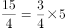。前项分别为：12、1/6 、3、2/3 、 3/4，观察可知：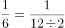、3=1/(1/6×2)、 2/3=1/(3÷2)、 3/4=1/(2/3×2)，则下一项为1/(3/4÷2)=8/3；后项为1、2、3、4、5的等差数列，下一项为6。故所求项为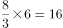。

故正确答案为C。

**来源**：2015年重庆市选调优秀大学生到基层工作考试《行测》题第50题

### 第 51 题

某教育基金向四名贫困学生捐助一笔钱，甲得到1/3，另外三人乙、丙、丁均分余下的钱，如果甲和乙共得60000元，则这笔捐款共有（    ）元。

A. 96000

B. 108000

C. 135000

D. 150000

第 51 题 · 答案与解析

**参考答案（粉笔题库参考内容）**

B

**解析**

设这笔捐款共有9x元，根据“甲得到1/3”可得，甲得到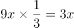元，根据“另外三人乙、丙、丁均分余下的钱”可得，乙得到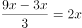元，根据“甲和乙共得60000元”，可列方程：3x+2x=60000元，解得x=12000元，故这笔捐款共有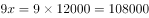元。

故正确答案为B。

**考点**：和差倍比问题

**来源**：2015年重庆市选调优秀大学生到基层工作考试《行测》题第51题

### 第 52 题

某种细菌在培养过程中，每20分钟分裂一次（一个分裂成2个），经过3小时，这种细菌由1个可以分裂成（    ）个。

A. 256

B. 512

C. 1024

D. 2048

第 52 题 · 答案与解析

**参考答案（粉笔题库参考内容）**

B

**解析**

3小时=60×3=180分钟，则这种细菌共会分裂180÷20=9次，细菌数与分裂次数的关系如下表所示：

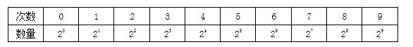

则3小时后1个细菌分裂成2^9=512个。

故正确答案为B。

**来源**：2015年重庆市选调优秀大学生到基层工作考试《行测》题第52题

### 第 53 题

企业经营的直接目的是利润，假设某企业生产的甲商品价格提高8%，其需求量下降8%；生产的乙商品价格下降6%，其需求量增加6%，在不考虑其他因素的情况下：

A. 甲、乙两种商品利润水平都提高

B. 甲、乙两种商品利润水平都降低

C. 甲商品利润水平降低，乙商品利润水平提高

D. 甲、乙两种商品利润水平都不变

第 53 题 · 答案与解析

**参考答案（粉笔题库参考内容）**

B

**解析**

假设甲、乙商品原本的价格与需求量皆为1，则二者价格变动前的销售额皆为1×1=1。甲商品价格浮动后的销售额为：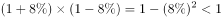，乙商品价格浮动后的销售额为：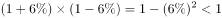，成本不变的情况下销售额均降低，则利润也都降低。

故正确答案为B。

**考点**：经济利润问题

**来源**：2015年重庆市选调优秀大学生到基层工作考试《行测》题第53题

### 第 54 题

已知一个时钟，每小时慢2分钟，下午14时整将时钟调至标准时间，当时钟走到18时50分时，标准时间为：

A. 18时58分20秒

B. 18时59分40秒

C. 19时整

D. 19时1分

第 54 题 · 答案与解析

**参考答案（粉笔题库参考内容）**

C

**解析**

因为这个时钟每小时慢2分钟，则这个时钟每走58分钟相当于正常时间的1个小时。时钟从14时走到18时50分时，共走了4×60+50=290分钟；290÷58=5小时，即相当于标准时间过了5个小时，此时为14+5=19时整 。

故正确答案为C。

**来源**：2015年重庆市选调优秀大学生到基层工作考试《行测》题第54题

### 第 55 题

某农村家庭的调查显示，电冰箱拥有率为49%，电视机拥有率为85%，洗衣机拥有率为44%，至少有两种电器的占63%，三种电器齐全的占25%，则一种电器都没有的比例为：

A. 10%

B. 15%

C. 20%

D. 25%

第 55 题 · 答案与解析

**参考答案（粉笔题库参考内容）**

A

**解析**

设一种电器都没有的比例为x，至少有两种电器的占63%，三种电器齐全的占25%，则只有两种电器的占63%-25%=38%。则根据容斥原理三集合非标准型公式：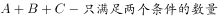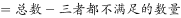，可得：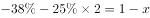，解得x=10%。

故正确答案为A。

**考点**：三集合

**来源**：2015年重庆市选调优秀大学生到基层工作考试《行测》题第55题

### 第 56 题

甲、乙两名篮球运动员投篮的命中率分别为0.8和0.75。令每人各投一球，则甲命中且乙未命中的概率为：

A. 1/5

B. 2/5

C. 3/5

D. 1/4

第 56 题 · 答案与解析

**参考答案（粉笔题库参考内容）**

A

**解析**

根据题意，每人各投一球，甲命中的概率为0.8，乙未命中的概率为1-0.75=0.25，故所求概率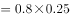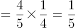。

故正确答案为A。

**考点**：给概率求概率

**来源**：2015年重庆市选调优秀大学生到基层工作考试《行测》题第56题

### 第 57 题

一项复印工作，如果由复印机A、B单独完成，分别需50分钟、40分钟。现两台复印机同时工作了20分钟后，B机器损坏需要维修，余下的工作由A机器单独完成，则完成这项复印工作共需时间（    ）分钟。

A. 5

B. 15

C. 20

D. 25

第 57 题 · 答案与解析

**参考答案（粉笔题库参考内容）**

D

**解析**

方法一：设复印工作的总量为200张，则复印机A的效率为200÷50=4张/分钟，复印机B的效率为200÷40=5张/分钟。共同工作20分钟共完成张，剩余200-180=20张，复印机A独立完成需要20÷4=5分钟，故完成这项工作共需要20+5=25分钟。

方法二：两台复印机同时工作20分钟后，其余工作由A单独完成，则完成工作共用时长必然大于20分钟，只有D项符合。

故正确答案为D。

**考点**：给完工时间型

**来源**：2015年重庆市选调优秀大学生到基层工作考试《行测》题第57题

### 第 58 题

一批救灾物资分别随16列货车从甲站紧急调到600公里以外的乙站，每列货车的平均速度都为125公里/小时。若两列相邻的货车在运行中的间隔不得小于25公里，则这批物资全部到达乙站最少需要（    ）小时。

A. 7.4

B. 7.8

C. 8

D. 8.2

第 58 题 · 答案与解析

**参考答案（粉笔题库参考内容）**

B

**解析**

16列货车共有16-1=15个间隔，根据“两列相邻的货车在运行中的间隔不得小于25公里”可知，第一列货车和最后一列货车中间的最小间隔为15×25=375公里，可将这16列货车的总长度看成375公里，则这批物资全部到达乙站最少需要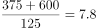小时。

故正确答案为B。

**考点**：普通行程

**来源**：2015年重庆市选调优秀大学生到基层工作考试《行测》题第58题

### 第 59 题

如图所示，小明把一块三角形的玻璃打碎成了三块，现在要到玻璃店去配一块完全一样的玻璃，那么最省事的方法是：

A. 带①去

B. 带②去

C. 带③去

D. 带②和③去

第 59 题 · 答案与解析

**参考答案（粉笔题库参考内容）**

C

**解析**

碎片③包括了三角形的两个角和一条边，延伸后可以完整还原原来的三角形，而根据①、②图形补充三角形均缺少一条边。

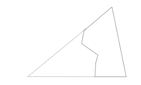

故正确答案为C。

**考点**：几何结论类-相似图形

**来源**：2015年重庆市选调优秀大学生到基层工作考试《行测》题第59题

### 第 60 题

建造一间占地面积为12m^2的背面靠墙的猪圈，底面为长方形，猪圈正面的造价为120元/m²，侧面的造价为80元/m²，屋顶造价为1120元/m²，如果墙高3m，则最低总造价为（    ）元。

A. 14600

B. 15230

C. 16320

D. 17200

第 60 题 · 答案与解析

**参考答案（粉笔题库参考内容）**

C

**解析**

方法一：设猪圈的长度为a，宽度为b。则a×b=12 ①，总造价c= 120×3×a+80×2×3×b+1120×12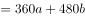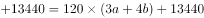 ②；当(3a+4b)的值最小时猪圈的总造价最低，因为a×b=12，则当3a=4b时，3a+4b的值最小，则a=4，b=3，c=120×24+13440=16320。

方法二：墙高为3米，则正面与侧面面积均为3的倍数，占地面积为12 m^2 ，则屋顶面积也为3的倍数，则总造价必为3的倍数，只有C项符合条件。

故正确答案为C。

**考点**：几何公式类-平面图形、非典型最值问题

**来源**：2015年重庆市选调优秀大学生到基层工作考试《行测》题第60题

### 第 61 题

根据图形规律，填入问号处最合适的一项是：

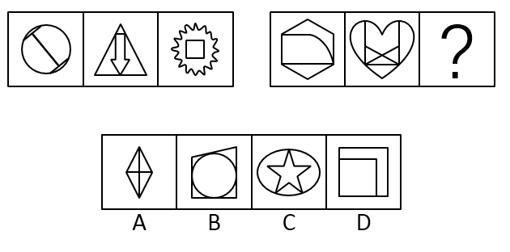

A. A

B. B

C. C

D. D

第 61 题 · 答案与解析

**参考答案（粉笔题库参考内容）**

A

**解析**

元素组成不同，考虑属性规律。题干出现等腰三角形与圆，优先考虑对称性，第一组图形的对称轴数量分别为2、1、0，第二组图形对称轴数量分别为0、1、？，故“？”处图形对称轴数量应该为2。A选项对称轴数量为2，B选项图形对称轴数量为0，C选项对称轴数量为1，D选项图形对称轴数量为1。

故正确答案为A。

**考点**：属性规律-对称性

**来源**：2015年重庆市选调优秀大学生到基层工作考试《行测》题第61题

### 第 62 题

根据图形规律，填入问号处最合适的一项是：

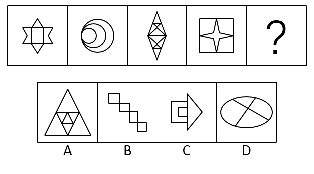

A. A

B. B

C. C

D. D

第 62 题 · 答案与解析

**参考答案（粉笔题库参考内容）**

A

**解析**

元素组成不同，优先考虑属性规律，题干图形出现等腰三角形，考虑对称性，观察发现，题干所有图形均为轴对称图形，因此？处要选择一个轴对称图形，B、D两项不是轴对称图形，排除B、D两项。题干出现多圆相切，优先考虑“一笔画”，题干图形都是“一笔画”图形，故？处应为“一笔画”图形，只有A项符合。

故正确答案为A。

**考点**：数量规律-复合

**来源**：2015年重庆市选调优秀大学生到基层工作考试《行测》题第62题

### 第 63 题

根据图形规律，填入问号处最合适的一项是：

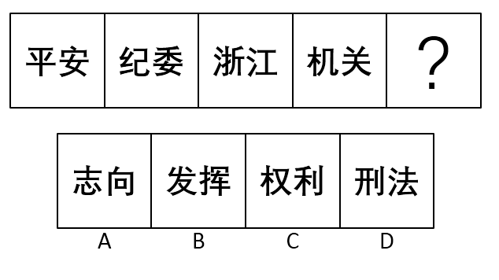

A. A

B. B

C. C

D. D

第 63 题 · 答案与解析

**参考答案（粉笔题库参考内容）**

D

**解析**

元素组成不同，封闭性、曲直性均无明显规律，考虑数量规律，观察可知，每个图形都有横直线，且每个图形的横直线数都为4。A项横直线数为5，B项横直线数为7，C项横直线数为3，D项横直线数为4，只有D项符合。

故正确答案为D。

**考点**：数量规律-线、文字/字母/数字类

**来源**：2015年重庆市选调优秀大学生到基层工作考试《行测》题第63题

### 第 64 题

根据图形规律，填入问号处最合适的一项是：

A. A

B. B

C. C

D. D

第 64 题 · 答案与解析

**参考答案（粉笔题库参考内容）**

A

**解析**

元素组成相似，优先考虑样式规律，横向看九宫格，无论是平移还是翻转，均不能发现明显规律，纵向观察九宫格可知，第一列的前两个图形，经过求同以后，进行上下翻转后可得第三个图形。第二列验证此规律依然成立，故第三列前两个图形经过求同以后，上下翻转可得A项。

故正确答案为A。

**考点**：样式规律-加减同异

**来源**：2015年重庆市选调优秀大学生到基层工作考试《行测》题第64题

### 第 65 题

选项中的四个图形，由题干图形拼合而成的是：

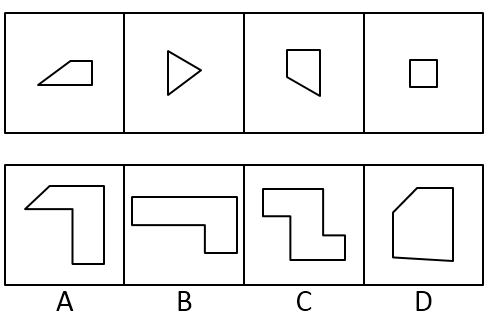

A. A

B. B

C. C

D. D

第 65 题 · 答案与解析

**参考答案（粉笔题库参考内容）**

C

**解析**

本题为平面拼合，可以采用平行等长相消的方法（找到相对面积较大的图形作为基准图形，找到平行且等长的边进行拼合，拼合之后等长线条抵消）。

平行等长相消的方式如下图所示：

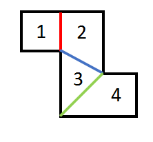

故正确答案为C。

**来源**：2015年重庆市选调优秀大学生到基层工作考试《行测》题第65题

### 第 66 题

责任分散效应是指对某一件事来说，如果是单个个体被要求单独完成任务，责任感就会很强，会做出积极的反应，但如果是要求一个群体共同完成任务，群体中的每个个体的责任感就会很弱，而面对困难或遇到责任往往会退缩。

根据上述定义，以下语句体现了责任分散效应的是：

A. 先天下之忧而忧，后天下之乐而乐

B. 天下兴亡，匹夫有责

C. 明天人之际，通古今之变

D. 一个和尚挑水吃，两个和尚抬水吃，三个和尚没水吃

第 66 题 · 答案与解析

**参考答案（粉笔题库参考内容）**

D

**解析**

第一步：找出定义关键词。

“单个个体被要求单独完成任务，责任感就会很强，会做出积极的反应”、“要求一个群体共同完成任务，群体中的每个个体的责任感就会很弱，而面对困难或遇到责任往往会退缩”。

第二步：逐一分析选项。

A项：先天下之忧而忧，后天下之乐而乐。其意思就是把国家、民族的利益摆在首位，为祖国的前途、命运担忧分愁，为天底下的人民幸福出力，是作者的伟大情怀，没有体现某一具体的任务，不符合定义，排除；

B项：天下兴亡，匹夫有责。其意思就是国家之事的兴亡，保护国家不致被倾覆，是帝王将相文武大臣的职责，与普通百姓无关；而天下大事的兴盛、灭亡，每一个老百姓都有义不容辞的责任。天下兴亡这个任务，每一个百姓都有义不容辞的责任，但却没有体现“群体中的每个个体的责任感就会很弱”，不符合定义，排除；

C项：明天人之际，通古今之变。其意思就是研究探索自然规律和社会规律之间的对立统一关系，理顺明白从古代到现在的变化迁移，成就自己的独立完善的理论著述，没有体现是个体还是群体被要求的任务，不符合定义，排除；

D项：一个和尚挑水吃，体现了“单个个体被要求单独完成任务，责任感就会很强，会做出积极的反应”，三个和尚没水吃，由于三人认为挑水的这个任务都不应该由自己去做，体现了“一个群体共同完成任务，群体中的每个个体的责任感就会很弱”，符合定义，当选。

故正确答案为D。

**考点**：单定义-其他句式

**来源**：2015年重庆市选调优秀大学生到基层工作考试《行测》题第66题

### 第 67 题

决策民主化是指将民主机制引入决策过程，使决策方案经过充分的协商、论证后，再由决策机构集体审议作出决定的一种制度安排。

根据上述定义，下列事项没有体现决策民主化的一项是：

A. 某村兴办水利，通过“一事一议”筹资筹劳

B. 某市就地铁票价调整举行听证会

C. 某企业在职工代表大会召开之前，分别向广大职工发出了为职代会总经理工作报告和厂长工作报告建言献策的倡议书

D. 为防止突击购车甚至突击购车屯牌，某市紧急宣布实施“限牌令”

第 67 题 · 答案与解析

**参考答案（粉笔题库参考内容）**

D

**解析**

第一步：找出定义关键词。

“将民主机制引入决策过程”、“使决策方案经过充分的协商、论证后，再由决策机构集体审议作出决定的一种制度安排”。

第二步：逐一分析选项。

A项：通过“一事一议”筹资筹劳，一件事情一个会议讨论决定，体现了“将民主机制引入决策过程”与“使决策方案经过充分的协商、论证后，再由决策机构集体审议作出决定的一种制度安排”，符合定义，排除；

B项：“举行听证会”，由群众与相关部门对价格提出异议，从而决定是否调整价格，体现了“将民主机制引入决策过程”与“使决策方案经过充分的协商、论证后，再由决策机构集体审议作出决定的一种制度安排”，符合定义，排除；

C项：“分别向广大职工发出了为职代会总经理工作报告和厂长工作报告建言献策的倡议书”，“建言献策”是为了广开言路，体现了“将民主机制引入决策过程”与“使决策方案经过充分的协商、论证后，再由决策机构集体审议作出决定的一种制度安排”，符合定义，排除；

D项：某市紧急宣布实施“限牌令”，没有体现“将民主机制引入决策过程”，不符合定义，当选。

本题为选非题，故正确答案为D。

**考点**：方式目的

**来源**：2015年重庆市选调优秀大学生到基层工作考试《行测》题第67题

### 第 68 题

路径依赖：是指人类社会中的技术演进或制度变迁均有类似于物理学中的惯性的表现，即一旦进入某一路径就可能对这种路径产生依赖，在社会演进过程中的作用有好有坏。

根据上述定义，下列史实能体现路径依赖及其积极作用的是：

A. 义和团“扶清灭洋”抗击外来侵略

B. 洋务派“中体西用”发起洋务运动

C. 英国继承宪章运动的精神和平渐进改良政治

D. 法国发扬传统轰轰烈烈闹革命

第 68 题 · 答案与解析

**参考答案（粉笔题库参考内容）**

C

**解析**

第一步：找出定义关键词。

“人类社会中的技术演进或制度变迁均有类似于物理学中的惯性的表现”、“一旦进入某一路径就可能对这种路径产生依赖”、“在社会演进过程中的作用有好有坏”。

第二步：逐一分析选项。

A项：义和团“扶清灭洋”抗击外来侵略，没有体现“技术演进或制度变迁”，不符合定义，排除；

B项：洋务派“中体西用”发起洋务运动。洋务运动，又称晚清自救运动、自强运动，但是后来失败，没有继续沿着以前的路径发展，没有体现“对这种路径产生依赖”，不符合定义，排除；

C项：英国继承宪章运动的精神和平渐进改良政治，“继承宪章运动的精神”符合“制度变迁均有类似于物理学中的惯性”，并且“渐进改良政治”也体现了“积极作用”，符合定义，当选；

D项：法国发扬传统轰轰烈烈闹革命，导致统治法国多个世纪的君主制在三年内土崩瓦解，没有体现“对这种路径产生依赖”，不符合定义，排除。

故正确答案为C。

**考点**：单定义-其他句式

**来源**：2015年重庆市选调优秀大学生到基层工作考试《行测》题第68题

### 第 69 题

财政部去年10月向社会公开行政事业的收费和政府性基金目录。行政事业性收费是指国家机关、事业单位、代行政府职能的社会团体及其它组织根据法律法规等有关规定，依据国务院规定程序批准，在实施社会共同管理，以及在向公民、法人提供特定公共服务过程中，向特定对象收取的费用；政府性基金是指各级人民政府及其所属部门依据法律、国家行政法规和有关文件的规定，为支持某项事业发展，按照国家规定程序批准，向公民、法人和其他组织征收的具有专项用途的资金，包括各种基金、资金、附加和专项收费。

根据上述定义，下列选项中所列项目全部属于政府性基金的是：

①民航发展基金

②壹基金

③华夏基金

④残疾人就业保障金

⑤国家电影事业发展专项资金

⑥彩票公益金

⑦港口建设费

⑧国家司法考试报名考务费

⑨城市公用事业附加

A. ①②④⑦

B. ③⑤⑥⑨

C. ①④⑤⑨

D. ⑤⑥⑦⑧

第 69 题 · 答案与解析

**参考答案（粉笔题库参考内容）**

C

**解析**

第一步：找出定义关键词。

“各级人民政府及其所属部门依据法律、国家行政法规和有关文件的规定”、“为支持某项事业发展”、“按照国家规定程序批准，向公民、法人和其他组织征收的具有专项用途的资金，包括各种基金、资金、附加和专项收费。”

第二步：逐一分析选项。

A项：②壹基金是由私人设立的基金会，不是由各级人民政府及其所属部门设立的，不符合定义，排除；

B项：③华夏基金是由私人设立的基金会，不是由各级人民政府及其所属部门设立的，不符合定义，排除；

C项：①民航发展基金是国家为了支持民航事业发展而设立的基金；④残疾人就业保障金是国家民政部门为了支持残疾人就业保障事业而设立的资金；⑤国家电影事业发展专项资金是国家为了电影事业的发展而设立的资金；⑨城市公用事业附加是国家为了公用事业的发展而设立的专项，符合定义，当选；

D项：⑥彩票公益金是指政府非税收入形式之一，指按照国家规定发行彩票取得销售收入扣除返奖奖金、发行经费后的净收入，没有体现“为支持某项事业发展”；⑧国家司法考试报名考务费，是考生为了参加考试缴纳的费用，没有体现“为支持某项事业发展”，不符合定义，排除。

故正确答案为C。

**考点**：常规问法

**来源**：2015年重庆市选调优秀大学生到基层工作考试《行测》题第69题

### 第 70 题

帕金森定律：是指两个平庸的助手分担一个领导的工作，领导自己则高高在上发号施令，两个助手不会对领导的权利造成威胁，同时两个助手上行下效，再为自己找两个更加无能的助手，如此类推，就形成了一个机构臃肿、人浮于事、相互扯皮、效率低下的领导体系。

根据上述定义，以下选项最符合帕金森定律的是：

A. 某公司市场部主管张某，因为性格比较内敛，疲于各种应酬，故而决定让出市场部主管一职，申请到其他部门当主管

B. 计算机专业出身的某上市金融公司高管刘某，对近期公司股权收益甚是头疼，刘某决定在现有一名助理的情况下再招聘一名有3年相关金融专业及工作经验的助理

C. 当官的A君工作很累时，把工作分配给级别和能力比自己都低的B君和C君。自己掌握大局，而B君和C君工作很累时也把自己的工作分配给级别和能力都不及自己的助手完成，他们掌握大局

D. 某公司设计总监接手一个不太拿手的项目感到力不从心，遂决定将该项目让给更有才华的上司刘某来统筹设计

第 70 题 · 答案与解析

**参考答案（粉笔题库参考内容）**

C

**解析**

第一步：找出定义关键词。

“指两个平庸的助手分担一个领导的工作，领导自己则高高在上发号施令，两个助手不会对领导的权利造成威胁”、“同时两个助手上行下效，再为自己找两个更加无能的助手”、“形成了一个机构臃肿、人浮于事、相互扯皮、效率低下的领导体系”。

第二步：逐一分析选项。

A项：决定让出市场部主管一职，申请到其他部门当主管，没有体现“两个平庸的助手分担一个领导的工作”，不符合定义，排除；

B项：计算机专业出身的某上市金融公司高管刘某，再招聘一名有3年相关金融专业及工作经验的助理，并没有明确说明有3年工作经验的专业人士是不是“平庸的助手”，不符合定义，排除；

C项：当官的A君工作很累时，把工作分配给级别和能力比自己都低的B君和C君，符合“两个平庸的助手分担一个领导的工作，领导自己则高高在上发号施令，两个助手不会对领导的权利造成威胁”，而B君和C君工作很累时也把自己的工作分配给级别和能力都不及自己的助手完成，他们掌握大局符合“同时两个助手上行下效，再为自己找两个更加无能的助手”，符合定义，当选；

D项：将该项目让给更有才华的上司刘某来统筹设计，没有提及“两个平庸的助手分担一个领导的工作”，不符合定义，排除。

故正确答案为C。

**考点**：主客体

**来源**：2015年重庆市选调优秀大学生到基层工作考试《行测》题第70题

### 第 71 题

肌肉萎缩症是一种损坏人体肌肉的遗传性疾病。由于身体无法制造支撑肌肉结构的蛋白质，患者会变得无法运动。目前几乎没有有效的治疗方法。而日本研究人员最新发现，添加“miR-195”和“miR-497”这两种小核糖核酸的骨骼肌干细胞被植入患有肌肉萎缩症的动物体内，骨骼肌得以再生。

由此可以推出：

A. 肌肉萎缩症是身体缺乏“miR-195”和“miR-497”这两种小核糖核酸所致

B. “miR-195”和“miR-497”这两种小核糖核酸能够编码制造支撑骨骼肌的蛋白质

C. “miR-195”和“miR-497”这两种小核糖核酸有助于维持骨骼肌干细胞的修复能力

D. 肌肉萎缩症的有效治疗将实现“零”的突破

第 71 题 · 答案与解析

**参考答案（粉笔题库参考内容）**

D

**解析**

日常结论题，根据题干信息逐一分析选项。

A项：添加“miR-195”和“miR-497”这两种小核糖核酸可以使骨骼肌得以再生，却不能够得出肌肉萎缩症是身体缺乏“miR-195”和“miR-497”这两种小核糖核酸所致，不能推出，排除；

B项：添加“miR-195”和“miR-497”这两种小核糖核酸可以使骨骼肌得以再生，没有明确说明这两种小核糖核酸是否能够编码制造支撑骨骼肌的蛋白质，不能推出，排除；

C项：添加“miR-195”和“miR-497”这两种小核糖核酸可以使骨骼肌得以再生，没有明确说明这两种小核糖核酸是否能有助于维持骨骼肌干细胞的修复能力，不能推出，排除；

D项：由题干可知，添加“miR-195”和“miR-497”这两种小核糖核酸可以使骨骼肌得以再生突破了“目前几乎没有有效的治疗方法”，意味着肌肉萎缩症的有效治疗将实现“零”的突破，当选。

故正确答案为D。

**考点**：日常结论

**来源**：2015年重庆市选调优秀大学生到基层工作考试《行测》题第71题

### 第 72 题

某大学考古博物馆发表了有关今年出售和获得藏品的报告，人们对报告的准确性产生了疑问，为了防止争议，报告由其他大学的三个考古学家来复审。因为这三个人会被允许查阅一切与报告有关的档案和资料，他们肯定可以判断报告是否准确。

上述论证的推理是错误的，因为：

A. 没有说明该馆的收藏是对大众开放的，还是仅供学者研究使用

B. 没有说明这三个考古学家是否有权查阅许多年以来的馆藏记录

C. 没有说明这三个考古学家发现报告有误后如何

D. 忽略了一些与报告无关的文件会提及今年馆藏的出售和增添藏品情况的可能性

第 72 题 · 答案与解析

**参考答案（粉笔题库参考内容）**

D

**解析**

第一步：找出论点和论据。

论点：报告由其他大学的三个考古学家来复审，他们肯定可以判断报告是否准确。

论据：这三个人会被允许查阅一切与报告有关的档案和资料。

第二步：逐一分析选项。

A项：“没有说明该馆的收藏是对大众开放的，还是仅供学者研究使用”，没有提及“出售和获得藏品”的情况，与解决报告的准确性无关，不能证明上述论证的推理是错误的，排除；

B项：“许多年以来的馆藏记录”与“今年出售和获得藏品的报告”的情况无关，与解决报告的准确性无关，不能证明上述论证的推理是错误的，排除；

C项：“发现报告有误后如何”与发现该报告准确性无关，不能证明上述论证的推理是错误的，排除；

D项：虽然这三个人会被允许查阅一切与报告有关的档案和资料，但是“报告无关的文件会提及今年馆藏的出售和增添藏品情况的可能性”，说明在不允许这三个人查阅的文件中，可能会出现出售和增添藏品情况的可能性，可以证明上述论证的推理是错误的，当选。

故正确答案为D。

**来源**：2015年重庆市选调优秀大学生到基层工作考试《行测》题第72题

### 第 73 题

一畅销的自助书的出版商在一些促销材料中声称这本书将向读者展示如何成为一个卓越成功的人。当然，每个人都知道没有书能给很多人带来那些从定义上一定仅局限于少数人的卓越的成功。因此，尽管出版商很明显故意地做了一个虚假的声明，但是在这种情况下这种做法不应该被认为是不道德的。

下面哪一原则，如果正确，能最强有力支持上面的推理？

A. 只要可能有人会认为某一虚假声明是假的，那么故意做出这样的声明就是不道德的

B. 只要人们能合情合理地接受某一虚假的声明为真，那么故意作出这样的声明就是不道德的

C. 如果作出虚假声明的人在损害那些认为该虚假声明为真的人的情况下获益，那么故意作出这样的声明是不道德的

D. 至少在其他某个人发现某个虚假声明是假的，且这个人一定一度认为该声明是真的情况下，故意作出这样的声明是不道德的

第 73 题 · 答案与解析

**参考答案（粉笔题库参考内容）**

D

**解析**

第一步：找出论点和论据。

论点：尽管出版商很明显故意地做了一个虚假的声明，但是在这种情况下这种做法不应该被认为是不道德的。

论据：每个人都知道没有书能给很多人带来那些从定义上一定仅局限于少数人的卓越的成功，即每个人都知道此声明是假的。

第二步：逐一分析选项。

A项：题干是说所有人都知道是假的，可以推出A项的前半句话——有人会认为某一虚假声明是假，因此，此时应该的出这样的声明是道德的，而A项却得出不道德，与题干不一致，排除；

B项：只要人们能合情合理地接受某一虚假的声明为真，那么故意作出这样的声明就是不道德的，与合情合理无关，不能够支持题干结论“这种做法不应该被认为是不道德的”，排除；

C项：如果作出虚假声明的人在损害那些认为该虚假声明为真的人的情况下获益，那么故意作出这样的声明是不道德的，与他是否获得收益无关，不能够支持题干结论“这种做法不应该被认为是不道德的”，排除；

D项：题干的论证结构是：每个人都知道此声明是假的，从而推出论点，是道德的；而D项说有人一度认为该声明是真的，即他不知道此声明是假的，推出这是不道德的，与题干论证结构一致，肯定了题干结论，当选。

故正确答案为D。

**考点**：补充论据

**来源**：2015年重庆市选调优秀大学生到基层工作考试《行测》题第73题

### 第 74 题

社会各界要求惩治行贿人的呼声一直不绝于耳。近年来，最高人民检察院也不断提出“依法严厉打击严重行贿犯罪”的要求。2014年1季度，广州市检察机关共查办行贿犯罪人员89人，同比上升102.27%，立案查办的行贿和单位行贿犯罪案件首次超过了受贿案件总数。2013年检察机关对5515名行贿人依法追究刑事责任。同比上升18.6%，但相比数量巨大并逐年递增的受贿犯罪，还是不太相称。

能够解释上述矛盾现象的不包括：

A. 行贿犯罪趋势群体化、交易手段隐蔽化，对检察机关办案能力构成了挑战

B. 司法实践中普遍存在“重受贿而轻行贿”倾向

C. 行贿者档案信息尚未公开，无法接受公众监督

D. 司法机关为收集证据，往往会从轻或免罪作为“交换”条件，使一些行贿人作为所谓“污点证人”被有意放过而非减轻处罚

第 74 题 · 答案与解析

**参考答案（粉笔题库参考内容）**

C

**解析**

第一步：找出题干矛盾。

行贿人依法追究刑事责任同比上升，但相比数量巨大并逐年递增的受贿犯罪，还是不太相称。

第二步：逐一分析选项。

A项，行贿犯罪趋势群体化、交易手段隐蔽化，对检察机关办案能力构成了挑战，说明有一部分行贿犯罪由于上述原因，检察机关不能及时发现并处理，可以解释题干矛盾，排除；

B项，司法实践中普遍存在“重受贿而轻行贿”倾向，由于轻视行贿罪行，导致了行贿犯罪数量与受贿犯罪数量不相称，可以解释题干矛盾，排除；

C项，行贿者档案信息尚未公开，无法接受公众监督，信息未公开与公众无法监督只能说明他们为什么会行贿，因为信息未公开，不容易被发现，但不能解释行贿犯罪与受贿犯罪为何不太相称，不可以解释题干矛盾，当选；

D项，往往会从轻或免罪作为“交换”条件，使一些行贿人作为所谓“污点证人”被有意放过而非减轻处罚，导致了行贿犯罪数量与受贿犯罪数量不相称，可以解释题干矛盾，排除。

本题为选非题，故正确答案为C。

**考点**：原因解释

**来源**：2015年重庆市选调优秀大学生到基层工作考试《行测》题第74题

### 第 75 题

绝大多数灵长类动物都生长发育得比较缓慢，而人类尤其突出，婴幼儿时期相比哺乳动物要漫长得多。美国一项新研究表明，这是因为能量一开始主要供给大脑，延长了身体的生长发育期。研究发现，4岁时，人类大脑所消耗的能量占人体中消耗量的40%，此时每克大脑组织的葡萄糖消耗水平是出生时的2.5倍；5岁时人类大脑对葡萄糖的需求达到峰值，成年人大脑对葡萄糖的需求只有此时的一半。

下面哪一项如果正确，能对该研究结论提出最强有力的质疑？

A. 爬行动物的婴幼儿时期同样漫长

B. 大脑发育对能量的需求与身体发育对能量的需求水平不一致

C. 大脑中连接神经元的突触数量并未在5岁时达到最大

D. 4～5岁时，人类身体的生长速度并不是最缓慢的

第 75 题 · 答案与解析

**参考答案（粉笔题库参考内容）**

D

**解析**

第一步：找出论点和论据。

论点：绝大多数灵长类动物都生长发育得比较缓慢，而人类尤其突出，婴幼儿时期相比哺乳动物要漫长得多。

论据：能量一开始主要供给大脑，延长了身体的生长发育期。研究发现，4岁时，人类大脑所消耗的能量占人体中消耗量的40%，此时每克大脑组织的葡萄糖消耗水平是出生时的2.5倍；5岁时人类大脑对葡萄糖的需求达到峰值，成年人大脑对葡萄糖的需求只有此时的一半。

第二步：逐一分析选项。

A项：“爬行动物的婴幼儿时期”，与题干论述的“灵长类动物”的情况，主体不一致，无法削弱，排除；

B项：“大脑发育对能量的需求与身体发育对能量的需求水平不一致”，并不能说明大脑需求能量更多，无法削弱，排除；

C项：“大脑中连接神经元的突触数量并未在5岁时达到最大”，但没有说明神经突触数量是能量供给多而导致的，无法削弱，排除；

D项：“4～5岁时，人类身体的生长速度并不是最缓慢的”，但是5岁时人类大脑对葡萄糖的需求达到峰值，切断了能量供给大脑与身体发育间的联系，4～5岁时大脑需求的能量虽然很高，但此时身体发育并未收到很大的影响，拆桥，可以削弱，当选。

故正确答案为D。

**考点**：拆桥

**来源**：2015年重庆市选调优秀大学生到基层工作考试《行测》题第75题

### 第 76 题

一个孩子对他的父亲说：“我从来没有说过谎。如果我曾经说过谎，那么我现在不说了。如果我现在还在说谎的话，那也是事出有因，不得已而为之。”

以下哪项与上述议论在表述方式上最为类似？

A. 气象学家：“最近北部地区不会出现持续降雪。如果出现持续降雪，只有当西伯利亚有强冷空气南下才有可能。但卫星云图显示，最近西伯利亚不会有强冷空气南下。”

B. 邻居：“我没有借过你的吸尘器。如果我借了，我肯定会归还的，现在你说我没归还，这说明我没有借过。”

C. 法医：“尸检发现死者在胸部有三处枪伤，每处都可能致命，我把它们分别标为A、B和C。如果不是A直接导致毙命，那么就是B和C。如果不是B，那就一定是C。”

D. 律师：“我的当事人不在犯罪现场，如果他在的话，他也没干。如果他干了，那么当时他一定精神错乱了。”

第 76 题 · 答案与解析

**参考答案（粉笔题库参考内容）**

D

**解析**

第一步，分析题干逻辑。

题干的形式是：A；-A→B；-B→C。

第二步，逐一分析选项。

A项：翻译形式：A；-A→B；-B，与题干表述方式不一致，排除；

B项：翻译形式：A；-A→B；-B→A，与题干表述方式不一致，排除；

C项：翻译形式：A 或 B 或 C；-A→B 且 C；-B→C，与题干表述方式不一致，排除；

D项：翻译形式：A；-A→B；-B→C，与题干表述方式一致，当选。

故正确答案为D。

**考点**：推理形式

**来源**：2015年重庆市选调优秀大学生到基层工作考试《行测》题第76题

### 第 77 题

通勤客机坠落的事故急剧增加在很大程度上是由飞行员缺乏经验所致。作为一个主要增长的工业部门，通勤客机最近对有经验的飞机驾驶员的需求量剧增。然而对飞机驾驶员的经验进行确定及评估是不可能的。例如，一个在气候良好的亚利桑那州飞行1000小时的教官，是不能和一个在充满暴风雨的东北部飞行1000小时的夜班货机飞行员相比的。

作者关于通勤客机坠落事故的增加是由飞行员缺乏经验所致的结论最能被作者提出的哪项观点所削弱？

A. 对通勤客机坠落事故的增加，只给出了片面的解释

B. 认为不可能衡量飞行员的经验

C. 使用了一个与所阐明的观点在逻辑上不相关的例子

D. 没有指明最近有多少通勤客机坠落事故是由飞行员缺乏经验所致

第 77 题 · 答案与解析

**参考答案（粉笔题库参考内容）**

B

**解析**

第一步：找出论点和论据。

论点：通勤客机坠落事故的增加是由飞行员缺乏经验所致。

论据：无。

第二步：逐一分析选项。

A项：“对通勤客机坠落事故的增加，只给出了片面的解释”，该题论点就是在讨论通勤客机坠落事故的增加是由飞行员缺乏经验所致，故不存在“片面的解释”，不能削弱作者关于通勤客机坠落事故的增加的结论，排除；

B项：题干把飞机坠毁归于飞行员缺乏经验，后来又说对飞行员的经验进行确定的评价是不可能的，自相矛盾，故作者关于通勤客机坠落事故的增加的结论最能被该选项所削弱，当选；

C项：该例子可以阐述“对飞机驾驶员的经验进行确定及评估是不可能的”这一观点，但却不能削弱作者关于通勤客机坠落事故的增加的结论，排除；

D项：“没有指明最近有多少通勤客机坠落事故是由飞行员缺乏经验所致”，这只是在说题干得到的论点没有科学依据，但不能说明论点不成立，排除。

故正确答案为B。

**考点**：削弱论点

**来源**：2015年重庆市选调优秀大学生到基层工作考试《行测》题第77题

### 第 78 题

近年来，越来越多的国内外研究发现，官员变更导致的政策不稳定性对一个地区的宏观经济增长有显著的负面影响。

研究得出上述结论的前提假设是：

Ⅰ.官员变更比率的提高和官员变更波动率的增大都会显著刺激财政支出的扩张，而财政支出扩张则会对经济增长产生显著的抑制作用

Ⅱ.地方政府往往掌握地方国企的经济管理权以及区域内行政审批、土地征用、贷款担保、政策优惠等重要资源，从而拥有较大的“权力”去自主发展经济和制定经济发展政策

Ⅲ.在以相对绩效为核心的晋升体制下，地方政府大多承担着比上一级政府更大的经济压力，其对社会经济增长的推动往往更加投入

Ⅳ.官员变更引起的政策不稳定性会通过刺激官员的短视性政策行为以及由此衍生政策不确定性预期对经济增长产生负面影响

A. Ⅰ和Ⅳ

B. Ⅱ和Ⅲ

C. Ⅰ和Ⅲ

D. Ⅱ和Ⅳ

第 78 题 · 答案与解析

**参考答案（粉笔题库参考内容）**

A

**解析**

第一步：找出论点和论据。

论点：官员变更导致的政策不稳定性对一个地区的宏观经济增长有显著的负面影响。

论据：无。

第二步：逐一分析前提假设。

Ⅰ：“官员变更比率的提高和官员变更波动率的增大都会显著刺激财政支出的扩张，而财政支出扩张则会对经济增长产生显著的抑制作用”，明确说明了官员变更会对地区宏观经济有负面影响，可以作为前提假设，当选；

Ⅱ：没有提及“官员变更对宏观经济有负面影响”，无法作为前提假设，排除；

Ⅲ：没有提及“官员变更对宏观经济有负面影响”，无法作为前提假设，排除；

Ⅳ：“官员变更引起的政策不稳定性会通过刺激官员的短视性政策行为以及由此衍生政策不确定性预期对经济增长产生负面影响”，明确说明了官员变更会对地区宏观经济有负面影响，可以作为前提假设，当选。

综上所述，得出上述结论的前提假设是Ⅰ和Ⅳ。

故正确答案为A。

**考点**：必要条件

**来源**：2015年重庆市选调优秀大学生到基层工作考试《行测》题第78题

### 第 79 题

航天局认为优秀宇航员应具备三个条件：第一，丰富的知识；第二，熟练的技术；第三，坚强的意志。现有至少符合条件之一的甲、乙、丙、丁四位优秀飞行员报名参选，已知：

①甲、乙意志坚强程度相同

②乙、丙知识水平相当

③丙、丁并非都是知识丰富

④四人中三人知识丰富、两人意志坚强，一人技术熟练

航天局经过考察，发现其中只有一人完全符合优秀宇航员的全部条件。他是：

A. 甲

B. 乙

C. 丙

D. 丁

第 79 题 · 答案与解析

**参考答案（粉笔题库参考内容）**

C

**解析**

由条件③得，丙与丁中肯定有人知识不丰富。再根据条件②和④可知，知识不丰富的人一定是丁。丁的技术也不熟练。因为如果丁的技术熟练，则由条件④“一人技术熟练”可知，甲、乙和丙三人技术都不熟练，这样就没有符合条件的了。因为甲、乙、丙和丁四人至少符合条件之一，所以，丁意志坚强。由条件①“甲、乙意志坚强程度相同”，推得甲和乙意志不坚强。因为如果都意志坚强的话，则就有甲、乙和丁三人意志坚强了，与条件④“两人意志坚强”矛盾，所以，甲和乙意志不坚强。那么，丙的意志坚强。因此，只有丙完全符合条件。

故正确答案为C。

**考点**：框架题

**来源**：2015年重庆市选调优秀大学生到基层工作考试《行测》题第79题

### 第 80 题

地球两极地区所有的冰都是由降雪形成的。特别冷的空气不能保持很多的湿气，所以不能产生大量降雪。近年来，两极地区的空气无一例外的特别冷。

以上信息能够最有力地支持以下哪一个结论？

A. 在两极地区，为了使雪转化成冰，空气必须特别冷

B. 如果现在两极地区的冰有任何增加和扩张，它的速度也是非常缓慢的

C. 两极地区较厚的冰层与较冷的空气是相互冲突的

D. 如果两极地区的空气不断变暖，大量的极地冰将会融化

第 80 题 · 答案与解析

**参考答案（粉笔题库参考内容）**

B

**解析**

第一步：找出论点和论据。

论点：根据问法“能够最有力地支持以下哪一个结论？”，可知题干中无论点，论点在选项中。

论据：地球两极地区所有的冰都是由降雪形成的。特别冷的空气不能保持很多的湿气，所以不能产生大量降雪。近年来，两极地区的空气无一例外的特别冷。

第二步：逐一分析选项。

A项：题干中表明的是冷空气与降雪间的关系，而没有提到雪转化为冰需要冷空气，因此，该选项推不出，排除；

B项：特别冷的空气不利于降雪，而近几年两极地区的空气都特别冷，则降雪也会特别少。两极地区的冰是由降雪形成的，所以两极地区的冰即使有任何增加和扩张，其速度也是极其缓慢的，能够推出该结论，当选；

C项，两极地区较厚的冰层非近期形成，为多年累积，当前的冷空气与较厚的冰层并不冲突，因此，该选项推不出，排除；

D项，根据题干信息，只能推出天气变暖可能导致降雪增加，而无法推出是否能导致大量极地冰融化，因此，该选项推不出，排除。

故正确答案为B。

**来源**：2015年重庆市选调优秀大学生到基层工作考试《行测》题第80题

### 第 81 题

钙：骨质疏松

A. 糖：糖尿病

B. 水：枯萎

C. 耐心：教育

D. 重量：引力

第 81 题 · 答案与解析

**参考答案（粉笔题库参考内容）**

B

**解析**

第一步：判断题干词语间逻辑关系。

缺钙是导致骨质疏松的原因，二者为对应关系中的因果关系。

第二步：判断选项词语间逻辑关系。

A项：糖尿病是一种以高血糖为特征的代谢性疾病，并不是缺糖导致的糖尿病，与题干逻辑关系不一致，排除；

B项：缺水是导致枯萎的原因，二者为对应关系中的因果关系，与题干逻辑关系一致，当选；

C项：从事教育工作应该有耐心，二者是对应关系中的必要条件关系，与题干逻辑关系不一致，排除；

D项：由于地心引力作用，而使物体具有向下的力，叫做重力，但没有体现题干“缺少某种东西”这一关系，与题干逻辑关系不一致，排除。

故正确答案为B。

**考点**：逻辑关系-对应关系

**来源**：2015年重庆市选调优秀大学生到基层工作考试《行测》题第81题

### 第 82 题

笔墨：纸砚

A. 大庭：广众

B. 琴棋：书画

C. 文化：传承

D. 指桑：骂槐

第 82 题 · 答案与解析

**参考答案（粉笔题库参考内容）**

B

**解析**

第一步：判断题干词语间逻辑关系。

笔、墨、纸、砚是中国独有的文书工具，即“文房四宝”，这四种物品为并列关系。

第二步：判断选项词语间逻辑关系。

A项：大庭指宽大的场地，广众指为数很多的人群，没有体现四种物品的并列关系，与题干逻辑关系不一致，排除；

B项：在古代，弹琴（多指弹奏古琴）、弈棋（大多指中国象棋和围棋）、书法、绘画是文人骚客（包括一些名门闺秀）修身所必须掌握的技能，故合称琴棋书画，即“文人四友”，这四种物品为并列关系，与题干逻辑关系一致，当选；

C项：传承文化是动宾搭配关系，没有体现四种物品的并列关系，与题干逻辑关系不一致，排除；

D项：指桑骂槐意为指着桑树数落槐树，没有体现四种物品的并列关系，与题干逻辑关系不一致，排除。

故正确答案为B。

**考点**：拆分思维、逻辑关系-并列关系

**来源**：2015年重庆市选调优秀大学生到基层工作考试《行测》题第82题

### 第 83 题

陡峭：山峰

A. 简朴：生活

B. 精炼：态度

C. 滥用：药物

D. 闪耀：光芒

第 83 题 · 答案与解析

**参考答案（粉笔题库参考内容）**

A

**解析**

第一步：判断题干词语间逻辑关系。

陡峭的山峰，二者是形容词与其修饰的名词之间的语法关系，构成偏正结构。

第二步：判断选项词语间逻辑关系。

A项：简朴的生活，二者是形容词与其修饰的名词之间的语法关系，构成偏正结构，与题干逻辑关系一致，当选；

B项：精炼与态度不能搭配，与题干逻辑关系不一致，排除；

C项：滥用药物为动宾搭配关系，与题干逻辑关系不一致，排除；

D项：闪耀光芒为动宾搭配关系，与题干逻辑关系不一致，排除。

故正确答案为A。

**考点**：语法关系

**来源**：2016年重庆市选调优秀大学生到基层工作考试《行测》题第83题

### 第 84 题

重力：滤水

A. 镜子：反射

B. 书本：知识

C. 运动：惯性

D. 质量：重力

第 84 题 · 答案与解析

**参考答案（粉笔题库参考内容）**

D

**解析**

第一步：判断题干词语间逻辑关系。

滤水产生的原因是重力，二者为因果上的对应关系。

第二步：判断选项词语间逻辑关系。

A项：镜子有反射的功能，二者是功能上的对应关系，与题干逻辑关系不一致，排除；

B项：书本上可以学到知识，二者不是因果上的对应关系，与题干逻辑关系不一致，排除；

C项：惯性大小与物体的运动状态无关，二者不是因果上的对应关系，与题干逻辑关系不一致，排除；

D项：重力产生的原因是质量，二者是因果上的对应关系，与题干逻辑关系一致，当选。

故正确答案为D。

**考点**：逻辑关系-对应关系

**来源**：2015年重庆市选调优秀大学生到基层工作考试《行测》题第84题

### 第 85 题

木偶：傀儡

A. 二氧化碳：一氧化碳

B. 冒失鬼：马大哈

C. 炒鱿鱼：辞职

D. 兰花：桂花

第 85 题 · 答案与解析

**参考答案（粉笔题库参考内容）**

B

**解析**

第一步：判断题干词语间的逻辑关系。

两词是全同关系，源于比喻，演变为近义词。

第二步：判断选项词语间的逻辑关系。

A项：二氧化碳与一氧化碳是并列关系，不是全同关系，与题干逻辑关系不一致，排除；

B项：两词是全同关系，源于比喻，演变为近义词，与题干逻辑关系一致，当选；

C是：炒鱿鱼是被开除，辞职是主动离职，二者是主动与被动的对应关系，与题干逻辑关系不一致，排除；

D项：兰花与桂花是并列关系，不是全同关系，与题干逻辑关系不一致，排除。

故正确答案为B。

**考点**：逻辑关系-全同关系

**来源**：2015年重庆市选调优秀大学生到基层工作考试《行测》题第85题

### 第 86 题

比翼双飞：劳燕分飞

A. 洗心革面：未雨绸缪

B. 功败垂成：功亏一篑

C. 含沙射影：明目张胆

D. 江河日下：蒸蒸日上

第 86 题 · 答案与解析

**参考答案（粉笔题库参考内容）**

D

**解析**

第一步：判断题干词语间逻辑关系。

比翼双飞是一个汉语成语，释义：比翼，翅膀挨着翅膀；双飞，成双地并飞，意为夫妻恩爱，相伴不离或男女情投意合，结为伴侣；劳燕分飞是一个成语，比喻到了分开的时候了，二者是反义关系。

第二步：判断选项词语间逻辑关系。

A项：洗心革面意为清除旧思想，改变旧面貌，借以比喻坏人物彻底悔改；未雨绸缪意思是趁着天没下雨，先修缮房屋门窗，比喻事先做好准备工作，预防意外的事发生，二者不是反义关系。与题干逻辑关系不一致，排除；

B项：功败垂成意思是事情接近成功的时候却遭到了失败；功亏一篑比喻做事情只差最后一点却没能完成，结果枉费工夫，二者不是反义关系。与题干逻辑关系不一致，排除；

C项：含沙射影比喻暗中攻击或陷害人；明目张胆意思是无所顾忌，胆大妄为，二者不是反义关系。与题干逻辑关系不一致，排除；

D项：江河日下通常指江河的水一天天地向下流，比喻情况一天天地坏下去；蒸蒸日上比喻一天天地向上发展，形容发展速度快，多指生活和生意，二者是反义关系。与题干逻辑关系一致，当选。

故正确答案为D。

**考点**：语义关系-反义关系

**来源**：2015年重庆市选调优秀大学生到基层工作考试《行测》题第86题

### 第 87 题

做一天和尚撞一天钟：得过且过

A. 醉翁之意不在酒：项庄舞剑

B. 张公吃酒李公醉：罪有应得

C. 坐山观虎斗：必有好戏

D. 有志不在年高：有眼不识泰山

第 87 题 · 答案与解析

**参考答案（粉笔题库参考内容）**

A

**解析**

第一步：判断题干词语间逻辑关系。

做一天和尚撞一天钟是指过一天算一天，凑合着混日子，比喻遇事敷衍，得过且过。二者是近义关系。

第二步：判断选项词语间逻辑关系。

A项：醉翁之意不在酒比喻本意不在此而在别的方面；项庄舞剑，比喻说话和行动的真实意图别有所指，二者是近义关系，与题干逻辑关系一致，当选；

B项：张公吃酒李公醉比喻由于误会而代人受过，与罪有应得不是近义关系，与题干逻辑关系不一致，排除；

C项：坐山观虎斗比喻为双方的斗争采取旁观的态度，等到两败俱伤的时候，再从中取利，与必有好戏不是近义关系，与题干逻辑关系不一致，排除；

D项：有志不在年高比喻年轻人只要有志向，成就不可限量，不在年纪大；有眼不识泰山比喻见闻太窄，认不出地位高或本领大的人，二者不是近义关系，与题干逻辑关系不一致，排除。

故正确答案为A。

**考点**：语义关系-近义关系

**来源**：2015年重庆市选调优秀大学生到基层工作考试《行测》题第87题

### 第 88 题

（    ） 对于 鸦片 相当于 馍馍 对于 （    ）

A. 罂粟 小麦

B. 大烟 馒头

C. 海洛因 发酵粉

D. 白粉 玉米

第 88 题 · 答案与解析

**参考答案（粉笔题库参考内容）**

B

**解析**

逐一代入选项。

A项：罂粟是鸦片的原材料，小麦是馍馍的原材料，但词语前后顺序相反，前后逻辑关系不一致，排除；

B项：大烟是鸦片的别称，馍馍是馒头的别称，二者为全同关系，前后逻辑关系一致，当选；

C项：海洛因是在鸦片的基础上加工改造形成的、危害更大的一种毒品，制作馍馍的过程中可能会用到发酵粉，二者为食品与添加剂的对应关系，前后逻辑关系不一致，排除；

D项：白粉别名海洛因，海洛因是在鸦片的基础上加工改造形成的、危害更大的一种毒品，玉米可以是制作馍馍的原材料，二者是原材料的对应关系，前后逻辑关系不一致，排除。

故正确答案为B。

**考点**：逻辑关系-全同关系

**来源**：2015年重庆市选调优秀大学生到基层工作考试《行测》题第88题

### 第 89 题

（    ） 对于 动力 相当于 （    ） 对于 信仰

A. 发动机 马列主义

B. 机械 宗教

C. 能量 信念

D. 员工 教徒

第 89 题 · 答案与解析

**参考答案（粉笔题库参考内容）**

D

**解析**

逐一代入选项。

A项：发动机提供动力，二者为对应关系；马列主义是一种信仰，二者为包容关系中的种属关系，前后逻辑关系不一致，排除；

B项：机械必须需要动力才能运转，二者是必要条件的对应关系；宗教是人类社会发展到一定历史阶段出现的一种文化现象，属于社会特殊意识形态，信仰指对某种主张、主义、宗教或对某人、某物的信奉和尊敬，并把它奉为自己的行为准则，二者无明显逻辑关系，前后逻辑关系不一致，排除；

C项：能量指物质做功的能力，动力是指使机械做功的各种作用力，二者无明显关系；信念是指认为是事实或者必将成为事实的对事物的判断、观点或看法，与信仰无明显对应关系，前后逻辑关系不一致，排除；

D项：员工必须要有动力，否则会被淘汰；教徒必须要有信仰，否则会被排斥，二者均为必要条件的对应关系，前后逻辑关系一致，当选。

故正确答案为D。

**考点**：逻辑关系-对应关系

**来源**：2015年重庆市选调优秀大学生到基层工作考试《行测》题第89题

### 第 90 题

睡眠 对于 （    ） 相当于 跑步 对于 （    ）

A. 精力 身体

B. 休息 锻炼

C. 工作 健康

D. 工作 运动

第 90 题 · 答案与解析

**参考答案（粉笔题库参考内容）**

B

**解析**

逐一代入选项。

A项：要想有精力必须要睡眠休息，二者为必要条件关系，但是跑步与身体不是必要条件关系，前后逻辑关系不一致，排除；

B项：睡眠是一种休息，跑步是一种锻炼，二者都为包容关系中的种属关系，前后逻辑关系一致，当选；

C项：跑步直接对健康有益，但不能说睡眠直接对工作有益，睡眠可以补充精力，精力对工作有益，是间接对应关系，前后逻辑关系不一致，排除；

D项：跑步是一种运动，但不能说睡眠是一种工作，前后逻辑关系不一致，排除。

故正确答案为B。

**考点**：逻辑关系-包容关系

**来源**：2015年重庆市选调优秀大学生到基层工作考试《行测》题第90题

## 材料 1

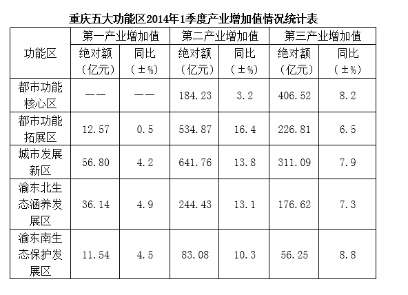

### 第 91 题

城市发展新区2013年1季度第三产业增加值约为（    ）亿元。

A. 212.97

B. 286.51

C. 288.31

D. 335.67

第 91 题 · 答案与解析

**参考答案（粉笔题库参考内容）**

C

**解析**

根据题干“城市发展新区2013年1季度第三产业增加值约为······”，结合材料时间为2014年第1季度，可判定本题为基期计算问题。定位统计表可得，城市发展新区2014年1季度第三产业增加值为311.09亿元，同比增长7.9%。根据公式：基期量可得，城市发展新区2013年1季度第三产业增加值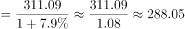亿元，与C项最接近。

故正确答案为C。

**考点**：基期计算、统计表

**来源**：2015年重庆市选调优秀大学生到基层工作考试《行测》题第91题

### 第 92 题

全市2014年1季度第一产业增加值同比提高约：

A. 3.5%

B. 4.0%

C. 4.8%

D. 5.3%

第 92 题 · 答案与解析

**参考答案（粉笔题库参考内容）**

B

**解析**

根据题干“2014年1季度第一产业增加值同比提高”，结合材料时间一致且材料给出第一产业各功能区的增加值及同比增速，可判定本题为混合增长率问题。定位表格材料可知：2014年1季度中，城市发展新区在第一产业中绝对额最高为56.80亿元，同比增速为4.2%，根据混合增长率结论“居中而不中，偏向较大的部分”，可得全市2014年1季度第一产业增加值同比增速最接近4.2%，排除C、D两项；在五大功能区中，只有都市功能拓展区的同比增速小于4.2%且都市功能拓展区的绝对额较小（12.57亿元），对于整体的增速影响较小，因此排除A项。

故正确答案为B。

**考点**：混合增长率、统计表

**来源**：2015年重庆市选调优秀大学生到基层工作考试《行测》题第92题

### 第 93 题

2014年1季度第二产业增加值同比提高金额最大的区域为：

A. 都市功能拓展区

B. 城市发展新区

C. 渝东北生态涵养发展区

D. 渝东南生态保护发展区

第 93 题 · 答案与解析

**参考答案（粉笔题库参考内容）**

B

**解析**

根据题干“2014年1季度······增加值······最大······”，可判定本题为增长量比较问题。定位表格材料，可得2014年1季度第二产业各功能区的绝对额和同比增速，根据公式，观察后发现在同比增速变化不大的前提下，C、D两项的现期值较小，故排除C、D两项；都市功能拓展区增加值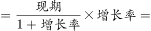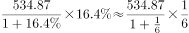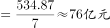，城市发展新区增加值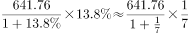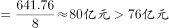，故2014年1季度第二产业增加值同比提高金额最大的区域为城市发展新区。

故正确答案为B。

**考点**：增长量比较、统计表

**来源**：2015年重庆市选调优秀大学生到基层工作考试《行测》题第93题

### 第 94 题

下列哪幅饼状图没能准确反映2014年1季度各功能区第一、二、三产业增加值各自的比例？

A. 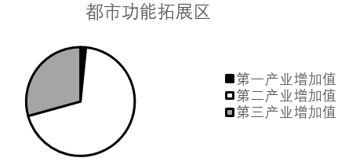

B. 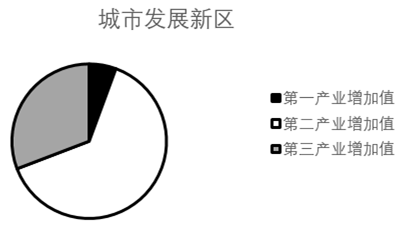

C. 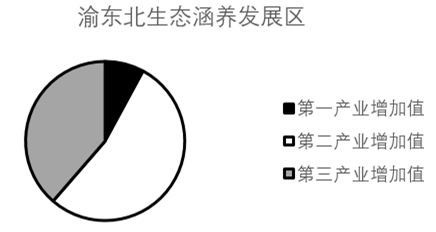

D. 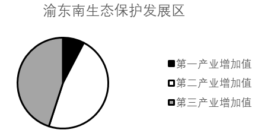

第 94 题 · 答案与解析

**参考答案（粉笔题库参考内容）**

D

**解析**

根据题干“······2014年······各自的比例”，结合材料时间一致，可判定本题为现期比重问题。定位表格材料，可知各功能区中三大产业分别的增加值，其中渝东南生态保护发展区的第二产业增加值绝对额（83.08亿元）大于第一产业和第三产业之和（11.54+56.25=67.79亿元），所占比重>50%，而D项明显不符合，无法准确反映2014年1季度渝东南生态保护发展区第一、二、三产业增加值各自的比例。

本题为选非题，故正确答案为D。

**考点**：现期比重、统计表

**来源**：2015年重庆市选调优秀大学生到基层工作考试《行测》题第94题

### 第 95 题

2014年1季度五大功能区第一、二、三产业增加值合计由高到低依次是：

A. 城市发展新区、都市功能拓展区、都市功能核心区、渝东北生态涵养发展区、渝东南生态保护发展区

B. 城市发展新区、都市功能核心区、都市功能拓展区、渝东北生态涵养发展区、渝东南生态保护发展区

C. 城市发展新区、都市功能拓展区、渝东北生态涵养发展区、都市功能核心区、渝东南生态保护发展区

D. 城市发展新区、都市功能拓展区、渝东北生态涵养发展区、渝东南生态保护发展区、都市功能核心区

第 95 题 · 答案与解析

**参考答案（粉笔题库参考内容）**

A

**解析**

定位材料表格，可知2014年1季度五大功能区第一、二、三产业增加值合计由高到低排序为：城市发展新区（56.80+641.76+311.09≈1010）>都市功能拓展区（12.57+534.87+226.81≈770）>都市功能核心区（184.23+406.52≈590）>渝东北生态涵养发展区（36.14+244.43+176.62≈460）>渝东南生态保护发展区（11.54+83.08+56.25≈150）

故正确答案为A。

**考点**：排序类、统计表

**来源**：2015年重庆市选调优秀大学生到基层工作考试《行测》题第95题

## 材料 2

我国2013年全年研究生招生61万人，在学研究生179万人，毕业生51万人。普通本专科招生700万人，在校生2468万人，毕业生639万人。中等职业教育招生698万人，在校生1960万人，毕业生678万人。普通高中招生823万人，在校生2436万人，毕业生799万人。

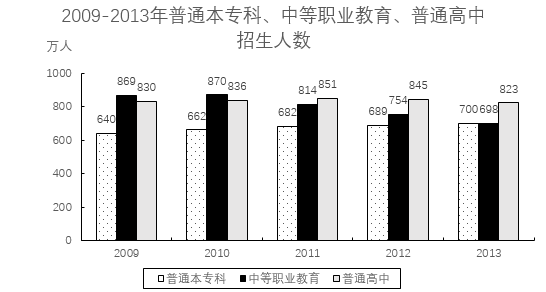

### 第 96 题

2009-2013年，平均每年中等职业教育招生人数为（    ）万人。

A. 675

B. 801

C. 825

D. 837

第 96 题 · 答案与解析

**参考答案（粉笔题库参考内容）**

B

**解析**

方法一：根据题干“2009-2013年，平均每年······”，可判定本题为现期平均数问题。定位统计图可得，2009-2013年中等职业教育招生人数分别为869、870、814、754、698万人。则2009-2013年平均每年中等职业教育招生人数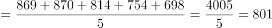万人。

方法二：削峰填谷。定位统计图可得，2009-2013年中等职业教育招生人数分别为869、870、814、754、698万人。以800为基准，分别作差约为69、70、14、-46、-102，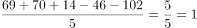，则所求平均数为800+1=801万人。

故正确答案为B。

**考点**：现期平均数、综合资料

**来源**：2015年重庆市选调优秀大学生到基层工作考试《行测》题第96题

### 第 97 题

2010-2013年，普通本专科招生人数同比增速最快的一年是：

A. 2010年

B. 2011年

C. 2012年

D. 2013年

第 97 题 · 答案与解析

**参考答案（粉笔题库参考内容）**

A

**解析**

根据题干“······同比增速最快的一年”，可判定本题为一般增长率问题。定位统计图，可知每年普通本专科招生人数。根据公式：，可知2010年-2013年的同比增速分别为：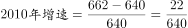，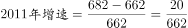，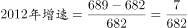，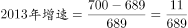，通过观察可知2010年的增速分子最大，分母最小，则2010年的同比增速最快。

故正确答案为A。

**考点**：一般增长率、综合资料

**来源**：2015年重庆市选调优秀大学生到基层工作考试《行测》题第97题

### 第 98 题

2013年，毕业生与招生人数之比最低的是：

A. 研究生

B. 普通本专科

C. 中等职业教育

D. 普通高中

第 98 题 · 答案与解析

**参考答案（粉笔题库参考内容）**

A

**解析**

根据题干“2013年······之比最低的是”，可判定本题为比值比较问题。定位文字材料可知：我国2013年全年研究生招生61万人，毕业生51万人；普通本专科招生700万人，毕业生639万人；中等职业教育招生698万人，毕业生678万人；普通高中招生823万人，毕业生799万人。则其毕业生与招生人数之比分别为：研究生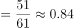；普通本专科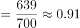；中等职业教育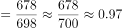；普通高中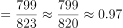，则研究生的毕业生与招生人数之比最低。

故正确答案为A。

**考点**：比值比较、综合资料

**来源**：2015年重庆市选调优秀大学生到基层工作考试《行测》题第98题

### 第 99 题

2009-2012年，普通本专科招生人数占三类招生总人数比例最高的年份是：

A. 2009年

B. 2010年

C. 2011年

D. 2012年

第 99 题 · 答案与解析

**参考答案（粉笔题库参考内容）**

D

**解析**

根据题干“2009-2012年······比例最高的年份”，结合材料时间一致，可判定本题为现期比重问题。定位统计图可知三类招生人数的数量，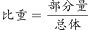，则2009-2012年，普通本专科招生人数占三类招生总人数比例分别是：2009年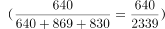、2010年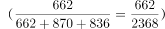、2011年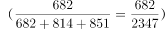、2012年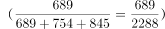，通过观察发现，2012年所占比重分子最大， 分母最小，数值最大。故2009-2012年，普通本专科招生人数占三类招生总人数比例最高的年份是2012年。

故正确答案为D。

**考点**：现期比重、综合资料

**来源**：2015年重庆市选调优秀大学生到基层工作考试《行测》题第99题

### 第 100 题

能够从上述资料中推知的是：

A. 2014年1月，在校生人数最多的是普通本专科院校

B. 2010年起，中等职业教育在我国受重视的程度逐年降低

C. 2013年普通本专科、中等职业教育、普通高中招生总人数较2009年约减少了5%

D. 2009-2013年，高等教育招生人数的比重年年攀升

第 100 题 · 答案与解析

**参考答案（粉笔题库参考内容）**

C

**解析**

A项：在材料中并没有给出2014年1月份的各项数据，无法判断，错误；

B项：在材料中只有中等职业教育人数招生人数数据，并没有给出中等职业教育在我国受重视的程度的相关描述，无法判断，错误；

C项：定位统计图，可知2009年普通本专科、中等职业教育、普通高中招生总人数=640+869+830=2339，2013年普通本专科、中等职业教育、普通高中招生总人数=700+698+823=2221，可见2013年招生总人数较2009年减少，则2013年普通本专科、中等职业教育、普通高中招生总人数较2009年减少幅度为，正确；

D项：在材料中并没有给出各年高等教育招生人数数据，无法判断，错误。

故正确答案为C。

**考点**：综合分析、综合资料

**来源**：2015年重庆市选调优秀大学生到基层工作考试《行测》题第100题

