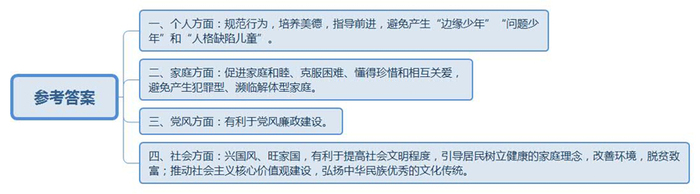
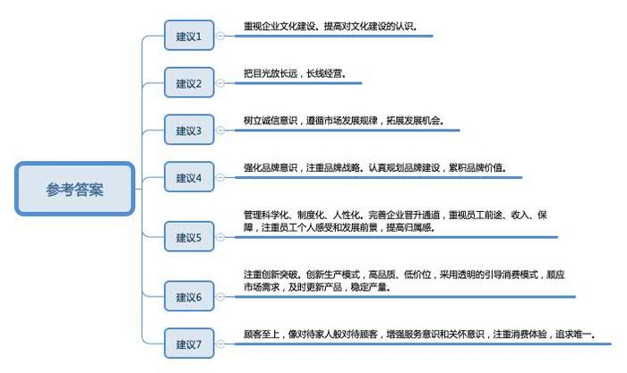
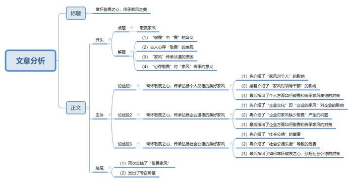

# 2016年重庆市公考《申论》题（下半年）

<!-- gwy:overview:start -->
> **重庆 · 2016 · 申论 · 下半年** ｜ 3 题 · 图片 3 处 · 答案随题折叠

导航：[题目](#题目) · [材料 1](#材料-1)
<!-- gwy:overview:end -->

> 候选采集稿。参考答案及解析来自粉笔页面，不代表官方答案或真实高分答卷；来源使用许可与原卷对应关系仍需人工核实。

## 给定材料

### 材料 1

家风，可以很大。就像一首名为《家风》的歌所唱的：“家风那个正那个国风兴，家国兴旺好家风。一辈做给那一辈呀一辈看，一辈讲给那一辈听。”家风，可以很小。网友“Sue的猫毛毛”说，小时候好多规矩：吃多少盛多少，不允许有剩饭；米粒掉桌上也要吃掉；吃饭得双手扶碗，不允许一只手肘朝外“跪”在桌上；坐那儿不许抖腿；不能说谎，否则被揍得很惨；看到长辈要先打招呼……

领导干部家风不正，事情就大了。中央纪委监察部网站“元旦春节期间违反中央八项规定精神问题监督举报曝光专区”，连续四周通报问题420起，其中很多违纪行为涉及亲属、家属。古语云，修身、齐家、治国、平天下。新时代，治国当从治家开始。领导干部的家风，是党风廉政建设的“晴雨表”。纵观十八大以来查处的大案要案，周永康、苏荣、刘铁男等很多腐败分子的违纪违法行为中，往往有“家族腐败”因素。父子兵、夫妻档、兄弟帮屡见不鲜，甚至“全家总动员”，把公权力变成“私人订制”，最终一起走上不归路。

除了“全家腐”，其他犯罪型家庭和濒临解体型家庭同样存在家风教育失败的问题，从而产生许多“边缘少年”“问题少年”和“人格缺陷儿童”。

陈某是一位17岁的单身母亲。“打架、流血、辱骂、歇斯底里……”陈某这样描述自己的家庭生活。终于，她走出了家门，在一群终日混迹电玩室的少男少女中找到了“解脱”和“温暖”。快到15岁那年，陈某怀孕了，孩子的父亲却不知所踪。

16岁的金某正在服刑，父亲平时游手好闲，经常带朋友到家里赌博，从来不避讳他。“我3岁时就能帮助他们洗牌、摆牌，他们还夸奖我是个天才。”金某对记者说，自己稍大一点就跟着父亲偷东西卖钱。

“这些极端案例让我想起一句话——‘父母皆祸害’。”复旦大学马克思主义学院副院长高国希说，“这句话来源于英国作家尼克·霍恩比的小说《自杀俱乐部》，少女杰丝在小结自己失败的青春期时，说了这样的话。”

### 材料 2

“家，是蛛网的中心，四面八方的道路都奔汇到这中心；家，是蛛网的中心，回忆的微笑，有条不紊地层层环绕这中心。”一个人走得再远，最初的能量无不来自家庭。好家风是从一代代的家庭生活中积淀而成的，凝聚着先辈的经验和智慧，代表着中华民族优秀的文化传统。好家风承载了先辈们对后代的希望和鞭策，今天依然能指导我们前进。

A市某村召开村民代表大会，通过了该村自治条例，而且采取打分制进行落实，违反规定要扣分，年终总结时得分高者则公布在村口的荣誉榜上。这部乡规民约公布后，得到了村民们的广泛支持，使村里的环境有了较大的改善。过去懒散的村民，或包大棚种地，或去厂里上班，平时休闲活动也换成了跳广场舞、打太极拳等文体活动。如今，该村已彻底摘掉了“贫困村”的帽子。

往昔的该村却是另一番景象，村支书李根华形容说是“老鹰也不肯下蛋的地方”，不仅环境糟糕，而且一些村民农闲时喜欢聚众赌博，纠纷不断。改变这一切的秘诀在哪里？村民认为该村的改变多亏了将家风融入自治条例，指引村民堂堂正正做人、实实在在做事。驻村干部说：“治理农村不能忽略来自田埂上、盛行泥土间的百姓家风，它们虽无华丽辞藻，但不乏为人处世的朴素哲理。”

在该市的另一个社区，党员们“晒”出家风正能量。该社区举行了一场主题为“论家风、思更远”的党员家庭家风美德论坛活动，党员居民讲述了各自的家风家训，向大家展示了一家和睦的“小窍门”。

“时间是检验爱情的试金石，历经磨难是对婚姻生活的最好诠释。”首先“晒”家风的是88岁高龄的包某，他和爱人结婚已有66年，“初为夫妻就开始经历了人生的磨难，老伴好不容易怀上女儿，艰辛让他们更加懂得了珍惜。生活中总有磨难、总有不顺，但我们总是互相守护在对方身边，相互关爱，细心劝解，从来没有因为生活的磨难而生嫌隙，女儿也深受感染，持家有道。”

“尊老爱幼，乐于助人”“教育子女要耐心，要给他们做好榜样”“知足常乐，俭以养德”“家庭不仅要和睦，邻里间更要互帮互助”……大家纷纷畅谈着各自的家风、家训。社区书记表示，“我们就是想通过挖掘党员家庭的好家风家训，引领更多居民树立健康家庭理念，以家风作为载体推动社会主义核心价值观建设。”

### 材料 3

家风，一头连着党风政风，一头连着社风民风。家风是什么？一千个人有一千种答案。有时是“负面清单”。网友A说：“只要不偷不抢不坑不骗，愿干啥干啥。”有时是“正面列表”。网友B说：“家风是孝顺！父亲是大孝子，一直侍奉我奶奶去世，搬个椅子睡在医院的走廊上，即使年纪大了，被骂也从不和父母顶嘴。”网友C说：“吃得了苦，做得了事，享得了乐。几代书香门第到现在，踏踏实实做人，兢兢业业做事，从商不贪，为官不腐。家风的确让我擦亮眼睛。”

但有一些人注意到，家风传承有式微的趋势。网友D说：“小时候有好多规矩，现在仍然遵守。但感觉现在的小孩太宠，太没有规矩了。”

家风传承淡漠的背后，是社会结构的巨大变化。四世同堂、几十口人共处一室的景象已很少见，取而代之的是三五口之家。从“大家族”进入“小家庭”时代，传统家庭观念受到猛烈冲击。

有些地方，独生子女成为“小霸王”，受到过度溺爱。家长不问“熊孩子”给别人造成多大的心理阴影，一味以“他还小”等必杀技“护短”。另一些地方，家庭名存实亡。“空心村”“留守村”大量出现，父母和子女长期分离，“生而不养、养而不教”，带来严重的社会问题。

“家是安乐窝，如果家没法让人安心快乐，社会也难以安定和顺。”北京大学哲学系教授楼宇烈说，“<u>中国文化以家庭为基础。过去中国人敬畏天地，敬畏祖宗，做事要对得起后代，而今这种敬畏心和家庭观均有所缺失，很多社会乱象的产生都与此有关。</u>”

大学生任某从小在家里被告知要尊敬长辈，吃饭须老人先动筷子，看到老人要施以援手。但这些优良家风，在现实中遭遇挑战。“比如说老人跌倒了要不要扶，已经成为一个社会问题。”

近几十年来，人类社会演变迅速，互联网技术发展迅猛，家庭代际之间的思想观念差异进一步拉大。现在二三十岁的年轻人与他们的父母被称为“历史上差异最大的两代人”。27岁的北京市民李韦认为，年轻人思想独立，可能不太理解老一辈的价值观，而过去家风中的一些要求确实已经不合时宜了。

### 材料 4

企业家郭某在谈到“家规”时有这样一段文字：我成长于一个信仰天主教的家庭，父亲只是一名送奶员，但是非常爱学习并且注重内省。这种内省是不需要更大范围听众的赞许和肯定的。母亲督促我们追求卓越、追求成就，并最终走向成功。郭某在唯一的自传中表示，“我无论在事业上取得什么样的成就，都与我父母的影响分不开。”

很多企业家在谈到各自的成就时，也一样归功于“家风”文化的培养。无锡是中国民族工商业和中国乡镇企业的重要发祥地，也是“苏南模式”的发源地之一。江南秀水孕育出许多商界望族，透过家风，无锡望族百年不衰的传奇，也有了可以探寻的轨迹。一张母亲的照片，配上旁白：妈妈跟我说做人要脚踏实地……这就是唐英年在香港竞选第二任议员时精心准备的竞选广告，而这句广告语，也正是从羊尖严家桥走出去的唐氏家族百年来坚守不变的家风写照。那是唐氏家族真正的“百年来坚守不变的家风”。

家风是企业家精神的成长基石。家风塑造了企业家的品德，也塑造了企业家的精神。家风蕴含的家族文化，如一泓清泉，渗透企业每一个细胞。而企业家精神决定了企业兴盛衰退，此中可见，家风对企业发展的核心效用。荣氏家族的兴旺也得益于继承刻苦耐劳的家风和遗训。荣氏家族的历史里，也处处可见家风的深刻烙印。“稳健与谨慎”“固守稳健，谨慎行事，决不投机”“干得痛快，处处争第一”“我是一个事业家，不是一个资本家，我所有的钱全用在事业上面”。家风塑造了这个商业世家百年辉煌的秘密。

一位“落马”企业家在监狱写下忏悔书：“我祖辈都是善良、本分的农民，但是自己没有在管理者的岗位上，坚持本分，丢失了家风。”而同样从农村走出来的企业家潘某、俞某，在与大学生分享“家风”时也特别讲到：走遍千山万水，难忘那些村落宗祠的大门上书写的“德泽源流远，家风世泽长”对联。

### 材料 5

一个家庭有家风，一个企业同样有家风。无论是家庭里的家风还是企业里的家风，都是为了能够让自己的后世子弟和企业员工能够把企业最优秀的文化传承下去，把世代积累下来的经验传递下去，不至于让这些优秀的文化和经验流失。无论是家族，还是企业，对于自己的家风都是极为珍惜的。

某中药企业是一家有着三百多年悠久历史的著名老字号企业，在全国都享有极高的声誉。该企业的创办人最初以走街串巷行医卖药维持生活，后发展成前店后坊、自产自销的药店。经过几代人的苦心经营，才有今天的辉煌。

该企业之所以有如此高的声誉，主要得益于他们对产品质量的坚守。对此该企业有两句极为有名的口号，也是他们的家风，叫做“炮制虽繁必不敢省人工，品味虽贵必不敢减物力”，第一句话说的是工作不偷懒，第二句是说不要偷工减料。正是因为该企业有着这样的家风，并且能够长期恪守，所以才成为绵延三百年而历久弥新的老品牌。该企业靠的是什么？是质量，更是对于质量坚守的家风。

其实不仅仅是做药品，做什么东西不是如此呢？只要不偷工减料，不偷懒耍滑，人们迟早会认识到你的产品的好。这是该企业的家风，也应该是中国所有企业的家风，是我们的社会风气。如果社会上的产品质量都非常好，那么社会上互相信任的风气就很容易建设起来，我们的社会也就很容易和谐起来。

### 材料 6

企业的家风不仅仅是道德教化的口号，还是家族精神的体现。要通过企业家的具体行为去传承和发展。吴家豆腐是一道名扬四海的地方特色食品，它以细腻柔韧、口感清香、味道鲜美著称于省内外。吴某作为吴家豆腐第四代传人，自22岁起便接替父亲执掌帅虹豆制品厂帅印，至今已经有15个年头了。随着豆腐市场需求日益扩大，各豆制品厂家的管理、制作工艺十分混乱，生产出的豆制品质量参差不齐，优劣不一。2008年4月，吴某首先提出了“质量比成本更重要，诚信比生命更可贵”的企业生存和发展的理念，继而对豆制品生产设备进行大刀阔斧的技术改造。他率先引进了先进的现代化生产设备和生产技术；随后又对自己的工厂环境进行了改造和整治。在先进技术与传统工艺的共同助力下，豆制品质量提升，该厂生产的石屏豆腐和豆腐皮顺利通过了“国家QS产品质量认证”

吴某从先辈们那里继承了中华民族“诚实守信，乐善好施”的传统美德，加之掌管企业多年，为人淳朴厚道，仗义疏财，重大义而轻小利，在行业内多有美誉和口碑。

S公司是该豆制品企业的长期合作伙伴。2014年春节前夕，S公司定制的豆腐没能赶上最后的班车，全部滞留在客运站里。为了坚守诚信，不让老客户受损失，吴某立刻调动人员前往汽车客运站把豆腐装上车，亲自开车连夜前往S公司。这一趟专车送豆腐，吴某损失利润1500多元，吴某却说：“我们虽然是小厂，但从来都没有让客户承担损失的先例，假如让客户受了损失，我们的损失就更大了，因为我们会因此失去诚信，这样的事，我们不做。”

凡是认识吴某的人，只要提起他的为人，无不竖起大拇指为他点赞，说他是个“热心人”。员工小刘的父亲突发脑溢血住进医院，小刘在无力凑齐手术费的情况下打电话向吴某求救，吴某立即亲自把钱送到医院。吴某对待厂里的员工如兄弟，讲诚意，对待有困难的陌生人也以爱心相待。当地某村因电线老化发生火灾，很多农户受灾，损失惨重。吴某得到消息后，毫不犹豫地买来大米、食用油、棉被等生活物资，无偿捐赠给受灾村民，帮助灾民渡过难关。良好的声誉让企业赢得了当地人的信任，企业不仅因此收获了稳定可靠的经济回报，也和谐地融入了当地社会。

### 材料 7

谈到企业文化建设的问题，很多小微企业主都是一头雾水，只有一些模糊的印象，更有很多小微企业主只关心赚钱生存，对企业文化建设嗤之以鼻，“赚钱才是硬道理，文化建设都是浮云”。其实企业文化就是一个企业的家风。一个家庭只有形成了良好的家风，才能兴旺发达。一个企业，也只有形成了良好的家风、良好的企业文化，才能真正做大做久。

某信息技术服务公司在去年参与的17项工程投标中，有6次因资质不达标而未能入围。公司总经理抱怨说：“资质问题是确保工程质量和进度的基本保证，但是很多时候是招标单位随意提高标准，人为地将我们这些小公司堵在门外。举个例说，一个标的只有1000万元的工程合同，招标方却要求投标单位注册资金必须在5000万元以上。”对此，有学者说，市场环境不公、门槛过高让小微企业失去了很多参与竞争的机会，但也不能把所有问题都归咎于采购招标单位。当前小微企业普遍实力较弱，更大的问题还在于，不少小微企业主目光短浅、诚信缺失，这些都是违背市场发展规律的企业性格，限制了小微企业的发展机会。

王某是一家小微企业董事长。今年4月，王某离开200平方米的旧厂房，搬进了现在的3000平方米的新大楼。看着员工们在空荡的大楼里忙碌，他一点也高兴不起来，“我们准备在鞋类上自己搞开发与创新运营，厂房、设备等都已经准备好了，硬件方面完全没问题，但在与银行沟通时，由于银行不能保证到款时间，我们不敢扩大规模。”在很多小微企业主眼中，融资难是制约小微企业成长的瓶颈。但是，某经济学家却不这么看，他认为，品牌意识薄弱、品牌战略缺失才是让小微企业陷入成长困境的主因。很多小微企业迫于生存压力，以眼前的盈利为目的，缺乏长线经营，往往选择做同质化产品，不敢去突破，没有认真规划品牌建设。很多小微企业融资失败的原因就是企业品牌建设没有达到投资人的要求。相反，一个企业如果已经积累了一定的品牌价值，即使它现在运转出现问题，也很可能融资成功。

在小微企业的成长中，因为员工流动太过频繁，大量小微企业不得不年年踏上招工之路。就在某公司发完工资的第二天，办公室又出现了一个空置的座位。这已经不是公司负责人林某第一次遇到这种情况，这家小公司总是面临着招人、走人、再招人、再走人的循环。林某公司遇到的情况并非个例，招工难、留工难已成为悬在小微企业头上的“紧箍”。财会专业毕业的大学生李某应聘时，首先将小微企业排除在外。去年，她在投考的公务员、国有银行、首府一些大型企业都落榜后，才选择了一家不足十人的小型企业。今年，李某跳槽了。让她决定离开的主要原因是，在那家小微公司，管理层都是老板的亲戚，任何一个人说话她都得听，而且她认为自己晋升的机会很渺茫，没有归属感。据相关调查显示，新生代求职者在工作中更加关注“管理人性化”“工作前途”“收入”及“社会保障”。他们不再受单一的经济利益驱动，而更加重视个人的感受和发展前景。

### 材料 8

在战后复兴、经济进入高速成长时期的日本，社会充满生机，女性积极步入社会，选择消费，于是诞生了众多的日本战后品牌。某日本化妆品品牌创建于1961年，已有50多年的历史，成为集研产销于一身的知名品牌。它在日本本土的工厂其貌不扬，看上去就像是有着多年历史、略显沧桑的大仓库。工厂仅有33名员工，一年销售收入折算人民币三千多万元。

该品牌负责人介绍说，这个品牌名称的原意是“自己的家，自己的故乡”。品牌的愿望和宗旨是，就像对待自己的家人一样热情，作为生活中的伴侣，陪伴顾客一生！

秉持像对待家人一样对待顾客的理念，1977年该品牌在日本开启业界先河，完全采用纯天然原料配方，严格监控从原料选定到产品销售的全过程，并且公开产品的全部成分，标明生产日期。同时，该品牌还减少不必要的包装和广告。通过这些举措，该品牌改变了以往日本化妆品的价格构造，对消费者采取完全透明的引导消费的模式，做到了高品质、低价位。三十多年来，该公司这些举措坚持不辍，得到了众多消费者的认同和赞赏，该企业也因此被日本社会赞誉为“完全透明的公司”。

创建之初，该企业也是手工生产，如今已发展成精致的现代工厂，生产车间几乎完全自动化，机器设备如同新购，地面亮丽、一尘不染，像刚刷过漆似的。

现场员工每天会花半天时间，专门对工装夹具、设备、仪器和地面等进行彻底的清扫、点检，确保每一批产品都是在洁净、精密和无菌的环境中生产。该企业顺应市场需求，产品及时更新，产量稳定。企业50多年始终保持着30人左右的规模，基本不对外招人，现在的员工当中相当一部分是原来员工的第二代、第三代。

这家面向本国人民服务了50多年的化妆品小厂，市场上没有一家自己的实体店，在众多药店、商场连一个小摊位也没有，如今盛行的新闻媒体和网络广告中也找不到它的影子，但它却成为日本同行业中位属前列的老品牌。“品牌不是靠宣传做出来的，是由客户的消费过程体验到的。”这个广为人知的道理，在该品牌身上得到了现实的验证。“做大不是我们的目标，融入人们的生活、提高生活质量，服务和关怀顾客才是我们的目的。”该品牌的负责人说。这不禁让人想起某日本企业家的介绍：企业经营的思路通常有两个。一个是追求第一，另一个是追求唯一，日本企业家基本上是从后者做起。

## 题目

### 第 1 题

**请结合“给定材料**1**—**2**”，谈谈家风建设在当前的现实意义。（20分）**

关联材料：材料 1、材料 2

作答要求：

要求：全面、准确、简明，有条理，不超过200字。

第 1 题 · 答案与解析

**参考答案（粉笔题库参考内容）**

一、个人方面：规范行为，培养美德，指导前进，避免产生“边缘少年”“问题少年”和“人格缺陷儿童”。

二、家庭方面：促进家庭和睦、克服困难、懂得珍惜和相互关爱，避免产生犯罪型、濒临解体型家庭。

三、党风方面：有利于党风廉政建设。

四、社会方面：兴国风、旺家国，有利于提高社会文明程度，引导居民树立健康的家庭理念，改善环境，脱贫致富；推动社会主义核心价值观建设，弘扬中华民族优秀的文化传统。

**解析**

**参考答案说明：**本参考答案从“个人”“家庭”“党风”“社会”等不同的方面进行了分条撰写。每条要点之间在内容上没有交叉。

**考点**：影响类

**来源**：2016年重庆市公考《申论》题（下半年）

### 第 2 题

**请结合“给定材料**7**\-**8**”，针对如何建设小微企业的企业文化提出你的建议。（30分）**

关联材料：材料 7、材料 8

作答要求：

要求：针对性强，建议合理、可行，不超过300字。

第 2 题 · 答案与解析

**参考答案（粉笔题库参考内容）**

一、重视企业文化建设。提高对文化建设的认识。

二、把目光放长远，长线经营。

三、树立诚信意识，遵循市场发展规律，拓展发展机会。

四、强化品牌意识，注重品牌战略。认真规划品牌建设，累积品牌价值。

五、管理科学化、制度化、人性化。完善企业晋升通道，重视员工前途、收入、保障，注重员工个人感受和发展前景，提高归属感。

六、注重创新突破。创新生产模式，高品质、低价位，采用透明的引导消费模式，顺应市场需求，及时更新产品，稳定产量。

七、顾客至上，像对待家人般对待顾客，增强服务意识和关怀意识，注重消费体验，追求唯一。

**解析**

**参考答案说明：**答案按照材料顺序，以“重视企业文化建设”“长线经营”“拓展发展机会”“累积品牌价值”“管理科学化、制度化、人性化”“注重创新突破”“对待顾客”七个不同方面进行了分条撰写。各条要点之间在内容上是并列关系，没有交叉。

**考点**：其他 其他

**来源**：2016年重庆市公考《申论》题（下半年）

### 第 3 题

**请结合“给定资料”，就“给定资料**3**”中的画线部分，围绕某学者提出的“敬畏”写一篇议论文。（50分）**

关联材料：材料 1、材料 2、材料 3、材料 4、材料 5、材料 6、材料 7、材料 8

作答要求：

要求：结合“给定资料”，自选角度，自拟题目，观点正确，内容充实，结构完整，语言流畅，1000字左右。

第 3 题 · 答案与解析

**参考答案（粉笔题库参考内容）**

**常怀敬畏之心，传承家风之美**

古人云：“畏则不敢肆而德以成，无畏则从其所欲而及于祸。”这里的“畏”指的是对良知、正义、天理的畏惧。**过去国人敬天畏地、祭祖尊宗，究其一生传承中华民族传统家风美德，如今社会结构变革，家风传承逐渐淡漠**，**随之产生的社会问题也频频发生，究其原因，便是由于缺少古人的敬畏之心**。心存敬畏是保持内心的执着与宁静、是恪守底线的从容与淡定、是传承家风的意义与基石，个人品德、企业道德、社会公德无不需要怀揣敬畏之心，传承家风之美。

**常怀敬畏之心，传承弘扬个人品德的美好家风。**个人和家庭的关系密不可分，家风破坏，祸及全家。一些普通家庭由于家风不正，对子女管教不严、方式欠妥，从而产生“问题少年”，这是典型的家风教育失败问题。习总书记说过：“每一位领导干部都要把家风建设摆在重要位置，廉洁修身、廉洁齐家。”领导干部的家风，是党风廉政建设的“晴雨表”，如果他们的家风崩毁，则不仅祸害家庭，而且还直接影响党和政府的形象，即使这样，现实生活中也不乏有“贪腐父子兵”“受贿夫妻档”“一人当官全家涉腐”的现象发生。那么，究其根本原因，对于个人来说是缺乏敬畏之心，对于家庭来说是缺乏优秀家风。曾国藩曾言：“心存敬畏方行有所止。”因此，我们应当常怀敬畏之心，时刻怀揣如履薄冰的谨慎态度，保持克己慎行的戒惧意念，约束个体行为方式，同时，要知礼仪、重家风，清廉质朴，善良守信，传承中华民族优秀家风美德。

**常怀敬畏之心，传承弘扬企业道德的美好家风。**对企业来说，企业文化就是家风，经营者能否将商业道德贯彻其中，形成独特的精神思想并敬畏遵守，决定着企业的发展前途。当前，部分企业趋于利益需求，不顾道德操守，诚信缺失，类似三聚氰胺“毒奶粉”、企业拖欠农民工工资、不惜破坏环境的生产作业等企业道德失衡的问题频频发生。从中暴露出企业价值观念弱化、社会责任意识不强、社会监管不力等诸多深层问题。这就需要我们树立企业正确的价值观念，加强企业公共服务意识，优化企业生产管理制度，使企业怀揣敬畏之心，传承企业文化，塑造优秀的企业道德家风。

**常怀敬畏之心，传承弘扬社会公德的美好家风。**社会公德是人类文明成果的一种沉淀和积累，它关乎着国家的长治久安，决定着中华民族的未来。然而，当前社会变革加速，导致社会风气逐渐涣散、社会公德准则失衡、传统思想遭受冲击，自私自利、唯利是图、假公济私现象也频频发生。长远看我们应当正视这些关乎国家发展、民族强盛的社会公德问题，时刻提醒我们应当常怀敬畏之心，加强社会公德宣传教育，营造良好的社会风气和公德素养，传承优秀传统文化，同时，按照中共中央印发的《公民道德建设实施纲要》中对公民提出的公共道德要求，提升自身公德意识，在全社会传承文明礼貌、助人为乐、爱护公物、保护环境、遵纪守法的公德家风。

敬畏，是一种人生态度，更是一种自省和自警；家风，是一种文化传承，更是一种继承和发扬。让我们常怀敬畏之心，在传承中华民族优秀家风之美的道路上披荆斩棘、排除万难，使中华民族伟大复兴的梦想之轮扬帆远航！

**文章分析**

**常怀敬畏之心，传承家风之美**

【**标题的优点：**首先，范文的标题“常怀敬畏之心，传承家风之美”突出了“敬畏家风”这一主题。其次，在形式上，文字简洁明快。】

（1）古人云：“畏则不敢肆而德以成，无畏则从其所欲而及于祸。”这里的“<u>畏</u>”指的是对<u>良知</u>、<u>正义</u>、<u>天理</u>的<u>畏惧</u>。过去国人敬天畏地、祭祖尊宗，<u>究其一生传承中华民族传统家风美德</u>，（2）<u>如今社会结构变革</u>，<u>家风传承逐渐淡漠</u>，随之产生的社会问题也频频发生，<u>究其原因</u>，<u>便是由于缺少古人的敬畏之心</u>。（3）<u>心存敬畏</u>是保持内心的执着与宁静、是恪守底线的从容与淡定、<u>是传承家风的意义与基石</u>，**个人品德、企业道德、社会公德无不需要怀揣敬畏之心，传承家风之美**。

【**开头的优点：**★内容方面：范文的开头紧扣题目给定的“敬畏”这段话展开。开头对“敬畏家风”这一主题进行了分析阐述，指出了（1）“敬畏”中“畏”的含义；（2）古人心存“敬畏”的表现；（3）“家风”传承淡漠的原因；（4）“心存敬畏”对“家风”传承的意义。★文字表达方面：长短句配合使用，使语言表达有节奏感。】

**常怀敬畏之心，传承弘扬个人品德的美好家风。**（1）<u>个人和家庭的关系密不可分</u>，<u>家风破坏</u>，<u>祸及全家</u>。一些普通家庭由于家风不正，对子女管教不严、方式欠妥，从而产生“问题少年”，这是典型的家风教育失败问题。（2）习总书记说过：“每一位<u>领导干部都要把家风建设摆在重要位置</u>，<u>廉洁修身</u>、<u>廉洁齐家</u>。”领导干部的家风，<u>是党风廉政建设的“晴雨表”</u>，<u>如果他们的家风崩毁</u>，<u>不仅祸害家庭</u>，<u>而且还直接影响党和政府的形象</u>，即使这样，现实生活中也不乏有“贪腐父子兵”“受贿夫妻档”“一人当官全家涉腐”的现象发生。那么，<u>究其根本原因</u>，<u>对于个人来说是缺乏敬畏之心</u>，<u>对于家庭来说是缺乏优秀家风</u>。（2）曾国藩曾言：“心存敬畏方行有所止。”因此，<u>我们应当常怀敬畏之心</u>，<u>时刻怀揣如履薄冰的谨慎态度</u>，<u>保持克己慎行的戒惧意念</u>，<u>约束个体行为方式</u>，同时，<u>要知礼仪</u>、<u>重家风</u>，<u>清廉质朴</u>，<u>善良守信</u>，<u>传承中华民族优秀家风美德</u>。

【**论述段****1****的优点：**★观点句：范文的观点句是紧扣“敬畏”“家风”等主题词提出的。形式上，它在段首处直接写出，位置突出，容易发现。内容上，关键词突出，内容要点明确，可以明显看出它是从“常怀敬畏之心”入手，指出从个人层面传承美好家风。★论述内容：（1）先介绍了“家风对个人”的影响；（2）接着介绍了“家风对领导干部”的影响；（3）最后指出了个人方面如何敬畏和传承家风美德的对策。注意：以上三个方面的内容都是紧扣“常怀敬畏之心，传承弘扬个人品德的美好家风”这个观点句进行分析论述的，论述的针对性强，内容层次丰富。最后，在论述方法和论据的选取上做到了讲道理和举例子相结合，做到了丰富多样。】

**常怀敬畏之心，传承弘扬企业道德的美好家风。**（1）对企业来说，<u>企业文化就是家风</u>，<u>经营者能否将商业道德贯彻其中</u>，<u>形成独特的精神思想并敬畏遵守</u>，<u>决定着企业的发展前途</u>。（2）当前，部分企业趋于利益需求，不顾道德操守，诚信缺失，类似三聚氰胺“毒奶粉”、企业拖欠农民工工资、不惜破坏环境的生产作业等企业道德失衡的问题频频发生。从中暴露出<u>企业价值观念弱化</u>、<u>社会责任意识不强</u>、<u>社会监管不力等诸多深层问题</u>。（3）这就需要我们<u>树立企业正确的价值观念</u>，<u>加强企业公共服务意识</u>，<u>优化企业生产管理制度</u>，<u>使企业怀揣敬畏之心</u>，<u>传承企业文化</u>，<u>塑造优秀的企业道德家风</u>。

【**论述段****2****的优点：**★观点句：范文的观点句是紧扣“敬畏”“家风”等主题词提出的。形式上，它在段首处直接写出，位置突出，容易发现。内容上，关键词突出，内容要点明确，可以明显看出它是从“常怀敬畏之心”入手，指出从企业层面传承美好家风。★论述内容：（1）先介绍了“企业文化”即“企业的家风”对企业的影响；（2）再介绍了“企业对家风缺少敬畏”产生的问题；（3）最后指出了企业方面如何敬畏和传承家风的对策。注意：以上三个方面的内容都是紧扣“常怀敬畏之心，传承弘扬企业道德的美好家风”这个观点句进行分析论述的，论述的针对性强，内容层次丰富。最后，在论述方法和论据的选取上做到了讲道理和举例子相结合，做到了丰富多样。】

**常怀敬畏之心，传承弘扬社会公德的美好家风。**（1）<u>社会公德是人类文明成果的一种沉淀和积累</u>，<u>它关乎着国家的长治久安</u>，<u>决定着中华民族的未来</u>。（2）然而，<u>当前社会变革加速</u>，导致<u>社会风气逐渐涣散</u>、<u>社会公德准则失衡</u>、<u>传统思想遭受冲击</u>，自私自利、唯利是图、假公济私现象也频频发生。（3）长远看我们应当正视这些关乎国家发展、民族强盛的社会公德问题，<u>时刻提醒我们应当常怀敬畏之心</u>，<u>加强社会公德宣传教育，营造良好的社会风气和公德素养</u>，<u>传承优秀传统文化</u>，同时，按照中共中央印发的《公民道德建设实施纲要》中对公民提出的公共道德要求，<u>提升自身公德意识</u>，在<u>全社会传承</u>文明礼貌、助人为乐、爱护公物、保护环境、遵纪守法的<u>公德家风</u>。

【**论述段****3****的优点：**★观点句：范文的观点句是紧扣“敬畏”“家风”等主题词提出的。形式上，它在段首处直接写出，位置突出，容易发现。内容上，关键词突出，内容要点明确，可以明显看出它是从“常怀敬畏之心”入手，指出从社会层面传承美好家风。★论述内容：（1）先介绍了“社会公德”的重要性；（2）再介绍了“社会公德失衡”导致的危害；（3）最后指出了如何常怀敬畏之心，弘扬社会公德的对策。注意：以上三个方面的内容都是紧扣“常怀敬畏之心，传承弘扬社会公德的美好家风”这个观点句进行分析论述的，论述的针对性强，内容层次丰富。最后，在论述方法和论据的选取上做到了讲道理和举例子相结合，做到了丰富多样。】

【**论述段之间的关系：**★内容的内在逻辑：范文的论述段之间是依照不同要素的角度展开的，论述段1、论述段2、论述段3分别从“个人品德、企业道德、社会公德”三个层面讲了要“怀揣敬畏之心，传承家风”。论述段1先写了“常怀敬畏之心，传承弘扬个人品德的美好家风”，论述段2再写了“常怀敬畏之心，传承弘扬企业道德的美好家风”，论述段3又写了“常怀敬畏之心，传承弘扬社会公德的美好家风”。★段与段的外在衔接：论述段1、2、3段首处以相同句式观点句承接了开头最后一句话。论述段之间彼此并列，使全文构成总分总的逻辑关系。】

（1）<u>敬畏</u>，是一种人生态度，更是一种自省和自警；<u>家风</u>，<u>是一种文化传承，更是一种继承和发扬</u>。让我们常怀敬畏之心，在传承中华民族优秀家风之美的道路上披荆斩棘、排除万难，（2）<u>使中华民族伟大复兴的梦想之轮扬帆远航</u>！

【**结尾的优点**：范文的结尾回扣了“敬畏”“家风”等主题词。（1）再次总结了“敬畏家风”。（2）发出了号召希望。】

**解析状态：unknown（来源未提供）**

**考点**：文章写作题

**来源**：2016年重庆市公考《申论》题（下半年）

