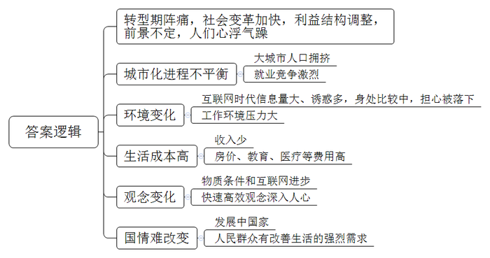

# 2017年公务员多省联考《申论》题（重庆上半年卷）

> 候选采集稿。参考答案及解析来自粉笔页面，不代表官方答案或真实高分答卷；来源使用许可与原卷对应关系仍需人工核实。

## 给定材料

### 材料 material-42b4d30eb673e504

当下社会，一切都和速度直接挂钩：飞机当天往返，火车夕发朝至，教育要趁早，就业要抢先，毕业就买房，爱情变速配。新世纪以来社会变革加快，利益结构调整，人们的经济地位被重新洗牌，对未来前景的不确定，使很多人心浮气躁，这与转型期带来的阵痛密切相关。

以往，只要是名牌大学毕业，就不愁找不到称心的工作；现在，城市化进程的不平衡性导致大城市人口拥挤，选择“好”职业的难度加大，即便是名校硕士、博士，找到的工作也不一定合意。为了在竞争激烈的就业市场占得先机，大学生纷纷成为“考证族”。陈某是一名法律系在读研究生，刚刚通过国家司法考试，拿到了法律职业资格证。研究生还没毕业，为什么现在就急着参加司法考试？陈某说，有了证，马上就能在律师事务所实习，就业时就能抢先一步。

在互联网时代，每天遇到海量信息，面对各种诱惑，身处不断的比较中，很多人担心被时代落下、害怕被别人超越。孙某是某IT公司软件工程师，最近刚跳槽到另一家规模更大的公司。大学毕业不到5年，他已经换了3份工作。“房价涨，收入低，晋级慢，在网上看到别的公司待遇更好，就想通过不断跳槽寻找新机会。”孙某说。

大城市居住不易，单是房价就已经透支了很多人大半辈子的财富，再加上高昂的教育费、医疗费等，一个人不拼命工作还真不行。某微博用户晒出一张图片：“山东某知名IT公司要求员工申请自愿放弃年休假，实行6×12小时工作制：每天工作12个小时、每周工作6天，春节、国庆等长假期间也要随叫随到。”面对如此苛刻的要求，却有不少人积极响应。一位响应者说，“对我们年轻人而言，大学毕业后能前行多远，不仅仅是个人能力的问题，如果没有父辈的外部支援，自己又不使劲上位，很难在大城市站稳脚跟。”

美国发明家富兰克林说过：“时间就是生命，时间就是金钱。”这句话作为大工业时代的座右铭，影响了整个世界。快速、高效的观念深入人心，成为人们自觉不自觉的选择。现代社会物质条件的进步也加剧了人们的这种心理。电话不普及的时候，人们已经习惯了几天才收到一封信，但在手机随处可见的今天，几分钟内对方没有回短信，人们就会嫌慢；在自行车与有轨电车还是主要出行工具的时候，等半个小时的公交车不足为奇，但现在，出行越来越便捷，却连打的都还忍不住叮嘱司机开快点。互联网的出现更大大改变了人们的生活方式，速度更快，变化更多，时间的价值更宝贵。很多人习惯了24小时开机，习惯了半夜被人从梦中叫醒谈工作，习惯了长期频繁加班。这种生活给现代人带来物质回报的同时，也导致了精神的疲惫和身体的损害。某网站的调查显示，我国已成为全球工作时间最长的国家之一，人均劳动时间超过日本和韩国。一些白领虽然报酬较高，但白天夜里都要紧张工作，生活很不规律。

某互联网公司的一位员工说：“连夜加班，刚开始你也许无法适应，但时间久了你会觉得，如果周围人都在加班，你早走了就显得很特别。虽然没有强制加班的规定，但公司里许多人都在‘抛妻弃子’、挑灯奋斗。因为你不加班，就比不过加班的人。”有人估算，我国每年因过劳去世的人多达60万，其中媒体人、科技工作者、互联网企业员工中死于过度疲劳的比例最高。

不停加班，带来了一系列健康问题，频繁跳槽、朝三暮四对心理的影响也不容小觑。比如，盲目跳槽的人在辞职过程中的无奈，重新选择时的焦虑，以及应聘新企业来回的奔波，都会极大地影响个人情绪。尤其是跨地区跳槽，从一个熟悉的环境到一个陌生的环境，前景的不确定性会给人带来更大的心理压力。

我们还是发展中国家，很多方面不能跟发达国家比，确实需要加快发展、早日富强，而且在中国推进市场化的进程中，人民群众有改善生活的强烈需求，这是中国社会保持较快发展的内在动力，处于这样的历史阶段，想要控制发展速度并不容易。因此，根本的解决之道不在于刻意放缓发展节奏，而在于防范快速发展过程中容易出现的失衡。政府要建立健全社会保障体系，创造更畅通更多元的发展通道，减轻人们的工作和生活压力。同时，个人也要积极调整心态，特别是年轻人初涉职场，要学会找到适合自己的节奏和平衡点，留出空间去调整身心状态，审视事业的计划和目标，体会人生的意义。

### 材料 material-95f6d9b919159c9a

随着经济社会的发展，越来越多的人在度假方式上，开始追求一种闲适的节奏：或是在家陪陪家人，或在田园放松心灵，或做点无用的事……而这种观念也正是社会更加成熟自信、文明进步的一种表现。

A市位于我国西部地区，具有丰富的旅游文化资源，是一座以旅游立市的小型城市。近年来，该市以休闲生活为旅游新卖点，提出“在这里正大光明地浪费光阴”“没有任何一件事是必须做的，只需随心住下，随性闲游！”等旅游消费主张来吸引游客，受到游客们的青睐。

在黄金周假期前两天，传来了“高速免费”“景点降价”的消息。A市市民高先生因担心人满为患，临时取消了长途出游的安排。当换种度假方式时，他很快便开始享受这种新的节奏了。高先生携妻儿开车来到郊区的一个水库，在青山绿水间垂钓。中午就地野餐，傍晚则将一天的收获带回家做成美味鱼汤。高先生告诉记者说：“尽管只钓到七八条小鱼，但一家人在一起的亲近感让我觉得幸福不过如此，这种生活正是我向往的。”28岁的曹女士则在黄金周期间选择宅在家里做卫生、看书、喝茶……她说：“刚工作时遇到假期不是在各家亲戚间奔波，就是在人山人海的景点抢镜头，不然就觉得虚度了。现在我宁愿做什么事都无需紧赶慢赶，享受悠闲的生活。最好的景致就在自己心里。”

2016年，A市新市长上任后，经过调查研究，系统提出了“打造休闲生活旅游城市，提高居民生活幸福感”的构想，重点围绕本地旅游资源，加强规划建设，将现代化理念与传统生活方式相结合，进一步打造“四季如春、休闲养生”的旅游生活城市，使游客和本地市民在这里不仅可以享受现代化带来的各种便利，更可以过上一种健康闲适的幸福生活。这一构想的提出得到了市民的支持。

## 题目

### 第 1 题

**根据给定资料**1**，概括当前社会上求快风气产生的原因。（20分）**

关联材料：material-42b4d30eb673e504

作答要求：

要求：全面、准确、简明，有条理，不超过200字。

### 第 2 题

**为推进休闲生活旅游城市建设，A市政府将召开市民代表、专家学者参加的座谈会，市长将在会上作开篇讲话，请你结合给定资料**2**~**3**，为市长草拟一份会议讲话提纲。（30分）**

关联材料：material-95f6d9b919159c9a

作答要求：

要求：

（1）切合主题，内容具体；

（2）条理清楚，层次分明；

（3）不超过300字。

### 第 3 题

**参考给定资料，以“平衡”为主标题，自拟副标题，自选角度，写一篇文章。（50分）**

关联材料：material-42b4d30eb673e504

作答要求：

要求：

（1）自选角度，立意明确；

（2）联系实际，不拘泥于“给定材料”；

（3）思路清晰，语言流畅；

（4）总字数1000~1200字。

## 答案与解析

第 1 题

**参考答案（粉笔题库参考内容）**

转型期阵痛，社会变革加快，利益结构调整，前景不定，人们心浮气躁。

1.城市化进程不平衡。大城市人口拥挤，就业竞争激烈。

2.环境变化。互联网时代信息量大、诱惑多，身处比较中，担心被落下；工作环境压力大。

3.生活成本高。收入少，房价、教育、医疗等费用高。

4.观念变化。物质条件和互联网进步，快速高效观念深入人心。

5.国情难改变。发展中国家，人民群众有改善生活的强烈需求。

**解析**

**参考答案说明：**本参考答案宏观上先从“总体原因”和“具体原因”两个方面进行分段。在具体原因方面，又从“城市化进程不平衡”“环境变化”“生活成本高”“观念变化”“国情难改变”等五个方面进行了分条撰写。各条要点之间在内容上相互并列，没有交叉。

**考点**：考点原因类

**来源**：来源2017年公务员多省联考《申论》题（重庆上半年卷）

粉笔申论页面对本题只提供「解析视频」入口，该入口是会员推广位，页面无视频地址与文字解析。

第 2 题

**参考答案（粉笔题库参考内容）**

关于推进休闲生活旅游城市建设的讲话提纲

随着社会经济的发展，人们开始追求闲适的节奏。

建休闲生活旅游城市利于：让人从紧张中解脱出来，享受现代化便利，过幸福生活；建设经济，丰富选择，推动文明。但面临问题：假期人多，体验差；城区规划欠妥，打造休闲区挤占道路，导致拥堵；发展落后，收入少。

为此，我市已提出建设构想，围绕本地旅游资源，加强规划布局，合理开辟休闲生活街区；将现代化理念与传统生活方式相结合，打造“四季如春、休闲养生”的旅游生活城市；以现实为基础，尊重市民选择，畅通交通，满足工作生活需要；职能部门工作要更精细，考虑要更全面；发展经济，提高市民收入，让休闲成为民众自然选择。

**解析**

**参考答案说明：**（1）本题不需要考虑格式，只写正文即可，但为了保险起见，建议加上标题。（2）正文部分，一方面从内容上来看，围绕“休闲旅游城市建设”这一主题，本参考答案的开头写到了旅游城市建设的背景；主体部分从“作用”“问题”“措施”三个方面进行了阐述。另一方面，形式上，本参考答案做到了分段、分条撰写，整体上条理较为清晰。本参考答案，在语言表达上做到了简洁、流畅。

**考点**：考点总结类

**来源**：来源2017年公务员多省联考《申论》题（重庆上半年卷）

第 3 题

**参考答案（粉笔题库参考内容）**

**平衡**

**——幸福生活需处理好“快”与“慢”的关系**

老话虽说“速度造就成功”，但老话又说“过犹不及”。环视周遭，有多少人因追求工作的快速高效而长期加班最终患上重疾，又有多少企业发展之初就因盲目扩张而最终倒闭，甚至有些父母为了咿呀学语的孩子将来有出息而追求超前教育……一幕幕因“快”导致的悲剧令人扼腕。我们亟需重新审视我们的生活，找到“快”与“慢”的平衡点，让悲剧不再重演，让生活更加幸福。

**我们要平衡工作与生活，让身心协调，在快节奏中享受慢的生活。**随着社会变革的加快，生活成本提高，很多人不得不开启了24小时在岗的超人化工作模式。可随之而来的，人们的健康被严重透支，甚至因过劳而死亡。其实，人生不仅有工作中的金戈铁马，独当一面，还有生活中的兴趣、闲暇、情感。我们要找到快工作与慢生活的平衡点，既要在工作中讲究方法，告别瞎忙，提高效率；又要学会健康休闲，调整身心状态，享受休闲的生活，体味人生的意义。

在“快”的皮鞭的驱使下，不仅造成了生活和工作的失衡，同样也给企业的发展带来重创，也让我们的教育失去原本的色彩。

**企业发展需平衡速度与质量，自身和时代，让企业稳定发展，长远发展**。速度是发展的第一要义，但不是事事讲速度。对于企业而言，战略上应该慢下来，思虑周详，战略才能决胜；行动应该高效，执行力强才能从“小字辈”做成“老字号”。但令人遗憾的是，有很多企业为了更大的市场，更丰厚的利润，罔顾自身条件，急功近利，盲目扩张。这无异于一叶障目，一味地追求经济效益，必将忽视标准化生产，导致产品与社会脱节、质量下降，品牌贬值。长此以往，企业的发展之路必将荆棘丛生。因此，企业在保持高速发展的同时，又要结合自身发展状况，主动降速，以退为进。要敢于驱动创新，优化人才体系，提升企业竞争能力，使企业发展能够长久可持续。

**教育要在孩子天性和教育内容间做平衡，尊重教育规律，用无用成就大用。**关于教育的理论已经数不胜数，但几乎所有教育学家都反对在教育上揠苗助长。然而，可悲的是很少有家长在教育上不是功利派。四年级学完小学课程，初一复习备战中考，高一就学完了所有高中的课程。只有第一名才会有出息，看似一心为了孩子好，实质上却是忽视了孩子的理解能力，罔顾孩子自然的生长规律。长此以往，不仅会降低孩子的听课效率，破坏学习兴趣，更会造成孩子的伪成熟，甚至会酿成更大的悲剧。由此可见，成长永远都不是急于求成的事情，应该有科学规划，让教育的内容与成长阶段相契合。用一本书、一场旅行、一次思想的碰撞，来挖掘孩子的潜能，激发他们的天性，来增加他们生命的厚度，发现真正的自己。

“拳头缩回去，是为了更有力地打出去。”平衡就像中国的太极拳，不是不发展，而是更好地发展，更科学地发展，更持续地发展。“快”不是不顾一切，要注重质量，“慢”也不是懒惰，要有智慧。让我们把握好快与慢的平衡，不急不缓、不浮不躁、循序渐进、稳稳当当地前进吧!

**解析**

**文章分析**

**平衡**

**——幸福生活需处理好“快”与“慢”的关系**

【**标题的优点：**内容上，主标题突出了“平衡”这一主题，副标题明确了平衡的具体内容是“快”与“慢”的关系。形式上，采用了主副搭配的结构，使文章主题、角度都很清晰。】

老话虽说“速度造就成功”，但老话又说“过犹不及”。（1）环视周遭，有多少人因追求工作的快速高效而长期加班最终患上重疾，又有多少企业发展之初就因盲目扩张而最终倒闭，甚至有些父母为了咿呀学语的孩子将来有出息而追求超前教育…….一幕幕因“快”导致的悲剧令人扼腕。（2）我们亟需重新审视我们的生活，找到“快”与“慢”的平衡点，让悲剧不再重演，让生活更加幸福。

【**开头的优点：**★内容方面：范文的开头是紧扣题目给定的“平衡”这一主题展开的。开头分析阐述了（1）工作生活、企业发展、教育等方面求快的现状、危害；（2）平衡快与慢。★文字表达方面：使用了“但……”“有……又有……甚至……”等关联词，使语言表达有逻辑性。】

**我们要****平衡工作与生活****，****让身心协调****，****在快节奏中享受慢的生活****。**（1）随着社会变革的加快，生活成本提高，很多人不得不开启了24小时在岗的超人化工作模式。可随之而来的，人们的健康被严重透支，甚至因过劳而死亡。其实，人生不仅有工作中的金戈铁马，独当一面，还有生活中的兴趣、闲暇、情感。（2）我们要找到快工作与慢生活的平衡点，既要在工作中讲究方法，告别瞎忙，提高效率；又要学会健康休闲，调整身心状态，享受休闲的生活，体味人生的意义。

【**论述段****1****的优点：**★观点句：范文的观点句是紧扣“平衡”这一文章主题提出的。形式上，它在段首处直接写出，位置突出，容易发现。内容上，关键词突出，内容要点明确，可以明显看出它是从“平衡工作生活的快与慢”入手，指出了“要享受慢生活”。★论述内容：（1）快节奏的工作、生活的状况及其危害；（2）平衡工作与生活的做法。注意：以上几个方面的内容都是紧扣“我们要平衡工作与生活，让身心协调，在快节奏中享受慢的生活”这个观点句进行分析论述的，论述的针对性强，内容层次丰富。在论述方法和论据的选取上做到了讲道理、举例子相结合，做到了丰富多样。】

在“快”的皮鞭的驱使下，不仅造成了生活和工作的失衡，同样也给企业的发展带来重创，也让我们的教育失去原本的色彩。

【**过渡段的优点：**范文过渡段分析了“‘快’给生活、工作、企业发展、教育”带来的危害，承接了论述段1，引出了论述段2、3。】

**企业发展需平衡速度与质量****，自身和时代，让企业稳定发展，长远发展。**（1）速度是发展的第一要义，但不是事事讲速度。对于企业而言，战略上应该慢下来，思虑周详，战略才能决胜；行动应该高效，执行力强才能从“小字辈”做成“老字号”。（2）但令人遗憾的是，有很多企业为了更大的市场，更丰厚的利润，罔顾自身条件，急功近利，盲目扩张。这无异于一叶障目，一味地追求经济效益，必将忽视标准化生产，导致产品与社会脱节、质量下降，品牌贬值。长此以往，企业的发展之路必将荆棘丛生。（3）因此，企业在保持高速发展的同时，又要结合自身发展状况，主动降速，以退为进。要敢于驱动创新，优化人才体系，提升企业竞争能力，使企业发展能够长久可持续。

【**论述段****2****的优点：**★观点句：范文的观点句是紧扣“平衡”这一文章主题提出的。形式上，它在段首处直接写出，位置突出，容易发现。内容上，关键词突出，内容要点明确，可以明显看出它是从“平衡企业发展的快与慢”入手，指出了“企业要平衡速度与质量”。★论述内容：（1）速度对企业发展的重要性；（2）过分追求速度的危害；（3）企业的正确发展之路。注意：以上几个方面的内容都是紧扣“企业发展需平衡速度与质量，自身和时代，让企业稳定发展，长远发展”这个观点句进行分析论述的，论述的针对性强，内容层次丰富。在论述方法和论据的选取上做到了讲道理、举例子相结合，做到了丰富多样。】

**教育要在孩子天性和教育内容间做平衡****，****尊重教育规律****，用无用成就大用****。**关于教育的理论已经数不胜数，但几乎所有教育学家都反对在教育上揠苗助长。（1）然而，可悲的是很少有家长在教育上不是功利派。四年级学完小学课程，初一复习备战中考，高一就学完了所有高中的课程。只有第一名才会有出息，看似一心为了孩子好，实质上却是忽视了孩子的理解能力，罔顾孩子自然的生长规律。长此以往，不仅会降低孩子的听课效率，破坏学习兴趣，更会造成孩子的伪成熟，甚至会酿成更大的悲剧。（2）由此可见，成长永远都不是急于求成的事情，应该有科学规划，让教育的内容与成长阶段相契合。用一本书、一场旅行、一次思想的碰撞，来挖掘孩子的潜能，激发他们的天性，来增加他们生命的厚度，发现真正的自己。

【**论述段****3****的优点：**★观点句：范文的观点句是紧扣“平衡”这一文章主题提出的。形式上，它在段首处直接写出，位置突出，容易发现。内容上，关键词突出，内容要点明确，可以明显看出它是从“平衡教育的快与慢”入手，指出了“教育要兼顾孩子的天性和教育内容”。★论述内容：（1）教育追求速度的现状及危害；（2）正确的教育方法。注意：以上几个方面的内容都是紧扣“教育要在孩子天性和教育内容间做平衡，尊重教育规律，用无用成就大用”这个观点句进行分析论述的，论述的针对性强，内容层次丰富。在论述方法和论据的选取上做到了讲道理、举例子相结合，做到了丰富多样。】

【**论述段之间的关系**：★内容的内在逻辑：范文的论述段之间是依照“并列”的逻辑展开的。论述段1先写了“工作生活中要平衡快与慢”，论述段2再写了“企业发展要平衡快与慢”，论述段3写了“教育要平衡快与慢”。★段与段的外在衔接：段3的“在‘快’的皮鞭的驱使下，不仅……同样……也让……”起到了承接论述段1，引出了论述段2、3的作用。】

“拳头缩回去，是为了更有力地打出去。”平衡就像中国的太极拳，不是不发展，而是更好地发展，更科学地发展，更持续地发展。“快”不是不顾一切，要注重质量，“慢”也不是懒惰，要有智慧。让我们把握好快与慢的平衡，不急不缓、不浮不躁、循序渐进、稳稳当当地前进吧!

【**结尾的优点**：范文的结尾回扣了“平衡”这一主题，发出了号召希望。】

  

**考点**：考点文章写作题

**来源**：来源2017年公务员多省联考《申论》题（重庆上半年卷）

粉笔申论页面对本题只提供「解析视频」入口，该入口是会员推广位，页面无视频地址与文字解析。

