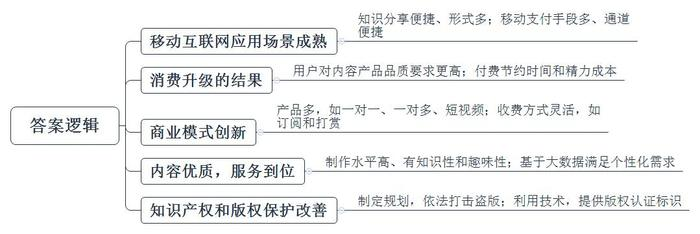
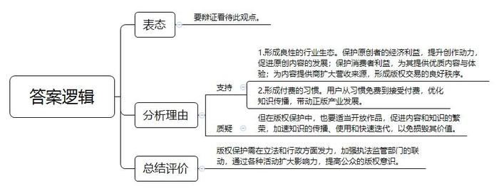
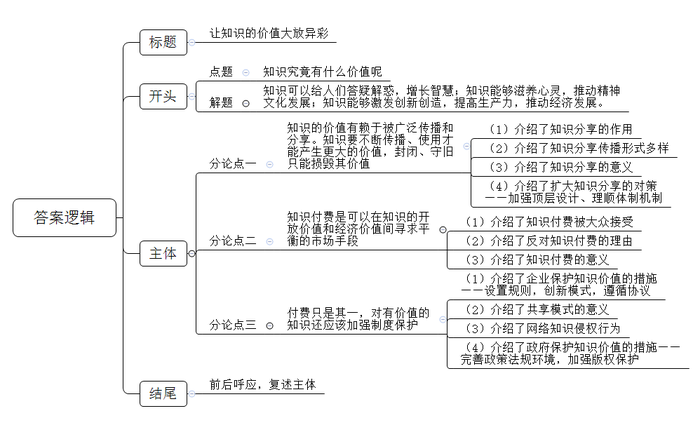

# 2017年重庆市公考《申论》题（下半年）

> 候选采集稿。参考答案及解析来自粉笔页面，不代表官方答案或真实高分答卷；来源使用许可与原卷对应关系仍需人工核实。

## 给定材料

### 材料 material-a2a8f199ced6fcde

网络宽带提速、三网融合、智能终端设备普及……短短十几年，互联网应用场景已被极大拓宽，移动互联时代，屏幕已成为现代人不可或缺的信息“看板”，细化的信息消费产品也正被商业开发者精耕细作。利用数字家庭设备点播节目、购买娱乐软件，以移动支付购买慕课（MOOC，大规模开放的在线课程）产品学习名校课程，在线付费学习……多样的移动支付手段，便捷的支付通道，使得信息可以在几秒钟内实现“变现”。

职场、健康、法律……在各种专业领域有了困惑怎么办？以前，人们需要通过各种途径，寻找专业人士帮助，现在，随着互联网上“知识分享”商业模式的逐渐成熟，这一过程被大大简化了。自2016年以来，涌现出许多新的知识付费产品，具有付费咨询、付费音频、付费课程、有偿问答等功能的知乎、分答、在行、喜马拉雅等知识分享平台纷纷出现，涵盖了文字、音频、视频、O2O等多种形式，开启了以“知识”作为贩卖物的有偿共享经济模式。在信息时代，消费者从源头开始满足自身需求，想拥有更大的主导权，深度参与到信息消费过程的流程设计中。

艾瑞咨询发布的《2016年中国网络新媒体用户研究报告》显示，33.8%的新媒体用户已经产生过数字信息的付费行为，15.6%的用户有进行付费的意愿，但是还没有付费行为，50.6%的用户不愿意也不打算为新媒体内容付费，而在2014年的调研数据中，有69.7%的用户不愿意为新媒体付费。可见，尽管面对海量免费的互联网信息，一部分用户仍然愿意为优质知识付费。

### 材料 material-9e1da793c590c37c

互联网上的数字作品具有易复制和易传播的特点。这使得盗版者可以直接获得经济收益，因此，付费的知识产品被侵权的情况屡屡出现。在一些问答平台上，往往提问者的问题被解答，就有人直接将答案截图分享出去了，其他用户不用付费就可轻松获取知识；更有专门众筹购买付费课程的组织，采用众筹的模式，每个人出一部分钱去购买付费知识，并小范围内共享；网校课程、会员账号、付费音频、线上讲座视频……在一些在线交易平台、QQ群，有大量知识付费产品被低价出售。在文章领域，很多大V的文章转载都未经许可；在音频领域，不少音频节目标榜原创，实际上却是从自媒体抄袭而来；短视频领域抄袭现象更为严重，直接截取他人的原创视频，为己所用，通过盗取别人的作品或原创内容来从事自己的商业化运作。

频频出现的版权纠纷，引起互联网企业对版权的重视。前不久，百度公司曾分批次暂时关闭“百度贴吧”文学目录下的全部贴吧，全面整顿和清查其中的盗版侵权内容；奇虎360科技有限公司宣布停止个人云盘服务，以强化版权保护；新浪微博与权威机构加强合作，向三千多位签约的自媒体作者提供免费长文章版权保护和版权认证标识，设立了专门的公司为用户提供免费的版权保护及法律援助；腾讯微信则在法律的基础上利用技术能力解决版权问题，目前微信已经可以检验这些作品是否第一次在平台内发布。

“版全家”App通过区块链、人工智能登记辅助AI机器人可以实现三分钟极速数字版权申请，可自动识别身份证号码、姓名、地址等信息，无需手动填写。申请的数字作品可以是文字、图片或者是视频，支持主流的多种文件格式。作品经中国版权保护中心审核通过，即可获得其颁发的DCI数字版权登记证书，拥有国家法律效力，已累计完成版权服务31万次。某维权网站负责人S认为：知识付费侵权已经形成产业链，并在多点开花。一个人接触到这种渠道并发现有用，可能带来100人不会在知识付费平台上付费。版权保护是知识传播的生命线和护身符。如果平台缺乏监管，那么没有任何成本的抄袭和侵权，将不利于原创内容的发展。原创者失去经济支撑或创作动力，最终损害的是消费者，他们将无法再获得优质内容。正版化进程的推进，为用户提供了更多优质内容以及更好的体验，为内容提供商扩大营收来源，形成版权交易的良好秩序，有助于保护创作者权益并在源头上激励内容创作，最终形成良性互动的行业生态。

## 题目

### 第 1 题

**根据给定资料**1**\-**7**，概括目前我国知识付费平台快速发展的原因。（20分）**

关联材料：material-a2a8f199ced6fcde

作答要求：

要求：内容全面，语言准确，条理清楚，不超过200字。

### 第 2 题

**给定资料**7**中提到“版权保护是知识传播的生命线和护身符。”****请根据给定资料**7**\-**9**，分析其理由。（25分）**

关联材料：material-9e1da793c590c37c

作答要求：

要求：观点明确，分析合理，不超过250字。

### 第 3 题

**从给定资料出发，以“知识的价值”为话题，自选角度，自拟题目，写一篇文章。（55分）**

关联材料：material-a2a8f199ced6fcde

作答要求：

要求：

（1）参考给定资料，但不拘泥于给定资料；

（2）主题明确，内容充实，结构合理，语言流畅；

（3）总字数1000～1200字。

## 答案与解析

第 1 题

**参考答案（粉笔题库参考内容）**

一、移动互联网应用场景成熟。知识分享便捷、形式多；移动支付手段多、通道便捷。

二、消费升级的结果。用户对内容产品品质要求更高；付费节约时间和精力成本。

三、商业模式创新。产品多，如一对一、一对多、短视频；收费方式灵活，如订阅和打赏。

四、内容优质，服务到位。制作水平高、有知识性和趣味性；基于大数据满足个性化需求。

五、知识产权和版权保护改善。制定规划，依法打击盗版；利用技术，提供版权认证标识。

**解析**

**参考答案说明：**答案从“移动互联网应用场景成熟”“消费升级的结果”“商业模式创新”“内容优质，服务到位”“知识产权和版权保护改善”等不同的原因进行了分条撰写。各条要点之间在内容上是并列关系，要点无交叉。

**考点**：考点原因类

**来源**：来源2017年重庆市公考《申论》题（下半年）

第 2 题

**参考答案（粉笔题库参考内容）**

要辩证看待此观点。理由如下：

版权保护可以：1.形成良性的行业生态。保护原创者的经济利益，提升创作动力，促进原创内容的发展；保护消费者利益，为其提供优质内容与体验；为内容提供商扩大营收来源，形成版权交易的良好秩序。2.形成付费的习惯。用户从习惯免费到接受付费，优化知识传播，带动正版产业发展。

但在版权保护中，也要适当开放作品，促进内容和知识的繁荣，加速知识的传播、使用和快速迭代，以免损毁其价值。

总之，版权保护需在立法和行政方面发力，加强执法监管部门的联动，通过各种活动扩大影响力，提高公众的版权意识。

**解析**

**参考答案****说明：**思路方面，本参考答案按照观点现象分析题“表态+分析理由+总结评价”的一般答题思路展开。内容方面，本参考答案先对“版权保护是知识传播的生命线和护身符”这一观点进行了表态；分析理由部分先从正面分析了“版权保护的重要性、意义”，接着从反面分析了“版权保护中适当开放作品”。词句表达方面，本参考答案加上了“但”“总之”等连接词来承接上下文。

**考点**：考点观点现象分析类

**来源**：来源2017年重庆市公考《申论》题（下半年）

粉笔申论页面对本题只提供「解析视频」入口，该入口是会员推广位，页面无视频地址与文字解析。

第 3 题

**参考答案（粉笔题库参考内容）**

**让知识的价值大放异彩**

高尔基说：“知识是我们这个社会的绝对价值。”**知识究竟有什么价值呢**？它主要体现在三个方面：知识可以给人们答疑解惑，增长智慧；知识能够滋养心灵，推动精神文化发展；知识能够激发创新创造，提高生产力，推动经济发展。

但与一般物品的价值不同，知识的价值需要被人掌握和使用才得以体现，某种知识被越多的人掌握和利用，其方方面面的价值就越大。

**因此，知识的价值有赖于被广泛传播和分享**。**知识要不断传播、使用才能产生更大的价值，封闭、守旧只能损毁其价值**。进入互联网时代，尤其如此。当前热门的“得到”、“分答”、“知乎”等知识分享平台就是依托移动互联网传播技术才放大了知识的价值。这些平台帮助人们解答困惑，开拓视野……最直接的价值就是对“人”的提升。其次，当前知识分享和传播的形式更加多样，比如网络阅读，网络课程，短视频等。这些分享，使人们得以了解历史文化和自然地理，还能给人们在健康、职业等方面的指导。今天，知识、科技竞争力越来越重要。我们应该加强顶层设计，理顺体制机制，加强组织，系统分享专业性、针对性强的有用知识。

但也要注意，并非所有信息都是知识。信息大爆炸的时代，真伪难辨，知识更迭异常迅速，知识付费应运而生。

**知识付费是可以在知识的开放价值和经济价值间寻求平衡的市场手段**。随着互联网应用开发的成熟，为知识付费被越来越多的人接受。“知乎”问答，“得到”名师课程等都是通过售卖知识获得金钱。但也有人认为知识付费抬高了学习门槛，不利于知识的开放价值。对此，我们观点是：知识的价值在于质量，而不是数量。知识付费能帮我们筛选出优质内容，提高知识质量，由此能进一步提高我们的学习效率，节约时间和精力成本。同时，知识付费也是对原创者的尊重，有利于知识创造的可持续发展。

**付费只是其一，对有价值的知识还应该加强制度保护**。既需要企业设置平台规则和商业模式创新，更需要政府完善法律制度。互联网平台上“知识分享”商业模式成熟，用户创作内容时遵循知识共享协议，共享模式让更有价值的知识快速传播，实现更大价值。但不可否认，网络知识分享中存在大量侵权行为，这需要完善相关法律法规，优化网络版权政策环境，不断推进正版化进程，让版权保护真正成为知识传播的护身符。

“生有涯而知无涯”，知识的价值内涵伴随互联网的发展越来越丰富，越来越多元。唯有让知识的价值大放异彩，才能让个人不断前进，让社会绽放智慧光芒！

**解析**

**文章分析**

**让知识的价值大放异彩**

【**标题的优点：**首先，范文的标题“让知识的价值大放异彩”突出了“知识的价值”这一主题。其次，形式上，文字简洁明快。】

高尔基说：“知识是我们这个社会的绝对价值。”**知识究竟有什么价值呢**？它主要体现在三个方面：（1）知识可以给人们答疑解惑，增长智慧；知识能够滋养心灵，推动精神文化发展；知识能够激发创新创造，提高生产力，推动经济发展。

【**开头的优点：**★内容方面。范文的开头是紧扣题目给定的“知识的价值”这一主题展开的。首先，开头开门见山点出主题，做到了主题明确。其次，对“知识的价值”这一主题进行了分析阐述，简要从答疑解惑、滋养心灵、激发创新创造三方面介绍了知识的价值。★文字表达方面：长短句配合使用，使语言表达有节奏感。】

但与一般物品的价值不同，（1）知识的价值需要被人掌握和使用才得以体现，某种知识被越多的人掌握和利用，其方方面面的价值就越大。

【**过渡段的优点：**范文过渡段分析了如何发挥知识的价值，指出了知识需要被人掌握和使用。此外，还要注意过渡段中的“某种知识被越多的人掌握和利用，其方方面面的价值就越大”是用来引起下文的过渡句。】

**因此，知识的价值有赖于被广泛传播和分享**。**知识要不断传播、使用才能产生更大的价值，封闭、守旧只能损毁其价值**。进入互联网时代，尤其如此。当前热门的“得到”、“分答”、“知乎”等（1）知识分享平台就是依托移动互联网传播技术才放大了知识的价值。这些平台帮助人们解答困惑，开拓视野……最直接的价值就是对“人”的提升。其次，（2）当前知识分享和传播的形式更加多样，比如网络阅读，网络课程，短视频等。这些分享，（3）使人们得以了解历史文化和自然地理，还能给人们在健康、职业等方面的指导。今天，知识、科技竞争力越来越重要。（4）我们应该加强顶层设计，理顺体制机制，加强组织，系统分享专业性、针对性强的有用知识。

【**论述段****1的优点：**★观点句：范文的观点句是紧扣“知识的价值”这一文章主题提出的。形式上，它在段首处直接写出，位置突出，容易发现。内容上，关键词突出，可以明显看出它是从“知识的传播与分享”入手，指出了如何呈现“知识的价值”。★论述内容：（1）介绍了知识分享的作用；（2）介绍了知识分享传播形式多样；（3）介绍了知识分享的意义；（4）介绍了扩大知识分享的对策——加强顶层设计、理顺体制机制。注意：以上几个方面的内容都是紧扣“知识的价值有赖于被广泛传播和分享。知识要不断传播、使用才能产生更大的价值，封闭、守旧只能损毁其价值”这个观点句进行分析论述的，论述的针对性强，内容层次丰富。最后，在论述方法和论据的选取上做到了讲道理、举例子相结合，做到了丰富多样。】

但也要注意，并非所有信息都是知识。信息大爆炸的时代，真伪难辨，知识更迭异常迅速，知识付费应运而生。

【**过渡段的优点：**范文过渡段分析了“知识付费”的背景。此外，还要注意过渡段中的“信息大爆炸的时代，真伪难辨，知识更迭异常迅速，知识付费应运而生”是用来引起下文的过渡句。】

**知识付费是可以在知识的开放价值和经济价值间寻求平衡的市场手段**。（1）随着互联网应用开发的成熟，为知识付费被越来越多的人接受。“知乎”问答，“得到”名师课程等都是通过售卖知识获得金钱。（2）但也有人认为知识付费抬高了学习门槛，不利于知识的开放价值。对此，我们观点是：知识的价值在于质量，而不是数量。（3）知识付费能帮我们筛选出优质内容，提高知识质量，由此能进一步提高我们的学习效率，节约时间和精力成本。同时，知识付费也是对原创者的尊重，有利于知识创造的可持续发展。

【**论述段****2的优点：**★观点句：范文的观点句是紧扣“知识的价值”这一文章主题提出的。形式上，它在段首处直接写出，位置突出，容易发现。内容上，关键词突出，可以明显看出它是从“知识开放与经济价值平衡手段”入手，介绍了知识付费。★论述内容：（1）介绍了知识付费被大众接受；（2）介绍了反对知识付费的理由；（3）介绍了知识付费的意义。注意：以上几个方面的内容都是紧扣“知识付费是可以在知识的开放价值和经济价值间寻求平衡的市场手段”这个观点句进行分析论述的，论述的针对性强，内容层次丰富。最后，在论述方法和论据的选取上做到了讲道理、举例子相结合，做到了丰富多样。】

**付费只是其一，对有价值的知识还应该加强制度保护**。（1）既需要企业设置平台规则和商业模式创新，更需要政府完善法律制度。互联网平台上“知识分享”商业模式成熟，用户创作内容时遵循知识共享协议，（2）共享模式让更有价值的知识快速传播，实现更大价值。但不可否认，（3）网络知识分享中存在大量侵权行为，（4）这需要完善相关法律法规，优化网络版权政策环境，不断推进正版化进程，让版权保护真正成为知识传播的护身符。

【**论述段****3的优点：**★观点句：范文的观点句是紧扣“知识的价值”这一文章主题提出的。形式上，它在段首处直接写出，位置突出，容易发现。内容上，关键词突出，可以明显看出它是从“加强制度保护”入手，指出了如何保护“知识的价值”。★论述内容：（1）介绍了企业保护知识价值的措施——设置规则，创新模式，遵循协议；（2）介绍了共享模式的意义；（3）介绍了网络知识侵权行为；（4）介绍了政府保护知识价值的措施——完善政策法规环境，加强版权保护。注意：以上几个方面的内容都是紧扣“对有价值的知识还应该加强制度保护”这个观点句进行分析论述的，论述的针对性强，内容层次丰富。最后，在论述方法和论据的选取上做到了讲道理、举例子相结合，做到了丰富多样。】

“生有涯而知无涯”，（1）知识的价值内涵伴随互联网的发展越来越丰富，越来越多元。（2）唯有让知识的价值大放异彩，才能让个人不断前进，让社会绽放智慧光芒！

【**结尾的优点**：范文的结尾回扣了“知识的价值”这一主题。（1）再次提到“知识的价值”这一主题；（2）发出了呼吁。】

**考点**：考点文章写作题

**来源**：来源2017年重庆市公考《申论》题（下半年）

粉笔申论页面对本题只提供「解析视频」入口，该入口是会员推广位，页面无视频地址与文字解析。

