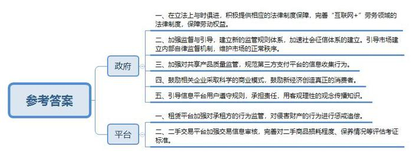
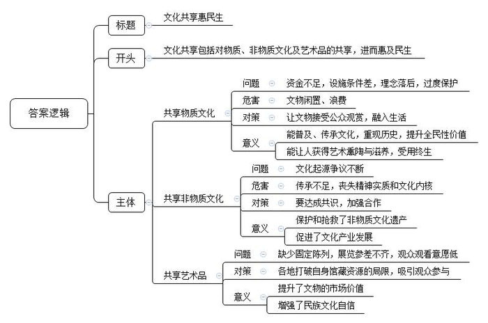
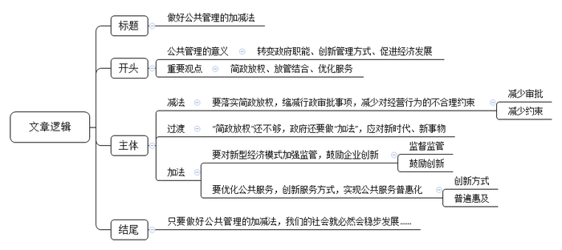

# 2018年公务员多省联考《申论》题（重庆一卷）

<!-- gwy:overview:start -->
> **重庆 · 2018 · 申论 · 一卷** ｜ 3 题 · 图片 3 处 · 答案随题折叠

导航：[题目](#题目)
<!-- gwy:overview:end -->

> 候选采集稿。参考答案及解析来自粉笔页面，不代表官方答案或真实高分答卷；来源使用许可与原卷对应关系仍需人工核实。

## 给定材料

### 材料 material-de7b904b3927e553

互联网的迅猛发展，从根本上颠覆了许多传统行业，也创造了新的行业和机遇。21世纪初，有学者提出了互联网时代协同消费的理念和发展模式，并将其分为若干阶段。最初，是代码共享，即通过互联网向用户提供信息，但信息流是单向的，用户不能参与其中进行评论和交流。当互联网进入Web2.0时代，用户开始通过网络平台与陌生人分享信息、表达观点，但其分享局限于内容或信息，不涉及实物交易，一般也不存在金钱报酬，仅仅是生活共享或是内容共享。

随着物物相联时代到来，网络平台公司通过互联网重新整合社会闲散资源和富余劳动力，然后再按需精准配置，实现物尽其用，社会分配从专业化向社会化转变，真正实现了离线资源的共享，即线上的分享协作渗透和延伸至线下，并由此改变了我们的文化和经济世界。如今，需求方不仅可以享受到低价与个性化服务，也得到了社交机会。对企业而言，随着加入网络的节点及节点间的连接增加，网络的价值会随着用户数量的平方数增加而增加。作为一种新的商业模式，其势必会对现行制度和秩序造成冲击，政府应积极提供相应的法律制度保障，实现其可持续发展。同时，任何商业行为都是以盈利为目标，任何市场的开发也都需要资金的支持，而过度的资本运作可能导致市场滥用其优势地位，甚至违背市场规律进行不正当竞争。政府理应鼓励相关企业采取科学的商业模式；鼓励新经济创造真正的消费者，而不仅是通过补贴来吸引消费者。

在新经济模式中，个体成为自由劳动者，劳动力价值能得到充分实现并完全由自己支配。供求双方通过互联网发布自己可供分享或需求的物品，不仅能为特定的供给者或需求者提供可选择的交易对象，还有助于掌握交易对象更多的信息，避免不公平交易，降低了交易成本。对闲置物资的再利用使得前期投入的成本要么已得到回收，要么当做沉没或折旧成本而收费较低廉，从而令闲置物资的边际成本更低，显现出更大的成本和资源利用效率优势。由于这一系列商业活动完全有别于过往经济行为，加强政府的监督与引导，显得尤为重要，建立新的监管规则体系迫在眉睫。在新的规则出台之前，可以运用相关的法理，借鉴现行的法律法规，引导市场建立内部自律监督机制，维护市场的正常秩序。

### 材料 material-ae84a38c3bf8a307

“观众想细看养心殿的文物，不用再趴窗户了。”据媒体报道，从2016年9月28日到2017年2月，深藏于故宫博物院养心殿的268件文物“移驾”首都博物馆，接受公众的检阅，这也是养心殿文物首次“出宫”。大批珍贵文物走出故宫，不仅仅是博物馆系统内部的一次完美合作，而且有着更为深广的意义。即文物不再一味地深“藏”不露，矜持内敛，而是正在以越来越开放的姿态，越来越亲民的路径，融入老百姓的生活。正如一位学者所言，一个一流的博物馆并不在于藏品有多么丰富，而在于人们要有机会看到这个馆里大量珍贵的藏品，并将博物馆文化融入自己的生活中去，从中汲取有助于现实生活的灵感。

如今飞入寻常百姓家的王谢堂前燕，可谓比比皆是。如公众像“追剧”一样密切关注海昏侯墓的考古挖掘。无论是展示时间，还是展览手段，均创下了记录。这样的努力，既是一种文化普及，也是一次全民性的价值提升。遗憾的是，从全国范围看，文物休眠的情形不在少数。由于资金缺乏，在许多县级文保所，众多国宝级文物多年深藏在地库之中。有些文保所甚至连一个像样的仓库都没有，大量宝贵的出土文物就随意堆放在地上，令人叹息。第三次全国文物普查数据显示，全国登记的不可移动文物高达76万处，而全国重点文物保护单位为4295处。这里面有多少文物常年深藏“冷宫”，不为人知？听任文物闲置，无疑是一种极大的文化浪费。而国内不少地方，虽然也建起了宏伟富丽的博物馆，但由于理念的落后以及过度保护的错误意识，能够展出来与公众见面的文物仍十分有限。文物就应该走出封闭状态，接受公众的观赏，让民众共享。文化的传承、历史的重现、艺术的熏陶，往往在这种亲炙一面中得以完成。一个人若有幸在众多传承有序、历史和文化价值极高的文物精品中获得滋养，也一定会受用终生。

## 题目

### 第 1 题

**根据给定资料**1**\-**2**，针对当前互联网协同消费经济存在的问题，提出相应的对策。（****20****分）**

关联材料：材料 material-de7b904b3927e553

作答要求：

要求：紧扣资料，对策可行，不超过300字。

第 1 题 · 答案与解析

**参考答案（粉笔题库参考内容）**

参考答案一：

一、完善制度法律，加强监督监管。1.借鉴现行法律法规，引导市场建立自律监督机制，完善监管规则，维护市场秩序，避免不正当竞争。2.完善“互联网+”劳务等领域的法律制度，界定劳动关系，保障劳动权益。

二、保障财产信息安全。1.鼓励企业采取科学商业管理模式，创造消费者。2.督促租赁平台监管租赁方，及时追责违法行为。3.把控产品质量，监管第三方支付平台信息收集，加强信息安全保护。

三、加强信用道德建设。1.引导用户遵守规则，承担责任，用客观理性观念传播知识。2.完善社会征信体系，提升信任感，提升二手交易平台信誉，完善二手商品评估考证标准。

参考答案二：

政府：一、在立法上与时俱进，积极提供相应的法律制度保障，完善“互联网+”劳务领域的法律制度，保障劳动权益。二、加强监督与引导，建立新的监管规则体系，加速社会征信体系的建立。引导市场建立内部自律监督机制，维护市场的正常秩序。三、加强对共享产品质量监管，规范第三方支付平台的信息收集行为。四、鼓励相关企业采取科学的商业模式，鼓励新经济创造真正的消费者。五、引导信息平台用户遵守规则，承担责任，用客观理性的观念传播知识。

平台：一、租赁平台加强对承租方的行为监管，对侵害财产的行为进行惩戒追偿。二、二手交易平台加强交易信息审核，完善对二手商品损耗程度、保养情况等评估考证标准。

**解析**

**参考答案说明：**答案根据政府和平台这两个不同的主体进行了分条撰写。且每条要点之间内容上没有交叉。

**考点**：考点提出对策类

**来源**：来源2018年公务员多省联考《申论》题（重庆一卷）

粉笔申论页面对本题只提供「解析视频」入口，该入口是会员推广位，页面无视频地址与文字解析。

### 第 2 题

**假设你是某文化报的记者，请根据给定资料**3**\-**4**，以****“****文化共享惠民生****”****为题，写一篇短评。（****30****分）**

关联材料：材料 material-ae84a38c3bf8a307

作答要求：

要求：

（1）紧扣主题，内容具体；

（2）层次分明，语言流畅；

（3）不超过300字。

第 2 题 · 答案与解析

**参考答案（粉笔题库参考内容）**

文化共享惠民生

文化共享包括对物质、非物质文化及艺术品的共享，进而惠及民生。

共享物质文化。由于资金不足，设施条件差，理念落后，过度保护，导致文物闲置、浪费。让文物接受公众观赏，融入生活，能普及、传承文化，重现历史，提升全民性价值；能让人获得艺术熏陶与滋养，受用终生。

共享非物质文化。文化起源争议不断，导致其传承不足，丧失精神实质和文化内核。我们要达成共识，加强合作，不仅保护和抢救了非物质文化遗产，还促进了文化产业发展。

共享艺术品。过去缺少固定陈列，展览参差不齐，观众观看意愿低。各地打破自身馆藏资源的局限，吸引观众参与。提升了文物的市场价值，增强了民族文化自信！

**解析**

**参考答案说明：**（1）本参考答案写到了标题和正文两个部分。（2）正文部分：一方面从内容来看，围绕着“文化共享”这一主题，开头部分总体介绍了“文化共享”的内涵，主体部分从“共享物质文化”“共享非物质文化”“共享艺术品”三个方面展开，指出了文化共享惠民生的三个层面。另一方面从形式来看，本参考答案进行分段撰写，做到了层次分明，为了体现公文题的逻辑性，还加上了“导致”“还”等连接词承接上下文。

**考点**：考点评论类

**来源**：来源2018年公务员多省联考《申论》题（重庆一卷）

粉笔申论页面对本题只提供「解析视频」入口，该入口是会员推广位，页面无视频地址与文字解析。

### 第 3 题

**根据你对给定资料**6**中划线部分****“****何时做加法，何时做减法，是一门公共管理的艺术，需要智慧，需要眼光，需要技巧，更需要视野。加法或是减法，不一样的切入角度，体现不一样的心态和思维逻辑，直接决定了最终的成败。****”****的理解，自拟题目，写一篇文章。（****50****分）**

关联材料：材料 material-de7b904b3927e553

作答要求：

要求：

（1）自选角度，立意明确；

（2）联系实际，不拘泥于给定资料；

（3）思路清晰，语言流畅；

（4）总字数1000-1200字。

第 3 题 · 答案与解析

**参考答案（粉笔题库参考内容）**

**做好公共管理加减法**

公共管理是一门艺术，体现行政部门的眼光与智慧，责任与担当。提升公共管理能力，对于转变政府职能、创新管理方式、促进经济发展等都意义重大。因此，党的十八大以来，面对复杂多变的社会事物，我国政府怀抱开放的心态和辩证的思维逻辑，致力于平衡公共管理中的“加法”与“减法”，全面推进“简政放权、放管结合、优化服务”改革，翻开了社会公共管理的新篇章。

**政府要做好公共管理的****“减法”，****就要落实简政放权****，缩减行政审批事项，****减少对****经营行为****的不合理约束****。**过去，政府审批事项过多，种种限制也多有不合理之处，影响了市场主体的积极性。比如农民销售自家的农产品，可能会因没有经营执照而被没收工具，甚至缴纳高额罚款。这就需要落实中央“简政放权”的方针，把政府不该管的事交给市场。但是，简政放权的目标还没有完全实现，今后还要继续推进“负面清单”的制定和公开工作，并将其写入法律制度，尤其要注意进一步减少对于微观事务的管理，从而减少对市场主体一些不必要、不合理的约束。这也是清权、减权的过程。清单越合理、越清晰，改革效果就越大。

当然，“简政放权”并不意味着政府责任的减少。政府还要做好公共管理的“加法”，应对新时代、新事物。

**政府要做好公共管理的****“加法”，****就要对新型经济模式****加强监管，鼓励企业创新。**当前，如互联网产业等新事物、新模式、新产业等层出不穷，它们不但是我国经济的希望所在，也为群众的生活带来了诸多便利。但这些新经济在发展模式、机制和特点等方面与传统经济有很大不同，政府过去的经验不一定能适用。套用老办法，可能将很多新事物扼杀，既制约创新活力，也对创新创业者不公平，甚至可能会引发新风险。所以，政府必须要通过审慎全面的监管，去芜存菁，推动新经济健康发展。同时，政府还应本着鼓励创新、包容审慎的原则，鼓励企业利用新技术、创造新模式。共享单车、共享汽车等企业，就正是在政府的监管和鼓励下一步一步发展壮大，有了今天的规模。

**政府要做好公共管理的****“加法”，还要优化公共服务，创新服务方式，实现公共服务普惠化。**无论是政府推动简政放权，还是完善监管体系，其最终的落脚点都是为了优化公共服务，最终实现服务群众。但随着社会发展，人民群众对公共服务也提出了更多样化、更高质量的要求，这就需要政府充分利用现代技术，让服务方式更加现代化、多元化。比如现在几乎所有社会企业，都开通了移动支付功能，便利消费者，但很多国营企业或景点仍未能开通，这就是政府应该努力的方向。另外，像文化、医疗、养老等公共服务，关系到千家万户，政府还应该进一步普及公共服务，让更多群众能享受到政府福利，提升生活幸福感。

在新时代，只要掌握好公共管理的艺术，做好公共管理的加减法，我们的社会就必然会在这种平衡中稳步发展，群众的生活质量也必然会节节攀升。

**解析**

**文章分析**

**做好公共管理加减法**

【**标题的优点：**首先，范文的标题“做好公共管理加减法”突出了“公共管理的加减法”这一主题。其次，形式上，文字简洁明快。】

（1）公共管理是一门艺术，体现行政部门的眼光与智慧，责任与担当。（2）提升公共管理能力，对于转变政府职能、创新管理方式、促进经济发展等都意义重大。因此，（3）党的十八大以来，面对复杂多变的社会事物，我国政府怀抱开放的心态和辩证的思维逻辑，致力于平衡公共管理中的“加法”与“减法”，全面推进“简政放权、放管结合、优化服务”改革，翻开了社会公共管理的新篇章。

【**开头的优点：**★内容方面。范文的开头是紧扣题目给定的“何时做加法，何时做减法，是一门公共管理的艺术，需要智慧，需要眼光，需要技巧，更需要视野……”这句话展开的。首先，开头点出主题，做到了主题明确。其次，对“公共管理的加减法”这一主题进行了分析阐述：（1）先指出了“公共管理”的含义。（2）接着指出了“提高公共管理能力”的意义。（3）最后指出了“做好公共管理加减法”的对策。★文字表达方面：使用了“因此”“从而”等关联词，使语言表达有逻辑性；长短句配合使用，使语言表达有节奏感。】

**政府要做好公共管理的****“减法”，****就要落实简政放权****，缩减行政审批事项，****减少对****经营行为****的不合理约束****。**（1）过去，政府审批事项过多，种种限制也多有不合理之处，影响了市场主体的积极性。比如农民销售自家的农产品，可能会因没有经营执照而被没收工具，甚至缴纳高额罚款。这就需要落实中央“简政放权”的方针，把政府不该管的事交给市场。但是，（2）简政放权的目标还没有完全实现，今后还要继续推进“负面清单”的制定和公开工作，并将其写入法律制度，尤其要注意进一步减少对于微观事务的管理，从而减少对市场主体一些不必要、不合理的约束。这也是清权、减权的过程。（3）清单越合理、越清晰，改革效果就越大。

【**论述段****1****的优点：**★观点句：范文的观点句是紧扣“公共管理的加减法”这一文章主题提出的。形式上，它在段首处直接写出，位置突出，容易发现。内容上，关键词突出，内容要点明确，可以明显看出它是从“简政放权”入手，指出了“政府公共管理中的‘减法’”。★论述内容：（1）先介绍了“过去政府行政管理存在的问题”；（2）接着介绍了“贯彻落实简政放权的具体措施”；（3）最后介绍了“简政放权的意义”。注意：以上三个方面的内容都是紧扣“政府要做好公共管理的‘减法’，就要落实简政放权，缩减行政审批事项，减少对经营行为的不合理约束”这个观点句进行分析论述的，论述的针对性强，内容层次丰富。在论述方法和论据的选取上做到了讲道理、举例子相结合，做到了丰富多样。】

当然，“简政放权”并不意味着政府责任的减少。政府还要做好公共管理的“加法”，应对新时代、新事物。

【**过渡段的优点：**范文过渡段分析了“公共管理的加减法”不仅要“减”，还要“加”。此外，还要注意过渡段末尾的“政府还要做好公共管理的‘加法’，应对新时代、新事物”是用来引起下文的过渡句。】

**政府要做好公共管理的****“加法”，****就要对新型经济模式****加强监管，鼓励企业创新。**（1）当前，如互联网产业等新事物、新模式、新产业等层出不穷，它们不但是我国经济的希望所在，也为群众的生活带来了诸多便利。（2）但这些新经济在发展模式、机制和特点等方面与传统经济有很大不同，政府过去的经验不一定能适用。套用老办法，可能将很多新事物扼杀，既制约创新活力，也对创新创业者不公平，甚至可能会引发新风险。所以，（3）政府必须要通过审慎全面的监管，去芜存菁，推动新经济健康发展。同时，政府还应本着鼓励创新、包容审慎的原则，鼓励企业利用新技术、创造新模式。共享单车、共享汽车等企业，就正是在政府的监管和鼓励下一步一步发展壮大，有了今天的规模。

【**论述段****2****的优点：**★观点句：范文的观点句是紧扣“公共管理的加减法”这一文章主题提出的。形式上，它在段首处直接写出，位置突出，容易发现。内容上，关键词突出，内容要点明确，可以明显看出它是从“政府加强监管，鼓励企业创新”入手，指出了“政府公共管理中的‘加法’”。★论述内容：（1）先介绍了“我国新经济取得的成绩”；（2）接着介绍了“老方法不适用于新经济”；（3）最后从“加强监管、鼓励创新”两个方面介绍了政府应采取的措施。注意：以上三个方面的内容都是紧扣“政府要做好公共管理的‘加法’，就要对新型经济模式加强监管，鼓励企业创新”这个观点句进行分析论述的，论述的针对性强，内容层次丰富。在论述方法和论据的选取上做到了讲道理、举例子相结合，做到了丰富多样。】

**政府要做好公共管理的****“加法”，还要优化公共服务，创新服务方式，实现公共服务普惠化。**（1）无论是政府推动简政放权，还是完善监管体系，其最终的落脚点都是为了优化公共服务，最终实现服务群众。（2）但随着社会发展，人民群众对公共服务也提出了更多样化、更高质量的要求，这就需要政府充分利用现代技术，让服务方式更加现代化、多元化。比如现在几乎所有社会企业，都开通了移动支付功能，便利消费者，但很多国营企业或景点仍未能开通，这就是政府应该努力的方向。另外，（3）像文化、医疗、养老等公共服务，关系到千家万户，政府还应该进一步普及公共服务，让更多群众能享受到政府福利，提升生活幸福感。

【**论述段****3****的优点：**★观点句：范文的观点句是紧扣“公共管理的加减法”这一文章主题提出的。形式上，它在段首处直接写出，位置突出，容易发现。内容上，关键词突出，内容要点明确，可以明显看出它是从“优化公共服务”入手，指出了“政府公共管理中的‘加法’”。★论述内容：（1）先介绍了“政府工作的落脚点是服务群众”；（2）接着介绍了“让公共服务现代化、多元化”；（3）最后介绍了“让公共服务普及化”。注意：以上三个方面的内容都是紧扣“政府要做好公共管理的‘加法’，还要优化公共服务，创新服务方式，实现公共服务普惠化”这个观点句进行分析论述的，论述的针对性强，内容层次丰富。在论述方法和论据的选取上做到了讲道理、举例子相结合，做到了丰富多样。】

【**论述段之间的关系**：★内容的内在逻辑：范文的论述段之间有两层逻辑。第一层，整体上是从“减法”到“加法”的逻辑展开的。第二层，其中观点2和观点3又是从“加法”出发，论述段2先写了“政府要做好加法，加强监管职能”，论述段3再写了“政府也应当做好服务的加法，让公共服务实现普惠化”。★段与段的外在衔接：论述段1、论述段2之间的过渡段“当然，‘简政放权’并不意味着政府责任的减少。政府还要做好公共管理的‘加法’，应对新时代、新事物”起到了承接论述段1、引出了论述段2、3的作用。】

在新时代，掌握好公共管理的艺术，（1）做好公共管理的加减法，我们的（2）社会必然会在这种平衡中稳步发展，群众的获得感、幸福感也必然会节节攀升。

【**结尾的优点**：范文的结尾回扣了“公共管理的加减法”这一主题。（1）再次提到了“公共管理的加减法”；（2）发出了展望，阐述了深远意义。】

**考点**：考点文章写作题

**来源**：来源2018年公务员多省联考《申论》题（重庆一卷）

粉笔申论页面对本题只提供「解析视频」入口，该入口是会员推广位，页面无视频地址与文字解析。

