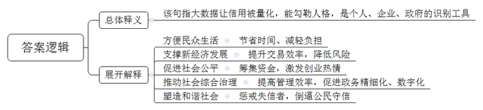
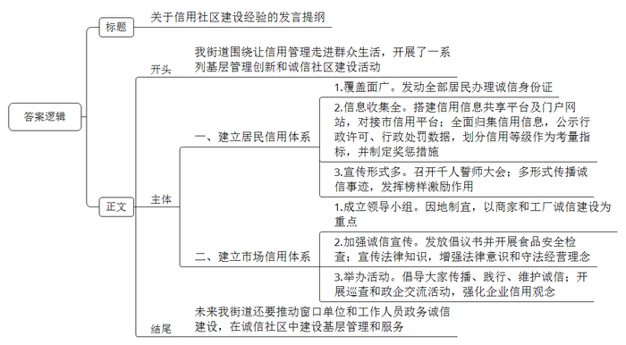
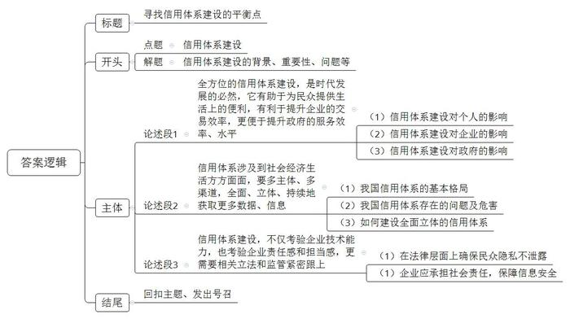

# 2019年公务员多省联考《申论》题（重庆一卷）

> 候选采集稿。参考答案及解析来自粉笔页面，不代表官方答案或真实高分答卷；来源使用许可与原卷对应关系仍需人工核实。

## 给定材料

### 材料 material-3853e8f618b8ab8c

一年前，小张从北京到杭州工作，在租房时，她惊喜地被中介告知，由于她的信用记录良好，所以不用缴纳两倍于月租的租房押金。而北京的胡先生，却遇上了一件让他颜面尽失的事情：原本在假期准备租辆宝马车和朋友外出自驾游玩，没想到却被租车公司拒绝。原来，胡先生由于欠款许久未还，已经被列入了“老赖”的名单，导致自己的信用数据不佳，被禁止租车。

2018年2月起，到E市妇女儿童医疗中心就诊的病患们发现，只要自己的信用度足够好，在医疗中心就可以“先诊疗后付费”，而无需一次次在诊室、检查室和交费处之间奔波，大大节省了自己的时间和精力。

信用骑车、信用住店、信用借书、公交车扫码乘车……这一幕一幕都告诉我们中国正在迈进信用社会。随着大数据时代的来临，信用成为每个人的“第二张身份证”。每个人、每个机构的信用度都可以被量化，曾经“看不见”“摸不到”的信用，正在逐步“变现”。

信用也提升了交易效率，为新经济提供支撑。对于废旧手机回收利用创业者向先生而言，信用就为他解决了“先收手机还是先付款”的难题。“先收手机，用户不放心。先付款，我们也怕损失。”向先生说，引入信用后，对高分用户优先付款，订单量上浮一倍，也没有出现违约情况。

有了信用的助力，企业经营效率变得更高。目前，多家共享单车企业已实现信用免押金，大大方便了新用户开通使用。一些共享汽车、共享租衣企业也在研究信用梯度收费等模式，最大限度吸引用户。用户对信用的珍视也令人惊喜。以租车为例，引入信用分后，行业租金欠款率下降了52%，违章罚款欠款率下降了27%。

在网络高度发达的今天，资源的分布不再局限于有形市场，很多资源分布在网络上。资金资源不再集中在类似于银行这种金融机构身上，而是通过互联网分散分布。一个人只要拥有足够的信用水平，在网络上就能够筹集到资金。所以，信用社会给予人们一个公平发展的环境。“信用既是商业社会的内在原则，也创造价值和财富。”某研究员说，随着信用体系不断完善，每个人都能在社会中获得公平发展的机会，这将大大激发全社会创业创新热情。

在某信用机构负责人看来，10年后，国内绝大多数城市都将成为信用城市。诚实守信的市民和商家，会享受到非常大的便利，政府的管理效率也将大大提高。信用体系的建立可以推动整个社会综合治理的发展。

在S市，26万老人领取养老金不用亲自跑腿去现场，只需要在手机上进行一次信用认证。购房者提取公积金时也不需要准备大量证明材料，柜台的人脸识别系统扫描后，他的相关信用信息迅速呈现……在促进政务精细化管理方面，“信用”正在发挥越来越重要的作用，有着高信用值的市民在通过实名认证之后，越来越多的业务都可以通过互联网进行办理，“刷脸”即可，而无需到窗口排队。

凑一堆人就走的“中国式过马路”、不走寻常路玩“跨越”、开车煲电话粥、没事打开远光灯……这些交通违规行为带来安全隐患，给城市管理增加了困难。当前，有的城市把这些交通违规行为纳入个人信用记录，已经能实现这样的应用场景：一名过马路闯红灯的路人，被监控系统识别身份，达到一定次数将扣除相应信用分，降低信用等级，严重的甚至会影响贷款。这种做法背后的逻辑是：一个不尊重交规的人，也可能做出不尊重其他公共规则的行为。个人信用信息就是对个人的一种人格勾勒。在一个公民素质发育成熟的社会，对公民的信用评估，往往是以公民在公共事务中的态度和做法为基本出发点的。信用既是一种道德品质，也是一种制度和规则。信用体系全面建立的意义不仅在于解决押金带来的纠纷，更在于塑造一个和谐的社会，换言之，每个人都更规矩——因为违反社会规则，将令你寸步难行。

### 材料 material-0c057396585236b9

“不乱扔杂物、不乱搭乱建、不违规饲养宠物，倡导邻里文明停车、和睦共处，积极配合社区的各项工作，共筑美丽幸福家园，争做诚信居民，为‘信用社区’贡献力量！”在先锋街道举行的“争做诚信居民，共建信用社区”千人誓师大会上，各社区居民代表一起郑重宣誓。

经历4年探索实践，C市今年成功获批社会信用示范城市。地处市中心的先锋街道围绕如何让信用管理走进群众日常生活，开展了一系列基层管理创新和诚信社区建设活动，将诚信建设向社区延伸。

“我们街道的光明社区2015年就率先开展了征信体系建设工作，4000名常住居民每人都有‘诚信身份证’！”街道办事处负责人介绍，光明社区是C市首个建立征信管理体系的社区。这几年来，社区居民对征信有了实实在在的认识。随着征信体系的建成和完善，征信已经渗透到光明社区的每个角落，扎根在每一个居民心中。“信用信息平台里的分数高，好处很多。自己的口碑好，别人都爱和你交往。”社区居民毕女士说。孟先生开办了社区国画公益课堂并担任授课老师，免费教授居民国画。提起创建国画公益课堂的初衷，他说：“我本身就是搞美术的，所以想让更多居民喜欢、了解国画。”让孟先生没有想到的是，这样的“份内事”竟然让自己得到20分的征信加分，成为社区居民学习的榜样。“我开办国画公益课堂不是为了加分，但是街道和社区给了这份荣誉，我也特别高兴。”孟先生说。

光明社区的居民征信条款是与市征信办多次沟通协调后最终制定的，社区征信管理有一套严格的流程和评价体系。社区搭建了社会信用信息共享平台及门户网站，并与市信用平台对接。社区通过平台和网站推进信用信息归集，已归集行政许可和行政处罚公示数据20169条，信用数据4187条，“红黑”名单数据311条。居民信用等级根据分数不同，分为五星级、四星级、三星级、二星级和一星级。居民信用等级的高低可在政策扶持、岗位招考、评先选优、发展党员、银行贷款等领域作为考量指标。居民在好人好事、保护社区环境等方面有所作为的，每次加5分。相反，有随意倾倒杂物或者造谣生事等行为的，每次扣5分。行为更加恶劣的，还要提报市级征信平台。社区负责人介绍，社区正在开展“诚信楼宇”“诚信家庭”“诚信个人”“诚信商铺”等活动，通过展示墙、电子宣传栏等展播诚信事迹，“我们要充分发挥榜样的激励作用，尤其要发挥党员干部的先锋带头作用。今后我们还要推动窗口单位和工作人员的政务诚信建设，把基层管理和服务融入到诚信社区的建设中。”

先锋街道的上岭社区也积极响应建设“诚信社区”活动的号召，积极开展“诚信社区”的创建活动。社区及时成立诚信社区领导小组，由社区书记担任组长，主任担任副组长。领导小组深入研究社区的实际情况，针对社区内商家和工厂较多的情况，决定以这些商家和工厂的诚信建设为重点，带动诚信社区的全面建设。

社区安排工作人员对辖区20余家经营门店发放了“诚信经营”倡议书，并对辖区的超市、餐饮门店等开展食品安全检查。在检查中，社区工作人员还向广大商户大力宣传《食品安全法》等法律知识，增强食品经营户的法律意识，强化守法经营理念。社区联合C市市场监督管理局在菜市场门前举办“百城万店讲诚信”主题活动，通过设置咨询台、投诉举报台，发放宣传资料、现场讲解等方式，向广大群众普及了安全消费、识药用药、生产等常识，引导消费者养成科学、健康、文明的消费习惯，倡导广大商家和群众争做诚信的传播者、践行者与维护者。

上岭社区联合市场监督管理局等有关部门对社区各商户和菜市场各个摊位进行多次巡查。经过巡查，社区内商户全部诚信经营，信誉良好，得到了周围居民的一致好评。各有关部门还在菜市场进行“诚信经营”大走访活动，对市场内商家的交易秤进行检查。结果显示，菜市场商家都能够做到诚信经营。

上岭社区联合社区各企业开展“质量第一，诚信做产品”活动。社区书记讲解了开展活动的目标、内容和意义。随后，企业负责人就提高产品质量、诚信做产品等方面做的工作进行了介绍，并与员工签订了《产品质量诚信承诺书》。通过此次活动，进一步强化了生产企业的信用观念。

## 题目

### 第 1 题

**“给定资料**1**”中提到“随着大数据时代的来临，信用成为每个人的‘第二张身份证’”，请你谈谈对这句话的理解。（20分）**

关联材料：material-3853e8f618b8ab8c

作答要求：

要求：紧扣给定资料1，全面、准确、简明，有条理，不超过150字。

### 第 2 题

**C市将于近期召开信用社区建设经验交流会，假定你是先锋街道的工作人员，请根据“给定资料**2**”起草一份发言提纲。（30分）**

关联材料：material-0c057396585236b9

作答要求：

要求：全面、准确、简明，有条理，不超过400字。

### 第 3 题

**“给定资料**5**”中提到，“信用体系建设，既要获取更多数据勾勒人格特征，也要注重保护每个人的隐私”。请你根据对这句话的理解，自拟题目，写一篇文章。（50分）**

关联材料：material-3853e8f618b8ab8c

作答要求：

要求：

（1）自选角度，立意明确；

（2）联系实际，不拘泥于“给定资料”；

（3）思路清晰，语言流畅；

（4）总字数1000-1200字。

## 答案与解析

第 1 题

**参考答案（粉笔题库参考内容）**

该句指大数据让信用被量化，能勾勒人格，是个人、企业、政府的识别工具。

信用的作用：1.方便民众生活。节省时间、减轻负担。2.支撑新经济发展。提升交易效率，降低风险。3.促进社会公平。筹集资金，激发创业热情。4.推动社会综合治理。提高管理效率，促进政务精细化、数字化。5.塑造和谐社会。惩戒失信者，倒逼公民守信。

**解析**

**参考答案说明**：思路方面，本参考答案按照“总体释义+展开解释”的答题思路展开。内容方面，本参考答案先对“随着大数据时代的来临，信用成为每个人的‘第二张身份证’”这句话进行了解释：“展开解释”部分从“方便民众的生活”“支撑新经济发展”“促进社会公平”“推动社会综合治理”“塑造和谐社会”等不同角度分析了“信用建设”的作用。

**考点**：考点词句解释类

**来源**：来源2019年公务员多省联考《申论》题（重庆一卷）

粉笔申论页面对本题只提供「解析视频」入口，该入口是会员推广位，页面无视频地址与文字解析。

第 2 题

**参考答案（粉笔题库参考内容）**

关于信用社区建设经验的发言提纲

我街道围绕让信用管理走进群众生活，开展了一系列基层管理创新和诚信社区建设活动。

一、建立居民信用体系。1.覆盖面广。发动全部居民办理诚信身份证；2.信息收集全。搭建信用信息共享平台及门户网站，对接市信用平台；全面归集信用信息，公示行政许可、行政处罚数据，划分信用等级作为考量指标，并制定奖惩措施；3.宣传形式多。召开千人誓师大会；多形式传播诚信事迹，发挥榜样激励作用。

二、建立市场信用体系。1.成立领导小组。因地制宜，以商家和工厂诚信建设为重点；2.加强诚信宣传。发放倡议书并开展食品安全检查；宣传法律知识，增强法律意识和守法经营理念；3.举办活动。倡导大家传播、践行、维护诚信；开展巡查和政企交流活动，强化企业信用观念。

未来我街道还要推动窗口单位和工作人员政务诚信建设，在诚信社区中建设基层管理和服务。

**解析**

**参考答案说明：**（1）格式方面，本参考答案写到了标题和正文两个部分。（2）正文部分：一方面从内容来看，围绕着“信用社区建设”这一主题，本参考答案开头部分简单介绍了“信用社区建设”的背景，主体部分从“建立居民信用体系”“建立市场信用体系”两个大的方面展开，指出了信用社区建设的两个方面的经验。另一方面从形式来看，本参考答案做到了分段、分条撰写，层次分明，为了体现公文题的逻辑性。

**考点**：考点总结类

**来源**：来源2019年公务员多省联考《申论》题（重庆一卷）

粉笔申论页面对本题只提供「解析视频」入口，该入口是会员推广位，页面无视频地址与文字解析。

第 3 题

**参考答案（粉笔题库参考内容）**

**寻找信用体系建设的平衡点**

人无信不立，业无信难兴，政无信必颓，国无信必衰，伴随着“陌生人”社会到来，人际交往中，诚信的重要性越发凸显。信用是一笔宝贵的社会财富。但我国目前信用体系建设面临征信角度单一、覆盖人群少、个人信息遭泄露等问题。因此，信用体系的建设，既要注重多主体、多渠道地收集数据，保障信息的全面性，也要通过法律、监管、技术等手段，规范信息的收集、使用，保障个人隐私，在信息获取的开放性与使用的封闭性中做到平衡。

**全方位的信用体系建设，是时代发展的必然，它有助于为民众提供生活上的便利，有利于提升企业的交易效率，更便于提升政府的服务效率、水平。**就现实而言，随着我国信用体系建设的不断完善，无论是租用共享单车，还是个人贷款，信用良好的人往往能快速获得他人认可，进而给自己生活、工作带来更多的便利。与此同时，在互联网时代，企业口碑、信誉愈发受到各方重视，因此，良好的信用可使企业的交易成本降低，交易效率大大提高。除此之外，信用在政府管理方面的价值也令人惊喜。只要有信用认证，众多政务服务就可以在互联网上进行。一次“刷脸”，省去了群众的千里奔波，也提升了政府的办事效率，促进了政府的精细化管理。

**信用体系涉及到社会经济生活方方面面，因此，要多主体、多渠道，全面、立体、持续地获取更多数据、信息。**当下，我国建立了统一的信息采集标准，初步形成了奖惩机制，“一处失信、处处受限”的格局逐步呈现。在这个背景下，如果个人数据收集是不全面的，必然会导致奖惩机制公平性的丧失。但就现实而言，我国信用体系建设存在诸多问题：覆盖人群少、涉及领域少、民间征信机构征信角度单一……片面的数据，所折射出的个人信用必然是有误差的，它就更无法全面反映出一个人的个人品德、家庭美德、职业道德、社会公德。从这个角度而言，就必然要全方位地收集数据，引入民间征信企业，扩大征信领域，增加征信人群……

**在全方位收集数据过程中，必然会面临信息泄露等问题，信用体系建设，这不仅考验企业技术能力，也考验企业责任感和担当感，更需要相关立法和监管紧密跟上。**个人征信牵涉到个人隐私，引入民营征信机构是否会泄露个人信息，是民众最大的担忧。我们要提防信息收集和记录变为一场隐私泄露的闹剧，就必须补上法律漏洞，严格审核民营机构的资质，制定严格准入标准，提高机构质量的同时也更好保障信用信息的准确性，避免出现造假作弊，信息良莠不齐，真伪难辨，为民众信息安全兜底。企业也需不断提升自身实力，研发技术，遵守行业规则，做好自律，担起社会责任，保障信息安全。

“信用既是一种道德品质，也是一种制度和规则”，“信用”的刚柔并济需要信用体系建设把握好信息收集全面性与个人隐私保护的平衡，如此，方能保障个人信息安全，提高道德建设水平，维护社会和谐稳定。

**解析**

**文章分析：**

**寻找信用体系建设的平衡点**

【**标题的优点：**首先，范文的标题“寻找信用体系建设的平衡点”突出了“信用体系建设”这一主题。其次，形式上，文字简洁明快。】

人无信不立，业无信难兴，政无信必颓，国无信必衰，（1）伴随着“陌生人”社会到来，人际交往中，诚信的重要性越发凸显。（2）信用是一笔宝贵的社会财富。（3）但我国目前信用体系建设面临征信角度单一、覆盖人群少、个人信息遭泄露等问题。（4）因此，信用体系的建设，既要注重多主体、多渠道地收集数据，保障信息的全面性，也要通过法律、监管、技术等手段，规范信息的收集、使用，保障个人隐私，在信息获取的开放性与使用的封闭性中做到平衡。

【**开头的优点：**★内容方面。范文的开头是紧扣“信用体系建设”这一主题展开的。首先，开头第二句话点出主题，做到了主题明确。其次，对“信用体系建设”这一主题进行了分析阐述：（1）先指出了“社会背景”；（2）接着指出了“信用的重要性”；（3）接着指出了“我国信用体系存在的问题”；（4）最后指出了“如何建设信用体系”。★文字表达方面：使用了“但……”“既要……也要……”等关联句式，使语言表达有逻辑性。】

**全方位的信用体系建设，是时代发展的必然，它有助于为民众提供生活上的便利，有利于提升企业的交易效率，更便于提升政府的服务效率、水平。**就现实而言，（1）随着我国信用体系建设的不断完善，无论是租用共享单车，还是个人贷款，信用良好的人往往能快速获得他人认可，进而给自己生活、工作带来更多的便利。与此同时，（2）在互联网时代，企业口碑、信誉愈发受到各方重视，因此，良好的信用可使企业的交易成本降低，交易效率大大提高。除此之外，（3）信用在政府管理方面的价值也令人惊喜。只要有信用认证，众多政务服务就可以在互联网上进行。一次“刷脸”，省去了群众的千里奔波，也提升了政府的办事效率，促进了政府的精细化管理。

【**论述段****1****的优点：**★观点句：范文的观点句是紧扣“信用体系建设”这一文章主题提出的。形式上，它在段首处直接写出，位置突出，容易发现。内容上，关键词突出，内容要点明确，可以明显看出它是从“个人、企业、政府”三个主体入手，指出了“信用体系建设的积极影响”。★论述内容：（1）先介绍了“信用体系建设对个人的影响”；（2）接着介绍了“信用体系建设对企业的影响”；（3）最后介绍了“信用体系建设对政府的影响”。注意：以上三个方面的内容都是紧扣“全方位的信用体系建设，是时代发展的必然，它有助于为民众提供生活上的便利，有利于提升企业的交易效率，更便于提升政府的服务效率、水平”这个观点句进行分析论述的，论述的针对性强，内容层次丰富。最后，在论述方法和论据的选取上做到了讲道理、举例相结合，做到了丰富多样。】

**信用体系涉及到社会经济生活方方面面，因此，要多主体、多渠道，全面、立体、持续地获取更多数据、信息。**当下，（1）我国建立了统一的信息采集标准，初步形成了奖惩机制，“一处失信、处处受限”的格局逐步呈现。在这个背景下，如果个人数据收集是不全面的，必然会导致奖惩机制公平性的丧失。但就现实而言，（2）我国信用体系建设存在诸多问题：覆盖人群少、涉及领域少、民间征信机构征信角度单一……片面的数据，所折射出的个人信用必然是有误差的，它就更无法全面反映出一个人的个人品德、家庭美德、职业道德、社会公德。从这个角度而言，（3）就必然要全方位地收集数据，引入民间征信企业，扩大征信领域，增加征信人群……

【**论述段****2****的优点：**★观点句：范文的观点句是紧扣“信用体系建设”这一文章主题提出的。形式上，它在段首处直接写出，位置突出，容易发现。内容上，关键词突出，内容要点明确，可以明显看出它是从“建设全面立体的信用体系”入手，指出了“如何建设信用体系”。★论述内容：（1）先介绍了“我国信用体系的基本格局”；（2）接着介绍了“我国信用体系存在的问题及危害”；（3）最后介绍了“如何建设全面立体的信用体系”。注意：以上三个方面的内容都是紧扣“信用体系涉及到社会经济生活方方面面，因此，要多主体、多渠道，全面、立体、持续地获取更多数据、信息”这个观点句进行分析论述的，论述的针对性强，内容层次丰富。最后，在论述方法和论据的选取上做到了讲道理、举例相结合，做到了丰富多样。】

**在全方位收集数据过程中，必然会面临信息泄露等问题，信用体系建设，这不仅考验企业技术能力，也考验企业责任感和担当感，更需要相关立法和监管紧密跟上。**个人征信牵涉到个人隐私，引入民营征信机构是否会泄露个人信息，是民众最大的担忧。我们要提防信息收集和记录变为一场隐私泄露的闹剧，（1）就必须补上法律漏洞，严格审核民营机构的资质，制定严格准入标准，提高机构质量的同时也更好保障信用信息的准确性，避免出现造假作弊，信息良莠不齐，真伪难辨，为民众信息安全兜底。（2）企业也需不断提升自身实力，研发技术，遵守行业规则，做好自律，担起社会责任，保障信息安全。

【**论述段****3****的优点：**★观点句：范文的观点句是紧扣“信用体系建设”这一文章主题提出的。形式上，它在段首处直接写出，位置突出，容易发现。内容上，关键词突出，内容要点明确，可以明显看出它是从“保护民众隐私”入手，指出了“如何建设信用体系”。★论述内容：（1）先介绍了“在法律层面上确保民众隐私不泄露”；（2）接着介绍了“企业应承担社会责任，保障信息安全”。注意：以上两个方面的内容都是紧扣“信用体系建设，这不仅考验企业技术能力，也考验企业责任感和担当感，更需要相关立法和监管紧密跟上”这个观点句进行分析论述的，论述的针对性强，内容层次丰富。最后，在论述方法和论据的选取上做到了讲道理、举例相结合，做到了丰富多样。】

【**论述段之间的关系：**★内容的内在逻辑：范文的论述段之间有两层逻辑。第一层，整体上是从“影响”到“对策”的逻辑展开的。第二层，其中观点2和观点3又是从“如何建设信用体系”出发，论述段2先写了“建设全面立体的信用体系”，论述段3再写了“保护公民隐私”。★段与段的外在衔接：论述段3的段首处的过渡句“在全方位收集数据过程中，必然会面临信息泄露等问题”，起到了承接论述段2、引出了论述段3的作用。】

“信用既是一种道德品质，也是一种制度和规则”，（1）“信用”的刚柔并济需要信用体系建设把握好信息收集全面性与个人隐私保护的平衡，如此，（2）方能保障个人信息安全，提高道德建设水平，维护社会和谐稳定。

【**结尾的优点**：范文的结尾回扣了“信用体系建设”这一主题。（1）再次总结了“信用体系建设”；（2）阐述了深远意义。】

**考点**：考点文章写作题

**来源**：来源2019年公务员多省联考《申论》题（重庆一卷）

粉笔申论页面对本题只提供「解析视频」入口，该入口是会员推广位，页面无视频地址与文字解析。

