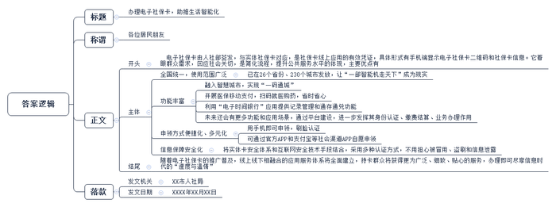
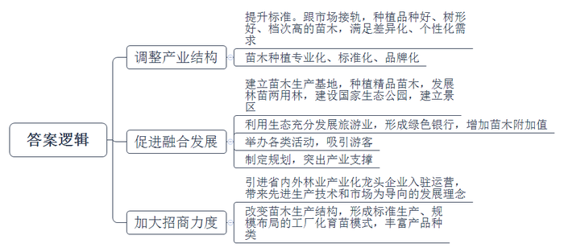

# 2019年公务员多省联考《申论》题（重庆二卷）

> 候选采集稿。参考答案及解析来自粉笔页面，不代表官方答案或真实高分答卷；来源使用许可与原卷对应关系仍需人工核实。

## 给定材料

### 材料 material-f7fa54f42139fb41

丰收的季节，陕北高原到处是红彤彤的苹果。63岁的赵家村村民老赵看着果实，满眼的喜悦。借助改革开放的东风，四十年来他用劳动创造了财富，改变了自己家的生活状况，也见证了他们村乃至黄土高原翻天覆地的变化。

“经常前胸贴后背，每天除了想吃还是想吃，饿得不行呀。”回忆起那时候的生活，打开话匣子的老赵苦笑着。

苦菜、烧圪卷、麻汤饭、酸菜，现在作为特色饭菜招待远方客人，可在老赵眼中，这些都是有时代印记的饭菜。“那时候偶尔吃个玉米窝头都幸福得不行。”老赵说。

那个年代人们主要是为吃穿发愁，孩子们盼望着正月有肉有饺子吃，条件好点的还能穿上新衣服。“记得当时村里有一家买回来猪肉，还没做熟就被孩子们吃得差不多了，日子过得太辛酸了。”老赵感慨。

1978年，来自远方的“包产到户”消息传遍了黄土高原的乡间田野，大家都期待的分田到户，让老赵看到了希望。“把地分到户以后，村民干劲十足啊！天不亮全家有劳动力的都上山劳动，直到晚上看不见才回家。山地上全部种的是小麦、高粱、谷子等粮食作物，平地上家家户户都种白菜、萝卜等时令蔬菜，不到第三个年头，交过公粮后自家的粮仓就再也没有空过。”老赵说，从那时起，孩提时代憧憬的顿顿吃白面，成了家常便饭。“早上吃白面馒头，下午吃白面面条，招待亲戚客人再也不用问邻居家借了，肉也不再是过年的奢侈品。”老赵回想着过往，脱口而出。

经过几年勤劳奋斗，老赵家里吃的穿的都解决了，口袋里也有了些余钱，他就开始着手解决住的问题。在村里，盖新房的不止老赵一家。在解决温饱问题后，农村开始兴建住所，改善居住环境。手表、自行车、缝纫机、收音机“三转一响”早已是陈年往事，冰箱、洗衣机、彩色电视机成了普及品，网络、汽车和智能设备走进农户家中，生活水平发生了巨大变化。

随着改革开放的不断深入，黄土地上的农民也在感受着不一样的社会气息。老赵不断从报纸书刊上获得社会变革的信息，而这些信息也一步一步改变着他对农村经济发展的认识。

在政府的宣传引导和自己思想转变下，他开始放弃种植小麦转而种植苹果，这在当时引起了不小的轰动。“不种麦子你吃啥呀？”“咱祖祖辈辈都是种地的好把式，种苹果能行吗？”当初许多村民劝他的声音依旧在耳旁环绕，然而“一根筋”的他并不为所动，坚持走自己的路。如今，长得郁郁葱葱的果树就是对他最好的回报，“你看看我这苹果，个大皮薄有甜度，看见就有胃口。”老赵笑着说。

“种苹果也是辛苦，但是钱袋子鼓起来了呀！”老赵说，现在十亩苹果每年可收入八九万元，尝到种植苹果甜头的他继续扩大种植规模，还添置了许多果园农业机械。他指着远处的山岗说，那边有他新建的十亩果园，等新园挂果，他的收入可以再翻一番，即使将来老得干不动了，二十亩果园流转给他人坐收流转金，也是一笔不菲的收入。

站在老赵家门口，只见大门左右角两只洁白陶瓷鸽子造型栩栩如生，大门两旁枣红色瓷砖上写着“吉祥如意步步高，一帆风顺年年好”，（横批）“家和万事兴”。走进院内，硬化过的院落再也不怕雨天泥泞不堪，水龙头一拧，白花花的自来水流个不停，干净整洁的玻璃替代了过去糊窗用的麻纸，院子一旁新建的果库也即将投入使用，整个院子散发着勃勃生机。站在村口往村里看，一排排窑洞跟城里的小区一样，整整齐齐。

“真是没想到我现在也能过上这样的日子！”翻着老照片的老赵感慨道，“想跟老伙伴唠几句，手机拿起来就打。想看看新鲜事，微信上多着呐。想到县里买东西，村口一天有好几辆班车。村里还建了一个图书室，摆上了科学种植养殖的有关书籍。晚上，大伙自发集合在村民广场，交流交流各自的想法，也有了休闲的好去处。这两年，大家还结成团，到北京、内蒙古转了转，可开心啦。”

“改革开放富百姓，党的政策暖人心；发展是条致富路，奔向小康永不停。”这是老赵经常念叨的一首打油诗，也是改革开放40年来在党的政策引领下群众脱贫致富的心声。

### 材料 material-0cf0ea1840f75285

30多年前，刚结婚的王芳和丈夫蜜月旅行，从老家霍县乘坐小巴车，在土路上颠簸了3个小时才到达安平市。住了一夜后，他们第二天一早从安平市乘坐早晨6点的客车，晚上8点才到南京。

“现在，早上在家从容地吃完早饭，网上订个高铁票，网约叫车，30分钟到安平站，再乘坐高铁，1个半小时就可以赶到南京吃午饭了。”现已年近花甲的王芳感慨道，“现在的年轻人度蜜月，没有到不了的远方。”

王芳的感慨，引发了许多人的共鸣。广西的张平至今保留着一封1986年的家书。那一年，他被上海市交通学校录取。张平的父亲在家书中用简单的几行字，道出了当时的“漫漫长路”：“我上月26日在南宁送你上车后，乘下午4点22分的火车到玉林下车……等待回县城的车，直到晚上8点半都没等到，后来搭一辆老乡的大货车回县里，半夜才到家。”

在张平求学期间，南宁至上海的直达特快列车每天仅有一趟，全程42个小时。“如此漫长的旅程，由于开窗透气，蒸汽机车飞扬的煤灰从开启的车窗飘入，让白衫变成黑衣。”如今，南宁与上海之间已有高铁、特快列车、快速列车开行，多个车次可供选择，最快的高铁车次全程只要12个小时。去年8月，张平从南宁出发回乡探望父亲，零距离换乘动车、班车，全程仅用3个小时。不仅是陆路交通，张平家乡人坐飞机也越来越方便了。前些年，玉林和南宁之间的航线也开通了。

王芳和张平的经历是我国交通大发展的一个缩影。

党的十八大后，中国铁路进入了新一轮的高速发展期。2016年，铁路部门调整了列车运行图。新图安排开行旅客列车3400多对，其中动车组列车2100多对，普速列车1200多对。旅客列车比原来增加近300对，增加的部分向二、三线和中西部城市倾斜。截至2017年年底，高铁营业里程2.5万千米，占世界高铁营业里程的三分之二；高速公路里程达13.6万千米，居世界之首；民用航空机场共229个，是改革开放初期的3倍……

让阳县自行车运动协会资深会员孙春想不到的是，几十年后，自行车竟然又成了人们喜欢的出行方式之一。孙春回忆说，在过去很长一段时间里，中国被外界称为“自行车王国”。能有一辆“永久”或“凤凰”牌自行车，不亚于现在拥有一辆小汽车。后来，随着摩托车、电动车、汽车的兴起，自行车渐渐没落。近两年来，共享单车在各地兴起，解决了人们“出行最后一公里”的问题，自行车迎来了“新生”。与40年前不同的是，如今的自行车只是人们出行方式的众多选择之一。这个看似回到原点的出行方式，背后却是交通工具插上互联网翅膀后的又一次更新迭代。

“互联网+交通”正在满足人们个性化、多元化、便捷化的出行需求。买列车票再也不用到车站排队，在家里动动手指就可以实现；在很多城市旅游乘坐公交，手机APP可以实时告知公交的“行踪”和路况信息；想要打车，手机上网就可以约车……多地打造“城市交通大脑”，新技术带来的变革一直在继续，相关制度也在不断跟进。

对于每一个出行者来说，40年巨变之后，“说走就走，路不再长”，已成为现实。

### 材料 material-f38ed019ddfc8a82

2018年4月22日，在首届“数字中国”建设成果展览会上，青岛市民刘女士领取到了国家人社部签出的首张电子社保卡。在接下来的短短几个月里，电子社保卡迅速普及，丽水、福州、新余、九江、广州、南宁、海口等多地群众陆续申领到电子社保卡。

成都市民王女士得知电子社保卡申领的消息后，马上掏出手机进行申领。“把社保卡‘放进’手机，只需几十秒，简单得很！比如，从支付宝里点击‘城市服务’，选择所在城市，通过‘刷脸’认证就行了。以后办理相关社保业务，忘带社保卡，用手机扫码也能办。”据了解，为让群众“少跑腿，好办事”，电子社保卡申领渠道丰富多元，不仅包含各地人社部门官方APP、各地政务服务APP，还有社保卡发卡银行APP、支付宝、微信、平安一账通、云闪付等社会渠道APP，持卡人可自愿选择申领渠道。

工作人员介绍，电子社保卡有两种表现形式：一是手机端显示的电子社保卡二维码，用于信息系统识别人员身份、缴费结算、办理业务；二是手机端显示的与实体卡一致的电子社保卡信息，用于人工核对并办理业务。

目前，全国统一的电子社保卡已经在26个省份、230个城市发放。随着一个又一个的城市被“点亮”，“电子社保卡地图”上星光熠熠，“一部智能机走天下”的梦想在更多人的日常生活之中已经成真。

“党的十八大明确提出了加快建立覆盖城乡居民的社会保障体系。十八大以来，社会保障工作的各个方面都在加紧推进。着眼群众需求，回应社会关切，不断简化优化办事流程，提升公共服务信息化水平，是移动互联网‘助力’人社服务的缩影。”工作人员说，“我们积极拥抱移动互联网、大数据和云计算，充分满足群众诉求，建立了全国社保卡服务平台，迎来了电子社保卡，开启了‘人社移动服务’新时代。”

电子社保卡以实体社保卡为基础，与实体社保卡一一对应，是社保卡线上应用的有效凭证。部分先行地区通过多项民生服务精准发力，让这张“无形卡”发挥出“大能量”。

南宁市将电子社保卡融入“智慧城市”建设，持卡人仅需提供电子社保卡二维码即可出入公园、图书馆、博物馆等市民公共场所，实现“一码通城”。宁夏回族自治区、西宁市、潮州市等地区结合电子社保卡开展医保移动支付相关业务，持卡人在药店展示电子社保卡二维码，便可购药，用卡体验大幅提升。青岛市在电子社保卡中新增了“电子时间银行”这一创新应用，为志愿者提供长期可靠的记录管理和通存通兑功能，践行了社保“记录一生、保障一生、服务一生”的承诺。此外，还有更多城市通过电子社保卡开通了就医服务功能，就医时出示手机端电子社保卡，看病后不用排队就可直接线上缴费支付。

电子社保卡全面推进应用的同时，各地人社部门不断加强基础支撑平台建设、“互联网+人社”服务矩阵建设、社保卡金融功能应用、对外协同服务平台建设等。电子社保卡应用将在实体社保卡应用基础上，进一步发挥其身份认证、缴费结算、业务办理的重要作用。

展望未来，查询社保权益记录、办理待遇资格认证、就医购药支付结算、办理参保缴费等功能相继上线，电子社保卡还将逐步嵌入到各地政务服务、智慧城市、金融服务等应用场景。

今年年初，福州市民曾女士因为流行性感冒来到药店，从走进药店，到付款完毕，只用了不到十分钟。“以前忘带社保卡又急着买药就多花不少钱，现在，动动指尖，省时省心。”她告诉记者，领取电子社保卡以来，自己买药都是靠“扫码”，每次结算都很顺利，“在我的推荐下，电子社保卡已成为身边亲戚和同事们的‘标配’。”

有关工作人员表示，电子社保卡以实体社保卡安全体系为基础，结合电子认证、人工智能等互联网安全技术手段，构建了网络与持卡人之间的有效连接，从而确认“实人、实名、实卡”。用电子社保卡在手机端查询信息、办理业务时，借助在线认证、密码验证、人脸识别、风险控制等多种认证方式，能够确保“是我办事”“是我查询”，不用担心被冒用、盗刷和泄露信息。

2018年年底，全国社保卡持卡人数超过12亿人，覆盖全国88%的人口。下一步，随着电子社保卡的推广普及，社保卡线上线下相融合的应用服务体系将全面建立，置身社保卡多元化服务生态圈中，持卡群众将获得更为广泛、细致、贴心的服务，尽享信息时代的“速度与温情”。

### 材料 material-dca9dd605f051b1e

蜿蜒盘旋的山路、生机盎然的苗木，时值初冬的F县罗坝村苗木种植基地，漫山的红枫、桂花和玉兰苗木让人心旷神怡。

有着20年苗木种植经验的老周，从自家5亩责任田起家，如今已经是邻里皆知的苗木种植大户。在他的示范带领下，周边村民纷纷斥资种树，投身到荒山种树的大潮中，全镇上万亩荒废的山丘地重新披上了绿衣裳。老周说：“当初是为了谋生养家，但种着种着，山绿了，环境好了，生态效益和社会效益接踵而至。”

F县地貌以丘陵为主，传统农作物种植业很难有起色，年景好的时候也只能是解决温饱。

穷则思变，改革开放以来，F县开始规模绿化苗木种植，经过多年的发展壮大，全县苗木产业种植已逾33万亩。

老周说，从全国来看，F县是数得上的老苗木产区，不仅品种多，而且规格全，有一整套苗木培育、种植、销售的队伍。仅他所在的罗坝村，苗木产业最兴盛的那些年，苗木经纪人就多达200人。当时的客户群不仅覆盖全国各地，有的苗木还走出国门，卖到意大利和韩国。在这之前，老周怎么也想不到，看上去并不起眼的苗木，市场竟有这么好，“大伙儿站在山包边就把买卖给做了”。

到2013年，全国各地苗木种植纷纷兴起，市场供大于求的情况逐渐凸显。此外，随着城市化建设要求越来越高，市场需求已经不再是过去简单的绿化和美化，彩化和艺化苗木正成为主流。伴随而来的则是苗木行情整体下滑，价格下跌导致苗农收入大幅度减少。老周深有体会：“像从前那样的传统方式，很难再有市场。”

在F县苗木种植的几十年发展道路中，不少苗农走过弯路、吃过亏，其中最具代表性的难题就是，市场需要什么，苗农就一窝蜂种植同一个品种，最后导致产品过剩。苗木卖不出去不说，还占用大量土地，最终只能被苗农忍痛当烧柴砍掉。

F县苗木产业的转型升级迫在眉睫。“相比较过去小而全、品种多的状况，苗木种植的专业化、标准化和品牌化才是当下的发展方向。”县林业局李局长说。

“没有市场卖不出去的苗子，只有不符合市场需求的苗子。”李局长的话一针见血。在他看来，换个思维来理解，市场下滑期就是苗木产业结构的一个调整期，也是提升标准的过渡期。虽然行情不比从前，但标准化种植的苗木市场仍然存在，树冠统一的苗木还是供不应求。“要跟市场接上轨，不仅品种要好，树形要好，档次也要提高，只有符合市场需求的苗木才有出路。”

要转型，怎么转？难题摆在了作为传统苗木大县的F县面前。

“用过去的生态成果来发展旅游产业，形成‘绿色银行’，进一步增加苗木附加值。”在县委金书记看来，这不失为一条打破僵局的路子。2015年，F县以规划引领乡村振兴，突出产业支撑，走出了一条一产、三产融合的发展路径。

产业兴才能乡村兴，经济强才能人气旺。“十八大以来，党中央提出新发展理念，产业兴旺是农业农村发展的物质基础，是促进农民脱贫增收、生活富裕的保障，也是汇聚人财物力支撑乡村振兴的原动力。”金书记的一席话，道出了苗木产业转型的必要性。

登上位于F县苍山林海的观景台，放眼望去，五彩斑斓的苗木尽收眼底，这里是国家生态公园，也是国家4A级旅游景区。6万多亩的苗木基地辐射周边5个村，目前拥有各类精品苗木100余种。全县7个乡镇，通过这几年发展林苗两用林，不仅营造了良好的生态环境，同时也提高了土地资源利用率和产出率。

“环境美了，生态好了，游客来了，人气越来越旺。”看到苍山林海的变化，县外宣办王主任感慨道。这两年，F县举办的观花节、采摘节、旅游节，一天就来好几千人，通过一产带动搞活三产，让当地百姓实实在在受惠。

从民间自发种植到引进企业入驻运营，如今的F县通过加大林业招商力度，引进了省内外30多家林业产业化龙头企业。

先进的生产技术和以市场为导向的发展理念，影响并改进了F县原有的苗木生产结构，标准生产、规模布局的工厂化育苗新模式正在逐渐形成，产品涵盖观赏绿化苗、经果林苗、用材苗、花卉、盆景和草坪地被等六大类400多个品种，年销售7亿多株，交易额40多亿元。

如今，苗农们尝到了转型发展的甜头。市场份额没少，赚到的钱更多。最为关键的是，通过产业结构及时调整，激发了苗农的种植热情，促进了苗木产业的发展。去年，老周所在的罗坝村人均收入就高达26400元。

## 题目

### 第 1 题

**根据给定资料**1**，归纳提炼改革开放以来赵家村发生的变化。（15分）**

关联材料：material-f7fa54f42139fb41、material-0cf0ea1840f75285、material-f38ed019ddfc8a82、material-dca9dd605f051b1e

作答要求：

要求：

（1）分条归纳概括；

（2）表述准确、完整；

（3）字数不超过250字。

### 第 2 题

**请结合给定资料**2**，谈谈你对其中画线句子“40年巨变之后，‘说走就走，路不再长’”的理解。（20分）**

关联材料：material-f7fa54f42139fb41、material-0cf0ea1840f75285、material-f38ed019ddfc8a82、material-dca9dd605f051b1e

作答要求：

要求：

（1）紧扣资料，观点明确；

（2）分析透彻，条理清晰；

（3）字数不超过300字。

### 第 3 题

**假设你是某市人社部门的工作人员，需要进社区向群众推广电子社保卡。请结合给定资料**3**，草拟一份介绍电子社保卡的宣传稿。（40分）**

关联材料：material-f7fa54f42139fb41、material-0cf0ea1840f75285、material-f38ed019ddfc8a82、material-dca9dd605f051b1e

作答要求：

要求：

（1）紧扣资料，内容完整；

（2）条理清晰，语言准确；

（3）字数不超过600字。

### 第 4 题

**给定资料**4**提到了F县在2013年发展苗木产业时遇到的困难，请谈谈F县是如何破解这一难题的。（25分）**

关联材料：material-f7fa54f42139fb41、material-0cf0ea1840f75285、material-f38ed019ddfc8a82、material-dca9dd605f051b1e

作答要求：

要求：

（1）针对性强，内容全面；

（2）条理清晰，简明扼要；

（3）字数不超过400字。

## 答案与解析

第 1 题

**参考答案（粉笔题库参考内容）**

1.物质生活水平提高。温饱问题解决，吃穿有余；收入增加，家电、网络等普及。

2.精神生活质量提升。文化休闲设施完善，参与旅游活动，借助手机等获取资讯，精神世界丰富。

3.农村土地政策改变。实行包产到户，激发劳动热情；发展土地流转，拓宽增收渠道。

4.村民思想观念转变。村民自发学习，转变经济发展认识，主动探索新产业，实现生产规模化、机械化。

5.乡村基础设施改善。新建住所，住房硬件条件改善，公共交通及生产设施完善。

**解析**

**参考答案说明：**本参考答案从“物质生活水平提高”“精神生活质量提升”“农村土地政策改变”“村民思想观念转变”“乡村基础设施改善”五个方面展开，各条答案要点之间在内容上相互并列，没有交叉。

**考点**：考点变化类

**来源**：来源2019年公务员多省联考《申论》题（重庆二卷）

粉笔申论页面对本题只提供「解析视频」入口，该入口是会员推广位，页面无视频地址与文字解析。

第 2 题

**参考答案（粉笔题库参考内容）**

一、这句话的意思是改革开放40年，交通发展满足人们个性化、多元化、便捷化的出行需求。

二、以前交通方式单一，道路设施不完善，车次少，出行时间长，出行环境差。

三、如今出行方便快捷。具体表现在：1.出行方式多样：可以采用火车、汽车、飞机、共享单车等方式。2.时间灵活：汽车约车，火车车次增加，零距离换乘，时间缩短。3.覆盖面广：高铁和机场线路增多，高铁线路和高速公路里程增加，机场增多，向二三线和中西部城市倾斜。4.技术制度变革：“互联网+交通”带来人性化服务和体验；在线购票，实时跟踪车辆信息和路况，网络约车，共享单车解决最后一公里问题。

**解析**

**参考答案说明：**思路方面，本参考答案按照词句解释题“总体释义+展开解释”的一般答题思路展开。内容方面，本参考答案先解释了“40年巨变之后，‘说走就走，路不再长’”的含义；接着分析了改革开放前交通出行的问题、改革开放后出行便捷的表现。词句表达方面，本答案加上了“以前”“如今”等表时间逻辑的词，增强了答案的逻辑性。

**考点**：考点词句解释类

**来源**：来源2019年公务员多省联考《申论》题（重庆二卷）

粉笔申论页面对本题只提供「解析视频」入口，该入口是会员推广位，页面无视频地址与文字解析。

第 3 题

**参考答案（粉笔题库参考内容）**

办理电子社保卡，助推生活智能化

各位居民朋友：

电子社保卡由人社部签发，与实体社保卡对应，是社保卡线上应用的有效凭证，具体形式有手机端显示电子社保卡二维码和社保卡信息。它着眼群众需求，回应社会关切，是简化流程，提升公共服务水平的体现，主要优点有：

一、全国统一，使用范围广泛。已在26个省份、230个城市发放，让“一部智能机走天下”成为现实。

二、功能丰富。融入智慧城市，实现“一码通城”；开展医保移动支付，扫码就医购药，省时省心；利用“电子时间银行”应用提供记录管理和通存通兑功能；未来还会有更多功能和应用场景，通过平台建设，进一步发挥其身份认证、缴费结算、业务办理作用。

三、申领方式便捷化、多元化。用手机即可申领，刷脸认证；可通过官方APP和支付宝等社会渠道APP自愿申领。

四、信息保障安全化。将实体卡安全体系和互联网安全技术手段结合，采用多种认证方式，不用担心被冒用、盗刷和信息泄露。

随着电子社保卡的推广普及，线上线下相融合的应用服务体系将全面建立，持卡群众将获得更为广泛、细致、贴心的服务，办理即可尽享信息时代的“速度与温情”。

XX市人社局

XXXX年XX月XX日

**解析**

**参考答案说明**：（1）格式方面，本参考答案写到了“标题”“称谓”“正文”“落款”四个部分。（2）正文部分，一方面从内容来看，围绕着“电子社保卡”这一主题，本参考答案的开头写到了电子社保卡相关背景、带来的意义等；主体部分从“全国统一，使用范围广泛”“功能丰富”“申领方式便捷化、多元化”“信息保障安全化”等几个方面给出了电子社保卡的优点；结尾进行呼吁号召。另一方面，形式上，本参考答案做到了分段、分条撰写，整体上条理较为清晰。

**考点**：考点宣传类

**来源**：来源2019年公务员多省联考《申论》题（重庆二卷）

粉笔申论页面对本题只提供「解析视频」入口，该入口是会员推广位，页面无视频地址与文字解析。

第 4 题

**参考答案（粉笔题库参考内容）**

一、调整产业结构。1.提升标准。跟市场接轨，种植品种好、树形好、档次高的苗木，满足差异化、个性化需求；2.苗木种植专业化、标准化、品牌化。

二、促进融合发展。1.建立苗木生产基地，种植精品苗木，发展林苗两用林，建设国家生态公园，建立景区；2.利用生态充分发展旅游业，形成绿色银行，增加苗木附加值；3.举办各类活动，吸引游客；4.制定规划，突出产业支撑。

三、加大招商力度。1.引进省内外林业产业化龙头企业入驻运营，带来先进生产技术和市场为导向的发展理念；2.改变苗木生产结构，形成标准生产、规模布局的工厂化育苗模式，丰富产品种类。

**解析**

**参考答案说明**：答案从“调整产业结构”“促进融合发展”“加大招商力度”等不同方面将对策进行了分条撰写。各条要点之间在内容上是并列关系。

**考点**：考点概括措施类

**来源**：来源2019年公务员多省联考《申论》题（重庆二卷）

粉笔申论页面对本题只提供「解析视频」入口，该入口是会员推广位，页面无视频地址与文字解析。

