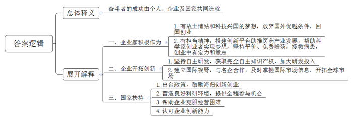

# 2020年0822公务员多省联考《申论》题（重庆一卷）

<!-- gwy:overview:start -->
> **重庆 · 2020 · 申论 · 一卷** ｜ 3 题 · 图片 3 处 · 答案随题折叠

导航：[题目](#题目)
<!-- gwy:overview:end -->

> 候选采集稿。参考答案及解析来自粉笔页面，不代表官方答案或真实高分答卷；来源使用许可与原卷对应关系仍需人工核实。

## 给定材料

### 材料 material-30712613c662678a

BD药业是一家在全球肿瘤药物领域拥有多项核心自主知识产权的高科技公司。说起BD药业的故事和梦想，公司董事长兼首席执行官丁先生有很多的感慨。

2002年，借着国家政策鼓励留学人员回国创新创业的东风，留洋十年的丁先生背起行囊，与几位合伙人一道回国创业。就在第二年，BD药业成立，开始追逐“做创新药”的大梦想。有人说，丁先生身上有不少光环，比如国外著名大学的医学博士、执业医师等，回国创业就意味着放弃了优越的生活条件、高额的薪水，白手起家，这个抉择很需要勇气。而在丁先生看来，这个选择顺理成章。“像我们这些知识分子，大多数还是有故土情结的，总是梦想着科技兴国。”除了游子的思乡情结，还有一点对丁先生来说非常重要——“国家鼓励海归创新创业，在国内可以做到在国外做不到的事”。他说，在国外，科学家只能做药物研发的其中某一段的研发，很少有几个科学家合作完成一个新药所有的研究，并将其产业化，只有在中国有这种机会。

与很多企业选择做仿制药不同，BD药业一开始就立志做新药，要在全球药业竞争中拥有完全知识产权。虽然面临各种技术难题、资金链断裂等“生死劫”，但有志者事竟成，在相关部门的支持下，BD药业克服了重重困难，最终取得了成功。他们研制的抗癌药获得国家颁发的新药证书，成为我国首个具有完全自主知识产权的同类抗癌新药。该药还被列入国际权威机构发布的新药研发年度报告，成为第一个获得国际机构认可的中国创制新药。

2016年1月8日对于丁先生来说很特别，也很难忘。这一天他作为BD药业相关项目的第一完成人，在2015年度国家科学技术奖励大会上捧起了光荣的奖杯。“这是奋斗者的奖杯，这个奖杯上不仅有我的名字，还有我们团队的名字，其实更应该有国家的名字。”当时，在深冬北京的暖阳中，丁先生郑重地一手拿着大红证书，一手举起奖杯，站在北京人民大会堂前拍了一张照片。这是国家对BD药业创新能力的巨大肯定。

“拥有自主创新，才能拥有话语权。”丁先生常说，“要真正把中国的医药产业发展起来，得把中国人用药的话语权掌握在自己手里。”

近年来，BD药业飞速发展，其源源不绝的动力就来自“创新”二字。自主研发是BD药业的看家本领，丁先生表示，今年截至目前创新研发投入已经超过10亿元。“我们正不断加强自主研发这一块。有自主研发做保障，我们就有底气开拓市场和开展合作。”BD药业把眼光投向全球，通过与国际知名医药企业合作，及时掌握国际市场信息，在全球的抗肿瘤药物市场中奋勇开拓。

如今，丁先生又种下了一颗新的梦想种子——以BD药业为基础，打造一座“医药梦工场”，搭建更大的创新平台，为医药产业的快速发展打造新引擎。丁先生说，这是一个为科学家、创业者造梦圆梦的项目，目标是打造一个具有国际先进水准的生物医药专业众创空间。未来，这里也将集聚一批医药领域的创业者。

研制新药去拯救病患，搭建创新平台去服务全行业。丁先生说，这些都是出自一个企业家的担当，“我们脑子里想的更多的是新药研发，以及企业的未来发展。”作为过来人，丁先生还想告诉创业者的是，企业家要有企业家的担当，企业家既要有仰望星空的格局与胸襟，也要有坐住板凳的定力和意志。“就拿我们医药行业来说，与一般的制造业不同的是，医药行业一方面与老百姓的身体健康密切相关，另一方面新产品的研发时间长、投入大、失败的风险高，要成功很难。”经历了风风雨雨，丁先生一直坚持“做老百姓吃得起的好药”，还对符合相关条件的患者进行免费赠药，赠药数量甚至超过了销售数量，这就是一位企业家的社会责任心。胸怀远方，迎接岁月的磨砺，才有了如今的BD药业。

### 材料 material-dea14af32dd83da5

一身时尚的服装，坐在一辆新买的小汽车中，车中音响里播放着快节奏的流行歌曲，这一切都使得小王和十多年前刚从乡下老家来时判若两人。在S市这座大城市坚持了十多年后，快递员小王觉得自己离这个流光溢彩的大都市越来越近了，这个城市对他来说也不再那么陌生和疏离。他离梦想更进了一步，在这个大城市扎根，不再有外乡人的距离感。

十多年前，21岁的小王站在S市一栋高楼下，仰着头看，看得脖子发酸。这是一个农村人第一次看到20多层高的大楼。彼时，物流产业政策和市场环境不断改善令中国物流行业呈现新的面貌。虽然面临高油价、人力资本上升的压力，但当时整个行业仍呈现蓬勃发展的势头。就是在此大背景下，小王从乡下老家来到S市当了一名快递员。

小王至今还记得，他第一次出来送快递，当天的10票快件，从早上8点送到了晚上12点他才送完。虽然磕磕绊绊一整天，但收工时，他感到很高兴，很有成就感。入职两个月后，小王的业绩就做到了网点的前三。那时候，民营快递行业基本还是固定工资制，小王一个月可以拿到2000元工资。

很长一段时间，晚上空闲的时候，小王和几个朋友会一起骑上电动车到处兜风。江边高楼大厦林立，五颜六色的灯光闪烁着。江面上游船来来往往。江上的夜风温暖。一切都是新鲜的，令他激动。他梦想着早日融入这个城市，成为这个城市的一员。

那时，电商客户还少，快递业以个人散件为主。全网点只有几个快递员。对S市人来说，快递员还是一份边缘职业，受人歧视。有一次，小王正准备进门收件，门内的客户却把他拦在了门外，“别别别，刚拖过地”，客户边不耐烦地嘟囔着边把门关上了。等了会儿，门才稍稍开了一条缝，客户把邮件递出来。至今，这条门缝还令他内心有强烈的刺痛感。不过，奔走在这个城市的大街小巷，小王也常常感受到了这个城市里人情的温暖。夏天的时候，很多热心市民和商家在街道上摆放了专门的冰柜，免费提供饮料。每次路过这些蓝色帐篷下的冰柜，小王都觉得特别暖心。

快递业的好时代起始于2008年。这一年，是中国的“奥运年”，也是中国物流发展的关键一年，很多电商开始助推物流业的迅猛发展。由于电商快件的特性，需要快递公司全国性的网络，加盟承包制开始兴起，全国性的快递系统开始运转。2009年10月1日起，新《邮政法》实施，确定了民营快递企业的合法地位，民营快递业迎来了发展的春天。2013年，民营快递企业市场占有率开始超过国有快递企业。

小王也分享了行业高速增长带来的红利。2013年，小王每天最多收件可以达到800件，谦和的态度和勤奋努力让他的业绩做到了网点第一，他每个月已经可以拿到8000元的工资，在S市也算不错的收入了，他的消费也升级了，开始去大型商城购物了。

随着快递业加盟制问题的逐渐暴露，各大快递公司逐渐收缩加盟网点，开始直营化。经营模式的改革助推了快递业的发展。2016年，中国快递业突破300亿，连续6年每年增长超过50％，此后多家快递公司成功上市，快递公司已不再是当年靠着几辆自行车送件的小作坊了。

2016年，小王所在网点被总部收回直营，开始按照更为成熟的公司管理模式运营。小王被任命为网点运营经理，参与网点的管理。现在小王每个月的工资已超过一万元。他买了一辆十几万的小汽车，并且回老家拆掉了当年的土坯老屋，新盖了一栋三层的小楼，让村里人羡慕不已。

小王很早就办理了S市的市民卡。市民卡不仅兼具医保卡和储蓄卡的功能，还能优惠享受到泊车、乘坐公交车、租赁公共自行车等公共服务。为了推动外地人融入城市，S市还推出了积分入户政策，只要积满一百分就可以落户。小王越来越感受到了这个城市很多制度传递出的温情，在这个城市工作了十多年，小王很感谢S市这个大城市，让他有了一份稳定且有上升空间的工作。当然，“现在S市也离不开快递业，离不开我们的服务了。”小王说。

### 材料 material-0524bc5124b7248c

“我们都在努力奔跑，我们都是追梦人。”是的，我们都是追梦人。追梦，我们收获满满；追梦，我们希望满满。

正如习近平总书记所说，中国人民具有伟大梦想精神。改革开放40多年的征程，就是一个追梦之旅。改革开放之初，我们党以非凡的胆略、坚定的自信设计了用70多年、分三步走基本实现社会主义现代化的宏伟蓝图。改革开放40多年的追梦路上，我们咬定青山不放松，风雨无阻朝着这个伟大目标前进。

从站起来、富起来到强起来，这是奋斗的力量，也是梦想的力量。

党的十九大对我国发展提出了更高的奋斗目标，形成了从全面建成小康社会到基本实现现代化、再到全面建成社会主义现代化强国的战略安排，发出了实现中华民族伟大复兴中国梦的最强音。

但是，船到中流浪更急，人到半山路更陡，并且“愈进愈难、愈进愈险而又不进则退、非进不可”。在这样的关键时刻，我们要心怀梦想、奋勇拼搏，一步一个脚印，一棒接着一棒，在新时代创造中华民族新的更大奇迹！

梦想是拼出来的，奇迹是干出来的。改革开放40多年来的辉煌成就背后，是40多年的不懈努力。未来中国梦的实现，同样需要汗水的浇灌。没有人能随随便便成功。改革开放40多年的历程告诉我们：伟大事业都始于梦想，基于创新，成于实干。梦想是激发活力的源泉，只要有梦想，就会有力量。只要有梦想，则时光不弃，未来可期。

## 题目

### 第 1 题

**给定资料**2**中提到，****“****这是奋斗者的奖杯，这个奖杯上不仅有我的名字，还有我们团队的名字，其实更应该有国家的名字****”****请你谈谈对这句话的理解。（****20分）**

关联材料：材料 material-30712613c662678a

作答要求：

要求：准确，全面，有条理，不超过250字。

第 1 题 · 答案与解析

**参考答案（粉笔题库参考内容）**

奋斗者的成功由个人、企业及国家共同造就。一、企业家积极作为：1.有故土情结和科技兴国的梦想，放弃国外优越条件，回国创业。2.有担当精神，搭建创新平台助推医药产业发展，帮助科学家创业者实现梦想，坚持平价、免费赠药，拯救病患，创业中有定力和意志。二、企业开拓创新：1.坚持自主研发，获取完全自主知识产权，加大研发投入。2.建立国际视野，与名企合作，及时掌握国际市场信息，开拓全球市场。三、国家扶持：1.出台政策，鼓励海归创新创业。2.营造良好科研环境，提供全程参与机会。3.帮助企业克服经营困难。4.认可企业创新能力。

**解析**

**参考答案说明：**思路方面，本参考答案按照词句解释题“总体释义+展开解释”的一般答题思路展开。内容方面，本参考答案首先解释了“这是奋斗者的奖杯，这个奖杯上不仅有我的名字，还有我们团队的名字，其实更应该有国家的名字”的含义；接着从“企业家”“企业”“国家”三个主体分类分条撰写各自的表现，使每条要点之间内容上没有交叉。

**考点**：考点词句解释类

**来源**：来源2020年0822公务员多省联考《申论》题（重庆一卷）

粉笔申论页面对本题只提供「解析视频」入口，该入口是会员推广位，页面无视频地址与文字解析。

### 第 2 题

**请根据给定资料**3**，以城市的温度为题目，为《S市日报》写一篇评论。（30分）**

关联材料：材料 material-dea14af32dd83da5

作答要求：

要求：紧扣资料，立意明确，思路清晰，语言准确，不超过400字。

第 2 题 · 答案与解析

**参考答案（粉笔题库参考内容）**

城市的温度

S市让人感受到人情的温暖、梦想实现的温暖、制度的温暖，应进一步推动外乡人融入城市，增强其归属感。

城市的温度体现在人情的温暖。如今，平等的职业观已深入人心，市民普遍尊重外来务工人员，以耐心、包容的心态对待他们；城市也有公益服务，夏天时很多爱心人士会提供免费饮料，用爱心温暖他人。

城市的温度体现在梦想实现的温暖。不少外来劳动者在城市分享了行业增长的红利，有了稳定且有上升空间的工作，收入大幅提高，实现消费升级，精神文化需求得到满足。他们扎根城市，实现梦想，不再有外乡人的距离感。

城市的温度还体现在制度传递的温情。S市积极推行市民卡，使其兼具医保卡和储蓄卡功能，让人优惠享受公共服务，并推出积分入户政策，降低落户门槛。

人与城市相互依赖着，城市的发展离不开人，城市应当为劳动者提供温暖的环境，让其留得住，发展得好。

**解析**

**参考答案说明：**（1）格式方面，本参考答案写到了“标题”“正文”。（2）正文部分，一方面从内容来看，围绕着“城市温度”这一主题，本参考答案的开头整体介绍了S市城市温度体现在哪些方面并表明态度立场；接着主体部分从传递人情温度、实现梦想温度、彰显制度温度三个方面具体说明S市城市温度的体现及其意义；最后结尾部分点出了人与城市的关系，并发出呼吁，进一步提升城市温度。另一方面，形式上，本参考答案做到了分段、分条撰写，整体上条理较为清晰。

**考点**：考点评论类

**来源**：来源2020年0822公务员多省联考《申论》题（重庆一卷）

粉笔申论页面对本题只提供「解析视频」入口，该入口是会员推广位，页面无视频地址与文字解析。

### 第 3 题

**给定资料**4**中提到村民眼中的变和小孙心中的不变，请你结合全部给定资料，围绕“变与不变”进行辩证思考，联系实际，自拟题目，写一篇文章。（50分）**

关联材料：材料 material-0524bc5124b7248c

作答要求：

要求：论点明确，层次清晰，结构完整，语言流畅，结合给定资料但不拘泥于给定资料，字数1000～1200字。

第 3 题 · 答案与解析

**参考答案（粉笔题库参考内容）**

**坚守为民初心 实现脱贫致富**

“草木蔓发，春山可望”，**从靠天吃饭到产业脱贫，变的不仅是农村的经济、农民的生活、农业的发展，也是听天由命向自力更生转变的观念**。这些“变化”的背后，则是“不变”的支撑。**这种****“不变”就是共产党人服务为民的信念，是基层干部扎根一线的情怀，更是千千万追梦人的拼搏底色**。

**基层干部应始终坚守带领群众脱贫致富的理想信念，保持干实事的初心情怀，深入基层、履职尽责，以民为本，解决群众****“燃眉”之事，不断拉近干群关系。**脱贫前，岩山村物质生活相对贫乏。面对村民的质疑与不信任，扶贫干部怀揣一颗真心，到田间地头了解情况，走家串户查找穷根。在了解了村里的“大事小情、家长里短”之后，因地制宜加强基础设施建设，完善生产条件，发展传统养殖业。与此同时，在扶贫中也重视扶技，根据当地产业特色，开设各种技能培训班，提升群众的生产发展水平。诸如此类，看似件件皆小事，可件件也都是群众心上事，一连串雪中送炭的实质性帮扶拉近了村民和工作队的距离，也带动了乡村经济发展，更是为村容村貌的改善和乡风文明的转变奠定了坚实的基础。

要想实现乡村的真正转变，实现脱贫致富梦，除了坚守初心，坚持实干导向，也需要坚持以增产增效增收，改变传统生产方式作为长远发展的目标。

**农村脱贫致富，最重要的就是物质经济条件的改善，这就需要我们不断加大产业开发力度，提高群众收入，确保脱贫效果的可持续性。**发展乡村产业是实现乡村发展的核心，亦是我们实现民族复兴的必由之路。但仅发展传统产业是远远不够的，我们还需要注重产业的融合发展，在依托当地特色产业的同时，招商引资，发展加工业，进行深加工，并将文化故事融入产品，提升产品附加值，开拓销路，提升收入。乡村经济的发展，不仅可以增加就业岗位，解决乡村人口流失的问题，还可以吸引更多人才返乡就业，反哺乡村自身，增加乡村的活力，从而真正找到穷根、治好穷病、摘掉穷帽。

**不变成就了乡村的改变，但脱贫致富的背后，是基层干部不断加强学习，创新工作方法，提升自身能力素质的实践。**“农村富不富，关键在支部”，发挥基层党组织的战斗堡垒作用是驻村帮扶的首要工作。在这一过程中，要积极开展学习教育活动，提升党员的先锋模范意识。正如“太行山愚公”李保国同志一样，他带领乡亲们脱贫致富的初心不动摇，带领村委班子不断开展学习先进农业知识，完成山区开发研究成果数十项，推广的林业技术更是极大地改善了当地生态环境。可以说，万亩荒地变绿洲，万千贫困人口变富裕，正是依靠李保国同志为首的基层干部们扎实的知识、先进的技术和坚持不懈的实践啊！

“船到中流浪更急，人到半山路更陡”。面对这迅猛变化的时代，我们需要主动求变以更好的适应时代，但更要坚持不变，坚守初心、坚定梦想、一心为民，才能够绘就出“全民奔小康”的蓝图，兑现“一个都不掉队”的誓言！

**解析**

**文章分析**

**坚守为民初心 实现脱贫致富**

【**标题的优点**：首先，范文的标题“坚守为民初心”突出了“不变”这一主题词，“实现脱贫致富”体现了“变”这一主题词。其次，形式上，文字对称，具有美感。】

（1）“草木蔓发，春山可望”，**从靠天吃饭到产业脱贫，****变的不仅是农村的经济、农民的生活、农业的发展****，也是听天由命向自力更生转变的观念**。（2）这些“变化”的背后，则是“不变”的支撑。（3）**这种****“不变”就是****共产党人服务为民的信念****，****是基层干部扎根一线的情怀****，****更是千千万追梦人的拼搏底色**。

【**开头的优点：**★内容方面：范文的开头是紧扣“变与不变”这一主题展开的。首先，开头第一句话解释了“变”的内涵；其次，指出了“变与不变”的关系，即“变是因为不变”；接着指出了“不变”的内涵。★文字表达方面：引用了“草木蔓发，春山可望”等古语，使文章开头显得较有文采，还使用了“也”“更”等并列和递进关联词，使语言表达有逻辑性。】

**基层干部应始终坚守带领群众脱贫致富的理想信念，保持干实事的初心情怀，深入基层、履职尽责，以民为本，解决群众****“燃眉”之事，不断拉近干群关系。**（1）脱贫前，岩山村物质生活相对贫乏。面对村民的质疑与不信任，扶贫干部怀揣一颗真心，到田间地头了解情况，走家串户查找穷根。在了解了村里的“大事小情、家长里短”之后，因地制宜加强基础设施建设，完善生产条件，发展传统养殖业。（2）与此同时，在扶贫中也重视扶技，根据当地产业特色，开设各种技能培训班，提升群众的生产发展水平。（3）诸如此类，看似件件皆小事，可件件也都是群众心上事，一连串雪中送炭的实质性帮扶拉近了村民和工作队的距离，也带动了乡村经济发展，更是为村容村貌的改善和乡风文明的转变奠定了坚实的基础。

【**论述段****1****的优点**：★观点句：范文的观点句是紧扣“变与不变”这一文章主题提出的。形式上，它在段首处直接写出，位置突出，容易被发现；内容上，关键词突出，内容要点明确，可以明显看出它是从“基层干部坚守理想信念，保持干事初心”即“不变”这一角度展开论述。★论述内容：（1）基层干部进行实地调查，在扶贫上发力；（2）开展培训，在扶技上发力；（3）基层干部坚守信念、保持实干的意义。注意：以上三个方面的内容都是紧扣观点句“基层干部应始终坚守带领群众脱贫致富的理想信念，保持干实事的初心情怀，深入基层、履职尽责，以民为本，解决群众‘燃眉’之事，不断拉近干群关系”进行分析论述的，层次清晰、针对性强。在论证方法上采用了讲道理和举例子相结合的方式，使内容更加充实。】

要想实现乡村的真正转变，实现脱贫致富梦，除了坚守初心，坚持实干导向，也需要坚持以增产增效增收，改变传统生产方式作为长远发展的目标。

【**过渡段的优点：**过渡段承上启下，先通过“除了坚守初心，坚持实干导向”承接上文的“不变”，然后通过“也需要坚持以增产增效增收，改变传统生产方式作为长远发展的目标”引出“不变是为了更好的改变”，从而引出后文的主要观点。】

**农村脱贫致富，最重要的就是物质经济条件的改善，这就需要我们不断加大产业开发力度，提高群众收入，确保脱贫效果的可持续性。**（1）发展乡村产业是实现乡村发展的核心，亦是我们实现民族复兴的必由之路。（2）但仅发展传统产业是远远不够的，我们还需要注重产业的融合发展，在依托当地特色产业的同时，招商引资，发展加工业，进行深加工，并将文化故事融入产品，提升产品附加值，开拓销路，提升收入。（3）乡村经济的发展，不仅可以增加就业岗位，解决乡村人口流失的问题，还可以吸引更多人才返乡就业，反哺乡村自身，增加乡村的活力，从而真正找到穷根、治好穷病、摘掉穷帽。

【**论述段****2的优点**：★观点句：范文的观点句是紧扣“变与不变”这一文章主题提出的。形式上，它在段首处直接写出，位置突出，容易被发现；内容上，关键词突出，内容要点明确，可以明显看出它是从如何实现经济上的“改变”这一角度展开论述。★论述内容：（1）发展乡村经济的重要性；（2）发展乡村经济的对策；（3）乡村经济发展带来的意义。注意：以上三个方面的内容都是紧扣观点句“农村脱贫致富，最重要的就是物质经济条件的改善，这就需要我们不断加大产业开发力度，提高群众收入，确保脱贫效果的可持续性”进行分析论述的，层次清晰、针对性强。在论证方法上以讲道理为主，增强了论证的说服力。】

**不变成就了乡村的改变，但脱贫致富的背后，是基层干部不断加强学习，创新工作方法，提升自身能力素质的实践。**（1）“农村富不富，关键在支部”，发挥基层党组织的战斗堡垒作用是驻村帮扶的首要工作。（2）在这一过程中，要积极开展学习教育活动，提升党员的先锋模范意识。正如“太行山愚公”李保国同志一样，他带领乡亲们脱贫致富的初心不动摇，带领村委班子不断开展学习先进农业知识，完成山区开发研究成果数十项，推广的林业技术更是极大地改善了当地生态环境。可以说，万亩荒地变绿洲，万千贫困人口变富裕，正是依靠李保国同志为首的基层干部们扎实的知识、先进的技术和坚持不懈的实践啊！

【**论述段****3的优点**：★观点句：范文的观点句是紧扣“变与不变”这一文章主题提出的。形式上，它在段首处直接写出，位置突出，容易被发现；内容上，关键词突出，内容要点明确，可以明显看出它是从基层干部改变自身，即“不变”背后的“改变”这一角度展开论述。★论述内容：（1）基层党建的重要性；（2）举例说明基层干部如何提升自身能力以及提升自身能力的重要性。注意：以上两个方面的内容都是紧扣观点句“不变成就了乡村的改变，但脱贫致富的背后，是基层干部不断加强学习，创新工作方法，提升自身能力素质的实践”进行分析论述的，层次清晰、针对性强。在论证方法上采用了讲道理和举例子相结合的方式，使内容更加充实。】

【**论述段之间的关系**：★内在逻辑上：范文的论述段之间呈现递进关系，按照“先说基层干部坚守不变理念和实干，再说通过基层干部的‘不变’推进乡村经济的巨变，最后说基层干部‘不变’背后的‘改变’”的逻辑展开的。★外在衔接上：论述段1之后的过渡段“除了坚守初心，坚持实干导向，也需要坚持以增产增效增收，改变传统生产方式作为长远发展的目标”，起到了承接论述段1，引出论述段2的作用；论述段3开头处的“不变成就了乡村的改变，但脱贫致富的背后”，起到了承接论述段1、2的作用。】

“船到中流浪更急，人到半山路更陡”。面对这迅猛变化的时代，我们需要主动求变以更好的适应时代，但更要坚持不变，坚守初心、坚定梦想、一心为民，才能够绘就出“全民奔小康”的蓝图，兑现“一个都不掉队”的誓言！

【**结尾的优点：**范文的结尾回扣了“变与不变”这一主题，并发出了呼吁号召。结尾短小精悍，不拖沓。】

**考点**：考点文章写作题

**来源**：来源2020年0822公务员多省联考《申论》题（重庆一卷）

粉笔申论页面对本题只提供「解析视频」入口，该入口是会员推广位，页面无视频地址与文字解析。

