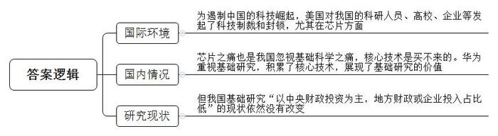
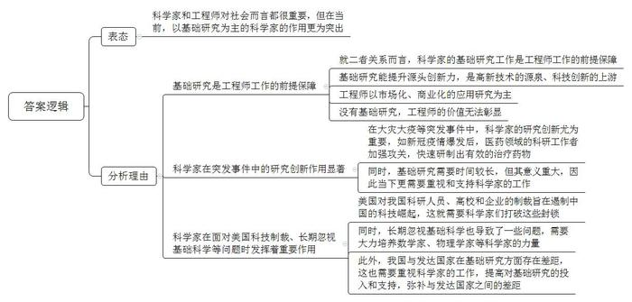

# 2020年重庆市集中选调生考试《申论》题（网友回忆版）

<!-- gwy:overview:start -->
> **重庆 · 2020 · 申论 · 选调生** ｜ 3 题 · 图片 2 处 · 答案随题折叠

导航：[题目](#题目) · [材料 1](#材料-1)
<!-- gwy:overview:end -->

> 候选采集稿。参考答案及解析来自粉笔页面，不代表官方答案或真实高分答卷；来源使用许可与原卷对应关系仍需人工核实。

## 给定材料

### 材料 1

14天完成核酸检测试剂研发和上市，迅速筛选一批有效治疗药物，推进灭活疫苗、重组蛋白疫苗等5条技术路线……新冠肺炎疫情发生以来，在没有硝烟的战场上，医学、药学、病毒学、生物学等领域的科研工作者在各自的“竞赛跑道”争分夺秒、全力攻关。

人类同疾病较量最有力的武器就是科学技术，人类战胜大灾大疫离不开科学发展和技术创新。今年3月，习近平总书记在北京考查新冠肺炎防控科研攻关工作时指出：“当前，打赢疫情防控人民战争、总体战、阻击战还需要付出艰辛努力。越是面对这种情况，越要坚持向科学要答案、要方法。”

### 材料 2

前不久，一位名叫王欣的中国学者在从洛杉矶机场返回国内时被美国方面扣押，美国司法部称其是一名军官，使用虚假签证信息并试图从美国实验室获取资料。而事实上，王欣只是一名心脑血管方面的医生。除了“抓人”，美国方面还针对哈尔滨工业大学、哈尔滨工程大学等出台制裁措施，禁止这些学校的学者和学生使用著名的工科数据处理软件MATLAB。

5月15日，美国商务部产业与安全局宣布修改《外国直接产品规则》，要求使用美国设备制造芯片等产品的外国企业在向华为出口前，必须获得美国政府的许可。换言之，美国认为此前对华为的限制存在“漏洞”，即第三国可以绕开美国给华为供货，美国试图利用新的规定，在全球范围内进一步织紧“扼杀”华为的网络。

中国科技迅速崛起，在很多方面都已经走在世界的前列，比如北斗卫星导航、量子通信、高铁技术、5G网络、移动支付等，引起美国的高度警觉。为了遏制中国的科技崛起，美国发起了科技制裁和封锁，枪口首先指向中兴科技，通过芯片断供、技术断供、服务断供，使中兴付出了巨大的代价，企业一度陷入危机。接着是华为，美国从一开始就禁止华为进入美国市场，面对华为领先全球的5G技术，也向世界各国发起了制裁游说，禁止荷兰ASML光刻机出口中国，禁止台积电为华为代工芯片，试图对华为进行全面围堵。

### 材料 3

芯片是国人之痛，然而从根本上说，芯片之痛是忽视基础学科之痛。

芯片可粗略分为设计和制造两个方面，这两个方面都与基础科学密不可分。从设计上来说，射频芯片、模拟芯片这种核心芯片本质是由无数晶体管巧妙组合在一起设计出来的，其设计原理基于物理学中的电学结构、电磁场、电磁波等知识。而我们熟知的数字芯片，如CPU、存储器等，除了物理学科的知识外，还涉及在数学基础上发展起来的计算机原理、信息论等。从制造上来说，把数千万甚至上亿晶体管刻在微小的晶圆上，要能十分精巧地控制电子流动，这又涉及到半导体物理和材料科学。作为芯片制造核心设备之一的光刻机，集分子激光、精密光学等多种基础学科于一身。荷兰的ASML公司几乎垄断了全世界高端光刻机市场，以中国目前的技术，只能制造中低端芯片，如果想要制造高端芯片，必须使用ASML的光刻机。

目前，虽然我们有海思、中芯国际等知名芯片设计和芯片制造企业，但就整体产业发展而言，相较国际一流水平还有较大差距。“起步晚是重要的历史原因，主导理念的偏差导致创新推进不够是现实原因。曾经，我们在很多方面，希望能够用更省事的办法解决问题，所谓‘造不如买，买不如租’。”中国工程院院士、中国科学院计算技术研究所研究员倪光南指出，“实践证明，核心技术是买不来的。中国芯片技术和产业的‘短板’最终还是需要中国人踏实创新来解决。”

华为创始人任正非有一个经典论述：修桥、修路、修房子只要砸钱就行了，芯片砸钱不行，得砸数学家、物理学家、化学家。中国要踏踏实实在数学、物理学、化学等各方面去努力，我们才可能在这个世界上站得起来。

过去几十年，包括华为在内的信息技术行业，主要依托现有理论和基础技术进行技术创新、工程创新及解决方案创新，做了一些短期看似“无用的”基础研究。如今，华为全球60多个基础实验室，已集结了700多位数学博士、200多位物理和化学博士；华为战略研究院正专注基础理论的突破和革命性技术的发明，围绕信息的全流程，研究和发掘未来5-10年的技术。

在华为的眼里，大学是基础理论研究与突破的主战场，为此，华为每年投入3亿美元支持相关大学开展基础科学、基础技术等的创新研究。华为董事、战略研究院院长徐文伟介绍，未来5-10年，华为将继续采取“支持大学研究、自建实验室、多路径技术投资”等多种方式把工业界的问题、学术界的思想、风险资本的理念整合起来共同创新。

2009年，4G刚刚步入商用，华为就启动了从芯片到材料、从散热到算法等贯穿整个5G的基础研究，如今已向5G投入超过40亿美元研发费用。5G商用之路刚启程，华为就已成为领跑者。华为已在全球获得50多个5G商用合同，20多万个5G基站已发货，全球将近2/3的5G基站由华为建设。

中粤联合投资合伙人罗浩元说：“从来就没有随随便便的成功，托起华为成功的关键是核心技术的积累。现在，像华为这样对基础研究有执念的企业虽然还不是普遍现象，但华为的成长历程让人们看到，基础研究之于企业和行业的价值。”

### 材料 4

“基础研究决定一个国家科技创新的深度和广度，‘卡脖子’问题根子在基础研究薄弱。”李克强总理在2019年9月2日主持召开的国家杰出青年科学基金工作座谈会上指出，“基础研究站得稳不稳，站得牢不牢，直接关系我国科技创新发展的未来。”“基础研究没有捷径可走。要有十年磨一剑的专注精神，潜下心来把冷板凳坐热。”“我们的基础研究领域科研人员今天要立大志，面向未来，瞄准我国创新发展的关键制约，把基础研究和应用基础研究做扎实。各级政府要加大对基础研究长期稳定支持力度，引导企业增加基础研究投入。”

“创新成果往往不是‘计划’出来的。比如牛顿坐在苹果树下发现万有引力定律，就属于灵光一现的突发奇想。但这种突发奇想不是拍脑袋想出来的，而是厚积薄发的结果。”李克强指出，“科学研究有其自身规律，我们必须尊重科学规律，尊重科学家，别总是想着用行政手段去‘规划’他们，而是要更多为他们营造心无旁骛、自由探索的良好氛围。”

### 材料 5

20世纪80年代的一句“学好数理化，走遍天下都不怕”言犹在耳。近年来，“重商主义”却俨然成为一种潮流——基础学科不仅招生难，而且许多此类专业学生毕业后也纷纷转行。

目前。我国大学开设的本科专业大体可以分为基础学科和应用学科两大类。以专业和学科知识本身为研究对象的、偏学术性的大体归于基础学科，比如数学、物理、化学、生物及历史、哲学等专业；应用学科则更加偏向解决社会实际问题，多有实践岗位性质，例如工程、经管、设计等专业。

在大学扩招的背景下，基础学科和应用学科专业的招生规模均有所扩大，但应用学科专业招生规模增长速度明显快于基础学科。这一点在“学霸”身上体现得更加明显，众所周知，中国高考状元选择就读的专业基本是各时期社会公认的最具竞争力、最赚钱和最热门的本科专业。《中国高考状元调查报告》显示，2017年中国各地区高考状元中，选择就读工商管理的高考状元人数最多，有236人；经济学专业有200人，居第二位。就读工商管理和经济学的高考状元人数遥遥领先于其他专业，合计占高考状元总数的56.4%。而选择数学的“学霸”仅18人，占2.33%；物理学仅13人，占1.68%；哲学和历史学更是分别仅有2人和1人。

鲜有企业愿意投资在短期内难以获得效益的基础学科上，这反映到企业对人才的需求上，就会出现基础学科毕业生不被认可、就业相对困难的现象。就算名校也不能逃脱这个怪圈。都说21世纪是生命科学的世纪，基因技术、细胞工程、生物制药等快速发展，生命科学正在不断创造奇迹，但国内生命科学类专业的本科毕业生并不吃香，甚至就业困难。例如，2018年清华大学生命科学学院的本科就业率只有92.9%，相对其他专业100%的就业率明显偏低。

基础学科招不到人怎么办？有被调剂来的。以一些学校的历史系为例，由于分数线可能明显低于新闻、财经、法律、管理等专业，一个班有很多同学都是被调剂来的，造就了一批批的“大学怨生”们，甚至那些以历史学科见长的高校也不能幸免。有为保研来的。比如清华大学物理学专业，有一些保研名额，使物理学专业学生能避免和其他专业争抢保研名额，所以物理学专业不冷清，但只为当跳板。还有被“忽悠”来的。不少院校通过改名让基础学科渐渐向应用靠拢，“嫁接”出了不少新颖的专业，如物理系开设了经济物理、统计物理，地理系也有了经济地理、商业地理。

### 材料 6

2018年度国家自然科学奖二等奖获得者——山东大学齐鲁医院教授张澄介绍，他所在团体的获奖项目“心血管重构分子机制、检测技术和干预策略的基础研究”攻关进行了10年。

“5年、10年的时间对于潜心基础研究来说太短，科研人员很难持续深入研究并实现成果转化，基础研究进行到三五年时能发表文章就很不错了，另外临床应用转化还需要时间，就我的研究领域来说，从基础研究走到临床应用，10年时间都紧巴巴的。”张澄说道。

中国科学院国家空间科学中心原主任吴季认为，基础研究需要长期、独立的对自然界根本性问题的思考，因此需要对相关科学家及其团队给予长期和稳定的支持。除了给予长期稳定的支持外，维护科学家不受行政干扰和利益驱动的独立思考也是非常重要的。

“过于急功近利的管理和评估，可能会干扰科学家的独立思考，那些经过独立的、不受干扰的思考获得的洞见、突破，一定不是催生出来的。”吴季指出。

据统计，2018年度国家自然科学奖、技术发明奖、科技技术进步奖三大奖获奖项目从立项到成果发表或应用平均时间为11年，其中，近一成的项目经历了超过20年的攻关和积累。

### 材料 7

自从提出创新型国家建设目标以来，企业正逐步成为研发活动的投入主体，但我国基础研究“以中央财政投资为主，地方财政或企业投入占比低”的现状依然没有改变。以2017年为例，美国企业基础研究支出占全国基础研究总支出的比例为28.38%，而我国仅为2.97%，美国企业基础研究支出占企业研发总支出的比例为6.59%，而我国仅为0.21%，差距十分明显。

一项对北京市、江苏省和广东省三地设有国家实验室的企业的研究发现，影响企业投入基础研究的因素主要如下：

在资金投入方面，企业普遍缺乏长期稳定的基础研究资金投入。目前，企业开展基础研究以自筹资金为主，因基础研究在短期内不会产生经济效益，未来应用也存在着较大不确定性，企业往往不愿意进行持续且稳定的基础研究投入。

在人才储备方面，企业普遍反映缺乏基础研究人才。目前，国内有能力从事基础研究的人才主要集中在高校和公立科研院所。而且各类人才引进的标准主要看学历、论文数量等，不符合企业的实际需要，而对引进高端人才的资质认定、优秀科研人员的职称评定等，企业又缺乏自主权。与此同时，人才竞争激烈，企业难以有效稳定其基础研究队伍。

在产学研合作方面，机制仍有待完善。一些处于行业技术前沿的企业反映，目前高校的研究能力难以满足企业的实际需要，产学研合作不能达到预期效果。国家企业重点实验室大都是以单个企业为单位，亦难以形成长期稳定的产学研合作平台。

在政策支持方面，企业反映，目前已有研发费用加计扣除政策，但希望有更多对企业基础研究的政策支持。

### 材料 8

近年来，我国基础研究投入持续增长，从2011年411.8亿元增至2018年1118亿元，年均增长15.34%，增速显著高于美、英、德、法、日等国家。尽管如此，我国基础研究投入仍然不足，仅从近20年累计投入看，我国与美国、日本的差距仍然较大。尤其是基础研究投入占R&D经费（研究与试验发展经费）的比例与发达国家差距明显。据统计，2018年我国这一比例为5.69%，即使考虑统计口径不同的因素，也远远低于发达国家的水平（一般为15%上下）。

我国科技论文产出数量持续增长，但质量与美国等科技强国仍有较大差距。据统计，2017年我国发表论文32.39万篇，居世界第2位。2008年至2018年论文被引用总次数也位居世界第2位。但由于低影响力论文所占比例不小，我国论文篇均被引用次数（10次/篇）仍低于世界平均水平（12.61次/篇），学科规范化的引文影响力刚刚达到世界平均水平，显著低于美国、英国、德国、法国等第一梯队国家。

近年来，我国基础研究取得了一批举世瞩目的成果，如铁基超导材料保持国际最高转变温度、量子反常霍尔效应、多光子纠缠、中微子振荡、干细胞、利用体细胞克隆猕猴等取得重要原创性突破。2015年，我国科学家屠呦呦研究员因发现青蒿素获诺贝尔生理学或医学奖，实现了本土从事研究工作的科学家获诺贝尔科学奖零的突破。但是，目前我国仍然是跟踪研究多，原创性和引领性研究少，冲击重大科学难题的勇气和能力不足，重大原创成果仅呈现出点的突破，解决“卡脖子”问题的能力明显较弱，基础研究产出质量与发达国家仍有较大差距。

我国基础研究人员数量逐年快速增长，全时当量（一个全时当量就是一个人全年的工作量，非全时人数按工作量折算为全时人员数）从2011年13.81万人年增长到2017年的29.01万人年，6年翻了一番。经过改革开放以来40年的发展，基本消除了人才断层影响，45岁以下的青年人已经成为我国基础研究的主力军，队伍年龄分布逐渐处于合理状态。同时也要看到，虽然我国造就了一支规模宏大、结构相对合理的研究队伍，但科学领军人才和顶尖团队仍然不足，对国际高水平人才的吸引力也有待提高。

我国建立了门类相对齐全的学科体系，有力推动了科学整体进步和全面人才培养。但是，随着科学技术的发展，近年来我国学科布局日益呈现出一些问题。最为突出的是，学科划分过细，造成各个学科隔离，不利于交叉，成为制约基础研究发展的一个深层次问题。

当前，我国初步建立了评价体系，但具体评价实践中存在一定程度的偏离。一是评价标准偏离科学本质。存在“一刀切”“重数量、轻质量”等现象，容易导致跟风做科研，追求发文章的数量和短平快，过度关注数量指标而忽视追求实质性的科学突破。二是评价过程偏离科学规范。仍然存在个体和集体行为的不规范、不负责任、信誉理念缺乏等现象，严重干扰正常评价秩序。三是评价结果偏离科学属性。评价结果的过度使用，仍然存在人才“标签化”以及与待遇过度挂钩等问题，不仅背离了激励人才成长的初衷，还导致功利主义滋生。总之，评价体系存在的问题，已经制约了原始创新能力和质量的进一步提升，导致科学精神缺失，难以做到“坐住冷板凳”和“十年磨一剑”。

### 材料 9

我国早就意识到基础研究存在的“短板”，2015年3月26日，以“加强基础研究与自主创新”为主题的香山科学会议在京召开。时任科技部部长万钢强调，基础研究作为提升国家源头创新能力最重要的载体，是高新技术的源泉，是科技创新的上游，在新的科技计划体系中将得到进一步加强和系统支持。

《国家中长期科技发展规划纲要(2006-2020)》的总目标提出，基础科学和前沿技术研究综合实力显著增强，取得一批在世界具有重大影响的科学技术成果，进入创新型国家行列，为在21世纪中叶成为世界科技强国奠定基础。

2016年，国务院印发《国家创新驱动发展战略纲要》提出“强化原始创新，增强源头供给”“加强面向国家战略需求的基础前沿和高技术研究”“大力支持自由探索的基础研究”。

2020年3月初，科技部、发展改革委等部门印发《加强“从0到1”基础研究工作方案》，旨在充分发挥基础研究对科技创新的源头性供给和引领作用，解决我国基础研究缺少“从0到1”的原创性成果的问题。5月，《新形势下加强基础研究若干重点举措》出台，政策功利接踵而至。

2020年5月29日，习近平总书记在给袁隆平、钟南山、叶培建等25位科技工作者代表的回信中指出，希望全国科技工作者弘扬优良传统，坚定创新自信，着力攻克关键核心技术，促进产学研深度融合，勇于攀登科技高峰。来自各条战线的科技工作者表示，将牢记总书记的殷殷嘱托，厚积基础研究，尤其是在“卡脖子”技术领域取得更多突破，把技术和发展的主动权牢牢掌握在自己手里，为把我国建设成为世界科技强国做出新的更大的贡献。

## 题目

### 第 1 题

**请概括给定资料**2**、**3**、**7**的主要内容。（20分）**

关联材料：材料 2、材料 3、材料 7

作答要求：

要求：全面、准确、简明。字数在150字以内。

第 1 题 · 答案与解析

**参考答案（粉笔题库参考内容）**

为遏制中国的科技崛起，美国对我国的科研人员、高校、企业等发起了科技制裁和封锁，尤其在芯片方面。芯片之痛也是我国忽视基础科学之痛，核心技术是买不来的。华为重视基础研究，积累了核心技术，展现了基础研究的价值。但我国基础研究“以中央财政投资为主，地方财政或企业投入占比低”的现状依然没有改变。

**解析**

**参考答案说明：**本参考答案按照资料的顺序，整合了三则资料的主要内容，并用一段话的形式呈现。

### 第 2 题

**有人说，比起科学家，我国当前更需要工程师。对此，你将如何反驳？（****30分****）**

关联材料：材料 1、材料 2、材料 3、材料 4、材料 5、材料 6、材料 7、材料 8、材料 9

作答要求：

要求：紧扣材料，观点鲜明，逻辑严密，论证充分。字数不超过600字。

第 2 题 · 答案与解析

**参考答案（粉笔题库参考内容）**

科学家和工程师对社会而言都很重要，但在当前，以基础研究为主的科学家的作用更为突出。具体理由如下：

1.基础研究是工程师工作的前提保障。就二者关系而言，科学家的基础研究工作是工程师工作的前提保障。基础研究能提升源头创新力，是高新技术的源泉、科技创新的上游；工程师以市场化、商业化的应用研究为主。没有基础研究，工程师的价值无法彰显。

2.科学家在突发事件中的研究创新作用显著。在大灾大疫等突发事件中，科学家的研究创新尤为重要，如新冠疫情爆发后，医药领域的科研工作者加强攻关，快速研制出有效的治疗药物；同时，基础研究需要时间较长，但其意义重大，因此当下更需要重视和支持科学家的工作。

3.科学家在面对美国科技制裁、长期忽视基础科学等问题时发挥着重要作用。美国对我国科研人员、高校和企业的制裁旨在遏制中国的科技崛起，这就需要科学家们打破这些封锁；同时，长期忽视基础科学也导致了一些问题，需要大力培养数学家、物理学家等科学家的力量；此外，我国与发达国家在基础研究方面存在差距，这也需要重视科学家的工作，提高对基础研究的投入和支持，弥补与发达国家之间的差距。

**解析**

**参考答案说明：**（1）表态部分，直接反驳题干观点，强调科学家的重要性。（2）分析论证部分，分别写到了“基础研究是工程师工作的前提保障”“科学家在突发事件中的研究创新作用显著”“科学家在面对美国科技制裁、长期忽视基础科学等问题时发挥着重要作用”这三个方面的内容。（3）形式上，按照观点现象分析题的内在逻辑，做到了分段、分条撰写，整体上条理较为清晰。还需要加上“因此”“此外”等连接词承接上下文。

### 第 3 题

**请结合给定资料，以****“探索推进基础研究高质量发展的路径”为主题，自选角度，自拟题目，写作一篇议论文。（50分）**

关联材料：材料 1、材料 2、材料 3、材料 4、材料 5、材料 6、材料 7、材料 8、材料 9

作答要求：

要求：

（1）紧扣主题，中心明确，条理清晰，措施有力，语言流畅；

（2）参考给定资料，但不拘泥于给定资料，不原文照抄；

（3）字数1000-1200字。

第 3 题 · 答案与解析

**参考答案（粉笔题库参考内容）**

**拥抱基础科学 探索未来之路**

21世纪是科技的时代，谁能站在科技发展的制高点，谁就能把握并引领世界发展的潮流。基础科学作为高精尖科技发展的基底，起到至关重要的作用。但我国基础科学被长期忽视，在关键领域的“卡脖子”问题愈发突出。实践证明，核心技术是买不来的。中国基础科学的短板最终还是需要中国人踏实创新来解决，要将产学研有机结合，补齐短板，凝聚科技发展动力。

**求索产业之路，激活基础研究的动力。**产业作为经济行为，能汇聚大量资金、人才，对基础研究有极强的带动作用。同时，基础研究的发展能从源头上带动企业创新，增强市场竞争力。二者相互促进，有一定的统一性。但基础研究平均研发时间长，短期不会产生经济效益，不确定性强，而企业必须先生存才能谈发展，先盈利才能谈未来，就很少会大量、持续投入到基础研究中。二者又有一定的对立性。破局之法一方面在政府，应在减税降费、资金扶持中对企业的基础研究有更大、更持续的支持；另一方面靠企业自身充分发挥能动性，要有战略定力，明确基础研究的重要性，也要有战术技巧，整合各方力量，共同创新。

**求索教育之路，夯实基础研究的根基。**基础研究需要扎实的知识，学校作为传播知识的主阵地，自然与基础研究有很深的联系。教育好起来，基础研究才能强起来。但目前的学校教育无法从数量和质量上培养出所需的科学家。未来，学校教育要从基础教育、高等教育、学科设置、求职就业等方向优化调整。基础教育要侧重培养孩子们求实探索的精神，激发他们学习科学知识的热情，并具备一定的科学常识与素养，当前山东等地在探索“未来学校”，这是很好的尝试，要不断总结经验，并逐渐推广至更多地方。高等教育存在所教知识滞后于世界发展、企业所需的问题，学科划分过于细化，不利交叉，学生毕业就业自然出现困难。高校应逐渐打破学科限制，做到与时俱进，讲授前沿知识。当育人和产业共生发展，就业的问题可以得到一定程度的解决。教育的改革形成了完整的闭环，基础研究的根基才能坚实。

**求索科研之路，打通基础研究的堵点。**科研是衔接产业与教育的关键一环，它既能将学校的知识通过合理方式转化为科研成果，又能使企业的应用创新更进一步。基础研究需要长期、独立的对自然界根本性问题的思考。但目前，过于急功近利的管理和评估，会干扰科学家的独立思考，无法获得具有洞察力的突破。因此，未来需要探索合理的机制，给予科研人员长期稳定的支持，为他们提供自由探索的良好氛围。除此之外，产学研的合作机制中，往往以单个企业为单位，难以形成长期稳定的合作平台。所以，未来应探索多方科研机构、相关主体合力研究的机制。科研有其自身规律，我们需要尊重规律，尊重科学家。

推动基础研究高质量发展之路并非坦途，但正是因为“无限风光在险峰”，才需要我们拿出耐心、智慧、行动，通过产学研的有机结合，让基础研究有持续、稳定的发展。

**解析状态：unknown（来源未提供）**

