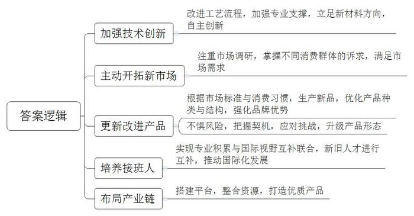
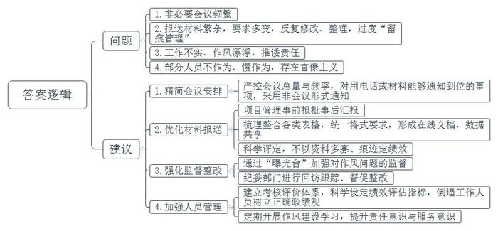
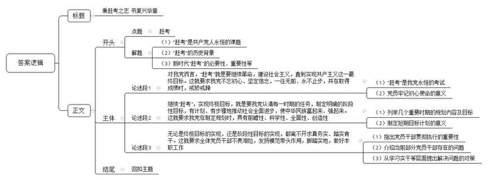

# 2021年公务员多省联考《申论》题（重庆一卷）

<!-- gwy:overview:start -->
> **重庆 · 2021 · 申论 · 一卷** ｜ 4 题 · 图片 4 处 · 答案随题折叠

导航：[题目](#题目) · [材料 1](#材料-1)
<!-- gwy:overview:end -->

> 候选采集稿。参考答案及解析来自粉笔页面，不代表官方答案或真实高分答卷；来源使用许可与原卷对应关系仍需人工核实。

## 给定材料

### 材料 1

1949年3月23日下午，西柏坡阳光明媚，毛泽东同志从住了10个月的小院里走出来，正好碰到迎上来的周恩来同志。他望着远处连绵雄伟的太行山，意味深长地说：“今天是进京赶考的日子。”周恩来答道：“我们都应当考及格，不要退回来。”毛泽东坚定地说：“退回来就失败了。我们决不当李自成！我们共产党人进北平，是要继续革命，建设社会主义，直到实现共产主义。”

2013年7月，习近平总书记在河北省调研时指出：“当年党中央离开西柏坡时，毛泽东同志说是‘进京赶考’。60多年过去了，我们取得了巨大进步，中国人民站起来了，富起来了，但我们面临的挑战和问题依然严峻复杂，应该说，党面临的‘赶考’远未结束。”

2020年10月，党的十九届五中全会审议通过了《中共中央关于制定国民经济和社会发展第十四个五年规划和二〇三五年远景目标的建议》。对于中国发展来说，“五年规划”是党治国理政的重要方式，也是量度中国步伐的显著路碑。从1953年新中国开始实行第一个“五年计划”，到2020年“十三五”规划完成，一个又一个五年，诠释了不同时期的历史标识，推动中华民族迎来了从站起来、富起来到强起来的伟大飞跃。

《管子·乘马》言：“是故事者生于虑，成于务，失于傲。不虑则不生，不务则不成，不傲则不失。”虽说前路并非一片坦途，但要坚信的是，一往无前、永不止步，戒骄戒躁，从来都是成就伟大事业的最正确姿态。

### 材料 2

永济村在解放前是“光山秃岭乱石沟，十人见了十人愁；旱涝风雹年年有，庄稼十年九不收”。全村有大大小小239条干涸贫瘠的沟壑，332座光秃秃的山头，森林覆盖率不到2%。50年代初，22岁的张一雁成为了永济村的党支部书记。为了改变生存环境，张一雁带着村民上山种树。由于经验不足，树的成活率极低，村民们泄了气。张一雁鼓励大家说：“我们改不了天，但我们可以换地！不管前方的路有多苦多难，只要方向正确，我们的日子一定会一天比一天红火。”

时光荏苒，转眼就到了2015年。这一年，从省里某部门退休的副厅级干部阎永强经过村干部换届选举成为了永济村新一任村支书。阎永强带回来的不仅是身份，还有服务家乡的赤子之心。他把自己的户口、党组织关系全部转回村里，“又成了一个真正的永济人。”“为了村里的发展，我不会领取任何报酬工资，只希望能像老书记一样，让家乡百姓的日子一天比一天好。”

阎永强向记者介绍起了永济村的致富史。1980年冬，张一雁率几名村干部到南方考察。所到之处，乡镇企业给农民带来的巨大变化令张一雁一行眼热心跳。经过慎重考虑，村委决定利用本地丰富的铁矿资源建一座钢铁厂，这也是省里当年的第一家村办企业。剪彩那天，当第一炉火红的铁水滚滚流出的时候，许多党员激动得哭了。后来，永济村又先后创办了铝合金厂、石料厂等企业。张一雁说：“办企业不同于当年我们上山栽树，不是光有憨劲就行。企业需要的是懂技术、会管理的人才。”这以后，永济村与许多大学联系，送青年农民到那里学企业管理、财务、农作物栽培等科学技术。

阎永强说，老书记最爱说的一句话是：“有了好头头，群众不发愁。”这好头头就是党支部，就是共产党员的先锋带头作用。在村办企业多年发展的背后，高耗能重污染的弊端日渐显现。2015年，村两委邀请了省农业大学农村发展研究所的专家，完成了新的村级规划。根据新规划，要淘汰一批落后产能，当时许多村民都担心“下岗”，不太情愿。全体党员以身作则，并动员家属、亲戚支持村两委的决定。2016年，村两委引来了展望农业科技有限公司，在铝合金厂的旧址上，建起一条年产500吨食用保健油的冷榨加工生产线，同时建立了一个集餐饮、住宿、观光于一体的田园综合体。广大村民不仅实现了“再就业”，收入还比过去翻了一番。

“小时候村周围到处是荒山秃岭，现在满眼郁郁葱葱。”2020年春，在永济村外不远处的一座山坡上，阎永强正带队搞绿化工程。“50年前为吃饱饭我跟着父亲拿着镰刀、背着松籽在永济的大山上种树，如今的永济村森林覆盖率超过87%，曾经的一座座荒山变成了一条条‘绿龙’，成了村民的‘绿色银行’。”阎永强说，“看到村里环境一天天变美，老百姓日子一天天富裕，我耳边常常回响起老书记那句话：‘只要方向正确，我们的日子一定会一天比一天红火’。”

### 材料 3

仙路控股有限公司是H县的一家食品企业，曾有过很长一段的高光时刻：1992年创办后，业绩一路高歌，旗下仙路鲜汁成为当时整个饮品行业中为数不多的百亿大单品，缔造了“中国零食龙头企业”的神话。如今，仙路公司却面临着“中年危机”。记者调查发现，仙路近年来的增长基本来自于几款多年前的老产品，而非新产品。仙路鲜汁这个单品几乎撑起了仙路的大半个江山，但鲜汁属于可替代产品，消费者对此类产品容易喜新厌旧。一位消费品行业专家告诉记者，仙路的第一代产品主要来自外国技术转移，借助中国经济快速发展和繁荣的东风，大胆生产扩张才获得后来的成绩。遗憾的是，一直以来，它主要依赖代工思维做品牌。如今，旗下主要品类经过多年发展，市场已经接近饱和，产品很难再有增量，业绩下滑是在所难免。

为了摆脱品牌老化的尴尬处境，仙路开启了疯狂的“中年变形记”。2017年，仙路一度推出了50多个新产品，几乎每月都有新产品上线，覆盖了咖啡、果汁、能量饮料等大类。但分析所谓的新品，不难发现只是在原来的产品结构上换汤不换药。对于仙路来说，面对庞大的市场，如果不快速找到第二增长曲线，则很容易在品牌优势耗尽后，走入无可挽回的滑落之路。

同样位于H县的国欣家居用品有限公司，是一家老牌的制造企业，产品是家居行业极其细分的市场——化纤丝，董事长陆建国与总经理陆欣是一对父女。

“以前的牙刷，化纤丝都是圆柱形的，触感和舒适度都不好，我们将圆柱改成圆锥，变得更加柔软，且便于口腔清洁和牙龈保护。”陆建国说，从柱体到锥体并非靠磨，而是需要一系列复杂的工艺流程来打造，看似很小的行业，却需要很强的专业支撑。90年代初，国内市场对此类化纤丝的需求量非常大，但全部依赖进口，且价格昂贵。

1993年，陆建国毅然选择下海，创办了国欣家居，立足新材料方向，做国产化替代。经过不断学习、实践，陆建国终于让生产出来的牙刷丝更加柔软舒适，并先后拿下了许多知名公司的订单。

牙刷丝领域站稳脚跟后，国欣家居将目光瞄向了刷丝原理都是相通的油漆刷丝市场。在做市场调研的时候，陆建国发现，质量好的油漆刷用的都是猪鬃、羊毛等天然材料，原材料比较匮乏。“当时的油漆刷使用场景相对单一，实际上油漆是水性还是油性，刷的是墙面还是地板，对油漆刷是有不同要求的。”陆建国说。沿着这一思路，国欣家居将产品从牙刷丝扩展到油漆刷丝，并拿下了油漆行业的数家大客户。

“公司每次产品的更新，都是有契机的。”陆建国告诉记者，2007年一家合作伙伴因企业战略变化，欲让国欣接管整个制刷项目。这对于迅速扩充公司实力无疑是良机，但是从只生产其中的丝，到生产整个刷具，这样的转型能否成功，经过反复地考量，国欣家居决定接受这个挑战。

陆建国告诉记者，国欣家居如今能够在市场如鱼得水，与女儿陆欣的接班助力有很大关联。“让女儿接班，并非我的本意，毕竟她会有更好的选择。”陆欣曾在一家世界500强企业工作，可是偶然间看到的一幕，让她改变了主意，“有一天下班已经很晚了，看到父亲戴着老花镜，还在跟客户打电话，说着并不流畅的英语，两鬓已经斑白，真的觉得我有责任回来帮助他。”国外的学习和工作经历，让陆欣跟着父亲一起打市场时显得游刃有余。父亲专业积累过硬，女儿胜在国际视野，两人互补联合，拿下了不少国际大单。

对于国欣家居的未来发展，陆欣也有自己的考量：“之前提到中国制造，大家的第一反应就是价格便宜，实际上不是我们做不出好产品，而是好产品需要供应链上下游的共同发力。”通过在化纤丝行业的精耕细作，陆欣看到了匠心的价值，她希望自己将来能够搭建一个平台，把好的资源整合起来，共同打造优质的产品。从产品部件，到生产成品，再到布局产业链，国欣家居在父女二代接力中也在发生着“蝶变”。

### 材料 4

“每天不是在开会，就是在开会的路上。”频繁又非必要的会议，让C市柳云村党支部书记老文很是头疼。老文工作的村子地处沿海，夏秋之际，台风频繁。“大家白天入户排查情况，宣传防台风要求，还得抽时间应付各种会议。”老文告诉记者，“有的会议只是花几分钟传达一下文件精神，其实用电话或者材料就能通知到位。”

“刚刚签订战略合作协议，实质项目还没落地，就要准备一堆汇报材料。”C市大华街道干部小李对报送“材料”的苦恼，也引起了扶贫干部小吴的共鸣。小吴2018年起驻村负责57户建档立卡贫困户的工作。回想近两年的工作，小吴说，驻村扶贫工作不易，但最让人头疼的，却是应付各项检查以及反复整理、填写、修改各种资料和表格。“最多的时候，我手里同时有20多个表格要填。有一个表，因为不同要求反复修改，弄了大半年。”如果遇到过于重视迎检资料的领导，可能出现以资料多寡、“痕迹”是否明显来定绩效的情况，基层干部就不得不加班加点找资料，熬更守夜补台账。

2020年，C市纪检监察机关紧扣“四风”问题，设立了转变作风“曝光台”。采取有奖举报、外聘专家、记者采访等形式，对工作不实、作风漂浮的给予定期曝光。被曝光的单位或个人，市纪委监委将回访跟踪、督促整改。市新区小学师生则是这一举措的直接受益者。该小学位于上塘路交叉口，2018年新建了一座高架桥，由于未设置隔音屏，800多名师生不得不在滚滚车流带来的噪音中上课。工程完成伊始，学校和学生家长就多次反映问题，希望加装隔音屏。该街道住建科负责人表示，隔音屏属于高架桥附属工程，高架桥是谁建的，隔音屏就该谁来建，而建设主体市建委则表示，该段高架已移交市城管委养护，应由该委负责加装隔音屏。市城管委称，隔音屏在工程建设过程中，是由原建设单位负责实施的，需要增补应由属地政府负责落实。这次一上“曝光台”，市建委马上邀请市信访、城管、环保等部门和街道进行协调。一个多月后，长达近两年的问题得以解决。

市纪委张副书记说，在作风建设方面，近期，C市一举推出了“六项机制”，重点整饬“闭门施策”“推诿扯皮”“政令空转”“留痕管理”“督考过多”“文山会海”等六大顽疾。“我对这样的措施表示肯定。”C市党校刘教授说，不少面向群众的基层政府人员，依然存在不作为、慢作为等现象，而这绝不是小事，甚至会在一定程度上影响政府威信。

### 材料 5

“你好小福，我想订餐。”78岁的孙奶奶按下开关，向机器人小福发出语音指令。“有两荤两素加米饭13元的和两荤一素加米饭10元的两种，您选哪一种？”稚嫩的童声清脆悦耳。“13元的。”“好的，稍后会有工作人员与您联系。”不一会儿，福龄老年服务中心工作人员刘大姐拎着盒饭，一路小跑来到孙奶奶的家。“对我们老人来说这个太好了！我不会用手机，现在只需要对机器人发个语音指令，立马有人上门。”孙奶奶说。

变化，缘于智慧养老服务平台的建成。2019年，坐落于F市北区物联网产业园的乐享科技有限公司利用物联网、云计算及大数据等技术打造了这一平台。该平台的建成是F市绘制“数字城市”蓝图的靓丽一笔。乘着“数字中国”建设的东风，F市抓住信息化先机，积极拥抱数字浪潮，从成立“数字城市”建设领导小组到制定“数字城市”中长期发展规划；从“一枝独秀”的软件园到“百花齐放”的数字经济产业；从最早的办事“跑多趟”到如今“一趟不用跑”……“数字城市”建设蓬勃发展。

2000年6月，F市东区软件园创业楼迎来首批入园企业。“当时，园区内的研发楼宇只有寥寥几栋，产业规模仅12.7亿元。”东区软件园管委会负责人回忆道。如今，东区软件园产业发展突飞猛进，总收入已超千亿元。据F市汪副市长介绍，在空间布局上，F市重点打造环中心城区“东区软件园-西区高新园-北区物联网产业园-南区大数据产业园”的数字经济创新集聚带，带动关联产业发展。

在推进“数字城市”建设过程中，F市坚持人民城市为人民的发展理念，不断拓展众多与百姓息息相关的数字化应用场景。“易民”APP是F市全力打造的数字惠民品牌，居民足不出户轻点手机APP，日常生活用品最快10多分钟送到家，出门购物、地铁进站，“刷脸”几秒钟即可完成付款。上线两年多来，该APP已发展成F市移动互联网的统一便民入口，为市民提供各类高频的便民服务、公共服务、政务服务等近80项。

打开F市数字城管系统，一张覆盖全市所有公用设施、道路交通、市容环境等城市管理项目的“电子地图”便呈现在眼前。在城区水系联排联调中心，工作人员可对城区上千个库、湖、池、河、闸、站实现一体化在线监测实时分析和远程调控。超级“大脑”交通大数据平台则为全市交通编织了一张智慧大网，实现点对点快速处置堵点。

“数字城市”在提高城市治理和人民生活水平的同时，也为F市改造提升传统产业、推动新旧动能转换提供了新机遇，如锦绣家纺公司依托数字大脑，实现“产、供、销、人、财、物”数据的实时获取和智能挖掘，让生产更高效智能；福仙茶业集团建立了物联网追溯体系，对基地种植到终端销售全过程进行实时监控。

产业更兴旺，城市更智慧，生活更美好。F市市委李书记表示，目前，数字经济占地区生产总值的比重提高到45%，数字经济上市企业占全市的一半。展望未来，李书记说，F市将更好地使用数字技术，不断释放数字红利，让人民群众畅享数字城市建设成果。

## 题目

### 第 1 题

**根据“给定资料**3**”，谈谈蝶变中的国欣公司给处在中年危机的仙路公司带来什么启示。（15分）**

关联材料：材料 3

作答要求：

要求：紧扣材料，分析全面；条理清晰，逻辑性强；不超过250字。

第 1 题 · 答案与解析

**参考答案（粉笔题库参考内容）**

1.加强技术创新。改进工艺流程，加强专业支撑，立足新材料方向，自主创新。

2.主动开拓新市场。注重市场调研，掌握不同消费群体的诉求，满足市场需求。

3.更新改进产品。根据市场标准与消费习惯，生产新品，优化产品种类与结构，强化品牌优势；不惧风险，把握契机，应对挑战，升级产品形态。

4.培养接班人。实现专业积累与国际视野互补联合，新旧人才进行互补，推动国际化发展。

5.布局产业链。搭建平台，整合资源，打造优质产品。

**解析**

**参考答案说明：**本参考答案从“加强技术创新”“主动开拓新市场”“更新改进产品”“培养接班人”“布局产业链”五个方面展开。各条要点之间在内容上相互并列，没有交叉。

**考点**：经验启示类

**来源**：2021年公务员多省联考《申论》题（重庆一卷）

### 第 2 题

**根据****“给定资料**4**”，归纳概括C市有关部门、单位存在的形式主义问题，并提出相应的解决办法。（20分）**

关联材料：材料 4

作答要求：

要求：紧扣资料，条理清晰，有可行性。不超过300字。

第 2 题 · 答案与解析

**参考答案（粉笔题库参考内容）**

问题：1.非必要会议频繁。2.报送材料繁杂，要求多变，反复修改、整理，过度“留痕管理”。3.工作不实、作风漂浮，推诿责任。4.部分人员不作为、慢作为，存在官僚主义。

建议：1.精简会议安排。严控会议总量与频率，对用电话或材料能够通知到位的事项，采用非会议形式通知。2.优化材料报送。项目管理事前报批事后汇报；梳理整合各类表格，统一格式要求，形成在线文档，数据共享；科学评定，不以资料多寡、痕迹定绩效。3.强化监督整改。通过“曝光台”加强对作风问题的监督；纪委部门进行回访跟踪、督促整改。4.加强人员管理。建立考核评价体系，科学设定绩效评估指标，倒逼工作人员树立正确政绩观；定期开展作风建设学习，提升责任意识与服务意识。

**解析**

**参考答案说明：**本参考答案按照“问题”和“建议”两方面进行了分类、分条撰写。先从“会议频繁”“材料繁杂”“工作不实”“人员管理”四个方面对问题进行了展开，又从“精简会议安排”“优化材料报送”“强化监督整改”“加强人员管理”四个方面阐明了对策建议。各条要点之间在内容上相互并列，没有交叉。

**考点**：提出对策类

**来源**：2021年公务员多省联考《申论》题（重庆一卷）

### 第 3 题

**省里准备召开数字城市建设工作的座谈会，如果你代表****F市进行发言，请根据“给定资料**5**”写一份经验交流发言提纲。（25分）**

关联材料：材料 5

作答要求：

要求：

（1）紧扣资料，要点完整；

（2）内容具体，条理清晰；

（3）不超过500字。

第 3 题 · 答案与解析

**参考答案（粉笔题库参考内容）**

建设“数字城市” 畅享美好生活

乘着“数字中国”建设的东风，我市抓住信息化先机，成立领导小组制定发展规划，发展数字经济产业，优化政务服务，推动“数字城市”建设蓬勃发展。经验介绍如下：

一、建设智慧养老服务平台。政企合作，依托机器人等智能硬件，提供适老化服务。二、打造创新集聚带。建设软件园，带动关联产业发展，形成集聚效应。三、拓展民生领域数字化应用场景。坚持人民城市为人民的发展理念，推出数字惠民APP，实现在线购买、刷脸支付，打造统一便民入口，提供高频便民服务、公共服务、政务服务。四、开发数字城管系统，城市管理项目全覆盖。一体化在线监测、实时分析和远程调控城区水系；建立交通大数据平台，实现点对点快速处置堵点。五、改造提升传统产业，推动新旧动能转换。依托数字大脑，实时获取和智能挖掘生产销售环节的各项数据；建立物联网追溯体系，实时监控产销全过程。

“数字城市”建设提高了城市治理和人民生活水平，推动了产业升级，“数字经济”生产总值和上市企业比重攀升。未来，F市将更好地使用数字技术，不断释放数字红利，让人民群众畅享“数字城市”建设成果。

**解析**

**参考答案说明：**（1）本参考答案包括标题、正文，符合发言提纲的格式要求。（2）正文部分，一方面，内容上，围绕着“F市‘数字城市’建设”这一主题，开头写到了F市“数字城市”建设的背景和宏观做法；主体部分从“建设智慧养老服务平台”“打造创新集聚带”“拓展民生领域数字化应用场景”“开发数字城管系统”“改造提升传统产业”五个方面介绍了经验；最后结尾部分总结了F市“数字城市”建设的意义以及对未来的展望。另一方面，形式上，本参考答案做到了分段、分条撰写，整体上条理较为清晰。

**考点**：总结类

**来源**：2021年公务员多省联考《申论》题（重庆一卷）

### 第 4 题

**结合给定材料，以****“****赶考****”****为主题，联系实际，自拟题目，写一篇文章。（****40分）**

关联材料：材料 1、材料 2、材料 3、材料 4、材料 5

作答要求：

要求：

（1）观点正确，见解深刻；

（2）内容全面，结构完整；

（3）思路清晰，语言流畅；

（4）字数在1000-1200字。

第 4 题 · 答案与解析

**参考答案（粉笔题库参考内容）**

**秉赶考之志 书复兴华章**

中国共产党的执政之路就是“赶考之路”，这是毛泽东同志高瞻远瞩提出的重大命题，也是一代又一代共产党人薪火相传的永恒课题。新中国成立初期，共产党人进京赶考，树立继续革命，努力建设社会主义，直到实现共产主义这一终极目标。经过几十年发展，我党带领人民群众在一个又一个短期规划中取得瞩目成就，但也面临各种各样的问题与挑战，这就需要我党继承“赶考精神”，回答好新时代考题，成就民族复兴的伟大事业。

**对我党而言，****“赶考”就是要继续革命，建设社会主义，直到实现共产主义这一最终目标。这就要求我党不忘初心、坚定信念，一往无前、永不止步，并在取得成绩时，戒骄戒躁。**“赶考”是历史赋予我党的考试，是人民对我党永不谢幕的考试。在这场“大考”中，我党唯有牢记“赶考”使命，将国家发展、人民幸福放在心头，常怀赤子之心，才能以顽强的意志、过硬的作风，为建设社会主义，实现共产主义伟大理想而奋斗。唯有勇往直前，躬行实践，才能敢于斗争，敢于担当，才能吸取经验，不断成长，才能排除万难，战胜一切险阻。唯有在成就面前戒骄戒躁，始终理性冷静，才能不断自我革新、挑战未来，才能取得最终的胜利。

实现共产主义是一个漫长的过程，需经历众多发展阶段。而每个阶段都有不同的任务、不同的问题，这就要我党不懈努力，继续“赶考”。

**继续****“赶考”，实现终极目标，就是要我党认清每一时期的任务，制定明确的阶段性目标，有计划、有步骤地推动社会全面进步，使中华民族富起来、强起来。这就要求我党在制定规划时，具有前瞻性、科学性、全面性、创造性。**从“一五”计划集中力量进行工业化建设，奠定工业化、现代化基础，到“十一五”计划促进区域协调发展，促进国民经济发展，再到“十三五”规划实施创新驱动发展战略，实现脱贫攻坚，确保经济高质量发展……正是一个又一个阶段性计划，才为国家建设提供方向，才夯实了社会主义现代化的根基。

**无论是终极目标的实现，还是阶段性目标的实现，都离不开求真务实、踏实肯干。这就要求全体党员干部不畏艰险，发扬模范带头作用，脚踏实地，做好本职工作。**无论是高瞻远瞩的长远规划，还是短期的阶段性计划，最终都要党员干部认真贯彻执行。然而，当前部分党员干部忽视岗位职责，奉行形式主义，消极对待群众，长此以往，必会削弱我党执行力，影响政策规划落地。为此，全体党员要摒弃形式主义、官僚主义等不良作风，带头垂范，坚定正确方向，在本职岗位上兢兢业业、无私奉献，推动社会事业稳步发展。

“赶考”之路是一条闯关路，这路并非坦途。面对成绩，我们不能骄傲，面对挑战，我们不能退缩。我们要肩负时代重任，为努力实现中华民族伟大复兴而奋斗不止！

**文章分析**

**秉赶考之志 书复兴华章**

【**标题的优点：**标题直接突出“赶考”这一主题，简明、清晰。】

（1）中国共产<u>党的执政之路</u>就是“赶考之路”，这是<u>毛泽东同志高瞻远瞩提出的重大命题</u>，也是一代又一代<u>共产党人薪火相传的永恒课题</u>。（2）<u>新中国成立初期</u>，共产党人<u>进京赶考</u>，树立<u>继续革命</u>，<u>努力</u><u>建设社会主义</u>，直到实现共产主义这一终极目标。（3）经过几十年发展，我党带领人民群众在一个又一个短期规划中取得瞩目成就，但<u>也面临</u><u>各种</u><u>各样的</u><u>问题</u><u>与</u><u>挑战</u>，这就<u>需要</u><u>我党继承</u><u>“赶考精神”</u>，回答好新时代考题，<u>成就民族复兴的伟大事业</u>。

【**开头的优点：**★内容方面。范文的开头是紧扣题目给定的“赶考”这一主题展开的。首先，指出“赶考”是共产党人永恒的课题；其次，介绍了“赶考”的历史背景；最后，阐述了新时代“赶考”的必要性、重要性。★文字表达方面。使用了“这是……也是……”“但”等连接词，使语言表达有逻辑性。】

**对我党而言，****“赶考”****就是要继续革命，建设社会主义，直到实现共产主义这一****最终目标。这****就****要求我党不忘初心****、****坚定****信念，****一往无前****、****永不止步****，****并****在取得成绩时，戒骄戒躁****。**（1）“赶考”是<u>历史赋予我党的考试</u>，<u>是人民对我党永不谢幕的考试</u>。在这场“大考”中，（2）我党唯有<u>牢记</u><u>“赶考”使命</u>，<u>将国家发展、人民幸福放在心头</u>，<u>常怀赤子之心</u>，才能以顽强的意志、过硬的作风，为建设社会主义，<u>实现共产主义伟大理想而奋斗</u>。唯有<u>勇往直前</u>，躬行实践，才能<u>敢于斗争</u>，<u>敢于担当</u>，才能吸取经验，不断成长，才能排除万难，<u>战胜一切险阻</u>。唯有在成就面前<u>戒骄戒躁</u>，始终理性冷静，才能不断自我革新、挑战未来，才能取得最终的胜利。

【**论述段****1的优点：**★观点句：范文的观点句是紧扣“赶考”这一文章主题提出的。形式上，它在段首处直接写出，位置突出，容易发现。内容上，关键词突出，内容要点明确，可以明显看出它是从“最终目标”的角度出发，阐述“赶考”的内涵。★论述内容：（1）指出“赶考”是我党永恒的考试；（2）从三个层面指出党员牢记初心使命的意义。注意：以上两个方面层次清晰，论述的针对性强。在论述方法上主要采用了讲道理、引用名言等方式，增强了论证的说服力。】

实现共产主义是一个漫长的过程，需经历众多发展阶段。而每个阶段都有不同的任务、不同的问题，这就要我党不懈努力，继续“赶考”。

**继续****“赶考”，实现终极目标，就是要我党认清每一时期的任务，制定明确的阶段性目标，有计划、有步骤地推动社会全面进步，使中华民族富起来、强起来。这就要求我党在制定规划时，具有前瞻性、科学性、全面性、创造性。**（1）从<u>“一五”</u>计划集中力量<u>进行工业化建设</u>，<u>奠定工业化、现代化基础</u>，到<u>“十一五”</u>计划<u>促进区域协调发展</u>，促进<u>国民经济发展</u>，再到<u>“十三五”</u>规划<u>实施创新驱动发展战略</u>，实现脱贫攻坚，<u>确保经济高质量发展</u>……（2）正是一个又一个阶段性计划，才为国家建设提供方向，才<u>夯实了</u><u>社会主义现代化</u><u>的根基</u>。

【**论述段****2的优点：**★观点句：范文的观点句是紧扣“赶考”这一文章主题提出的。形式上，它在段首处直接写出，位置突出，容易发现。内容上，关键词突出，内容要点明确，可以明显看出它是从“阶段性目标”的角度出发，阐述“赶考”的内涵。★论述内容：（1）列举了几个重要时期“五年规划”的内容及目标；（2）总结了制定短期目标计划的意义。注意：以上两个方面层次清晰，论述的针对性强。在论述方法上主要采用了讲道理和举例子相结合的方式，使内容更加充实。】

**无论是终极目标的实现，还是阶段性目标的实现，都离不开求真务实、踏实肯干。这就要求全体党员干部不畏艰险，发扬****模范带头****作用****，****脚踏实地，做好本职工作。**（1）无论是高瞻远瞩的<u>长远规划</u>，还是短期的<u>阶段性计划</u>，最终<u>都要党员干部认真贯彻执行</u>。（2）然而，当前<u>部分党员干部忽视岗位职责</u>，奉行<u>形式主义</u>，<u>消极对待群众</u>，长此以往，必会<u>削弱我党执行力</u>，<u>影响政策规划落地</u>。为此，（3）全体党员要<u>摒弃</u>形式主义、官僚主义等<u>不良作风</u>，<u>带头垂范</u>，<u>坚定正确方向</u>，在本职岗位上<u>兢兢业业</u>、<u>无私奉献</u>，推动社会事业稳步发展。

【**论述段****3的优点：**★观点句：范文的观点句是紧扣“赶考”这一文章主题提出的。形式上，它在段首处直接写出，位置突出，容易发现。内容上，关键词突出，内容要点明确，可以明显看出它是从“落实实干”的角度出发，阐述“赶考”的内涵。★论述内容：（1）指出党员干部贯彻执行的重要性；（2）介绍了当前部分党员干部存在的问题；（3）从学习实干等层面提出解决问题的对策。注意：以上三个方面层次清晰，论述的针对性强。在论述方法上主要采用了讲道理和举例子相结合的方式，使内容更加充实。】

【**论述段之间的关系：**★内容的内在逻辑：论述段1从“最终目标”的角度指出赶考的内涵，论述段2从“阶段性目标”的角度指出赶考的内涵，论述段3从“落实实干”的角度指出赶考的内涵，三个论述段整体按照“理论-实践”的思路进行论述。】

“赶考”之路是一条闯关路，这路并非坦途。面对成绩，我们不能骄傲，面对挑战，我们不能退缩。我们要肩负时代重任，为努力实现中华民族伟大复兴而奋斗不止！

【**结尾的优点**：范文的结尾回扣了“赶考”这个主题，语言精悍，不拖沓。】

**解析状态：unknown（来源未提供）**

**考点**：文章写作题

**来源**：2021年公务员多省联考《申论》题（重庆一卷）

