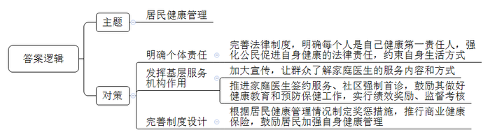
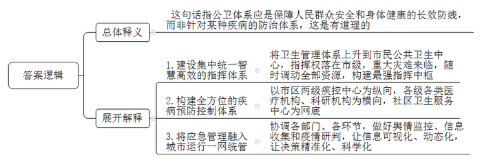
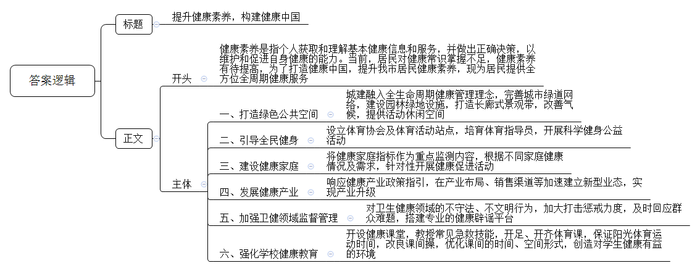
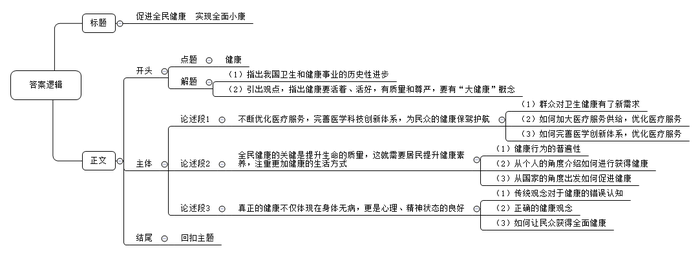

# 2021年重庆市集中选调生考试《申论》题

<!-- gwy:overview:start -->
> **重庆 · 2021 · 申论 · 集中选调生** ｜ 4 题 · 图片 4 处 · 答案随题折叠

导航：[题目](#题目) · [材料 1](#材料-1)
<!-- gwy:overview:end -->

> 候选采集稿。参考答案及解析来自粉笔页面，不代表官方答案或真实高分答卷；来源使用许可与原卷对应关系仍需人工核实。

## 给定材料

### 材料 1

全家总动员，体验趣味十足的闯关挑战赛；与好友相约，去体育馆切磋球技；参加郊区徒步活动，边行走边欣赏沿途美景……2020年8月8日，全国第十二个全民健身日到来之际，各地纷纷举办形式多样的健身活动，从线上到线下，健身的热情和运动的快乐正在回归民众的生活。近年来，我国经常参加体育锻炼的人数约达到4亿，马拉松、广场舞等运动项目持续普及并带动产业发展，在培育经济增长新动能方面潜力巨大。

当前我国人口老龄化加速，60岁以上人口已达2.5亿，2030年将达3.7亿，2050年预计达4.87亿。人口老龄化之外，我国疾病谱、生态环境、生活方式也在不断变化。

健康不仅是身体无病，也是心理、精神等的全面健康，涉及医药卫生、社会服务、环境建设等各个方面。世界卫生组织发布的健康公式显示，100%健康等于60%生活方式、17%环境、15%遗传和8%卫生服务。

2021年3月，由中科院心理研究所和社会科学出版社联合发布的《中国国民心理健康报告（2019—2020）》显示，2008年东部地区存在抑郁风险的人数占比仅比中西部地区低2.6%，到2020年这个差距拉大到8%。城市户籍人口心理健康状况显著优于农村户籍人口，低收入、低学历、无业与失业人群的心理问题更为突出。

“春节至今，我家添置了好些新家伙，如空气净化器、消毒柜、除菌洗碗机、按摩器材、血氧仪、制氧机等，虽然花了不少钱，但为了家人的健康，值！”家住江西省南昌市南昌县的王某说道。

中国社会科学评价研究院院长荆某认为：近年来，随着国内政策红利持续释放，居民消费结构不断升级，人们更加注重健康的生活方式，也愿意在健康消费上加大投入。2020年健康产业增加值约达到12万亿元，占GDP的比重超过10%。位于海南琼海的博鳌乐城国际医疗旅游先行区，是国务院特批的国内首个医疗产业旅游先行区。“这里环境优美、气候宜人。我们引进国际最新医疗设备，与预防医学、传统中医药学等相结合，让顾客既放松身心，又康养治病。”先行区相关负责人李某说，医疗旅游为人们提供更高质量的健康服务。“我们这里有两家三级综合医疗机构，全国已有30万会员。”

疫情期间，在湖北方舱医院，AI辅助诊断技术助力新冠肺炎CT筛查，几秒钟就能完成对数百张CT影像的AI判定，1分钟内就能为医生提供辅助诊断参考，大幅提升检查效率；微信、支付宝、新浪微博、好大夫等均上线在线问诊平台，各地定点医院也开设了线上问诊服务。

党的十九大报告提出，我国社会主要矛盾已经转化为“人民日益增长的美好生活需要和不平衡不充分的发展之间的矛盾”。人民群众多层次多样化健康需求还会持续快速增长，国家对医学科技创新也将提出更高要求。与之相比，我国医学科技创新体系尚未形成整体优势，如基础研究能力和原始创新能力亟待加强。2020年9月，习近平总书记在教育文化卫生体育领域专家代表座谈会上强调，要把人民健康放在优先发展战略地位；在科学家座谈会上提出“四个面向”要求，将“面向人民生命健康”列为“四个面向”之一。

这次新冠肺炎疫情防控斗争更是让人们认识到，“上工治未病”。如今，人们不仅要求看得上病、看得好病，更希望不得病、少得病；人们不再满足于生命的长度，更追求生命的质量；不仅满足于“躯体没有疾病”，更将其扩展为“身体、精神等的良好状态”……显然，<u>健康已不等同于“活着”，而是要“活好”“有尊严地活着”</u>。

### 材料 2

2020年4月，H市出台《关于完善重大疫情防控体制机制健全公共卫生应急管理体系的若干意见》，围绕构建保障人民群众安全和身体健康的长效防线，提出到2025年，使H市成为全球公共卫生最安全城市之一。

“应对重大公共卫生事件，必须要有完整而且强有力的防控体系，而防控体系的核心是灵敏高效的指挥中心。”H市某相关部门负责人表示。强健的公卫体系，应该是永久的安全堡垒，而非因为某种疾病临时搭建的“板房”。建设集中统一、智慧高效的公共卫生应急指挥体系，不是仅限于过去卫生系统针对某一种传染病的单一卫生管理指挥体系，而是上升到建设市民公共卫生中心，指挥权在市一级层面。指挥系统的提升，对今后重大灾难的应急管理来说，意味着可以随时调动一切资源，为全市公共卫生体系搭建“最强大脑”。

“目前我市已形成以市区两级疾控中心为纵向，以各级各类医疗机构、科研机构等为横向，以社区卫生服务中心为网底的疾病预防控制网络体系。”H市某医院副院长黄某说。多个街道兴建“卫生应急平安屋”，日常向社区居民宣传各类防灾减灾急救知识，普及推广应急物品，在灾难发生时可作为社区紧急救援临时指挥部。

“在社区、机场、综合性医院，遍布全市的发热门诊，就是公共卫生体系的第一个点。居民生病找医生，我们的体系就启动了。”黄某谈道，此次抗击疫情积累的经验，有助于建设世界一流的公共卫生体系，包括建设更完备的发热门诊、发热哨点等，构成更灵敏的网络。

H市计划从三方面完善疫情预警和直报体系：一是在现有病例监测、症候群监测基础上，完善基于大数据的综合监测系统，形成多点触发、动态灵敏的预警研判模式；二是完善公共卫生“苗子事件”监测信息系统；三是加强监测数据深度挖掘，基于人工智能开发传染病智能化辅助诊疗技术。

疫情以来，H市利用大数据等技术，分区域、分等级评估公共卫生安全风险，实现了应急工作精准高效，努力减少疫情对正常生产生活秩序的影响。如根据所处区域疫情风险，将每一个社区防疫单元划分为“红、黄、绿”三个等级，城市管理者可根据红、黄、绿不同防疫风险等级，统筹构建科学合理的物流线路、垃圾转运线路、交通线路等。

此外，H市探索将卫生应急管理融入“城市运行一网统管”，协调各部门、各环节，做好舆情监控、信息收集和疫情研判，发挥各类组织在突发公共卫生事件中的作用。通过大数据等手段让疫情信息可视化、动态化，让防控决策精准化、科学化，提高公共卫生应急体系运行效率。

疫情期间，面对社区居民的各类就诊难题，H市M社区卫生服务中心“智慧家医”一直在线，为居民答疑解惑。“社区卫生服务中心人员长期和老百姓打交道，平时除了看病，更要进行健康教育。”M社区卫生服务中心负责人张某谈道。在H市F社区卫生服务中心，每个全科医生都配有一名护士。护士们工作强度很大，全科医师葛某说，避免社区医生和护士超负荷工作的根本措施是增员，但这件事做起来很难。社区卫生服务中心人才流失率较高，部分高学历人才熬不过低工资和对未来发展空间的担忧，选择了离开。“人都想往高处走，让基层的岗位更有吸引力，才是留住人才的根本。”葛某说。

未来，要逐步推广公卫医师规范化培训，通过基础建设，改善实验室业务用房和功能布局，建设一批对标国际先进水平的实验室，H市疾控中心负责人李某表示。

### 材料 3

日前，专家们就某话题展开讨论。

专家A：与全球所有快速发展的国家一样，极大丰富的物质生活带来了一系列新的健康问题：随着工业化、城镇化、人口老龄化进程加快，我国慢性病患病人数已居全球之首。我国现有2.5亿多高血压患者，糖尿病患者超过1亿，心脑血管疾病、癌症、慢性呼吸系统疾病、糖尿病等慢性非传染性疾病导致的死亡人数占总死亡人数的88%。

专家B：医改30年来，过分强调政府、机构的医疗救治责任和公民享有医疗的权利，个体责任几乎被忽略，慢性病可防可控的特征没有充分体现。国人对医疗的需求和要求很高，希望就医随到随看，不但要看好，最好不花多少钱，但人们在对自身生活方式的约束和健康保障的制度设计上几乎不作为。

专家C：制度设计没有体现“每个人是自己健康第一责任人”的理念，反映社会和民众长期死抱“最后一公里的救治模式”不放，没有把关注和工作重点真正转到减少生病的人和延缓已有病程上，民众的健康意识、管好“最初一公里”的观念远未被唤醒。

专家D：没有民众个人健康意识的觉醒，慢性病发病人数就不会下降，全民健康促进的目标难以落地，“大健康产业”的群众基础和市场也会缺乏。

专家A：我们一直倡导和推进家庭医生签约服务，让基层社区卫生服务机构发挥百姓“健康守门人”的作用，对居民及其家庭实行全面的、连续的、有效的医疗保健服务。

专家D：就家庭医生签约服务，我讲讲我的经历，我退休后把执业地点从大医院转到某社区医院，医院给在社区建立健康档案的女性居民发短信，告知她们来了一位妇产科主任医师，如果觉得合适可以跟我签约。结果发出8000多条短信，来签约的不到40人，一年中我接到的咨询电话不超过10个。

专家C：居民有病首先想到大医院挂专家号，更无从了解家庭医生的服务内容和方式，使得基层卫生服务机构“健康守门人”的作用形同虚设。

专家B：我举一个日本的例子，2008年日本厚生劳动省出台法规，强制政府机关和企业给40岁至74岁的员工定期测量腰围，腰围超标者必须检查血糖、血压、血脂。超标者或认定为代谢综合征的必须在3个月内自行减肥，若减肥失败，必须接受饮食控制教育。此外，政府还对推动雇员减肥不力的地方政府或私人企业处以罚款。

专家D：建议在相关法律中，加上“每个公民是健康第一责任人”的有关论述，强化公民促进自身健康的法律责任，为制定相应法规制度提供上位法依据，也为健康中国“最初一公里”提供法律依据。

专家A：让社区医生成为居民健康的“第一守门人”，不能仅仅停留在“鼓励居民与家庭医生签约”上。医学是一门实践科学，好大夫缺少实践也会退步，社区首诊率低与基层医生诊疗水平低之间会形成恶性循环。可借鉴发达国家经验，推行“社区强制首诊”，除急重症，其他疾病必须由家庭医生转诊至大医院相关专科，让家庭医生真正了解自己的辖区居民，真正建立医患关系的“熟人模式”。

专家C：可鼓励家庭医生做好健康教育和预防保健工作，让居民少生病、不生病。在家庭医生完成保障居民健康工作任务前提下，把结余费用作为他们的绩效奖励，有助于提高基层工作者主动开展疾病预防工作、控制不合理医疗成本的积极性。同时，相关部门要对家庭医生进行监督考核。

专家A：可采取类似车险的制度设计，将健康管理得差、经常使用医保的居民和健康管理得好、不经常使用医保的居民区分对待，鼓励好的，鞭策不好的。

专家B：同意这一观点，建立类似汽车保险中“少出险，少缴费”的激励措施，实现“小病少报销，大病多保障，不病有奖励”，鼓励居民加强自身健康管理。商业健康保险在产业链布局上具有资源配置优势，最具有保障投保人少生病、生小病的动力，以及汇聚最新健康理念、技术和资本的能力。

### 材料 4

在芬兰，冬季严寒漫长，由于人们饮食中摄入的蔬菜少、盐分多，加上吸烟盛行等，从二战后到上世纪六七十年代，芬兰不仅心脑血管疾病高发，而且糖尿病、高血压、高血脂等病早早攻破青壮年的防线，导致死亡、残疾等过早发生。为寻求改变，芬兰开始由政府主导，对农业、食品、盐、烟等消费都实行政策引导，创造出心脑血管疾病发病率较30年前下降80%的健康奇迹。

2016年8月，习近平总书记在全国卫生与健康大会上发表重要讲话指出，没有全民健康，就没有全面小康。2017年10月，健康中国正式作为国家战略，写入党的十九大报告。2019年10月，十九届四中全会提出强化提高人民健康水平的制度保障。2020年10月，党的十九届五中全会审议通过的《中共中央关于制定国民经济和社会发展第十四个五年规划和二〇三五年远景目标的建议》提出，全面推进健康中国建设，强调要为人民提供全方位全周期健康服务。健康，正在从名词变成动词，运行在治国理政政策的深处。

2016年，C市东湖绿道成为国内首个被联合国人居署认定的“改善中国城市公共空间示范项目”。有市民说，绿道就是幸福道，绿道越多，城市越有看头，生活也越有兴头。“现在我市每个区都有自己独具特色的绿道网络，无论从C市哪个地点出发，步行15分钟，都可以走上城市绿道悠闲漫步、自在骑行。”市相关部门宣传处处长刘某说，把全生命周期健康管理理念贯穿在城市规划、建设、管理的全过程、各环节，已成为共识。据介绍，C市近年大力做好生态修复、环境保护、绿色发展三篇文章，根据规划，市8个区，每个区新增绿道不少于10公里。一系列园林绿地设施，将打通区域间生态廊道，缓解因开发强度高、人口密集造成的热岛效应，改善城市小气候。长廊式的景观带，也将给市民创造更多户外活动、休闲空间。

截至目前，C市市区两级共有单项体育协会近200个，全民健身体育活动站点4000余个，拥有5个以上体育健身站点的街道占比100%，社区站点覆盖率达98%。3.5万多人的各级各类社会体育指导员遍布城乡，广泛开展科学健身公益活动，让更多健身群众找到了组织、找到了归属感。

2019年7月，国务院印发《健康中国行动（2019-2030）》等系列文件，据介绍，健康中国行动共涉及15个专项、三大方面。2020年10月，国家卫生健康委办公厅等联合印发的《关于开展以健康家庭建设为重点深化创建幸福家庭活动的通知》指出，要在人口与家庭发展动态监测中，将有关健康家庭指标作为重点监测内容，动态掌握，精准施策。根据不同家庭的健康状况和不同成员的健康需求，一家一策开展针对性强的健康促进活动。

政策是产业发展的第一驱动力，健康中国行动的颁布，给各级政府和各行业都带来了全新的机遇和挑战。产业要根据政策的指引，在产业布局、销售渠道等部分加速建立新型业态，实现产业升级，跟上时代的潮流，某知名媒体健康事业部总监马某谈道。

### 材料 5

“一家人吃饭，还要分着吃，一点也不热闹。”听说儿媳要在家里搞分餐制和公筷制，在C市帮忙带孙子的李某急了。一些长辈旧观念一时难以改变，分餐容易成为家庭代际矛盾爆发的导火索，在C市工作的周某讲道。

从2008年开业就坚持在包间内每个餐位放两双筷子，一双夹菜，一双吃饭。10年来，一直坚持这个做法，但是实际运行情况并不是很理想，在C市经营两个餐饮品牌的赵某介绍。

“现在，很多人都喜欢订外卖，看上去方便快捷，但容易形成膳食单一的饮食结构。”专家张某说，家庭成员一起用餐，膳食会更加丰富。

这两年横纹肌溶解综合征病患增多，某医院急诊科医生江某称，这一病症的主因是横纹肌受损，导致细胞内容物漏出，就像肌肉“溶解”掉了一样，严重者甚至存在肾衰竭和猝死风险。“出现这一病症的人群，以热爱健身、长期‘撸铁’的年轻人为主，他们急于塑形，忽略了正确的运动量和运动姿势，从而导致运动损伤。”

几年前自己曾根据病情让一名胃癌患者先化疗再手术，但这位患者在微信朋友圈看到化疗对身体危害大，于是未遵医嘱就选择去旅游。一年多后，病情加重，到手术时癌细胞已严重扩散，医生田某谈道。

专家指出，健康素养，是指个人获取和理解基本健康信息和服务，并做出正确决策，以维护和促进自身健康的能力。2019年，国家卫生健康委在31个省（自治区、直辖市）336个县区级监测点开展的全国居民健康素养监测结果显示：2019年全国城市居民健康素养水平为24.81%，农村居民水平为15.67%。东部地区居民健康素养水平为24.60%，中部地区为16.31%，西部地区为14.30%。

“网购健康用品怎么辨别真伪？多少价格合适？”C市居民陈某困惑。据统计，自2020年2月以来，全国市场监管部门共查获问题口罩8066万只，查获消毒水等其他问题防护用品37万件，累计查办非法制售口罩等防护用品案件2.7万起。

中国互联网联合辟谣平台等发布的“疫情期间健康类谣言榜单”显示，“维生素C可以预防新冠肺炎”“大量喝水能预防新冠肺炎”等谣言层出不穷，并收割大量“粉丝”。在信息大爆炸和社交网络发达的互联网时代，普通民众很难辨识信息真伪，网络辟谣达人王某谈道。

“要对卫生健康领域不守法、不文明行为，施以更严格的约束、更严厉的惩戒。特别是针对健康谣言，要加大打击力度，相关部门要及时回应。”王某建议，相关部门和专业机构可与一些网络大V合作，搭建专业的健康辟谣平台。

上午9点左右，C市育才小学六年级学生曾某展示了他的心肺复苏技术。只见他一边按压，一边交代按压频率、动作要领和注意事项等。“心肺复苏是我们五、六年级同学在健康课堂上学到的、必须掌握的基本技能，学校会对我们进行验收考核，所以大家都会。”曾某讲道。

健康知识传播不是单向的、灌输式的，而是要注重反馈和互动。健康传播工作者魏某表示，随着健康中国行动的全力推进，还需要依靠更多机构和个人，提升健康服务能力，做健康知识的传播者、践行者，以及示范者。

C市公立小学校长袁某介绍说，学校坚持在学生成长中播下生命安全和健康生活的种子，在整体减少家庭作业量的同时，开足、开齐体育课，确保学生阳光体育运动的时间不被侵占。对课间操进行改良，自创了网球操、游泳活力操，优化大课间的时间、空间形式，“只要是对孩子健康有益的环境，我们就要打造；只要是对孩子健康有益的教育，我们就要坚持。”袁某谈道，让孩子每天都活力满满的，身体棒棒的。

## 题目

### 第 1 题

**请根据给定资料3，简要概括专家们讨论的主题及提出的对策。（10分）**

关联材料：材料 3

作答要求：

要求：全面、准确、简明。字数在200字以内。

第 1 题 · 答案与解析

**参考答案（粉笔题库参考内容）**

主题：居民健康管理。

对策：1.明确个体责任。完善法律制度，明确每个人是自己健康第一责任人，强化公民促进自身健康的法律责任，约束自身生活方式。

2.发挥基层服务机构作用。加大宣传，让群众了解家庭医生的服务内容和方式；推进家庭医生签约服务、社区强制首诊，鼓励其做好健康教育和预防保健工作，实行绩效奖励、监督考核。

3.完善制度设计。根据居民健康管理情况制定奖惩措施，推行商业健康保险，鼓励居民加强自身健康管理。

**解析**

**参考答案说明：**本题答案分别写到了讨论的主题和提出的对策。对策分别从“明确个体责任”“发挥基层服务机构作用”“完善制度设计”三个方面展开，各条答案要点之间在内容上相互并列，没有交叉。

### 第 2 题

**给定资料2中提到，“强健的公卫体系，应该是永久的安全堡垒，而非因为某种疾病临时搭建的‘板房’”。请结合H市经验，谈谈你对这句话的理解。（15分）**

关联材料：材料 2

作答要求：

要求：提炼准确，观点明确，分析全面，符合实际。字数不超过250字。

第 2 题 · 答案与解析

**参考答案（粉笔题库参考内容）**

这句话指公卫体系应是保障人民群众安全和身体健康的长效防线，而非针对某种疾病的防治体系，这是有道理的。具体需做到：1.建设集中统一智慧高效的指挥体系。将卫生管理体系上升到市民公共卫生中心，指挥权落在市级，重大灾难来临，随时调动全部资源，构建最强指挥中枢。2.构建全方位的疾病预防控制体系。以市区两级疾控中心为纵向，各级各类医疗机构、科研机构为横向，社区卫生服务中心为网底。3.将应急管理融入城市运行一网统管。协调各部门、各环节，做好舆情监控、信息收集和疫情研判，让信息可视化、动态化，让决策精准化、科学化。

**解析**

**参考答案说明：**（1）思路方面，本参考答案按照词句解释题“总体释义+展开解释”的一般答题思路展开。（2）内容方面，本参考答案首先解释了给定句子的含义，并亮明了观点；再在“展开解释”部分从“建设集中统一智慧高效的指挥体系”“构建全方位的疾病预防控制体系”“将应急管理融入城市运行一网统管”三个方面，介绍了把公卫体系打造成长效防线的对策。（3）词句表达方面，本参考答案加上了“具体需要做到”等连接词来承接上下文。

### 第 3 题

**请阅读给定资料4和5，假设近日C市将召开新闻发布会，政府相关部门负责人将围绕“如何进一步提升居民健康素养”作主题发言，请拟写一份发言提纲。（30分）**

关联材料：材料 4、材料 5

作答要求：

要求：紧扣材料，合理可行；观点正确，深刻简明；条理清晰，语言流畅。字数不超过500字。

第 3 题 · 答案与解析

**参考答案（粉笔题库参考内容）**

提升健康素养，构建健康中国

健康素养是指个人获取和理解基本健康信息和服务，并做出正确决策，以维护和促进自身健康的能力。当前，居民对健康常识掌握不足，健康素养有待提高，为了打造健康中国，提升我市居民健康素养，现为居民提供全方位全周期健康服务。

一、打造绿色公共空间。城建融入全生命周期健康管理理念，完善城市绿道网络，建设园林绿地设施，打造长廊式景观带，改善气候，提供活动休闲空间。二、引导全民健身。设立体育协会及体育活动站点，培育体育指导员，开展科学健身公益活动。三、建设健康家庭。将健康家庭指标作为重点监测内容，根据不同家庭健康情况及需求，针对性开展健康促进活动。四、发展健康产业。响应健康产业政策指引，在产业布局、销售渠道等加速建立新型业态，实现产业升级。五、加强卫健领域监督管理。对卫生健康领域的不守法、不文明行为，加大打击惩戒力度，及时回应群众难题，搭建专业的健康辟谣平台。六、强化学校健康教育。开设健康课堂，教授常见急救技能，开足、开齐体育课，保证阳光体育运动时间，改良课间操，优化课间的时间、空间形式，创造对学生健康有益的环境。

**解析**

**参考答案说明**：（1）本题要求写一份发言提纲，不需要考虑格式，保险起见，建议加上标题。（2）正文部分，一方面从内容来看，围绕着“提升健康素养”这一主题，本参考答案的开头写到了健康素养的含义，当前居民健康常识不足的问题，以及响应健康中国，为居民提供全方位全周期健康服务的国家战略；接着主体部分从“打造绿色公共空间”“引导全民健身”“建设健康家庭”“发展健康产业”“加强卫健领域监督管理”“强化学校健康教育”六个方面给出了具体的做法。另一方面，形式上，本参考答案做到了分段、分条撰写，整体上条理较为清晰。

### 第 4 题

**请深入思考和理解资料1中画横线部分“健康已不等同于‘活着’，而是要‘活好’‘有尊严地活着’”，参考给定资料，联系当前社会实际，自拟题目，自选角度，写一篇议论文。（45分）**

关联材料：材料 1、材料 2、材料 3、材料 4、材料 5

作答要求：

要求：

（1）论述充分，见解深刻，思路清晰，逻辑严密，语言流畅；

（2）参考给定资料，但不拘泥于给定资料，不原文照抄；

（3）字数1000-1200字。

第 4 题 · 答案与解析

**参考答案（粉笔题库参考内容）**

**促进全民健康 实现全面小康**

新中国成立以来，我国医疗卫生普及水平和社会发展水平大幅提升，卫生与健康事业取得了巨大历史性进步，国人基本摆脱“求生存”“求寿命”的状态。现在，我们对健康有了更多期许、更高期待，不仅要活着，更要活好，追求生命的质量和尊严，实现身体上、精神上、心理上都完全良好的状态。显然，现代社会的健康是一个“大健康”概念。

**不断优化医疗服务，完善医学科技创新体系，为民众的健康保驾护航。**人民群众生活水平的提高产生了丰富多样、精细高标的卫生健康服务新需求，但工业化、城镇化、人口老龄化、疾病谱变化等又给维护和促进人民健康带来了新的挑战。因而医疗事业也要紧跟变化，不断创新，一方面持续优化医疗服务，加大医疗服务供给，解决看病难、看病贵、看病不舒心不方便等难题，如疫情期间各地推出的在线问诊平台，不仅解决了各类就诊难题，也实时在线为群众答疑解惑，满足了人民日益增长的卫生健康需求。另一方面，要提高医学基础研究和创新能力，建设完整而且强有力的公共卫生防控体系，构建保障人民群众安全和身体健康的长效防线。

**全民健康的关键是提升生命的质量，这就需要居民提升健康素养，注重更加健康的生活方式。**医疗行为是一种专业技术活动，需要具备专业知识，但健康行为则是人人可为。世界卫生组织发布的健康公式显示，100%健康等于60%生活方式、17%环境、15%遗传和8%卫生服务。每个人都是自己健康的第一责任人，所以作为个人，我们要提升健康素养，获取正确的锻炼、养生等信息和知识；同时注重健康的生活方式，加强自身健康管理，在家庭生活中，养成良好的卫生习惯，如践行分餐制和公筷制、适当增加健康消费投入等。当然，“大健康”意味着“大卫生”，生命质量的保障还得将健康融入所有政策，从国家层面制定整体性方案，激发多元参与、社会共治的热情。

**真正的健康不仅体现在身体无病，更是心理、精神状态的良好。**传统的观念认为“健康就是没有疾病”，然而现实中我们常常见到有的人虽然身体康健，但心理问题突出，甚至影响正常生活。因而，健康不仅仅是无疾病、不虚弱，还应该包括心理的健康、人格的健全、情绪的稳定等等方面，具有更为丰富的内涵。如何让亿万民众获得全面健康，有尊严地活着，成了新时代的课题。我们看到越来越多的城市把全生命周期健康管理理念贯穿在城市规划、建设、管理的全过程、各环节，从独具特色的绿道网络，到一步一景的生态走廊，再到多样化的科学健身公益活动，民众的生活越来越有兴头，归属感、幸福感不断提升。

没有全民健康，就没有全面小康。我们要把人民健康放在优先发展战略地位，让健康从名词变成动词，只要全方位全周期保障人民健康，全体人民共建共享健康中国的目标就一定能实现！

**文章分析**

**促进全民健康 实现全面小康**

【**标题的优点：**首先，标题中含有主题词，使文章主题更突出、清晰。其次，标题在形式上采用对称式结构，使标题更有亮点。】

（1）新中国成立以来，我国<u>医疗卫生普及水平和社会发展水平大幅提升</u>，<u>卫生与健康事业取得了巨大历史性进步</u>，国人基本摆脱“求生存”“求寿命”的状态。（2）**现在，我们对健康有了更多期许、更高期待，****不仅要活着****，****更要活好****，****追求生命的质量和尊严****，****实现身体上****、****精神上****、****心理上都完全良好的状态**。**显然，现代社会的健康****是一个****“****大健康****”****概念**。

【**开头的优点：**★内容方面。范文的开头是紧扣“健康”这一主题展开的。（1）对我国卫生和健康事业的历史性进步进行肯定；（2）引出观点，指出健康要活着、活好，有质量和尊严，要有“大健康”概念。★文字表达方面。使用了“不仅……更……”“显然”等连接词，使语言表达有逻辑性；长短句配合使用，使得语言表达有节奏感。】

**不断优化医疗服务，完善医学科技创新体系，为民众的健康保驾护航**。（1）<u>人民群众生活水平的提高产生了丰富多样</u>、<u>精细高标的卫生健康服务新需求</u>，<u>但工业化</u>、<u>城镇化</u>、<u>人口老龄化</u>、<u>疾病谱变化等又给维护和促进人民健康带来了新的挑战</u>。（2）因而医疗事业也要紧跟变化，不断创新，一方面<u>持续优化医疗服务</u>，<u>加大医疗服务供给</u>，<u>解决看病难、看病贵、看病不舒心不方便等难题</u>，如疫情期间各地推出的在线问诊平台，不仅解决了各类就诊难题，也实时在线为群众答疑解惑，满足了人民日益增长的卫生健康需求。（3）另一方面，<u>要提高医学基础研究和创新能力</u>，<u>建设完整而且强有力的公共卫生防控体系</u>，<u>构建保障人民群众安全和身体健康的长效防线</u>。

【**论述段1的优点：**★观点句：范文的观点句是紧扣“健康”这一文章主题提出的。形式上，它在段首处直接写出，位置突出，容易发现。内容上，关键词突出，内容要点明确，可以明显看出主要论述“优化医疗服务”。★论述内容：（1）先介绍了群众对卫生健康有了新需求；（2）再介绍了如何加大医疗服务供给，优化医疗服务。（3）最后介绍了如何完善医学创新体系，优化医疗服务。注意：以上三个方面的内容都是紧扣“不断优化医疗服务，完善医学科技创新体系，为民众的健康保驾护航”这个观点句进行分析论述的，论述的针对性强，内容层次丰富。在论述方法上主要采用了讲道理、举例子相结合的方式，论述充实深刻。】

**全民健康的关键是提升生命的质量，这就需要居民提升健康素养，注重更加健康的生活方式**。（1）医疗行为是一种专业技术活动，需要具备专业知识，但<u>健康行为则是人人可为</u>。世界卫生组织发布的<u>健康公式</u>显示，100%健康等于60%生活方式、17%环境、15%遗传和8%卫生服务。（2）每个人都是自己健康的第一责任人，所以<u>作为个人</u>，我们要<u>提升健康素养</u>，<u>获取正确的锻炼</u>、<u>养生等信息和知识</u>；同时<u>注重健康的生活方式</u>，<u>加强自身健康管理</u>，<u>在家庭生活中</u>，<u>养成良好的卫生习惯</u>，如践行分餐制和公筷制、适当增加健康消费投入等。（3）当然，“大健康”意味着“大卫生”，<u>生命质量的保障还得将健康融入所有政策</u>，<u>从国家层面制定整体性方案</u>，<u>激发多元参与</u>、<u>社会共治的热情</u>。

【**论述段2的优点：**★观点句：范文的观点句是紧扣“健康”这一文章主题提出的。形式上，它在段首处直接写出，位置突出，容易发现。内容上，关键词突出，内容要点明确，可以明显看出主要论述“提升生命质量”。★论述内容：（1）先介绍了健康行为的普遍性；（2）再从个人的角度介绍如何进行获得健康；（3）最后从国家的角度出发如何促进健康。注意：以上三个方面的内容都是紧扣“全民健康的关键是提升生命的质量，这就需要居民提升健康素养，注重更加健康的生活方式”这个观点句进行分析论述的，论述的针对性强，内容层次丰富。在论述方法上主要采用了讲道理、举例子相结合的方式，论述充实深刻。】

**真正的健康不仅体现在身体无病，更是心理、精神状态的良好**。（1）传统的观念认为“<u>健康就是没有疾病</u>”，然而现实中我们常常见到有的人虽然身体康健，<u>但心理问题突出</u>，<u>甚至影响正常生活</u>。（2）因而，健康不仅仅是无疾病、不虚弱，<u>还应该包括心理的健康</u>、<u>人格的健全</u>、<u>情绪的稳定等等方面</u>，具有更为丰富的内涵。（3）如何让亿万民众获得全面健康，有尊严地活着，成了新时代的课题。我们看到<u>越来越多的城市把全生命周期健康管理理念贯穿在城市规划</u>、<u>建设</u>、<u>管理的全过程</u>、<u>各环节</u>，<u>从独具特色的绿道网络</u>，<u>到一步一景的生态走廊</u>，<u>再到多样化的科学健身公益活动</u>，<u>民众的生活越来越有兴头</u>，归属感、幸福感不断提升。

【**论述段3的优点：**★观点句：范文的观点句是紧扣“健康”这一文章主题提出的。形式上，它在段首处直接写出，位置突出，容易发现。内容上，关键词突出，内容要点明确，可以明显看出主要论述“心理、精神健康”。★论述内容：（1）先介绍了传统观念对于健康的错误认知；（2）再介绍了正确的健康观念；（3）最后介绍了如何让民众获得全面健康。注意：以上三个方面的内容都是紧扣“真正的健康不仅体现在身体无病，更是心理、精神状态的良好”这个观点句进行分析论述的，论述的针对性强，内容层次丰富。在论述方法上主要采用了讲道理的方式，论述充实深刻。】

【论述段之间的关系：三个论述段分别从“优化医疗服务”“提升生命质量”“心理、精神健康”等三个角度，对文章主题“健康”展开了论述，在内容上，彼此之间呈现出并列的逻辑。】

没有全民健康，就没有全面小康。我们要把人民健康放在优先发展战略地位，让健康从名词变成动词，只要全方位全周期保障人民健康，全体人民共建共享健康中国的目标就一定能实现！

【**结尾的优点：**范文的结尾回扣了“健康”这个主题，并且进行了展望，发出了号召。】

**解析状态：unknown（来源未提供）**

