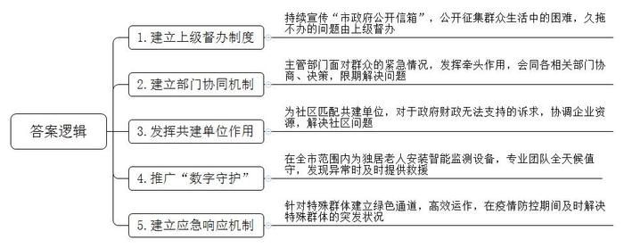
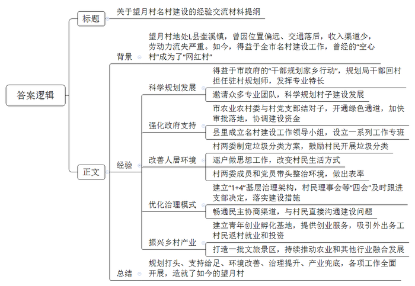
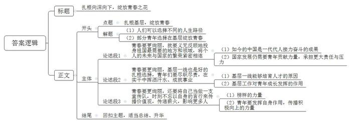

# 2022年重庆市集中选调生考试《申论》题

<!-- gwy:overview:start -->
> **重庆 · 2022 · 申论 · 选调生** ｜ 3 题 · 图片 3 处 · 答案随题折叠

导航：[题目](#题目) · [材料 1](#材料-1)
<!-- gwy:overview:end -->

> 候选采集稿。参考答案及解析来自粉笔页面，不代表官方答案或真实高分答卷；来源使用许可与原卷对应关系仍需人工核实。

## 给定材料

### 材料 1

2021年7月1日，习近平总书记在庆祝中国共产党成立100周年大会上强调，江山就是人民、人民就是江山，打江山、守江山，守的是人民的心。中国共产党根基在人民、血脉在人民、力量在人民。中国共产党始终代表最广大人民根本利益，与人民休戚与共、生死相依。

2021年7月21日至23日，习近平总书记在西藏考察时强调，要在为民服务上力行，教育引导广大党员、干部始终把人民放在心中最高位置，当好人民群众的知心人、贴心人、领路人，用心用情用力解决好群众急难愁盼问题。

2022年3月1日，习近平总书记在中央党校（国家行政学院）中青年干部培训班开班式上强调，党员干部只有胸怀天下、志存高远，不忘初心使命，把人生理想融入党和人民事业之中，把为人民幸福而奋斗作为自己最大的幸福，才能拥有高尚的、充实的人生。

### 材料 2

近期，A市党史学习教育领导小组对全市落实“我为群众办实事”实践活动情况开展了调研，以下是调研中收集到的一些案例。

案例一：B区某居民楼自2009年建成以来一直未通天然气，居民多次到燃气公司反映。起初，燃气公司以入住率不达标为由故意拖延。2016年，入住率达标了，燃气公司又称居民楼的燃气表过期，必须换新表才能通气。虽然大家怨声载道，但只能交钱换新表。然而，燃气公司施工时，发现燃气管道井内有一根归属广电集团的高压电缆，于是以存在安全隐患为由停止了施工。而广电集团借口成本太高，拒绝开展迁移工作。2021年5月，A市政府在“市政府电子信箱”中获悉该居民楼通气难问题，决定督办。结果，B区有关部门仅用2天时间，就解决了拖了12年的难题。居民黄先生说：“一些部门对群众的事久拖不办，但一遇到上级督办就立刻变得雷厉风行，如果雷厉风行能常态化就好了。”

案例二：2021年6月，A市兴隆生物接到一笔订单，客户要求在40天内将近亿份新冠抗原快速检测试剂发到某国。这笔订单让公司喜忧参半，有订单是好事，但时间紧，任务重，最难解决的是电的问题。生产部龚经理说：“电如果供不上，根本不可能完成生产任务。”兴隆生物所在工业园区管委会了解到情况后，立即会同电力公司、生态环境局、规划和自然资源局等多部门协商，仅用5天时间就新建了一座临时变电站，解决了用电难题。

案例三：2021年7月，文星社区求助共建单位富阳城投集团，反映文星社区附近居民夜晚出行因没有路灯而十分不便。城投集团党委得知这一情况后，将其列为集团“我为群众办实事”待办事项，并按照“一事一案”原则，定方案、定人员、定责任。由于文星社区附近道路不属于市政道路范畴，无法得到财政支持。城投集团采取捐赠方式，为文星社区附近道路安装了路灯。

案例四：2021年8月，D区民政局启动“数字守护“行动，为全区独居老人安装智能门锁、烟感器、燃气报警器和睡眠呼吸监护仪。“数字守护”四件套采集的实时数据会回传到D区政务云端，云端通过人工智能监测各类险情，包括家中着火、燃气泄漏、老人心率异常、呼吸暂停等30多种场景。与此同时，专业团队全天值守后台，从发现异常到实施“亲属、社区、110或120”的三级联合救援，5分钟内即可到位。截至2021年12月，D区有超过5000名老人拥有了这份贴心又安心的“数字守护”四件套。

案例五：2022年3月4日，孕妇小文在微博发文：“我昨天下午突然情况不稳定需要住院，傍晚进行完核酸采样，等到今天上午11点还没有结果，家人一着急就去市卫健委微信公众号留言反映情况，两分钟后卫健委工作人员就回复‘电话发我’。中午12点，我就接到医院的电话，通知我办理入院手续。入院后我才知道，中间那一个小时有很多人都在为我的事忙碌着，让我十分感动。”有网友评论，“电话发我”可上榜“2022年最霸气官方回复”。在“电话发我”的背后，是A市卫健委在疫情防控期间针对特殊群体建立的绿色通道应急响应机制高效运作的结果。

### 材料 3

千余亩乌榄树葱郁高大，十里碧道水清岸绿，民宿里传出欢声笑语……C市L县奎溪镇望月村，这个曾经的“空心村”一跃成为游人如织的“网红村”。“我做梦都没想到望月村能变得这么好！”村民老张站在自家新盖的楼房前，眉飞色舞地说。曾经的望月村，位置偏远、交通落后，村民收入渠道少，青壮年纷纷“逃离”。

“咱们村背靠梅岭，梯田遍地，奎溪绕村，古乌榄树漫山遍野，古驿道等文化古迹错落分布，这么优越的资源禀赋，我们应该以习近平生态文明思想为指导，因地制宜，彰显‘一山谷一水系一田园一文化’特色生态文化风貌，将望月村建设成乡村振兴示范标杆。”“乡村规划师”小王说道。小王是C市规划局的工作人员，2019年，她积极参与C市“干部规划家乡行动”，回到望月村，当起了一名驻村规划师。“我们还邀请了很多专业团队来望月村‘把脉支招’，科学规划望月村名村建设发展。”

加强规划设计、强化环境整治、实施“清单管理”、开展产业招商、加强古村落保护……望月村名村建设工作得到有效支持和推进。C市农业农村委与望月村党支部结对子，沟通协调市、县相关部门，开通绿色通道，加快审批落地。举办发展研讨会、产业招商洽谈会，先后为望月村协调建设资金5000万元。L县成立了以县领导为组长，县级相关职能部门、奎溪镇、望月村为成员单位的名村建设工作领导小组，并结合相关职能部门职责，设立了建设规划、农业建设、环境提升、文旅发展等工作专班。

打造名村工程，首在改善人居环境，难题之一就是“垃圾分类处理”。过去很多生活垃圾都是直接倾倒在村民房屋周围或奎溪里，道路脏乱，溪水浑浊发臭。为此，望月村“两委”制定了垃圾分类方案，鼓励村民开展垃圾分类。“思想工作并不好做，村民们已经习惯了过去的生活方式，我们一户一户讲政策、摆道理、谈发展，村‘两委’成员还带头进行垃圾分类。”望月村党支部何书记深有感触地说，“在乡村环境整治工作中，群众一眼就能看出，冲在前面的都是党员。党员身份‘亮’了出来，党员的形象也‘靓’了起来。”此外，望月村还建立了以村党支部为核心，村民理事会、乡友促进会、监督委员会和村民互助会等“四会”组织共同参与的“1+4”基层治理架构。支部研究通过的决定，“四会”立即跟进，用村规民约，帮助村里解决了很多难事，先后完成了道路升级、河道整治、节点美化、房屋外立面改造等工作，一系列名村建设措施得到落地。

“望月村是我们的家，我们也要为名村建设出力。”村民老云说道。在名村建设过程中，望月村“两委”畅通民主协商渠道，注重与村民直接沟通望月村规划建设问题，有效调动了村民们的参与积极性，村民们也通过各种形式表达意见和建议。有村民发现施工单位擅自在空置宅基地建设污水池，便及时通知村“两委”制止；有村民发现村便民服务中心未设计无障碍通道，随后便通知村“两委”联系规划施工单位调整……

随着望月村名村建设的不断推进，望月茶馆、“梅岭山货”农品会、“增农优品”电商平台、“黑金果”乌榄文创……一个个青年“归巢”创业孵化基地建立起来，为返乡青年提供咨询、培训、资源对接、创业项目扶持等服务。孵化基地不仅针对进驻的企业主体，对于自发参与望月名村建设的村民创业者，也会提供相关服务。截至目前，全村外出务工村民返村就业和投资的比例达到30%。

“乡村振兴，关键是产业振兴。目前，望月观星小镇项目、稻田花海AI智能农业区、沙车精品民宿区、乌榄园环境景观工程等一批文旅景区逐渐开放运营……我们将紧紧抓住党建引领乡村振兴这条主线，不松劲、不放手，推动农业和旅游观光等行业融合发展。”谈到望月村的未来，驻村第一书记小陶满怀信心。

### 材料 4

2020年，中国石油大学（北京）克拉玛依校区首届毕业生，有近三分之一的同学选择奉献西部，让青春在祖国最需要的地方绽放，小贺是其中之一。2019年夏天，他被分配到新疆油田准东采油厂H作业区实习，在跟随师傅巡井时忽遇暴雨，但是，师傅没受到丝毫干扰，熟练地在油井间穿梭，停车、下车、巡查、取样，再上车。师傅告诉他：“干了近20年，遇到过各种各样的恶劣天气，但只要有口井需要巡检，就要想方设法抵达。”师傅的话坚定了小贺留下来的念头。工作后，不论刮风下雨，还是酷暑严寒，小贺坚持行走在采油一线。他说：“只有贴近草皮，才能看清草根，真正找到自己想要扎根的土地在哪里。”

在第二次青藏高原综合科学考察中，中国科学院青藏高原研究所的刘博士主动请缨前往多个高原湖泊实地探访，收集大量样本，用以分析人类活动对高原湖泊生态系统的影响。“探究其中的作用机制，有助于我们更好地开展青藏高原生态保护。”刘博士说，“作为青年科研工作者，我要努力把青春奋斗融入党和人民事业，守护更多绿水青山。”

已经合龙的大桥上，收尾工程正有序开展。Z集团隧道分部项目姚经理每天都要到现场，与同事们一起及时解决技术问题。“如今交通基础设施建设更注重技术装备、科技创新能力、智能化与绿色化水平的均衡发展，这个领域是我们桥梁建设年轻一代施展才华的阵地。”姚经理说，“不负党和人民的殷切期望，就要在实干中挥洒汗水、成就事业。”

7月暑气蒸腾，在J省安化市角棠村，市委组织部选调生、“90后”村委会主任助理小曾，正顶着烈日维修路灯。作为一名在基层工作的年轻人，小曾体会最深的就是“在实干中成长”。“硕士毕业后来到农村工作的初心，就是想为老百姓多做点实事。我要脚踏实地，从基层做起，从一点一滴做起。”

每教一届学生，李老师都会带他们去沙漠里上一堂课。“同学们，沙漠的那边，是什么？”“应该……还是沙漠吧。”“不，是海，蔚蓝的大海！”少年们憧憬的目光翻越沙丘，投向远方。2000年，李老师大学毕业来到新疆M县一中任教，20多年来，她始终坚持立德树人，服务基层，在一线从事语文教学工作。M县教委主任说：“<u>只有荒凉的沙漠，没有荒凉的人生</u>。像李老师这样多年扎根新疆默默奉献的老师还有很多，而且越来越多的毕业生纷纷响应号召，从城市走向基层，从东部来到西部，像一棵棵胡杨树那样扎根、成长。”

## 题目

### 第 1 题

**请你谈谈“给定资料2”中的案例对A市进一步开展好“我为群众办实事”实践活动有哪些启示？（20分）**

关联材料：材料 2

作答要求：全面、准确、有条理。不超过300字。

第 1 题 · 答案与解析

**参考答案（粉笔题库参考内容）**

1.建立上级督办制度。持续宣传“市政府公开信箱”，公开征集群众生活中的困难，久拖不办的问题由上级督办。

2.建立部门协同机制。主管部门面对群众的紧急情况，发挥牵头作用，会同各相关部门协商、决策，限期解决问题。

3.发挥共建单位作用。为社区匹配共建单位，对于政府财政无法支持的诉求，协调企业资源，解决社区问题。

4.推广“数字守护”。在全市范围内为独居老人安装智能监测设备，专业团队全天候值守，发现异常时及时提供救援。

5.建立应急响应机制。针对特殊群体建立绿色通道，高效运作，在疫情防控期间及时解决特殊群体的突发状况。

**解析**

**参考答案说明**：本参考答案从“建立上级督办制度”“建立部门协同机制”“发挥共建单位作用”“推广‘数字守护’”“建立应急响应机制”五个方面展开，各条答案要点之间在内容上相互并列，没有交叉。

### 第 2 题

**C市近期准备召开全市名村建设工作座谈会，L县有关领导将在座谈会上发言。请你根据“给定资料3”，拟写一份经验交流材料提纲。（30分）**

关联材料：材料 3

作答要求：

（1）紧扣资料，内容全面；

（2）准确简明、条理清晰；

（3）不超过500字。

第 2 题 · 答案与解析

**参考答案（粉笔题库参考内容）**

关于望月村名村建设的经验交流材料提纲

背景：望月村地处L县奎溪镇，曾因位置偏远、交通落后，收入渠道少，劳动力流失严重。如今，得益于全市名村建设工作，曾经的“空心村”成为了“网红村”。

经验：一、科学规划发展。得益于市政府的“干部规划家乡行动”，规划局干部回村担任驻村规划师，发挥专业特长；邀请众多专业团队，科学规划村子建设发展。二、强化政府支持。市农业农村委与村党支部结对子，开通绿色通道，加快审批落地，协调建设资金；县里成立名村建设工作领导小组，设立一系列工作专班。三、改善人居环境。村两委制定垃圾分类方案，鼓励村民开展垃圾分类；逐户做思想工作，改变村民生活方式；村两委成员和党员带头整治环境，做出表率。四、优化治理模式。建立“1+4”基层治理架构，村民理事会等“四会”及时跟进支部决定，落实建设措施；畅通民主协商渠道，与村民直接沟通建设问题。五、振兴乡村产业。建立青年创业孵化基地，提供创业服务，吸引外出务工村民返村就业和投资；打造一批文旅景区，持续推动农业和其他行业融合发展。

总结：规划打头、支持给足、环境改善、治理提升、产业兜底，各项工作全面开展，造就了如今的望月村。

**解析**

**参考答案说明**：（1）格式方面，本参考答案写到了“标题”“正文”两个部分。（2）正文部分，一方面从内容上来看，围绕“名村建设”这一主题，本参考答案的开头先写到了“望月村过去的情况和如今的变化”；主体部分从“科学规划发展”“强化政府支持”“改善人居环境”“优化治理模式”“振兴乡村产业”这五个方面介绍了望月村的经验；最后结尾部分进行了简单总结。另一方面，形式上，本参考答案做到了分段、分条撰写，整体上条理较为清晰。

### 第 3 题

**“给定资料4”中提到：“只有荒凉的沙漠，没有荒凉的人生。”请你结合对这句话的理解，参考给定资料，联系实际，自选角度，自拟题目，写一篇文章。（50分）**

关联材料：材料 1、材料 2、材料 3、材料 4

作答要求：

（1）观点明确，见解深刻；

（2）参考给定资料，但不拘泥于给定资料；

（3）思路清晰，语言流畅；

（4）字数800-1000字。

第 3 题 · 答案与解析

**参考答案（粉笔题库参考内容）**

**扎根向深向下，绽放青春之花**

在一个宽容的社会中，人们可以拥有各异的人生路径。当下的年轻人，在选择人生方向时，有人偏好舒适和自由，有人追求兴趣和激情，有人崇尚金钱与享受……但是有的年轻人却选择了不一样的道路，他们选择把青春融入党和人民的事业，或奔赴西部，或扎根基层一线，或是去到祖国和人民需要的其他地方，让青春绽放出绚丽的花。

**青春要更绚丽，就要义无反顾地投身祖国最需要的地方和领域，将个人的未来与国家的繁荣紧密相连。**习近平总书记曾寄语青年：“好儿女志在四方，有志者奋斗无悔。”万丈高楼不会自己拔地而起，荒地也不会自己变成千亩良田，如今繁荣昌盛的中国，正是一代代建设者接力而来。当下的年轻一代也要为国家的发展付出实际行动。还有一些欠发达的地区等着青年去开发，还有一些重要领域等待青年去建设，扛住了更大的责任与压力，也必然做出更伟大的成绩。

**青春要更绚丽，基层一线也是好的扎根选择，青年们要尽职尽责，在实干中挥洒汗水、成就事业**。都说“基层育人才”，那是因为基层和一线的岗位，是离困难挑战最近的地方，也是离人民群众最近的地方，所以也是最能锻炼和考验年轻人的舞台。就像一名普通石油工人师傅所说，“只有贴近草皮，才能看清草根”。在开展基层工作的过程中，不但可以将专业知识和现实问题结合对照，积累起扎扎实实、精准老道的专业能力，还能够锻炼心态，做到戒骄戒躁、不畏艰难，更好地学习和成长，在今后的工作中，才能敢接烫手的山芋、敢啃最硬的骨头。

**青春要更绚丽，还要将自己当做一支宣传队，时刻不忘以自身的言行来传播价值观，传递薪火，影响更多人。**榜样的力量是无穷无尽的，一个人真正的力量，可能体现在他的个体之外。张桂梅被称作“燃灯者”，既是对她“燃烧自己，烛照他人”的精神的赞颂，也是对她点亮万千乡村女孩的人生的写实。黄文秀的颁奖词中也写道：“有些人从山里走了，就不再回来，你从城里回来，却再没有离开。”没有离开的，是她身上的心怀感恩、勇于担当、乐于奉献等等这些精神。青年无论身在何处何岗，都要传播着积极向上的力量，让更多的人受到启发和感动。

同国家一同进步，青春才能绽放；同人民一起并肩，青春才能无悔。国家发展、社会进步是一场接力赛，需要一代代青年接力而行、奋勇争先，去到祖国和人民最需要的地方，青春之花也必将绽放在祖国山河的处处。

**解析**

**文章分析**

**扎根向深向下，绽放青春之花**

【**标题的优点：**首先，标题中含有主题词，使文章主题更突出、清晰。其次，在形式上采用了对称式标题，使标题更加完整、饱满。】

（1）在一个宽容的社会中，<u>人们可以拥有各异的人生路径</u>。当下的年轻人，在选择人生方向时，有人偏好舒适和自由，有人追求兴趣和激情，有人崇尚金钱与享受……（2）但是<u>有的年轻人却选择了不一样的道路</u>，<u>他们选择把青春融入党和人民的事业</u>，或奔赴西部，或<u>扎根基层一线</u>，或是<u>去到祖国和人民需要的其他地方</u>，让青春绽放出绚丽的花。

【**开头的优点：**★内容方面。范文的开头是紧扣“扎根基层，绽放青春”这一主题展开的。首先，开头点出主题，做到了主题明确。其次，对“扎根基层，绽放青春”这一主题进行了分析阐述，指出了：（1）人们可以选择不同的人生路径；（2）部分青年选择在基层绽放青春。★文字表达方面。使用了排比的修辞方法，使语言表达更有气势。】

**青春要更绚丽，就要义无反顾地投身祖国最需要的地方和领域，将个人的未来与国家的繁荣紧密相连。**（1）习近平总书记曾寄语青年：“好儿女志在四方，有志者奋斗无悔。”<u>万丈高楼不会自己拔地而起</u>，荒地也不会自己变成千亩良田，<u>如今繁荣昌盛的中国</u>，<u>正是一代代建设者接力而来</u>。（2）<u>当下的年轻一代也要为国家的发展付出实际行动</u>。还有<u>一些欠发达的地区等着青年去开发</u>，还有<u>一些重要领域等待青年去建设</u>，<u>扛住了更大的责任与压力</u>，<u>也必然做出更伟大的成绩</u>。

【**论述段1的优点：**★观点句：范文的观点句是紧扣“扎根基层，绽放青春”这一文章主题提出的。形式上，它在段首处直接写出，位置突出，容易发现。内容上，关键词突出，内容要点明确，可以明显看出是从“青年要将个人与国家紧密相连”的角度展开论述。★论述内容：（1）先介绍了如今的中国是一代代人接力奋斗的成果；（2）接着指出国家发展仍需要青年贡献力量，承担更大责任与压力。注意：以上两个方面的内容都是紧扣“青春要更绚丽，就要义无反顾地投身祖国最需要的地方和领域，将个人的未来与国家的繁荣紧密相连”这个观点句进行分析论述的，论述的针对性强，内容层次丰富。在论述方法上主要采用了讲道理的方式，论述清晰透彻。】

**青春要更绚丽，基层一线也是好的扎根选择，青年们要尽职尽责，在实干中挥洒汗水、成就事业**。（1）都说“<u>基层育人才</u>”，那是因为<u>基层和一线的岗位</u>，<u>是离困难挑战最近的地方</u>，<u>也是离人民群众最近的地方</u>，<u>所以也是最能锻炼和考验年轻人的舞台</u>。就像一名普通石油工人师傅所说，“只有贴近草皮，才能看清草根”。（2）在开展基层工作的过程中，<u>不但可以将专业知识和现实问题结合对照</u>，<u>积累起扎扎实实</u>、<u>精准老道的专业能力</u>，<u>还能够锻炼心态</u>，做到戒骄戒躁、不畏艰难，<u>更好地学习和成长</u>，<u>在今后的工作中</u>，<u>才能敢接烫手的山芋</u>、<u>敢啃最硬的骨头</u>。

【**论述段2的优点：**★观点句：范文的观点句是紧扣“扎根基层，绽放青春”这一文章主题提出的。形式上，它在段首处直接写出，位置突出，容易发现。内容上，关键词突出，内容要点明确，可以明显看出是从“基层一线对于青年的价值”的角度展开论述。★论述内容：（1）先介绍了基层一线能够培育人才的原因；（2）接着指出了基层工作对青年成长发挥的作用。注意：以上两个方面的内容都是紧扣“青春要更绚丽，基层一线也是好的扎根选择，青年们要尽职尽责，在实干中挥洒汗水、成就事业”这个观点句进行分析论述的，论述的针对性强，内容层次丰富。在论述方法上主要采用了讲道理的方式，论述清晰深刻。】

**青春要更绚丽，还要将自己当做一支宣传队，时刻不忘以自身的言行来传播价值观，传递薪火，影响更多人。**（1）<u>榜样的力量是无穷无尽的</u>，<u>一个人真正的力量</u>，<u>可能体现在他的个体之外</u>。张桂梅被称作“燃灯者”，既是对她“燃烧自己，烛照他人”的精神的赞颂，也是对她点亮万千乡村女孩的人生的写实。黄文秀的颁奖词中也写道：“有些人从山里走了，就不再回来，你从城里回来，却再没有离开。”没有离开的，是她身上的心怀感恩、勇于担当、乐于奉献等等这些精神。（2）<u>青年无论身在何处何岗</u>，<u>都要传播着积极向上的力量</u>，<u>让更多的人受到启发和感动</u>。

【**论述段3的优点：**★观点句：范文的观点句是紧扣“扎根基层，绽放青春”这一文章主题提出的。形式上，它在段首处直接写出，位置突出，容易发现。内容上，关键词突出，内容要点明确，可以明显看出是从“青年发挥榜样作用”的角度展开论述。★论述内容：（1）先介绍了榜样的力量；（2）接着指出青年要发挥自身作用，传播积极向上的力量。注意：以上两个方面的内容都是紧扣“青春要更绚丽，还要将自己当做一支宣传队，时刻不忘以自身的言行来传播价值观，传递薪火，影响更多人”这个观点句进行分析论述的，论述的针对性强，内容层次丰富。在论述方法上采用了讲道理和举例子相结合的方式，论述充实透彻。】

【**论述段之间的关系：**范文的论述段之间是依照并列的逻辑展开的，论述段1先写了“青年要将个人与国家紧密相连”，论述段2接着写了“基层一线对于青年的价值”，论述段3最后写了“青年发挥榜样作用”，文章整体逻辑清晰。】

同国家一同进步，青春才能绽放；同人民一起并肩，青春才能无悔。国家发展、社会进步是一场接力赛，需要一代代青年接力而行、奋勇争先，去到祖国和人民最需要的地方，青春之花也必将绽放在祖国山河的处处。

【**结尾的优点：**范文的结尾回扣了“扎根基层，绽放青春”这个主题，并且进行了总结升华。】

