# 2022年重庆市选调优秀大学生到基层工作考试《行测》题

<!-- gwy:overview:start -->
> **重庆 · 2022 · 行测 · 选调生** ｜ 100 题 · 图片 102 处 · 答案随题折叠

| 题型模块 | 题量 | 题号 |
| --- | ---: | ---: |
| 常识判断 | 20 | 1–20 |
| 言语理解与表达 | 30 | 21–50 |
| 数学运算 | 10 | 51–60 |
| 判断推理 | 30 | 61–90 |
| 资料分析 | 10 | 91–100 |
| **合计** | **100** | |

导航：[题型与作答说明](#题型与作答说明) · [题目](#题目) · [材料 1](#材料-1)
<!-- gwy:overview:end -->

> 候选采集稿。参考答案及解析来自粉笔页面，不代表官方答案或真实高分答卷；来源使用许可与原卷对应关系仍需人工核实。

## 题型与作答说明

常识判断

（20题）

根据题目要求，在四个选项中选出一个最恰当的答案。

言语理解与表达

（30题）

本部分包括表达与理解两方面的内容。请根据题目要求，在四个选项中选出一个最恰当的答案。

数学运算

（10题）

在这部分试题中，每道题呈现一段表述数字关系的文字，要求你迅速、准确地计算出答案。

判断推理

（30题）

本部分包括图形推理、定义判断、类比推理与逻辑判断四种类型的试题。

资料分析

（10题）

所给出的图、表、文字或综合性资料均有若干个问题要你回答。你应根据资料提供的信息进行分析、比较、计算和判断处理。

## 题目

### 第 1 题

关于《中共中央关于党的百年奋斗重大成就和历史经验的决议》，下列与之相关的表述不正确的是（ ）。

A. 中国特色社会主义进入新时代，党面临的主要任务是，实现第一个百年奋斗目标，开启实现第二个百年奋斗目标新征程，朝着实现中华民族伟大复兴的宏伟目标继续前进

B. 改革开放和社会主义现代化建设新时期，党面临的主要任务是，在找到建设社会主义现代化的正确道路基础上使人民群众共同富裕起来，为最终实现社会主义现代化强国和中华民族伟大复兴提供根本的制度体制保障和物质支撑

C. 社会主义革命和建设时期，党面临的主要任务是，实现从新民主主义到社会主义的转变，进行社会主义革命，推进社会主义建设，为实现中华民族伟大复兴奠定根本政治前提和制度基础

D. 新民主主义革命时期，党面临的主要任务是，反对帝国主义、封建主义、官僚资本主义，争取民族独立、人民解放，为实现中华民族伟大复兴创造根本社会条件

第 1 题 · 答案与解析

**参考答案（粉笔题库参考内容）**

B

**解析**

本题考查政治常识。

2021年11月11日中国共产党第十九届中央委员会第六次全体会议通过了《中共中央关于党的百年奋斗重大成就和历史经验的决议》，以下简称《决议》。

A项正确，《决议》在“四、开创中国特色社会主义新时代”部分指出：“党的十八大以来，中国特色社会主义进入新时代。党面临的主要任务是，实现第一个百年奋斗目标，开启实现第二个百年奋斗目标新征程，朝着实现中华民族伟大复兴的宏伟目标继续前进。”

B项错误，《决议》在“三、进行改革开放和社会主义现代化建设”部分指出：“改革开放和社会主义现代化建设新时期，党面临的主要任务是，继续探索中国建设社会主义的正确道路，解放和发展社会生产力，使人民摆脱贫困、尽快富裕起来，为实现中华民族伟大复兴提供充满新的活力的体制保证和快速发展的物质条件。”

C项正确，《决议》在“二、完成社会主义革命和推进社会主义建设”部分指出：“社会主义革命和建设时期，党面临的主要任务是，实现从新民主主义到社会主义的转变，进行社会主义革命，推进社会主义建设，为实现中华民族伟大复兴奠定根本政治前提和制度基础。”

D项正确，《决议》在“一、夺取新民主主义革命伟大胜利”部分指出：“新民主主义革命时期，党面临的主要任务是，反对帝国主义、封建主义、官僚资本主义，争取民族独立、人民解放，为实现中华民族伟大复兴创造根本社会条件。”

本题为选非题，故正确答案为B。

### 第 2 题

关于改革开放以来历届六中全会的重点关注内容，下列表述不正确的是（ ）。

A. 1981年6月，中共十一届六中全会通过《关于建国以来党的若干历史问题的决议》，标志着党在指导思想上拨乱反正任务的完成

B. 2001年9月，中共十五届六中全会通过《关于加强和改进党的作风建设的决定》，提出作风建设“八个坚持、八个反对”的要求

C. 2015年10月，中共十八届六中全会通过《关于新形势下党内政治生活的若干准则》和《中国共产党党内监督条例》

D. 2021年11月，中共十九届六中全会通过《中共中央关于党的百年奋斗重大成就和历史经验的决议》和中共中央《关于召开党的第二十次全国代表大会的决议》

第 2 题 · 答案与解析

**参考答案（粉笔题库参考内容）**

C

**解析**

本题考查政治常识。

A项正确，1981年6月中国共产党第十一届六中全会通过了《关于建国以来党的若干历史问题的决议》。《决议》对建国以来党的重大历史问题特别是“文化大革命”、毛泽东的功过是非和毛泽东思想基本内容与指导意义作了总结和评价；肯定了十一届三中全会以来逐步确立的适合中国情况的建设社会主义现代化强国的正确道路，进一步指明中国社会主义事业和党的工作继续前进的方向；标志着党在指导思想上完成了拨乱反正。

B项正确，2001年9月26日中国共产党第十五届中央委员会第六次全体会议通过了《关于加强和改进党的作风建设的决定》。《决定》强调加强和改进党的作风建设的极端重要性和紧迫性，提出了加强和改进党的作风建设的指导思想和主要任务，阐述了在党的作风建设方面的“八个坚持、八个反对”。

C项错误，2016年10月27日，中国共产党第十八届中央委员会第六次全体会议召开，《关于新形势下党内政治生活的若干准则》和《中国共产党党内监督条例》是全会的重要成果。两个党内法规的制定出台，是全面从严治党一次广泛而深入的思想动员和组织动员，是对党的十八大以来全面从严治党理论和实践的系统总结，是着眼解决新形势下党内突出问题而进行的重要顶层设计，是对马克思主义建党理论和实践的创新发展。

D项正确，中国共产党第十九届中央委员会第六次全体会议，于2021年11月8日至11日在北京举行。全会听取和讨论了习近平受中央政治局委托作的工作报告，审议通过了《中共中央关于党的百年奋斗重大成就和历史经验的决议》和《关于召开党的第二十次全国代表大会的决议》。

本题为选非题，故正确答案为C。

### 第 3 题

2021年8月，在中非互联网发展与合作论坛上，中国主动倡议与非方共同制定并实施（ ）。

A. 中非全面合作计划

B. 中非命运共同体计划

C. 中非贸易便利通畅计划

D. 中非数字创新伙伴计划

第 3 题 · 答案与解析

**参考答案（粉笔题库参考内容）**

D

**解析**

本题考查政治常识。

D项正确，A、C、D三项错误，2021年8月24日，在中非互联网发展与合作论坛开幕式上，外交部部长助理邓励宣布，中方愿同非方共同制定和实施“中非数字创新伙伴计划”，并就此提出六点建议，包括：加强数字基建，打通经济社会发展的信息动脉；发展数字经济，推动数字技术和实体经济融合发展；开展数字教育，破解数字创新“人才瓶颈”；提升数字包容性，服务非洲普通民众；共创数字安全，提升数字治理能力；搭建合作平台，以交流促进数字进步。

故正确答案为D。

### 第 4 题

《中华人民共和国国民经济和社会发展第十四个五年规划和2035年远景目标纲要》提出的要支持形成国际科技创新中心的地区是：

A. 北京、上海、深圳

B. 北京、武汉、深圳

C. 北京、上海、粤港澳大湾区

D. 北京、上海、成渝地区双城经济圈

第 4 题 · 答案与解析

**参考答案（粉笔题库参考内容）**

C

**解析**

本题考查政治常识。

A、B、D三项错误，C项正确，《中华人民共和国国民经济和社会发展第十四个五年规划和2035年远景目标纲要》在“第二篇 坚持创新驱动发展 全面塑造发展新优势”的“第四章 强化国家战略科技力量”指出：“支持北京、上海、粤港澳大湾区形成国际科技创新中心，建设北京怀柔、上海张江、大湾区、安徽合肥综合性国家科学中心，支持有条件的地方建设区域科技创新中心。强化国家自主创新示范区、高新技术产业开发区、经济技术开发区等创新功能。适度超前布局国家重大科技基础设施，提高共享水平和使用效率。集约化建设自然科技资源库、国家野外科学观测研究站（网）和科学大数据中心。加强高端科研仪器设备研发制造。构建国家科研论文和科技信息高端交流平台。”

故正确答案为C。

### 第 5 题

国家大柄，莫重于兵，2021年是中国共产党建党100周年，也是国防和军队现代化新“三步走”起步之年，党的十九届六中全会对国防和军队建设做出的战略安排是：

A. 到2035年实现建军一百年奋斗目标

B. 到2040年基本实现国防和军队现代化

C. 到2049年全面实现国防和军队信息化

D. 到本世纪中叶把人民军队全面建成世界一流军队

第 5 题 · 答案与解析

**参考答案（粉笔题库参考内容）**

D

**解析**

本题考查政治常识。

A、B、C三项错误，D项正确，党的十九届六中全会通过的《中共中央关于党的百年奋斗重大成就和历史经验的决议》中的“四、开创中国特色社会主义新时代”部分的“（十）在国防和军队建设上”指出：“党提出新时代的强军目标，确立新时代军事战略方针，制定到二〇二七年实现建军一百年奋斗目标、到二〇三五年基本实现国防和军队现代化、到本世纪中叶全面建成世界一流军队的国防和军队现代化新‘三步走’战略，推进政治建军、改革强军、科技强军、人才强军、依法治军，加快军事理论现代化、军队组织形态现代化、军事人员现代化、武器装备现代化，加快机械化信息化智能化融合发展，全面加强练兵备战，坚持走中国特色强军之路。”

故正确答案为D。

### 第 6 题

关于文物，下列说法错误的是：

A. “兽形匜”是中国古代用于装饰屋脊的一种兽形建筑小构件

B. “宣德款剔红牧牛图方盘”中的“剔红”是一种漆器的加工工艺

C. “彩绘漆金夹纻阿弥陀佛坐像”是中国古代的传统塑像工艺

D. “掐丝珐琅兽面纹提梁卣”中的“珐琅”是不透明的玻璃材质

第 6 题 · 答案与解析

**参考答案（粉笔题库参考内容）**

A

**解析**

本题考查人文常识。

A项错误，春秋兽形匜是春秋时期的浇水用青铜器。器形精美，做工细致，极具观赏性，堪称同时代铜器中的一件佳作。

B项正确，雕漆，又称剔红，是中华民族传统工艺的瑰宝和精华，与景泰蓝、象牙雕刻、玉雕一起被誉为京城工艺“四大名旦”。雕漆始于漆器，是以大漆为原料，在胎体上一层层涂堆到适当厚度再进行加工雕刻的工艺。

C项正确，彩绘漆金夹纻阿弥陀佛坐像为7世纪初唐朝干漆夹纻工艺制作的坐佛。造像生动细腻，宛若真人，双目有神，表情祥和，呈跏趺坐姿，身披袈裟，袒右肩，衣纹褶皱自然写实，流畅生动。夹纻造像工艺是我国独有的漆器制作工艺。

D项正确，清代乾隆掐丝珐琅兽面纹提梁卣是清代乾隆年代制作的一款宫廷御用珐琅器。中国人习惯于将涂饰在金属器物表面的玻璃质称为珐琅釉。珐琅是用石英、长石、硝石和碳酸钠等加上铅和锡的氧化物，烧成不透明的玻璃质涂料。

本题为选非题，故正确答案为A。

### 第 7 题

2021年东京奥运会，中国代表团取得了很多新突破，下列表述错误的是：

A. 全红婵在女子3米跳板决赛中夺冠，3次跳出满分动作

B. 杨倩夺得女子10米气步枪冠军，创造了新的奥运会纪录

C. 女子4×200米自由泳接力获得金牌，同时打破了世界纪录

D. 苏炳添创造男子100米亚洲纪录，中国人首次进入奥运男子百米决赛

第 7 题 · 答案与解析

**参考答案（粉笔题库参考内容）**

A

**解析**

本题考查政治常识。

A项错误，2021年8月5日，在东京奥运会跳水项目女子10米跳台决赛中，中国选手全红婵以466.20分夺得冠军。全红婵是2021年东京奥运会中国体育代表团年龄最小的运动员，年仅14岁。

B项正确，2021年7月24日举行的东京奥运会女子10米气步枪决赛中，中国选手杨倩夺得冠军，为中国代表团揽入本届奥运会第一枚金牌，创造了新的奥运会纪录。这也是2021年东京奥运会诞生的首枚金牌。

C项正确，2021年7月29日，东京奥运会游泳比赛在东京水上运动中心展开，在女子4×200米自由泳接力决赛中，由中国选手杨浚瑄、汤慕涵、张雨霏和李冰洁组成的中国队以7分40秒33获得金牌并创造了新的世界纪录。这是中国队首次获得这个项目的奥运金牌，也是中国代表团在2021年东京奥运会上获得的第14枚金牌！

D项正确，2021年8月1日，中国田径选手苏炳添出战2021年东京奥运会男子100米半决赛第三组的比赛，以小组第1名的成绩晋级决赛，并以9.83秒的成绩刷新亚洲纪录，由此创造新的历史，成为第一位进入奥运男子百米决赛的中国选手。

本题为选非题，故正确答案为A。

### 第 8 题

公元前119年，张骞第二次出使西域，在大夏看见了蜀布和邛竹杖，这里的大夏是指现在的：

A. 伊朗

B. 土耳其

C. 阿富汗

D. 吉尔吉斯斯坦

第 8 题 · 答案与解析

**参考答案（粉笔题库参考内容）**

C

**解析**

本题考查人文常识。

C项正确，A、B、D三项错误，元狩四年（公元前119年），张骞第二次奉派出使西域。这时，汉朝业已控制了河西走廊，积极进行武帝时对匈奴最大规模的一次战役。几年来汉武帝多次向张骞询问大夏等地情况，欲联系其他国家跟汉共同抵抗匈奴。作为西域古国的大夏即巴克特里亚王国，是公元前3世纪中叶希腊殖民者在中亚（位于现今青藏高原西北部的帕米尔西部地区，即位于现今帕米尔以西的阿富汗一带）建立的奴隶制国家。“巴克特里亚”是古希腊人对现今兴都库什山以北的阿富汗东北部地区的称呼，又称“中亚希腊王国”，中国汉文史籍《史记》《汉书》《山海经》称该地区为大夏。

故正确答案为C。

### 第 9 题

十月革命一声炮响，给中国带来了马克思主义，在中国早期的马克思主义思想运动中，李大钊起着主要作用，1919年，他在报刊上开辟了“马克思研究”专栏，该报刊的名字是：

A. 《新青年》

B. 《东方杂志》

C. 《晨报副刊》

D. 《湘江评论》

第 9 题 · 答案与解析

**参考答案（粉笔题库参考内容）**

C

**解析**

本题考查人文常识。

C项正确，A、B、D三项错误，1919年2月，李大钊接任《晨报副刊》主编，积极推进改版，突出宣传“新修养、新知识、新思想”，尤其是加大对马克思主义的宣传力度。1919年5月5日，为纪念马克思诞生101周年，李大钊协助《晨报副刊》开辟“马克思研究”专栏。该专栏坚持了半年，发表了马克思的《劳动与资本》、考茨基的《马氏资本论释义》、河上肇的《马克思唯物史观》等多部经典论著。

故正确答案为C。

### 第 10 题

下列关于习近平法治思想的表述错误的是：

A. 党和法的关系是政治和法治关系的集中反映

B. 改革与法治辩证统一，应当在法治下推进改革，在改革中完善法治

C. 党对法治工作具有绝对领导地位，但是不妨碍政法机关依法独立公正行使职权

D. 社会主义法治应当在党的领导下进行，当党的政策与国家法律发生冲突时，以党的政策为准

第 10 题 · 答案与解析

**参考答案（粉笔题库参考内容）**

D

**解析**

本题考查法律常识。

A项正确，习近平总书记强调：“党和法的关系是一个根本问题，处理得好，则法治兴、党兴、国家兴；处理得不好，则法治衰、党衰、国家衰。党的领导和依法治国不是对立的，而是统一的。”故说明党和法的关系是政治和法治关系的集中反映。

B项正确，2018年8月24日，习近平总书记在中央全面依法治国委员会第一次会议上强调：“‘改革与法治如鸟之两翼、车之两轮’，要坚持在法治下推进改革，在改革中完善法治。”

C项正确，根据《中国共产党政法工作条例》第六条规定：“政法工作应当遵循以下原则：（一）坚持党的绝对领导，把党的领导贯彻到政法工作各方面和全过程；······（九）政法单位依法分工负责、互相配合、互相制约，确保正确履行职责、依法行使权力；······”

D项错误，依法治国就是依照体现人民意志和社会发展规律的法律治理国家，而不是依照个人意志、主张治理国家；要求国家的政治、经济运作、社会各方面的活动通通依照法律进行，而不受任何个人意志的干预、阻碍或破坏。在我国的法治理念下，当党的政策与国家法律发生冲突时，应以法律为准。

本题为选非题目，故正确答案为D。

### 第 11 题

下列关于故意杀人罪的描述中，说法正确的是∶

A. 王某想要李某死于车祸，于是和李某一起飙车，结果飙车的时候因为操作不当，李某当场死亡，王某的行为构成故意杀人罪

B. 王某想要李某死亡，于是经常邀约李某喝酒，由于长期喝酒，李某肝脏严重损环，后患肝癌死亡，王某的行为构成故意杀人罪

C. 王某与李某有仇，于是天天对李某进行语言羞辱，结果李某不堪忍受，跳楼自杀，王某的行为是造成李某死亡的直接原因，故构成故意杀人罪

D. 王某认为人死亡后可以远离痛苦，于是在家人食物中投毒，结果导致家人死亡，但王某本人被救活。后经鉴定，王某具有辨认与控制能力。经查实，王某小学毕业，平时比较迷信，虽然王某的行为出于愚昧无知，但仍构成故意杀人罪

第 11 题 · 答案与解析

**参考答案（粉笔题库参考内容）**

D

**解析**

本题考查法律常识。

根据《中华人民共和国刑法》第二百三十二条规定，故意杀人罪是指故意非法剥夺他人生命的行为。从客观上来说，故意杀人罪的行为内容为剥夺他人生命即杀人，其特点是直接或者间接作用于人的肌体，使人的生命非自然终结。剥夺他人生命的方式，既可以是作为，如刀砍、斧劈、拳击、枪杀等，也可以是不作为，如母亲故意不给婴儿哺乳致其死亡等；既可以是物理的方式，如刺杀、毒杀，也可以是心理的方法，如以精神冲击方法致心脏病患者死亡。但不管是什么杀人行为，都必须具有致人死亡的紧迫危险性。从主观上来说，故意杀人罪的责任形式为故意，即明知自己的行为会发生他人死亡的结果，并且希望或者放任这种结果的发生。

A项错误，王某虽然想要李某死于车祸，但和李某一起飙车这个行为并没有致人死亡的紧迫危险性，导致李某最终死亡的直接原因是操作不当，王某不构成故意杀人罪。

B项错误，王某虽然想要李某死亡，但邀约喝酒这个行为并没有致人死亡的紧迫危险性，导致李某最终死亡的直接原因是肝脏受损、罹患肝癌，王某不构成故意杀人罪。

C项错误，语言羞辱并没有致人死亡的紧迫危险性，不属于杀人行为，王某不构成故意杀人罪。

D项正确，王某主观上具有杀害家人的故意，客观上实施了在家人食物中投毒的行为，且对自己的行为有辨认和控制能力，构成故意杀人罪，应当承担刑事责任。

故正确答案为D。

### 第 12 题

2021年12月，中央经济工作会议在北京举行，会上提出要把提高        综合生产能力放在更加突出的位置。

A. 粮食

B. 农业

C. 农村

D. 农民

第 12 题 · 答案与解析

**参考答案（粉笔题库参考内容）**

B

**解析**

本题考查政治常识。

B项正确，A、C、D三项错误，2021年中央经济工作会议于12月8日至10日在北京举行。习近平总书记在会上发表重要讲话，总结2021年经济工作，分析当前经济形势，部署2022年经济工作。会议提出：“要把提高农业综合生产能力放在更加突出的位置，持续推进高标准农田建设，深入实施种业振兴行动，提高农机装备水平，保障种粮农民合理收益，中国人的饭碗任何时候都要牢牢端在自己手中。”

故正确答案为B。

### 第 13 题

2022年，我国新型基础设施建设（简称"新基建"）将进一步加快。下列属于"新基建"的是：

A. 北煤南运

B. 航空运输业

C. 城际高速铁路

D. 深水港建设

第 13 题 · 答案与解析

**参考答案（粉笔题库参考内容）**

C

**解析**

本题考查政治常识。

C项正确，A、B、D三项错误，新基建是智慧经济时代贯彻新发展理念，吸收新科技革命成果，实现国家生态化、数字化、智能化、高速化、新旧动能转换与经济结构对称态，建立现代化经济体系的国家基本建设与基础设施建设。新基建主要包括5G基站建设、特高压、城际高速铁路和城市轨道交通、新能源汽车充电桩、大数据中心、人工智能、工业互联网七大领域。

故正确答案为C。

### 第 14 题

2021年11月《中共中央 国务院关于加强新时代老龄工作的意见》指出：“坚持整合资源、协调发展。构建居家社区机构相协调、医养康养相结合的养老服务体系和健康支撑体系，大力发展          养老服务，促进资源均衡配置。”

A. 智能型

B. 健康型

C. 普惠型

D. 互助型

第 14 题 · 答案与解析

**参考答案（粉笔题库参考内容）**

C

**解析**

本题考查政治常识。

C项正确，A、B、D项错误，《中共中央 国务院关于加强新时代老龄工作的意见》是中共中央 国务院于2021年11月18日通过的意见，其中指出：“坚持整合资源、协调发展。构建居家社区机构相协调、医养康养相结合的养老服务体系和健康支撑体系，大力发展普惠型养老服务，促进资源均衡配置。推动老龄事业与产业、基本公共服务与多样化服务协调发展，统筹好老年人经济保障、服务保障、精神关爱、作用发挥等制度安排。”

故正确答案为C。

### 第 15 题

下列诗句所描述的地区中，位于长江上游的是：

A. 孤帆远影碧空尽，唯见长江天际流

B. 天门中断楚江开，碧水东流至此回

C. 阁中帝子今何在？槛外长江空自流

D. 风急天高猿啸哀，渚清沙白鸟飞回

第 15 题 · 答案与解析

**参考答案（粉笔题库参考内容）**

D

**解析**

本题考查人文常识。

长江干流在湖北宜昌以上为上游，宜昌至江西湖口为中游，湖口以下为下游。

A项错误，诗句出自唐代李白的《黄鹤楼送孟浩然之广陵》，意思是友人的孤船帆影渐渐地远去，消失在碧空的尽头，只看见一线长江，向邈远的天际奔流。是诗人在黄鹤楼送别友人的场景，黄鹤楼位于湖北武汉，属于长江中游。

B项错误，诗句出自唐代李白的《望天门山》，意思是长江犹如巨斧劈开天门雄峰，碧绿江水东流到此回旋澎湃。天门山，是安徽当涂县的东梁山（古代又称博望山）与和县的西梁山的合称，属于长江下游。

C项错误，诗句出自唐代王勃的《滕王阁序》，意思是修建这滕王阁的滕王如今在哪里呢？只有那栏杆外的滔滔江水空自向远方奔流。滕王阁在今江西南昌赣江滨，属于长江中游。

D项正确，诗句出自唐代杜甫的《登高》，意思是风急天高猿猴啼叫显得十分悲哀，水清沙白的河洲上有鸟儿在盘旋。此诗作于公元767年（唐代宗大历二年）的秋天，杜甫独自登上夔州白帝城外的高台。白帝城，位于重庆市奉节县，属于长江上游。

故正确答案为D。

### 第 16 题

公民身份证号码是身份证的主要组成部分之一，下列关于我国公民身份号码说法错误的是∶

A. 由地址码、出生日期码、顺序码和校验码共18位组成

B. 地址码表示编码对象常住户口所在地的行政区划代码

C. 校验码用X来代替10以保证公民身份证符合国家标准

D. 三位顺序码的最后一位奇数分配给女性，偶数分配给男性

第 16 题 · 答案与解析

**参考答案（粉笔题库参考内容）**

D

**解析**

本题考查法律常识。

A项正确，公民身份号码是特征组合码，由十七位数字本体码和一位校验码组成。排列顺序从左至右依次为：六位数字地址码，八位数字出生日期码，三位数字顺序码和一位校验码。

B项正确，地址码表示编码对象常住户口所在县（市、旗、区）的行政区划代码。

C项正确，作为尾号的校验码，是由号码编制单位按统一的公式计算出来的，如果某人的尾号是0-9，都不会出现X，但如果尾号是10，那么就得用X来代替，因为如果用10做尾号，那么此人的身份证就变成了19位，而19位的号码违反了国家标准，并且中国的计算机应用系统也不承认19位的身份证号码。Ⅹ是罗马数字的10，用X来代替10，可以保证公民的身份证符合国家标准。

D项错误，顺序码表示在同一地址码所标识的区域范围内，对同年、同月、同日出生的人编定的顺序号，顺序码的奇数分配给男性，偶数分配给女性。

本题为选非题，故正确答案为D。

### 第 17 题

2021年是我国的航天大年，航天发射次数一年内首次突破40次。在中国航天的命名系统中，充满了中国特有的浪漫主义色彩。下列名称与对应航天系统不相符的是：

A. “天宫”——中国空间站

B. “嫦娥”——中国探月工程

C. “天问”——中国恒星探测工程

D. “悟空”——中国暗物质粒子探测卫星

第 17 题 · 答案与解析

**参考答案（粉笔题库参考内容）**

C

**解析**

本题考查科技常识。

A项正确，“天宫”指中国载人空间站，中国空间站包括天和核心舱、实验舱梦天、实验舱问天、载人飞船（神舟系列）和货运飞船（天舟系列）五个模块。

B项正确，中国月球探测工程命名为“嫦娥工程”。月球探测器以中国古代神话人物“嫦娥”命名。中国的探月工程分为“绕”“落”“回”3个阶段。

C项错误，2020年4月24日，中国行星探测任务被正式命名为“天问系列”，首次火星探测任务被命名为“天问一号”，后续行星任务依次编号。天问一号的名称来源于中国古代爱国主义诗人屈原的长诗《天问》。

D项正确，暗物质粒子探测卫星命名为“悟空”，“悟空”是中国古典名著《西游记》中齐天大圣的名字，“悟”有领悟的意思，“悟空”有领悟、探索太空之意；另一方面，“悟空”的火眼金睛，犹如暗物质粒子探测卫星的探测器。

本题为选非题，故正确答案为C。

### 第 18 题

下列著名科学家与其经典名言对应错误的是（ ）。

A. 知识就是力量——培根

B. 人的天职在于勇于探索真理——伽利略

C. 科学没有国界，但科学家有祖国——巴斯德

D. 天才是百分之一的灵感加上百分之九十九的汗水——爱迪生

第 18 题 · 答案与解析

**参考答案（粉笔题库参考内容）**

B

**解析**

本题考查科技常识。

A项正确，“知识就是力量”这句经典名言最早是培根说的。完整的一句话是：“知识就是力量，但更重要的是运用知识的技能。”培根是英国16、17世纪之际的哲学家，经验主义哲学的奠基人。培根在哲学上最大的贡献在于，提出了唯物主义经验论的一系列原则；制定了系统的归纳逻辑，强调实验对认识的作用。马克思、恩格斯称培根是“英国唯物主义的第一个创始人”。

B项错误，“人的天职在于勇于探索真理”是哥白尼的名言。哥白尼是文艺复兴时期的波兰天文学家、数学家、教会法博士、神父。他提出了日心说，否定了教会的权威，改变了人类对自然对自身的看法，他经过长年的观察和计算完成了伟大著作《天体运行论》。伽利略是意大利天文学家、物理学家和工程师、欧洲近代自然科学的创始人，近代科学实验奠基人之一。

C项正确，“科学没有国界，但科学家有祖国”这句话是法国科学家巴斯德说的。在德国占领法国后，身为法国人的巴斯德把母校波恩大学赠他的荣誉证书退了回去，别人用“科学无国界”来劝说他时，他便在“科学无国界”的后边又添上了后一句：“但科学家是有祖国的”。巴斯德是法国微生物学家、化学家，近代微生物学的奠基人。

D项正确，“天才是百分之一的灵感加上百分之九十九的汗水”是爱迪生的名言。名言的全部内容是：“天才是1%的灵感，99%的汗水，但那1%的灵感是最重要的，甚至比那99%的汗水都要重要。”爱迪生是世界著名的发明家、物理学家、企业家，被誉为“世界发明大王”。

本题为选非题，故正确答案为B。

### 第 19 题

许多光学仪器的镜片表面会镶上一层增透膜，使光线成像更加清晰，如照相机镜头的表面，通常看上去会呈现出蓝紫色，这是由于以下哪种原因形成的？

A. 光的干涉

B. 光的衍射

C. 光的偏振

D. 光的折射

第 19 题 · 答案与解析

**参考答案（粉笔题库参考内容）**

A

**解析**

本题考查科技常识。

A项正确，B、C、D三项错误，增透膜又称减反射膜，它的主要功能是减少或消除透镜、棱镜、平面镜等光学镜片表面的反射光。其工作原理为光的干涉，当光照射到增透膜上时，会有一部分光在膜的两个面上反射回去，反射回去的光（两列波），会发生干涉，而如果膜的厚度满足一定条件，两列反射回去的光波就会相干相消，从而增加这些元件的透光量，减少或消除系统的杂散光。而照相机镜头的增透膜，一般选择特定的材料，使对人眼最敏感的黄绿色光进行相消干涉，使其反射光强减弱，所以照相机镜头呈现出与黄绿色光互补的蓝紫色。

故正确答案为A。

### 第 20 题

生物的遗传和变异不仅保证了物种延续、稳定，也为生物进化提供了基础。下列相关表述中错误的是：

A. 基因重组是生物进化的源泉

B. 基因突变是生物变异的根本来源

C. 动植物中存在的世代交替是生物进化的一种方式

D. 孤雌生殖是为了适应不良环境从而促进生物进化

第 20 题 · 答案与解析

**参考答案（粉笔题库参考内容）**

D

**解析**

本题考查科技常识。

A项正确，基因重组是指在生物体进行有性生殖的过程中，控制不同性状的基因的重新组合。基因重组是形成生物多样性的重要原因，是生物变异的来源之一，对生物进化具有重要意义。因此说基因重组是生物进化的源泉。

B项正确，基因突变是指DNA分子中发生碱基对的替换、增添或缺失，而引起的基因碱基序列的改变。基因突变是新基因产生的途径，是生物变异的根本来源，为生物进化提供丰富的原材料。

C项正确，在一些植物和某些动物的生活史中，产生孢子的孢子体世代（无性世代，二倍体世代），和产生配子的配子体世代（有性世代，单倍体世代），有规律地交替出现的现象，叫世代交替。世代交替使动植物潜在变异能力得以提高，有利于通过遗传机制产出更具适应能力的新生物种；另一方面由于隐性基因表现机会少、传播缓慢，有缓解自然选择压力的作用，所以生物体就可避免来不及对突然选择作出快速应变。动植物中存在的世代交替是生物进化的一种方式。

D项错误，孤雌生殖是指卵不经过受精也能发育成正常的新个体。这是普遍存在于一些较原始动物种类身上的生殖现象，简单来说就是生物不需要雄性个体，单独的雌性也可以通过复制自身的DNA进行繁殖。目前大多数理论认为有性生殖能产生更多的基因组合，增加适应性演化的几率，防止有害突变的积累，基因组合的广泛变异能增加子代适应自然选择的能力，增加少数个体在难以预料和不断变化的环境中存活的机会，从而对物种有利。而孤雌生殖由于其后代基因都来自于雌性一方，基因型都是相同的，当环境发生改变时，所有后代可能都无法适应新环境，所以认为孤雌生殖对生物适应不良环境不利。

本题为选非题，故正确答案为D。

### 第 21 题

“互联网+传统艺术”这种方式给传统艺人带来了新的发展机遇。首先，网上付费欣赏可以扩大受众规模，增加表演者的收入，稳定他们的内心，让他们没有后顾之忧。其次，网络世界青年群体居多，传统文化艺术要想更好地传承，抓住青年这个大群体            。

填入画横线部分最恰当的一项是：

A. 刻不容缓

B. 迫在眉睫

C. 势在必行

D. 任重道远

第 21 题 · 答案与解析

**参考答案（粉笔题库参考内容）**

C

**解析**

根据“网络世界青年群体居多”可知，抓住青年这个大群体是传承传统文化艺术必须要做的，C项“势在必行”形容事情迫于情势，必须采取行动，符合文意，当选。

A项“刻不容缓”形容情势十分紧迫，一刻也不容耽搁，B项“迫在眉睫”比喻十分紧急，一刻也不能延迟，均侧重紧迫性，文段并没有体现紧迫性，与文意不符，排除；D项“任重道远”比喻肩负需经历长期奋斗的重任，文段并未体现需经历长期奋斗，与文意不符，排除。

故正确答案为C。

【文段出处】《传统文艺表演如何“互联网+”？》

### 第 22 题

欧洲的古老岩画多为洞穴岩画，为了保护史前的艺术品，很多岩洞都采取了封闭措施，以保护史前的洞穴岩画不受游客呼吸和汗水的腐蚀。塞拉尼亚·拉林多萨岩画全部暴露在外，在南美热带雨林的湿热气候中竟保持万年不变色，堪称奇迹。塞拉尼亚·拉林多萨岩画无论是规模、内容、艺术水准还是保存状态，都令人            。

填入画横线部分最恰当的一项是：

A. 瞠目结舌

B. 叹为观止

C. 大开眼界

D. 拍案叫绝

第 22 题 · 答案与解析

**参考答案（粉笔题库参考内容）**

B

**解析**

根据横线前“不受游客呼吸和汗水的腐蚀”“竟保持万年不变色，堪称奇迹”可知，横线处表示该岩画的艺术水准及保存状态水平极高，让人十分惊叹，B项“叹为观止”形容所见到的事物好到了极点，且“令人叹为观止”为常用搭配，当选。

A项“瞠目结舌”形容受窘或惊呆的样子，侧重惊讶，不能体现对美好事物的赞赏，排除；C项“大开眼界”指开阔视野，增长见识，强调获取新的知识与见闻，未体现对象事物好坏，排除；D项“拍案叫绝”指拍着桌子叫好，形容非常赞赏，更强调对某人的作品或者话语意见赞赏，与前文“保存状态”搭配不当，排除。

故正确答案为B。

【文段出处】《破解南美史前岩画中的文化密码》

### 第 23 题

2020年快速崛起的在线教育行业在2021年伊始就再次            。在去年的春晚舞台上，各大在线教育机构“八仙过海，各显神通”，纷纷通过知识福袋、免费赠课、抽奖、抢红包等多元化玩法与观众互动，并借此植入品牌，一举成为春晚赞助商主力，为新一年的用户和流量争夺战            。

依次填入画横线部分最恰当的一项是：

A. 粉墨登场 排兵布阵

B. 崭露头角 未雨绸缪

C. 大放异彩 跑马圈地

D. 独占鳌头 养精蓄锐

第 23 题 · 答案与解析

**参考答案（粉笔题库参考内容）**

C

**解析**

第一空，搭配“在线教育”，并且根据横线前“快速崛起”以及“再次”可知，横线处需表达在线教育行业在2021年开始又一次快速发展之意。C项“大放异彩”形容有优异的成绩或是突出的成就，符合文意，保留。A项“粉墨登场”比喻坏人经过一番乔装打扮登上政治舞台，含贬义，文段为描述客观事实，并无贬义的感情色彩，排除；B项“崭露头角”比喻突出地显露出才能和本领，在线教育行业在2020年已快速崛起，2021年是再次快速发展，而非刚刚显露出才能与本领，与文意不符，排除；D项“独占鳌头”原指科举时代中了状元，现泛指占首位或第一名，文段并未体现出在线教育行业是第一名，排除。

第二空，代入验证，C项“跑马圈地”指用强势占领不属于他们的土地，在文段中意为各大教育机构之间共同抢占有限的市场资源，争夺用户和流量，符合文意，当选。

故正确答案为C。

【文段出处】《在线教育市场火爆5G将推动行业从量变到质变》

### 第 24 题

从实质上来说，星座的不同就是出生时间的不同。不同星座的人在精神气质或生理上是否存在差异，心理学研究的结果            。但医学上确有得到广泛承认的        。多种疾病是与时间有关的，比如季节性情绪障碍（SAD）是其中之一。

依次填入画横线部分最恰当的一项是：

A. 模糊不定 发现

B. 各执一词 结论

C. 语焉不详 证据

D. 模棱两可 理论

第 24 题 · 答案与解析

**参考答案（粉笔题库参考内容）**

A

**解析**

第一空，搭配“结果”，根据“但医学上确有得到广泛承认的”可知，横线处与“得到广泛承认”语义相反，表达心理学研究的结果不统一，没有定论，A项“模糊不定”指不清楚，不确定，D项“模棱两可”比喻含糊、不明确的意见、态度或主张等，均符合文意，保留。B项“各执一词”指甲这样说，乙那样说，各以为自己说得对，通常修饰人，如甲乙双方各执一词，与“结果”搭配不当，排除；C项“语焉不详”指虽然提到了，但说得不详细，侧重强调不够详细，与是否确定无关，排除。

第二空，根据文意可知，“多种疾病是与时间有关的，比如季节性情绪障碍（SAD）是其中之一”是对横线处的举例说明，季节性情绪障碍是一种医学发现，而非从医学活动中推测、演绎、抽象或综合而得出的原理，故A项“发现”，符合文意，当选。D项“理论”，不符合文意，排除。

故正确答案为A。

【文段出处】《星座划分人类性格 专家揭示神秘占星术（图）》

### 第 25 题

在中国考古学百年发展过程中，中华文明起源与发展是最为重要的研究内容，也是几代考古人            、潜心研究的重大课题。几代考古人勤奋耕耘，            ，勾勒出中华文明起源与发展的轮廓。

依次填入画横线部分最恰当的一项是：

A. 孜孜以求 薪火相传

B. 废寝忘食 前赴后继

C. 默默无闻 一往无前

D. 甘于奉献 淡泊名利

第 25 题 · 答案与解析

**参考答案（粉笔题库参考内容）**

A

**解析**

第一空，由顿号引导近义并列，横线处所填成语与“潜心研究”语义相近，“潜心研究”指研究用心且深入。A项“孜孜以求”指不知疲倦地探求，B项“废寝忘食”指非常专心勤奋，均与文意相符，保留。C项“默默无闻”指没有名气，不被人知道，D项“甘于奉献”指乐意奉献，均与“潜心研究”的语义无关，排除。

第二空，根据“几代考古人勤奋耕耘”“勾勒出中华文明起源与发展的轮廓”可知，横线所在句子应体现几代考古人的接续努力才让中华文明起源与发展的轮廓逐渐清晰。A项“薪火相传”比喻学问技艺一代代地继承下去，也比喻种族、文化等代代相传，与文意相符，当选。B项“前赴后继”指前面的人上去，后面的人就跟上去，形容奋勇前进，连续不断，无法体现代际传承，排除。

故正确答案为A。

【文段出处】《百年考古 成就辉煌》

### 第 26 题

近几年，随着全球政治经济环境变化，有的国家大搞单边主义、保护主义，传统国际循环明显        。这种情况下，必须把发展立足点放在国内，更多依靠国内市场实现经济发展。我国是全球最大和最有潜力的消费市场，具有巨大增长空间。改革开放以来，我们遭遇过很多外部风险冲击，最终都能            ，靠的就是办好自己的事、把发展立足点放在国内。

依次填入画横线部分最恰当的一项是：

A. 受阻 枯木逢春

B. 下挫 柳暗花明

C. 弱化 化险为夷

D. 迟缓 有备无患

第 26 题 · 答案与解析

**参考答案（粉笔题库参考内容）**

C

**解析**

本题可从第二空入手，根据“我们遭遇过很多外部风险冲击”与“就是办好自己的事、把发展立足点放在国内”可知，横线处应体现出我们通过走自己的发展路线化解了多次的外部冲击，转危为安，B项“柳暗花明”指在困境中出现转机，看到希望，C项“化险为夷”指使危险的情况或处境变为平安，均符合文意，保留。A项“枯木逢春”指垂危的病人或事物重新获取生机，文段并无“重新”之意，排除；D项“有备无患”指事先有准备就可以避免祸患，文段并无“事先做准备”之意，排除。

第一空，搭配“传统国际循环”，且根据“随着全球政治经济环境变化，有的国家大搞单边主义、保护主义”可知，横线处应体现出在全球政治经济环境变化的影响下，传统国际循环的影响在变小、减弱，C项“弱化”指变弱、使变弱，与“传统国际循环”搭配恰当，且符合文意，当选。B项“下挫”指下降、下跌，多搭配“价格”“销量”等，与“传统国际循环”搭配不当，排除。

故正确答案为C。

【文段出处】《习近平：关于<中共中央关于制定国民经济和社会发展第十四个五年规划和二〇三五年远景目标的建议>的说明》

### 第 27 题

新闻标题固然重要，绞尽脑汁装点门面也            。但是做标题还是要遵循基本的规律和语言习惯，无论是纸媒还是新媒体，把明显的病句作为标题都是极不妥当的，更不应该            将它变为风气。

依次填入画横线部分最恰当的一项是：

A. 无可非议 推波助澜

B. 天经地义 为虎作伥

C. 事出有因 添油加醋

D. 理所当然 危言耸听

第 27 题 · 答案与解析

**参考答案（粉笔题库参考内容）**

A

**解析**

本题可从第二空入手，文段指出存在“把明显的病句作为标题”的问题，横线后“将它变为风气”指助推其发展，扩大其影响，A项“推波助澜”比喻从旁鼓动、助长事物（多指坏的事物）的声势和发展，扩大影响，符合文意，保留。B项“为虎作伥”比喻给坏人当帮凶，文段所述并非“坏人”，不符合文意，排除；C项“添油加醋”比喻叙述事情或转述别人的话时，为了夸大，或为了引起别人的注意而添上原来没有的内容，文段所述并非“叙述事情或转述别人的话”，不符合语境，排除；D项“危言耸听”指故意说些夸大的吓人的话，使人惊疑震动，不符合文意，排除。

第一空，代入验证，前文指出新闻标题很重要，阐述了“装点门面”具有合理性，A项“无可非议”意思是没有什么可以指责的，表示言行合乎情理，符合文意，当选。

故正确答案为A。

【文段出处】《“活该”体标题真的好吗》

### 第 28 题

市场经济环境中，作品成了产品，要到市场上销售，出品方需要锦上添花的广告，所以，出品方不仅生产作品，也生产有利于销售产品的评论，评论的评判功能慢慢向商品广告的功能转化，评论的环境发生了变化，评论的            也受到影响，评论家说真话就有了难度，好处说好容易，坏处说坏不易，这是客观存在的，这也是            、绕来绕去不做判断之文风形成的原因之一。

依次填入画横线部分最恰当的一项是：

A. 专业性 瞻前顾后

B. 独立性 吞吞吐吐

C. 创造性 含含糊糊

D. 及时性 闪烁其词

第 28 题 · 答案与解析

**参考答案（粉笔题库参考内容）**

B

**解析**

第一空，根据“评论家说真话就有了难度，好处说好容易，坏处说坏不易”可知，横线处应体现评论家不敢说真话导致评论受到环境或其他事情的影响，B项“独立性”指人的意志不易受他人影响，有较强的独立能力，符合文意，保留。A项“专业性”指具有专业水平和知识性，文段强调的是评论受到环境或其他事情的影响，而非“专业性”，与文意不符，排除；C项“创造性”指具有创新的性质，根据文意可知，文段并未强调评论的创新是否受到影响，与文意不符，排除；D项“及时性”指与时间相关，强调不拖延的性质，题干未强调评论是否具有及时性，与文意不符，排除。

第二空，代入验证，B项“吞吞吐吐”形容有顾虑，有话不敢直说或说话含混不清，与“绕来绕去”构成并列关系，符合文意，当选。

故正确答案为B。

【文段出处】《别绕！文艺评论当开门见山》

### 第 29 题

人口学或许是最有趣的研究学科，在            的专有名词和一堆无趣的统计数字背后，暗藏着人类社会最          的故事，包括生与死、社群的兴起与衰落、移民落脚他乡的挣扎、我们该如何          退休生活以及孩子的未来，等等。

依次填入画横线部分最恰当的一项是：

A. 琳琅满目 感人 安排

B. 高深莫测 平凡 经营

C. 眼花缭乱 温馨 应对

D. 枯燥乏味 精彩 规划

第 29 题 · 答案与解析

**参考答案（粉笔题库参考内容）**

D

**解析**

第一空，搭配“专有名词”，且根据“和”可知，横线处所填成语应与“无趣”构成近义并列，体现出专有名词是令人感到没有意思的，D项“枯燥乏味”形容单调、没有趣味，符合文意，保留。A项“琳琅满目”意思为满眼都是珍贵的东西，形容美好的事物很多，多指书籍和工艺品，和“专业名词”搭配不当，排除；B项“高深莫测”形容估摸不透，侧重强调理解不了，无法与“无趣”构成并列关系，且“专有名词”并非是无法让人理解的词语，搭配不当，排除；C项“眼花缭乱”指眼睛看见复杂纷繁的东西而感到迷乱，常搭配“令人”，搭配不当，排除。

第二空，代入验证，D项“精彩”指表演、展览、言论、文章等优美、出色，与“故事”搭配恰当，保留。

第三空，代入验证，D项“规划”指筹划，计划，与“退休生活”“孩子的未来”均搭配恰当，当选。

故正确答案为D。

【文段出处】《老人潮来了》

### 第 30 题

历史是一面镜子。以史为鉴，才能避免            。对历史，我们要心怀敬畏、心怀良知。历史无法改变，但未来可以        。铭记历史，不是为了延续仇恨，而是要共同引以为戒。传承历史，不是为了        过去，而是要开创未来，让和平的薪火代代相传。

依次填入画横线部分最恰当的一项是：

A. 妄自尊大 期盼 沉溺

B. 原地踏步 开创 重复

C. 重蹈覆辙 塑造 纠结

D. 莫衷一是 展望 留恋

第 30 题 · 答案与解析

**参考答案（粉笔题库参考内容）**

C

**解析**

第一空，由前文“以史为鉴”可知，横线处需体现借鉴历史能防范之前出现过的问题，C项“重蹈覆辙”比喻没有吸取教训，重犯过去的错误，填入文段可以表示借鉴历史，避免再次出现问题，符合文意，保留。A项“妄自尊大”指狂妄地自以为极其了不起，B项“原地踏步”现多用来比喻在学习或工作上没有显著成绩，D项“莫衷一是”形容不能断定哪个对，哪个不对，也指得不出一致的结论，均无法体现借鉴历史的作用，排除。

第二空，代入验证，C项“塑造”指改变原来的样子，由横线处“但”可知，前后为转折关系，填入文段，可以与前文“无法改变”构成对应，保留。

第三空，代入验证，C项“纠结”意为使陷入困惑或混乱状态，可以与后文“开创未来”构成对应，当选。

故正确答案为C。

【文段出处】《2015年9月28日，习近平在第七十届联合国大会一般性辩论时的讲话》

### 第 31 题

白并非无色，它是一种干净的颜色，但同时也不只是颜色，而是更丰富的感受。这种美学理念在中国传统书法里也能找到回应，有一种手法叫“布白”，在一张纸上，安排字的点画间架，布置字、行之间的空白关系，让整个画面疏密有致。                    ，也擅长使用“空白”。清代张式说:“空白，非空纸。空即画也。”有时候，决定一张画面气质的并不是着墨的地方，而是留白的部分。适当的留白，才能让画面流动起来、有活气和想象的空间。

填入画横线部分最恰当的一项是：

A. 文人趣味的写意山水讲究笔简意足

B. 传统中国画主要是以笔墨创作为主

C. 中国人向来深知虚实相生的重要性

D. 中国传统文人画对“白”异常讲究

第 31 题 · 答案与解析

**参考答案（粉笔题库参考内容）**

C

**解析**

横线出现在文段中间，需结合前后文内容进行分析。横线前先介绍白是一种更丰富的感受，并通过指代词“这种”指出丰富的感受也体现在中国传统书法里，接着介绍书法的“布白”手法是让字、行之间有空白，让画面疏密有致，横线后出现并列关联词“也”并指出擅长使用空白，结尾介绍适当的留白能让画面流动起来、有活气及想象的空间。横线前后均在论述“白”的重要性，故横线处应与此并列，也应体现出适当留白的作用，C项“虚实相生”指通过实与虚的结合来表达意境，“实”即有实际内容的部分，“虚”即留白的部分，故可体现出适当留白的作用，当选。

A项“笔简意足”、B项“笔墨创作”均无法体现出适当留白的作用，排除；

D项“中国传统文人画”仅表达绘画的内容，无法与前文衔接，排除。

故正确答案为C。

【文段出处】《没人打扰的每一分钟，都是成年人的糖》

### 第 32 题

前几年的讨论中，逃离北上广深的话题时而出现。一些人卖掉大城市的房子回小城市过安逸日子的故事，更是为不少人说道。但事实上，就整个人才的流动趋势看，                    。中国人有句俗语叫“人往高处走”，不管是基于就业机会还是工资水平，人才，尤其是青年人才，自然会倾向于向更发达的地方流动。

填入画横线部分最恰当的一项是：

A. 人才向中小城市流动是大趋势

B. 互联网给中小城市带来了机遇

C. 逃离一线城市其实是个伪命题

D. 一线城市对人才的吸引力更大

第 32 题 · 答案与解析

**参考答案（粉笔题库参考内容）**

C

**解析**

横线出现在文段中间，需结合上下文内容进行分析。文段开篇指出逃离北上广深的话题时而出现，一些人离开大城市回到小城市。随后通过转折词“但”引出横线内容，且结合横线后人才倾向于向更发达的地方流动的内容，横线处应体现就人才流动趋势看，人才并未逃离北上广深，依然向一线城市流动，对应C项。

A项，“向中小城市流动”与后文表意相悖，无法衔接后文，排除；

B项，前后文均未提及“互联网”，衔接不当，排除；

D项，文段重在论述人才的流动情况，而非探讨人才会被什么吸引，与C项相比，衔接前后文不严谨，排除。

故正确答案为C。

【文段出处】《这份排名，再证“逃离北上广”是个伪命题》

### 第 33 题

气温骤降时，抵抗力低的人容易感冒，高血压患者也容易出现血压不稳定现象。如果两种疾病兼得，如何用药是个大问题。有些感冒药，如盐酸伪麻黄碱、乙酰氨基酚这两种成分，对高血压、冠心病患者有一定影响，会让血压升高。其中，盐酸伪麻黄碱能使外周血管收缩，从而达到缓解鼻塞的作用，这会让血压升高，心跳加快。所以，这种成分对高血压、冠心病患者有不良影响。根据统计，约八成冠心病患者合并糖代谢异常。所以，糖尿病患者也要警惕这种成分。

这段文字意在说明：

A. 有些感冒药可能会导致血压升高

B. 服用感冒药具有缓解鼻塞的作用

C. 糖尿病患者不应该服用感冒药

D. 高血压患者更易出现感冒症状

第 33 题 · 答案与解析

**参考答案（粉笔题库参考内容）**

A

**解析**

文段开篇指出气温骤降时容易出现感冒或血压不稳定的情况，接着指出两种疾病兼得，如何用药是个大问题，后文介绍有些感冒药会让血压升高，并通过“如”列举了盐酸伪麻黄碱、乙酰氨基酚这两种成分的例子进行论证，故文段重在强调有些感冒药会让血压升高，对应A项。

B项，“具有缓解鼻塞的作用”对应举例子的内容，非重点，且未提及主题词“血压”，排除；

C项，“不应该服用感冒药”与文意不符，文段论述“糖尿病患者也要警惕这种成分”，且未提及主题词“血压”，排除；

D项，“高血压患者更易出现感冒症状”文段并未提及，无中生有，排除。

故正确答案为A。

【文段出处】光明网文摘报《感冒药可致血压突升》

### 第 34 题

①此外，父母中的一方在婚姻关系中不能得到满足和慰藉，与孩子结成过度紧密的关系

②由于拒绝“长大”，这种孩子责任感差、依赖性强、心理脆弱、优柔寡断，常以自我为中心，小家子气

③成人幼稚病男女都有，并没有明显的区别，这与家庭教育环境密切相关

④他们不仅难以承担家庭责任，也不会处理婚姻矛盾，对其人际关系产生重大负面影响

⑤当父母发现问题，再想将孩子推出家门推向社会，往往为时已晚

⑥比如，父母过分满足孩子的需要，忽略其应承担的责任

将以上6个句子重新排列，语序正确的是：

A. ③①⑥⑤④②

B. ②④③⑥①⑤

C. ②⑤①③⑥④

D. ③⑥①⑤②④

第 34 题 · 答案与解析

**参考答案（粉笔题库参考内容）**

D

**解析**

对比选项，判断首句，②句出现“这种孩子”，指代不清，不适合作首句，排除B、C两项。③句引出“成人幼稚病”的话题，并论述其与家庭教育环境密切相关，适合作首句，保留A、D两项。

继续观察，判断③句后接①句还是⑥句，①句通过关联词“此外”引导并列结构，强调父母与孩子之间的关系，而③句只强调“成人幼稚病”与家庭教育环境密切相关，无法与①句构成并列，排除A项。⑥句通过“比如”进行举例说明，具体解释“成人幼稚病”与家庭的关系，③⑥两句可以构成捆绑，D项当选。

故正确答案为D。

【文段出处】《心里咨询中的回溯疗法与彼得·潘综合征》

### 第 35 题

在数字遗产涉及死者相关隐私问题上，网络运营商所承担的关于保护用户隐私的义务，是指使用相关技术等协助用户的使用，不得让用户的私人信息遭到泄露，这个义务不应该阻碍用户使用、转让及交易数字财产权利行使。所以，面对隐私权与继承权的冲突，可以在继承程序中制定一个充分保护隐私的规范，即在充分考虑死者个人意愿的前提下，继承前由网络运营商保护死者隐私，继承后由继承人保护死者隐私。继承者在继承数字遗产的同时需承担起保护相关隐私的义务，否则将承担相应的责任。这样分工明确，既可以不损害继承者的继承权，也不会损害死者的相关隐私。

这段文字意在强调：

A. 网络运营商应主动承担保护死亡用户隐私的义务

B. 应在数字遗产的继承程序中制定保护隐私的规范

C. 数字遗产的继承应充分考虑死者的个人意愿

D. 数字遗产继承者应承担保护用户隐私的义务

第 35 题 · 答案与解析

**参考答案（粉笔题库参考内容）**

B

**解析**

文段开篇指出网络运营商在数字遗产涉及死者相关隐私问题上需要承担的保护义务，接着通过结论引导词“所以”引出重点，即制定一个充分保护隐私的规范，并从网络运营商和继承者两个角度展开具体论述，尾句进行解释说明。故文段重点在给出的结论，即应在数字遗产的继承程序中制定保护隐私的规范，对应B项。

A、D两项，分别对应“网络运营商”和“继承者”在数字遗产的继承程序中应承担的保护隐私的义务，表述片面，排除；

C项，文段重在强调应在数字遗产的继承程序中制定保护隐私的规范，“考虑死者的个人意愿”并非文段重点，排除。

故正确答案为B。

【文段出处】《数字遗产如何面对隐私权与继承权的冲突》

### 第 36 题

随着人类影响的不断增强，地球上的荒野地快速消失，为应对生态危机，荒野保护行动在全球范围内兴起，国家公园与自然保护地体系建设方兴未艾，未来自然保护地体系将向着保护地球30%甚至50%区域的目标扩展。随着荒野保护行动日益扩大，人们逐渐认识到荒野应当是更大生态系统的一部分，并且除了保护仅存的高价值荒野地之外，还需要进一步恢复受损生态系统的原真性和完整性，增强荒野地和保护地体系的连通性。在此背景下，再野化概念应运而生。

这段文字接下来最可能讲的是：

A. 再野化的意义

B. 再野化的定义

C. 再野化的实现

D. 再野化的背景

第 36 题 · 答案与解析

**参考答案（粉笔题库参考内容）**

B

**解析**

本题为接语选择题，通读全文，重点关注文段最后谈论的核心话题。文段首先介绍背景，指出为应对生态危机，荒野保护行动兴起，人们逐渐认识到除了要保护高价值荒野地之外，还需恢复受损生态系统。尾句指出再野化概念在此背景下诞生。根据话题一致原则，文段接下来最可能围绕“再野化概念”论述，介绍什么是再野化，对应B项。

A项“再野化的意义”和C项“再野化的实现”与文段尾句的衔接不如B项紧密，且有可能是放置在B项之后论述，排除；

D项，“再野化的背景”为前文已经论述过的内容，不会作为接下来继续论述的内容，排除。

故正确答案为B。

【文段出处】《再野化，一种生态保护修复的新理念》

### 第 37 题

中小企业普遍资金相对不足、研发能力较弱，与高校院所科研力量紧密结合，不仅能及时跟踪前沿技术，也有助于推动科研成果快速产业化。从长远看，在技术对接和转化中，也将为企业培养更多技术人才，壮大创新发展的有生力量。                    。这既需要政府部门建好平台，让企业的技术需求与科研院所的研究成果对接起来，也需要企业自身加强研发能力，更好承接高校科研成果。

填入画横线部分最恰当的一项是：

A. 由于中小企业抗风险能力较低，科研机构与其合作的意向不强

B. 高校院所亦可以在与中小企业的合作中不断提高研发能力从而实现双赢

C. 中小企业只有掌握了前沿技术，将核心装备牢牢掌握在自己手中才能壮大

D. 当前在产学研融合过程中，一定程度上存在资源“找不到”、成果“用不好”的困境

第 37 题 · 答案与解析

**参考答案（粉笔题库参考内容）**

D

**解析**

本题为语句填空题，横线在文段中间，需考虑与前后文的衔接。横线前介绍中小企业与高校院所科研力量结合将产生诸多积极影响。横线后通过“需要”提出对策，强调在政府部门建好平台的同时企业自身加强研发能力，以便对接和承接科研成果。故横线处所填句子应围绕企业与科研院所合作展开论述，且能体现出从“科研成果”方面提出存在的问题之意，对应D项。

A项，文段未提及“合作的意向不强”，无中生有，排除；

B、C两项，均未提及后文核心话题“科研成果”，与后文无法衔接，排除。

【文段出处】《让更多“小巨人”撑起“大创新”》

### 第 38 题

习惯壁垒是指通过长期不断培养消费者使用自己品牌的习惯，让消费者逐渐适应其产品或服务的特殊和使用方法，而不能接受其他竞争对手的产品。蚝油长期以来都是装在玻璃瓶里的。玻璃瓶的阻隔性，透光性，美观性都是经过多年的验证，并且被企业和消费者认可。

这段文字主要说的是：

A. 蚝油只适合玻璃瓶包装

B. 蚝油的玻璃瓶包装具有排他性

C. 玻璃瓶是经过多年验证被认可的包装

D. 如果蚝油长期用其他材料包装也会被市场接受

第 38 题 · 答案与解析

**参考答案（粉笔题库参考内容）**

B

**解析**

文段开篇介绍习惯壁垒的定义，即通过培养消费者习惯，让其不能接受其他的竞争产品，紧接着引出蚝油长期以来装在玻璃瓶里的话题，并从多个方面说明蚝油的玻璃瓶包装经过多年验证，被企业和消费者所认可。故文段重在强调蚝油的玻璃瓶包装因存在习惯壁垒而被市场认可。B项，“排他性”说明市场认可蚝油的玻璃瓶包装，不习惯其他包装，符合文意，当选。

A项，“只适合”表述过于绝对，排除；

C项，缺少主题词“蚝油”，排除；

D项，“其他材料包装也会被市场接受”与文意相悖，文中对“习惯壁垒”的表述指出市场不能接受其他包装，且缺少主题词“玻璃瓶”，排除。

故正确答案为B。

【文段出处】人民资讯《蚝油瓶的设计为什么一直不改进？》

### 第 39 题

此前，人们对于哺乳动物睡眠行为进行了一系列的研究，发现人类以及其他哺乳动物的入睡时间、睡眠持续时间以及睡眠质量主要由生物钟和睡眠压力来调节。其中睡眠时间的长短主要与睡眠压力有关，也就是说，我们处于清醒状态的时间越长，大脑积累的损伤就越多，也就需要更长的休息时间来修复。研究人员猜测DNA损伤的积累到一定阈值或许是触发哺乳动物睡眠的“驱动因素”。哺乳动物在清醒状态下的神经元活动会诱导神经元DNA双链断裂，同时神经元中DNA的损伤修复会比正常分裂细胞慢，从而导致损伤持续积累。而睡眠状态会降低DNA损伤水平。

根据这段文字，下列选项正确的是：

A. 更长时间的睡眠，对健康更有利

B. 人在清醒状态时间越长越渴望睡眠

C. 睡眠时间不够，会影响神经元中DNA的修复

D. 生物钟不同，修复受损DNA所需的睡眠时间不一样

第 39 题 · 答案与解析

**参考答案（粉笔题库参考内容）**

C

**解析**

A项，根据“大脑积累的损伤就越多，也就需要更长的休息时间来修复”可知，睡眠时间并非越长越好，表述错误，排除；

B项，根据“我们处于清醒状态的时间越长，大脑积累的损伤就越多，也就需要更长的休息时间来修复”可知，文段意在说明人清醒时间越长，大脑需要的修复时间就越长，而选项中仅体现“渴望睡眠”，并未说明所需时间的长短，排除；

C项，根据“哺乳动物在清醒状态下的神经元活动会诱导神经元DNA双链断裂，同时神经元中DNA的损伤修复会比正常分裂细胞慢”可知，睡眠时间不够对神经元中DNA修复确有影响，表述正确，当选；

D项，文段并未介绍不同生物钟和修复受损DNA所需的睡眠时间的关系，无中生有，排除。

故正确答案为C。

【文段出处】《研究实锤来了：困了又不睡，DNA易报废！》

### 第 40 题

实现碳达峰、碳中和正成为全社会的共识，并正在由共识转化为行动。但也有一些地方和行业尚未充分做好碳减排准备，习惯依赖于高碳发展路径。按照欧盟本世纪中叶实现碳中和目标，其碳达峰至碳中和大致要历经60年，而我国从碳达峰到碳中和仅有30年时间，面临比发达国家时间更紧、幅度更大的减排要求。现实国情决定了我国不能照搬发达国家自然达峰和减排的模式，而要在经济社会快速发展过程中实现碳达峰、碳中和。这意味着我国实现碳达峰、碳中和，必然是涉及价值观念、产业结构、能源体系、消费模式等诸多层面的系统性变革。

这段文字主要说的是：

A. 碳达峰、碳中和目标对我国来说并不公平

B. 中国必须根据国情创新模式实现碳达峰、碳中和

C. 我国的碳达峰、碳中和绝不是轻轻松松就能实现的

D. 实现碳达峰、碳中和，是一场广泛而深刻的经济变革

第 40 题 · 答案与解析

**参考答案（粉笔题库参考内容）**

B

**解析**

文段开篇论述实现碳达峰、碳中和正成为全社会的共识，然后通过转折词“但”强调有些地方尚未做好碳减排准备，接着说明我国从碳达峰到碳中和面临比发达国家时间更紧、幅度更大的减排要求，并要在经济社会快速发展过程中实现碳达峰、碳中和，尾句进一步说明我国实现碳达峰、碳中和需要诸多层面的系统性变革，故文段意在强调我国实现碳达峰、碳中和困难重重，B项“中国必须根据国情创新模式实现碳达峰、碳中和”属于文段中问题的针对性对策，当选。

A项，对应“从碳达峰到碳中和仅有30年时间，面临比发达国家时间更紧、幅度更大的减排要求”，属于文段问题分析的部分，非重点，且表述片面，排除；

C项，属于问题表述，相较于B项的对策，非重点，排除；

D项，缺少核心话题“我国”，偏离文段重点，排除。

故正确答案为B。

【文段出处】人民网《一场广泛而深刻的经济社会变革》

### 第 41 题

为了更好地利用季节、合理使用土地，实现生物互利作用最大化和生物互害作用最小化，寻求多样生物之间的最佳生态关系，在有限的耕地上实现最大的产出，中国古代劳动人民发明了轮作复种、间作套种、多熟种植等多种种植制度。内蒙古敖汉旱地农业系统是以小米为主要农作物，兼顾糜黍、荞麦、高粱、黑瓜籽、杂豆等杂粮旱地作物，实行条播、轮作倒茬、间作套种等传统耕作方式的典型代表。这种耕种方式，在2020年11月入选为“全球减贫案例征集活动”的最佳案例，为世界减贫贡献了中国人的农耕智慧。

最适合做这段文字标题的是：

A. 辨土肥田，因地制宜

B. 适时和土，用地养地

C. 顺势而为，轮作复种

D. 因势利导，润泽良田

第 41 题 · 答案与解析

**参考答案（粉笔题库参考内容）**

B

**解析**

文段开篇指出中国古代劳动人民为了更好地利用季节、土地，发明了轮作复种、间作套种、多熟种植等多种种植制度，接下来通过内蒙古敖汉旱地农业系统进行举例说明。故文段为总分结构，主要强调要在相应的耕作季节及时处理土地，根据耕作物特点采取不同的种植方式，对应B项。

A项，“辨土肥田，因地制宜”意思是要能够辨别土壤类型和肥力状况，根据不同田地的特点选择耕作物，文段并未提及“辨别土壤类型和肥力状况”，无中生有，排除；

C项，“轮作复种”仅为多种种植制度的其中一种，表述片面，排除；

D项，“因势利导，润泽良田”意思是顺着地形、地理趋势加以引导水资源、灌溉土壤，文段并未提及如何“灌溉土壤”，无中生有，排除。

故正确答案为B。

【文段出处】《农业文化遗产中的农耕智慧》

### 第 42 题

加强城乡社区基层党组织建设，改进城乡社区党组织对社区各类组织和各项工作的领导，充分发挥基层党组织战斗堡垒作用和党员先锋模范作用，把基层党组织的政治优势、组织优势转化为治理效能。强化基层政府在城乡社区治理中的主导职责，促使其加强对城乡社区治理的政策支持、财力物力保障和能力建设指导，不断提高依法指导城乡社区治理的能力和水平。注重发挥基层群众性自治组织基础作用，进一步加强基层群众性自治组织规范化建设，提升其开展社区协商、服务社区居民的能力，激发城乡居民参与社区治理的内在动力。

最适合做这段文字标题的是：

A. 提升智慧治理能力

B. 优化社区服务格局

C. 集聚多元共治合力

D. 加强基层组织作用

第 42 题 · 答案与解析

**参考答案（粉笔题库参考内容）**

C

**解析**

文段开篇指出要加强城乡社区基层党组织建设，发挥其作用，接着指出要强化基层政府在城乡社区治理中的主导职责，促使其发挥治理指导作用，最后指出要发挥基层群众性自治组织基础作用，促使城乡居民参与自治。故文段为并列结构，强调城乡社区基层党组织建设、基层政府、基层群众性自治组织三方面的作用，C项“集聚多元共治合力”为全面概括的表述，当选。

A项“提升智慧治理能力”、B项“优化社区服务格局”均无法体现多方面共同治理之意，排除；

D项，“基层组织”仅对应“基层党组织”“基层群众性自治组织”的内容，表述片面，排除。

故正确答案为C。

【文段出处】《提升城乡社区治理现代化水平》

### 第 43 题

党的十八大以来，我国基本公共服务均等化加快推进，建成世界上最大的社会保障网，基本医疗保险覆盖超13.5亿人，基本养老保险覆盖超10亿人；累计建设各类保障性住房和棚改安置住房8000多万套，帮助2亿多困难群众改善了住房条件；教育公平和质量不断提升，2020年九年义务教育巩固率为95.2%；基本医疗和公共卫生服务改善。同时也应看到，我国发展不平衡不充分的问题仍然突出，基本公共服务均等化水平有待进一步提升。“十四五”规划和2035年远景目标纲要把“基本公共服务均等化水平明显提高”作为“十四五”时期我国经济社会发展主要目标的内容。

这段文字没有提到的是：

A. 我国社会保障体系逐步完善

B. 我国教育公平质量显著提升

C. 我国公共服务尚需均衡发展

D. 我国公共服务能力需要提升

第 43 题 · 答案与解析

**参考答案（粉笔题库参考内容）**

D

**解析**

A项，根据“建成世界上最大的社会保障网，基本医疗保险覆盖超13.5亿人，基本养老保险覆盖超10亿人”可知，我国社会保障体系逐步完善，表述正确，排除；

B项，根据“教育公平和质量不断提升，2020年九年义务教育巩固率为95.2%”可知，我国教育公平和质量正显著提升，表述正确，排除；

C项，根据“我国发展不平衡不充分的问题仍然突出，基本公共服务均等化水平有待进一步提升”可知，我国目前公共服务均等化水平是不高的，“基本公共服务均等化”即人人都能享受到公共服务，文段说明我国公共服务需要均衡发展，表述正确，排除；

D项，文段并未提及“我国公共服务能力需要提升”，仅说明“基本公共服务”存在均等化水平不高的情况，无中生有，当选。

本题为选非题，故正确答案为D。

【文段出处】《推动公共服务高质量发展（新知新觉）》

### 第 44 题

目前，光纤网络、4G移动通信网络已经覆盖99.9%以上的行政村，农业信息化应用场景日趋丰富，数字技术被广泛应用于农业、牧业、林业、渔业等诸多领域，电子商务在农村不断发展，农村数字化治理程度不断提高。但是，由于不同地区的地理位置、地形地势等存在差异，部分行政村通信网络的覆盖范围、信号质量还有待进一步提升。要在加强乡村数字基础设施建设的同时，构建面向农业农村的综合信息服务体系，建立涉农信息普惠服务机制，推进乡村管理服务数字化。

最适合做这段文字标题的是：

A. 大力推进数字乡村服务建设

B. 扩大农村通信网络覆盖范围

C. 加强农村数字基础设施建设

D. 建立涉农信息普惠服务机制

第 44 题 · 答案与解析

**参考答案（粉笔题库参考内容）**

A

**解析**

文段开篇介绍目前网络几乎完全覆盖了农村，农业信息化、数字技术应用、电子商务都在不断发展，农村数字化治理程度不断提高。接着通过“但是”引出问题，即农村网络覆盖范围和信号质量不够。尾句提出对策，即在加强乡村数字基础设施建设的同时，要通过构建综合信息服务体系、建立涉农信息普惠服务机制的方式，推进乡村管理服务数字化。故文段重点在对策，重在强调通过一系列举措继续推进乡村管理服务数字化，对应A项。

B项，“扩大农村通信网络覆盖范围”对应农村数字基础设施建设的一部分，表述片面，排除；

C项“加强农村数字基础设施建设”、D项“建立涉农信息惠普服务机制”均仅对应尾句推进数字化乡村建设中对策的一部分，表述片面，排除。

故正确答案为A。

【文段出处】《加快数字社会建设步伐》

### 第 45 题

到2020年底，全国实现超低排放的煤电机组累计约9.5亿千瓦，6.2亿吨左右粗钢产能完成或正在实施超低排放改造。京津冀及周边地区、汾渭平原农村累计完成散煤治理2500万户左右。2020年煤炭消费量占能源消费总量的56.8%，比2015年下降7.2个百分点，单位国内生产总值二氧化碳排放较2005年降低约48.4%。2020年全国地级及以上城市空气质量优良天数比率为87%，比2015年上升5.8个百分点。

根据这段文字，下列说法正确的是：

A. 2020年我国摆脱对煤炭消费的依赖

B. 2020年全国城市空气质量显著改善

C. 2020年单位国内生产总值碳排放降低

D. 2020年全国粗钢产能实现超低排放改造

第 45 题 · 答案与解析

**参考答案（粉笔题库参考内容）**

C

**解析**

A项，我国是否“摆脱对煤炭消费的依赖”文中未提及，无中生有，排除；

B项，根据“2020年全国地级及以上城市空气质量优良天数比率为87%，比2015年上升5.8个百分点”可知，“全国城市”范围扩大，且“显著改善”表述过于绝对，排除；

C项，根据“单位国内生产总值二氧化碳排放较2005年降低约48.4%”可知，表述正确，当选；

D项，根据“6.2亿吨左右粗钢产能完成或正在实施超低排放改造”可知，“超低排放改造”并未实现，表述错误，排除。

故正确答案为C。

【文段出处】《推动经济社会发展全面绿色转型》

### 第 46 题

西风带原本是条近乎平直的稳定东行的纬向气流，当气流发生波动时，我们把向南凹的部分称为“槽”，向北凸的部分称作“脊”。西风带上“槽”的形成与冷空气的向南移动有关，而“脊”的形成往往意味着中纬度地区有暖空气向北发展。当“脊”不断向北发展，其南部与南方暖空气的联系被中高纬度冷空气截断后，将会形成一个闭合的暖中心，称为“阻塞高压”。这种阻塞高压稳定少动，持续时间长，它破坏了西风带环流，有利于波动的形成和发展，即南北向气流的发展，从而给冷空气的南下打开了“通道”。

这段文字意在说明：

A. 西风带是如何流动的

B. 冷空气是如何南下的

C. “阻塞高压”是如何形成的

D. “槽”和“脊”是如何波动的

第 46 题 · 答案与解析

**参考答案（粉笔题库参考内容）**

B

**解析**

文段开篇引出话题“西风带”且介绍了“槽”与“脊”，接着指出西风带上“槽”的形成与冷空气南下有关，后文说明“脊”的运动会形成“阻塞高压”，尾句通过指代词指出“阻塞高压”给冷空气的南下打开了“通道”，文段层层递进，强调冷空气南下的具体过程，对应B项。

A项“西风带是如何流动的”对应文段首句，C项“‘阻塞高压’是如何形成的”及D项“‘槽’和‘脊’是如何波动的”均对应尾句之前的内容，为前文冷空气南下过程中的具体内容，非文段重点，排除。

故正确答案为B。

【文段出处】《关于寒潮的那些事》

### 第 47 题

①“发射线”和“吸收线”的强度都取决于气体的密度

②光子在穿过外流时，其中的一部分会被外流吸收

③黑洞辐射的光子和黑洞外流都在远离黑洞运动

④同样，外流气体向外运动的过程中也会辐射一定频率的光子，产生“发射线”

⑤虽然黑洞外流产生在距离黑洞更远的地方，但由于其运动速度远小于光速，外流往往会被吸积流辐射的光子追上

⑥因此，在黑洞的辐射光谱上会产生“吸收线”

将以上6个句子重新排列，语序正确的是：

A. ③⑤②⑥④①

B. ②③⑤④①⑥

C. ①⑤③⑥④②

D. ⑤②③①⑥④

第 47 题 · 答案与解析

**参考答案（粉笔题库参考内容）**

A

**解析**

对比选项，确定首句。首句分别为①②③⑤句，①句论述决定“发射线”和“吸收线”强度的因素，②句论述光子穿过外流时的情况，③句论述光子和黑洞外流都在远离黑洞运动 ，⑤句论述黑洞外流的具体情况，均可以作为话题引入，可以作首句。但观察发现，③⑤两句均围绕黑洞外流展开论述，按照日常逻辑顺序，应该先介绍黑洞外流，再介绍黑洞外流的具体状况，故③句应在⑤句之前，排除C、D两项。

继续观察发现，④句出现关联词“同样”，可以考虑关联词捆绑，④句论述“发射线”的产生，对比A、B两项，④句之前分别为⑤句和⑥句，⑥句论述“吸收线”的产生，可以与④句构成并列结构，A项当选。⑤句论述黑洞外流会被光子追上，无法与④句构成并列结构，排除B项。

故正确答案为A。

【文段出处】《黑洞真的“贪婪”吗？》

### 第 48 题

冬季是心血管疾病的好发季节。相关研究数据表明，每年的12月至次年3月是心血管病发病高峰期，发病数明显高于其他月份，这与血脂季节性波动的结论也相一致。统计数据显示，因心血管疾病死亡的事件中约15.8%与天气寒冷相关，而仅有1.3%与天气炎热相关。心力衰竭、心肌梗死和脑卒中在寒冷季节的发病率和死亡率均高于温暖季节。

这段文字接下来最有可能讲的是：

A. 心血管疾病为何冬季高发

B. 心血管疾病的症状有哪些

C. 如何有效治疗心血管疾病

D. 如何预防冬季心血管疾病

第 48 题 · 答案与解析

**参考答案（粉笔题库参考内容）**

A

**解析**

本题为接语选择题，通读全文，重点把握文段最后讨论的核心话题。文段开篇引出话题，冬季是心血管疾病的好发季节，随后通过数据资料具体论述冬季心血管病的高发情况，故接下来应论述冬季心血管疾病为何高发，对应A项。

B项“心血管疾病的症状”、C项“治疗心血管疾病”均与文段核心话题不一致，文段核心话题为“冬季”“心血管疾病”，不可能为接下来要论述的内容，排除；

D项“如何预防”为针对心血管疾病冬季好发的对策，按照逻辑顺序，应先分析原因，再提出对策，故D项应在A项之后论述，排除。

故正确答案为A。

【文段出处】《冬季如何保持心血管健康》

### 第 49 题

释放消费，不仅涉及居民收入等需求端，也涉及消费供给等供给端。“国际化”意味着面向全球消费者，需拥有运营全球人流、物流、资金流的集散能力。要达到“国际”标准，需要显著提升资源要素配置效率，推动产品和服务规则、规范、标准、管理的国际化。为此，                    。这是推动国际消费中心城市建设的基础性制度安排。在这方面的突破，将为全国提供重要的先行先试经验与探索。

填入画横线部分最恰当的一项是：

A. 必须实现居民消费水平和消费结构的不断提升和优化

B. 应在壮大新型消费模式的同时强化新消费模式的监管

C. 要立足社会消费品零售总额上的先行优势和协同效应

D. 要在市场化改革和高水平开放上有更加实质性的进展

第 49 题 · 答案与解析

**参考答案（粉笔题库参考内容）**

D

**解析**

本文为语句填空题，横线在中间，需对前后文进行分析。文段首句引出释放消费的话题，接下来从“国际化”的角度指出释放消费要提升资源要素配置效率，推动产品和服务规则、规范等的国际化。横线后通过“这”指代横线处内容，指出其是推动国际消费中心城市建设的基础性制度安排，故横线处既要体现需要不断提升以实现和国际接轨，同时也需要体现是一项基础性制度安排，D项“市场化改革”可以对应“基础性制度安排”，“高水平开放”可对应需要不断提升以实现和国际接轨，符合文意，当选。

A项，“消费水平和消费结构”并未体现制度性内容，且无法体现“国际化”，排除；

B项，侧重强调“消费模式”，表述片面，且无法体现“国际化”，排除；

C项，“消费品零售总额”无中生有，排除。

故正确答案为D。

【文段出处】《建设国际消费中心城市是篇大文章》

### 第 50 题

近几年电价一直没有上涨，管控较紧，因为电价跟粮食一样，影响面很大，从经济和人民生活的高质量追求角度考虑，只能稳电价，不敢轻易涨。对于电力系统来说，成本上升，电价稳定不动的话，电力系统将无法消化转型成本，如果靠政府补贴，将不可持续；即使通过技术进步提高效率、抵消成本，空间也有限。因此，                    。当然，市场化的手段不是简单地转嫁成本，而是通过市场化的价格信号，改变产业的格局，推进相关的改革。

填入画横线部分最恰当的一项是：

A. 就必须借助降低转型成本来拓展其市场空间

B. 有必要通过运用市场化手段来协助政策调控

C. 可尝试通过合理配置资源来启动市场化手段

D. 还需要依靠相对市场化的手段解决转型成本

第 50 题 · 答案与解析

**参考答案（粉笔题库参考内容）**

D

**解析**

本题为语句填空题，横线在中间，需对前后文进行分析。文段首先解释了近几年电价没有上涨的原因，接着指出了电力系统转型成本上升，电价却不变的情况会对电力系统产生影响，而且靠政府补贴是不可持续的，即提出问题，横线后论述何为市场化手段，由此可知，横线后具体解释的“市场化手段”正是横线处用来解决电力系统无法消化转型成本问题的对策，即横线处要引出“市场化手段”这一话题。D项，“市场化的手段解决转型成本”符合文意，当选。

A项，“借助降低转型成本”表述不明确，文段明确指出要通过“市场化手段”来解决这一问题，排除；

B项，“协助政策调控”无中生有，且文段重在强调通过具体措施解决电力系统无法消化转型成本问题，偏离文段重点，排除；

C项，未体现“解决电力系统无法消化转型成本”这一问题，且根据后文可知，市场化手段包含“通过市场化的价格信号，改变产业的格局，推进相关的改革”等，而非通过合理配置资源来启动市场化手段，表述错误，排除。

故正确答案为D。

【文段出处】《“实现碳中和”这个宏伟目标，难在何处》

### 第 51 题

A、B两地分别与某个半径150米的圆形池塘边缘相距100米、且AB的连线经过池塘的圆心，张某从A地出发以1米/秒的速度匀速行走。全程除转向1次外均保持直线行进。问他从A地到B地的最短用时在以下哪个范围内？

A. 不到9分30秒

B. 9分30秒~10分之间

C. 10分~10分30秒之间

D. 10分30秒以上

第 51 题 · 答案与解析

**参考答案（粉笔题库参考内容）**

C

**解析**

如下图所示，张某需从A地绕过池塘（圆O），通过外部路径到达B地。过A点作圆的切线AD、过B点作圆的切线BE，延长AD、BE交于C点，此时（AC＋BC）为外部最短路径。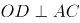，，A、B、C三点连线构成等腰三角形。AO＝100+150=250米，OD为半径150米，根据勾股定理可知，在直角中，米。因与均为直角三角形且为公共角，则，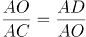，则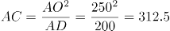米，全程最短为AC+BC=312.5×2=625米，用时为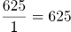秒＝10分25秒，在C项范围内。

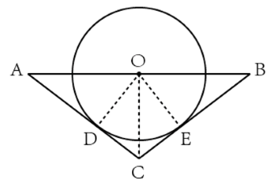

故正确答案为C。

### 第 52 题

甲和乙两种商品的年货礼盒售价分别为400元/盒和500元/盒，每个礼盒中包含5千克甲商品或3千克乙商品，甲和乙的成本分别为50元/千克和90元/千克。某日商场销售两种礼盒共56盒，总销售额为24600元。问当日甲礼盒的销售利润比乙礼盒：

A. 高不到500元

B. 高500元以上

C. 低不到500元

D. 低500元以上

第 52 题 · 答案与解析

**参考答案（粉笔题库参考内容）**

A

**解析**

根据题意可列表如下：

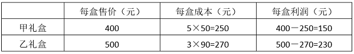

假设当日售出甲礼盒a个，乙礼盒b个。因“销售两种礼盒共56盒，总销售额为24600元”，则a＋b=56······①，400a＋500b=24600······②，联立解得a=34，b=22。则当日甲礼盒的销售利润为34×150=5100元，乙礼盒的销售利润为22×230=5060元，甲礼盒的销售利润比乙礼盒高5100-5060＝40元，在A项范围内。

故正确答案为A。

### 第 53 题

街道现有一笔预算用于为防疫志愿者购买防护服，如每人购买3套则剩余1720元；如每人购买5套则还需额外的680元预算。最终街道为每人购买4套防护服，剩余资金为每人购买13元/包的消毒湿巾2包，问街道防疫志愿者有多少人？

A. 16

B. 20

C. 24

D. 26

第 53 题 · 答案与解析

**参考答案（粉笔题库参考内容）**

B

**解析**

设街道防疫志愿者有x人，购买每套防护服需y元。由题意可知：预算金额=3xy+1720=5xy-680，整理可得xy=1200，则预算金额为5320元；又因为“最终街道为每人购买4套防护服，剩余资金为每人购买13元/包的消毒湿巾2包”，则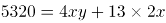，解得x=20。

故正确答案为B。

### 第 54 题

一个项目由甲、乙、丙三家企业共同参与，其中甲和乙出的人力分别占项目总人力的75%和25%，乙和丙出的资金分别占项目总投资的40%和60%。如果将人力和出资金额按一定比例分配利润，则甲分配的利润是乙的1.5倍。问丙分配的利润为项目总利润的：

A. 

B. 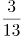

C. 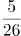

D. 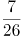

第 54 题 · 答案与解析

**参考答案（粉笔题库参考内容）**

B

**解析**

根据题意，设该项目总人力为4X，则甲出的人力为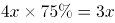，乙出的人力为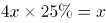；该项目总投资为5Y，则乙出的资金为5Y×40%=2Y，丙出的资金为5Y×60%=3Y。因“将人力和出资金额按一定比例分配利润”，则每家企业付出的人力和出资金额与分配的利润成正比。根据“甲分配的利润是乙的 1.5倍”，可得3X=1.5（X+2Y），解得X=2Y。丙分配的利润占项目总利润的比例为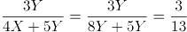。

故正确答案为B。

### 第 55 题

甲、乙两个工厂共同完成某项生产任务，如同时开工，需要25天完成。但实际上甲工厂开工1天后停工5天升级生产设备，升级后的效率比开始时提升了50%，结果提前1天完成。问开工时甲工厂的效率是乙工厂的：

A. 2倍

B. 3倍

C. 1/2

D. 1/3

第 55 题 · 答案与解析

**参考答案（粉笔题库参考内容）**

D

**解析**

设甲工厂升级前每天的效率为x，乙工厂每天的效率为1，则升级后甲工厂每天的效率为x×(1+50%)=1.5x。在实际工作过程中，甲工厂升级前工作了1天，升级后工作了25-1-1-5=18天，乙工厂工作了25-1=24天。根据工作总量不变，可得25(x+1)=(x+18×1.5x)+24，解得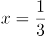，则开工时甲工厂的效率是乙工厂的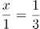。

故正确答案为D。

### 第 56 题

现有12个外观相同的包装盒，其中4个包装盒内各有3个苹果，4个包装盒内各有4个苹果，4个包装盒内各有5个苹果，现从中随机选出3个包装盒，问其中的苹果正好可以平均分给5人的概率在以下哪个范围内？

A. 不到10%

B. 10%-15%之间

C. 15%-20%之间

D. 超过20%

第 56 题 · 答案与解析

**参考答案（粉笔题库参考内容）**

B

**解析**

总情况为在12个包装盒中选出3个，情况数为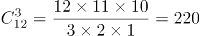种。满足条件的情况为包装盒中的苹果正好可以平均分给5人，即苹果总数应为5的整数倍，可能为10、15。当苹果总数为10个时，应选择2个有3个苹果的包装盒、1个有4个苹果的包装盒，情况数为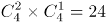种；当苹果总数为15个时，应选择3个有5个苹果的包装盒，情况数为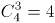种，则共有24+4=28种满足条件的情况数，所求概率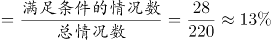，在B项范围内。

故正确答案为B。

### 第 57 题

企业将新招聘的张、王、刘、李、陈、何、榜和延8名应届生分配到甲、乙、丙三个分公司。要求每个分公司最多分配3人，张、王二人必须分配到同一个分公司，刘、李、陈三人必须分配到三个不同的分公司，何分配到的分公司不能是人数最多的，问有多少种不同的分配方式?

A. 36

B. 72

C. 144

D. 432

第 57 题 · 答案与解析

**参考答案（粉笔题库参考内容）**

A

**解析**

根据题干，刘、李、陈三人必须分配到三个不同的分公司，情况数为。因8名应届生分配到三个分公司且每个分公司最多分配3人，则除刘、李、陈三人外，三个分公司分得的人员组合情况为（1，2，2）。又因何分配到的分公司不能是人数最多的，且张、王二人必须分配到同一个分公司，则榜、延二人分配到同一个分公司，即组合情况为（何，张+王，榜+延），分配到三个分公司，情况数为。则不同的分配方式有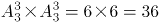种。

故正确答案为A。

### 第 58 题

一块长方形田地ABCD如下图所示，已知AB：BC=6：5，AE：EB=1：2，AI：ID=3：2，G和F则是另两边中点，现要在图中灰色部分种植作物A，问作物A的种植面积占该田地总面积的：

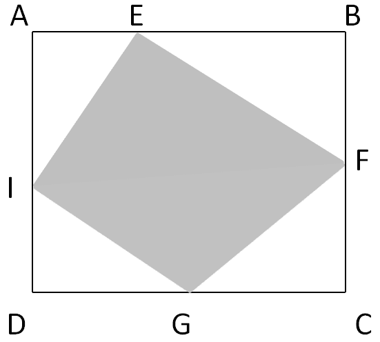

A. 不到45%

B. 45%-50%之间

C. 50%-55%之间

D. 55%以上

第 58 题 · 答案与解析

**参考答案（粉笔题库参考内容）**

C

**解析**

赋值AB=CD=12，BC=AD=10，因AE：EB=1：2，则AE=4，EB=8；AI：ID=3：2，则AI=6，ID=4；F和G分别是BC和CD中点，则BF=CF=5，CG=GD=6。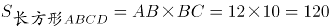，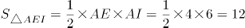，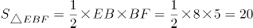，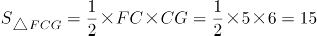，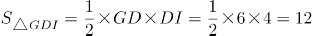。作物A的种植面积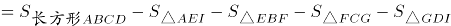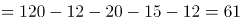，占该田地总面积的比重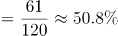，在C项范围内。

故正确答案为C。

### 第 59 题

某种产品的生产成本中，80%为原材料成本和人工成本，其余为其他成本。已知如人工成本上涨20%，原材料成本下降12%，总成本保持不变。问如其他成本上涨20%，人工成本上涨10%，原材料成本至少要下降多少才能保证成本不变？

A. 10%

B. 12%

C. 12.5%

D. 14%

第 59 题 · 答案与解析

**参考答案（粉笔题库参考内容）**

D

**解析**

假设生产1件该产品的人工成本为x，原材料成本为y。若人工成本上涨20%，原材料成本下降12%，总成本保持不变，即20%x=12%y，解得x：y=3：5。赋值x=3，y=5，则1件该产品的生产成本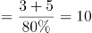，其他成本=10-3-5=2。若其他成本上涨20%，人工成本上涨10%，在保证生产成本不变的情况下，此时原材料成本=10-2×（1+20%）-3×（1+10%）=10-2.4-3.3=4.3，下降了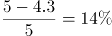。

故正确答案为D。

### 第 60 题

某单位招标信息化建设项目，预算为400万元。甲、乙、丙、丁4家投标企业的平均报价为预算金额的95%，已知只有甲企业的报价超过预算金额，任意2家企业的报价相差均不少于10万元且不多于100万元。问甲企业的报价最高可能为多少万元？

A. 440

B. 442.5

C. 445

D. 447.5

第 60 题 · 答案与解析

**参考答案（粉笔题库参考内容）**

D

**解析**

根据题意，4家企业报价之和为4×400×95%=1520万元。要想甲企业的报价尽可能高，则其他企业的报价应尽可能低。假设甲企业的报价为x万元，因任意2家企业的报价相差均不少于10万元且不多于100万元，则另外三家企业最低的报价依次为x-80、x-90、x-100万元。x+（x-80）+（x-90）+（x-100）=1520，解得x=447.5，即甲企业的报价最高可能为447.5万元。

故正确答案为D。

### 第 61 题

从所给四个选项中，选择最合适的一个填入问号处，使之呈现一定的规律性：

A. A

B. B

C. C

D. D

第 61 题 · 答案与解析

**参考答案（粉笔题库参考内容）**

D

**解析**

元素组成不同，优先考虑数量规律。本题为九宫格题目，优先横着看，第一行每个图形均有六个小黑球，第二行每个图形均有八个小黑球，第三行前两个图形均有十个小黑球，那么问号处图形应有十个小黑球，排除A、B两项；继续观察发现，题干所有图形均由小黑球和小白球组成，整体均构成轴对称图形，且对称轴只有一条，观察对称轴方向可知，每列图形对称轴方向相同，只有D项符合。

故正确答案为D。

### 第 62 题

把下面的六个图形分为两类，使每一类都有各自的共同特征或规律，分类正确的一项是：

A. ①②③，④⑤⑥

B. ①②④，③⑤⑥

C. ①②⑥，③④⑤

D. ①③⑥，②④⑤

第 62 题 · 答案与解析

**参考答案（粉笔题库参考内容）**

C

**解析**

本题为分组分类题目。观察发现，多边形内部被线条分割，优先考虑面数量，但题干图形的面数量都是3，无法分组。继续观察发现，所有图形均明显存在最大面且最大面出现等腰元素，可优先考虑最大面的对称性，其中图①②⑥最大面均为中心对称图形，图③④⑤最大面均为轴对称图形，故图①②⑥一组，图③④⑤一组。

故正确答案为C。

### 第 63 题

左边是给定纸盒的外表面，右边哪项能由它折叠而成？

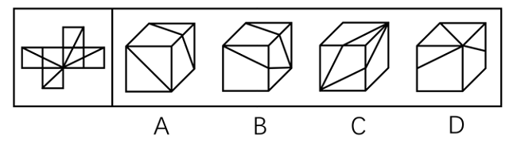

A. A

B. B

C. C

D. D

第 63 题 · 答案与解析

**参考答案（粉笔题库参考内容）**

C

**解析**

将原展开图标上序号如下图，逐一进行分析。

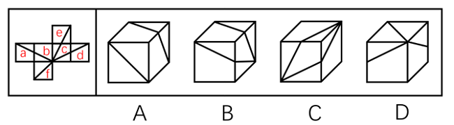

A项：选项正面是面f，因为面f与面e为相对面，面b与面d为相对面，相对面不能同时出现，因此选项由面f、面a和面b或面f、面a和面d构成。当选项由面f、面a和面b构成时，题干展开图中（如下图1所示），三个面的公共点分别挨着面a中的梯形和面b中的三角形，而选项中，三个面的公共点挨着面a和面b中的梯形，选项与题干展开图不一致；

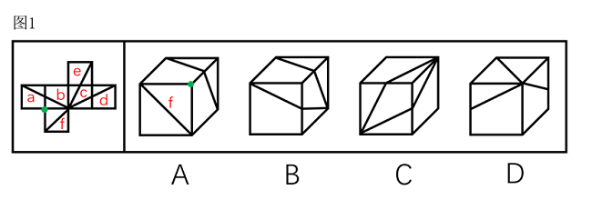

当选项由面f、面a和面d构成时，题干展开图中（如下图2所示），面a与面d的公共边与两个面中的直角梯形的长底边相邻，而选项中，面a与面d的公共边与两个面中的直角梯形的短底边相邻，选项与题干展开图不一致，排除；

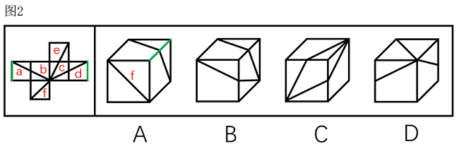

B项：选项侧面是面c，因为面c与面a为相对面，面b与面d为相对面，相对面不能同时出现，因此选项由面c、面b和面e或面c、面d和面e构成。当选项由面c、面b和面e构成时，题干展开图中（如下图3所示），面c中的三角形的顶点在三个面的公共点上，而选项中，面c中的四边形的顶点在三个面的公共点上，选项与题干展开图不一致；

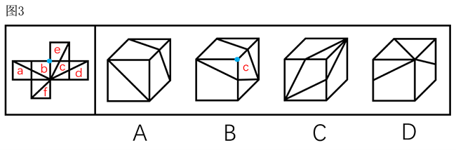

当选项由面c、面d和面e构成时，题干展开图中（如下图4所示），三个面的公共点在面e和面d中两个直角三角形的直角顶点上，而选项中，三个面的公共点只在一个直角三角形的直角顶点，选项与题干展开图不一致，排除；

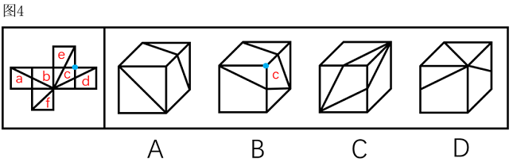

C项：选项由面c、面d和面e构成，选项与题干展开图一致，当选；

D项：选项顶面是面f，因为面f与面e为相对面，面b与面d为相对面，相对面不能同时出现，因此选项由面f、面a和面b或面f、面a和面d构成。当选项由面f、面a和面b构成时，题干展开图中（如下图5所示），三个面的公共点没有散发出直线，而选项中，三个面的公共点散发出三个面中的直线，选项与题干展开图不一致；

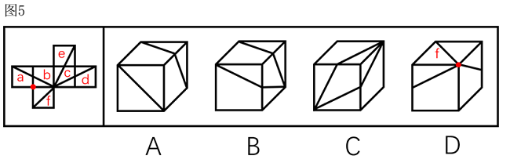

当选项由面f、面a和面d构成时，题干展开图中（如下图6所示），面a与面f的公共边挨着面a中的梯形，而选项中，面f与两个面的公共边均挨着面中的三角形，选项与题干展开图不一致，排除。

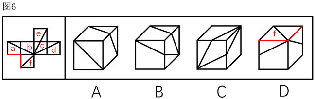

故正确答案为C。

### 第 64 题

从所给的四个选项中，选择最合适的一个填入问号处，使之呈现一定的规律性：

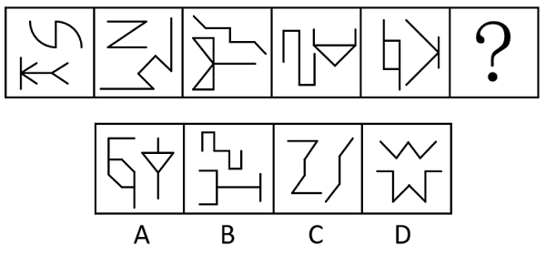

A. A

B. B

C. C

D. D

第 64 题 · 答案与解析

**参考答案（粉笔题库参考内容）**

B

**解析**

元素组成不同，优先考虑属性规律。观察发现，题干图形出现箭头、“Z”字变形图等，优先考虑对称性。继续观察发现，题干图形均由一个中心对称图形和一个轴对称图形组成，只有B项符合。

故正确答案为B。

### 第 65 题

左边的立体图形是由①、②和③组成的，下列哪项可以填入问号处？

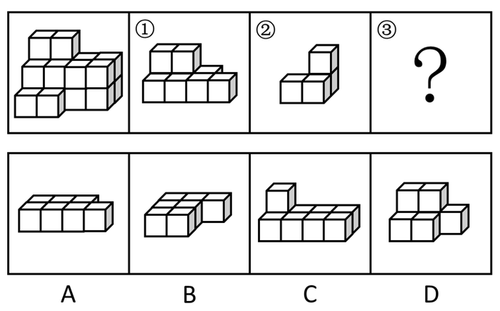

A. A

B. B

C. C

D. D

第 65 题 · 答案与解析

**参考答案（粉笔题库参考内容）**

B

**解析**

本题考查立体拼合。观察题干给出的图形可知，图形可分为3层，由上至下第一层有2个小立方体，第二层有8个小立方体，共2排，第三层有10个小立方体，共3排。图①共有2层，最上层有2个小立方体，可以拼在多面体的第一层和第二层（如下图所示），则题干多面体第二层还剩余1个小立方体，第三层还剩余10个小立方体。图②共有2层，可以拼在多面体的第二层和第三层（如下图所示），则题干多面体仅第三层还剩余7个小立方体。根据凹凸一致原则对立体图形进行拼合可知，第三层应有3排，对应B项。具体拼合方式如下图所示，左侧立体图形可以由图①、②以及B项拼合而成。

故正确答案为B。

### 第 66 题

乞题指以需要证明的命题作为证明的前提，也就是说，一个问题被用来支持结论，结论的理由是问题自身（A推出A），这样的错误称之为乞题错误。

根据上述定义，下列属于乞题的有几个？

①氯仿为什么会使人意识模糊？因为氯仿能够催眠，自然能够使人的直觉麻痹

②中国古代的科学技术是高度发达的，因为当时中国有世界上最先进的发明创造

③抽象艺术算不上是艺术，那些图片和雕塑并不代表什么，这就是为什么它算不上艺术的原因

④火星上是有人的，因为用望远镜观察火星，可以发现上面有不少有规则的条状阴影，这是火星人开凿的运河

A. 1

B. 2

C. 3

D. 4

第 66 题 · 答案与解析

**参考答案（粉笔题库参考内容）**

A

**解析**

第一步：找出定义关键词。

“以需要证明的命题作为证明的前提”、“一个问题被用来支持结论，结论的理由是问题自身（A推出A）”。

第二步：逐一进行分析。

①通过氯仿能够催眠，来证明氯仿会使人意识模糊，不符合“一个问题被用来支持结论，结论的理由是问题自身（A推出A）”，不符合定义；

②通过古代中国有世界上最先进的发明创造，来证明中国古代科学技术高度发达，不符合“一个问题被用来支持结论，结论的理由是问题自身（A推出A）”，不符合定义；

③通过图片和雕塑不代表什么，算不上艺术，来证明抽象艺术算不上艺术，抽象艺术是指对真实自然物象的描绘予以简化或完全抽离的艺术，图片和雕塑属于抽象艺术，即通过证明部分抽象艺术算不上艺术，来证明抽象艺术算不上艺术，符合“一个问题被用来支持结论，结论的理由是问题自身（A推出A）”，符合定义；

④通过火星上有开凿的运河，来证明火星上有人，不符合“一个问题被用来支持结论，结论的理由是问题自身（A推出A）”，不符合定义。

综上，属于乞题的有1个。

故正确答案为A。

### 第 67 题

碳中和指国家、地区、企业、团体或个人测算出自己在一定时间内，直接或间接排放的温室气体总量，然后通过植树造林、节能减排等形式，抵消掉自身产生的二氧化碳排放量，实现二氧化碳“零排放”。

根据上述定义，下列属于碳中和的是：

A. 通过植树造林，恢复生态，利用可再生能源，少用化石能源，减少温室气体排放总量

B. 截至2019年底，我国碳排放比2015年下降18.2%，提前完成向国际社会承诺的2020年目标

C. 我国将于2060年前通过植树造林、碳捕集和封存利用等形式吸收自身产生的二氧化碳排放

D. 2035年前，我国积极推进交通行业和工业减排，发展二氧化碳捕集、利用、封存等技术

第 67 题 · 答案与解析

**参考答案（粉笔题库参考内容）**

C

**解析**

第一步：找出定义关键词。

“国家、地区、企业、团体或个人”、“测算出自己在一定时间内，直接或间接排放的温室气体总量”、“通过植树造林、节能减排等形式”、“抵消掉自身产生的二氧化碳排放量，实现二氧化碳‘零排放’”。

第二步：逐一分析选项。

A项：该项指出通过植树造林等方式减少温室气体排放总量，仅涉及减排，未涉及抵消产生的二氧化碳排放量，不符合“抵消掉自身产生的二氧化碳排放量，实现二氧化碳‘零排放’”，不符合定义，排除；

B项：该项指出我国提前完成向国际社会承诺的2020年碳排放目标，仅涉及减排，未涉及抵消产生的二氧化碳排放量，不符合“抵消掉自身产生的二氧化碳排放量，实现二氧化碳‘零排放’”，不符合定义，排除；

C项：该项指出我国将在2060年前通过植树造林等形式吸收自身产生的二氧化碳排放，符合“国家、地区、企业、团体或个人”、“通过植树造林、节能减排等形式”、“抵消掉自身产生的二氧化碳排放量，实现二氧化碳‘零排放’”，符合定义，当选；

D项：该项指出我国积极推进交通行业和工业减排，仅涉及减排，未涉及抵消产生的二氧化碳排放量，不符合“抵消掉自身产生的二氧化碳排放量，实现二氧化碳‘零排放’”，不符合定义，排除。

故正确答案为C。

### 第 68 题

人为分类法是按照人们的目的和方法，以植物一个或几个特征或经济意义作为分类依据的分类方法。这种方法简单易懂、便于掌握，但不能反映植物类群的进化规律和亲缘关系。

根据上述定义，下列不属于人为分类法的是：

A. 土豆和西红柿都来源于美洲，归为美洲作物

B. 香樟、雪松因其四季常青，为常绿类植物

C. 大豆、豌豆均含有蛋白质、脂肪等营养物质，归为粮食作物

D. 萝卜和芥菜的花朵形态为四瓣、十字状分布，归为十字花科植物

第 68 题 · 答案与解析

**参考答案（粉笔题库参考内容）**

D

**解析**

第一步：找出定义关键词。

“按照人们的目的和方法”、“以植物一个或几个特征或经济意义作为分类依据的分类方法”、“不能反映植物类群的进化规律和亲缘关系”。

第二步：逐一分析选项。

A项：该项根据植物的原产地进行分类，且没有反映植物类群的进化规律和亲缘关系，符合“按照人们的目的和方法”、“以植物一个或几个特征或经济意义作为分类依据的分类方法”、“不能反映植物类群的进化规律和亲缘关系”，符合定义，排除；

B项：该项根据植物四季常青的特点进行分类，且没有反映植物类群的进化规律和亲缘关系，符合“按照人们的目的和方法”、“以植物一个或几个特征或经济意义作为分类依据的分类方法”、“不能反映植物类群的进化规律和亲缘关系”，符合定义，排除；

C项：该项根据植物含有的营养成分进行分类，属于根据经济意义分类，符合“按照人们的目的和方法”、“以植物一个或几个特征或经济意义作为分类依据的分类方法”、“不能反映植物类群的进化规律和亲缘关系”，符合定义，排除；

D项：该项根据萝卜和芥菜的花朵形态特点，将其归为十字花科植物，显示了植物间的亲缘关系，不符合“不能反映植物类群的进化规律和亲缘关系”，不符合定义，当选。

本题为选非题，故正确答案为D。

注意：本题D项采用的是“自然分类法”，如下图所示：

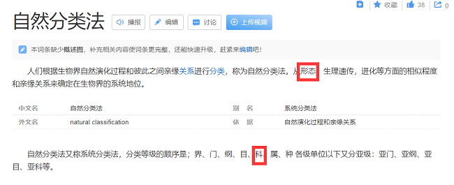

### 第 69 题

饱和心理是指人们在工作、学习和生活等方面，因为长期面对、从事重复或缺乏新意的事情，而感到无聊和无奈，以致内心不能再承受下去的心理现象。

根据上述定义，下列属于饱和心理现象的是：

A. 心理实验证明，人们的注意通常先会随着某种刺激增加而增强。但相关刺激反复出现并达到一定程度时，注意力就会逐渐下降

B. 妈妈为给小明做榜样，每天用更多时间看书学习。开始小明能学习妈妈看书学习的样子，时间一长，小明对此感到腻烦和不可忍耐

C. 条件反射实验证明，铃响后给实验动物一份美食，当这种组合刺激重复多次后，只要响铃，实验动物就会做出期待美食的条件反射

D. 妈妈以为小轩爱吃红烧肉，隔三差五做一碗香喷喷的红烧肉给他吃。小轩悄悄对爸爸说，其实是看到妈妈做得辛苦才装得特别爱吃

第 69 题 · 答案与解析

**参考答案（粉笔题库参考内容）**

B

**解析**

第一步：找出定义关键词。

“人们在工作、学习和生活等方面”、“长期面对、从事重复或缺乏新意的事情”、“感到无聊和无奈，以致内心不能再承受下去”。

第二步：逐一分析选项。

A项：人们的注意会随着刺激增加而增强，在达到一定程度后注意力下降，不存在无聊和无奈、内心不能再承受的情况，不符合“感到无聊和无奈，以致内心不能再承受下去”，不符合定义，排除；

B项：小明在长时间学习妈妈看书学习的样子后，感到腻烦和不可忍耐，符合“人们在工作、学习和生活等方面”、“长期面对、从事重复或缺乏新意的事情”、“感到无聊和无奈，以致内心不能再承受下去”，符合定义，当选；

C项：动物在铃声和美食的重复刺激后形成的条件反射，不符合“人们在工作、学习和生活等方面”，也不存在内心不能再承受的情况，不符合“感到无聊和无奈，以致内心不能再承受下去”，不符合定义，排除；

D项：小轩对爸爸说是看到妈妈做红烧肉辛苦才装得特别爱吃，没有体现出其它的心理状态，不符合“感到无聊和无奈，以致内心不能再承受下去”，不符合定义，排除。

故正确答案为B。

### 第 70 题

司法文书是指侦查、检察、审判、公证等司法机关在处理各类案件的各个环节、步骤上形成与使用的专用文书，司法文书主要包括具有法律效力的文书，也包括不直接发生法律效力，但对执行法律有切实保证作用的文书。

根据上述定义，下列不属于司法文书的是：

A. 犯罪现场中遗留的受害人亲笔题写的书信

B. 小宋针对自己的犯罪行为向司法机关自首时写出的材料

C. 小王收到的人民法院送达的要求其准时到庭的开庭通知书

D. 侦查人员为搜集犯罪证据，去被害人住处搜查后据有关情况写成的笔录

第 70 题 · 答案与解析

**参考答案（粉笔题库参考内容）**

A

**解析**

第一步：找出定义关键词。

“侦查、检察、审判、公证等司法机关”、“在处理各类案件的各个环节、步骤上形成与使用的专用文书”。

第二步：逐一分析选项。

A项：受害人写的书信是在案发前写的，不是司法机关在处理案件时形成的，不符合“侦查、检察、审判、公证等司法机关”、“在处理各类案件的各个环节、步骤上形成与使用的专用文书”，不符合定义，当选；

B项：小宋向司法机关自首时写出的材料，是侦查机关在处理案件时形成与使用的文书，符合“侦查、检察、审判、公证等司法机关”、“在处理各类案件的各个环节、步骤上形成与使用的专用文书”，符合定义，排除；

C项：人民法院是司法机关，开庭通知书是人民法院在处理案件时形成与使用的文书，符合“侦查、检察、审判、公证等司法机关”、“在处理各类案件的各个环节、步骤上形成与使用的专用文书”，符合定义，排除；

D项：侦查人员在被害人住处搜查后写的笔录，是侦查过程中形成的文书，符合“侦查、检察、审判、公证等司法机关”、“在处理各类案件的各个环节、步骤上形成与使用的专用文书”，符合定义，排除。

本题为选非题，故正确答案为A。

### 第 71 题

斗拱：古建筑：荷载重量

A. 尾灯：汽车：照明搜索

B. 船舵：帆船：控制航向

C. 剧场：舞台：提供演出

D. 芯片：手机：结构保护

第 71 题 · 答案与解析

**参考答案（粉笔题库参考内容）**

B

**解析**

第一步：判断题干词语间逻辑关系。

斗拱是我国木结构建筑中的支承构件，在立柱和横梁交接处。斗拱是古建筑的一部分，二者为组成关系，斗拱的主要作用是荷载重量，二者为功能对应关系。

第二步：判断选项词语间逻辑关系。

A项：尾灯是汽车的一部分，二者为组成关系，但是尾灯的主要作用是安全警示，不是照明搜索，与题干逻辑关系不一致，排除；

B项：船舵是帆船的一部分，二者为组成关系，船舵的主要作用是控制航向，二者为功能对应关系，与题干逻辑关系一致，当选；

C项：舞台是剧场的一部分，二者为组成关系，但两词顺序与题干相反，与题干逻辑关系不一致，排除；

D项：芯片是手机的一部分，二者为组成关系，芯片的主要作用是运算存储，不是结构保护，与题干逻辑关系不一致，排除。

故正确答案为B。

### 第 72 题

紫外线灯：消毒

A. 真菌：致病

B. 风扇：散热

C. 植树：造林

D. 敷料：创伤

第 72 题 · 答案与解析

**参考答案（粉笔题库参考内容）**

B

**解析**

第一步：判断题干词语间逻辑关系。

紫外线灯可以用来消毒，二者为功能的对应关系。

第二步：判断选项词语间逻辑关系。

A项：真菌可能是致病的原因，二者为因果的对应关系，与题干逻辑关系不一致，排除；

B项：风扇可以用来散热，二者为功能的对应关系，与题干逻辑关系一致，当选；

C项：植树的目的是造林，二者为方式目的对应关系，与题干逻辑关系不一致，排除；

D项：敷料可以用来包扎创伤，与创伤本身为作用对象的对应关系，与题干逻辑关系不一致，排除。

故正确答案为B。

### 第 73 题

糯米：汤圆：小吃

A. 枣泥：月饼：粽子

B. 椰汁：椰肉：椰油

C. 化纤：风衣：服装

D. 玻璃：陶瓷：茶杯

第 73 题 · 答案与解析

**参考答案（粉笔题库参考内容）**

C

**解析**

第一步：判断题干词语间逻辑关系。

糯米是制作汤圆的原材料，二者为原材料的对应关系；汤圆是一种小吃，二者为种属关系。

第二步：判断选项词语间逻辑关系。

A项：枣泥是制作月饼的原材料，二者为原材料的对应关系；月饼和粽子为并列关系，与题干逻辑关系不一致，排除；

B项：椰汁和椰肉都是椰子的组成部分，二者为并列关系，椰油是椰肉晒干后榨的油，二者为原材料的对应关系，与题干逻辑关系不一致，排除；

C项：化纤是制作风衣的原材料，二者为原材料的对应关系；风衣是一种服装，二者为种属关系，与题干逻辑关系一致，当选；

D项：玻璃和陶瓷为并列关系，都是制作茶杯的原材料，与题干逻辑关系不一致，排除。

故正确答案为C。

### 第 74 题

地壳运动：峡谷：高原

A. 温度骤降：冰雹：大气环境

B. 原油泄漏：爆炸：事故调查

C. 风力侵蚀：戈壁：沙漠

D. 暖湿气流：降水：干旱

第 74 题 · 答案与解析

**参考答案（粉笔题库参考内容）**

C

**解析**

第一步：判断题干词语间逻辑关系。

峡谷和高原为并列关系，均可能由地壳运动导致，后两词均与第一词为因果的对应关系。

第二步：判断选项词语间逻辑关系。

A项：冰雹和大气环境不是并列关系，且温度骤降是大气环境发生变化的一种情况，二者不是因果的对应关系，与题干逻辑关系不一致，排除；

B项：爆炸和事故调查不是并列关系，与题干逻辑关系不一致，排除；

C项：戈壁和沙漠为并列关系，均可能由风力侵蚀导致，后两词均与第一词为因果的对应关系，与题干逻辑关系一致，当选；

D项：降水和干旱不是并列关系，且暖湿气流不可能导致干旱，二者不是因果的对应关系，与题干逻辑关系不一致，排除。

故正确答案为C。

### 第 75 题

灾害预警：减少损失

A. 寒风凛冽：树木凋零

B. 演出彩排：顺利演出

C. 调解纠纷：劳动仲裁

D. 次贷危机：股市震荡

第 75 题 · 答案与解析

**参考答案（粉笔题库参考内容）**

B

**解析**

第一步：判断题干词语间逻辑关系。

灾害预警是为了减少损失，二者为方式目的的对应关系。

第二步：判断选项词语间逻辑关系。

A项：寒风凛冽会导致树木凋零，二者为因果的对应关系，与题干逻辑关系不一致，排除；

B项：演出彩排是为了顺利演出，二者为方式目的的对应关系，与题干逻辑关系一致，当选；

C项：劳动仲裁是为了调解纠纷，二者为方式目的的对应关系，但两词顺序与题干相反，与题干逻辑关系不一致，排除；

D项：次贷危机会导致股市震荡，二者为因果的对应关系，与题干逻辑关系不一致，排除。

故正确答案为B。

### 第 76 题

儿童读物：启蒙读物

A. 连续变量：离散变量

B. 刑事诉讼：民事诉讼

C. 生产资料：生活资料

D. 一类疫苗：麻疹疫苗

第 76 题 · 答案与解析

**参考答案（粉笔题库参考内容）**

D

**解析**

第一步：判断题干词语间逻辑关系。

启蒙读物指教育儿童的读物，是使初学者获得基本的入门知识的读物，启蒙读物是儿童读物的一种，二者为种属关系。

第二步：判断选项词语间逻辑关系。

A项：在统计学中，变量根据变量值是否连续可分为连续变量与离散变量。连续变量是指在一定区间内可以任意取值的变量，其数值是连续不断的；离散变量可以按一定顺序一一列举，通常指以整数位取值的变量。二者为并列关系，与题干逻辑关系不一致，排除；

B项：根据诉讼的内容和形式，诉讼可以分为刑事诉讼、民事诉讼和行政诉讼。其中，刑事诉讼是解决被追诉者刑事责任问题的诉讼活动；民事诉讼是解决民事争议的诉讼活动。二者为并列关系，与题干逻辑关系不一致，排除；

C项：生产资料是从事生产时所必需的物质条件，生活资料是指供人们物质文化生活需要的社会产品。二者不是种属关系，与题干逻辑关系不一致，排除；

D项：一类疫苗是指政府免费向公民提供，公民应当依照政府的规定接种的疫苗，麻疹疫苗是一类疫苗的一种，二者为种属关系，与题干逻辑关系一致，当选。

故正确答案为D。

### 第 77 题

过河拆桥：饮水思源

A. 江心补漏：未雨绸缪

B. 不名一钱：一贫如洗

C. 了如指掌：一窍不通

D. 浮光掠影：走马观花

第 77 题 · 答案与解析

**参考答案（粉笔题库参考内容）**

A

**解析**

第一步：判断题干词语间逻辑关系。

“过河拆桥”比喻达到目的以后，就把曾经帮助过自己的人一脚踢开；“饮水思源”比喻人在幸福的时候不忘幸福的来源，二者为反义关系，且过河拆桥为贬义词，饮水思源为褒义词。

第二步：判断选项词语间逻辑关系。

A项：“江心补漏”比喻补救已迟，无法挽回差错或败局；“未雨绸缪”比喻事先做好准备，二者为反义关系，且江心补漏为贬义词，未雨绸缪为褒义词，与题干逻辑关系一致，当选；

B项：“不名一钱”指没有一文钱，形容极其贫困；“一贫如洗”形容十分贫穷，二者为近义关系，与题干逻辑关系不一致，排除；

C项：“了如指掌”形容对情况非常清楚；“一窍不通”比喻一点儿也不懂，二者为反义关系，但了如指掌为褒义词，一窍不通为贬义词，与题干逻辑关系不一致，排除；

D项：“浮光掠影”指像水面的光和掠过的影子一样，一晃就消逝，形容印象不深刻；“走马观花”比喻粗略地观察事物，二者为近义关系，与题干逻辑关系不一致，排除。

故正确答案为A。

### 第 78 题

苦尽：甘来

A. 冷嘲：热讽

B. 大街：小巷

C. 异口：同声

D. 内忧：外患

第 78 题 · 答案与解析

**参考答案（粉笔题库参考内容）**

A

**解析**

第一步：判断题干词语间逻辑关系。

苦尽甘来指艰苦的境况过去，美好的境况到来，“苦”和“甘”为反义关系，“尽”和“来”均为动词。

第二步：判断选项词语间逻辑关系。

A项：冷嘲热讽指用尖酸刻薄的语言进行讥笑及讽刺，“冷”和“热”为反义关系，“嘲”和“讽”均为动词，与题干逻辑关系一致，当选；

B项：大街小巷指城镇里的街道，形容都市里的各处地方，“大”和“小”为反义关系，但“街”和“巷”均为名词，与题干逻辑关系不一致，排除；

C项：异口同声指不同的嘴说同样的话，形容大家说的完全一致，“异”和“同”为反义关系，但“口”和“声”均为名词，与题干逻辑关系不一致，排除；

D项：内忧外患指国内不安定，并有外来侵略，形势危急，“内”和“外”为反义关系，但“忧”和“患”均为名词，与题干逻辑关系不一致，排除。

故正确答案为A。

### 第 79 题

眼镜镜片 对于 （ ） 相当于 （ ） 对于 铝合金

A. 视力；坚固

B. 树脂；易拉罐

C. 凹透镜；重金属

D. 眼镜镜架；不锈钢

第 79 题 · 答案与解析

**参考答案（粉笔题库参考内容）**

B

**解析**

逐一代入选项。

A项：“眼镜镜片”可以用来矫正“视力”，二者是对应关系；“铝合金”具有“坚固”的属性，二者是属性对应关系，前后逻辑关系不一致，排除；

B项：“树脂”是制作“眼镜镜片”的一种原材料，二者是原材料的对应关系；“铝合金”是制作“易拉罐”的一种原材料，二者是原材料的对应关系，前后逻辑关系一致，当选；

C项：有的“眼镜镜片”是“凹透镜”，有的“眼镜镜片”不是“凹透镜”，有的“凹透镜”是“眼镜镜片”，有的“凹透镜”不是“眼镜镜片”，二者是交叉关系；“重金属”是指密度大于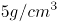的金属，“铝合金”不是“重金属”，二者是反向种属关系，前后逻辑关系不一致，排除；

D项：“眼镜镜片”和“眼镜镜架”是组成眼镜的两个部分，二者是并列关系；“铝合金”和“不锈钢”是两种不同的材质，二者是并列关系，但二者是独立存在的，前后逻辑关系不一致，排除。

故正确答案为B。

### 第 80 题

（ ） 对于 兰花 相当于 螃蟹 对于 （ ）

A. 兰草；蟹钳

B. 蝴蝶兰；花蟹

C. 蕙兰；甲壳动物

D. 丁香；水生动物

第 80 题 · 答案与解析

**参考答案（粉笔题库参考内容）**

C

**解析**

逐一代入选项。

A项：兰花的一个别名是兰草，二者是全同关系，蟹钳是螃蟹的组成部分，二者是组成关系，前后逻辑关系不一致，排除；

B项：蝴蝶兰是一种兰花，二者是种属关系，花蟹是一种螃蟹，二者是种属关系，但前后顺序相反，前后逻辑关系不一致，排除；

C项：蕙兰是一种兰花，二者是种属关系，螃蟹是一种甲壳动物，二者是种属关系，前后逻辑关系一致，当选；

D项：丁香和兰花是两种不同的植物，二者是并列关系，螃蟹是一种水生动物，二者是种属关系，前后逻辑关系不一致，排除。

故正确答案为C。

### 第 81 题

日前，研究人员在30个国家开展了近65项研究，涉及包括6万多名年龄在6岁到79岁之间的研究对象，目的是调查社会经济地位与牙齿磨损之间的联系。他们发现，在上私立学校且父母收入较高的青少年中，牙齿磨损似乎要严重得多。因此研究人员认为，富易伤牙。

以下哪项如果为真，最能支持上述研究者的观点?

A. 良好的口腔卫生习惯是保持一口好牙齿的秘诀

B. 富裕家庭的孩子有更多的机会进行定期牙齿护理

C. 社会经济地位低的成年人更容易因饮食不当、潜在疾病而出现牙齿磨损

D. 相较于贫困家庭的孩子，富人的孩子更容易买到碳酸饮料，多喝碳酸饮料会增加牙齿磨损程度

第 81 题 · 答案与解析

**参考答案（粉笔题库参考内容）**

D

**解析**

第一步：找出论点和论据。

论点：富易伤牙。

论据：在上私立学校且父母收入较高的青少年中，牙齿磨损似乎要严重得多。

论点和论据均讨论的是 “富裕家庭的孩子的牙齿磨损程度更严重”，二者话题一致，加强优先考虑补充论据，即解释富裕家庭的孩子的牙齿磨损程度更严重的原因或举例证明。

第二步：逐一分析选项。

A项：该项说的是保持一口好牙齿的秘诀，而论点说的是富裕家庭的孩子的牙齿磨损程度更严重，话题不一致，无法加强，排除；

B项：该项说的是富裕家庭的孩子有更多的机会进行定期牙齿护理，但并未说明富与牙齿磨损之间的联系，无法加强，排除；

C项：该项说的是社会经济地位低的成年人更容易出现牙齿磨损，说明富人比穷人的牙齿更不易磨损，属于削弱论点，无法加强，排除；

D项：该项说的是富裕家庭的孩子比贫困家庭的孩子更容易买到碳酸饮料，多喝碳酸饮料会增加牙齿磨损程度，解释了富裕家庭的孩子的牙齿磨损程度更严重的原因，属于补充论据，可以加强，当选。

故正确答案为D。

### 第 82 题

近日，研究人员利用胡萝卜渣以及蔬菜渣成功生产出了经济实惠的原纤化纤维素纳米纤维，并用其制备成了一种特殊的喷雾，结果证实，这种喷雾可以在果蔬表面形成保护性纤维涂层，将果蔬的保质期延长7天。研究人员认为，这种喷雾有望成为食物保鲜的重要材料。

以下哪项如果为真，最能支持上述研究者的观点？

A. 利用胡萝卜渣中提取的原纤化纤维素制备而成的生物塑料可以轻松被土壤中的细菌和真菌降解

B. 胡萝卜年产量可达4500万吨，其中大部分被用于榨汁，而榨汁剩下的胡萝卜渣中含有80%的纤维素

C. 用胡萝卜渣以及蔬菜渣制备原纤化纤维素纳米纤维时，无论胡萝卜渣及蔬菜渣是否新鲜，均不会影响原纤化纤维素纳米纤维的性能

D. 使用漂白预处理可以成功去除胡萝卜渣中的木质素和其他残留物，显著降低纤维化所需的能量，且不会影响原纤化纤维素纳米纤维的质量

第 82 题 · 答案与解析

**参考答案（粉笔题库参考内容）**

C

**解析**

第一步：找出论点和论据。

论点：这种喷雾有望成为食物保鲜的重要材料。

论据：喷雾可以在果蔬表面形成保护性纤维涂层，将果蔬的保质期延长7天。

本题论点和论据说的都是胡萝卜渣以及蔬菜渣制成的喷雾可以用于食物保鲜，论点和论据话题一致，加强优先考虑补充论据，也可以考虑必要条件。

第二步：逐一分析选项。

A项：选项只是说降解问题，没有提及是否能保鲜，话题不一致，无法加强，排除；

B项：选项只是说胡萝卜年产量和胡萝卜渣中纤维素含量，没有提到制成这种喷雾的另一原材料蔬菜渣，也没有提及是否能保鲜，无法加强，排除；

C项：如果两种原材料的新鲜度会影响纤维的性能，那么这种喷雾就不能成为食物保鲜的重要材料，该项是论点成立的必要条件，可以加强，当选；

D项：选项说的是使用漂白预处理这一种方法的具体影响，如果不使用这种方法，可能也能做成这种纤维，该方法对论点是否成立没有明显影响，无法加强，排除。

故正确答案为C。

### 第 83 题

一旦侵害个人信息权益造成损害，就要求承担法律责任。

上述说法如果为真，以下哪项也一定为真？

A. 虽然未侵害个人信息权益造成损害，但也要承担法律责任

B. 如果未侵害个人信息权益造成损害，不承担法律责任

C. 要么侵害个人信息权益造成损害，要么不承担法律责任

D. 只有未侵害个人信息权益造成损害，才不承担法律责任

第 83 题 · 答案与解析

**参考答案（粉笔题库参考内容）**

D

**解析**

第一步：翻译题干。

侵害个人信息权益造成损害承担法律责任。

第二步：逐一分析选项。

A项：翻译为“-侵害个人信息权益造成损害 且 承担法律责任”，但“-侵害个人信息权益造成损害”和“承担法律责任”不是必然同时存在的，无法推出，排除；

B项：翻译为“-侵害个人信息权益造成损害承担法律责任”，是对题干翻译的否前，否前无法得出确定结论，无法推出，排除；

C项：“要么A，要么B”为A和B二者有且只有一个满足，但题干为推出关系，无法确定这两者必然有且只有一个满足，无法推出，排除；

D项：翻译为“-承担法律责任侵害个人信息权益造成损害”，是对题干翻译的否后，否后必否前，可以推出，当选。

故正确答案为D。

### 第 84 题

仿佛就是在一夜之间，“万物皆可元宇宙”。在元宇宙之中，人们似乎可以不再受到肉体的束缚，时空的限制也已经不是问题，人们在其中以光速移动，就连外表也可以随意选择，可选择一款“虚拟化身”与亲朋好友相聚······元宇宙的超现实不禁让人们担忧，数亿人的“数字生活”可能会被几家大公司所控制，元宇宙的出现会让这种情况继续恶化。

以下哪项如果为真，最能削弱上述观点？

A. 元宇宙会让人类满足于虚拟现实所带来的快感，进而让人类故步自封

B. 元宇宙允许现实以碎片的形式进入，但前提条件是现实必须被操纵我们感知、干预我们行为的数字准则所覆盖

C. 实现元宇宙需要虚拟现实设备，虚拟现实设备只有在系统测量到了人体的动作时才能够工作，并且给出相应的画面

D. 人们在虚拟现实系统中留下的数据会成为算法的训练数据，把人的身体语言与接下来的行为结果进行配对，让人们随后在现实中做出可以预期的行为

第 84 题 · 答案与解析

**参考答案（粉笔题库参考内容）**

C

**解析**

第一步：找出论点和论据。

论点：数亿人的“数字生活”可能会被几家大公司所控制，元宇宙的出现会让这种情况继续恶化。

论据：无。

本题只有论点，没有论据，削弱优先考虑削弱论点，即数亿人的“数字生活”不会被几家大公司所控制，元宇宙的出现不会让这种情况继续恶化。

第二步：逐一分析选项。

A项：该项指出了元宇宙会让人类故步自封，与论点讨论的人们的“数字生活”是否会被控制无关，话题不一致，无法削弱，排除；

B项：该项指出了现实必须被操纵我们感知、干预我们行为的数字准则所覆盖，讲述的是现实进入元宇宙的前提条件，与论点讨论的人们的“数字生活”是否会被控制无关，话题不一致，无法削弱，排除；

C项：该项指出了元宇宙需要虚拟现实设备，虚拟现实设备只有在系统测量到人体动作时才会工作，说明在元宇宙中人们可以自行操控自己，不会被外界所控制，削弱论点，可以削弱，当选；

D项：该项指出了虚拟现实系统可以让人们在现实中做出可以预期的行为，讲述的是虚拟现实系统运行的原理，与论点讨论的人们的“数字生活”是否会被控制无关，话题不一致，无法削弱，排除。

故正确答案为C。

### 第 85 题

一些研究人员以859名初中生为被试者，连续三年在每年5月测量被试者的抑郁水平、自我伤害度以及父母心理控制程度，研究人员根据被试者三次测量后抑郁和自伤程度的发展轨迹，将被试者分为“低抑郁-低自伤-稳定组”“中抑郁-中自伤-降低组”“低抑郁-低自伤-增长组”3组，经过对照发现，父母心理控制水平越高的青少年属于“低抑郁-低自伤-增长组”的可能性越大，因此，父母心理控制是造成青少年抑郁和自伤的主要人际因素。

以下哪项如果为真，最能支持上述观点？

A. 三年中青少年感知到的父母心理控制并没有下降

B. 青少年抑郁和自伤的发展轨迹在男女生中没有差异

C. 师生关系和同伴关系不能显著预测青少年抑郁和自伤的发展轨迹

D. 青少年个体的抑郁水平持续增强时也会随之提高其自伤行为的频率

第 85 题 · 答案与解析

**参考答案（粉笔题库参考内容）**

C

**解析**

第一步：找出论点和论据。

论点：父母心理控制是造成青少年抑郁和自伤的主要人际因素。

论据：研究人员根据被试者三次测量后抑郁和自伤程度的发展轨迹，将被试者分为“低抑郁-低自伤-稳定组”“中抑郁-中自伤-降低组”“低抑郁-低自伤-增长组”3组，经过对照发现，父母心理控制水平越高的青少年属于“低抑郁-低自伤-增长组”的可能性越大。

本题论点和论据都在讨论父母心理控制会导致青少年抑郁和自伤，二者话题一致，加强优先考虑补充论据。

第二步：逐一分析选项。

A项：指出三年中青少年感知到的父母心理控制并没有下降，补充了这次调查的一个前提，从而保证调查数据的有效性，可以支持“父母心理控制是造成青少年抑郁和自杀的人际因素”，但无法支持“是主要的”人际因素，所以A在本题中对于论点的支持非常弱，排除；

（“A是B的原因”和“A是B的主要原因”是不同的。比如：饿死是人死亡的原因，但不能说饿死是人死亡的主要原因，因为实际的调查结果可能是某几种疾病导致的死亡是大多数，而饿死的只是极个别）

B项：指出青少年抑郁和自伤的发展轨迹在男女生中没有差异，但性别差异与论点讨论的父母心理控制是造成青少年抑郁和自伤的主要人际因素无关，无关选项，无法加强，排除；

C项：指出师生关系和同伴关系不能显著预测青少年的抑郁和自伤轨迹，排除了父母之外的两种人际关系是“主要”因素的可能，且这两种关系对于初中生来说也是最为常见的两种人际关系，通过排除他因进行加强，此时就可以证明父母“是主要的”因素，力度比A项强，当选；

D项：指出青少年个体自伤行为频率会随抑郁水平增强而提高，说的是自伤行为与抑郁水平之间的关系，与论点讨论的父母心理控制是造成青少年抑郁和自伤的主要人际因素无关，无关选项，无法加强，排除。

故正确答案为C。

注：本题C项的表述其实不够严谨，在原文中，研究人员只讨论了父母，师生和同伴这三种关系，所以只需排除另外两种关系，就可以证明父母是造成青少年抑郁和自杀的“主要”人际因素；当脱离原文的情况下，除了父母、师生和同伴三种关系以外，青少年可能还有其他的人际关系。但从题干逻辑结构和命题意图来看，C项是在对着父母是“主要”因素而努力，C项还是更优。所以建议同学们了解本题的思路即可，不用作为备考重点。

### 第 86 题

为了确定压力对毛发生长的影响，研究人员详细分析了皮质酮（小鼠在长期慢性压力下释放的一种激素）如何调节小鼠毛囊的活动，小鼠实验显示，当皮质酮水平升高时，毛囊的休止期会延长，无法再生；反过来，如果皮质酮水平降低，毛囊干细胞会被激活，开始生长新的毛发，因此有人认为：降低人体皮质酮，就可治疗长期压力导致的脱发。

以下哪项如果为真，最能削弱上述观点？

A. 皮质酮会通过抑制一种名为GAS6的蛋白的产生，控制毛囊干细胞的激活

B. 慢性压力应激引起的脱发可能是由减少毛囊锚定和抑制进入生长期的机制相互促进的

C. 小鼠和人类的毛发生长周期不太一样，这或许会影响对应激性毛发干细胞抑制进行逆转的有效性

D. 啮齿动物的皮质酮被认为对应人类的皮质酮，但目前尚并不清楚人体内的皮质酮是否也能对毛囊产生类似作用

第 86 题 · 答案与解析

**参考答案（粉笔题库参考内容）**

D

**解析**

第一步：找出论点和论据。

论点：降低人体皮质酮，就可治疗长期压力导致的脱发。

论据：小鼠实验显示，当皮质酮水平升高时，毛囊的休止期会延长，无法再生；反过来，如果皮质酮水平降低，毛囊干细胞会被激活，开始生长新的毛发。

本题论据讨论的是“小鼠”皮质酮水平与毛囊的关系，论点讨论的是“人类”皮质酮水平与毛囊的关系，二者主体不一致，削弱优先考虑拆桥。

第二步：逐一分析选项。

A项：该项解释了皮质酮如何作用于毛囊，有加强的力度，无法削弱，排除；

B项：该项指出压力脱发可能是两种因素“相互促进”的过程，那么即便降低皮质酮能解决“抑制毛囊生长期”这一问题，可能也无法解决“毛囊锚定减少”的问题，因此仅靠降低皮质酮不一定能治疗该类脱发，可以削弱，保留；

C项：该项指出小鼠与人类在“毛发生长周期”上存在差异，而且可能会影响有效性，即使小鼠可以通过激活毛囊干细胞改善脱发，该效果在人类身上也未必成立，可以削弱，保留；

D项：该项指出目前尚不清楚人体内的皮质酮是否会对毛囊产生与小鼠类似的作用，说明从小鼠实验直接推广到人体缺乏充分依据，可以削弱，保留。

对比B、C、D三项，B项中的“可能”与C项中的“或许”证明二者均为可能性削弱，且题干话题围绕皮质酮与毛囊的关系展开，但B项与C项均未直接提及“皮质酮”，而D项质疑的是皮质酮对毛囊的作用，与题干话题更一致。而且D项从根源上切断了实验主体，啮齿动物和人类之间的联系，从根源上削弱了从小鼠实验推广到人体的合理性，削弱力度强于B、C两项。

故正确答案为D。

### 第 87 题

评估读写障碍学生的传统方式是当一个孩子在读写方面遭遇了异常困难，其家长和老师坐到一起，通过纸质测试收集信息并评估孩子的优势和劣势，以确诊和制定适当的干预方案。目前某科技公司发明了一种读写障碍筛查工具，即通过电脑和眼动追踪摄像机，对每一个学生进行测试，以此找出少部分可能有读写障碍倾向的孩子，该公司市场管销人员表示，这种眼动追踪技术潜力无限，有望在学校得到普及。

以下哪项如果为真，最能削弱上述观点？

A. 单纯通过纸笔测试，很难直接读取结果，要花费大量时间

B. 教育工作者不一定都是科学家或研究者，他们可能没有足够的资源去理解该如何充分利用测试的结果

C. 此技术只是一个筛查工具，主要目的是在早期就能找到那些有阅读障碍倾向的孩子，而不是一个诊断工具

D. 眼动仪可分辨出读写障碍者和非读写障碍者之间的阅读差异，但这些差异很可能只是阅读障碍的结果而非原因

第 87 题 · 答案与解析

**参考答案（粉笔题库参考内容）**

B

**解析**

第一步：找出论点和论据。

论点：这种眼动追踪技术潜力无限，有望在学校得到普及。

论据：目前某科技公司发明了一种读写障碍筛查工具，即通过电脑和眼动追踪摄像机，对每一个学生进行测试，以此找出少部分可能有读写障碍倾向的孩子。

本题的论点讨论的是这种眼动追踪技术有潜力，有希望在学校得到普及，论据讨论的是该种技术能够找出少部分可能有读写障碍倾向的孩子，二者话题一致，削弱优先考虑削弱论点。

第二步：逐一分析选项。

A项：该项说的是纸笔测试有很难直接读取结果、耗时久的弊端，但是没有提及眼动追踪技术潜力如何，能否在学校得到普及，话题不一致，无法削弱，排除；

B项：该项说的是教育工作者可能无法理解和利用该技术的检测结果，说明该技术可能很难在学校得到普及，直接削弱论点，当选；

C项：该项说的是眼动追踪技术是筛查出有阅读障碍倾向的孩子的工具，论据讨论的是眼动追踪可以筛查少部分可能有读写障碍倾向的孩子，也并未提及这个技术有诊断功能，故两者并不矛盾，且该项未提及该技术能否在学校普及，无关项，无法削弱，排除；

D项：该项说的是眼动仪分辨出的差异很可能只是阅读障碍的结果而非原因，但未提及能否对有阅读障碍倾向的孩子有所帮助，也未提及眼动仪能否在学校普及，话题不一致，无法削弱，排除。

故正确答案为B。

### 第 88 题

有人说玩是孩子的天性，多玩玩具能够开发他们的智力，但研究人员做了一项实验：将三岁以下的儿童分成两组，一组提供4种玩具，另一组提供16种玩具。结果发现，玩具种类越多，孩子的智力越差。

以下哪项如果为真，最能解释上述发现？

A. 过多的玩具会让孩子无法集中于某个玩具，不利于注意力的培养

B. 玩具过多容易使孩子大脑形成各种“兴奋灶”，互相影响、干扰和制约，阻碍神经系统发育

C. 高难度玩具完全超出了孩子的认知发展水平，容易产生挫败感和无力感，对玩具失去兴趣和探索欲

D. 玩具较少的孩子在看到新玩具时会更加珍惜，由衷地产生幸福感，而玩具较多的孩子则容易形成不懂得满足的性格

第 88 题 · 答案与解析

**参考答案（粉笔题库参考内容）**

B

**解析**

第一步：找出题干矛盾。

孩子拥有的玩具种类越多，智力却越差。

第二步：逐一分析选项。

A项：该项说的是玩具过多不利于培养孩子的注意力，但注意力与智力不同，不能解释为什么孩子拥有的玩具种类越多，智力却越差，不能解释题干矛盾，排除；

B项：该项说的是玩具过多会阻碍神经系统发育，神经系统发育不良会影响孩子的智力，可以解释为什么孩子拥有的玩具种类越多，智力却越差，可以解释题干矛盾，当选；

C项：该项说的是高难度的玩具会让孩子失去对玩具的兴趣和探索欲，但失去对玩具的兴趣和探索欲并不代表智力差，不能解释为什么孩子拥有的玩具种类越多，智力却越差，不能解释题干矛盾，排除；

D项：该项说的是玩具多的孩子容易不满足，但不满足并不代表智力差，不能解释为什么孩子拥有的玩具种类越多，智力却越差，不能解释题干矛盾，排除。

故正确答案为B。

### 第 89 题

最近一项研究探讨了女性产品代言人性别如何影响女性消费者对该产品的评价，这个实验分为4组，分别邀请不同数量的女性参与，进入实验后，给她们分别看男性和女性代言的场景描述以及产品图片，接下来被试者会完成有关产品评价的量表，即“您如何评价这个产品？”结果显示：与女性代言女性产品相比，男性代言时女性消费者对该产品的评价会显著降低。因此，广告商使用男性代言无法达到预期效果。

以下哪项如果为真，最能支持上述观点？

A. 代言女性产品时，男性代言人扮演关心女性朋友的暖男角色可以让女性消费者更好地接受这种新颖的产品代言方式

B. 对自我认同缺乏信心的部分女性消费者面对男性代言女性产品时，会激活强烈的身份威胁感，采取消极的应对方式

C. 对于男性代言而言，随着私密性的提高，男性代言的负面效应随之增强，但这种加强效应达到一定程度后不再提升

D. 男性代言人代言很多女性产品时无法亲身体验，只是简单拿产品做摆拍，略显突兀的展示效果远远不及女性代言人

第 89 题 · 答案与解析

**参考答案（粉笔题库参考内容）**

D

**解析**

第一步：找出论点和论据。

论点：广告商使用男性代言无法达到预期效果。

论据：与女性代言女性产品相比，男性代言时女性消费者对该产品的评价会显著降低。

本题论点论据都是在说相比于女性代言女性产品，男性代言的效果并不好，论点和论据话题一致，因此加强优先考虑补充论据（举例子或解释原因）。

第二步：逐一分析选项。

A项：该项说的是男性代言人扮演暖男角色会让女性消费者更好地接受产品，说明男性代言女性产品可以起到较好效果，该项是对论点的削弱，无法加强，排除；

B项：该项说的是部分女性消费者会消极应对男性代言的女性产品，举例说明男性代言女性产品时确实可能起到反效果，举例加强，可以加强，保留；

C项：该项说的是随着私密性的提高，男性代言的负面效应随之增强，但这个负面效应是有限的，负面效应到底有多大不明确，不明确项，无法加强，排除；

D项：该项说的是男性代言人无法亲身体验产品，只能摆拍，效果远不如女性代言人好，解释了为什么在代言女性产品时，男性代言人确实不如女性代言人的效果好，解释原因，可以加强，保留。

对比B、D两项，D项解释原因的力度大于B项举例加强的力度。

故正确答案为D。

### 第 90 题

研究人员分别用麦克斯韦望远镜和阿塔卡马大型毫米/亚毫米波阵观测了金星。他们探测到一个只属于磷化氢的光谱特征，并估算出金星云层中的磷化氢浓度，研究团队研究了所有磷化氢产生的可能性：火山、雷击、坠落到大气中的陨石，并最后将它们逐个排除。他们发现，金星上的任何活动都不能产生足以解释他们检测到的磷化氢数量。研究人员表示：磷化氢很容易在生物代谢中生成，因此金星大气中存在的某种生命形式，产生了我们探测到的磷化氢。

以下哪项如果为真，最能质疑研究人员的观点?

A. 磷化氢的光谱特征与二氧化硫的光谱特征十分相似，而金星的大气中存在大量的二氧化硫

B. 产生光谱线的云层位于金星大气层的中高层，那里环境十分恶劣，磷化氢根本不可能存在

C. 金星大气存在某种人类还从来没有认识到的自然现象，比如某种行星地质级别的化学反应

D. 研究组重新分析探测数据后估计，磷化氢的平均浓度为1ppb，约为先前预估值的七分之一

第 90 题 · 答案与解析

**参考答案（粉笔题库参考内容）**

B

**解析**

第一步：找出定义关键词。

论点：金星大气中存在的某种生命形式，产生了我们探测到的磷化氢。

论据：研究团队探测到一个只属于磷化氢的光谱特征，并估算出金星云层中的磷化氢浓度，研究团队研究了所有磷化氢产生的可能性：火山、雷击、坠落到大气中的陨石，并最后将它们逐个排除。他们发现，金星上的任何活动都不能产生足以解释他们检测到的磷化氢数量。同时，磷化氢很容易在生物代谢中生成。

本题的论据说的是金星大气层中存在磷化氢，且探测到的数量不可能是非生物（火山、雷击、陨石）生成的，另一方面，磷化氢很容易由生物代谢生成，即说明是生物代谢产生了金星大气层中的磷化氢，而论点说的是金星大气中的某种生命形式产生了磷化氢，所以，二者讨论话题一致，削弱可以考虑削弱论点，也可以考虑削弱论据。

第二步：逐一分析选项。

A项：该项说明二氧化硫与磷化氢的光谱特征十分相似，但论据明确说明，研究人员观察到的光谱特征只属于磷化氢，因此不存在混淆二氧化硫和磷化氢的可能，无法削弱，排除；

B项：该项说明在金星大气层的中高层中不可能存在磷化氢，说明研究团队的其观测结果并不准确，而研究团队的推测结果是基于金星大气层存在磷化氢而得，该项可以质疑研究团队的分析结果，削弱论据，可以削弱，当选；

C项：该项讨论的是金星大气的其他自然现象，而论点讨论的是产生磷化氢的来源，二者讨论的话题不一致，无法削弱，排除；

D项：该项说明磷化氢的探测数据有误，实际数据约为原数据的七分之一，但非生物（火山、雷击、陨石）因素是否可以产生该平均浓度的磷化氢并不明确，不明确项，无法削弱，排除。

故正确答案为B。

## 材料 1

### 第 91 题

2020年养老保险基金收支有结余的是：

A. 甲省

B. 乙省

C. 丙省

D. 丁省

第 91 题 · 答案与解析

**参考答案（粉笔题库参考内容）**

C

**解析**

定位统计表可知2020年甲省、乙省、丙省、丁省的养老保险基金收支数据。根据：结余即收入大于支出，仅丙省养老保险基金收入（3858亿元）＞支出（3314亿元），有结余。

故正确答案为C。

### 第 92 题

与2018年比较，2019年全国养老保险基金收入增速区间是：

A. 2%-3%

B. 3%-4%

C. 4%-5%

D. 5%-6%

第 92 题 · 答案与解析

**参考答案（粉笔题库参考内容）**

B

**解析**

根据题干“与2018年比较，2019年······增速区间是”，可判定本题为一般增长率问题。定位统计表可得：2018年、2019年全国养老保险基金收入分别为51168亿元、52918亿元。根据公式：增长率，则所求增长率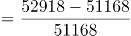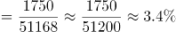，在B项区间内。

故正确答案为B。

### 第 93 题

与2018年比较，2019年养老保险基金收入增速低于全国水平的是：

A. 甲省和乙省

B. 乙省和丁省

C. 乙省和丙省

D. 丁省

第 93 题 · 答案与解析

**参考答案（粉笔题库参考内容）**

D

**解析**

根据题干“与2018年比较，2019年······增速······”，可判定本题为一般增长率问题。定位统计表可知2018年、2019年四个省份的养老保险基金收入数据。结合上题可知，2019年全国养老保险基金收入增速约为3.4%，根据公式：增长率，则与2018年比较，2019年的增长率分别为：甲省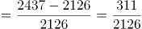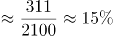；乙省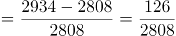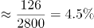；丙省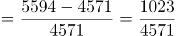；丁省。比较可知，增速低于全国的只有丁省。

故正确答案为D。

### 第 94 题

4个省份2018-2020年养老保险基金的结余额趋势是：

A. 

B. 

C. 

D. 

第 94 题 · 答案与解析

**参考答案（粉笔题库参考内容）**

A

**解析**

定位表格可得2018-2020年4个省份养老保险基金的收入与支出。根据公式：结余额=收入-支出，甲省与乙省2019年收入均大于支出，则2019年结余额均大于0，而2020年收入均小于支出，则2020年结余额小于0，则2019年结余额＞2020年结余额；丙省：2019年结余额（5594-3762=1832亿元）>2020年结余额（3858-3314=544亿元）；丁省：2019年结余额（1047-1084=-37亿元）>2020年结余额（1032-1172=-140亿元），因此4个省份结余额2019-2020年趋势均是下降的，符合的只有A项。

故正确答案为A。

### 第 95 题

下列选项中，关于养老保险基金的说法正确的是：

A. 全国的基金收入在2018-2020年期间逐年增加

B. 4个省份基金收支的结余在2018-2020年期间逐年增加

C. 丙省的基金收入超出其它三省的原因是该省的缴费率高于其它三省

D. 2020年资料中养老保险基金收支有缺口的省份较前两年均有所增加

第 95 题 · 答案与解析

**参考答案（粉笔题库参考内容）**

D

**解析**

A项：定位表格可得，2019年全国养老保险基金收入（52918亿元）＞2020年全国养老保险基金收入（44376亿元），并非逐年增加，错误；

B项：定位表格可得，甲省2019年养老保险基金收支结余=2437-2426＞0，2020年收支结余=1684-1982＜0，故2020年收支结余＜2019年收支结余，结余较上年下降，并非逐年增加，错误；

C项：材料未给出丙省的基金收入超出其它三省的原因，且未提及缴费率，故无法判断，错误；

D项：养老保险基金收支缺口指基金收入＜基金支出。定位表格可得：2018年收支有缺口的省份为0个；2019年收支有缺口的省份为丁省（收入1047亿元＜支出1084亿元），共1个；2020年收支有缺口的省份为甲省（收入1684亿元＜支出1982亿元）、乙省（收入2036亿元＜支出2982亿元）、丁省（收入1032亿元＜支出1172亿元），共3个，故2020年养老保险基金收支有缺口的省份较前两年均有所增加，正确。

故正确答案为D。

## 材料 2

### 第 96 题

2018-2020年，全国铝电容器出口额约比2015-2017年增长了：

A. 7%

B. 10%

C. 13%

D. 16%

第 96 题 · 答案与解析

**参考答案（粉笔题库参考内容）**

C

**解析**

根据题干“······约比······增长了”，结合选项为百分数，可判定本题为一般增长率问题。定位柱状图可知2014-2020年全国铝电容器出口额。则2015-2017年全国铝电容器出口额为7.77+7.19+8.22=23.18亿美元，2018-2020年全国铝电容器出口额为8.92+8.14+9.15=26.21亿美元。根据公式：增长率，则2018-2020年，全国铝电容器出口额比2015-2017年增长了。

故正确答案为C。

### 第 97 题

2015-2020年六年间，全国铝电容器出口额同比增幅超过10%的年份比同比降幅超过10%的年份：

A. 多1个

B. 多2个

C. 少1个

D. 少2个

第 97 题 · 答案与解析

**参考答案（粉笔题库参考内容）**

A

**解析**

根据题干“······同比增幅超过10%······同比降幅超过10%······”，可判定本题为一般增长率问题。定位柱形图可知2014-2020年全国铝电容器出口额。根据公式：增长率，则2015-2020年六年间，全国铝电容器出口额的同比增长率分别为：

2015年，；

2016年，；

2017年，；

2018年，；

2019年，；

2020年，。

综上可知，2015-2020年六年间，全国铝电容器出口额同比增幅超过10%的年份有2017年、2020年，共2个；同比降幅超过10%的年份只有2015年1个。则同比增幅超过10%的年份（2个）比同比降幅超过10%的年份（1个）多1个。

故正确答案为A。

### 第 98 题

2020年，广东和江苏铝电容器出口额约占全国同类产品出口总额的：

A. 60%

B. 65%

C. 70%

D. 75%

第 98 题 · 答案与解析

**参考答案（粉笔题库参考内容）**

D

**解析**

根据题干“2020年······占······”，可判定本题为现期比重问题。定位柱形图可得：2020年，全国铝电容器出口额为9.15亿美元；定位表格可得：2020年，广东和江苏铝电容器出口额分别为35167万美元、33044万美元。根据公式：比重，则所求比重，与D项最接近。

故正确答案为D。

### 第 99 题

把江苏、浙江、上海三省市按2020年铝电容器出口单价从高到低排列正确的是：

A. 上海，江苏，浙江

B. 江苏，浙江，上海

C. 上海，浙江，江苏

D. 浙江，江苏，上海

第 99 题 · 答案与解析

**参考答案（粉笔题库参考内容）**

A

**解析**

根据题干“······2020年······出口单价······”，可判定本题为现期平均数问题。定位表格可得：2020年，江苏铝电容器出口额为33044万美元，出口量为67.9亿个；浙江铝电容器出口额为1434万美元，出口量为10.0亿个；上海铝电容器出口额为3899万美元，出口量为4.4亿个。根据公式：出口单价=，则这三个省市出口单价分别为：江苏，美元/万个；浙江，美元/万个；上海，美元/万个。比较可知，三个省市出口单价从高到低排序应为：上海，江苏，浙江。

故正确答案为A。

### 第 100 题

关于全国铝电容器出口状况，能够从上述资料中推出的是：

A. 2014-2020年，出口总额超过60亿美元

B. 2016-2020年期间出口额最高的年份是2020年

C. 2020年，广东省出口量占全国出口总量的一半以上

D. 2020年，全国有5个省市出口额超过全国出口总额的5%

第 100 题 · 答案与解析

**参考答案（粉笔题库参考内容）**

B

**解析**

A项：定位柱形图可知2014-2020年各年全国铝电容器出口额。则2014-2020年全国铝电容器出口总额=9.81+7.77+7.19+8.22+8.92+8.14+9.15=59.2亿美元＜60亿美元，错误；

B项：定位柱形图可知2016-2020年各年全国铝电容器出口额。观察可知，出口额最高的年份是2020年（9.15亿美元），正确；

C项：定位表格可知2020年广东省及部分省市铝电容器的出口量，则广东省出口量占全国总出口量的比重为：，错误。

D项：定位柱形图和表格可知，全国出口总额的5%为：9.15亿美元×5%=4575万美元，材料中已给出的省市高于4575万美元的有广东、江苏、山东、湖南共4个；材料中“其他”省市之和为3443万美元，故不会再有超过4575万美元的省市。错误。

故正确答案为B。

