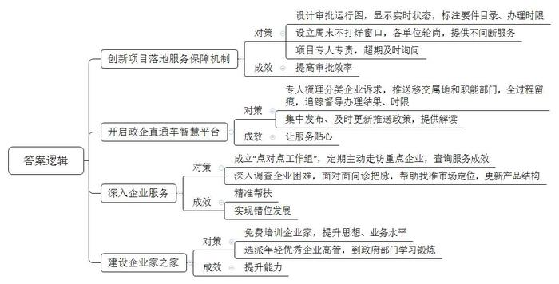
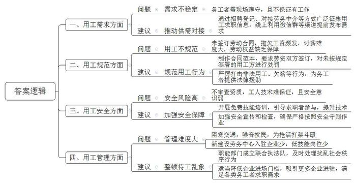
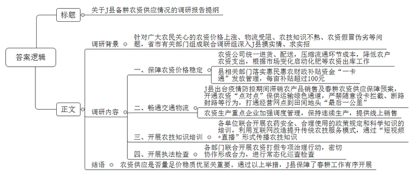
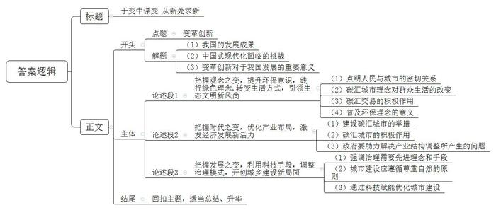

# 2023年公务员多省联考《申论》题（重庆一卷）

<!-- gwy:overview:start -->
> **重庆 · 2023 · 申论 · 一卷** ｜ 4 题 · 图片 4 处 · 答案随题折叠

导航：[题目](#题目) · [材料 1](#材料-1)
<!-- gwy:overview:end -->

> 候选采集稿。参考答案及解析来自粉笔页面，不代表官方答案或真实高分答卷；来源使用许可与原卷对应关系仍需人工核实。

## 给定材料

### 材料 1

走进H市政务服务中心，首先映入眼帘的是一块大屏幕，屏幕上有一张类似地铁运行图的线路表，各个站点闪烁着指示灯。“行驶”其间的，并非列车，而是H市的招商引资项目。H市创新项目落地服务保障机制，把项目建设的各环节细化设计成14个站点的“地铁运行图”，每个站点代表一个审批事项，绿、蓝、黄、红四色指示灯分别代表该环节办结、未办、在办及超期4种状态。为实现项目早落地、快落地、落好地，政务服务中心还设立“周末不打烊”窗口。“税务、社保等24个单位实行轮岗制，为企业提供不间断服务。”市政务服务中心林主任说，“我们采取专人负责制，每个项目安排一位对接人员，所有环节只需联系他一个人。如果出现超期，信息会迅速传递到市优化营商环境督导组，督导组会及时询问。”服务窗口前，富渝科技高经理正在准备要件进行注册登记，新项目即将从“始发站”上车，“每站都标注了所需的要件目录、办理时限，一目了然。”在高经理看来，这种机制带来的最明显变化就是审批速度快了一倍。

建新厂投资大，市羊毛衫产业园的流动资金一时短缺。“有一笔钱能应急，可看得见，拿得慢。”产业园负责人老李说，“我们外贸订单多，每月出口退税，按流程办要两周。”有人提醒他，可以到H市年初开通的“政企直通车”智慧平台提出诉求。老李的诉求一反映上去，就被列入“红色”加急清单，仅两天就办结。点开“政企直通车”智慧平台的“企业诉求”板块，清晰可见每一条诉求的主办部门、办理进度、完结日期。H市安排专人对接企业留言诉求梳理分类，根据属地和部门职责推送移交，全过程留痕，并对办理结果、时限进行追踪督导。“这个平台不仅处理企业诉求，还主动为企业提供政策解读。”老李使用这个平台后发现，在平台的“惠企政策”板块，所有相关政策是集中发布，滚动更新的。只要输入查询关键词，就会出现相关政策，还配有工作人员的讲解视频。“平台最近上线了推送功能，根据搜索记录，及时推送最新政策。从人找政策到政策找人，服务变得真是越来越贴心了。”

在忆家纺织集团的厂房里，一条条细如发丝的化纤从卷轴拉出，经过上浆、并轴，织成连绵不断的布匹。“别看现在生产线满负荷运转，几个月前，订单少，三天两头停产。”集团徐总说，“幸亏有‘点对点工作组’，他们看到我们的困难后主动组织企业间对接，逐渐打开了销路。”徐总所说的“点对点工作组”，是H市党政干部常态化联系民营企业的制度，一家重点企业安排一名科级干部为“首席服务官”、一名后备干部为“首席服务员”、一名主办银行负责人为“首席金融官”，“点对点工作组”要定期、主动走访企业。“我最初没把这个工作组当回事，以为只是走走过场。”徐总说。看到工作组为公司开拓销路不断奔波，甚至节假日还在忙碌，市督导组也经常来了解工作组的服务成效，徐总发现政府对这个帮扶制度非常认真，“现在，政府对企业更加了解，帮扶也更加精准了。”

“我们公司之前的摊子铺的太大，分支业务没有发展起来，还影响主营业务下滑。”市化纤股份有限公司王总经理说，市里得知后及时组织相关部门的工作人员和专家来到公司，面对面问诊把脉，帮助寻找准确的市场定位，指导企业专注色纱、安全气囊丝、阻燃纤维等细分领域，形成新的产品结构。“错位发展，让我们获得了明显的比较优势。”企业健康发展，离不开企业家的成长。每次走进H市的“企业家之家”，王总经理都感觉自己“找到了家”。这里开设了“商务大讲堂”、民营企业家学院，免费培训企业家。除了在这培训，王总经理还有一段独特的经历——去H市商务局学习锻炼。市委、市政府出台文件，每年选派15名年轻优秀企业高管，用两到三个月的时间，到市政府经济管理部门学习锻炼，王总经理成为其中之一。两个月下来，王总经理对外贸政策、海外市场更了解了，为公司开拓海外市场做了充分准备。

“我们就是因为看中这里营商环境的变化，才将176亿元的高纯多晶硅项目选择在这里。”新品材料公司夏董事长说。2022年H市市场主体数量同比增长47％，居民收入也明显提高。“营商环境是一个地方的重要软实力，优化营商环境就是解放生产力，提高综合竞争力。”H市张市长说，“我们所有的变化都聚焦于人民对美好生活的向往，出于我们对全市人民不变的承诺。优化营商环境永远在路上，我们将继续完善探索。”

### 材料 2

清晨6时许，新唐路已是人声鼎沸。这里是R市最大的零工市场，每天几千名务工人员聚集在此讨生活。他们白天在新唐路揽工，夜晚归家陪伴妻子儿女。新唐路处于江陵区城乡结合部，很多进城务工人员在此租赁廉价的房屋，工地上的小包工头也发现这里能找到工人，久而久之，人越聚越多，新唐路也成了“自由劳动力市场”的代名词。老唐家住在江陵区隆港社区，因为自身文化程度较低，学过木工的他，一直在新唐路打零工。“年轻时候也在工地上待过，后来老婆孩子都来R市了，我就在这买了房子。”老唐笑言，“我们打零工的收入总体还可以，大部分都是日结，每天的工钱平均有两三百，但我们不是每天都有活干，有时在这里连蹲几天也没有合适的工作，就算白蹲也必须守着。趁着还干得动，就多干点，存钱养老、看病。”现在，妻子在摆摊卖小吃，他在新唐路打零工，虽然生活并不富裕，但比老家的生活好多了，老唐已经感到很知足了。

天公不作美，豆大的雨点突然打下来。“下雨了，下雨了……”不少人一边喊着，一边跑向周边的建筑下面去躲雨，但还有一半左右的人坚守原地，并没有离开，似乎已经习惯暴雨的突袭。50多岁的靳大姐就是在这样的雨天继续坚守的人，她拿出随身携带的雨衣套上，已经六天没找到活干，遇到下雨天更是心急，期盼着包工头的到来。突然，她转身走向马路对面，急匆匆地走到一辆三轮车旁边，大家以为她去抢工作，没想到是讨薪去了。或许是下着大雨的原因，靳大姐被拖欠了一个月的200元钱今天讨回得格外顺利，她脸上终于露出了笑容。在新唐路，日结工资虽然听起来痛快，但被拖欠工资也是家常便饭，由于没签合同，更为日后讨薪埋下隐患。

来自东印县的小刘今年刚满18岁，第一次跟着老乡来到新唐路，想跟着去工地上学点电焊技术，养家糊口。“你会不会电焊？还是学徒？”一个包工头大声问他。“会的，我家里好几个人都干电焊呢！”小刘赶紧回答。“那你们几个跟我走吧！”小刘和老乡赶紧收拾东西跟上了车。“这里有干了十几年的老技工，也有初出茅庐、缺乏经验的新人，基本都是靠老人手把手带出来，没有参加过任何培训，且不说技术过不过关，这安全意识就不够，你看那小子，安全帽都没带。”老唐意味深长地说，“如果发生安全事故，他们这零工身份，没有签任何劳动合同，最后都是自己倒霉。”

几百号人聚集在一个路口，虽然给揽活的务工人员和招人的包工头带来了便利，却给城市管理造成了困扰。他们是城市的建设者，理应受到关照，但规模性地占马路等活，造成交通拥堵不说，噪音扰民也多次引来周边居民的投诉，甚至还发生过为了抢活打架斗殴的事。为了规范零工市场发展，去年江陵区在新唐路两公里外设立了“江陵区劳务中心”，本想取代现有的新唐路零工市场，但中心设立一年，入驻企业寥寥无几，而新唐路零工市场却依然火热。经常去新唐路揽工的包工头老王说，劳务中心对进场招聘的企业有相关资质规定，没有企业资质的小包工头根本无法进驻。“我们招揽零工，主要都是一些工程赶工期，人手不够，需要临时找人来干活，即使让我们进驻劳务中心，招人的程序也很复杂。”老王说。零工市场刚好提供了这样的供给。实际上，配备有座椅、空调、饮水机等舒适设施的劳务中心对务工者并不是没有吸引力，而是因为他们大多上了年龄，技能水平也不高，在劳务中心找不到他们能够匹配的工作。

“零工市场作为就业‘蓄水池’，为就业者和企业之间搭建了一座供需桥梁。”江陵区人社局郑局长说，“要盘活零工市场的社会闲置资源，还需补齐各方短板，为务工者系好‘安全带’，真正让‘蓄水池’发挥作用。”

### 材料 3

D省是农业大省，2022年春耕备耕农资供应面临艰巨任务。农资供应是否量足价稳质优，事关夏粮能否增产和粮食安全大局。针对广大农民关心的问题，2022年3月，省市有关部门组成联合调研组深入J县摸实情、求实招。

“从今年初开始，小麦追肥用到的氮肥、尿素等价格普遍上涨，2月中下旬尿素平均价格达到每吨2500元，3月上旬价格已升至每吨3000元。”新庄镇农民专业合作社理事长告诉调研组，“今年种子、农药、肥料进货价格为多年来的高点，尤其农药价格最高的翻了两番。”

县农资公司陈总介绍，受国际肥料市场价格带动、国内生产成本推动、春耕化肥需求量增加、疫情影响农资物流运输等多种因素叠加影响，近期尿素、磷酸二铵、氯化钾、国产复合肥的平均批发价格同比分别上涨34%、15%、88%、36%。化肥是粮食的“粮食”，化肥保供稳价直接关系到全年粮食生产目标的实现。为应对当前农资价格上涨带来的不利影响，公司统一进货、统一配送，压缩流通环节成本，降低农户农资支出。同时根据化肥市场价格变化情况，及时启动商业化肥淡季储备的出库工作，平均每吨化肥的价格较市场价格低300元左右，有力维护了市场稳定，保障了农业生产安全和农民利益。预计春耕期间，公司将供应化肥近5000吨，农药近90吨，确保农资不断档、不脱销。

县农业农村局张副局长介绍，在国家发改委、财政部等部门统筹安排下，今年第一批300多万吨春耕肥储备已开始向市场投放。后续还有大量储备化肥将陆续投放市场。近日，中央财政下达200亿元资金，对实际种粮农民发放一次性补贴，缓解农资价格上涨带来的影响，调动农民种粮积极性。县里进一步落实惠民惠农财政补贴资金“一卡通”发放管理，及时将耕地地力保护补贴、种粮补贴等直接发放到种粮农民的社会保障卡银行账户，每亩补贴超过100元。

2022年初，D省出现了局部疫情，抗疫任务较为繁重，对当地交通物流造成了一些影响，但调研组在J县看到，春耕备耕一点没耽误。他们一手抓防疫，一手忙备耕，不让疫情误农情。化肥厂等农资生产重点企业加强调度管理，保持连续生产。农民可以线上下单买种子、化肥。一辆辆满载种、肥的货车通过绿色通道奔驰在乡间，让农资进村入户。

县疫情防控指挥部负责人介绍，县里出台了疫情防控期间滞销农产品销售及春耕农资供应保障预案，开通了农资“点对点”保供运输绿色通道，严禁随意设卡拦截、断路封路等行为，并全力打通经营网点到田间地头“最后一公里”。

在县职教中心，县农技中心、融媒体中心等正联合开展第二期“农技专家当主播”培训，资深农技（艺）师、返乡“新农人”、种田“老把式”共20多人参加培训。授课专家向调研组介绍，农资买得起、运得进、用得上，还要科学用。不少农民朋友对农药安全、合理使用的政策规定和科学知识不太熟悉，有的过度使用农药、化肥、农膜等。县里利用互联网的强渗透性和广覆盖性改造提升传统农技服务模式，通过“短视频+直播”形式传播农技知识，为生产安全、绿色优质的农产品提供了精准高效的农技服务支撑。

“你好，请配合工作，我们要进行商品质量抽检……”在一农资门市，调研组看到县综合行政执法局工作人员正在开展执法检查。带队负责人介绍，春耕备耕期间，是农资销售旺季，也是不法分子坑农、害农的高发期。县农业农村局联合县公安局、县综合行政执法局等单位，开展农资打假专项治理行动，密切协作形成合力，对农资经营门店和生产企业进行常态化巡查检查，突出抓好假劣种子坑农害农、肥料养分不足、农药兽药添加禁用药物、农膜质量差等问题，确保群众买到放心农资。

### 材料 4

在C市环境交易所，当天的碳汇交易信息正在大屏幕上实时滚动。交易员小冯正在为企业办理碳汇交易账户。“朋友都觉得我的工作很‘洋气’。”谈及自己的工作，小冯露出了笑容。碳汇是指通过植树造林、植被恢复等措施，吸收大气中的二氧化碳，从而减少温室气体在大气中浓度的过程、活动或机制。碳汇交易则是一方通过减少排放或者吸收二氧化碳，将多余的碳排放指标转卖给有需要的另一方，以抵消他们的减排任务，也就是平常所说的“卖空气”。“目前碳汇的交易活跃度和金融化程度还比较低，相关制度规则还有待完善。”小冯说，“但是环境交易所的成立标志着碳汇交易开启了正规化的新局面，这个新局面将促使企业更加意识到碳排放权的价值，相信未来的碳汇交易市场会有更多新机遇。”

C市正在全面探索提升碳汇能力的新路径，成立环境交易所只是其打造“碳汇城市”的一个侧影。C市近年引进的10个亿元项目中，大多为低碳产业。其中，新引进的生物质发电公司年发电量约2.1亿千瓦时、分布式光伏发电项目年发电量约140万千瓦时，年均节省标煤耗量9.5万吨，年均减少二氧化碳排放量24万吨。“我们将着力重塑产业结构，推动产业生态化，借助建设‘碳汇城市’的新机遇，打开城市经济发展的新局面。”C市龙市长说。

在市区的一座公园里，工人们正忙着植树，树与树之间不再讲究“整齐”，而是自然随机布点、“无序”栽植。“与一般造林不同，我们践行的是目前比较先进的‘近自然造林’理念——遵循‘尊重自然、顺应自然、保护自然’的原则，最大限度地模拟自然界中森林生长的环境，让树木实现个性生长、自然演替，从而形成一个生命力和包容性都极强的生态系统。”市城市管理局张局长说，经过多年不懈努力，C市森林覆盖率达40.2%，生态碳汇能力大大提高，“步步见绿”的城市空间新局面逐渐成型。

碳汇理念正不知不觉地浸润到C市治理的方方面面。以前，C市的一座高架桥下，经常有大量砖石、渣土等建筑废料高高低低绵延上百米，犹如一块灰色调的“城市疮疤”。现在再经过这里，上有蓝天白云，中有高架桥穿过，下有花海绿廊。这个变化是怎么发生的？“我们给这里覆盖了一层‘营养土’，这层营养土与建筑渣土混合后，能有效改善土壤营养成分，为植物的生长提供优质条件。”张局长说，这些“营养土”是市政污泥等有机固废制成的。市政污泥是污水处理过程中产生的固体沉淀物质，过去一般填埋和焚烧处理，但会污染环境，增加碳排放量。C市引入高新技术团队，把市政污泥制成有机发酵物，调配成花卉用土，覆盖在建筑渣土上，再播撒花草，“城市疮疤”很快就变成了新的城市风景线。“这种‘碳汇’模式一举两得，既治理建筑垃圾，也解决市政污泥。”张局长说，“我市已有47万平方米城市裸土完成土壤改良及花草种植，一年可实现固碳近3000吨。”

在C市，随着碳汇理念的普及，绿色低碳正成为全民新风尚。点开“碳汇积分”小程序，小苗骄傲地展示自己的4位数积分。“我在绿色商城兑换了好多奖励，现在又在攒积分。”她笑道。“碳汇积分”小程序是C市推出的碳减排数字账本，市民衣食住行游的每次减排行为，都会在小程序上进行量化和记录，形成个人“碳账本”。乘坐公共交通、旧物回收……“举手之劳”的绿色低碳行为都可以收获碳汇积分，这些碳汇积分可以兑换奖品，推动着从“环保意识”到“环保行为”的转化。如今碳汇积分成为了小苗和朋友天天“比拼”的项目。“与其说是我们为‘碳汇城市’建设贡献力量，不如说是碳汇理念改变了我们的生活习惯。”小苗说。

“空气卖出近4万元！”浦上村村支书老林兴奋地说，浦上村位于C市郊区，今年以单价100元/吨的价格向一家企业出售了375吨碳汇资源。碳汇交易给这个山村带来了新机遇，让村民们当上了“卖碳翁”。老林算了一笔账：村里有1.3万亩毛竹林，按照现在的碳汇价格计算，碳汇收入能有20多万元。近年毛竹价格连年走低，有时候卖一季毛竹成本都收不回来，村民都不愿意照管。有了碳汇，只要把毛竹林养好，“竹叶子”就能变成“钱票子”。“这片林子荒得比较厉害，要赶紧梳理，加强养护。”……老林带着村民爬山头、定规划，大家重新背上砍刀修起了竹梢，村民细致养护、培育毛竹林这样多年未见的场景又回来了。

“新局蕴新机，新机生新局。我们正在以城乡一体、协调发展的新思路推动‘碳汇城市’建设，点‘碳’成金，把‘碳汇城市’打造成我们的金字招牌。”龙市长说，“<u>以变促变，以新求新</u>，‘碳汇城市’建设将给我们带来一场从个人到城市，从观念到行为的全方位变革。”

## 题目

### 第 1 题

**请根据“给定资料1”，谈谈H市为优化营商环境采取了哪些措施，取得了哪些成效？（15分）**

关联材料：材料 1

作答要求：

要求：全面、准确、有条理，不超过300字。

第 1 题 · 答案与解析

**参考答案（粉笔题库参考内容）**

1.创新项目落地服务保障机制。设计审批运行图，显示实时状态，标注要件目录、办理时限；设立周末不打烊窗口，各单位轮岗，提供不间断服务；项目专人专责，超期及时询问，提高审批效率。

2.开启政企直通车智慧平台。专人梳理分类企业诉求，推送移交属地和职能部门，全过程留痕，追踪督导办理结果、时限；集中发布、及时更新推送政策，提供解读，让服务贴心。

3.深入企业服务。成立“点对点工作组”，定期主动走访重点企业，查询服务成效，精准帮扶；深入调查企业困难，面对面问诊把脉，帮助找准市场定位，更新产品结构，实现错位发展。

4.建设企业家之家。免费培训企业家，提升思想、业务水平；选派年轻优秀企业高管，到政府部门学习锻炼，提升能力。

**解析**

**参考答案说明**：本参考答案从“创新项目落地服务保障机制”“开启政企直通车智慧平台”“深入企业服务”“建设企业家之家”四个方面，介绍了其做法和成效。各条答案要点之间在内容上相互并列，没有交叉。

**考点**：多要素组合类

**来源**：2023年公务员多省联考《申论》题（重庆一卷）

### 第 2 题

**请根据“给定资料2”，梳理新唐路零工市场存在的问题，并提出解决问题的建议。（20分）**

关联材料：材料 2

作答要求：

要求：

（1）问题梳理全面、准确、有条理；

（2）所提建议与问题相对应，具体明确、切实可行；

（3）不超过400字。

第 2 题 · 答案与解析

**参考答案（粉笔题库参考内容）**

一、问题：需求不稳定。务工者需现场蹲守，且不保证有工作。建议：推动供需对接。通过招聘登记、对接劳务中介等方式广泛征集用工求职信息，线上利用微信群等渠道提前发布需求。

二、问题：用工不规范。未签订劳动合同，拖欠工资频发，讨薪难度大，劳动权益缺乏保障。建议：规范用工行为。制作合同范本，要求劳资双方签订，对未按规定签署的用工方进行处罚；严厉打击非法用工、欠薪等行为，为务工者提供法律援助。

三、问题：安全风险高。不审查资质，工人技术难保证，且安全意识弱。建议：加强安全保障。开展免费技能培训，引导求职者参与，提升技术；加强安全宣传和检查，确保严格按照安全守则作业。

四、问题：管理难度大。阻塞交通，噪音扰民，为抢活打架斗殴；新建设劳务中心入驻企业少，低技能岗位少。建议：整顿待工乱象。职能部门成立联合执法队，及时处理扰乱社会秩序行为；适当降低企业进场门槛，吸引更多企业进驻，满足各类务工者求职需求。

**解析**

**参考答案说明：**本参考答案从“用工需求”“用工规范”“用工安全”“用工管理”四个方面展开，每个方面内部包含“问题”和“建议”两个层面，且所提建议与问题相对应。各条答案要点之间在内容上相互并列，没有交叉。

**考点**：提出对策类

**来源**：2023年公务员多省联考《申论》题（重庆一卷）

### 第 3 题

**假如你是调研组工作人员，请根据“给定资料3”，拟写一份调研报告提纲。（25分）**

关联材料：材料 3

作答要求：

要求：

（1）紧扣资料，内容全面；

（2）准确简明，有逻辑性；

（3）不超过500字。

第 3 题 · 答案与解析

**参考答案（粉笔题库参考内容）**

关于J县备耕农资供应情况的调研报告提纲

调研背景：针对广大农民关心的农资价格上涨、物流受阻、农技知识不熟、农资假冒伪劣等问题，省市有关部门组成联合调研组深入J县摸实情、求实招。

调研内容：一、保障农资价格稳定。农资公司统一进货、配送，压缩流通环节成本，降低农户农资支出，根据市场变化启动化肥等农资出库工作；县相关部门落实惠民惠农财政补贴资金“一卡通”发放管理，每亩补贴超过100元。二、畅通交通物流。J县出台疫情防控期间滞销农产品销售及春耕农资供应保障预案，开通农资“点对点”保供运输绿色通道，严禁随意设卡拦截、断路封路等行为，打通经营网点到田间地头“最后一公里”；农资生产重点企业加强调度管理，保持连续生产，提供线上销售。三、开展农技知识培训。各单位联合开展农药安全、合理使用的政策规定和科学知识的培训，利用互联网改造提升传统农技服务模式，通过“短视频+直播”形式传播农技知识。四、开展执法检查。各部门联合开展农资打假专项治理行动，密切协作形成合力，进行常态化巡查检查。

结语：农资供应是否量足价稳质优至关重要。通过以上举措，J县保障了春耕工作有序开展。

**解析**

**参考答案说明**：（1）格式方面，本参考答案写到了“标题”“正文”两个部分。（2）正文部分，一方面从内容上来看，围绕“J县春耕备耕农资供应情况”这一主题，本参考答案从“调研背景”“调研内容”“结语”三个方面展开。另一方面，形式上，本参考答案做到了分段、分条撰写，整体上条理较为清晰。

**考点**：总结类

**来源**：2023年公务员多省联考《申论》题（重庆一卷）

### 第 4 题

**“给定资料4”中提到“以变促变，以新求新”。请结合对这句话的理解，参考给定资料，联系实际，自选角度，自拟题目，写一篇文章。（40分）**

关联材料：材料 1、材料 2、材料 3、材料 4

作答要求：

要求：

（1）观点明确，见解深刻；

（2）参考给定资料，但不拘泥于给定资料；

（3）思路清晰，语言流畅；

（4）总字数1000-1200字。

第 4 题 · 答案与解析

**参考答案（粉笔题库参考内容）**

**于变中谋变 从新处求新**

改革开放以来，我国经历了世界历史上规模最大、速度最快的城镇化进程，人民幸福指数不断攀升，现代化建设稳步推进。然而，中国式现代化是人口规模巨大的现代化，新型城镇化建设仍面临诸多挑战。新局蕴新机，新机生新局。在新的历史时期，唯有全方位的创新变革，以变促变，以新求新，才能持续推进城乡协调发展，为中国式现代化建设提供充足的动力。

**把握观念之变，提升环保意识，践行绿色理念，转变生活方式，引领生态文明新风尚。**人民城市人民建，人民城市为人民，城市的发展与居民的行为息息相关。碳汇城市理念的普及改变了群众的生活方式，通过积累“碳汇积分”，群众在日常生活中主动进行减排行为，实现了从“环保意识”到“环保行为”的转化。与此同时，碳汇交易也给乡村带来了新的风貌，村民自觉梳理修复植被，保护生态环境的积极性大幅提升。环保理念的普及与人的绿色生活方式有机结合，让人们充分享受到绿色发展所带来的便利和舒适，有效推进城乡生态文明建设。

**把握时代之变，优化产业布局，激发经济发展新活力。**面对新的时代之机，只有集聚创新合力，调整产业结构，才能推动城乡高质量发展。在碳汇城市的建设过程中，一方面通过成立环境交易所带动城市碳汇交易正规化，引导企业重视碳排放权价值。另一方面大力引进低碳产业，推进节能减排取得显著成效。碳汇城市的打造实现了产业生态化，激发经济活力的同时保障了生态效益。当然，调整产业布局也有阵痛期，可能会出现资金短缺、销路不畅、农民工无处就业等问题，这就需要政府及时伸出“援手”，要优化营商环境，盘活零工市场的社会闲置资源，为农民提供就业技术指导……从城市到乡村，产业结构之变正持续促进经济发展释放新动能。

**把握发展之变，利用科技手段，调整治理模式，开创建设新局面。**随着社会的发展，治理也需要先进的理念和手段。例如，C市引入高新技术团队，把市政污泥制成有机发酵物，将其制成花土，并在上面播撒花草，“城市疮疤”变成了“城市花园”。这充分说明，城市的建设应遵循、尊重自然的原则，持续保护健康的生态系统。同时，还要运用科技赋能，提升碳汇能力，着力打造“步步见绿，处处有景”的城市空间，改善群众生活环境，切实提升群众的幸福感。

时代前进的脚步永不停歇，身处百年未有之变局，唯有开拓思路，于变化中求变化，于新局中求新机，才能不断跨越险滩，把握历史主动，绘就城乡可持续发展的新画卷。

**文章分析**

**于变中谋变** **从新处求新**

【**标题的优点：**标题直接采用给定句子的表述，使文章主题更突出、明确。其次，在形式上采用了对称式标题，使标题更加完整、饱满。】

（1）<u>改革开放以来</u>，<u>我国经历了世界历史上规模最大、速度最快的城镇化进程</u>，人民幸福指数不断攀升，<u>现代化建设稳步推进</u>。（2）然而，中国式现代化是人口规模巨大的现代化，<u>新型城镇化建设仍面临诸多挑战</u>。（3）新局蕴新机，新机生新局。<u>在新的历史时期</u>，<u>唯有全方位的创新变革</u>，以变促变，以新求新，<u>才能持续推进城乡协调发展</u>，<u>为中国式现代化建设提供充足的动力</u>。

【**开头的优点：**★内容方面。范文的开头是紧扣“变革创新”这一主题展开的。首先，开头点出主题，做到了主题明确。其次，对“变革创新”这一主题进行了分析阐述，指出了（1）我国的发展成果；（2）中国式现代化面临的挑战；（3）变革创新对于我国发展的重要意义。★文字表达方面。使用了“然而”“唯有……才……”等关联词，使语言表达有逻辑性。】

**把握观念之变，提升环保意识，践行绿色理念,转变生活方式，引领生态文明新风尚**。（1）<u>人民城市人民建</u>，<u>人民城市为人民</u>，<u>城市的发展与居民的行为息息相关</u>。（2）<u>碳汇城市理念的普及改变了群众的生活方式</u>，通过积累“碳汇积分”，群众在日常生活中主动进行减排行为，<u>实现了从</u>“<u>环保意识</u>”到“<u>环保行为</u>”<u>的转化</u>。（3）与此同时，<u>碳汇交易也给乡村带来了新的风貌</u>，<u>村民自觉梳理修复植被</u>，<u>保护生态环境的积极性大幅提升</u>。（4）<u>环保理念的普及与人的绿色生活方式有机结合</u>，<u>让人们充分享受到绿色发展所带来的便利和舒适</u>，<u>有效推进城乡生态文明建设</u>。

【**论述段1的优点：**★观点句：范文的观点句是紧扣“变革创新”这一文章主题提出的。形式上，它在段首处直接写出，位置突出，容易发现。内容上，关键词突出，内容要点明确，可以明显看出是从“观念变化”的角度展开论述。★论述内容：（1）先介绍了人民与城市的密切关系；（2）接着介绍了碳汇城市理念对群众生活的改变；（3）碳汇交易的积极作用；（4）最后强调普及环保理念的意义。注意：以上四个方面的内容都是紧扣“把握观念之变，提升环保意识，践行绿色理念,转变生活方式，引领生态文明新风尚”这个观点句进行分析论述的，论述的针对性强，内容层次丰富。在论述方法上主要采用了讲道理的方式，论述清晰透彻。】

**把握时代之变，优化产业布局，激发经济发展新活力**。面对新的时代之机，只有集聚创新合力，调整产业结构，才能推动城乡经济高质量发展。（1）在<u>碳汇城市的建设</u>过程中，一方面<u>通过成立生态交易所带动城市碳汇交易正规化</u>，引导企业重视碳排放权价值。另一方面<u>大力引进低碳产业</u>，推进节能减排取得显著成效。（2）<u>碳汇城市的打造实现了产业生态化</u>，<u>激发经济活力的同时保障了生态效益</u>。（3）当然，<u>调整产业布局也有阵痛期</u>，可能<u>会出现</u>资金短缺、销路不畅、农民工无处就业<u>等问题</u>，这就<u>需要政府及时伸出</u>“<u>援手</u>”，<u>要优化营商环境</u>，<u>盘活零工市场的社会闲置资源</u>，<u>为农民提供就业技术指导</u>……从城市到乡村，产业结构之变正持续促进经济发展释放新动能。

【**论述段2的优点：**★观点句：范文的观点句是紧扣“变革创新”这一文章主题提出的。形式上，它在段首处直接写出，位置突出，容易发现。内容上，关键词突出，内容要点明确，可以明显看出是从“时代变化”的角度展开论述。★论述内容：（1）先介绍了建设碳汇城市的举措；（2）接着指出了碳汇城市的积极作用；（3）最后介绍了政府要助力解决产业结构调整所产生的问题。注意：以上三个方面的内容都是紧扣“把握时代之变，优化产业布局，激发经济发展新活力”这个观点句进行分析论述的，论述的针对性强，内容层次丰富。在论述方法上主要采用了讲道理的方式，论述清晰透彻。】

**把握发展之变，利用科技手段，调整治理模式，开创城乡建设新局面**。（1）<u>随着社会的发展</u>，<u>治理需要先进的理念和手段</u>。例如，C市引入高新技术团队，把市政污泥制成有机发酵物，将其制成花土，并在上面播撒花草，“城市疮疤”变成了“城市花园”。（2）这充分说明，<u>城市的建设应遵循</u>、<u>尊重自然的原则</u>，<u>持续保护健康的生态系统</u>。同时，（3）<u>还要运用科技赋能</u>，<u>提升碳汇能力</u>，着力打造“步步见绿，处处有景”的城市空间，<u>改善群众生活环境</u>，<u>切实提升群众的幸福感</u>。

【**论述段3的优点：**★观点句：范文的观点句是紧扣“变革创新”这一文章主题提出的。形式上，它在段首处直接写出，位置突出，容易发现。内容上，关键词突出，内容要点明确，可以明显看出是从“发展变化”的角度展开论述。★论述内容：（1）先介绍了治理需要先进理念和手段；（2）接着指出城市建设应遵循尊重自然的原则；（3）介绍了通过科技赋能优化城市建设。注意：以上四个方面的内容都是紧扣“把握发展之变，利用科技手段，调整治理模式，开创城乡建设新局面”这个观点句进行分析论述的，论述的针对性强，内容层次丰富。在论述方法上主要采用了讲道理的方式，论述清晰透彻。】

【**论述段之间的关系：**三个论述段分别从“观念之变”“时代之变”“发展之变”的角度，对文章主题“变革创新”展开了论述，彼此之间呈现出并列的逻辑。】

时代前进的脚步永不停歇，身处百年未有之变局，唯有开拓思路，于变化中求变化，于新局中求新机，才能不断跨越险滩，把握历史主动，绘就城乡可持续发展的新画卷。

【**结尾的优点：**范文的结尾回扣了“变革创新”这个主题，并且进行了总结升华。】

**解析状态：unknown（来源未提供）**

**考点**：文章写作题

**来源**：2023年公务员多省联考《申论》题（重庆一卷）

