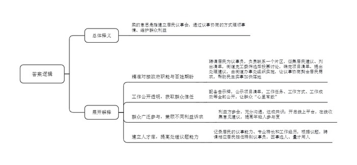
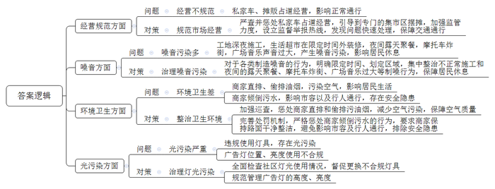
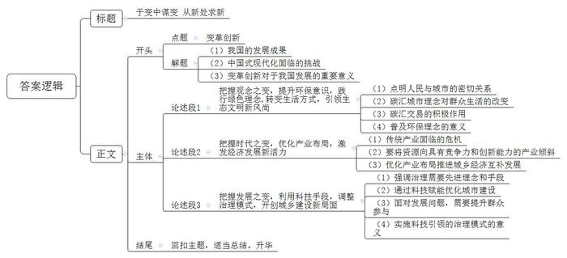

# 2023年公务员多省联考《申论》题（重庆三卷）

> 候选采集稿。参考答案及解析来自粉笔页面，不代表官方答案或真实高分答卷；来源使用许可与原卷对应关系仍需人工核实。

## 给定材料

### 材料 material-5699ad853797b9f5

长年在外经商的老陈，老家在F县高山镇鼓楼村。一年前，老陈和家人商量后，同村里提出了建房申请。“我今年68岁了，在外奋斗大半辈子，最大的心愿就是回家乡将危旧老屋翻盖成新房子。”老陈说。

旧房新建进入实质性操作，村里的土地协管员小谢上门，和老陈仔细沟通起了建房流程。“近几年农村建房出了新规定，面积不能超过120平方米，总高度不能超过14米。此外手续要全，审批要过，建设过程中也不能出半点岔子。”小谢对老陈说。

以前在F县，只要邻居没意见，农村的房子几乎是想怎么建就怎么建。超大面积、五六层的房屋，在当地很常见。因此，F县过去农村自建房“两违”（违法违规占用破坏自然资源和违法违规建设行为）问题不少。2016年起，F县开展农村自建房“两违”问题集中整治，由县、镇主要领导挂帅，并建立五级网格员巡查机制，对建房的前、中、后期实施全程监管。

小谢将老陈一家的户口本、身份证、建房申请等材料一一收上来，仔细核查建房是否符合“一户一宅”、村庄用地规划等建设要求。资格审查通过后，村里召开村两委会议审议，四周邻居无异议后签字按手印，审议结果要在村里公示15个工作日。之后，所有材料提交镇政府审批，经过一个多月的等待，老陈终于盼来了他的施工公示牌。那天，他特意开车去镇上，像得了宝贝似的把牌子“抱”了回来。半米见方的施工公示牌上，房屋建设人、建筑红线图、乡村建设规划许可证、建筑平面图、工匠带头人等信息一一在列。把牌子往门前一立，老陈喜笑颜开，在噼里啪啦的鞭炮声中，房子开始动工了。

老陈早年也干过工匠，可还是毫不犹豫地请了个专业工匠。“建房是大事，不能马虎。”建新房，老陈做足了功课，“现在的乡村工匠都得经过培训，持证上岗，找他们建房，安全和质量都有保障！”工匠曾师傅在村里口碑不错，老陈这次找了他负责施工，两人就建房细节和设计图纸进行了多次沟通。图纸一出，双方签订施工合同、安全质量承诺书。“往后，在房子建造的安全和规范方面，我就是第一负责人。”曾师傅说。曾师傅也是老工匠出身，从事房屋建设30多年，可没想到，多年后，自己又重新走进课堂，参加了县里组织的乡村工匠培训。学完培训班的课程，曾师傅领到了工匠培训证，证书上“安全模范”四个字格外醒目。

隔三差五，老陈就会在工地上碰见镇、村干部和村镇规划建设执法管理人员，一打听才知道，县里对新建房的监管有新规定，明确相应干部必须在建房过程中“四到场”——宅基地申请审查到场，批准后丈量放样到场，施工关键节点巡查到场，竣工验收到场。村党支部书记老林来的次数最多，对本村建房中的问题，老林要发现在第一线，解决在第一线，不能解决的，要及时上报镇“两违”办处理。“超出规定限制一厘米都不行。”在现场，老林一看安全是否达标，二看建房每一步是否符合规定。“建房要审批，施工要挂牌，无牌必停工。”写在村里墙上的这句标语，人人都知晓，老陈知道，这句话可不是说说而已。村里有户人家，就因为建房不规范，公示牌被收走，整改后才重新开工，一拖就是几个月。有了前车之鉴，老陈建房的每一步都走得很扎实。

三声鞭炮后，老陈家房屋主体结构终于大功告成。随后，质量验收机构对照着原先的施工红线图、平面设计图，开展竣工验收。拿着尺子和测绘仪，测绘人员丈量房屋面积……全部指标合格后，老陈便带着验收报告到县里的行政服务大厅办手续。捧着刚刚到手的新房产权证，老陈激动又感慨：“房子顺利竣工不容易，今年新年可以搬进新房过了，全家都高兴！”质量、安全各方面达标后，老陈的新建房被纳入F县房屋结构安全监管范围。“经过标准化改造，危房变新房，老陈建房的故事，就是F县自建房建设走向规范的一个生动缩影。”县住建局负责人说。

### 材料 material-89f473743bd6387a

自从小区改造列入县民生实事项目，各小区微信群里就议论纷纷：这家要求先装灯，那户提出停车难，诉求复杂多样。怎么让大家都满意？由86名成员组成的东风街道第一届居民议事会成立，解了难题。居民议事会成员向居民征集建议后，列出了包含楼道灯安装、停车位改造等25个诉求的建议清单。“街道党工委对建议清单进行筛选，形成候选清单，再提交居民议事会讨论和投票。居民议事会确定项目清单并提出处理建议后，由街道党工委交由街道办事处组织实施。”街道党工委孙书记说，议事协商议的是民生话题，瞄准的是更好地解决民生问题。确定议题过程中，街道党工委要发挥主动作用，将政府职能与百姓期盼精准对接，让议事协商直击痛点，契合居民心意，推动民生实事加快落地。

东风街道居民议事会是县基层协商议事试点之一。走进居民议事会，10多套活动桌椅整齐地摆放着，可根据不同议事主题排列组合，同时还配套发言台和LED显示屏。一块大大的告示牌悬挂在墙壁上，上面正在公示居民议事会近期表决的项目清单，包含了项目名称、提出人、解决方案、办理主体、办理进度等等。通过这个清单，居民议事会所做的事情一目了然。“议事会在做什么、怎么做、做得怎么样，一切都是公开透明的，大伙儿心里有数，才会信任议事会。”议事员老郑笑言，“以前大家有问题，没有商量的地方，现在有了这个阵地，大家遇到问题都喜欢来聊一聊，敞开心扉，把问题摊开，不知不觉就找到了解决办法。”老郑退休前是一名教师，为人公道，热心社区事务，被聘请来当议事员。“议事员由居民推荐、街道遴选，大多是党员，政治素质过硬。有的是像老郑这样的老住户，在居民中威望较高；有的是有专长的行家，能为大家出谋划策。”孙书记说，每个议事员都要联系一个片区，负责收集居民关心的问题。

“车乱停，有时堵楼门口，出行难。”停车乱，无车户难以忍受。“我们也想按车位停，可哪有车位？”停车难，有车户也感到无奈。东风街道的一次居民议事会上，社区居委会、物业、业委会、议事员、有车户代表、无车户代表畅所欲言。“没有车位的统一停小区外吧，不影响小区环境。”无车户提出。“还是停小区内好，安全可管理。”有车户有异议。经过充分讨论，大家达成共识。停小区外妨碍交通，可行性差，还是要在小区内挖掘潜力，将废弃绿地、边角地划成车位。方案表决后公示，车位边一楼的无车户担忧噪声会影响休息。议事会再次启动，决定在车位与住房之间种植花草，同时对受影响住户进行补偿。现在，有车居民自觉泊车入位，一排排车辆整整齐齐。“议事会已经形成了一套行之有效的程序，街道工作人员主持，将参会人员分成不同小组进行讨论，再由各组代表汇总上台发言，投票选出可行性高的解决方案。”孙书记说，不少事项牵涉到不同利益主体，议事会要尊重和照顾不同利益诉求。虽然很多时候协商的过程很曲折，甚至有争吵，但充分沟通后达成共识，能兼顾不同的利益方，促进彼此理解，消除了矛盾和怨气。日前，东风街道居民议事会还开通了线上平台。“如今讲共建、共治、共享，最重要的就是老百姓肯参与进来!”孙书记说，议事会开到线上以后，居民只需要扫二维码，就能在平台上提交意见和建议，这让年轻人的参与度大大提高，这样议事会就能更广泛地听取群众的心声。

议事协商有结果，更要落地，切实解决群众诉求，把民生实事办到群众心坎上，才会得到群众信任。前不久，街道的新城中心改造项目通过验收，居民眼前一亮：小广场铺上了花岗岩，游乐场传来孩子们的欢笑声，休闲步道上多了散步的居民。“去年，大家还抱怨这小广场环境脏、蚊虫多，有和没有一个样。”高先生笑着说。高先生是建筑设计研究院的工程师，受聘为议事会特别议事员，负责新城中心改造的监督。高先生每天都要到工地上看看，周末更是经常一待就是半天，增设小广场铺装场地、展示墙和儿童游乐场所等，就是他看完设计图纸后提出的建议。东风街道根据居民的议事能力、专业特长和工作经历，建立人才库。议题确定后，街道就会联系相应的居民，聘请他们担任特别议事员，让“适合”的人参加“合适”的会，从而提高议事会处理议题的能力。

“议而能决，商而能行，理顺群众的‘气’，很多事情都好办了，毕竟大家在根本利益上是一致的。这便是运用柔的方法，取得好的效果。”孙书记说。

### 材料 material-e458bccf4821d8bc

南浦步行街坐落在N市蓝阳区中心地带，既是居民日常购物、观光的场所，也是商业地产、个人居住的聚集地。步行街自2022年5月“开街”以来，持续火爆，吸引了众多客流到此消费游玩，是N市网红夜市一条街，2022年8月蓝阳区城市管理局在对12345便民服务平台部分不满意诉求件进行分析时发现，在不到一周的时间里，有30多个诉求件集中反映步行街周边有关问题。经调查，反映问题情况基本属实，以下是诉求件反映的主要内容。

最近，“后备箱经济”比较火，虽然步行街设立了专门的集市区，但还是经常有私家车打“擦边球”，停靠在步行街入口处的非机动车道上，打开后备箱售卖各式各样的商品，影响行人和非机动车通行。

深夜12点多，步行街东面的工地还在施工，噪音十分扰民。最可怕的是那个洗车池，离场的搅拌车反反复复、前进后退地在池里洗车轮的污泥，巨大的噪音让人无法忍受。熟睡的小孩又被吵醒了，好无奈！

步行街上的烧烤摊油烟直接排到空气中，经常飘到我们家里来，熏得我们眼睛都睁不开了，也不敢开窗通风，希望城管部门管管。

步行街入口的那家生活超市，大中午还在装修，严重影响我们住在附近的居民，噪音这么大，家里的老人都神经衰弱了。

步行街对面的小公园，晚上10点多还经常有人在那边聚会，喝酒、聊天，声音很大，他们都不用休息吗，能不能管管？

步行街西头的锦信路上经常有摩托车深夜“炸街”，不时地呼啸而过，摩托车的声音非常响，真是不让人睡觉了，希望依法处理。

经常有摊贩推着各种贩卖车，在步行街上占着人行道和非机动车道经营，生意还特别好。聚集了一堆人在那里消费，人都走不过去了。

步行街有几家餐饮店偷偷挖管道，将油烟直接排入路边的下水道。我们傍晚散步时经常会闻到下水道冒出来的刺鼻油烟味，这些没有净化的油烟飘出来，空气质量可想而知。

我是住在步行街对面文华小区的居民，我家对面安装的不知道是什么射灯，一到晚上，光线直射进卧室的窗户，实在太亮了，导致我们都不能好好休息。另外，斜对面商务宾馆的广告霓虹灯位置又高，亮度又强，每天从晚上亮到凌晨三四点，十分刺眼，能不能帮助协调处理下。

步行街一些餐饮摊的老板经常把“汤汤水水”直接倾倒在人行道上。弄得到处油汪汪的，不仅影响市容，还影响行人通行。有一次，我们家小孩还在那里滑倒了，搞得浑身脏兮兮的。

每到晚上，就有人搬着便携设备在步行街东头的小广场放音乐、唱歌，就跟露天KTV似的，声音那么大，肯定超标了！这边离我们住宅区很近，小孩子写作业都受影响，反映了几次，消停没几天又出现了。

## 题目

### 第 1 题

**假如你是****F县住建局工作人员，请根据“给定****资****料**1**”，为本县村民拟写一份农村自建房建设流程。（15分）**

关联材料：material-5699ad853797b9f5

作答要求：

要求：

（1）紧扣资料，内容全面；

（2）条理清晰，语言准确；

（3）不超过300字。

### 第 2 题

**“给定资料**2**”提到“运用柔的方法，取得好的效果”。请谈谈对“柔”的理解。****（****20分）**

关联材料：material-89f473743bd6387a

作答要求：

要求：理解准确，分析透彻，简明扼要。不超过400字。

### 第 3 题

**假如你是蓝阳区城市管理局工作人员，请根据****“给定资料**3**”，对步行街周边的问题进行梳理分类，并分别提出解决建议。（25分）**

关联材料：material-e458bccf4821d8bc

作答要求：

要求：

（1）问题梳理全面、准确、有条理；

（2）所提建议具有针对性、可行性；

（3）不超过500字。

### 第 4 题

**“给定资料**4**”中提到“以变促变，以新求新”，请结合对这句话的理解，参考给定资料，联系实际，自选角度，自拟题目，写一篇文章。（40分）**

关联材料：material-5699ad853797b9f5

作答要求：

要求：

（1）观点明确，见解深刻；

（2）参考给定资料，但不拘泥于给定资料；

（3）思路清晰，语言流畅；

（4）总字数1000字左右。

## 答案与解析

第 1 题

**参考答案（粉笔题库参考内容）**

农村自建房建设流程

为规范农村自建房建设，现将建设流程公示如下：

一、总要求：面积不能超过120㎡，高度不能超过14米。

二、申请阶段：1.资格审查：提交户口本、身份证、建房申请等材料，核查是否符合“一户一宅”、村庄用地规划等建设要求。2.村“两委”会议审议：邻居无异议后签字按手印，审议结果公示15个工作日。3.镇政府审批：审批通过后，发放施工公示牌。

三、施工阶段：聘请专业建筑工匠，持证上岗，确定建房细节和设计图纸，确保施工过程符合安全规范。

四、验收阶段：质量验收机构对照施工红线和平面设计图验收，合格后，带验收报告到县政务大厅办产权证。

**解析**

**参考答案说明：**（1）格式方面，本参考答案写到了“标题”“正文”两个部分。（2）正文部分，一方面从内容来看，开头简单交代了发文目的；主体从“总要求”“申请阶段”“施工阶段”“验收阶段”四个方面介绍农村自建房的建设流程。另一方面，形式上，本参考答案做到了分段、分条撰写，整体上条理较为清晰。

**考点**：考点宣传类

**来源**：来源2023年公务员多省联考《申论》题（重庆三卷）

粉笔申论页面对本题只提供「解析视频」入口，该入口是会员推广位，页面无视频地址与文字解析。

第 2 题

**参考答案（粉笔题库参考内容）**

柔的意思是指建立居民议事会，通过议事协商的方式理顺事情、维护群众利益。具体体现在：

1.精准对接政府职能与百姓期盼。聘请居民为议事员，负责联系一个片区，征集居民建议、列出清单，街道党工委筛选后投票讨论，确定项目清单、提出处理建议，由街道办事处组织实施，让议事协商契合居民需求，帮助民生实事加快落地。

2.工作公开透明，获取群众信任。配备告示牌，公示项目清单，工作任务、工作方式、工作成效等全部公开，让群众“心里有数”。

3.群众广泛参与，兼顾不同利益诉求。利益方参会，充分沟通，达成共识；开启线上平台，在线收集意见建议，提高年轻人参与度。

4.建立人才库，提高处理议题能力。记录居民的议事能力、专业特长和工作经历，根据议题，聘请相应居民担任特别议事员，因事选人、量才用人。

**解析**

**参考答案说明：**思路方面，本参考答案根据资料具体内容，按照词句解释题“总体释义+展开解释”的答题思路展开。内容方面，本参考答案先对题干指定的剧中“运用柔的方法，取得好的效果”中的“柔”进行了解释；接着“展开解释”部分从“精准对接政府职能与百姓期盼”“工作公开透明，获取群众信任”“群众广泛参与，兼顾不同利益诉求”“建立人才库，提高处理议题能力”等四个方面，对“柔”的具体表现进行了详细地分析，且四条答案要点之间在内容上是并列关系，没有交叉。

**考点**：考点词句解释类

**来源**：来源2023年公务员多省联考《申论》题（重庆三卷）

粉笔申论页面对本题只提供「解析视频」入口，该入口是会员推广位，页面无视频地址与文字解析。

第 3 题

**参考答案（粉笔题库参考内容）**

1.问题：经营不规范。私家车、摊贩占道经营，影响正常通行。对策：规范市场经营。严查并惩处私家车占道经营，引导到专门的集市区摆摊，加强监管力度，设立监督举报热线，发现问题快速处理，保障交通通行。

2.问题：噪音污染多。工地深夜施工，生活超市在限定时间外装修，夜间露天聚餐，摩托车炸街，广场音乐声音过大，产生噪音污染，影响居民休息。对策：治理噪音污染。对于各类制造噪音的行为，明确限定时间、划定区域，集中整治不正常施工和夜间的露天聚餐、摩托车炸街、广场音乐过大等制噪行为，保障居民休息。

3.问题：环境卫生差。商家直排、偷排油烟，污染空气，影响居民生活；商家倾倒污水，影响市容以及行人通行，存在安全隐患。对策：整治环境卫生。加强巡查，惩处商家直排和偷排污油烟，减少空气污染，保障空气质量；完善处罚机制，严格惩处商家倾倒污水的行为，要求商家保持路面干净整洁，避免影响市容及行人通行，排除安全隐患。

4.问题：光污染严重。违规使用灯具，存在光污染；广告灯位置、亮度使用不合规。对策：治理灯光污染。全面检查社区灯光使用情况，督促更换不合规灯具；规范管理广告灯的高度、亮度。

**解析**

**参考答案说明：**本参考答案围绕“经营规范”“噪音”“环境卫生”“光污染”四个方面的问题及其对策展开，问题梳理全面，所提措施与问题相对应。各条答案要点之间在内容上是并列关系，没有交叉。

**考点**：考点提出对策类

**来源**：来源2023年公务员多省联考《申论》题（重庆三卷）

粉笔申论页面对本题只提供「解析视频」入口，该入口是会员推广位，页面无视频地址与文字解析。

第 4 题

**参考答案（粉笔题库参考内容）**

**于变中谋变 从新处求新**

改革开放以来，我国经历了世界历史上规模最大、速度最快的城镇化进程，人民幸福指数不断攀升，现代化建设稳步推进。然而，中国式现代化是人口规模巨大的现代化，新型城镇化建设仍面临诸多挑战。新局蕴新机，新机生新局。在新的历史时期，唯有全方位的创新变革，以变促变，以新求新，才能持续推进城乡协调发展，为中国式现代化建设提供充足的动力。

**把握观念之变，提升环保意识，践行绿色理念，转变生活方式，引领生态文明新风尚。**人民城市人民建，人民城市为人民，城市的发展与居民的行为息息相关。碳汇城市理念的普及改变了群众的生活方式，通过积累“碳汇积分”，群众在日常生活中主动进行减排行为，实现了从“环保意识”到“环保行为”的转化。与此同时，碳汇交易也给乡村带来了新的风貌，村民自觉梳理修复植被，保护生态环境的积极性大幅提升。环保理念的普及与人的绿色生活方式有机结合，让人们充分享受到绿色发展所带来的便利和舒适，有效推进城乡生态文明建设。

**把握时代之变，优化产业布局，激发经济发展新活力。**面对新的时代之机，只有集聚创新合力，调整产业结构，才能推动城乡经济高质量发展。随着科技进步和全球化的加剧，传统产业面临市场竞争和淘汰的风险。因此，将资源和资金向具有竞争力和创新能力的产业倾斜，提升产业价值链和供应链的整体水平，促进城乡经济高质量发展。此外，优化产业布局还可以实现城乡经济的互补发展。在城市化和乡村振兴双轮驱动下，通过城乡一体化的战略，将城市的发展优势与乡村的资源禀赋相结合，优化资源配置和产业链衔接，实现城乡经济的互利共赢。

**把握发展之变，利用科技手段，调整治理模式，开创城乡建设新局面。**随着社会的发展，治理需要先进的理念和手段，通过引入先进的科学技术，可以提高城乡基础设施建设的质量和效率，实现智慧城乡的建设。城市的建设应遵循尊重自然的原则，持续保护健康的生态系统，运用科技赋能，提升碳汇能力，着力打造“步步见绿”的城市空间。同时面对发展过程中面临的各类新问题，应该广泛汇集民意，提升群众参与社会治理积极性。东风街道居民议事会通过线上平台解决群众问题，群众满意度大幅提升。通过实施科技引领的治理模式，我们可以提高城乡建设的质量，实现城乡共同繁荣和可持续发展的目标。

时代前进的脚步永不停歇，身处百年未有之变局，唯有开拓思路，于变化中求变化，于新局中求新机，才能不断跨越险滩，把握历史主动，绘就城乡可持续发展的新画卷。

**解析**

**文章分析**

**于变中谋变** **从新处求新**

【**标题的优点：**标题直接采用给定句子的表述，使文章主题更突出、明确。其次，在形式上采用了对称式标题，使标题更加完整、饱满。】

（1）改革开放以来，我国经历了世界历史上规模最大、速度最快的城镇化进程，人民幸福指数不断攀升，现代化建设稳步推进。（2）然而，中国式现代化是人口规模巨大的现代化，新型城镇化建设仍面临诸多挑战。（3）新局蕴新机，新机生新局。在新的历史时期，唯有全方位的创新变革，以变促变，以新求新，才能持续推进城乡协调发展，为中国式现代化建设提供充足的动力。

【**开头的优点：**★内容方面。范文的开头是紧扣“变革创新”这一主题展开的。首先，开头点出主题，做到了主题明确。其次，对“变革创新”这一主题进行了分析阐述，指出了（1）我国的发展成果；（2）中国式现代化面临的挑战；（3）变革创新对于我国发展的重要意义。★文字表达方面。使用了“然而”“唯有……才……”等关联词，使语言表达有逻辑性。】

**把握观念之变，提升环保意识，践行绿色理念****,转变生活方式，引领生态文明新风尚**。（1）人民城市人民建，人民城市为人民，城市的发展与居民的行为息息相关。（2）碳汇城市理念的普及改变了群众的生活方式，通过积累“碳汇积分”，群众在日常生活中主动进行减排行为，实现了从“环保意识”到“环保行为”的转化。（3）与此同时，碳汇交易也给乡村带来了新的风貌，村民自觉梳理修复植被，保护生态环境的积极性大幅提升。（4）环保理念的普及与人的绿色生活方式有机结合，让人们充分享受到绿色发展所带来的便利和舒适，有效推进城乡生态文明建设。

【**论述段****1的优点：**★观点句：范文的观点句是紧扣“变革创新”这一文章主题提出的。形式上，它在段首处直接写出，位置突出，容易发现。内容上，关键词突出，内容要点明确，可以明显看出是从“观念变化”的角度展开论述。★论述内容：（1）先介绍了人民与城市的密切关系；（2）接着介绍了碳汇城市理念对群众生活的改变；（3）碳汇交易的积极作用；（4）最后强调普及环保理念的意义。注意：以上四个方面的内容都是紧扣“把握观念之变，提升环保意识，践行绿色理念,转变生活方式，引领生态文明新风尚”这个观点句进行分析论述的，论述的针对性强，内容层次丰富。在论述方法上主要采用了讲道理的方式，论述清晰透彻。】

**把握时代之变，优化产业布局，激发经济发展新活力**。面对新的时代之机，只有集聚创新合力，调整产业结构，才能推动城乡经济高质量发展。（1）随着科技进步和全球化的加剧，传统产业面临市场竞争和淘汰的风险。（2）因此，将资源和资金向具有竞争力和创新能力的产业倾斜，提升产业价值链和供应链的整体水平，促进城乡经济高质量发展。（3）此外，优化产业布局还可以实现城乡经济的互补发展。在城市化和乡村振兴双轮驱动下，通过城乡一体化的战略，将城市的发展优势与乡村的资源禀赋相结合，优化资源配置和产业链衔接，实现城乡经济的互利共赢。

【**论述段****2的优点：**★观点句：范文的观点句是紧扣“变革创新”这一文章主题提出的。形式上，它在段首处直接写出，位置突出，容易发现。内容上，关键词突出，内容要点明确，可以明显看出是从“时代变化”的角度展开论述。★论述内容：（1）先介绍了传统产业面临的危机；（2）接着指出了要将资源向具有竞争力和创新能力的产业倾斜；（3）最后介绍了优化产业布局推进城乡经济互补发展。注意：以上三个方面的内容都是紧扣“把握时代之变，优化产业布局，激发经济发展新活力”这个观点句进行分析论述的，论述的针对性强，内容层次丰富。在论述方法上主要采用了讲道理的方式，论述清晰透彻。】

**把握发展之变，利用科技手段，调整治理模式，开创城乡建设新局面**。（1）随着社会的发展，治理需要先进的理念和手段，通过引入先进的科学技术，可以提高城乡基础设施建设的质量和效率，实现智慧城乡的建设。（2）城市的建设应遵循尊重自然的原则，持续保护健康的生态系统，运用科技赋能，提升碳汇能力，着力打造“步步见绿”的城市空间。（3）同时面对发展过程中面临的各类新问题，应该广泛汇集民意，提升群众参与社会治理积极性。东风街道居民议事会通过线上平台解决群众问题，群众满意度大幅提升。（4）通过实施科技引领的治理模式，我们可以提高城乡建设的质量，实现城乡共同繁荣和可持续发展的目标。

【**论述段****3的优点：**★观点句：范文的观点句是紧扣“变革创新”这一文章主题提出的。形式上，它在段首处直接写出，位置突出，容易发现。内容上，关键词突出，内容要点明确，可以明显看出是从“发展变化”的角度展开论述。★论述内容：（1）先介绍了治理需要先进理念和手段；（2）接着介绍了通过科技赋能优化城市建设；（3）介绍了面对发展问题，需要提升群众参与；（4）最后介绍了实施科技引领的治理模式的意义。注意：以上四个方面的内容都是紧扣“把握发展之变，利用科技手段，调整治理模式，开创城乡建设新局面”这个观点句进行分析论述的，论述的针对性强，内容层次丰富。在论述方法上主要采用了讲道理的方式，论述清晰透彻。】

【**论述段之间的关系：**三个论述段分别从“观念之变”“时代之变”“发展之变”的角度，对文章主题“变革创新”展开了论述，彼此之间呈现出并列的逻辑。】

时代前进的脚步永不停歇，身处百年未有之变局，唯有开拓思路，于变化中求变化，于新局中求新机，才能不断跨越险滩，把握历史主动，绘就城乡可持续发展的新画卷。

【**结尾的优点：**范文的结尾回扣了“变革创新”这个主题，并且进行了总结升华。】

**考点**：考点文章写作题

**来源**：来源2023年公务员多省联考《申论》题（重庆三卷）

粉笔申论页面对本题只提供「解析视频」入口，该入口是会员推广位，页面无视频地址与文字解析。

