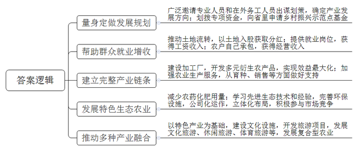
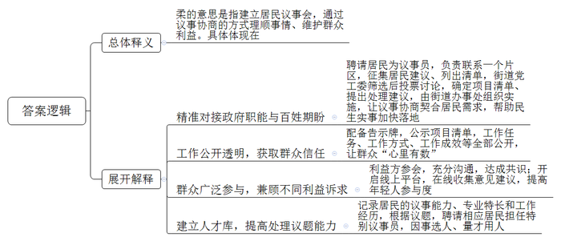

# 2023年公务员多省联考《申论》题（重庆二卷）

> 候选采集稿。参考答案及解析来自粉笔页面，不代表官方答案或真实高分答卷；来源使用许可与原卷对应关系仍需人工核实。

## 给定材料

### 材料 material-af2cf49b638d8a86

群山环绕，万亩橘林。在一处农家屋前，人来人往，主人小黄微笑着迎上来，端着剥好的橘子说：“来尝尝，自家产的，好吃！”小黄在橘乡田园综合体承包的橘园今年大丰收。依托全县36万亩柑橘产业，Z县打造的橘乡田园综合体正大步向前发展。Z县有种植柑橘的传统、产业基础较好，但柑橘却卖不出去。Z县人不服气，主动求变，探索乡村振兴致富路。“我们先后开了二十多场会，邀请专家学者、企业家以及我们县在外工作的人一起来为乡村振兴出谋划策。”Z县方县长说，“最后县委县政府决定兴办橘乡田园综合体，走特色农业之路。县政府划拨专项资金，还向省里申请了乡村振兴示范点基金。”

小黄家在双桂村，以前也种柑橘，但因品种不佳、管理不善，盈利不多，他就把橘园交给父母打理，自己出去打工了。常年在外务工，家里年迈的父母和年幼的孩子是小黄最放心不下的牵挂。既能照顾家又能实现就业增收，是他多年以来的心愿。听说县里要在老家兴办田园综合体，小黄赶紧把家里的土地流转入股。“现在我们这里大变样了，政府修建了四车道的水泥路，直通高速公路，还开通了5G网络。土地流转到田园综合体后，利用率明显提高，我们每年都能拿到土地分红。”小黄说，“政府还帮流转了土地的村民解决就业问题，开展种植技术培训。我们可以在田园综合体中当长期固定工人，每月领工资，也可以自己承包橘园。”小黄从田园综合体承包的12亩橘园今年产了一万斤果子。以前产量小，还得操心销售。现在产量大了，小黄却一点都不担心：“工厂会来收购。”他说的工厂，是田园综合体内的柑橘加工厂。走进工厂车间，圆滚滚的新鲜柑橘，在智能化生产线上排列整齐。生产线的尽头，柑橘已变成橙汁。橙汁，只是柑橘加工产业链上的一个点。生产线上，柑橘变成20余种产品：果肉制成橙汁、果酒、橘蓉等，皮渣则提炼出抗癌药物原料——橘皮甙，连废渣都制成了有机肥和橘饲料。吃橘饲料长大的橘香猪，肉价是普通猪肉价的4倍。“有了完整的加工产业链，我们就能充分利用每一颗柑橘的价值，实现经济效益最大化，乡村振兴才有了最有力的保障。”田园综合体吴书记说。柑橘新品种培育中心、检验检测中心、柑橘交易中心……从创新育种到服务果农，一个完整的柑橘产业链条正在不断成长。

郁郁葱葱的柑橘树下，三叶草、苕子正茂盛生长。“这是绿肥作物，可以抑制杂草生长，等叶子干枯了，还能作有机肥。”吴书记说。为了减少化肥农药用量，田园综合体里全部采用太阳能杀虫灯、生物有机肥，确保绿色环保。绿油油的脆李压弯了枝头，池塘里的荷花开满了水面，金黄的稻田里鱼儿在嬉戏……好一幅生态优美的现代农业图。田园综合体兴建之初，Z县积极招商，引进一家大型生态农业公司入股，“县政府对这家公司进行了深入调查，的确是有资质、有经验、有技术，口碑比较好。”吴书记说，“在他们的帮助下，我们确立了生态农业的发展路径，对田园综合体进行公司化运作，以便更适应市场竞争。”田园综合体一开始就立体化布局柑橘、水稻、蔬菜、蜜蜂等种养业，还引进生态环境检测技术，完善垃圾污水处理等基础设施。如今，这里已建成特色生态农业基地1.8万亩，带动上万农民就业，农民年人均可支配收入达到2.5万元以上。

毗邻田园综合体办公区的是刚开放的柑橘品种博览园。进入大门，400多个柑橘品种跃然眼前，形态各异：小如豌豆的“金豆”、大个的香橙……“田园综合体规划了3平方公里的柑橘文化博览区，柑橘品种博览园只是其中的一部分。”吴书记说，“这是我们以柑橘产业为基础融合文化旅游的尝试。”田园综合体内已经建成了橘乡荷海、智慧橘园、桃李梦园等，成为当地的人气休闲旅游地。在游玩之余，游客还可在柑橘文化博览区了解我国柑橘种植历史，观看现代柑橘种植技术的展示，加深对柑橘文化的认识。“冬春摘橘、夏季赏荷、秋季观稻，我们这里四季有风景。”吴书记表示，未来还会开展马拉松，山地自行车等体育赛事，“随着以柑橘产业为主导、多种产业融合的复合型农业不断壮大，我们的田园综合体一定会更加蒸蒸日上。”

从普通的山村到现代田园综合体，迈向幸福的故事每天都在这里上演。“未来我们还会不断改革创新，以变应变，释放乡村振兴新动能，走出一条新型城镇化之路。”方县长信心满满地说道。

### 材料 material-99967cdc265be420

自从小区改造列入县民生实事项目，各小区微信群里就议论纷纷，这家要先装灯，那户提出停车难，诉求复杂多样，怎么让大家都满意？由86名成员组成的东风街道第一届居民议事会成立，解了难题。居民议事会成员向居民征集建议后，列出了包含楼道灯安装、停车位改造等25个诉求的建议清单。“街道党工委对建议清单进行筛选，形成候选清单，再提交居民议事会讨论和投票。居民议事会确定项目清单并提出处理建议后，由街道党工委交由街道办事处组织实施。”街道党工委孙书记说，“议事协商议的是民生话题，瞄准的是更好地解决民生问题。确定议题过程中，街道党工委要发挥主动作用，将政府职能与百姓期盼精准对接，让议事协商直击痛点，契合居民心意，推动民生实事加快落地。”

东风街道居民议事会是县基层协商议事试点之一。走进居民议事会，10多套活动桌椅整齐地摆放着，可根据不同议事主题排列组合，同时还配套发言台和LED显示屏。一块大大的告示牌悬挂在墙壁上，上面正在公示居民议事会近期表决的项目清单，包含了项目名称、提出人、解决方案、办理主体、办理进度等等，通过这个清单，居民议事会所做的事情一目了然。“议事会在做什么、怎么做、做得怎么样，一切都是公开透明的，大伙儿心里有数，才会信任议事会。”议事员老陈笑言，“以前大家有问题，没有商量的地方，现在有了这个阵地，大家遇到问题都喜欢来聊一聊，敞开心扉，把问题摊开，不知不觉就找到了解决办法。”老陈退休前是一名教师，为人公道，热心社区事务，被聘请来当议事员。“议事员由居民推荐、街道遴选，大多是党员，政治素质过硬。有的是像老陈这样的老住户，在居民中威望较高；有的是有专长的行家，能为大家出谋划策。”孙书记说，每个议事员都要联系一个片区，负责收集居民关心的问题。

“车乱停，有时堵楼门口，出行难。”停车乱，无车户难以忍受。“我们也想按车位停，可哪有车位？”停车难，有车户也感到无奈。东风街道的一次居民议事会上，社区居委会、物业、业委会、议事员、有车户代表、无车户代表畅所欲言。“没有车位的统一停小区外吧，不影响小区环境。”无车户提出。“还是停小区内，安全可管理。”有车户有异议。意见不同，大家一起分析：停小区外可能妨碍交通，可行性差，还是要在小区内挖掘潜力，将废弃绿地、边角地划成车位。方案公示，车位边一楼的无车户担忧噪声影响休息。议事会再次启动，决定在车位与住房之间种植花草，同时对受影响住户进行补偿。现在，有车居民自觉泊车入位，一排排车辆整整齐齐。“议事会已经形成行之有效的程序，街道工作人员主持，将参会人员分成不同小组进行讨论，由各组代表汇总上台发言，投票选出可行性高的解决方案。”孙书记说，“不少事项牵涉到不同利益主体，议事会要尊重和照顾不同利益诉求。虽然很多时候协商的过程很曲折，甚至有争吵，但充分沟通后达成共识，能兼顾不同的利益方促进彼此理解，消除了矛盾和怨气。”日前，东风街道居民议事会还开通了线上平台。“如今讲共建、共治、共享，最重要的就是老百姓肯参与进来！”孙书记说，“议事会开到线上以后，居民只需要扫二维码，就能在平台上提交意见和建议，这让年轻人的参与度大大提高，这样议事会就能更广泛地听取群众的心声。”

议事协商有结果，更要落地，切实解决群众诉求，把民生实事办到群众心坎上，才会得到群众信任。前不久，街道的新城中心改造项目通过验收，居民眼前一亮：小广场铺上了花岗岩，游乐场传来孩子们的欢笑声，休闲步道上多了散步的居民。“去年，大家还抱怨这小广场环境脏、蚊虫多，有和没有一个样。”高先生笑着说。高先生是建筑设计研究院的工程师，受聘为议事会特别议事员，负责新城中心改造的监督。高先生每天都要到工地上看看，周末更是经常一待就是半天，增设小广场铺装场地、展示墙和儿童游乐场所等，就是他看完设计图纸后提出的建议。东风街道根据居民的议事能力、专业特长和工作经历，建立人才库。议题确定后，街道就会联系相应的居民，聘请他们担任特别议事员，让“适合”的人参加“适合”的会，从而提高议事会处理议题的能力。

“议而能决，商而能行，理顺群众的‘气’，很多事情都好办了，毕竟大家在根本利益上是一致的。这便是运用柔的方法，取得好的效果。”孙书记说。

### 材料 material-51ebf325b56b54ee

为优化文旅产业布局，促进乡村旅游升级发展，集江县宽石镇近日召开了一场关于乡村旅游规划调整升级的座谈会，听取各方意见建议。以下是座谈会的主要发言记录：

集江县发改局陈副局长：乡村旅游的落脚点应该是乡村，游客去农村主要还是想体验乡村特色和风情。开展乡村旅游规划，千万不能摒弃乡村的质朴与自然，不能按照城市规划的思路去规划设计，把农村建得跟城市一样。规划还是要着眼于“游客为什么来、什么游客来、游客怎么来、游客来了干什么、怎样让游客介绍人来”这几个问题。解决好这些问题，乡村旅游才可能发展起来。

村民代表老赵：镇里要在我们村搞旅游项目，都不听听我们的想法，我感觉跟我们也没有太大关系。虽然这几年村里整洁了一些，生活也便利了一些，但外面的人来旅游，我们也做不了什么，没有实际的收益。我觉得让村民们能赚到钱才实在，否则我还是愿意去城里打工，村里好多人跟我的想法都一样。

石茂村村委会刘主任：我们规划得再好，可有些村民就是不太配合，还是喜欢把鸡鸭养得到处都是，卫生也没处理干净，垃圾随处乱倒，有的村民养的狗还追着人家到处跑，外面的人来了自然不会高兴，不告你就算不错了。

灰石村驻村第一书记张某：我感觉，我们镇乡村旅游的主题内容同质化比较严重，比如花海，除了规模不一样，其他大抵相同。农家乐，就是简单的餐饮，加上棋牌、钓鱼，就没有其他内容了。采摘、观光活动的体验感也是千篇一律，体现不了我们这个地方的特色农业和文化。旅游产业的核心竞争力不足，历史文化深度挖掘不够，乡村核心的魂、自身的特色、差异化竞争等方面鲜有挖掘。

江流村村委会李主任：我们村经过调研了解、征求意见，筹划建设“造田公社”景观，计划以农业种植为基础，将农田开发成可观、可玩、可学的各类创意场景，这个还是比较有特色的。可是，规划前期就需要不少资金投入，单纯从村里去开支，肯定是不够的，还是希望县里多支持，另外，最好有懂行的人来帮我们做一些旅游开发管理的事情。

县规划设计院潘工程师：乡村旅游规划设计要融入当地县镇、服务于村庄。处理好传统村落、基本农田保护与开发的关系，避免大拆大建、无效投入，所以规划就非常重要。如果规划和周遭环境产生对抗、格格不入，不能很好地尊重村民意愿，这样的规划哪怕自身再优秀，也不是好作品，这都需要专业的规划人才深入乡村实地去感受、体验，寻找最佳的解决方案。

村民代表小周：村里说我家的老宅比较有特色，要保护修缮起来，政府会出一部分钱，但我们对这一块的政策不太了解，手续怎么办都不知道，村里也没什么人说得清楚，都是传来传去，走了不少弯路，也没有彻底解决问题，能不能有专门的人来指导我们怎么做。

集江县文化体育和旅游局钱副局长：这几年，乡村旅游遍地开花、如火如荼，大家都想分一杯羹，但规划要对建设以后的事情有个统筹考虑。有的地方往往注重硬环境建设，却忽视软环境治理，管理跟不上，配套服务也不行，个别还发生过安全事故，谁敢再去啊！有的地方基础设施和配套服务都完善了，但游客量却没有增加，收益也不可观，主要是没有对受众人群、出游目的、消费能力等进行系统分析，宣传推介就更加无从说起了。

宽石镇李镇长：乡村旅游规划不能各自为政，要以“一盘棋”思想抓好统筹，根据各村的实际情况制定规划，再把散落的珍珠串成项链，形成我们镇的特色旅游项目。这样，游客到了我们镇，就可以根据实际需要订制项目，比如红色旅游、文化旅游、生态旅游等，既可以一揽子游下来，也可以分类订制游。

## 题目

### 第 1 题

**请根据****“给定资料**1**”，谈谈****Z县****打造现代田园综合体的过程对推进乡村振兴工作有哪些值得借鉴的经验。（****15分）**

关联材料：material-af2cf49b638d8a86

作答要求：

要求：全面，准确，有条理，不超过300字。

### 第 2 题

**“给定资料**2**”提到“运用柔的方法，取得好的效果”，请谈谈对“柔”的理解。（20分）**

关联材料：material-99967cdc265be420

作答要求：

要求：理解准确、分析透彻、简明扼要，不超过400字。

### 第 3 题

**请根据****“给定资料**3**”，梳理当前宽石镇乡村旅游规划中存在的问题，并提出相应的改进建议。（25分）**

关联材料：material-51ebf325b56b54ee

作答要求：

要求：

（1）问题梳理全面、准确、有条理；

（2）所提建议与问题相对应，具体明确、切实可行；

（3）不超过400字。

### 第 4 题

**“给定资料**4**”中提到“以变促变，以新求新”，请结合对这句话的理解，参考给定资料，联系实际，自选角度，自拟题目，写一篇文章。（40分）**

关联材料：material-af2cf49b638d8a86

作答要求：

要求：

（1）观点明确，见解深刻；

（2）参考给定资料，但不拘泥于给定资料；

（3）思路清晰，语言流畅；

（4）总字数1000字左右。

## 答案与解析

第 1 题

**参考答案（粉笔题库参考内容）**

1.量身定做发展规划。广泛邀请专业人员和在外务工人员出谋划策，确定产业发展方向；划拨专项资金，向省里申请乡村振兴示范点基金。

2.帮助群众就业增收。推动土地流转，以土地入股获取分红；提供就业岗位，获得工资收入；农户自己承包，获得经营收入。

3.建立完整产业链条。建设加工厂，开发多元衍生农产品，实现效益最大化；加强农业生产服务，从育种、销售等方面做好支持。

4.发展特色生态农业。减少农药化肥用量；学习先进生态技术和经验，完善环保设施，公司化运作，立体化布局，积极参与市场竞争。

5.推动多种产业融合。以特色产业为基础，建设文化设施，开发旅游项目，发展文化旅游、休闲旅游、体育旅游等，发展复合型农业。

**解析**

**参考答案说明**：本参考答案从“量身定做发展规划”“帮助群众就业增收”“建立完整产业链条”“发展特色生态农业”“推动多种产业融合”五个方面展开，各条答案要点之间在内容上相互并列，没有交叉。

**考点**：考点经验启示类

**来源**：来源2023年公务员多省联考《申论》题（重庆二卷）

粉笔申论页面对本题只提供「解析视频」入口，该入口是会员推广位，页面无视频地址与文字解析。

第 2 题

**参考答案（粉笔题库参考内容）**

柔的意思是指建立居民议事会，通过议事协商的方式理顺事情、维护群众利益。具体体现在：

1.精准对接政府职能与百姓期盼。聘请居民为议事员，负责联系一个片区，征集居民建议、列出清单，街道党工委筛选后投票讨论，确定项目清单、提出处理建议，由街道办事处组织实施，让议事协商契合居民需求，帮助民生实事加快落地。

2.工作公开透明，获取群众信任。配备告示牌，公示项目清单，工作任务、工作方式、工作成效等全部公开，让群众“心里有数”。

3.群众广泛参与，兼顾不同利益诉求。利益方参会，充分沟通，达成共识；开启线上平台，在线收集意见建议，提高年轻人参与度。

4.建立人才库，提高处理议题能力。记录居民的议事能力、专业特长和工作经历，根据议题，聘请相应居民担任特别议事员，因事选人、量才用人。

**解析**

**参考答案说明：**思路方面，本参考答案根据资料具体内容，按照词句解释题“总体释义+展开解释”的答题思路展开。内容方面，本参考答案先对题干指定理解的句子“运用柔的方法，取得好的效果”中的“柔”进行了解释；接着“展开解释”分别从“精准对接政府职能与百姓期盼”“工作公开透明，获取群众信任”“群众广泛参与，兼顾不同利益诉求”“建立人才库，提高处理议题能力”等四个方面，对街道组织居民议事会解决群众问题的具体做法与效果，进行了详细地分析，且四条答案要点之间在内容上是并列关系，没有交叉。

**考点**：考点词句解释类

**来源**：来源2023年公务员多省联考《申论》题（重庆二卷）

粉笔申论页面对本题只提供「解析视频」入口，该入口是会员推广位，页面无视频地址与文字解析。

第 3 题

**参考答案（粉笔题库参考内容）**

1.问题：项目脱离群众。不听取群众意见，群众无法从项目中获得收益。建议：项目规划要广泛调查、吸纳群众意见，让群众深度参与旅游产业、项目。

2.问题：群众配合度低。散养禽畜，乱倒垃圾，村里卫生环境差。建议：制定村规民约，对禽畜养殖、垃圾处理等问题作出明确规范，并配套奖惩措施。

3.问题：同质化严重。缺少地方特色，核心竞争力不足，历史文化深度挖掘不够。建议：开发创意场景，并充分挖掘地方特色、文化，体现不同村落的差异。

4.问题：缺少资源。村子无力负担全部支出，缺少专业开发管理人才。建议：申请县级财政补贴，引入社会资本，引进专业旅游规划开发管理人才。

5.问题：宣传不到位。群众不了解修缮保护政策和手续办理流程。建议：通过进村入户、村广播等方式广泛宣传政策，安排专人指导手续办理。

**解析**

**参考答案说明：**本参考答案分别围绕“项目脱离群众”“群众配合度低”“同质化严重”“缺少资源”“宣传不到位”五个方面的问题及对应的建议展开，进行了分条撰写；各条具体要点之间在内容上相互并列，没有交叉。

**考点**：考点提出对策类

**来源**：来源2023年公务员多省联考《申论》题（重庆二卷）

粉笔申论页面对本题只提供「解析视频」入口，该入口是会员推广位，页面无视频地址与文字解析。

第 4 题

**参考答案（粉笔题库参考内容）**

**于变中谋变 从新处求新**

改革开放以来，我国经历了世界历史上规模最大、速度最快的城镇化进程，人民幸福指数不断攀升，现代化建设稳步推进。然而，中国式现代化是人口规模巨大的现代化，新型城镇化建设仍面临诸多挑战。新局蕴新机，新机生新局。在新的历史时期，唯有全方位的创新变革，以变促变，以新求新，才能持续推进城乡协调发展，为中国式现代化建设提供充足的动力。

**把握观念之变，提升环保意识，践行绿色理念，转变生活方式，引领生态文明新风尚。**人民城市人民建，人民城市为人民，城市的发展与居民的行为息息相关。碳汇城市理念的普及改变了群众的生活方式，通过积累“碳汇积分”，群众在日常生活中主动进行减排行为，实现了从“环保意识”到“环保行为”的转化。与此同时，碳汇交易也给乡村带来了新的风貌，村民自觉梳理修复植被，保护生态环境的积极性大幅提升。环保理念的普及与人的绿色生活方式有机结合，让人们充分享受到绿色发展所带来的便利和舒适，有效推进城乡生态文明建设。

**把握时代之变，优化产业布局，激发经济发展新活力。**面对新的时代之机，只有集聚创新合力，调整产业结构，才能推动城乡经济高质量发展。在碳汇城市的建设过程中，一方面通过成立生态交易所带动城市碳汇交易正规化，引导企业重视碳排放权价值。另一方面大力引进低碳产业，推进节能减排取得显著成效。碳汇城市的打造实现了产业生态化，激发经济活力的同时保障了生态效益。在乡村振兴的建设中，通过打造现代田园综合体，进行公司化运作，盘活了乡村自然资源，促进产业融合发展。从城市到乡村，产业结构之变正持续促进经济发展释放新动能。

**把握发展之变，利用科技手段，调整治理模式，开创城乡建设新局面。**随着社会的发展，治理需要先进的理念和手段。城市的建设应遵循尊重自然的原则，持续保护健康的生态系统，运用科技赋能，提升碳汇能力，着力打造“步步见绿”的城市空间。同时面对发展过程中面临的各类新问题，应该广泛汇集民意，提升群众参与社会治理积极性。东风街道居民议事会通过线上平台解决群众问题，群众满意度大幅提升。集江县举办多元主体参与的座谈会听取群众意见，群策群力推进了当地产业多元发展。只有治理模式与时俱进，才能开拓城乡高水平发展的时代新局。

时代前进的脚步永不停歇，身处百年未有之变局，唯有开拓思路，于变化中求变化，于新局中求新机，才能不断跨越险滩，把握历史主动，绘就城乡可持续发展的新画卷。

**解析**

**文章分析**

**于变中谋变 从新处求新**

【**标题的优点：**标题直接采用给定句子的表述，使文章主题更突出、明确。其次，在形式上采用了对称式标题，使标题更加完整、饱满。】

（1）改革开放以来，我国经历了世界历史上规模最大、速度最快的城镇化进程，人民幸福指数不断攀升，现代化建设稳步推进。（2）然而，中国式现代化是人口规模巨大的现代化，新型城镇化建设仍面临诸多挑战。（3）新局蕴新机，新机生新局。在新的历史时期，唯有全方位的创新变革，以变促变，以新求新，才能持续推进城乡协调发展，为中国式现代化建设提供充足的动力。

【**开头的优点：**★内容方面。范文的开头是紧扣“变革创新”这一主题展开的。首先，开头点出主题，做到了主题明确。其次，对“变革创新”这一主题进行了分析阐述，指出了（1）我国的发展成果；（2）中国式现代化面临的挑战；（3）变革创新对于我国发展的重要意义。★文字表达方面。使用了“然而”“唯有……才……”等关联词，使语言表达有逻辑性。】

**把握观念之变，提升环保意识，践行绿色理念，****转变生活方式，引领生态文明新风尚**。（1）人民城市人民建，人民城市为人民，城市的发展与居民的行为息息相关。（2）碳汇城市理念的普及改变了群众的生活方式，通过积累“碳汇积分”，群众在日常生活中主动进行减排行为，实现了从“环保意识”到“环保行为”的转化。（3）与此同时，碳汇交易也给乡村带来了新的风貌，村民自觉梳理修复植被，保护生态环境的积极性大幅提升。（4）环保理念的普及与人的绿色生活方式有机结合，让人们充分享受到绿色发展所带来的便利和舒适，有效推进城乡生态文明建设。

【**论述段****1的优点：**★观点句：范文的观点句是紧扣“变革创新”这一文章主题提出的。形式上，它在段首处直接写出，位置突出，容易发现。内容上，关键词突出，内容要点明确，可以明显看出是从“观念变化”的角度展开论述。★论述内容：（1）先介绍了人民与城市的密切关系；（2）接着介绍了碳汇城市理念对群众生活的改变；（3）碳汇交易的积极作用；（4）最后强调普及环保理念的意义。注意：以上四个方面的内容都是紧扣“把握观念之变，提升环保意识，践行绿色理念，转变生活方式，引领生态文明新风尚”这个观点句进行分析论述的，论述的针对性强，内容层次丰富。在论述方法上主要采用了讲道理的方式，论述清晰透彻。】

**把握时代之变，优化产业布局，激发经济发展新活力**。面对新的时代之机，只有集聚创新合力，调整产业结构，才能推动城乡经济高质量发展。（1）在碳汇城市的建设过程中，一方面通过成立生态交易所带动城市碳汇交易正规化，引导企业重视碳排放权价值。另一方面大力引进低碳产业，推进节能减排取得显著成效。（2）碳汇城市的打造实现了产业生态化，激发经济活力的同时保障了生态效益。（3）在乡村振兴的建设中，通过打造现代田园综合体，进行公司化运作，盘活了乡村自然资源，促进产业融合发展。从城市到乡村，产业结构之变正持续促进经济发展释放新动能。

【**论述段****2的优点：**★观点句：范文的观点句是紧扣“变革创新”这一文章主题提出的。形式上，它在段首处直接写出，位置突出，容易发现。内容上，关键词突出，内容要点明确，可以明显看出是从“时代变化”的角度展开论述。★论述内容：（1）先介绍了建设碳汇城市的举措；（2）接着指出了碳汇城市的积极作用；（3）最后介绍了乡村振兴建设中产业结构的调整。注意：以上三个方面的内容都是紧扣“把握时代之变，优化产业布局，激发经济发展新活力”这个观点句进行分析论述的，论述的针对性强，内容层次丰富。在论述方法上主要采用了讲道理的方式，论述清晰透彻。】

**把握发展之变，利用科技手段，调整治理模式，开创城乡建设新局面**。（1）随着社会的发展，治理需要先进的理念和手段。（2）城市的建设应遵循尊重自然的原则，持续保护健康的生态系统，运用科技赋能，提升碳汇能力，着力打造“步步见绿”的城市空间。（3）同时面对发展过程中面临的各类新问题，应该广泛汇集民意，提升群众参与社会治理积极性。东风街道居民议事会通过线上平台解决群众问题，群众满意度大幅提升。集江县举办多元主体参与的座谈会听取群众意见，群策群力推进了当地产业多元发展。（4）只有治理模式与时俱进，才能开拓城乡高水平发展的时代新局。

【**论述段****3的优点：**★观点句：范文的观点句是紧扣“变革创新”这一文章主题提出的。形式上，它在段首处直接写出，位置突出，容易发现。内容上，关键词突出，内容要点明确，可以明显看出是从“发展变化”的角度展开论述。★论述内容：（1）先介绍了治理需要先进理念和手段；（2）接着介绍了通过科技赋能优化城市建设；（3）介绍了面对发展问题，需要提升群众参与；（4）最后介绍了治理模式与时俱进的必要性。注意：以上四个方面的内容都是紧扣“把握发展之变，利用科技手段，调整治理模式，开创城乡建设新局面”这个观点句进行分析论述的，论述的针对性强，内容层次丰富。在论述方法上主要采用了讲道理的方式，论述清晰透彻。】

【**论述段之间的关系：**三个论述段分别从“观念之变”“时代之变”“发展之变”的角度，对文章主题“变革创新”展开了论述，彼此之间呈现出并列的逻辑。】

时代前进的脚步永不停歇，身处百年未有之变局，唯有开拓思路，于变化中求变化，于新局中求新机，才能不断跨越险滩，把握历史主动，绘就城乡可持续发展的新画卷。

【**结尾的优点：**范文的结尾回扣了“变革创新”这个主题，并且进行了总结升华。】

**考点**：考点文章写作题

**来源**：来源2023年公务员多省联考《申论》题（重庆二卷）

粉笔申论页面对本题只提供「解析视频」入口，该入口是会员推广位，页面无视频地址与文字解析。

