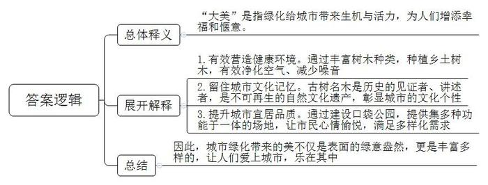
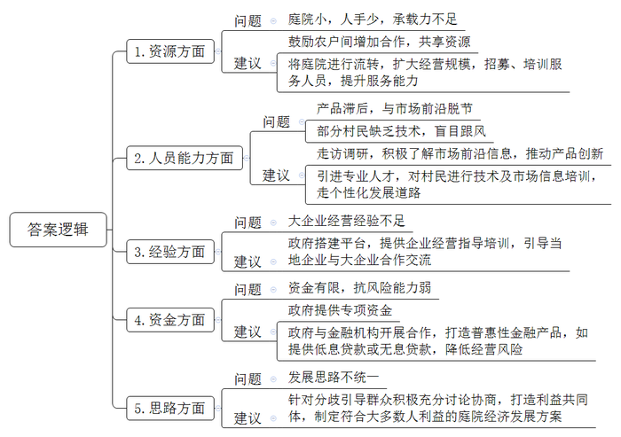
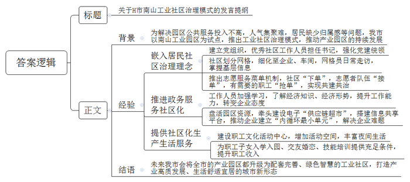
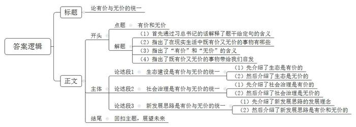

# 2024年公务员多省联考《申论》题（重庆一卷）

<!-- gwy:overview:start -->
> **重庆 · 2024 · 申论 · 一卷** ｜ 4 题 · 图片 4 处 · 答案随题折叠

导航：[题目](#题目)
<!-- gwy:overview:end -->

> 候选采集稿。参考答案及解析来自粉笔页面，不代表官方答案或真实高分答卷；来源使用许可与原卷对应关系仍需人工核实。

## 给定材料

### 材料 material-756b17084c465f30

街道两侧、楼前屋后，一簇簇千树海棠开得明艳、热烈，恍若缤纷的花海，点亮了明媚春光……日前，F市广宁旅游区的千树海棠如期绽放，甚是美丽。“这里植物层次丰富，基本达到三季有花、四季有绿，大大提升了城市的颜值。”F市城市管理委员会刘主任说。F市近年大力开展城市绿化，充满魅力的广宁旅游区就是F市城市绿化工作结出的一颗硕果。

走在F市的大路上，如同穿行在露天的树木博物馆中，绿树成荫，不同的树木不断变换。当初在选择绿化树时，有人提议效仿某些地方，从外地引进一些时髦的花木。“绿化是大家的事，要听取大家的意见。”刘主任说。城市管理委员会通过多种渠道广泛征求民意，发现大部分人都主张种植乡土树木。“毕竟本乡本土的树木适应本地环境，容易成活，大家也有种植经验。”有网友留言说。经过调研论证，F市因地制宜，在不同的街区种植不同的乡土树木。如今，F市的大道上，银杏、海棠、白蜡等交错成林，公园及绿地内杨树、泡桐等茁壮成长。“盲目种植一些时髦的花木，成活率很低，后续的管护费用也居高不下。”刘主任说，“我们种植的这些乡土树木虽然普通常见，但它们成活率高，能更有效地净化空气、减少噪音，有效地营造出了健康环境。”

白昼的喧嚣褪去，明月高悬，花木掩映的城市显得如此美丽动人。“我们的工作就是要让美丽永远伴随着这座城市。”市容园林服务中心工程师小张说。园林技术人员经过长期钻研已经形成一套适合本地的科学养护办法，可以做到通过修剪、保温等措施来调节开花时间，对树木的水肥管理也非常精细。小张说：“壮年树采取刺激生长的方式，高龄树采取治病加养生的方式，管护要因树而异。”F市栽植了很多丝木棉树，这些丝木棉美若彤云，照亮了城市，但随着时间的推移，出现了树势衰弱、针叶发黄等现象。对此，市容园林服务中心通过树体杀菌、树洞填补、浇灌根系复壮液等一系列针对性的修复措施开展复壮，目前95%以上的丝木棉长势明显好转。

为更好地保护树木，F市开展树木调查登记工作，建立古树后备资源库，树龄50年以上的全部入库，实行挂牌管理，以古树的标准进行养护。F市还建立古树名木智慧云平台，融合大数据、区块链等技术对古树名木进行全程跟踪管理，不但可以随时调阅档案资料、地理位置等信息，还可以实时监测土壤养分、倾斜角度等，提升保护的科学性和精准性。“树木是一个城市的印记，特别是一些大树老树更是历史的见证者、讲述者，是不可再生的自然文化遗产。城市绿化是一项系统工程，不仅要把树木保护好，还要留住城市的文化记忆，彰显城市的文化个性。”刘主任说，F市正充分利用古树资源，打造一批“古树绿地”“古树公园”和森林康养示范基地，“把城市的绿化工作和经济、文化融为一体，相得益彰。”

F市护城河公园是一座口袋公园，以中式古典风格为主，构建了多植物、多层次、多色彩的滨河绿色廊道，吸引了众多市民游园。“河边空气好，在这儿遛弯心情愉悦，每天傍晚到公园散步已经成了一种生活习惯。”一位按时到护城河公园“打卡”的市民说。F市已经建成40多个这样的口袋公园，提升绿化面积80万平方米。这些公园串点成线、连线成片，有效改善了城市生态环境，提升了城市宜居品质。“口袋公园的建设破解了城市绿化用地紧缺、大规模建设资金不足等问题，是一种节俭高效的绿化措施；同时这些公园集观赏、休闲、娱乐、科普等功能于一体，既是市民的会客厅，也是市民的运动场，功能齐全，能满足多样化需求。”刘主任说。

天蓝水碧，四季红绿，漫步在F市大街小巷，满眼生机与活力，清新靓丽的城市景观为人们增添了幸福和惬意。“绿化，给城市带来美，这种美应该是一种大美。它不仅是表面的绿意盎然，还应该是实实在在的、丰富多样的、深沉久远的、亲切熟悉的、充满希望的……让人们因此爱上这座城市，乐于生活其中。”刘主任说。

### 材料 material-ffbfbacb8509c328

2020年，W市开始试点推进庭院经济，经过几年努力，庭院经济初显蓬勃之势。2023年中央一号文件提出，鼓励脱贫地区有条件的农户发展庭院经济。为评估庭院经济发展情况，进一步助力乡村振兴，W市农业农村局深入乡村开展调研工作。以下是调研组的部分调研笔记内容：

●陈村。村民老陈因地制宜，把自家庭院重新装修，在家里开起农家乐。老陈：“我们这里是山区，风景好，而且山里的菜新鲜、地道、有特色，隔三岔五就有游客来山上游玩，顺便品尝我们的农家菜。经常有客人提前打电话来，点名要吃我们家的炖鸡。现在政府鼓励发展庭院经济，我这房前屋后都种了菜，加工出来就能变现钱。可惜的是，家里地方太小了，客人一多就没地方坐，种的菜也不够招待，有时候单凭家里的几口人也忙不过来。”

●郭家村。村党支部黄书记：“我们村算是找准了发展方向，就是在自己庭院加工软体沙发。现在我们村的软体沙发加工业已初具规模，村民们逐渐走上了致富路。这都是因为我们有小章！他懂技术，也懂市场。”

小章：“我以前在沿海一家沙发公司上班，回家过年时，正遇上村里宣传庭院经济，我在外很多年，也想回家发展，就抱着试一试的想法，利用自家庭院干起软体沙发的加工。现在，我们通过网络把小庭院和大市场联系起来，在多家电商平台开设网店，也和直播带货的主播合作，每天订单有一百多单。”

黄书记：“我们村在自家庭院加工软体沙发的农户超过20家，不仅收益可观，还带动了近200名村民就业。周边村子很多人前来取经，也准备从事沙发加工。”

小章：“其实我们的市场是受限的，因为沙发的工艺技术、设计理念和款式风格一直在变化，而我们与市场前沿有些脱节，产品始终稍显滞后。很多人没有技术，也不懂市场，一窝蜂来学做沙发，这未必是件好事。”

●赵村。这是一个有着300多年铁编加工历史的村庄，村里80%的人都有铁编手艺，但一直以来，铁编生产都是家庭作坊、自产自销，走不出“庭院”。村党支部杨书记带着铁编加工户代表到沿海发达地区考察学习。回来后，赵村成立了金属制品产业合作社。由专人负责采购原材料和推广产品，铁编加工户只需要按统一标准在自家庭院加工制作。

杨书记：“我们之前太局限于传统小农经济的思想。要面向市场！市场需要什么，我们就生产什么。小作坊创造大产业，去年一年，我们村铁编销售额突破了两亿元。现在随着规模不断扩大，合作社的事情越来越多，资金往来也越来越复杂，我们没有经营大企业的经验，还是很有压力。”

●方沟村。村民小刘通过网络直播销售花卉。这些花卉都是她在自家庭院里种的，品种虽然不多，但都是市面上比较少见的。小刘：“我最喜欢的工作就是每天在自家小院直播推销花卉。我的客户主要是一些对新奇植物抱有好奇心的人，他们一般不太在乎价格。我还想扩大一些规模，但这些花卉成本很高，我的资金有限，经不起风险。”除了直播花卉的品种、价格和种植注意事项外，小刘还喜欢分享绿植美化居室和庭院的心得：“院子闲着也是闲着，种上花卉，看着舒心，住着养心。”

●张店村。村党支部夏书记联系五户不在村里居住的村民召开协商会，讨论将院子流转给村里发展民宿。

夏书记：“我们把‘小’而‘散’的庭院打造出各自的特色，通过设计形成一个功能互补的民宿联合体。这样大家不仅可以获得租金和分红，还能就近就业。”

村民老韩：“之前隔壁村老江家办过民宿，后来同质化竞争太激烈，老江只能通过压低报价来吸引客户，可是报价降低了，服务品质也跟着降低了，无法留住顾客，最终陷入了恶性循环。”

村民老张：“我觉得我们村现在这样子就很好，干干净净，又安静，顺其自然就行了。有的地方办民宿，一下子迎来很多客人，吵吵嚷嚷，还影响环境卫生。”

由于大家意见不一，协商会最后没有达成共识。“庭院经济有奔头，周围很多村都搞得红红火火，我们没有搞不好的道理。”夏书记会后说，“浪头会不断起伏，但浪潮永远向前。只要我们不懈努力，就一定能搞起来。”

### 材料 material-e374c1ce8a978634

H市，一个因工业而兴的城市。在这里，一个又一个的产业园区成为城市发展的引擎，吸引了很多人前来追逐梦想。但是，早年间的产业园区重招商引资、轻管理服务，强产业、弱配套，导致园区虽产值高但公共服务投入不高，虽人口聚集但人气难以集聚，虽归属城市但居民缺少归属感。这在“赚了钱就寄回家”的第一代进城务工人员那里“不是什么问题”，但在追求生活品质的新一代进城务工人员那里“都是问题”。为了解决这个问题，实现产业园区的持续发展，H市以南山工业园区为试点，推出工业社区治理模式，将居民社区治理理念嵌入产业园区，为企业和员工提供社区化服务。

“情绪不能去控制，只能去管理，家长学会情绪管理能促进亲子关系良性互动……”走进南山工业社区的周末托管班，心理老师正为亲子家庭分享有关情绪管理的方法，帮助家长们解决孩子成长中遇到的困惑。开办托管班的点子来源于社区网格员的日常走访。为解决园区企业双职工家庭周末的子女教育管理难题，社区统筹资源，搭建平台，邀请心理咨询专业教师团队，创新开启周末托管模式。南山工业社区只有6名社工，而各类企业有五百多家，员工近8万名。“小社区也能完成大治理。”南山工业社区党委柯书记说，“党建统领是‘定盘星’。”南山工业社区在成立之初就建立了党组织，书记由优秀社工担任。社区划分成几个网格，每个网格再分成若干个微网格，微网格细化到企业甚至车间，是社区掌握基层信息的触角，也是治理和服务的抓手。“大家的园区大家建，我们还推出了志愿服务菜单机制，吸引志愿者参与社区共建共治。”柯书记说。交通引导、平安夜巡、家园美化……社区有服务需求“下单”，志愿者队伍“接单”，有落户、子女入学积分需要的职工“抢单”，服务对象摇身一变成为共同服务者，让社区服务更加及时高效。

“作为工业社区，我们的工作跟着经济形势走。”柯书记原来在居民社区工作，刚到南山工业社区时，因不熟悉经济差点闹了笑话，后来他带领社区工作人员不断学习经济知识，了解经济形势。如今，柯书记和企业负责人对话时，已经可以熟练地使用“资金链”“内循环”“供给侧”等词语，企业的态度也在潜移默化中改变。“原来一听到社区，总觉得跟企业无关，现在发现小社区有大本领。”某电子材料有限公司张经理说。张经理的公司曾遇到如何加快上市的难题，没想到社区专门组织了一场园区内科技企业和金融机构的对接会，帮助其入选上市企业后备库。“工业社区已经从简单为职工衣食住行提供服务的配角，变成盘活园区资源、推动园区发展的主角之一。”张经理说，“有了他们暖心的帮助，我们这些做企业的感到放心。”去年，南山工业社区还牵头建设电子平台“供应链超市”，承担起了供需信息播报、物流信息共享、降成本方案共通等功能。“供应链超市”以数字化赋能企业发展，搭建了园区内企业的信息共享平台，推动园区企业建立起“内循环最小单元”。柯书记最近就在忙两件事：一是协调银行，建立一个5亿元规模的贷款资金池，用于解决“超市”里因资金短缺“上架”的厂房、仓库多起来的问题，缓解园区内企业资金压力；二是把园区内企业组织起来，共商如何调整用能结构，实现产业绿色发展。

南山工业社区的职工文化活动中心不久前正式投用，宽敞的室外健身休闲区和多功能室内教育休闲活动区解决了众多企业职工活动空间少的问题。每天晚上，篮球场、健身房、图书馆、咖啡吧里，都有职工前来享受丰富的夜间生活。“在这里，不管是职工子女入学入园，还是年轻人交友婚恋、技能培训，都有了充足的条件。”某公司人事专员万女士感慨，社区化的生活环境，成了企业招聘、留人的一大亮点。南山工业社区每年都举办“工匠学堂”“社区技校”等技能培训。自试点以来，南山工业社区的职工收入年均增速高于全市4.2个百分点。

接下来，H市将总结推广南山工业社区的试点经验，将全市产业园区都升级为配套完善、绿色智慧的工业社区，打造产业高质发展、生活舒适宜居的城市新形态。“不能因为是产业园区就只关注生产，而忽视了生活方面的管理和服务，我们的发展就是要满足人民日益增长的美好生活需要。”柯书记说。

## 题目

### 第 1 题

**“给定资料**1**”中提到“绿化，给城市带来美，这种美应该是一种大美”。请根据“给定资料**1**”，谈谈对“大美”一词的理解。（15分）**

关联材料：材料 material-756b17084c465f30

作答要求：

要求：全面、准确、有条理，不超过250字。

第 1 题 · 答案与解析

**参考答案（粉笔题库参考内容）**

“大美”是指绿化给城市带来生机与活力，为人们增添幸福和惬意。具体表现在：

1.有效营造健康环境。通过丰富树木种类，种植乡土树木，有效净化空气、减少噪音。

2.留住城市文化记忆。古树名木是历史的见证者、讲述者，是不可再生的自然文化遗产，彰显城市的文化个性。

3.提升城市宜居品质。通过建设口袋公园，提供集多种功能于一体的场地，让市民心情愉悦，满足多样化需求。

因此，城市绿化带来的美不仅是表面的绿意盎然，更是丰富多样的，让人们爱上城市，乐在其中。

**解析**

**参考答案说明****：**思路方面，本参考答案按照词句解释题“总体释义+展开解释+总结”的一般答题思路展开。内容方面，本参考答案首先对“大美”进行总体释义，然后再从“有效营造健康环境”“留住城市文化记忆”“提升城市宜居品质”三个方面进行展开解释，最后进行总结。词句表达方面，本参考答案加上了“因此”等连接词来承接上下文，使上下衔接更顺畅。

**考点**：考点词句解释类

**来源**：来源2024年公务员多省联考《申论》题（重庆一卷）

粉笔申论页面对本题只提供「解析视频」入口，该入口是会员推广位，页面无视频地址与文字解析。

### 第 2 题

**请根据****“给定资料**2**”，梳理W市在发展庭院经济中遇到的问题，并提出解决问题的建议。（20分）**

关联材料：材料 material-ffbfbacb8509c328

作答要求：

要求：

（1）问题梳理全面、准确、有条理；

（2）所提建议与问题相对应，具体明确、切实可行；

（3）不超过400字。

第 2 题 · 答案与解析

**参考答案（粉笔题库参考内容）**

1.问题：庭院小，人手少，承载力不足。建议：鼓励农户间增加合作，共享资源；将庭院进行流转，扩大经营规模，招募、培训服务人员，提升服务能力。

2.问题：产品滞后，与市场前沿脱节；部分村民缺乏技术，盲目跟风。建议：走访调研，积极了解市场前沿信息，推动产品创新；引进专业人才，对村民进行技术及市场信息培训，走个性化发展道路。

3.问题：大企业经营经验不足。建议：政府搭建平台，提供企业经营指导培训，引导当地企业与大企业合作交流。

4.问题：资金有限，抗风险能力弱。建议：政府提供专项资金；政府与金融机构开展合作，打造普惠性金融产品，如提供低息贷款或无息贷款，降低经营风险。

5.问题：发展思路不统一。建议：针对分歧引导群众积极充分讨论协商，打造利益共同体，制定符合大多数人利益的庭院经济发展方案。

**解析**

**参考答案说明：**本参考答案从“资源”“人员能力”“经验”“资金”“思路”五个方面介绍了问题，并针对每一方面的问题给出了相应的建议。此外，形式方面，本答案做到了分类分条撰写，各条要点之间在内容上是并列关系，没有交叉。

**考点**：考点提出对策类

**来源**：来源2024年公务员多省联考《申论》题（重庆一卷）

粉笔申论页面对本题只提供「解析视频」入口，该入口是会员推广位，页面无视频地址与文字解析。

### 第 3 题

**省里准备召开****“城市高质量发展”论坛，请根据“给定资料**3**”，拟写一份介绍H市南山工业社区治理模式的发言提纲。（25分）**

关联材料：材料 material-e374c1ce8a978634

作答要求：

要求：

（1）紧扣资料，内容全面；

（2）准确简明，有逻辑性；

（3）不超过500字。

第 3 题 · 答案与解析

**参考答案（粉笔题库参考内容）**

关于H市南山工业社区治理模式的发言提纲

背景：为解决园区公共服务投入不高，人气集聚难，居民缺少归属感等问题，我市以南山工业园区为试点，推出工业社区治理模式，推动产业园区的持续发展。

经验：一、嵌入居民社区治理理念。建立党组织，优秀社区工作人员担任书记，强化党建统领；社区划分网格，细化至企业、车间，网格员日常走访，掌握基层信息；推出志愿服务菜单机制，社区“下单”，志愿者队伍“接单”，有需要的职工“抢单”，实现共建共治。

二、推进政务服务社区化。工作人员加强学习，了解经济知识、经济形势，提升工作能力，转变企业态度；盘活园区资源，牵头建设电子“供应链超市”，搭建信息共享平台，推动企业建立“内循环最小单元”，解决企业难题。

三、提供社区化生产生活服务。建设职工文化活动中心，增加活动空间，丰富夜间生活；为职工子女入学入园、交友婚恋、技能培训提供充足条件，提升职工收入。

结语：未来我市会将全市的产业园区都升级为配套完善、绿色智慧的工业社区，打造产业高质发展、生活舒适宜居的城市新形态。

**解析**

**参考答案说明：**（1）格式方面，本参考答案写到了“标题”“正文”两个部分。（2）正文部分，一方面，内容上，围绕“H市南山工业社区治理模式”这一主题，本参考答案的先在开头部分交代南山工业社区治理的相关背景；接着正文部分从“嵌入居民社区治理理念”“推进政务服务社区化”“提供社区化生产生活服务”三方面介绍了该治理模式的具体经验做法；最后结尾部分提出了未来发展计划和目标。另一方面，形式上，本参考答案做到了分段、分条撰写，整体上条理清晰，逻辑顺畅。

**考点**：考点总结类

**来源**：来源2024年公务员多省联考《申论》题（重庆一卷）

粉笔申论页面对本题只提供「解析视频」入口，该入口是会员推广位，页面无视频地址与文字解析。

### 第 4 题

**“给定资料**4**”中提到“青山绿水是无价之宝”，又提到“生态有价”。生活中有许多既有价又无价的事物，请对此进行深入思考，参考给定资料，联系实际，自选角度，自拟题目，写一篇文章。（40分）**

关联材料：材料 material-756b17084c465f30

作答要求：

要求：

（1）观点明确，见解深刻；

（2）参考给定资料，但不拘泥于给定资料；

（3）思路清晰，语言流畅；

（4）总字数1000-1200字。

第 4 题 · 答案与解析

**参考答案（粉笔题库参考内容）**

**论有价与无价的统一**

习总书记提出，绿水青山就是金山银山。“金山银山”，既有字面含义上的经济之义，也深层次体现出深刻、长远的思想。从这个角度上说，生态环境是有价的，有经济价值，又是无价的，利于长远发展，是二者的有机统一。生活中也有许多既有价又无价的事物，社会治理、文化建设、经济发展新思路等，都是有价又无价的生动体现。

**有价，指的是有直接的价值，强调实用性，主要体现在经济、市场等层面；无价，指的是无法计算价值，比喻极为珍贵的事物，这种价值往往是丰富多元、深刻、长远的**。既有价又无价的事物还有很多，这给我们的启发是：既要重视现在，还要看到未来；既要看到表层价值，还要挖掘深层价值。兼顾有价与无价，我们应树立系统思维，坚持两点论和重点论的统一。

**生态建设是有价与无价的统一。**生态有价，主要体现在生态资源可以通过确权、入股经营等市场化方式产生经济价值。如有的地方自然环境优美，发展了旅游业，促进经济发展；有的地方森林覆盖率高，利用碳汇交易，带动了增收。生态有价，也无价。生态好了，经济发展了，生产要素流向改变了，民众建设家乡的积极性也提高了，社会治理更顺畅了，也为子孙后代发展攒下了“家底”。生态的无价，是丰富、深刻、长远的。

**社会治理是有价与无价的统一。**治理有价，它能给人以安定有序的环境、高效便捷的服务，也能为经济发展提供保障。如厦门市开启平安小区建设，为民众带去安宁；宁波市开展“无柜台”服务模式，为民众、企业提供贴心、优质服务；丽江市黎光村动员村民，群策群力，发展了旅游经济。治理有价，也无价。好的治理，能给人归属感，促进人的长远发展，满足人民日益增长的美好生活需要。如有的工业园区将居民社区治理理念嵌入产业园区，延伸政务服务内容和触角，为企业和员工提供社区化服务。好的治理，是有价与无价的统一。

**新发展思路是有价与无价的统一。**新发展思路中的内核是创新、协调、绿色、开放、共享等理念，在这种理念的推动下，乡村开始探索发展新路径，如发展庭院经济，走小而精的路线，带动了特色产业的发展，促进了群众增收致富，助力地区经济发展，这是新发展思路的有价。同时思路的变革，也转变了群众的思想，激发了群众的内生动力，带领大家奔赴美好生活，这便有了无形的社会价值。所以在发展中，要以有价为最终的目标，辅以无价的思考，将长远、可持续的思路落实在社会发展的更多领域，走富强、复兴之路。

老子说：“凿户牖以为室，有之以为利，无之以为用。”有价与无价，统一在一起，才能彰显事物的全部价值。这也为我们在做人生选择时提供了一些启示：心怀梦想，脚踏实地。

**解析**

**文章分析**

**论有价与无价的统一**

【**标题的优点：**标题中含有主题词，使文章主题更突出、清晰。】

（1）习总书记提出，绿水青山就是金山银山。“金山银山”，既有字面含义上的经济之义，也深层次体现出深刻、长远的思想。从这个角度上说，生态环境是有价的，有经济价值，又是无价的，利于长远发展，是二者的有机统一。（2）生活中也有许多既有价又无价的事物，社会治理、文化建设、经济发展新思路等，都是有价又无价的生动体现。

（3）有价，指的是有直接的价值，强调实用性，主要体现在经济、市场等层面；无价，指的是无法计算价值，比喻极为珍贵的事物，这种价值往往是丰富多元、深刻、长远的。既有价又无价的事物还有很多，（4）这给我们的启发是：既要重视现在，还要看到未来；既要看到表层价值，还要挖掘深层价值。兼顾有价与无价，我们应树立系统思维，坚持两点论和重点论的统一。

【**开头的优点：**★内容方面。范文的开头是紧扣“有价和无价”这一主题展开的。（1）首先通过习总书记的话解释了题干给定句的含义；（2）指出了在现实生活中既有价又无价的事物有哪些；（3）指出了“有价”和“无价”的含义；（4）指出了既有价又无价的事物带给我们启发。★文字表达方面。使用了“从这个角度上说”“这给我们的启发是”等过渡句，使语言表达有逻辑性；长短句配合使用，使得语言表达有节奏感。】

**生态建设是有价与无价的统一**。（1）生态有价，主要体现在生态资源可以通过确权、入股经营等市场化方式产生经济价值。如有的地方自然环境优美，发展了旅游业，促进经济发展；有的地方森林覆盖率高，利用碳汇交易，带动了增收。（2）生态有价，也无价。生态好了，经济发展了，生产要素流向改变了，民众建设家乡的积极性也提高了，社会治理更顺畅了，也为子孙后代发展攒下了“家底”。生态的无价，是丰富、深刻、长远的。

【**论述段****1的优点：**★观点句：范文的观点句是紧扣“有价和无价”这一文章主题提出的。形式上，它在段首处直接写出，位置突出，容易发现。内容上，关键词突出，内容要点明确，可以明显看出主要论述“生态建设是有价与无价的统一”。★论述内容：（1）先介绍了生态是有价的；（2）然后介绍了生态是无价的。注意：以上两个方面的内容都是紧扣“生态建设是有价与无价的统一”这个观点句进行分析论述的，论述的针对性强，内容层次丰富。在论述方法上主要采用了讲道理、举例子相结合的方式，论述充实深刻。】

**社会治理是有价与无价的统一**。（1）治理有价，它能给人以安定有序的环境、高效便捷的服务，也能为经济发展提供保障。如厦门市开启平安小区建设，为民众带去安宁；宁波市开展“无柜台”服务模式，为民众、企业提供贴心、优质服务；丽江市黎光村动员村民，群策群力，发展了旅游经济。（2）治理有价，也无价。好的治理，能给人归属感，促进人的长远发展，满足人民日益增长的美好生活需要。如有的工业园区将居民社区治理理念嵌入产业园区，延伸政务服务内容和触角，为企业和员工提供社区化服务。好的治理，是有价与无价的统一。

【**论述段****2****的优点：**★观点句：范文的观点句是紧扣“有价和无价”这一文章主题提出的。形式上，它在段首处直接写出，位置突出，容易发现。内容上，关键词突出，内容要点明确，可以明显看出主要论述“社会治理是有价与无价的统一”。★论述内容：（1）先介绍了社会治理是有价的；（2）然后介绍了社会治理是无价的。注意：以上两个方面的内容都是紧扣“社会治理是有价与无价的统一”这个观点句进行分析论述的，论述的针对性强，内容层次丰富。在论述方法上主要采用了讲道理、举例子相结合的方式，论述充实深刻。】

**新发展思路是有价与无价的统一。**（1）新发展思路中的内核是创新、协调、绿色、开放、共享等理念，在这种理念的推动下，（2）乡村开始探索发展新路径，如发展庭院经济，走小而精的路线，带动了特色产业的发展，促进了群众增收致富，助力地区经济发展，这是新发展思路的有价。同时思路的变革，也转变了群众的思想，激发了群众的内生动力，带领大家奔赴美好生活，这便有了无形的社会价值。所以在发展中，要以有价为最终的目标，辅以无价的思考，将长远、可持续的思路落实在社会发展的更多领域，走富强、复兴之路。

【**论述段****3****的优点：**★观点句：范文的观点句是紧扣“有价和无价”这一文章主题提出的。形式上，它在段首处直接写出，位置突出，容易发现。内容上，关键词突出，内容要点明确，可以明显看出主要论述“新发展思路是有价与无价的统一”。★论述内容：（1）先介绍了新发展思路的发展理念；（2）然后介绍了新发展思路是有价和无价的。注意：以上两个方面的内容都是紧扣“新发展思路是有价与无价的统一”这个观点句进行分析论述的，论述的针对性强，内容层次丰富。在论述方法上主要采用了讲道理、举例子相结合的方式，论述充实深刻。】

【**论述段之间的关系**：★内在逻辑上：文章先论述“生态建设是有价与无价的统一”，再论述“社会治理是有价与无价的统一”，最后论述“新发展思路是有价与无价的统一”，并列逻辑清晰严谨。】

老子说：“凿户牖以为室，有之以为利，无之以为用。”有价与无价，统一在一起，才能彰显事物的全部价值。这也为我们在做人生选择时提供了一些启示：心怀梦想，脚踏实地。

【**结尾的优点：**范文的结尾回扣了“有价和无价”这个主题，并且进行了展望，发出了号召。】

**考点**：考点文章写作题

**来源**：来源2024年公务员多省联考《申论》题（重庆一卷）

粉笔申论页面对本题只提供「解析视频」入口，该入口是会员推广位，页面无视频地址与文字解析。

