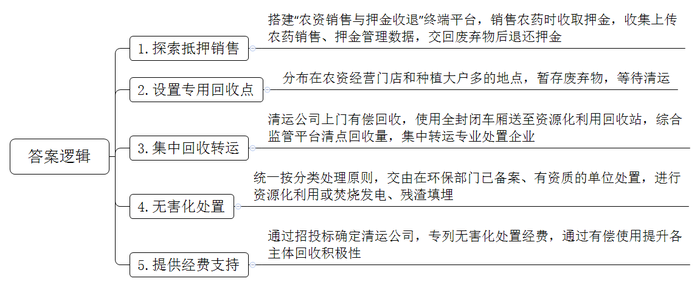
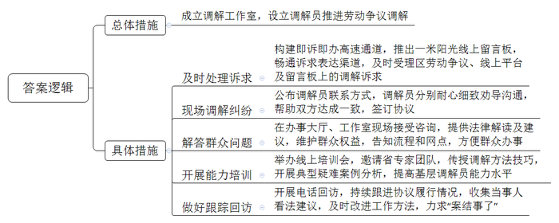
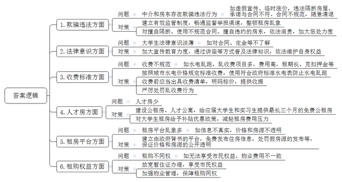
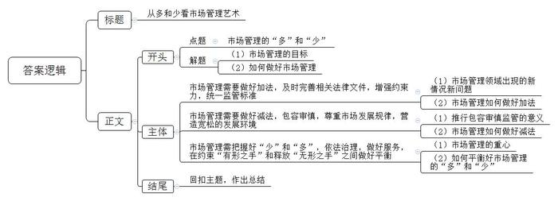

# 2024年公务员多省联考《申论》题（重庆三卷）

<!-- gwy:overview:start -->
> **重庆 · 2024 · 申论 · 三卷** ｜ 4 题 · 图片 4 处 · 答案随题折叠

导航：[题目](#题目) · [材料 1](#材料-1)
<!-- gwy:overview:end -->

> 候选采集稿。参考答案及解析来自粉笔页面，不代表官方答案或真实高分答卷；来源使用许可与原卷对应关系仍需人工核实。

## 给定材料

### 材料 1

Q县高林镇沙田村村民老吴拎着一兜子废弃农药瓶、农药袋，走进农业植保专业合作社的农资销售门店，冲着店长喊：“老张，收农药瓶子了！”老张接过袋子，在电脑上打开“农资销售与押金收退”终端平台，点击“退押金”功能，拿起扫码枪，逐一扫描瓶子袋子上的条形码，相关信息便显示在电脑屏幕上。老张说，店里销售农药时，按每个农药瓶袋1元向农户收取押金，并通过销售扫码、在线登记等方式，收集上传农药销售、押金管理数据。

“以前，农药包装废弃物无人回收、无人管理，农民将废弃的农药瓶、农药袋‘随手一扔’，这些在农田里随处可见的瓶瓶罐罐犹如一颗颗‘生态炸弹’渗入土壤，时间一长就会破坏农田生态系统。”高林镇赵副镇长说。前几年，Q县探索抵押销售的方式，农户购买农药时向经营门店缴纳部分押金，使用过的农药包装废弃物交回后退还押金，以此提升普通农户回收农药包装废弃物的积极性。

“种柑橘，一年要打5次农药。”种植大户老何一早给果树喷洒农药后，将用完的几个塑料农药瓶装进包装袋，送进不远处的一间木屋，这是县里专门为他设置的回收点。他说，前些年，村里没有农药包装废弃物回收点，用过的农药瓶袋堆放比较随意。时间久了，瓶子袋子四散开来，残存的农药难免洒到地上。现在，县里有120个农药包装废弃物回收点，主要分布在农资经营门店和种植大户较多的地方，使用后的农药瓶袋可先暂存在回收点，等清运公司上门清运。

清运公司定期上门回收，每个回收点需要清运时，也可随时联系清运公司，随叫随到。午后，县清运公司叶师傅驾驶清运车，向老何家庭农场附近的回收点驶去。到了回收点，称重、装货、填写清运清单，按每斤0.7元的价格向老何付费并开具票据，一次有偿回收就完成了。叶师傅说：“为防止废弃农药瓶袋在清运、转运过程中掉落，我们使用的是全封闭车厢，具有防雨、防渗漏、防遗撒等功能，避免造成二次污染。”

经过一路收集后，叶师傅将废弃农药瓶袋送到了县农业废弃物资源化利用回收站，待集中后转运到专业处置企业。在回收站里，农药包装废弃物回收综合监管平台的大显示屏上，全县各个回收点当日农药包装废弃物回收量一目了然。

“农药包装废弃物回收集中后，最重要的一环是进行无害化处置。”县环保局刘工程师介绍。县里明令禁止私自焚烧、掩埋等不采取无害化防护措施的行为，统一按照分类处理的原则，由在环保部门备案、具有相关资质的单位进行处置。

A公司是县里唯一专业处置有害物质的企业，主要承担全县农药包装废弃物的转运处置及无害化处理工作。“包装废弃物分类处置，才算真正实现了收集、运输、处置的全闭环、资源化、无害化。”在专门的中转仓库里，技术员小胡指挥着工人们从转运车上小心地卸下农药包装废弃物。他说：“经过分类后，可循环利用的进行资源化利用；可燃烧的依托垃圾焚烧发电厂焚烧发电，产生的气体达标后排放，残渣将深埋在经过防渗漏、防扬散处理的安全填埋场。”

农药包装废弃物处置是一项系统工程，涉及一系列环节。“专业清运公司向种植大户、农资经营门店支付回收费用，县里再支付清运公司相关费用，以有偿使用为纽带，环环相扣，提高种植大户、农资经营门店及清运公司各个市场参与主体回收农药包装废弃物的积极性。”县农业农村局许局长介绍。县里每年通过招投标确定清运公司，县财政每年专列农药包装废弃物无害化处置经费，包括相关平台系统建设维护费用、收集清运费用、有偿回收费用等。近三年来，全县已累计清运处置农药包装废弃物45.06吨，120个回收点实现定期清运全覆盖，回收率达87.1%。

### 材料 2

老李是H区人力资源和社会保障局“一米阳光”劳动争议调解工作室的一名调解员。某电视台记者跟随老李的脚步，探访“劳动争议调解员的一天”，以下是采访镜头实录。

时间：上午8：00；地点：“一米阳光”劳动争议调解工作室

老李上班第一件事就是及时受理区劳动争议，“互联网+调解”线上服务平台及“一米阳光”线上留言板上的调解诉求。“您好，我是‘一米阳光’调解工作室的调解员老李，您说的情况我都了解了，您放心，公司那边我会再沟通协调。”老李与留言的当事人进行了电话沟通。放下电话，老李对记者说：“我们局构建了即诉即办高速通道，重点推出的‘一米阳光’线上留言板，畅通了诉求表达渠道，目前解答满意率是100%。”

时间：上午9：00；地点：“一米阳光”劳动争议调解工作室

之前与老李约好的一个案件的双方当事人都到了。牛某系某建筑工程有限公司雇佣的临时工人，在施工过程中，不慎从梯子上跌落，随即送往医院就诊后选择保守治疗，在家休养至今，历时9个月。牛某要求公司赔偿，但公司认为申请人的受伤是由于自身过错导致，公司不愿意承担全部责任，只愿意给付一部分人道主义补偿，双方产生较大分歧，于是通过区人社局公布的调解员的联系方式找到了老李。调解现场气氛剑拔弩张，老李当机立断，将双方安置在不同的房间，开始当起双方的“老娘舅”，分别耐心劝导。“咱们先别激动，今天就是奔着解决问题的目的来的，我们今天面对面沟通，有话好好说，这个调解方案你们看下是否可行……”经过老李一番苦口婆心地劝说和沟通，公司做出了让步。看到双方的意见取得了一致，老李立即草拟了调解协议，双方最终签订协议并握手言和。

时间：上午11：00；地点：“一米阳光”劳动争议调解工作室

老李刚要坐下来规整卷宗，工作室涌进来几名劳动者。老李经过认真倾听、仔细分析后，对相关问题进行了法律层面的解读，在维护当事人合法权益的基础上，提出解决纠纷的建议：“考虑实际情况，公司经营困难，一次性全部支付比较困难，可以分二至三期支付，既减轻公司负担，也能让大家的权益得到保障……”

时间：下午2：00；地点：区劳动保障维权中心办事大厅

“请坐，您慢慢说……”老李在办事大厅现场接受办事群众咨询，“这个案子可以先行申请调解，整个处理流程更快捷高效。以后碰到类似的情形，咱们区各个镇都有劳动保障维权中心调解网络，您都可以就近办理。”

时间：下午3：30；地点：“一米阳光”劳动争议调解工作室

老李正在参加区人社局举办的调解员能力提升线上培训会，和老李一起参加本次培训的还有辖区各镇（街）劳动人事争议调解员、企事业单位调解员、各类专职、兼职劳动仲裁员、人力资源专员等。“给我们培训的是省里的调解专家团队，这些调解方法技巧和劳动人事争议仲裁典型疑难案例分析，对我们日常调解工作帮助很大。”培训结束后，老李对记者说。

时间：下午5：45；地点：“一米阳光”劳动争议调解工作室

老李开始拨打回访电话，持续跟进此前案件协议的履行情况。“这是区人社局的一项规定，进行回访一方面是了解之前案件的调解款项是否按时到账，另一方面是倾听收集当事人的看法和建议，及时改进工作方法，力求真正做到‘案结事了’，做好劳动争议调解的‘后半篇文章’。”老李对记者说。

时间：晚上7：00，天已黑，老李结束了一天的工作。这就是老李忙碌且充实、辛苦但欣慰、用心更暖心的一天。用老李的话说：“我累并快乐着。”

服务无止境，奔跑不停歇。这一天，只是众多劳动争议调解员辛劳付出的一个缩影，他们通过共同努力，凭着一颗热心，真诚、公平、公正地对待每一起矛盾纠纷，为推进劳动争议调解工作、维护社会和谐稳定添上了浓墨重彩的一笔。

### 材料 3

近年来，S县乘着新时代改革东风，发展了一批特色产业，经济实现了快速发展，加上毗邻省会城市，吸引了许多大学生来此就业。为进一步优化人才发展环境，县委人才办、县融媒体中心联合开展了“人才服务大家谈”线上意见征集活动，不少网友就人才落户、住房保障、医疗保障等方面提出意见建议。以下是一些关于大学生租房问题的留言：

●中介的欺骗行为很让人恼火！要么就搪塞你，图上的房子已经租出去了；要么先把人骗出来看房，然后敷衍说现在价格翻倍了。很多人看了几套，觉得累了，可能就直接签了。朋友们，我就想知道你们的一居室都是怎么找到的？

●2023年，我在S县找到了一份实习工作，朋友说她租的套房还空一间，邀请我与她合租。由于实习时长是3个月，我朋友跟房东反复强调只租3个月。房东满口答应，但提供的合同上租期却是一年。房东表示这只是中介公司的合同模板，实际操作可以按聊天记录的约定来，我们就签下了租房合同。然而入住仅两个月，房东就开始催缴下一季度的房租，否则就让我们搬离。后来协商无果，我们只能搬走，房东扣除了第三个月的租金和全部押金。虽然很生气，但因为这是合同中规定的，我们也没有办法。

●我在校内“租房信息交流群”找到一套与自己需求较为匹配的房子，价格也比较满意。临近约定看房的时间，房东提出需要预交300元定金，以体现看房的“诚意”。虽然将信将疑，但一时半会儿也找不到比这个看起来更合适的，就将钱打了过去。看房后感觉也还行，正准备签约，房东却将原本标价一个月1000元租金的房子，涨到了1500元。我当然不愿接受，于是被房东扣除了200元的定金。房东说我看房不租导致他损失了今天的生意，所以我需要承担这部分损失。

●除了房屋的租金，电费1.5元一度，水费5元一吨，还有其他乱七八糟的费用，实在太贵了。我们刚毕业，本身就没什么钱，还要一年起租、押二付一或押三付一，真的很难承受。退租的时候还经常会以各种理由克扣一部分押金。

●刚来时因为没有多少钱，我就找了一个三居室隔成六七间的群租房，租了其中一间，价格倒是很便宜。但没多久，这里就被举报了，我们被强制清退。找房东退押金时，才知道租给我们的“二房东”早就跑得不见踪影了！

●房租有时候还不是最头疼的问题，关键是花了钱可能还住得不舒心，比如说押金难退、水电乱跑、随意清退等等，非常折腾人。

●我们大学生刚毕业，资历浅，县里人才房只有几栋，太少了，根本轮不到我们。现在，连很多大城市都在出台政策吸引人才，我们县更要多建一些公租房、人才公寓，最好能给应届大学生和实习生提供最长三个月的免费公租房。只有这样，才能吸引人才、留住人才，未来才能发展得更好更强大。

●租房平台的信息一点都不真实，价格和房源都不透明。网上图片说好1500元/月，去到那里给你找2000元/月的，还是差的那种。找中介又怕被坑，太难了。能不能建一个由政府背书的平台，免费发布住房信息。对发布假房源的，一定要严惩！

●招租各种好，入住坑不少，满眼都是泪！退租时被告知合同下面写了一行小字，设备使用费500元，房屋清扫费200元。

●我们虽然在这里工作、居住，但户口还在老家。因为房东不愿意配合我们办暂住证，所以很多市民权益我们没法享受。还有，同住一个小区，我们租房的和业主待遇大不一样。比如说停车费，业主都是50元/月，而我们要100元/月。

●作为被伤害过的租客，真心希望政府能够建立有效的制度，整顿房屋中介公司的乱象；对已违法的公司保持追责，请一定要严惩他们。大多数人生活不易，还请相关部门不要再让他们伤害我们！

●刚毕业或者正在实习的学生工作一般还没有稳定下来，要是工作变动，押金都没得退。可否解决租期必须“一年”“半年”起租，否则扣押金的问题呢？

### 材料 4

原价50元的蛋糕特价10元3份，56元一箱的酸奶卖29.9元，12.8元的矿泉水现价0.5元……什么样的东西打折力度如此之大？说的就是“临期食品”！临期食品一般是指即将到达保质期，但仍在保质期内的食品。与常规食品相比较，距离保质期越近，其价格越便宜。曾经，对于临期食品的处理，商家往往感到头疼，消费者对其更是“瞧不上”，报以敬而远之的态度。如今，随着“勤俭节约、杜绝浪费”的观念深入人心，加上价格便宜，临期食品反倒成了“香饽饽”。

“我都是晚上来买第二天的早餐，正常情况下，一个面包加盒牛奶，需要10多元，但买临期食品能省三四元。”一位消费者对记者坦言，“既给自己省了钱，又避免了食物浪费，这是双赢。”H市一家超市负责人表示：“以往临期食品的处理是一大难题，但现在这些食品受到了消费者特别是年轻人的青睐，反倒成了商机。”一项临期食品行业市场分析研究报告显示，目前中国临期食品主力消费者为年轻人，年龄介于26-35岁的占比47.8%。以前人们总认为，买打折食品要么是退休大妈们的专利，要么是经济拮据的人才去购买，但现在很多年轻人加入了这个行列。

刚大学毕业的小乐告诉记者，最初在社交网络上刷到临期食品，发现这些快到期的零食好多都是知名品牌，还很便宜。小乐参加了拥有8万多人的某网站“我爱临期食品分享团”。他们在此分享折扣购买的经历和“踩雷”的教训，甚至挨个点评买来的零食。小乐说，大家不愿意购买的那些临期食品，主要是存在食品本身不健康或口味欠佳等问题。业内人士表示，临期食品之所以盛行，与国家提倡杜绝浪费有关，还与当前食品行业产能过剩、上游供应量激增有关。据商务部统计，国内零食总产值已超2万亿元，按每年2.5%的食品沉淀率计算，临期食品市场规模已接近千亿元。

今年32岁的小君在H市海花社区街角的显眼处开了间“熟季良品零食折扣店”。红色的大招牌上，并没有明晃晃的“临期食品”字眼，消费者得从“熟季良品”的字眼里才能嗅出一些微妙的味道。小君告诉记者，目前，二三线城市的消费者对临期食品行业的认可度依然不高，提到“临期”，多有负面印象。但从事食品行业第四个年头的小君很明确，自己下一步的重心就在这家折扣店。他认为，临期折扣店的下一个风口就要来了。他反复向记者表示：“要做，就赶紧做。”

然而，面对已经从“小众狂欢”走入大众视野的临期食品，一些消费者抢着“捡漏”，也有不少人因食品安全问题心里“犯嘀咕”。在业界专家看来，虽然临期食品已经站在了风口上，但也存在不小的风险。一旦出现质量把控不力，就会让市场重新审视这一行业。零售行业的资深从业者魏先生告诉记者，普通商品在临近保质期的3/4这个临界点时会进行打折出售，还有一部分临期食品可以退回厂家。不过许多厂家对此也没有太好的办法，多采用销毁或丢弃的方式来处理，事实上造成了资源浪费，没有办法退回厂家且未销售完的打折商品，经销商也多采用销毁处理。因此，只要是通过靠谱的渠道买的，不用担心它有什么不安全的地方。

记者了解到，当前临期食品市场缺少规范，很大程度依靠商家自觉，并且线上线下对临期食品的品控没有统一标准。L大学工商管理学院王博士告诉记者，尽管临期食品的说法已经被商家和消费者普遍接受，但严格地说，临期食品还只是一个市场概念，并不是一个标准的法律概念。食品安全相关的法律法规均未涉及“临期食品”这一概念，更未对临期食品作出任何规定。有关部门曾出台过临期食品管理办法，对商家销售即将过期食品履行“醒目提示”义务提出明确要求，但这些多属于部门规范性文件，层级效力不高，约束力不强，且还存在监管标准不统一等问题。

H大学营销学院陈教授表示，如今的年轻人消费变得既理性又自信，不再觉得越贵越好，对同样的东西，开始主动寻找更具性价比的渠道。他们是未来消费的主体，代表着一个时代的消费取向，也代表着当下的消费自信。如何管好临期食品是一门学问。市场上不该少的少了或者不该多的多了，是做得少了还是管得多了，都值得管理部门思考。<u>把握好这少和多，是对管理者的重大考验</u>，让商家卖得坦荡、让顾客买得放心，无疑需要监管者多些“包容之心”，发挥好“有形的手”的作用，加强食品安全依法治理，让广大消费者获得更大幸福感。

## 题目

### 第 1 题

**请根据****“给定资料**1**”，梳理Q县处置农药包装废弃物的主要做法。（15分）**

关联材料：材料 1

作答要求：

要求：全面、准确，有条理，不超过300字。

第 1 题 · 答案与解析

**参考答案（粉笔题库参考内容）**

1.探索抵押销售。搭建“农资销售与押金收退”终端平台，销售农药时收取押金，收集上传农药销售、押金管理数据，交回废弃物后退还押金。

2.设置专用回收点。分布在农资经营门店和种植大户多的地点，暂存废弃物，等待清运。

3.集中回收转运。清运公司上门有偿回收，使用全封闭车厢送至资源化利用回收站，综合监管平台清点回收量，集中转运专业处置企业。

4.无害化处置。统一按分类处理原则，交由在环保部门已备案、有资质的单位处置，进行资源化利用或焚烧发电、残渣填埋。

5.提供经费支持。通过招投标确定清运公司，专列无害化处置经费，通过有偿使用提升各主体回收积极性。

**解析**

**参考答案说明：**本题答案分别从“探索抵押销售”“设置专用回收点”“集中回收转运”“无害化处置”“提供经费支持”五个方面介绍了Q县处置农药包装废弃物的做法，各条答案要点之间在内容上相互并列，没有交叉。

**考点**：概括措施类

**来源**：2024年公务员多省联考《申论》题（重庆三卷）

### 第 2 题

**请根据****“给定****资料**2**”，谈谈H区人力资源和社会保障局在推进劳动争议调解工作方面采取了哪些措施。（20分）**

关联材料：材料 2

作答要求：

要求：分析全面，条理清晰；不超过300字。

第 2 题 · 答案与解析

**参考答案（粉笔题库参考内容）**

成立调解工作室，设立调解员推进劳动争议调解。

1.及时处理诉求。构建即诉即办高速通道，推出一米阳光线上留言板，畅通诉求表达渠道，及时受理区劳动争议、线上平台及留言板上的调解诉求。

2.现场调解纠纷。公布调解员联系方式，调解员分别耐心细致劝导沟通，帮助双方达成一致，签订协议。

3.解答群众问题。在办事大厅、工作室现场接受咨询，提供法律解读及建议，维护群众权益，告知流程和网点，方便群众办事。

4.开展能力培训。举办线上培训会，邀请省专家团队，传授调解方法技巧，开展典型疑难案例分析，提高基层调解员能力水平。

5.做好跟踪回访。开展电话回访，持续跟进协议履行情况，收集当事人看法建议，及时改进工作方法，力求“案结事了”。

**解析**

**参考答案说明：**本参考答案先介绍了推进劳动争议调解工作的总体举措，接着具体举措从“及时处理诉求”“现场调解纠纷”“解答群众问题”“开展能力培训”“做好跟踪回访”五个方面进行了分条撰写。各条要点之间在内容上相互并列，没有交叉。

**考点**：概括措施类

**来源**：2024年公务员多省联考《申论》题（重庆三卷）

### 第 3 题

**请根据****“给定资料**3**”，梳理当前S县大学生租房存在的问题，并提出相应的解决建议。****（****25分）**

关联材料：材料 3

作答要求：

要求：

（1）问题梳理全面、准确、有条理；

（2）所提建议与问题相对应，具体明确、切实可行；

（3）不超过500字。

第 3 题 · 答案与解析

**参考答案（粉笔题库参考内容）**

1.问题：中介和房东存在欺骗违法行为。如虚假宣传、临时涨价，违法隔断房屋、承诺与合同不符、合同不规范，随意清退。对策：建立有效监管制度，畅通监督举报渠道，整顿租房乱象；对擅自隔断、使用不规范合同、擅自违约的房东，依法追责，加大惩处力度。

2.问题：大学生法律意识淡薄。如对合同、定金等不了解。对策：加大宣传教育力度，通过讲座等方式普及法律知识，依法维护自身权益。

3.问题：收费不规范。如水电乱跑，乱收费项目多，费用高，租期长、克扣押金等。对策：按照城市水电价格规定标准收费，使用符合政府标准水电表防止水电乱跑；收费前应当出具收费清单，明码标价，提供收据；严厉处罚乱收费行为。

4.问题：人才房少。对策：建设公租房、人才公寓，给应届大学生和实习生提供最长三个月的免费公租房；对大学生租房给予补贴优惠政策，减轻租房费用压力。

5.问题：租房平台乱象多。如信息不真实，价格和房源不透明。对策：建立由政府背书的平台，免费发布住房信息，处罚假房源的发布等，保证价格和房源的公开透明。

6.问题：租购不同权。如无法享受市民权益，物业费用不一致。对策：放宽暂住证办理，享受市民权益；加强物业管理，保障租购同权。

**解析**

**参考答案说明：**本参考答案从“欺骗违法”“法律意识”“收费标准”“人才房”“租房平台”“租购权益”这六个方面展开，每个方面内部先阐释问题，再给出相应的解决建议，做到了所提建议与问题相对应。各条答案要点之间在内容上相互并列，没有交叉。

**考点**：提出对策类

**来源**：2024年公务员多省联考《申论》题（重庆三卷）

### 第 4 题

**“给定资料**4**”中提到“把握好这少和多，是对管理者的重大考验”。请深入思考这句话，参考给定资料，联系实际，自选角度，自拟题目，写一篇文章。****（****40分）**

关联材料：材料 1、材料 2、材料 3、材料 4

作答要求：

要求：

（1）观点明确，见解深刻；

（2）参考给定资料，但不拘泥于给定资料；

（3）思路清晰，语言流畅；

（4）总字数1000字左右。

第 4 题 · 答案与解析

**参考答案（粉笔题库参考内容）**

**从多和少看****市场管理艺术**

市场管理艺术，在于如何巧妙地运用管理手段，实现市场的有效治理。在市场管理中，“多”意味着要多关注市场变化，多制定并执行有效的市场策略，确保市场的稳定和繁荣，而“少”则代表着减少不必要的行政干预，少产生冗长的决策流程，提高市场运作的效率。同时要在“多”与“少”之间找到平衡点，既不过度干预，也不放任。

**市场管理需要做好加法，及时完善相关法律文件，增强约束力，统一监管标准。**随着市场环境的不断变化，新市场模式、新交易方式的不断涌现，原有法律难以覆盖全部的新兴领域，这些空白区域可能成为不法分子利用的漏洞，对市场秩序进行破坏。这要求法律文件及时更新，建立统一的监管体系，为市场管理提供明确的法律依据和执法标准，以应对新挑战、新变化。同时，加大执法力度，确保法律得到严格执行，遏制违法行为的发生，真正实现“良法善治”。

**市场管理需要做好减法，包容审慎，尊重市场发展规律，营造宽松的发展环境。**济南市长清区市场监管局积极落实放管服改革，转变思想观念和工作理念，推行“双随机、一公开”监管模式，减少对企业的频繁检查，减轻企业负担。这种包容审慎监管模式不仅有助于激发市场活力，还能促进新兴业态的健康发展，提高市场监管的针对性和有效性。因此，做好市场管理的“减法”，要在管理过程中做到精简、高效，减少市场主体不必要的限制，避免过度干预。

**市场管理需把握好****“****少****”****和****“****多****”****，依法治理，做好服务，在约束****“****有形之手****”****和释放****“****无形之手****”****之间做好平衡。**市场管理的核心在于平衡监管与自由市场之间的关系，以促进经济的健康、稳定和可持续发展。一方面政府应明确自身在市场中的角色定位，发挥市场在资源配置中的决定性作用，同时加强宏观调控和政策引导，防止市场失灵、失控。另一方面，应尊重市场主体的自主经营权，避免对市场主体经营活动的过度干预，实现市场管理的科学化、规范化和高效化。

在市场管理的实践中，多和少并非对立面，而是相互依存、相互促进。管理者要能迅速响应市场的新情况、新问题，适时增加或减少管理力度，增强市场的韧性和竞争力，为经济的持续健康发展提供有力保障。

**文章分析**

**从多和少看市场管理艺术**

【**标题的优点：**首先，范文的标题“从多和少看市场管理艺术”突出了“市场管理的‘多’和‘少’”这一主题。其次，形式上，文字简洁明快有力，不拖沓。】

（1）<u>市场管理艺术</u>，<u>在于如何巧妙地运用管理手段</u>，<u>实现市场的有效治理</u>。在市场管理中，（2）“<u>多</u>”<u>意味着要多关注市场变化</u>，<u>多制定并执行有效的市场策略</u>，<u>确保市场的稳定和繁荣</u>，<u>而</u>“<u>少</u>”<u>则代表着减少不必要的行政干预</u>，<u>少产生冗长的决策流程</u>，<u>提高市场运作的效率</u>。<u>同时要在</u>“<u>多</u>”<u>与</u>“<u>少</u>”<u>之间找到平衡点</u>，<u>既不过度干预</u>，<u>也不放任</u>。

【**开头的优点：****★内容方面。**范文的开头是紧扣“市场管理的‘多’和‘少’”这一主题展开的。首先，开头点出主题，做到了主题明确。其次，对“市场管理的‘多’和‘少’”这一主题进行了分析阐述，指出了（1）市场管理的目标；（2）如何做好市场管理。**★文字表达方面：**使用了“同时……”等关联词，使语言表达有逻辑性。】

**市场管理需要做好加法，及时完善相关法律文件，增强约束力，统一监管标准。**（1）<u>随着市场环境的不断变化</u>，<u>新市场模式</u>、<u>新交易方式的不断涌现</u>，<u>原有法律难以覆盖全部的新兴领域</u>，<u>这些空白区域可能成为不法分子利用的漏洞</u>，<u>对市场秩序进行破坏</u>。（2）<u>这要求法律文件及时更新</u>，<u>建立统一的监管体系</u>，<u>为市场管理提供明确的法律依据和执法标准</u>，<u>以应对新挑战</u>、<u>新变化</u>。同时，<u>加大执法力度</u>，<u>确保法律得到严格执行</u>，<u>遏制违法行为的发生</u>，<u>真正实现</u>“<u>良法善治</u>”。

【**论述段****1的优点：**★观点句：范文的观点句是紧扣“市场管理的‘多’和‘少’”这一文章主题提出的。形式上，它在段首处直接写出，位置突出，容易发现。内容上，关键词突出，内容要点明确，可以明显看出它是从“做好加法”这个角度入手，指出了做好市场管理的对策。★论述内容：（1）市场管理领域出现的新情况新问题；（2）市场管理如何做好加法。注意：以上两个方面的内容都是紧扣“市场管理需要做好加法，及时完善相关法律文件，增强约束力，统一监管标准”这个观点句进行分析论述的，论述的针对性强，内容层次丰富。最后，在论述方法上采取了讲道理的方式进行展开，做到了论述有力。】

**市场管理需要做好减法，包容审慎，尊重市场发展规律，营造宽松的发展环境。**（1）<u>济南市长清区市场监管局积极落实放管服改革</u>，<u>转变思想观念和工作理念</u>，<u>推行</u>“<u>双随机</u>、<u>一公开</u>”<u>监管模式</u>，<u>减少对企业的频繁检查</u>，<u>减轻企业负担</u>。<u>这种包容审慎监管模式不仅有助于激发市场活力</u>，<u>还能促进新兴业态的健康发展</u>，<u>提高市场监管的针对性和有效性</u>。因此，（2）<u>做好市场管理的</u>“<u>减法</u>”，<u>要在管理过程中做到精简</u>、<u>高效</u>，<u>减少市场主体不必要的限制</u>，<u>避免过度干预</u>。

【**论述段****2****的优点：**★观点句：范文的观点句是紧扣“市场管理的‘多’和‘少’”这一文章主题提出的。形式上，它在段首处直接写出，位置突出，容易发现。内容上，关键词突出，内容要点明确，可以明显看出它是从“做好减法”这个角度入手，指出了做好市场管理的对策。★论述内容：（1）推行包容审慎监管的意义；（2）市场管理如何做好减法。注意：以上两个方面的内容都是紧扣“市场管理需要做好减法，包容审慎，尊重市场发展规律，营造宽松的发展环境”这个观点句进行分析论述的，论述的针对性强，内容层次丰富。最后，在论述方法上主要采取了讲道理和举例子相结合，做到了丰富多样。】

**市场管理需把握好****“少”和“多”，依法治理，做好服务，在约束“有形之手”和释放“无形之手”之间做好平衡。**（1）<u>市场管理的核心在于平衡监管与自由市场之间的关系</u>，<u>以促进经济的健康</u>、<u>稳定和可持续发展</u>。（2）<u>一方面政府应明确自身在市场中的角色定位</u>，<u>发挥市场在资源配置中的决定性作用</u>，<u>同时加强宏观调控和政策引导</u>，<u>防止市场失灵</u>、<u>失控</u>。另一方面，<u>应尊重市场主体的自主经营权</u>，<u>避免对市场主体经营活动的过度干预</u>，<u>实现市场管理的科学化</u>、<u>规范化和高效化</u>。

【**论述段****3****的优点：**★观点句：范文的观点句是紧扣“市场管理的‘多’和‘少’”这一文章主题提出的。形式上，它在段首处直接写出，位置突出，容易发现。内容上，关键词突出，内容要点明确，可以明显看出它是从“平衡‘多’和‘少’”这个角度入手，指出了做好市场管理的对策。★论述内容：（1）市场管理的重心；（2）如何平衡好市场管理的“多”和“少”。注意：以上两个方面的内容都是紧扣“市场管理需把握好‘少’和‘多’，依法治理，做好服务，在约束‘有形之手’和释放‘无形之手’之间做好平衡”这个观点句进行分析论述的，论述的针对性强，内容层次丰富。最后，在论述方法上采取了讲道理的方式进行展开，做到了论述有力。】

【**论述段之间的关系：****★内容的内在逻辑：**范文的论述段之间是依照“分-总”的逻辑展开的。论述段1先写了市场管理需要做好加法，这是从“多”的角度提出的对策，论述段2又写了市场管理需要做好减法，这是从“少”的角度提出的对策，论述段3综合了上述两方面内容，提出要平衡好“有形之手”和“无形之手”，这是从把握好“多”和“少”的角度提出的对策。**★段与段的外在衔接：**论述段1、2、3都直接点题，均用“市场管理需要……”的表述引出核心观点，使文章整体上看起来逻辑清晰。】

<u>在市场管理的实践中</u>，<u>多和少并非对立面</u>，<u>而是相互依存</u>、<u>相互促进</u>。管理者要能迅速响应市场的新情况、新问题，适时增加或减少管理力度，增强市场的韧性和竞争力，为经济的持续健康发展提供有力保障。

【**结尾的优点：**范文的结尾回扣了“市场管理的‘多’和‘少’”这个主题，并作出了总结。】

**解析状态：unknown（来源未提供）**

**考点**：文章写作题

**来源**：2024年公务员多省联考《申论》题（重庆三卷）

