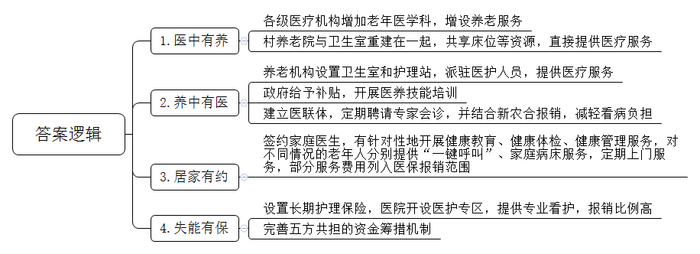
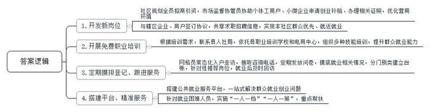
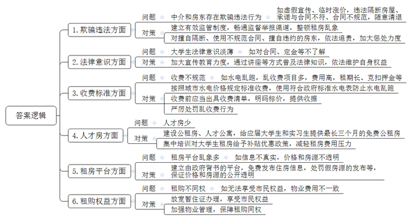

# 2024年公务员多省联考《申论》题（重庆二卷）

<!-- gwy:overview:start -->
> **重庆 · 2024 · 申论 · 二卷** ｜ 4 题 · 图片 4 处 · 答案随题折叠

导航：[题目](#题目) · [材料 1](#材料-1)
<!-- gwy:overview:end -->

> 候选采集稿。参考答案及解析来自粉笔页面，不代表官方答案或真实高分答卷；来源使用许可与原卷对应关系仍需人工核实。

## 给定材料

### 材料 1

近年来，A县充分发挥养老机构资源优势和医疗机构技术优势，坚持“医中有养、养中有医、居家有约、失能有保”，积极探索“医养一体、两院融合”农村养老新路径。以下是有关部门就这项工作进行调研座谈时，部分干部群众的发言摘要。

某镇中心卫生院周院长：我们卫生院有60张床位，过去长期使用率不足60%。3年前，一位老人看病后由于家中无人照料，提出继续住院接受护理的意愿。我们一摸底，发现全镇约有140名失能、半失能老人。但以前卫生院没有养老服务功能，附近的养老机构、幸福院里也没有专业的医护人员，无法满足这些老人的入住需求。正好赶上县里出台“医养一体、两院融合”政策，我们就把50张床位申请用于承担医养结合功能。随着老人入住，现在床位使用率升至100%。增加医养结合床位，可谓“一举多得”。

县卫健局办公室费主任：目前，老年人大多数都是居家和社区养老，形成了“9073”格局，即90%左右的老年人居家养老，7%的老年人依托社区支持养老，3%的老年人入住机构养老。对于居家养老群众，我们推行家庭医生签约服务，有针对性地开展健康教育、健康体检、健康管理服务。其中，对居家行动不便的农村老人实行“一键呼叫”服务，即在老人手机上设置快捷键，可一键拨通家庭医生电话；对部分患病老人实行家庭病床服务，并把部分服务费用列入医保报销范围，目前有300多人次享受了这项服务。同时，我们还定期为居家老人提供血压检查、心电图监测等上门服务，极大缓解了居家养老的就医负担。

某医养服务公司护理员老赵：昨天我们跟着签约医生一起去了86岁的张奶奶家。8年前，张奶奶因脑卒中导致瘫痪在床。她家孩子都在外地工作，身边只有老伴陪伴。我们公司根据她的实际情况，由专业康复师和医生量身制定护理计划。目前，老人处于康复阶段，我们每两天就上门一次给她做康复护理，像她这种情况，平均每天需要90元护理费，但长护险可以减免54元，个人仅负担36元，这个费用大家基本都能负担得起。

县卫健局白局长：长期以来，医不能养、养不能医是基层的共性难题，养老、看病两头跑，增加了老百姓的负担，无形中束缚了大家的手脚。为解决这一问题，我们以老年人的健康需求为导向，不断充实完善医养结合、长期照护、安宁疗护及老年健康服务等方面的政策体系，以居家为基础、社区为依托、机构为支撑，推动形成了规模适度、功能完善、覆盖城乡的医养结合服务框架，探索出一条医养结合的新路径。现在，全县3家二级以上综合医院全部开设了老年医学科、7家乡镇卫生院增设了养老服务职能，鼓励各级医疗卫生机构为乡村养老机构提供服务，同时，大力推进“两个机构、一门服务”养老机构建设，在乡村养老机构、幸福院中增设卫生室和护理站，派驻医护人员提供医疗服务，全力保障群众基本健康需求。

某村养老院刘院长：村里原来的养老院地方小，医疗条件差，距离村卫生室也不近。前年，按照县里明确的“资源共享、优势互补、群众自愿、市场运作”原则，我们把村养老院和卫生室重建在一起。按照县里《“医养一体、两院融合”机构养老试行办法》，我们拿到了每张床位1500元的建设补贴，以后还可以按入住人数拿到每人每年600元的运营补贴。现在，村卫生室的5名医护人员不但负责给全村百姓看病，还负责对养老院的老人进行专业护理、医疗保健，其他工作人员也都参加了县里组织的医养技能培训。同时，我们还与县医院建立医联体，定期聘请专家来给老年人会诊。入住的老年人突发疾病或大病时也可以第一时间得到医院专业救治。现如今，在养老院看病，能用新农合报销，村里很多老人都申请搬进来。

村民老张：过去因为父母都瘫痪在床，我只能辞去工作照顾老人。村干部知道我家的情况后，帮助我们申请了长期护理险鉴定，还帮忙联系让二老住进了县医院“长护险”医护专区。在这里，一天三顿有人把饭菜端到跟前，护理人员定时给擦脸洗手、打扫卫生，照料起来比我们做儿女的还细心周到，两位老人身体状况好了很多。我母亲原来还有两块褥疮，经过两个多月的专业看护，她的褥疮没了。一旦老人病情有变化，随时有专业的医生护士处理。现在国家的政策好，我们的医疗专护费用能报销65%，每人每月支付1200元左右就行，家里减轻了不少负担，我也能安心出去工作了。

县医保中心史主任：县里已连续3年把“长护险全覆盖”作为为民办实事项目写入县政府工作报告，由各级部门具体抓落实。它综合考虑个人、医保基金和财政承受能力等因素，建立“全民缴费+财政补贴+医保统筹基金+福彩公益金补助+社会捐助”五方共担的资金筹措机制，确保资金筹集稳定，有效降低了群众负担。例如，城乡居民护理险，个人、财政、福彩基金和医保基金统筹额度分别为3元、3元、4元和40元。

### 材料 2

在裕民社区“爱上锅巴饭”的后厨，老曹忙活着给客人制作餐点，门店里络绎不绝的客人，让老曹没有休息的时间，一年前还在外漂泊的他，如今已经是小店的老板；梅姐是裕民信合花园物业公司的一名员工，曾经在家待业的她如今通过应聘完成了从“家庭主妇”到“职场女性”的转变。

这样的“变形记”每天都在裕民社区上演。

“我们裕民社区是在县城‘南扩北升’基础上建起来的‘年轻’社区，属于易地搬迁社区。去年，我们社区被评为第五批国家级充分就业社区，这实属不易啊。我们社区外来人口多、人口流动性大，劳动力供大于求的矛盾在我们这个社区表现得尤为突出。”社区党支部张书记说，“我和这些搬迁群众一样，都是这个小区的新人，这里就业岗位不多，做好原住居民以及搬迁群众稳岗就业工作，就是我到任后要破解的首要难题。”

就业岗位不多，那就想办法开发新的岗位。为了实现就业岗位“开源”，社区规划办全员出动拉项目、谈项目、筹资金；社区市场监督协管员成了“店小二”，负责协助个体工商户、小微企业在社区内申请创业补贴、办理相关证照。社区营商环境的优化，带来的是源源不断的就业岗位。“短短两年，我们社区就促成一个大型超市、一批商户的开业和发展，为居民提供了收银员、理货员等600余个工作岗位，我们还引进1个公园、1个景观廊桥项目的建设和4个楼盘的开发，这能为社区居民提供建筑类岗位300余个。”社区建设办翁主任说。此外，裕民社区还与辖区企业、商户签订《促进充分就业合作协议书》，双方共享求职招聘信息，鼓励企业、个体工商户为本社区群众优先就业、就近就业积极创造条件。

农村搬迁劳动力绝大多数没有一技之长，文化素质参差不齐，转移就业难度大。促进搬迁劳动力充分就业，社区的出路在哪里？

家住裕民社区的叶女士原本是一名普通的家庭主妇，待业在家的她日常喜欢刷短视频。令她没有想到的是，一年前参加的电商中高级培训班改变了她的生活，让她的日常爱好变成了谋生手段，从此打开了直播带货的大门。

裕民社区通过开展职业培训，让原本就业“单选题”变为了择业“多选题”。根据失业人员的培训需求，社区主动联系县人社局组织开展技能培训。“2022年，我们依托县职业培训学校和电商中心，组织220名搬迁群众参加月嫂、烹饪、电商直播等培训，进一步提高了社区群众的就业能力、增加了失业人员的就业砝码，90%的群众都通过培训开创了自己就业的新路……”张书记信心满满地说，“这些培训都是免费的，大家积极性都很高。我们就是要让搬迁群众头脑灵起来、信心强起来、思想活起来！”

夏大姐是裕民社区第四网格的网格长，定期做好片区劳动力的摸排登记和后期跟进服务是她的重要工作之一。无论春夏秋冬，夏大姐得空就去入户走访，平日里群众咨询电话不断，定期她还要发放调查问卷，对社区的家庭劳动力状况、就业情况、搬迁群众的技能水平和培训意愿等情况做摸排，并将摸底情况分门别类建立台账。平时她都会随身携带自制的“劳动力小册子”，随时翻看补充，还经常“点对点”推荐合适岗位，就业后一个月内还会回访。夏大姐说：“看似简单的工作，其实需要耗费大量的心血。”

“政策咨询、岗位推荐、技能培训、创业扶持、托底安置”，裕民社区办公室的任务栏上赫然写着这些大字……在裕民社区的公共就业服务平台，居民只需要“走进一扇门”，便可办好就业创业相关的事情。此外，针对就业困难人员，裕民社区还实施“一人一档”“一人一策”，重点解决帮扶问题。2022年，58岁的老周找到夏大姐，想要找份工作，但他既无年龄优势又无技术长处。这样一个几乎“不可能完成的任务”，却在夏大姐及社区工作人员的共同努力下圆满完成。最终，老周在社区里的一家公司当上了保安。“安置一人，稳定一家，和谐一片”，这是夏大姐在工作中的深切感受。

“目前，我们社区4028名劳动力的就业率达到了97%，失业人员再就业率达到了98%，认定就业困难人员的就业率达到了100%。”张书记兴奋地介绍说，“在创建充分就业社区的过程中，老百姓找到了好工作，日子更有奔头；企业解决了用工需求，发展更有底气；社区收获了群众的肯定和沉甸甸的荣誉，大家做好工作也更有劲了。”

如今的裕民社区已经实现了充分就业目标，但张书记却不敢有丝毫的懈怠，他说：“接下来，我们要密切跟踪就业形势发展变化，重点关注现有就业人员的稳岗问题，扎扎实实做好当前和下一阶段稳就业工作，更好地服务社区居民。”

### 材料 3

近年来，S县乘着新时代改革东风，发展了一批特色产业，经济实现了快速发展，加上毗邻省会城市，吸引了许多大学生来此就业。为进一步优化人才发展环境，县委人才办、县融媒体中心联合开展了“人才服务大家谈”线上意见征集活动，不少网友就人才落户、住房保障、医疗保障等方面提出意见建议。以下是一些关于大学生租房问题的留言：

●中介的欺骗行为很让人恼火！要么就搪塞你，图上的房子已经租出去了；要么先把人骗出来看房，然后敷衍说现在价格翻倍了。很多人看了几套，觉得累了，可能就直接签了。朋友们，我就想知道你们的一居室都是怎么找到的？

●2023年，我在S县找到了一份实习工作，朋友说她租的套房还空一间，邀请我与她合租。由于实习时长是3个月，我朋友跟房东反复强调只租3个月。房东满口答应，但提供的合同上租期却是一年。房东表示这只是中介公司的合同模板，实际操作可以按聊天记录的约定来，我们就签下了租房合同。然而入住仅两个月，房东就开始催缴下一季度的房租，否则就让我们搬离。后来协商无果，我们只能搬走，房东扣除了第三个月的租金和全部押金。虽然很生气，但因为这是合同中规定的，我们也没有办法。

●我在校内“租房信息交流群”找到一套与自己需求较为匹配的房子，价格也比较满意。临近约定看房的时间，房东提出需要预交300元定金，以体现看房的“诚意”。虽然将信将疑，但一时半会儿也找不到比这个看起来更合适的，就将钱打了过去。看房后感觉也还行，正准备签约，房东却将原本标价一个月1000元租金的房子，涨到了1500元。我当然不愿接受，于是被房东扣除了200元的定金。房东说我看房不租导致他损失了今天的生意，所以我需要承担这部分损失。

●除了房屋的租金，电费1.5元一度，水费5元一吨，还有其他乱七八糟的费用，实在太贵了。我们刚毕业，本身就没什么钱，还要一年起租、押二付一或押三付一，真的很难承受。退租的时候还经常会以各种理由克扣一部分押金。

●刚来时因为没有多少钱，我就找了一个三居室隔成六七间的群租房，租了其中一间，价格倒是很便宜。但没多久，这里就被举报了，我们被强制清退。找房东退押金时，才知道租给我们的“二房东”早就跑得不见踪影了！

●房租有时候还不是最头疼的问题，关键是花了钱可能还住得不舒心，比如说押金难退、水电乱跑、随意清退等等，非常折腾人。

●我们大学生刚毕业，资历浅，县里人才房只有几栋，太少了，根本轮不到我们。现在，连很多大城市都在出台政策吸引人才，我们县更要多建一些公租房、人才公寓，最好能给应届大学生和实习生提供最长三个月的免费公租房。只有这样，才能吸引人才、留住人才，未来才能发展得更好更强大。

●租房平台的信息一点都不真实，价格和房源都不透明。网上图片说好1500元/月，去到那里给你找2000元/月的，还是差的那种。找中介又怕被坑，太难了。能不能建一个由政府背书的平台，免费发布住房信息。对发布假房源的，一定要严惩！

●招租各种好，入住坑不少，满眼都是泪！退租时被告知合同下面写了一行小字，设备使用费500元，房屋清扫费200元。

●我们虽然在这里工作、居住，但户口还在老家。因为房东不愿意配合我们办暂住证，所以很多市民权益我们没法享受。还有，同住一个小区，我们租房的和业主待遇大不一样。比如说停车费，业主都是50元/月，而我们要100元/月。

●作为被伤害过的租客，真心希望政府能够建立有效的制度，整顿房屋中介公司的乱象；对已违法的公司保持追责，请一定要严惩他们。大多数人生活不易，还请相关部门不要再让他们伤害我们！

●刚毕业或者正在实习的学生工作一般还没有稳定下来，要是工作变动，押金都没得退。可否解决租期必须“一年”“半年”起租，否则扣押金的问题呢？

### 材料 4

傍晚时分的B市，不少人沿着环城的菱河河堤缓缓而行，一旁的露天运动场上空也回荡着欢快的广场舞音乐，好不热闹……一种幸福的“松弛感”弥漫在这座城市的每个角落。天热，大家就去山区纳凉，到高山草甸休闲，很是舒坦；天冷，吃一碗辣子面，或是三五好友来一场围炉煮茶，十分惬意。B市的老百姓，正享受着这座城市高质量转型发展带来的美好。

早年间，B市形成了较为完备的传统工业体系。然而，随着时间推移和经济发展，生态环境承受的压力越来越大。“既要保护好青山绿水，又要搞好产业发展，这是奋力谱写中国式现代化建设新篇章的必由之路。我们要做到两全，很难。”B市发改委李主任说。为守护绿水青山蓝天、推进高质量发展，B市积极谋求产业转型。菱河沿岸，市塑料总厂各分厂相继关停。大山深处，不符合环保要求的矿厂悉数关闭。市委市政府组织力量会同各区县有关部门，深入调研各地的具体情况，调整发展方向，找寻新突破点。有的县侧重挖掘潜力，如以煤炭产业为支柱产业的L县，煤炭资源储量超30亿吨，面对环保要求，该县建起生态矿区、绿色矿区，集煤炭清洁利用、现代能源化工、物流集散于一体，让能源工业循环起来；有的县侧重巧用资源，如位于山区的F县，凭借自然资源优势，找到了林麝养殖这个新产业，拉动农民增收的同时，还推动F县进入全市“五强县”行列。

在B市新华区的主导产业表单上，食品加工业排在首位，其中果醋酿造更是拉动当地经济发展的重头戏。为满足果醋公司扩大产能的需求，市国资委协调将市塑料总厂的一个分厂关停后闲置的70多亩工业用地划给果醋公司，300多名原塑料分厂职工到果醋公司再就业。去年，公司的酿造师老胡领了个稀奇差事——配合技术工程师，将传统酿造手艺转化成数据。计算机精准记录下胡师傅家几代相传的手艺，将其变成精密参数。如今，新建的智能化酿造车间里，工人只需轻点按钮，便可指挥一车间的智能设备忙起来。通过传统工艺的现代化转型，果醋公司的产能显著提升，实现了每年5000吨的产量。“包装材料园正在建设中。”果醋公司张董事长说，“过去包材企业散落在外地，吸引来本地后，果醋产业链延长开来，产值不断增加。我们的果醋是绿色健康饮品，符合当今消费潮流。我们有信心围绕果醋，打造出现代化的食品产业集群。”

汽车是B市经开区的主导产业。这里集聚了多家整车生产企业和200多户汽车零部件企业。走进经开区一家汽车公司的总装车间，自动化生产线一眼望不到头，平均每6分钟就有一辆整车下线。“据测算，汽车整车重量降低10%，燃油效率提高6%至8%。”公司张经理说，“我们公司使用的汽车板不仅质量更轻，而且比普通钢材密度大、强度高，在保证汽车安全性的同时实现节能减排。绿色、高科技是我们产业转型的方向。”在公司的展示区，一款外观新颖的轻型新能源卡车吸引了很多人。这款纯电动厢式运输车主打绿色低碳，适用于中短途运输。今年，这家汽车公司的新能源车型累计销量同比增加152.3%。“围绕一个产业链，可以发展得非常好，但也有风险。”市经开区发展管委会吴主任说，“以传统汽车生产为主导的经开区，如今正着力‘破茧’，在新能源、新材料等领域打开局面。<u>创新是有风险的，但它又是规避风险的最好方式</u>。新能源汽车是新的增长点，下一步我们要培育竞争新优势，在新赛道上继续奋勇争先。”

柿子是B市农村的传统种植作物。伴随着城市发展的全面转型，该市的柿子产业也焕然一新，柿子产业带满目葱茏。“金果子”销往40多个城市，出口28个国家和地区。柿子漂洋过海送到消费者手中刚好能吃，可以实现吗？“政府成立了专门的技术研发推广中心，我们也正在做相关试验，希望消费者收到柿子的时候，软度和甜度刚刚好，可以直接吃。”一家果业公司的负责人说。B市立志把柿子打造成本地的地理标志品牌，既组织从业者走出去，在各地调研，又把农业专家请进来，教农民机械化、数字化种植，提高“金果子”含金量。种植环节，改品种、改树形；仓储环节，气调贮藏、智能控温；配送环节，轻量包装、冷链物流……一二三产业咬合而成的链条，处处洋溢着时代新风。如今，B市柿子全年综合产值突破60亿元，带动近12万人就业。

“通过深挖再造，我们完成了各区县的产业突围。我们的下一个目标是持续发力、做大做精，实现地区发展各领风骚。”李主任说。

## 题目

### 第 1 题

**请根据****“给定资料**1**”，概括A县探索“医养一体、两院融合”的主要举措。****（****15分****）**

关联材料：材料 1

作答要求：

要求：

（1）全面准确；

（2）分条列出；

（3）不超过300字。

第 1 题 · 答案与解析

**参考答案（粉笔题库参考内容）**

1.医中有养。各级医疗机构增加老年医学科，增设养老服务；村养老院与卫生室重建在一起，共享床位等资源，直接提供医疗服务。

2.养中有医。养老机构设置卫生室和护理站，派驻医护人员，提供医疗服务；政府给予补贴，开展医养技能培训；建立医联体，定期聘请专家会诊，并结合新农合报销，减轻看病负担。

3.居家有约。签约家庭医生，有针对性地开展健康教育、健康体检、健康管理服务，对不同情况的老年人分别提供“一键呼叫”、家庭病床服务，定期上门服务，部分服务费用列入医保报销范围。

4.失能有保。设置长期护理保险，医院开设医护专区，提供专业看护，报销比例高；完善五方共担的资金筹措机制。

**参考答案说明：**本参考答案从“医中有养”“养中有医”“居家有约”“失能有保”四个方面展开，各条答案要点之间在内容上相互并列，没有交叉。

**解析状态：unknown（来源未提供）**

### 第 2 题

**请根据****“给定资料**2**”，谈谈裕民社区是如何创建充分就业社区的。（20分）**

关联材料：材料 2

作答要求：

要求：全面、准确，有条理，不超过300字。

第 2 题 · 答案与解析

**参考答案（粉笔题库参考内容）**

1.开发新岗位。社区规划全员招商引资，市场监督协管员协助个体工商户、小微企业申请创业补贴、办理相关证照，优化营商环境；与辖区企业、商户签订协议，共享求职招聘信息，实现本社区群众优先、就近就业。

2.开展免费职业培训。根据培训需求，联系县人社局，依托县职业培训学校和电商中心，组织多种技能培训，提升群众就业能力。

3.定期摸排登记、跟进服务。网格员常态化入户走访，接听咨询电话，定期发放问卷，摸底就业相关情况，分门别类建立台账，针对性推荐岗位，就业后及时回访。

4.搭建平台、精准服务。搭建公共就业服务平台，一站式解决群众就业创业问题；针对就业困难人员，实施“一人一档”“一人一策”，重点帮扶。

**参考答案说明：**本参考答案从“开发新岗位”“开展免费职业培训”“定期摸排登记、跟进服务”“搭建平台、精准服务”四个方面展开，各条答案要点之间在内容上相互并列，没有交叉。

**解析状态：unknown（来源未提供）**

### 第 3 题

**请根据****“给定资料**3**”，对当前S县大学生租房面临的问题进行梳理，并提出相应的解决建议。（25分）**

关联材料：材料 3

作答要求：

要求：

（1）问题梳理全面、准确；

（2）所提建议与问题相对应，具体明确、切实可行；

（3）不超过500字。

第 3 题 · 答案与解析

**参考答案（粉笔题库参考内容）**

1.问题：中介和房东存在欺骗违法行为。如虚假宣传、临时涨价，违法隔断房屋、承诺与合同不符、合同不规范，随意清退。对策：建立有效监管制度，畅通监督举报渠道，整顿租房乱象；对擅自隔断、使用不规范合同、擅自违约的房东，依法追责，加大惩处力度。

2.问题：大学生法律意识淡薄。如对合同、定金等不了解。对策：加大宣传教育力度，通过讲座等方式普及法律知识，依法维护自身权益。

3.问题：收费不规范。如水电乱跑，乱收费项目多，费用高，租期长、克扣押金等。对策：按照城市水电价格规定标准收费，使用符合政府标准水电表防止水电乱跑；收费前应当出具收费清单，明码标价，提供收据；严厉处罚乱收费行为。

4.问题：人才房少。对策：建设公租房、人才公寓，给应届大学生和实习生提供最长三个月的免费公租房；对大学生租房给予补贴优惠政策，减轻租房费用压力。

5.问题：租房平台乱象多。如信息不真实，价格和房源不透明。对策：建立由政府背书的平台，免费发布住房信息，处罚假房源的发布等，保证价格和房源的公开透明。

6.问题：租购不同权。如无法享受市民权益，物业费用不一致。对策：放宽暂住证办理，享受市民权益；加强物业管理，保障租购同权。

**参考答案说明：**本参考答案从“欺骗违法”“法律意识”“收费标准”“人才房”“租房平台”“租购权益”这六个方面展开，每个方面内部先阐释问题，再给出相应的解决建议，做到了所提建议与问题相对应。各条答案要点之间在内容上相互并列，没有交叉。

**解析状态：unknown（来源未提供）**

### 第 4 题

**“****给定资料**4**”中提到“创新是有风险的，但它又是规避风险的最好方式”。请深入思考这句话，参考给定资料，联系实际，自选角度，自拟题目，写一篇文章。（40分）**

关联材料：材料 1、材料 2、材料 3、材料 4

作答要求：

要求：

（1）观点明确，见解深刻；

（2）参考给定资料，但不拘泥于给定资料；

（3）思路清晰，语言流畅；

（4）总字数1000字左右。

第 4 题 · 答案与解析

**参考答案（粉笔题库参考内容）**

**创新：风险与机遇并存**

“创新是有风险的，但它又是规避风险的最好方式。”这句话深刻揭示了创新在现代社会发展中的核心地位。创新不仅是推动社会进步的重要动力，也是企业和个人在激烈竞争中脱颖而出的关键。然而，创新并非坦途，它伴随着风险与挑战，但正是这种不确定性，促使我们不断探索、不断突破，最终实现更大的安全与发展。

**创新带来未知风险，但也能开辟新机遇。**创新的本质是对未知的探索和尝试，往往会面临技术尚未成熟、市场需求不确定等多重风险，但创新可以实现新的市场需求，创造新的价值，从而开辟出一片蓝海。一方面，产业创新必然伴随着大量资金、劳动力等资源要素的投入，一旦失败则会带来较大的经济损失，而新质生产力的出现也可能会对传统行业及人群产生较大冲击，造成“创造性毁灭”。另一方面，创新又是发展的第一动力，有助于摆脱传统的经济增长方式，克服发展瓶颈，寻求新的增长点，推动经济持续、健康发展，降低发展风险。

因此，发展中要尽力平衡好创新和风险的辩证关系，贯彻落实“坚持稳中求进、以进促稳、先立后破”的科学发展论。

**创新必须要立足实际，发挥自身优势，明确主攻方向，推动产业转型，从而降低创新风险。**各地优势资源禀赋不同，优势产业各异，要在稳住传统产业“基本盘”的基础上，用新技术改造提升传统产业，推动特色产业和主导产业的转型发展，推进现代化产业体系建设。同时，要持续打好技术攻坚战，进一步挖掘壮大新兴产业、培育未来产业，比如新能源、新材料、人工智能、大数据等领域，在新赛道上继续奋勇争先，实现科技创新和产业创新深度融合。

另外，**政府需要进行充分的市场调研，制定科学的创新策略，建立完善的创新支持体系，为创新提供有力的保障。**各地要充分调研研究，学习借鉴先进经验，以市场为导向推动创新，确保符合当今消费潮流，提高创新成功率。另外，政府应聚焦重点领域和关键环节，强化人才、资金、技术等政策支撑，推动资源要素集聚，加快完善知识产权保护、市场准入等相关制度机制，持续优化营商环境，打通堵点卡点，为产业创新发展保驾护航。

机遇与风险并存，困难与希望同在。创新是有风险的，但也是规避风险的最好方式，要平衡好创新和风险的关系，蹄疾步稳推动创新发展。

**文章分析**

**创新：风险与机遇并存**

【**标题的优点：**首先，范文的标题突出了“创新与风险”这一主题。其次，形式上，文字简洁明快，不拖沓。】

（1）“创新是有风险的，但它又是规避风险的最好方式。”这句话深刻揭示了<u>创新在现代社会发展中的核心地位</u>。<u>创新不仅是推动社会进步的重要动力</u>，<u>也是企业和个人在激烈竞争中脱颖而出的关键</u>。（2）然而，<u>创新并非坦途</u>，它<u>伴随着风险与挑战</u>，但<u>正是这种不确定性</u>，<u>促使我们不断探索</u>、<u>不断突破</u>，最终<u>实现更大的安全与发展</u>。

【**开头的优点：**★内容方面。范文的开头是紧扣“创新与风险”这一主题展开的。首先，开头点出主题，做到了主题明确。其次，对“创新与风险”这一主题进行了分析阐述：（1）强调了创新的重要性；（2）引出核心观点，阐明创新既伴随风险，又能助力实现更大的安全与发展。★文字表达方面。使用了“不仅是……也是……”等连接词，使语言表达更有气势。】

**创新带来未知风险，但也能开辟新机遇**。（1）<u>创新的本质是对未知的探索和尝试</u>，往往<u>会面临技术尚未成熟</u>、<u>市场需求不确定等多重风险</u>，但创新<u>可以实现新的市场需求</u>，<u>创造新的价值</u>，<u>从而开辟出一片蓝海</u>。（2）一方面，<u>产业创新必然伴随着大量资金</u>、<u>劳动力等资源要素的投入</u>，一旦<u>失败则会带来较大的经济损失</u>，而<u>新质生产力的出现也可能会对传统行业及人群产生较大冲击</u>，造成“<u>创造性毁灭</u>”。（3）另一方面，创新又<u>是发展的第一动力</u>，<u>有助于摆脱传统的经济增长方式</u>，<u>克服发展瓶颈</u>，寻求<u>新的增长点</u>，推动经济持续、健康发展，<u>降低发展风险</u>。

【**论述段****1的优点：**★观点句：范文的观点句是紧扣“创新与风险”这一文章主题提出的。形式上，它在段首处直接写出，位置突出，容易发现。内容上，关键词突出，内容要点明确，可以明显看出是从“创新和风险的辩证关系”的角度展开论述。★论述内容：（1）先介绍创新的本质决定其既面临风险，也能创造新价值；（2）接着介绍产业创新所面临的各种风险；（3）最后，指出创新为发展提供动力，推动经济持续、健康发展。注意：以上三个方面的内容都是紧扣“创新带来未知风险，但也能开辟新机遇”这个观点句进行分析论述的，论述的针对性强，内容层次丰富。在论述方法上主要采用了讲道理的方式，论述清晰透彻。】

因此，发展中要尽力平衡好创新和风险的辩证关系，贯彻落实“坚持稳中求进、以进促稳、先立后破”的科学发展论。

【**过渡段****的优点：**本段承上启下，既总结性指出要平衡创新和风险的关系，还引出下文对降低创新风险和保障持续创新的论述。】

**创新必须要立足实际，发挥自身优势，明确主攻方向，推动产业转型，从而降低创新风险**。（1）<u>各地优势资源禀赋不同</u>，<u>优势产业各异</u>，要<u>在稳住传统产业</u>“基本盘”<u>的基础上</u>，用<u>新技术改造提升传统产业</u>，<u>推动特色产业和主导产业的转型发展</u>，<u>推进现代化产业体系建设</u>。（2）同时，要<u>持续打好技术攻坚战</u>，进一步<u>挖掘壮大新兴产业</u>、<u>培育未来产业</u>，比如新能源、新材料、人工智能、大数据等领域，在新赛道上继续奋勇争先，<u>实现科技创新和产业创新深度融合</u>。

【**论述段****2的优点：**★观点句：范文的观点句是紧扣“创新与风险”这一文章主题提出的。形式上，它在段首处直接写出，位置突出，容易发现。内容上，关键词突出，内容要点明确，可以明显看出是从“降低创新风险”的角度展开论述。★论述内容：（1）先介绍各地要结合自身优势，利用新技术推动产业转型升级；（2）接着指出要持续创新技术，培育新产业，实现科技和产业创新融合。注意：以上两个方面的内容都是紧扣“创新必须要立足实际，发挥自身优势，明确主攻方向，推动产业转型，从而降低创新风险”这个观点句进行分析论述的，论述的针对性强，内容层次丰富。在论述方法上采用了举例子、讲道理相结合的方式，论证充实有力。】

另外，**政府需要进行充分的市场调研，制定科学的创新策略，建立完善的创新支持体系，为创新提供有力的保障**。（1）<u>各地要充分调研研究</u>，<u>学习借鉴先进经验</u>，<u>以市场为导向推动创新</u>，确保符合当今消费潮流，<u>提高创新成功率</u>。（2）另外，政府应<u>聚焦重点领域和关键环节</u>，<u>强化人才</u>、<u>资金</u>、<u>技术等政策支撑</u>，<u>推动资源要素集聚</u>，加快<u>完善知识产权保护</u>、<u>市场准入等相关制度机制</u>，持续优化营商环境，打通堵点卡点，<u>为产业创新发展保驾护航</u>。

【**论述段****3的优点：**★观点句：范文的观点句是紧扣“创新与风险”这一文章主题提出的。形式上，它在段首处直接写出，位置突出，容易发现。内容上，关键词突出，内容要点明确，可以明显看出是从“政府为创新提供保障”的角度展开论述。★论述内容：（1）先指出各地要充分调研，学习经验，提高创新成功率；（2）接着强调了政府要强化政策和制度支撑，为创新保驾护航。注意：以上两个方面的内容都是紧扣“政府需要进行充分的市场调研，制定科学的创新策略，建立完善的创新支持体系，为创新提供有力的保障”这个观点句进行分析论述的，论述的针对性强，内容层次丰富。在论述方法上主要采用了讲道理的方式，论述清晰有力。】

【**论述段之间的关系：**★内容的内在逻辑：范文的三个论述段整体上呈现递进的逻辑，论述段1先整体上阐明“创新和风险的辩证关系”；论述段2和论述段3接着论述了如何降低创新风险和如何保障持续创新。★段与段的外在衔接：论述段1后面的过渡句起到了承接论述段1，引出论述段2和论述段3的作用。】

机遇与风险并存，困难与希望同在。创新是有风险的，但也是规避风险的最好方式，要平衡好创新和风险的关系，蹄疾步稳推动创新发展。

【**结尾的优点：**范文的结尾回扣了“创新与风险”这个主题，并且进行了总结升华。】

**解析状态：unknown（来源未提供）**

