# 2024年重庆市定向选调优秀大学生到基层工作考试《行测》题

<!-- gwy:overview:start -->
> **重庆 · 2024 · 行测 · 选调生** ｜ 100 题 · 图片 156 处 · 答案随题折叠

| 题型模块 | 题量 | 题号 |
| --- | ---: | ---: |
| 常识判断 | 15 | 1–15 |
| 言语理解与表达 | 25 | 16–40 |
| 数学运算 | 15 | 41–55 |
| 判断推理 | 30 | 56–85 |
| 资料分析 | 15 | 86–100 |
| **合计** | **100** | |

导航：[题型与作答说明](#题型与作答说明) · [题目](#题目) · [材料 1](#材料-1)
<!-- gwy:overview:end -->

> 候选采集稿。参考答案及解析来自粉笔页面，不代表官方答案或真实高分答卷；来源使用许可与原卷对应关系仍需人工核实。

## 题型与作答说明

常识判断

（15题）

根据题目要求，在四个选项中选出一个最恰当的答案。

言语理解与表达

（25题）

本部分包括表达与理解两方面的内容。请根据题目要求，在四个选项中选出一个最恰当的答案。

数学运算

（15题）

在这部分试题中，每道题呈现一段表述数字关系的文字，要求你迅速、准确地计算出答案。

判断推理

（30题）

本部分包括图形推理、定义判断、类比推理与逻辑判断四种类型的试题。

资料分析

（15题）

所给出的图、表、文字或综合性资料均有若干个问题要你回答。你应根据资料提供的信息进行分析、比较、计算和判断处理。

## 题目

### 第 1 题

学习贯彻习近平新时代中国特色社会主义思想主题教育是贯彻落实党的二十大精神的重大举措。这次主题教育的总要求是“学思想、强党性、重实践、建新功”。要把这一总要求贯穿主题教育全过程，下列说法正确的有几项？（ ）

①总要求——体现了我们党认识与实践相结合、理论与实际相联系、改造主观世界与改造客观世界相统一的一贯要求，是一个紧密联系、相互贯通、内在统一的整体

②强党性——自觉用新时代中国特色社会主义思想改造客观世界，坚定理想信念，提升思想境界

③重实践——积极识变应变求变，防范化解重大风险，推动中国式现代化取得新进展新突破

④建新功——凝心聚力促发展，立足岗位作贡献，努力创造经得起历史和人民检验的实绩

A. 1

B. 2

C. 3

D. 4

第 1 题 · 答案与解析

**参考答案（粉笔题库参考内容）**

C

**解析**

本题考查理论与政策。

2023年4月3日，学习贯彻习近平新时代中国特色社会主义思想主题教育工作会议在京召开，习近平总书记发表重要讲话（以下简称“讲话”）。

①正确，讲话在“二、全面准确把握主题教育的目标要求”中指出：“牢牢把握总要求。这次主题教育的总要求是‘学思想、强党性、重实践、建新功’。这四句话体现了我们党认识与实践相结合、理论与实际相联系、改造主观世界与改造客观世界相统一的一贯要求，是一个紧密联系、相互贯通、内在统一的整体。要把这一总要求贯穿这次主题教育全过程。”

②错误，讲话在“二、全面准确把握主题教育的目标要求”中指出：“强党性，就是要自觉用新时代中国特色社会主义思想改造主观世界，深刻领会这一思想关于坚定理想信念、提升思想境界、加强党性锻炼等一系列要求，始终保持共产党人的政治本色。”该项中“改造客观世界”表述错误，应为“改造主观世界”。

③正确，讲话在“二、全面准确把握主题教育的目标要求”中指出：“重实践，就是要自觉践行新时代中国特色社会主义思想，用以改造客观世界、推动事业发展，用以观察时代、把握时代、引领时代，积极识变应变求变，解决经济社会发展和党的建设中存在的各种矛盾问题，防范化解重大风险，推动中国式现代化取得新进展新突破。”

④正确，讲话在“二、全面准确把握主题教育的目标要求”中指出：“建新功，就是要从新时代中国特色社会主义思想中汲取奋发进取的智慧和力量，熟练掌握其中蕴含的领导方法、思想方法、工作方法，不断提高履职尽责的能力和水平，凝心聚力促发展，驰而不息抓落实，立足岗位作贡献，努力创造经得起历史和人民检验的实绩。”

综上，①③④正确，共3项。

故正确答案为C。

### 第 2 题

跳出历史周期率，这是关系党千秋伟业的一个重大问题，关系党的生死存亡，关系我国社会主义制度的兴衰成败。关于如何跳出历史周期率，下列说法正确的是（ ）。

①让人民来监督政府

②党的自我革命

③谦虚谨慎、艰苦奋斗

④敢于斗争、善于斗争

A. ①②

B. ①③

C. ②③

D. ②④

第 2 题 · 答案与解析

**参考答案（粉笔题库参考内容）**

A

**解析**

本题考查理论与政策。

①②正确，2021年11月11日，习近平总书记在党的十九届六中全会上讲话时指出：“我们党历史这么长、规模这么大、执政这么久，如何跳出治乱兴衰的历史周期率？毛泽东同志在延安的窑洞里给出了第一个答案，这就是‘只有让人民来监督政府，政府才不敢松懈’。经过百年奋斗特别是党的十八大以来新的实践，我们党又给出了第二个答案，这就是自我革命。”

③④错误，习近平总书记在党的二十大报告中提出：“全党同志务必不忘初心、牢记使命，务必谦虚谨慎、艰苦奋斗，务必敢于斗争、善于斗争，坚定历史自信，增强历史主动，谱写新时代中国特色社会主义更加绚丽的华章。”“谦虚谨慎、艰苦奋斗”是党的优良传统和作风，旨在保持党同人民群众的血肉联系；“敢于斗争、善于斗争”是党在应对风险挑战时的重要本领，旨在强调勇于战胜前进道路上的困难。二者并非直接回答“如何跳出历史周期率”。

故正确答案为A。

### 第 3 题

党的二十大报告指出，要加快构建新发展格局，着力推动高质量发展。下列有关说法错误的是（ ）。

A. 推进高水平对外开放，增强国内国际两个市场两种资源联动效应

B. 坚持把发展经济的着力点放在实体经济上，建设现代化产业体系

C. 构建高水平社会主义市场经济体制，坚持和完善社会主义基本经济制度

D. 加快建设工业强国，扎实推动城市产业、人才、文化、生态、组织振兴

第 3 题 · 答案与解析

**参考答案（粉笔题库参考内容）**

D

**解析**

本题考查理论与政策。

A项正确，党的二十大报告在“四、加快构建新发展格局，着力推动高质量发展”中指出：“（五）推进高水平对外开放。依托我国超大规模市场优势，以国内大循环吸引全球资源要素，增强国内国际两个市场两种资源联动效应，提升贸易投资合作质量和水平。”

B项正确，党的二十大报告在“四、加快构建新发展格局，着力推动高质量发展”中指出：“（二）建设现代化产业体系。坚持把发展经济的着力点放在实体经济上，推进新型工业化，加快建设制造强国、质量强国、航天强国、交通强国、网络强国、数字中国。”

C项正确，党的二十大报告在“四、加快构建新发展格局，着力推动高质量发展”中指出：“（一）构建高水平社会主义市场经济体制。坚持和完善社会主义基本经济制度，毫不动摇巩固和发展公有制经济，毫不动摇鼓励、支持、引导非公有制经济发展，充分发挥市场在资源配置中的决定性作用，更好发挥政府作用。”

D项错误，党的二十大报告在“四、加快构建新发展格局，着力推动高质量发展”中指出：“（三）全面推进乡村振兴。全面建设社会主义现代化国家，最艰巨最繁重的任务仍然在农村。坚持农业农村优先发展，坚持城乡融合发展，畅通城乡要素流动。加快建设农业强国，扎实推动乡村产业、人才、文化、生态、组织振兴。”故“工业强国”“城市产业”表述错误，应为“农业强国”“乡村产业”。

本题为选非题，故正确答案为D。

### 第 4 题

习近平经济思想是运用马克思主义政治经济学基本原理指导新时代经济发展实践的理论成果，是一个内涵丰富、博大精深的严整体系。下列关于这一思想体系对马克思主义政治经济学的新发展说法正确的是（ ）。

A. 以人民为中心的发展思想发展了关于生产和需要关系的理论

B. 供给侧结构性改革的方针发展了关于社会主义经济本质的理论

C. 加强党对经济工作的全面领导的观点发展了关于经济和政治关系的理论

D. 推进完善社会主义市场经济体制的思想发展了关于经济发展原则的理论

第 4 题 · 答案与解析

**参考答案（粉笔题库参考内容）**

C

**解析**

本题考查理论与政策。

2022年6月22日，《人民日报》发表了题为《深入学习贯彻习近平经济思想》的文章，以下简称文章。

A项错误，C项正确，文章指出：“习近平经济思想坚持把马克思主义政治经济学基本原理同中国实际和时代特征相结合，不断推进马克思主义政治经济学中国化时代化，创造性地提出加强党对经济工作的全面领导的重大理论观点，丰富发展了马克思主义政治经济学关于经济和政治关系的理论；创造性地提出坚持以人民为中心的发展思想，丰富发展了马克思主义政治经济学关于社会主义经济本质的理论······”故A项中“发展了关于生产和需要关系的理论”表述错误，应为“发展了关于社会主义经济本质的理论”。

B、D两项错误，文章指出：“创造性地提出树立和坚持新发展理念，丰富发展了马克思主义政治经济学关于经济发展原则的理论······创造性地提出推进完善社会主义市场经济体制的重要思想，丰富发展了马克思主义政治经济学关于市场经济的理论；创造性地提出供给侧结构性改革的重大方针，丰富发展了马克思主义政治经济学关于生产和需要关系的理论······”故B项中“发展了关于社会主义经济本质的理论”表述错误，应为“发展了关于生产和需要关系的理论”，D项中“发展了关于经济发展原则的理论”表述错误，应为“发展了关于市场经济的理论”。

故正确答案为C。

### 第 5 题

习近平总书记强调，任何时候我们都不能走那种急就章、竭泽而渔、唯GDP的道路。这就是为什么要树牢新发展理念。这给我们带来的启示有（ ）。

①提高产出总量是经济发展的基础

②统筹发展和安全是新发展理念的题中之义

③可持续的经济增长才符合高质量发展的目标

④要以创新来增强经济发展的动力

A. ①②

B. ②③

C. ②④

D. ③④

第 5 题 · 答案与解析

**参考答案（粉笔题库参考内容）**

D

**解析**

本题考查理论与政策。

①错误，题干明确反对“唯GDP”，强调不能单纯追求产出总量，而应注重发展的质量和可持续性，因此①与题干主旨相悖。

②错误，新发展理念的具体内容是“创新、协调、绿色、开放、共享”，“统筹发展和安全”是独立于新发展理念的重要战略要求，并非其组成部分。

③正确，题干反对“竭泽而渔”，“竭泽而渔”指破坏资源与环境的短期发展，而“可持续增长”恰好可以避免此类问题，符合高质量发展和新发展理念的核心。

④正确，题干反对“急就章”，“急就章”常伴随粗放式、依赖资源投入的发展模式，新发展理念以“创新”为核心动力，能摆脱粗放模式，实现长效发展，符合高质量发展和新发展理念的核心。

故③④表述正确。

故正确答案为D。

### 第 6 题

当前，人类已进入“风险社会”，面临的突发事件更为复杂多样。下列关于突发事件说法错误的是（ ）。

A. 国务院和县级以上人民政府是突发事件应对管理工作的行政领导机关

B. 突发事件包括自然灾害、事故灾难、公共卫生事件和社会安全事件四大类

C. 突发事件应对坚持人民至上，生命至上，实行预防为主，预防与应急相结合的原则

D. 按照社会危害程度和影响范围，突发事件分为重大、较大、一般和轻微四个等级

第 6 题 · 答案与解析

**参考答案（粉笔题库参考内容）**

D

**解析**

本题考查法律常识。

A项正确，《中华人民共和国突发事件应对法》第十九条规定：“县级以上人民政府是突发事件应对管理工作的行政领导机关。国务院在总理领导下研究、决定和部署特别重大突发事件的应对工作······县级以上地方人民政府设立由本级人民政府主要负责人、相关部门负责人、国家综合性消防救援队伍和驻当地中国人民解放军、中国人民武装警察部队有关负责人等组成的突发事件应急指挥机构，统一领导、协调本级人民政府各有关部门和下级人民政府开展突发事件应对工作······”

B项正确，《中华人民共和国突发事件应对法》第二条规定：“本法所称突发事件，是指突然发生，造成或者可能造成严重社会危害，需要采取应急处置措施予以应对的自然灾害、事故灾难、公共卫生事件和社会安全事件······”

C项正确，《中华人民共和国突发事件应对法》第五条规定：“突发事件应对工作应当坚持总体国家安全观，统筹发展与安全；坚持人民至上、生命至上；坚持依法科学应对，尊重和保障人权；坚持预防为主、预防与应急相结合。”

D项错误，《中华人民共和国突发事件应对法》第三条规定：“按照社会危害程度、影响范围等因素，突发自然灾害、事故灾难、公共卫生事件分为特别重大、重大、较大和一般四级······”故“突发事件有重大、较大、一般和轻微四个等级”表述错误，应为“突发事件有特别重大、重大、较大和一般四个等级”。

本题为选非题，故正确答案为D。

### 第 7 题

联合国是第二次世界大战后成立的一个由主权国家组成的政府间国际组织。下列有关说法错误的是（ ）。

A. 联合国秘书长不得具有常任理事国国籍

B. 联合国成立与《双十协定》的签订发生于同年

C. 申请加入联合国的国家须先经安全理事会推荐

D. 联合国下属的国际法院依照《联合国宪章》运行

第 7 题 · 答案与解析

**参考答案（粉笔题库参考内容）**

D

**解析**

本题考查人文常识。

A项正确，联合国秘书长是联合国秘书处的行政首长，根据《联合国宪章》由安全理事会推荐并经大会任命产生，任期5年可连任。该职位遵循地区轮任惯例，常任理事国不得参选，主要职责包括执行安理会、大会等机构委托的职务、提请安理会关注国际和平威胁、协调联合国行政事务（根据工作需要任命副秘书长协助工作）、定期提交工作报告。

B项正确，联合国是一个政府间国际组织，成立于1945年10月24日。核心宗旨是维护国际和平与安全及进行国际合作，是最具普遍性、权威性和代表性的政府间国际组织，凡爱好和平、接受《联合国宪章》义务的国家，均可成为会员国。《双十协定》即《政府与中共代表会谈纪要》，1945年8月29日至10月10日，以毛泽东为首的中国共产党代表团与国民党政府代表在重庆举行谈判，经过43天的谈判，在10月10日签署该协定。

C项正确，加入联合国的国家须经安全理事会推荐，再由联合国大会决定。步骤简要介绍如下：1．该国向秘书长递交申请书以及一封信，正式声明接受《联合国宪章》规定的义务。2．安全理事会审议申请。任何对接纳新会员的推荐必须得到安理会15个会员国的9个赞成票，而且五个常任理事国（中国、法国、俄罗斯联邦、大不列颠及北爱尔兰联合王国和美利坚合众国）没有任何一个投反对票。3．如果安理会推荐接纳该国，对该国的推荐将递交联大审议。必须有三分之二的会员国投赞成票，联大才能接纳一个新会员国。4．接纳新会员国的决议通过之日，会员资格正式生效。

D项错误，国际法院为联合国主要司法机关，根据1945年6月26日在旧金山签署的《联合国宪章》设立，于1946年开始工作，取代1920年在国际联盟主持下设立的常设国际法院。以实现联合国的一项主要宗旨：“以和平方法且依正义及国际法之原则，调整或解决足以破坏和平之国际争端或情势”。国际法院依照《国际法院规约》及其本身的《国际法院规则》运行，而非《联合国宪章》。《国际法院规约》是《联合国宪章》的一部分。

本题为选非题，故正确答案为D。

### 第 8 题

下列选项中两首音乐背景故事相同的是（ ）。

A. 《霸王卸甲》与《十面埋伏》

B. 《汉宫秋月》与《夕阳箫鼓》

C. 《高山流水》与《平沙落雁》

D. 《梅花三弄》与《阳春白雪》

第 8 题 · 答案与解析

**参考答案（粉笔题库参考内容）**

A

**解析**

本题考查人文常识。

A项正确，《霸王卸甲》是中国古代琵琶大套武曲，与《十面埋伏》并称，背景均为楚汉垓下之战。不过相同背景下侧重点不同，《霸王卸甲》以项羽方为视角，侧重刻画项羽的悲壮结局，《十面埋伏》以刘邦方为视角，侧重描绘战争的激烈过程。乐谱最早见于清代华秋萍的《琵琶谱》。

B项错误，《汉宫秋月》是中国名曲。原为崇明派琵琶曲，现流传有多种谱本。背景主要表达古代宫女哀怨悲愁的情绪及一种无可奈何、寂寥清冷的生命意境；《夕阳箫鼓》是中国古代琵琶文曲代表作品之一，亦属中国十大古曲。该曲后改编为琵琶曲《春江花月夜》，背景为江南春江夜景，属抒情写意的文曲，结构为多段体，运用推、拉、揉、吟等技法描绘山水意境，并通过变奏手法及水波、桨橹声等造型乐汇表现暮鼓夕阳、轻舟泛江等画面。

C项错误，《高山流水》为中国古琴曲，属于中国十大古曲之一。背景为春秋时期伯牙与钟子期的“知音”典故。传说先秦的琴师伯牙在荒山弹琴，樵夫钟子期领会其琴音描绘的是“峨峨兮若泰山”和“洋洋兮若江河”，伯牙感叹“善哉，子之心而与吾心同”。钟子期死后，伯牙摔琴绝弦，终生不弹，故有高山流水之曲；《平沙落雁》又名《雁落平沙》，是一首中国古琴名曲，有多种流派传谱。其背景为自然荒野场景，意在借大雁之远志，写逸士之心胸。最早刊于明代《古音正宗》。

D项错误，《梅花三弄》又名《梅花引》《梅花曲》《玉妃引》，根据《太音补遗》和《蕉庵琴谱》所载，背景为咏梅主题。相传原本是晋朝桓伊所作的一首笛曲，后来改编为古琴曲。乐曲通过梅花的洁白芬芳和耐寒等特征，借物抒怀，来歌颂具有高尚节操的人；《阳春白雪》是古典琵琶名曲，为中国著名十大古曲之一。背景为春秋时期的古典乐曲，相传为春秋时期晋国的师旷或齐国的刘涓子所作。核心是表现冬去春来、万物复苏的清新景象，因曲调高雅，衍生出“阳春白雪”的成语。

故正确答案为A。

### 第 9 题

下列关于我国南极科考站说法错误的是（ ）。

A. 昆仑站是我国首个南极内陆考察站，海拔超过4000米

B. 东方站是我国在南极罗斯海沿岸建立的常年科学考察站

C. 长城站是我国在南极建立的首个科考站，于1985年竣工

D. 中山站以孙中山先生的名字命名，可观测到极昼极夜现象

第 9 题 · 答案与解析

**参考答案（粉笔题库参考内容）**

B

**解析**

本题考查科技常识。

A项正确，中国南极昆仑站是中国首个南极内陆考察站，位置确定为南纬80度25分01秒，东经77度06分58秒，高程4087米，位于南极内陆冰盖最高点冰穹A西南方向约7.3公里。这也是中国继在南极建立长城站、中山站以来，建立的第三个南极考察站。

B项错误，东方站位于中国海南省东方市，是中国铁路广州局集团有限公司管辖的铁路车站，也是海南环岛铁路、海南西环货线上的站点。中国在南极罗斯海沿岸建立的常年科学考察站是中国南极秦岭站。这是中国第五个南极考察站，也是继长城站、中山站之后的第三个常年科考站。

C项正确，中国南极长城站是中国在南极建立的第一个科学考察站。位于南极洲南设得兰群岛的乔治王岛西部的菲尔德斯半岛上，东临麦克斯维尔湾中的小海湾——长城湾，湾阔水深，进出方便，背依终年积雪的山坡，水源充足。1985年2月20日，中国第一个南极考察站——长城站宣布落成，填补了中国科学事业上的一项空白。

D项正确，中国南极中山站简称中山站，是中国在南极洲建立的科学考察站之一，建立于1989年2月26日，位于东南极大陆拉斯曼丘陵，以中国民主革命的伟大先驱者孙中山先生的名字命名。中山站有极昼和极夜现象，连续白昼时间54天，连续黑夜时间58天。

本题为选非题，故正确答案为B。

### 第 10 题

下列选项中业主有权拒缴物业费的是（ ）。

A. 业主甲收房后一直没有装修居住

B. 业主乙收房后一直没有与物业公司签订物业合同

C. 业主丙与租客小毛约定由小毛缴纳物业费，但小毛没有缴纳

D. 业主丁要求物业公司出示物业收费审批文件，物业公司出具了该文件的复印件

第 10 题 · 答案与解析

**参考答案（粉笔题库参考内容）**

D

**解析**

本题考查法律常识。

A项错误，根据《中华人民共和国民法典》第九百四十四条第一款规定：“业主应当按照约定向物业服务人支付物业费。物业服务人已经按照约定和有关规定提供服务的，业主不得以未接受或者无需接受相关物业服务为由拒绝支付物业费。”本项中，业主甲在收房后，虽未装修居住，但其享受了物业提供的服务，应当按照约定向物业服务人支付物业费。

B项错误，根据《中华人民共和国民法典》第九百三十九条规定：“建设单位依法与物业服务人订立的前期物业服务合同，以及业主委员会与业主大会依法选聘的物业服务人订立的物业服务合同，对业主具有法律约束力。”本项中，虽然业主乙收房后一直没有与物业公司签订物业合同，但是，业主收房之前，建设单位与物业公司订立的前期物业服务合同对乙也具有法律约束力，因此，乙无权拒缴物业费。

C项错误，根据《物业管理条例》第四十一条第一款规定：“业主应当根据物业服务合同的约定交纳物业服务费用。业主与物业使用人约定由物业使用人交纳物业服务费用的，从其约定，业主负连带交纳责任。”本项中，租客小毛没有按约定缴纳物业费，业主丙应承担连带缴纳责任，因此业主丙无权拒缴物业费。

D项正确，根据《物业服务收费管理办法》第七条规定：“物业服务收费实行政府指导价的，有定价权限的人民政府价格主管部门应当会同房地产行政主管部门根据物业管理服务等级标准等因素，制定相应的基准价及其浮动幅度，并定期公布······”第八条规定：“物业管理企业应当按照政府价格主管部门的规定实行明码标价，在物业管理区域内的显著位置，将服务内容、服务标准以及收费项目、收费标准等有关情况进行公示。”物业收费标准的审批文件是物业企业收取物业费的法律依据，其制定和审批需严格遵循国家及地方相关法律法规，业主丁有权要求物业公司出示原件，物业公司出示复印件，丁有权拒缴物业费。

故正确答案为D。

### 第 11 题

下列关于地球公转说法错误的是（ ）。

A. 公转速度随日地距离而改变

B. 公转一周所用时间为365日

C. 1月初，地球距离太阳最近

D. 公转轨道平面称为黄道平面

第 11 题 · 答案与解析

**参考答案（粉笔题库参考内容）**

B

**解析**

本题考查地理国情。

地球公转，是指地球按一定轨道围绕太阳转动。

A、C两项正确，地球公转轨道是椭圆，太阳位于椭圆的一个焦点上，导致日地距离随公转位置变化。每年1月初，地球距离太阳最近，这个位置叫近日点；每年7月初，地球距离太阳最远，这个位置叫远日点。地球位于近日点（1月初）时，日地距离最近，公转速度最快；地球位于远日点（7月初）时，日地距离最远，公转速度最慢。故公转速度与日地距离呈负相关，随日地距离而改变。

B项错误，地球公转周期是指地球绕太阳一圈所需的时间，它存在两个明显的周期，分别为回归年和恒星年。回归年是指太阳连续两次通过春分点的时间间隔，即太阳中心自西向东沿黄道从春分点到春分点所经历的时间，又称为太阳年。1回归年为365.2422日，即365天5小时48分46秒。恒星年是地球公转的真正周期，在一个恒星年期间，地球公转所需时间约为365日6小时9分10秒。该项“365日”是公历平年的天数，是为了方便生活对“恒星年”进行的近似取舍（忽略了约6小时的零头），并非地球公转一周所用的精确时间。

D项正确，黄道平面是指地球绕太阳公转的轨道所在的平面，与地球赤道面交角为。由于月球和其它行星等天体的引力影响地球的公转运动，黄道面在空间的位置总是在不规则地连续变化。

本题为选非题，故正确答案为B。

### 第 12 题

下列关于省份名称与简称的说法错误的是（ ）。

A. 青海省因有国内最大的内陆咸水湖而得名

B. 湖北省因省内最大河流为赣江而简称“赣”

C. 重庆从隋朝开始因嘉陵江被称“渝水”而同称“渝”

D. 安徽省因历史上有古皖国和境内的皖山、皖河而简称“皖”

第 12 题 · 答案与解析

**参考答案（粉笔题库参考内容）**

B

**解析**

本题考查地理国情。

A项正确，青海省简称“青”，因境内有国内最大的内陆咸水湖——青海湖而得名。位于中国西北内陆，全省均属青藏高原范围内，也是长江、黄河、澜沧江的发源地，故称三江源，素有“中华水塔”的美誉。

B项错误，湖北省，简称“鄂”，又名“楚”，别名荆楚，中华人民共和国省级行政区，省会武汉；江西简称“赣”，因公元733年唐玄宗设江南西道而得省名，又因为江西最大河流为赣江而得简称，是中国内陆省份之一。

C项正确，重庆市的简称“渝”源于其历史名称“渝州”。在隋朝时期，重庆因位于嘉陵江（古称渝水）畔，被命名为“渝州”。因此，重庆便以“渝”作为简称，这一名称沿用至今。

D项正确，安徽省简称“皖”的来历是古代“皖国”和境内的“皖山”“皖河”。

本题为选非题，故正确答案为B。

### 第 13 题

“树大招风”这个成语提示我们，空气阻力的大小可能跟物体的大小有关系。一研究小组利用风扇、不同大小的物体、力的传感器等器材进行了实验验证。“空气阻力的大小可能跟物体的大小有关系”这个环节属于科学探究中的（ ）。

A. 提出问题

B. 猜想假设

C. 实验验证

D. 分析论证

第 13 题 · 答案与解析

**参考答案（粉笔题库参考内容）**

B

**解析**

本题考查科技常识。

B项正确，A、C、D三项错误，科学探究通常包括提出问题、猜想与假设、制定计划与设计实验、进行实验与收集数据、分析与论证、评估、表达与交流等环节。题干中“空气阻力的大小可能跟物体的大小有关系”这一表述，是基于“树大招风”这一生活经验所作出的、尚未经过实验证实的初步推断，其中“可能”一词是猜想与假设的典型标志。而后续使用器材进行实验，正是为了验证这一假设。因此，该环节属于“猜想假设”。

故正确答案为B。

### 第 14 题

下列现象中所蕴含的物理原理解释错误的是（ ）。

A. 沾满油渍的碗碟容易从手中滑落是由于摩擦力减小

B. 雨后路面上的油渍看起来五颜六色是由于光的反射

C. 春暖花开时经常闻到扑鼻的花香是由于分子不停运动

D. 天气干燥时脱掉外衣触摸金属门把手容易被电是衣物摩擦起电后的放电现象

第 14 题 · 答案与解析

**参考答案（粉笔题库参考内容）**

B

**解析**

本题考查科技常识。

A项正确，根据摩擦力的影响因素，接触面越光滑，摩擦力越小。沾满油渍的碗碟表面变得光滑，减小了手与碗碟接触面的粗糙程度，从而减小了摩擦力，导致碗碟容易从手中滑落。

B项错误，光的干涉是指两列或几列光波在空间相遇时相互叠加，在某些区域始终加强，在另一些区域则始终削弱，形成稳定的强弱分布的现象。雨后路面上的油渍形成薄油膜，阳光经油膜上下表面反射，两束反射光干涉，不同颜色光（波长不同）叠加后明暗不同，故呈现五颜六色，并非光的反射。

C项正确，一切物质的分子都在不停地做无规则的运动，这种无规则运动叫做分子的热运动。春暖花开的时候，能闻到花香是由于分子在不停地做无规则运动，香气扩散到人的鼻孔中。

D项正确，天气干燥时，外衣与身体之间的摩擦会使衣物带上静电。金属门把手是导体，当人触摸门把手时，衣物上积累的静电会通过门把手快速转移到大地，这个过程就是静电放电，人会感受到轻微的电击。

本题为选非题，故正确答案为B。

### 第 15 题

古人咏梅的诗句很多，如张九成的“长条直上姿尤媚，斜朵横来思更清”；王安石的“墙角数枝梅，凌寒独自开”。从生物体的结构层次来看，一枝梅具有的完整结构层次，由小到大排列正确的是（ ）。

A. 组织——细胞——器官——个体

B. 个体——细胞——组织——器官

C. 细胞——组织——器官——个体

D. 组织——器官——细胞——个体

第 15 题 · 答案与解析

**参考答案（粉笔题库参考内容）**

C

**解析**

本题考查科技常识。

C项正确，A、B、D三项错误，细胞是生物体结构和功能的基本单位。组织是由形态相似、结构和功能相同的细胞联合在一起形成的细胞群。器官是由不同的组织按照一定的次序结合在一起，能行使特定功能的结构。个体是由各种器官协同配合而成的完整生物体。题干中的“一枝梅”属于器官层次，其由多种组织（如输导组织、保护组织等）构成，这些组织又由无数细胞构成，同时它又是“梅树”这个个体的一部分。因此，一枝梅所具备的完整结构层次，从小到大排列为：细胞——组织——器官——个体。

故正确答案为C。

### 第 16 题

目前地震预测仍是世界性的科学难题，但是，这并不代表我们对地震            ，比如我们对地震的“老巢”断裂带，已经有一定的了解。

填入画横线部分最恰当的一项是（ ）。

A. 一窍不通

B. 一无所知

C. 无所适从

D. 束手无策

第 16 题 · 答案与解析

**参考答案（粉笔题库参考内容）**

B

**解析**

根据“比如”后的解释说明可知， 我们对地震有一定的了解，故横线处所填成语应表达“对地震一点不了解”的意思。B项“一无所知”表示对某事物完全不了解或毫无认知，符合文意，当选。A项“一窍不通”比喻什么都不懂，常用于形容在某项技能上的完全无能，不符合文段语境，排除；C项“无所适从”指不知道怎么办才好，不符合文段语境，排除；D项“束手无策”形容人在面临问题时毫无应对方法，不符合文段语境，排除。

故正确答案为B。

【文段出处】青年报新闻中心《去年以来中国发生9次6级或以上地震，原来是这几条断裂带在“发威”》

### 第 17 题

打开导航软件，出行路线            ，软件还能实时分析路况，预估出行时间；在电商平台上选购衣服，通过线上试衣功能，可以直观感受衣服搭配是否合适；居家休闲，            便可“云游”博物馆，欣赏珍贵文物······对于许多人而言，这些场景早已成为日常生活的一部分。

依次填入画横线部分最恰当的一项是（ ）。

A. 一览无遗 离群索居

B. 有目共睹 深居简出

C. 一目了然 足不出户

D. 显而易见 销声匿迹

第 17 题 · 答案与解析

**参考答案（粉笔题库参考内容）**

C

**解析**

第一空，根据“软件还能实时分析路况，预估出行时间”可知，横线处所填成语应体现导航软件能够清晰呈现出行路线。C项“一目了然”形容事物、事情原委很清晰，一看就清楚明了，D项“显而易见”形容事情或道理很明显，极容易看清楚，均符合文意，保留。A项“一览无遗”形容视野广阔，没有阻碍，把事物或景象都看在眼里，没有遗漏，B项“有目共睹”指凡是有眼睛的人都能看见，形容事实极其明显，强调效果显著，均不符合文段语境，排除。

第二空，根据“居家休闲”及“‘云游’博物馆”可知，横线处所填成语应体现不离开家就能实现。C项“足不出户”指脚不跨出家门，置于此处表达不用出门，在家“云游”博物馆、欣赏珍贵文物，符合文意，当选。D项“销声匿迹”指隐藏起来或不公开露面，不符合文段语境，排除。

故正确答案为C。

【文段出处】人民日报《建设数字中国，数字化点亮新生活》

### 第 18 题

高处俯瞰，环抱村庄的莲花山起伏连绵。远处，            的水居丹霞景区被湛蓝的天空        得如同一幅油画；近前，奔腾的黄河水从八盘峡穿山越岭而来，又沿着村南的河道浩荡东去。

依次填入画横线部分最恰当的一项是（ ）。

A. 色彩斑斓 映衬

B. 姹紫嫣红 烘托

C. 五花八门 陪衬

D. 千变万化 渲染

第 18 题 · 答案与解析

**参考答案（粉笔题库参考内容）**

A

**解析**

第一空，搭配“水居丹霞景区”，且根据“如同一幅油画”可知，横线处成语应强调水居丹霞景区色彩众多，非常美丽。A项“色彩斑斓”形容颜色灿烂繁多，契合丹霞地貌多种色彩交织的视觉特征，且与文段形象化说法“一幅油画”形成对应，保留。B项“姹紫嫣红”形容各种花朵娇艳美丽，而丹霞地貌是地质景观，并非花海，与“水居丹霞景区”搭配不当，排除；C项“五花八门”比喻事物繁多，变化多端，侧重于种类或花样繁杂，文段并非强调水居丹霞景区种类多，排除；D项“千变万化”形容变化极多，丹霞地貌不具有多变的特点，排除。

第二空，代入验证，横线处词语描述“湛蓝的天空”与“水居丹霞景区”的关系。A项“映衬”指映照、衬托，强调背景使主体的形象更加鲜明，置于此处可以体现“湛蓝的天空”作为背景，将色彩斑斓的丹霞景区衬托得更加美丽，符合文意，当选。

故正确答案为A。

【文段出处】人民网《黄河古村换新颜（走进传统村落）》

### 第 19 题

在以文化建设带动城市建设的实践中，艺术日益成为城市转型的重要助推器，从城市建设到城市更新，越来越多的美术元素        公共空间，以小中见大的特质，提升城市功能品质，        城市特色品位，满足人民美好生活需要。

依次填入画横线部分最恰当的一项是（ ）。

A. 嵌入 呈现

B. 渗入 展现

C. 浸入 凸显

D. 融入 彰显

第 19 题 · 答案与解析

**参考答案（粉笔题库参考内容）**

D

**解析**

第一空，搭配“公共空间”，根据“文化建设带动城市建设”以及“艺术日益成为城市转型的重要助推器”可知，横线处需体现美术元素进入公共空间成为城市建设的一部分，A项“嵌入”指将一个事物或观念牢固地或深深地固定或树立在另一物体或观念里，B项“渗入”形容一种事物对另一事物的渗透、影响，D项“融入”指融合、混入，均符合文意，保留。C项“浸入”通常指将物体放置在液体中，与“公共空间”搭配不当，排除。

第二空，根据前文“提升城市功能品质”和后文“满足人民美好生活需要”可知，横线处需体现美术元素进入公共空间后，对城市特色品位起到的积极作用，D项“彰显”指鲜明地显示，感情色彩积极，符合文段感情色彩，当选。A项“呈现”指显现，展示出，B项“展现”指展示出来，均为中性表达，与文段感情色彩不符，排除。

故正确答案为D。

【文段出处】人民日报《用艺术点亮城市文化空间》

### 第 20 题

所谓“生活”，从来都不只是衣食住行这么简单，只有满足精神层面的需求，才能活得更有生气。现实生活中，不少人都感叹            ，并因此产生一种深深的孤独感与无力感，但在一个嘴巴多过耳朵的时代，            ，我们是否有倾听他人心声的耐心与兴趣？

依次填入画横线部分最恰当的一项是（ ）。

A. 水清无鱼 清夜扪心

B. 知己难寻 闭门思过

C. 曲高和寡 反求诸己

D. 知音难觅 扪心自问

第 20 题 · 答案与解析

**参考答案（粉笔题库参考内容）**

D

**解析**

第一空，根据“因此”可知，横线处与后文构成因果关系，结合后文“产生一种深深的孤独感与无力感”可知，横线处应填入产生孤独感和无力感的原因，B项“知己难寻”与D项“知音难觅”均指难以找到理解自己的人，可以作为产生孤独感和无力感的原因，符合文意，保留。A项“水清无鱼”原指水域过于清澈会导致鱼类无法生存，后比喻对人要求过于严苛便难以团结他人，文段并未体现对人要求严苛，排除；C项“曲高和寡”指曲调高雅，能跟着唱的人就少，比喻言论或作品不通俗，能理解的人很少，虽可产生孤独感，但文段未提及言论或作品不通俗之意，排除。

第二空，根据“在一个嘴巴多过耳朵的时代”以及“我们是否有倾听他人心声的耐心与兴趣”可知，横线处应体现自我反思、审视自身之意，D项“扪心自问”指按住心口，独自反省，自问自己，符合文意，当选。B项“闭门思过”指关起门来自我反省，记起、认识到或考虑到自己错误、不端、不道德的行为或罪行，多用于犯错后的反省，而文段强调的是“反思是否有倾听的耐心”，并非“认错”，与文意不符，排除。

故正确答案为D。

【文段出处】人民网-人民日报《我的生活，AI做主？》

### 第 21 题

发展人工智能产业是一项系统工程。比如，支撑自动驾驶升级，除了“聪明”的车，更要有“        ”的路，这离不开营造包括技术研发、基础设施、数据流通在内的良好产业生态。此外，发挥应用场景的优势，也需及时补上底层技术的短板。推进人工智能应用走深走实的同时，加强软硬件、底层技术攻关，两者            ，才能增强产业发展后劲，掌握发展的主动权。

依次填入画横线部分最恰当的一项是（ ）。

A. 智慧 齐头并进

B. 睿智 双管齐下

C. 灵敏 并驾齐驱

D. 聪慧 并行不悖

第 21 题 · 答案与解析

**参考答案（粉笔题库参考内容）**

A

**解析**

第一空，根据“除了‘聪明’的车”可知，横线处所填词语应与“聪明”语义相近。A项“智慧”指辨析判断、发明创造的能力，B项“睿智”形容聪慧、明智，D项“聪慧”表示聪明、有才智，均可体现路具有智能化的特征，符合文意，保留。C项“灵敏”指反应快，能对极其微弱的刺激迅速反应，与文意不符，排除。

第二空，根据“推进人工智能应用走深走实的同时，加强软硬件、底层技术攻关”可知，横线处应表达两者需要同时进行之意。A项“齐头并进”指不分先后地一齐前进或同时进行，符合文意，当选。B项“双管齐下”指做一件事两个方面同时进行或两种方法同时使用，“双”与“两者”重复，置于此处用法不当，排除；D项“并行不悖”指同时进行，不相冲突，文段并非强调不冲突，与文意不符，排除。

故正确答案为A。

【文段出处】人民日报评论《让人工智能成为“智慧动能”》

### 第 22 题

“无痕设计”的概念虽属当代，但其所        的中华民族崇尚自然的审美趣味及“天人合一”“无为而为”的哲学思想，却早已根植于中国传统民居建筑的营造思维之中。我国不同地域的自然条件和人文环境            ，人们            、就地取材，孕育出特色鲜明的人居环境文化，充满了智慧的环境共生观念。

依次填入画横线部分最恰当的一项是（ ）。

A. 蕴涵 云泥之别 因地制宜

B. 蕴含 千差万别 依山就势

C. 蕴藏 霄壤之别 顺势而为

D. 蕴籍 截然不同 将计就计

第 22 题 · 答案与解析

**参考答案（粉笔题库参考内容）**

B

**解析**

本文从第二空入手，搭配“自然条件和人文环境”，由“我国不同地域”“孕育出特色鲜明的人居环境文化”可知，横线处所填成语应描述我国自然条件和人文环境的差异，B项“千差万别”形容差别大，符合语境，保留。A项“云泥之别”形容极大的差别，C项“霄壤之别”形容事物差异极大，均侧重表达双方处于截然相反或差距悬殊的状态，存有高低优劣对比的倾向，但文段仅论述自然条件和人文环境的不同，并未涉及高低优劣以及存有差距的判断，且这两项在用法上常与“有”“存在”“显出”等动词搭配，构成“存在云泥之别”“有霄壤之别”等固定结构，置于此处用法不当，排除；D项“截然不同”形容两种事物没有一点共同之处，用于形容“我国不同地域的自然条件和人文环境”程度过重，排除。

第一空，代入验证，B项“蕴含”指包含，常用于抽象事物如思想、情感，与“审美趣味及哲学思想”搭配恰当，保留。

第三空，代入验证，由横线后顿号可知，横线处与“就地取材”构成近义并列，“就地取材”指在所处环境中选取所需材料，引申为依托现有条件发挥潜力的行为方式，B项“依山就势”指因势利导，因地制宜，合理地运用客观条件，与“就地取材”都体现了充分利用当地现有条件的意思，二者语义相近，构成并列，符合文意，当选。

故正确答案为B。

【文段出处】光明日报《无痕设计，让生活回归自然》

### 第 23 题

森林是一把天然的“          ”。成片森林冠层的树叶和枝干通过反射和吸收大部分太阳辐射，减少到达地面的热量，使得林内气温明显低于林外。森林也是一台天然的“          ”。高温促使植物根部加速吸收土壤水分，通过导管运输至叶片，水分从叶片的气孔以水蒸气的形式散失到大气中。与无植被区域相比，植被覆盖区域可以增加相对湿度2.9%~8.3%。

依次填入画横线部分最恰当的一项是（ ）。

A. 遮阳伞 加湿器

B. 晴雨伞 除湿机

C. 保护伞 净化器

D. 降落伞 烘干机

第 23 题 · 答案与解析

**参考答案（粉笔题库参考内容）**

A

**解析**

第一空，根据“成片森林冠层的树叶和枝干通过反射和吸收大部分太阳辐射，减少到达地面的热量，使得林内气温明显低于林外”可知，横线处所填词语需体现森林可以反射和吸收太阳辐射，减少到达地面的热量。A项“遮阳伞”指用于遮防太阳光直接照射的伞，B项“晴雨伞”指遮阳和挡雨两用的伞，C项“保护伞”比喻可以起保护作用的、有威慑性的力量或有权势的人，均符合文意，保留。D项“降落伞”指使人或物从空中安全降落到地面的一种航空工具，与文意无关，排除。

第二空，根据“高温促使植物根部加速吸收土壤水分······与无植被区域相比，植被覆盖区域可以增加相对湿度2.9%~8.3%”可知，横线处所填词语需体现森林可以增加区域湿度。A项“加湿器”指空调设备的一种，用于增加空气中水蒸气的含量，符合文意，当选。B项“除湿机”是空调设备的一种，由风扇将潮湿空气抽入机内，通过热交换器变成干燥空气排出机外，如此循环使室内湿度降低，与文意相悖，排除；C项“净化器”指用于清除某种物质中的杂质、污染物、有害成分或不需要的物质，从而提高其纯度、安全性或质量的设备或装置，与文意无关，排除。

故正确答案为A。

【文段出处】人民日报《森林是如何调节气候的？（把自然讲给你听）》

### 第 24 题

从第一堂合唱课上的            ，到主动对老师提出想唱的歌；从第一次录制视频参加比赛时紧张得满头大汗，到3年后在北京剧场里的笑容灿烂，孩子们在音乐的        中，实现由自卑到自信、由孤僻到开朗的转变。

依次填入画横线部分最恰当的一项是（ ）。

A. 手足无措 滋育

B. 肃然无声 滋润

C. 万籁无声 滋补

D. 一声不吭 滋养

第 24 题 · 答案与解析

**参考答案（粉笔题库参考内容）**

D

**解析**

第一空，首句中通过分号引导两个并列的分句，根据“从第一次录制视频参加比赛时紧张得满头大汗，到3年后在北京剧场里的笑容灿烂”可知，“从······到······”前后为相反的语义关系，故横线处内容应与“主动对老师提出想唱的歌”语义相反，体现不主动唱歌之意。D项“一声不吭”指沉默不语，一句话也不说，可体现不主动唱歌之意，符合文意，保留。A项“手足无措”形容十分慌张，不知道该如何是好，侧重形容神态、状态慌张，文段语境中应是不主动唱歌的行为而非神态，不符合语境，排除。B项“肃然无声”形容非常安静，严肃恭敬的样子，C项“万籁无声”形容周围环境十分安静，一点儿声响都没有，均与文意无关，排除。

第二空，代入验证，根据横线后“由自卑到自信、由孤僻到开朗”可知，横线处内容应体现音乐对孩子们成长的积极作用，D项“滋养”指供给养分，补养，符合文意，当选。

故正确答案为D。

【文段出处】人民日报《乘着歌声的翅膀飞越大山（暖闻热评）》

### 第 25 题

海草床是地球上最        的碳捕获和封存系统之一，其贮存碳的效率比森林高90倍，是全球        的碳库。虽然海草床仅覆盖全球海洋面积的0.2%，但其每年的碳封存数量可达全球海洋碳封存总量的10%-15%，且碳储存时间可达数千年。

依次填入画模线部分最恰当的一项是（ ）。

A. 显著 难得

B. 独特 庞大

C. 珍贵 潜在

D. 有效 重要

第 25 题 · 答案与解析

**参考答案（粉笔题库参考内容）**

D

**解析**

第一空，形容海草床作为碳捕获和封存系统的特性，根据后文“其贮存碳的效率比森林高90倍”可知，横线处应体现海草床系统在碳捕获和封存上的实际作用和效果。D项“有效”意为能实现预期目的、有效果的，符合文意，保留。A项“显著”形容明显、突出，通常搭配“效果”“成效”，与“系统”搭配不当，且无法体现出海草床系统功能的有效性，排除。B项“独特”强调独一无二、唯一性，C项“珍贵”强调宝贵、有价值，均不符合文意，排除。

第二空，代入验证，形容海草床作为全球碳库的特点，根据后文“其每年的碳封存数量可达全球海洋碳封存总量的10%-15%，且碳储存时间可达数千年”可知，横线处应体现海草床贡献巨大。D项“重要”准确体现了海草床作为碳库在全球范围内贡献巨大，符合文意，当选。

故正确答案为D。

【文段出处】中国科学报《不可或缺的“海洋之肺”——海草床“家底”摸清》

### 第 26 题

经过数千年的传承和发展，古琴成为人类历史上极富文化含量的乐器，保存至今的琴曲            。古琴独特的记谱法和打谱实践、围绕琴乐形成的丰富而深刻的古琴文化，让古琴成为人类音乐宝库中            的瑰宝。

依次填入画横线部分最恰当的一项是（ ）。

A. 数以千计 当之无愧

B. 成千盈百 盛名之下

C. 寥寥无几 名下无虚

D. 寥若晨星 表里如一

第 26 题 · 答案与解析

**参考答案（粉笔题库参考内容）**

A

**解析**

第一空，根据前文“经过数千年的传承和发展，古琴成为人类历史上极富文化含量的乐器”以及后文“围绕琴乐形成的丰富而深刻的古琴文化”可知，横线处应体现保存至今的琴曲数目多之意。A项“数以千计”意为以千来计数、计算，形容数量很多，B项“成千盈百”形容很多，二者均与文意相符，保留。C项“寥寥无几”意为非常少，D项“寥若晨星”意为稀少的好像早晨的星星，二者均与文意相悖，排除。

第二空，根据“古琴独特的记谱法和打谱实践、围绕琴乐形成的丰富而深刻的古琴文化”可知，横线处应体现古琴确实可以称为瑰宝之意。A项“当之无愧”意为当得起某种称号或荣誉，无须感到惭愧，与文意相符，当选。B项“盛名之下”意为名望很大的人实际很难与他的声望相符，指名声常常可能大于实际，名不符实，与文意不符，且“盛名之下”常用来表示谦虚或自我警戒，使用语境也不符，排除。

故正确答案为A。

【文段出处】人民网《在继承中转化，在学习中超越（艺海观澜）》

### 第 27 题

行走于边疆苦寒之地，出没于灾害瘟疫之乡，        于无情战火之中，这是军人的职业特点。这一职业最需要奉献精神， 也需要通过全社会的        来完成职业荣誉感的培植和塑造。职业无贵贱之分，但军人这一职业却是其他所有社会分工的        职业。军人为社会发展提供的是国家安全产品，没有和平，百业难兴。

依次填入画横线部分最恰当的一项是（ ）。

A. 现身 努力 新型

B. 决战 协作 必需

C. 决胜 尊崇 托底

D. 战斗 关注 核心

第 27 题 · 答案与解析

**参考答案（粉笔题库参考内容）**

C

**解析**

第一空，根据“行走于边疆苦寒之地，出没于灾害瘟疫之乡······于无情战火之中，这是军人的职业特点”可知，横线所填词语需体现军人在艰苦环境中的活动和奉献，体现军人在战火中的积极角色。B项“决战”指敌对双方使用主力进行决定胜负的战役或战斗，C项“决胜”指决定最后的胜负，D项“战斗”指斗争、作战，三项均可体现出军人的核心职业特点，符合文意，保留。A项“现身”指出现、露面，语义过轻，无法体现军人在战火中的主动行动，排除。

第二空，根据前后文可知，横线所填词语需体现出社会对军人职业的态度和行动，即职业荣誉感的培植和塑造需要社会的积极认可和尊重。C项“尊崇”意为尊敬推崇，D项“关注”指关心重视，均可体现全社会对军人的正面态度，保留。B项“协作”指互相配合完成任务，侧重强调“合作”，与文意不符，排除。

第三空，由“军人为社会发展提供的是国家安全产品，没有和平，百业难兴”可知，军人职业是其他社会分工的基础和保障。C项“托底”比喻做后盾，在某些方面给予保证，符合文意，当选。D项“核心”指主要部分，侧重强调“中心地位”，但军人职业并非是社会分工的主要内容，而是保障其他分工的前提，与文意不符，排除。

故正确答案为C。

【文段出处】人民网《今天，我们如何提升军事职业吸引力》

### 第 28 题

人们通常把地球表面被纬度线包围的部分称为极地或极圈。北极和南极是地球的极巅，它们            ，各据一方。冰天雪地是极地的特色，寒冷干燥是那里的常态。夏季极昼，阳光普照，没有夜晚，给人以        之感，也带来入睡的艰难；冬季极夜，长夜难明，见不到太阳，是另一番考验。尽管极地            ，那里的生态环境却别有洞天：企鹅在南极雪地疾走，白熊在北极冰水游泳，苍鹰在高峰之巅盘旋······神奇的世界、迷人的景象，令人心驰神往。

依次填入画横线部分最恰当的一项是（ ）。

A. 遥遥相对 喧哗 息交绝游

B. 遥相呼应 寂静 人迹罕至

C. 交相辉映 喧嚣 川流不息

D. 相映成趣 肃静 一隅之地

第 28 题 · 答案与解析

**参考答案（粉笔题库参考内容）**

B

**解析**

第一空，横线前“它们”指代南北两极，根据“北极和南极是地球的极巅”“各据一方”可知，横线处所填成语应体现南北两极在地球两端远远相对之意。A项“遥遥相对”指两者远远地互相对着，B项“遥相呼应”指远远地相互照应、配合，均符合文意，保留；C项“交相辉映”指（各种光亮、彩色等）相互映照，多形容美好的事物，D项“相映成趣”指相互衬托着，显得很有趣味，很有意思，均无法体现南北两极远远相对之意，排除。

第二空，根据文意可知，横线处所填词语用来形容夏季极昼给人的感受，A、B两项无法判断，均保留。

第三空，根据“冰天雪地”“寒冷干燥”可知，极地不适宜人类生存，且根据转折词“却”可知，横线处与转折词后语义相反，横线后描写极地生态环境别有洞天，多种动物在此处生存，故横线处所填成语应体现极地人很少之意。B项“人迹罕至”指人的足迹很少到达，符合文意，当选。A项“息交绝游”指停止社交活动、断绝世俗往来，多用于描述隐居避世的生活状态，与“极地”搭配不当，排除。

故正确答案为B。

【文段出处】人民网《极地科考 造福人类（开卷知新）》

### 第 29 题

黄河三角洲农业高质量发展，需要有科技创新、人才队伍、产业发展、资金财力，以及有效政策支撑。但目前，该区域科技—产业融合仍然不活跃。因此要以市场为主导，以产业为动力，建立高效的融合创新机制——科技融合产业、产业融合科技。建议在黄河三角洲设立农业高质量发展科技—产业融合基金，政府、企业、金融三方融资，鼓励科技创新团队创业和融入企业联合创新，支持在企业内部成立技术创新实验室，共同解决黄河三角洲农业高质量发展面临的技术难题。

这段文字主要介绍（ ）。

A. 促进黄河三角洲农业科技与产业融合的思路

B. 黄河三角洲农业高质量发展面临的技术难题

C. 多渠道解决资金来源对农业高质量发展的意义

D. 黄河三角洲农业生产中建立融合机制的必要性

第 29 题 · 答案与解析

**参考答案（粉笔题库参考内容）**

A

**解析**

文段开篇指出黄河三角洲农业高质量发展所需要素，接着通过转折词“但”引出该区域存在科技—产业融合不活跃的问题，随后通过“因此要”引出对策，即以市场为主导、以产业为动力建立科技与产业的融合创新机制，后文对如何建立科技与产业融合创新机制进一步展开说明，故文段重点是对策，对应A项。

B项“技术难题”为问题表述，非重点，且文段提及的是“科技—产业融合不活跃”问题，而非技术难题，偏离文段核心，排除；

C项“多渠道解决资金来源”对应如何建立科技与产业融合创新机制的部分内容，表述片面，排除；

D项“融合机制”范围扩大，文段论述的是“科技—产业融合创新机制”，偏离文段中心，排除。

故正确答案为A。

【文段出处】中国网·中国发展门户网《黄河三角洲农业高质量发展新模式》

### 第 30 题

近期，研究人员证明，等离子体可以通过振动将二氧化碳分解为碳和氧，与滤膜结合，就可以在火星上制造氧气。目前，火星上已有一个制氧装置MOXIE，它利用高压和高温分离二氧化碳，用稳定的锆制成的膜过滤出氧气。他们指出，用类似的膜与等离子体搭配，也可以在火星上制造氧气；这种膜比MOXIE的电驱动方法更有效，更容易在火星表面进行。MOXIE项目负责人表示，这项工作代表了等离子技术的重要进步，但其效率不太可能超过MOXIE，因为MOXIE生产氧气的效率已接近理论极限。不过，他表示，通过等离子体可以分离出其他分子并制造出MOXIE无法生产的资源，如为肥料制造氮和一氧化碳等。

关于文中提及在火星上制氧的两种方式，下列说法正确的是（ ）。

A. 采用相同的驱动方式

B. 制氧效率存在明显差异

C. 都能为制造肥料提供支撑

D. 氧气分离过程中都使用滤膜

第 30 题 · 答案与解析

**参考答案（粉笔题库参考内容）**

D

**解析**

A项，根据“用类似的膜与等离子体搭配，也可以在火星上制造氧气；这种膜比MOXIE的电驱动方法更有效”可知，两者采用不同的驱动方式，与文意不符，排除；

B项，根据“这项工作代表了等离子技术的重要进步，但其效率不太可能超过MOXIE，因为MOXIE生产氧气的效率已接近理论极限”可知，“明显差异”无中生有，排除；

C项，根据“通过等离子体可以分离出其他分子并制造出MOXIE无法生产的资源，如为肥料制造氮和一氧化碳等”可知，为制造肥料提供支撑是等离子体的优点，与文意不符，排除；

D项，根据“等离子体······与滤膜结合，就可以在火星上制造氧气”及“火星上已有一个制氧装置MOXIE······用稳定的锆制成的膜过滤出氧气”可知，两种方式都使用滤膜，表述正确，当选。

故正确答案为D。

【文段出处】人民政协网《等离子体或可在火星上制造氧气和肥料》

### 第 31 题

传统刑法犯罪构成要求行为人主观上的过错，风险刑法却不再也不可能追根究底地探求行为人的主观心态，这是由风险社会的风险决定的。风险社会的风险更多地强调人类的理性决策和行为可能带来的未知后果，这种未知性不仅仅意味着不利因素，也包含着收益的可能。在这种情况下，很难去探究决策人、行为人的主观过错，因为很可能在决策、行为时是没有主观过错的，在事实上也很难查明。

这段文字主要解释（ ）。

A. 人类理性决策在社会实践中的复杂后果

B. 风险刑法不深究行为人主观心态的原因

C. 行为人的主观心态对犯罪事实认定的影响

D. 传统刑法与风险刑法在犯罪界定上的区别

第 31 题 · 答案与解析

**参考答案（粉笔题库参考内容）**

B

**解析**

文段开篇通过转折词关联词“却”强调风险刑法不再也不可能探求行为人的主观心态，接着指出这一现象是由风险社会的风险决定的，后文进行具体的解释说明，故文段重在分析风险刑法不深究行为人主观心态的原因，对应B项。

A项，缺少文段主题词“风险刑法”，且“人类理性决策”为解释说明部分的内容，非重点，排除；

C项，缺少文段主题词“风险刑法”，且“主观心态对犯罪事实认定的影响”文段并未涉及，无中生有，排除；

D项，“传统刑法”为转折前的内容，非重点，排除。

故正确答案为B。

【文段出处】知网《论风险刑法与传统刑法的融合》

### 第 32 题

对于冰冻圈灾害，以往主要集中在单灾种风险评估方面，很少涉猎冰冻圈多灾种综合风险评估。未来，应集成冰冻圈各类灾害类型，根据各灾种发生概率、规模和死亡人数，构建冰冻圈灾害综合风险评估体系。在此基础上，借鉴冰冻圈灾害空间分异规律、特点，查明区域冰冻圈灾害的演变过程，辨识冰冻圈不同灾种对不同区域的影响范围、影响程度。根据冰冻圈不同灾种灾损、关联性及相对重要性，利用风险分析、建模、损失评估等方法，系统评估冰冻圈灾害综合风险程度，绘制冰冻圈灾害类型、灾情、灾频、风险等区划图件，以此为基础，提出各区防灾减灾方案或措施。

最适合做这段文字关键词的是（ ）。

A. 冰冻圈灾害 综合风险评估体系 灾种

B. 冰冻圈灾害评估 风险分析 防灾减灾

C. 灾种风险评估 冰冻圈灾害类型 防灾减灾

D. 风险评估 冰冻圈灾害空间分异 风险程度

第 32 题 · 答案与解析

**参考答案（粉笔题库参考内容）**

A

**解析**

文段开篇引出“冰冻圈灾害”这一话题，指出当前对其研究多局限于单灾种风险评估，对“多灾种综合风险评估”的关注存在不足。随后通过“应”提出对策，强调需结合各灾种实际情况，构建“冰冻圈灾害综合风险评估体系”。接着对该体系的功能与价值进行具体阐释，通过借鉴冰冻圈灾害的空间分异规律与特点，查明灾害的演变过程、辨识不同灾种的影响范围及程度；依据各灾种信息，系统评估冰冻圈灾害综合风险程度，绘制冰冻圈灾害区划图件，以此提出防灾减灾方案或措施。故文段围绕“冰冻圈灾害”这一核心话题，重点强调了构建针对不同灾种的“综合风险评估体系”的必要性及其意义。关键词应涵盖文字的核心话题，即“冰冻圈灾害”“综合风险评估体系”和“灾种”，对应A项，当选。

B项，“风险分析”仅是系统评估冰冻圈灾害综合风险程度中的一种方法，并非文段关键词，排除；

C项，“灾种风险评估”表述不准确，在文中包括“单灾种风险评估”和“多灾种风险评估”，而文段核心话题为“综合风险评估体系”，即“多灾种风险评估”，与文段核心话题不符，排除；

D项，“风险评估”未明确体现“综合评估”这一核心，且“冰冻圈灾害空间分异”仅为体系构建中可借鉴的要素之一，并非文段关键词，排除。

故正确答案为A。

【文段出处】中国发展门户网《冰冻圈灾害特征、影响及其学科发展展望》

### 第 33 题

近年来，风电、光伏发电等新能源电力行业高速发展，在电力系统中占比逐步提高，对电力系统调节能力提出了更高的要求。时间上，风光发电受自然环境影响，发电波动性较大，且出力往往同用电负荷不匹配。空间上，风光装机主要分布在东北、华北北部和西北地区，与用电负荷较高的中东部地区存在空间上的不匹配。为了维持弃风弃光率在合理范围，亟需通过加大调峰能力建设投入，来持续推动消纳水平的提升。此时，应用于火电机组的大调节比燃烧器深度调峰技术，作为一项“黑”科技应运而生。

这段文字意在说明（ ）。

A. 风电、光伏发电等引领的新一轮能源革命

B. 风光发电在满足用电负荷要求方面的局限

C. 大调节比燃烧器深度调峰技术的产生背景

D. 新能源电力行业与传统能源互补的必要性

第 33 题 · 答案与解析

**参考答案（粉笔题库参考内容）**

C

**解析**

文段开篇通过“近年来”引出新能源电力行业高速发展对电力系统调节能力提出更高要求的大背景，接着从“时间”与“空间”两个维度进行具体论述，然后通过“亟需”指出要加大调峰能力的建设投入，来推动消纳水平的提升，尾句通过指代词“此时”指代前文，引出结论，强调“大调节比燃烧器深度调峰技术”由此出现。故文段核心话题为“大调节比燃烧器深度调峰技术”，重点介绍了大调节比燃烧器深度调峰技术因何产生，即产生背景，对应C项。

A项，“风电、光伏发电”对应文段背景引入部分，非重点，且偏离核心话题“大调节比燃烧器深度调峰技术”，排除；

B项，“局限”对应文段尾句前内容，非重点，且偏离核心话题“大调节比燃烧器深度调峰技术”，排除；

D项，“与传统能源互补”文段并未提及，无中生有，排除。

故正确答案为C。

【文段出处】中国能源报《“黑”科技成就“绿”事业——山西文龙中美聚焦低碳技术，为能源革命提供山西方案》

### 第 34 题

如果你考虑将鱼缸中的金鱼放生，请三思而后行。它们可能看起来美丽且无辜，其实是一种“迷人的危险”。据最新针对北爱尔兰最常见的两种鱼类——金鱼和白云山鲦鱼的研究，发现金鱼更贪吃，比白云山鲦鱼或本地物种胃口更大。在行为模式方面，金鱼也更“勇敢”，更愿意与其他物种竞争，会对英国池塘、河流和溪流中的本地野生动物种群造成严重破坏。研究人员解释说，尽管北欧的气候通常是非本地物种的野外生存障碍，但金鱼能够耐受这种气候，它们吞噬其他物种赖以生存的资源，或捕食蝌蚪和其他小鱼，对河流、湖泊的本土生物多样性构成严重威胁。

关于金鱼威胁北欧生物系统的原因，文段中未提及（ ）。

A. 掠食习惯

B. 适应能力

C. 繁殖速度

D. 性格特点

第 34 题 · 答案与解析

**参考答案（粉笔题库参考内容）**

C

**解析**

A项，根据“它们吞噬其他物种赖以生存的资源，或捕食蝌蚪和其他小鱼”可知，文段提到了金鱼的“掠食习惯”，排除；

B项，根据“尽管北欧的气候通常是非本地物种的野外生存障碍，但金鱼能够耐受这种气候”可知，文段提到了金鱼对北欧的“适应能力”，排除；

C项，文段并未提及金鱼的“繁殖速度”，无中生有，当选；

D项，根据“在行为模式方面，金鱼也更‘勇敢’，更愿意与其他物种竞争”可知，文段提到了金鱼的“性格特点”，排除。

本题为选非题，故正确答案为C。

【文段出处】科技日报《放生金鱼或破坏生物多样性》

### 第 35 题

①一切移情作用都起类似联想，都是“拟人”的实例

②因为类似联想的结果，物固然可以变成人，人也可变成物。物变成人通常叫做“拟人”。《长信怨》的“寒鸦”是实例

③类似联想在艺术上尤其重要

④人变成物通常叫做“托物”。班婕妤自比“团扇”，就是“托物”的实例

⑤鸦是否能寒，我们不能直接感觉到，我们觉得它寒，便是设身处地地想

⑥不但如此，寒鸦在这里是班婕妤所羡慕而又妒忌的受恩承宠者，它也许是隐喻赵飞燕

⑦例如“感时花溅泪，恨别鸟惊心”和“水是眼波横，山是眉峰聚”一类的诗句都是以物拟人

将以上7个句子重新排列，语序正确的是（ ）。

A. ②④⑤①③⑦⑥

B. ③②①⑤⑦⑥④

C. ③②⑤⑥①⑦④

D. ①②⑤⑦④③⑥

第 35 题 · 答案与解析

**参考答案（粉笔题库参考内容）**

C

**解析**

对比选项，确定首句。①句介绍一切移情作用都是“拟人”的实例，②句解释原因，介绍类似联想的结果，即物可以变成人，人可以变成物，并说明物变成人叫做“拟人”，并以《长信怨》的“寒鸦”为例，③句引出话题，介绍类似联想在艺术上的重要性，对比发现，应先引出类似联想的话题，介绍其在艺术上的重要性，再通过实例加以证明，故③句应在②句之前，排除A、D两项。

继续观察发现，⑥句出现指代词“不但如此”和“这里”，整句话围绕寒鸦展开论述。⑥句前文分别为⑤句和⑦句，⑤句分析人们为何会觉得寒鸦带有寒意，可与⑥句构成捆绑，共同承接②句的“寒鸦”实例，⑦句只是列举拟人诗句，并未提及寒鸦，无法与⑥句构成捆绑，排除B项，C项当选。

故正确答案为C。

【文段出处】朱光潜《谈美》

### 第 36 题

①自由气球随风飞翔，系留气球利用缆绳系留固定在地面锚泊设施上

②飞艇是自带动力装置，可进行操纵飞行的浮空器，按浮空高度可分为中低空飞艇和平流层飞艇

③总体上，浮空器可分为气球和飞艇两类

④浮空器是指内部充入（含有）的气体比重低于空气的航空器，其升空原理是依靠轻于空气的气体浮力产生的静升力克服自身重力升空

⑤气球是指无动力装置的浮空器，可分为自由气球和系留气球

⑥内部充入氢气或氦气的气球就是一种浮空器，但科学上应用的浮空器却不是这么简单

将以上6个句子重新排列，语序正确的是：

A. ③②①⑤④⑥

B. ⑥④③⑤①②

C. ⑥⑤④③②①

D. ②⑤④⑥①③

第 36 题 · 答案与解析

**参考答案（粉笔题库参考内容）**

B

**解析**

观察选项，对比首句，②句介绍飞艇，③句指出浮空器分为气球和飞艇两类，⑥句通过“······的气球就是一种浮空器”的例子引出“浮空器”这一话题，根据行文逻辑，应先交代整体分类，再介绍具体品类，故③句应在②句之前，排除D项。③句及⑥句均可作首句，保留A、B、C三项。

继续观察发现，③句点明浮空器分为气球和飞艇两类，②句介绍飞艇、⑤句介绍气球、①句细化讲解气球类型，①②⑤三句均为分述内容。根据行文逻辑，应先交代整体分类，再介绍具体品类，故①②⑤句均应在③句之后，且①句应在⑤句后，C项⑤句在③句之前，A项①句应在⑤句之前，排除A、C两项，B项当选。

故正确答案为B。

【文段出处】光明日报《浮空艇：空中“大白鲸”，科考新平台》

### 第 37 题

足球是为数不多的用脚踢的运动。人类大多数球类项目都是用手，用脚显然比用手更难。因此，足球运动水平提高的难度极大。相对困难的得分方式导致结果的不确定性增大，从而增添了比赛的戏剧性。理论上讲，得分较为容易的球类运动，强弱队同场竞技的悬念较小，这个从统计学上可以说明。而足球由于得分难度相对较大，容易爆出“冷门”，比赛的悬念很大。比赛悬念是体育最大的魅力，在这方面，足球运动可谓登峰造极。

这段文字意在强调：

A. 足球运动水平提高的难度大

B. 足球比赛因易爆“冷门”而悬念大

C. 足球比赛的魅力在于它的“悬念”性

D. 相较于其他比赛，足球比赛“戏剧性”强

第 37 题 · 答案与解析

**参考答案（粉笔题库参考内容）**

C

**解析**

文段开篇介绍足球运动的特点，指出其因“用脚踢”而比多数用手的球类运动更难，接着通过“因此”得出结论，即足球运动水平提高难度大，相对困难的得分方式导致结果不确定性增加，比赛戏剧性增强，然后通过与“得分较易的球类运动”对比，具体解释说明足球因得分难易爆“冷门”，具备极大比赛悬念，最后总结全文，指出比赛悬念是体育最大的魅力，并强调足球在这方面达到极致。故文段论述的核心话题是足球比赛的魅力来源于“悬念”性，对应C项。

A项，“足球运动水平提高的难度大”仅对应开头部分的内容，非重点，排除；

B项，“易爆‘冷门’而悬念大”仅对应解释说明部分的内容，非重点，排除；

D项，“‘戏剧性’强”表述片面，缺少“悬念”这一核心话题，排除。

故正确答案为C。

【文段出处】道客巴巴《关于足球的五个有趣事实》

### 第 38 题

从生命进化角度看，生物体的运转需要能量，食物的本质就是提供维持生物体运转的能量。从这个意义上说，谷物是食物，蔬菜和肉蛋奶也是食物，甚至微生物、合成物质都可以成为食物。实现食物安全应满足3个条件：一是有充足的供应，能够提供足够能量；二是有丰富的种类和合理的结构，能够满足各类能量需求；三是有合理的食用方式，能够被人体有效转化利用。

根据这段文字，下列说法错误的是（ ）。

A. 合理的膳食能够满足人体能量需求

B. 能够转化为能量的物质都是食物

C. 食物应该能够被人体转化吸收

D. 食物是维持生物体运转的能量

第 38 题 · 答案与解析

**参考答案（粉笔题库参考内容）**

B

**解析**

A项，根据“二是有丰富的种类和合理的结构，能够满足各类能量需求”可知，表述正确，排除；

B项，根据“食物的本质就是提供维持生物体运转的能量······谷物是食物，蔬菜和肉蛋奶也是食物，甚至微生物、合成物质都可以成为食物”可知，食物能够提供能量，但推不出“能够转化为能量的物质都是食物”，表述错误，当选；

C项，根据“三是有合理的食用方式，能够被人体有效转化利用”可知，表述正确，排除；

D项，根据“生物体的运转需要能量，食物的本质就是提供维持生物体运转的能量”可知，表述正确，排除。

本题为选非题，故正确答案为B。

【文段出处】经济日报《全面准确把握大食物观科学内涵》

### 第 39 题

“超级月亮”是一种较为常见的天文现象，在一年中总会出现几次。由于月球以椭圆形轨道绕地球转动，所以月球与地球间的距离总在不断变化。地球与月球间平均距离约为38.4万公里，近地点距离小于36万公里，远地点则超过40万公里。因此，处于近地点附近时的月亮，通常在视觉上看起来要显得更大一些。当月球处于近地点附近，月亮的圆球又刚好是满月阶段时，月亮从视觉上看起来是最大的，故而被称为“超级月亮”。

这段文字主要介绍了“超级月亮”的（ ）。

A. 形成原因

B. 观看时间

C. 观看方式

D. 出现规律

第 39 题 · 答案与解析

**参考答案（粉笔题库参考内容）**

A

**解析**

文段开篇引入“超级月亮”的话题，随后指出因月球绕地轨道为椭圆形，月地距离会变化，并列举数据进行解释，后文通过“因此”“故而”层层推导，强调月球处于近地点附近且月亮的圆球为满月阶段时，月亮视觉上最大，即“超级月亮”。故全文重点围绕“超级月亮”的形成展开，对应A项。

B项“观看时间”、C项“观看方式”文段均未提及，无中生有，排除；

D项“出现规律”仅在首句提及“一年中总会出现几次”，为话题引入内容，非重点，排除。

故正确答案为A。

【文段出处】人民日报《“超级月亮”是什么月亮？》

### 第 40 题

心理学中使用主观社会经济地位（SSES）来描述个体在与他人进行社会比较后认为自己相对拥有资源的多少及由此带来的阶层差异的主观感受，高SSES的个体可能有更高的价格质量效应，这是因为低SSES的人购买商品时会货比三家，采用权衡思维，较少通过价格线索判断质量。同时，不同类型的产品会对价格质量效应产生不同的影响，相比于强调“拥有”的物质型产品（如家具），强调“参与”的体验型产品（如旅游度假）往往缺乏明确的质量判断标准，消费者倾向以更加宽泛的主观标准（如商品价格）来判断此类产品的质量，也就是说，当面对体验型产品时，                    。

填入画横线部分最恰当的一项是：

A. 高主观社会经济地位者更易通过价格判断其质量

B. 低主观社会经济地位者需要经验才能判断其质量

C. 人们将放弃通过货比三家的方法来确定是否购买

D. 消费者会通过他人的评价来决定其后续购买行为

第 40 题 · 答案与解析

**参考答案（粉笔题库参考内容）**

A

**解析**

横线位于文段结尾且为尾句中的分句，横线前“也就是说”对前文进行总结，故需结合前文内容分析。文段开篇引出心理学中主观社会经济地位（SSES）的概念，随后指出高SSES的个体可能有更高的价格质量效应，并进行原因分析，即因为低SSES的人购买商品时较少通过价格线索判断质量。接着指出不同类型的产品对价格质量效应有不同影响，对于强调“参与”的体验型产品，因缺乏明确的质量判断标准，消费者倾向以商品价格等宽泛的主观标准判断其质量，结合前文高SSES的人更易通过价格判断质量，且对于“体验型产品”消费者有通过商品价格判断其质量的倾向，故面对体验型产品时，高SSES者更倾向于通过价格判断其质量，对应A项。

B项，前文提到低SSES的人购买商品时较少依靠价格线索判断质量，未提及需要“经验”判断，无中生有，排除；

C项，“人们将放弃通过货比三家的方法”表述过于绝对，文段只提到高SSES的个体通过价格判断质量，并未提到所有人都会放弃“货比三家”，排除；

D项，文段未提及“消费者会通过他人的评价来决定其后续购买行为”，无中生有，排除。

故正确答案为A。

### 第 41 题

一块长和宽都是整数的矩形土地，若其周长在数值上刚巧等于土地面积，则该块土地面积有多少种可能性？（ ）

A. 2

B. 3

C. 4

D. 5

第 41 题 · 答案与解析

**参考答案（粉笔题库参考内容）**

A

**解析**

设该块土地的长和宽分别为x、y，x、y均为正整数，根据题意可列式：xy=2（x+y），整理可得：（x-2）（y-2）=4，则该矩形土地的长、宽及面积有以下几种情况：

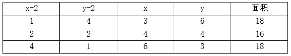

综上，该块土地面积可能是18、16，共计2种可能性。

故正确答案为A。

### 第 42 题

已知某车间工人全部出勤可用24小时完成生产任务。若最初只有1人上班，工作t小时后才有第2个人来上班，再过t小时才来第3人······依次类推，直到完成任务，刚巧第1人工作时间是最后1人的11倍。问第1位工人工作了多少小时？（ ）

A. 22

B. 33

C. 44

D. 55

第 42 题 · 答案与解析

**参考答案（粉笔题库参考内容）**

C

**解析**

设该车间的工人有n人，最后1位工人工作时间为x小时，则第1位工人工作时间为11x小时。根据题意，每工作t小时后均加入员工1人，从最后1人到第1人的工作时间构成公差为t的等差数列，根据等差数列求和公式：，可得这些工人总的工作时间小时。赋值该车间的工人每人每小时的工作量为1，因工作总量相同可得：，解得x=4，则第1位工人工作了小时。

故正确答案为C。

### 第 43 题

羽毛球运动员练习接发球，甲每天练习1000次，乙第一天练习600次且往后每天都比前一天多练习100次。整个训练周期内乙总共比甲多练习2600次。问训练周期共多少天？（ ）

A. 12

B. 13

C. 14

D. 15

第 43 题 · 答案与解析

**参考答案（粉笔题库参考内容）**

B

**解析**

根据题意，设训练周期共n天，则训练周期内甲总共练习1000n次；乙的练习次数构成首项为600、公差为100的等差数列，根据公式：，则乙总共练习次。可列式：，整理可得，即（n-13）（n+4）=0，解得n=13或-4（舍去）。

故正确答案为B。

### 第 44 题

A汽车在B汽车前方10千米处以80千米/小时的速度行驶。B汽车的初始速度为120千米/小时，均匀减速行驶1小时后刚好静止，问两车行驶过程中的最短距离在（ ）范围内。(单位：千米）

A. 0

B. 0~2.5之间

C. 2.5~5之间

D. 超过5

第 44 题 · 答案与解析

**参考答案（粉笔题库参考内容）**

C

**解析**

根据题意，B汽车做匀减速运动，两车之间的距离逐渐减小，直到B汽车的速度小于A汽车，因此当两车速度相等，即B汽车速度为80km/h时，两车之间的距离最小。根据匀加速瞬时速度公式：，可得加速度，则B汽车速度为80km/h时行驶了小时。根据匀变速运动平均速度，可得B汽车行驶前小时的平均速度为km/h，路程为km，A汽车行驶路程为km，此时两车之间的距离为km，在C项范围内。

故正确答案为C。

### 第 45 题

C地为连接A、B两地道路中的某一点。甲和乙开车分别从A、B两地同时出发匀速相向而行，到达对方的出发点后立刻原速折返。已知出发2小时后甲经过C地，又过1小时后乙经过C地，又过了4小时20分后均已折返的甲、乙两人迎面相遇。问甲、乙两人的速度比为（ ）。

A. 2：3

B. 3：2

C. 4：5

D. 5：4

第 45 题 · 答案与解析

**参考答案（粉笔题库参考内容）**

D

**解析**

设A、B两地的距离为S。根据“出发2小时后甲经过C地，又过1小时后乙经过C地”，则，。故；根据直线两端多次相遇公式：，可列式：，化简可得：。

故正确答案为D。

### 第 46 题

4个工厂每天共可装配120台机器，且任意两个工厂的生产效率都不同。已知甲工厂每天可装配的机器数量是乙、丙工厂之和的，丙工厂每天可装配的机器数量是乙、丁工厂的平均值，乙工厂每天可装配37台机器。问效率最高的工厂每天可以装配的机器数量比效率最低的工厂多多少台？（ ）

A. 12

B. 17

C. 22

D. 27

第 46 题 · 答案与解析

**参考答案（粉笔题库参考内容）**

D

**解析**

根据题意，甲工厂每天可装配的机器数量是乙、丙工厂之和的，故。设甲工厂每天可装配的机器数量为2x台，则乙+丙=3x台，丙=（3x-37）台。根据“4个工厂每天共可装配120台机器”，即丁=120-甲-（乙+丙）=120-2x-3x=（120-5x）台。根据“丙工厂每天可装配的机器数量是乙、丁工厂的平均值”，可列式：，解得x=21，则甲工厂每天可装配2×21=42台，丙工厂每天可装配3×21-37=26台，丁工厂每天可装配120-5×21=15台，故甲为效率最高的工厂，丁为效率最低的工厂，甲工厂每天可以装配的机器数量比丁工厂多42-15=27台。

故正确答案为D。

### 第 47 题

一条圆形跑道长米，甲和乙从直线距离200米的两点同时出发顺时针跑步。已知甲的速度比乙快，5分钟后乙第二次到达甲的出发位置，此时甲与乙的直线距离为100米，且甲在跑步过程中始终未超过乙。问甲的速度在（ ）范围内。（）

A. 不到12千米/小时

B. 12~13千米/小时之间

C. 13~14千米/小时之间

D. 超过14千米/小时

第 47 题 · 答案与解析

**参考答案（粉笔题库参考内容）**

C

**解析**

根据题意可得圆形跑道半径为米，则甲和乙分别在直径的两端出发。因5分钟后乙第二次到达甲的出发位置，且甲在跑步过程中始终未超过乙，则此时甲应到达过一次但尚未第二次到达自己的出发位置，且此时甲、乙二人的直线距离为100米，如图所示。因为AC=OA=OC=100米，则为等边三角形，，弧长米。故5分钟甲跑步的距离为米，甲的速度为米/小时千米/小时=13.816千米/小时，在C项范围内。

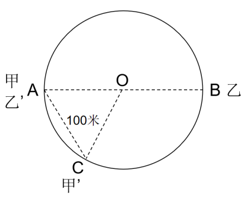

故正确答案为C。

### 第 48 题

小李和小赵进行乒乓球比赛，约定先胜4局者获胜。已知小李每局比赛对小赵的胜率都是60%，问小李在5局获胜的概率与小李在6局获胜的概率相差（ ）。

A. 不到1个百分点

B. 1~3个百分点之间

C. 3~5个百分点之间

D. 超过5个百分点

第 48 题 · 答案与解析

**参考答案（粉笔题库参考内容）**

A

**解析**

根据“小李每局比赛对小赵的胜率都是60%”可知，小李每局比赛对小赵输的概率都是1-60%=40%。先胜4局者获胜，若小李在5局获胜，则前4局中输1局，概率为；若小李在6局获胜，则前5局中输2局，概率为。相差，在A项范围内。

故正确答案为A。

### 第 49 题

一艘游轮从A城到B城顺流行驶用了5小时，到达目的地后返回，以同样功率匀速逆流而行用了7小时。假如从A城出发时在河中放一木排。问游轮与木排相遇时，木排漂流了多少小时？

A. 8

B. 9

C. 10

D. 11

第 49 题 · 答案与解析

**参考答案（粉笔题库参考内容）**

C

**解析**

赋值路程为5和7的最小公倍数35千米，根据公式：路程=速度×时间,则顺流速度为千米/小时，逆流速度为千米/小时。根据流水行船公式可知，船速=顺流速度-流水速度=逆流速度+流水速度，则有7-流水速度=流水速度+5，解得流水速度=1。当游轮从B城返回时，木排已经漂流了5小时，漂流距离为5×1=5千米，又漂流了小时与游轮相遇，故木排一共漂流了5+5=10小时。

故正确答案为C。

### 第 50 题

某村有A、B两块待收割麦田，其中A的面积为B的2倍。现安排x名村民8：00开始在A收割，12：00开始将0.5x名村民调到B，14：00撤走在B收割的村民，只保留1人继续工作且A、B分别于当天16：00和22：00完成收割。已知所有村民的工作效率相同，问x的值为多少？

A. 4

B. 8

C. 12

D. 16

第 50 题 · 答案与解析

**参考答案（粉笔题库参考内容）**

A

**解析**

赋值每名村民的工作效率为1。根据A麦田为x名村民从8：00工作到12：00（4小时），后由x-0.5x=0.5x名村民从12：00工作到16：00（4小时），可知A麦田的面积为4x×1+4×0.5x×1；B麦田为0.5x名村民从12:00工作到14：00（2小时），后由1人从14：00工作到22：00（8小时），则B麦田的面积为2×0.5x×1+8×1×1。根据“A的面积为B的2倍”，可知4x×1+4×0.5x×1=2（2×0.5x×1+8×1×1），解得x=4。

故正确答案为A。

### 第 51 题

已知甲的年龄是一个两位数，且个位数比十位数大3。乙比甲大27岁，且恰好是甲的个位数和十位数对调。问甲、乙的年龄之和最小可能是（ ）岁。

A. 33

B. 44

C. 55

D. 66

第 51 题 · 答案与解析

**参考答案（粉笔题库参考内容）**

C

**解析**

方法一：根据题意可知，乙-甲=27······①，根据奇偶特性，乙年龄与甲年龄的差为奇数，则甲、乙年龄之和也一定为奇数，排除B、D项，剩二代一，问最小，从最小代入。

代入A项，甲+乙=33······②，联立①②解得：甲=3，不是两位数，排除；

代入C项，甲+乙=55······③，联立①③解得：甲=14，乙=41，满足题干所有条件，当选。

方法二：设甲年龄十位数字为a，则个位数字为（a+3）；乙年龄的十位数字为（a+3），个位数字为a。甲、乙的年龄之和为10a+（a+3）+10（a+3）+a=（22a+33）岁，要想两人的年龄之和最小，则a应尽量小，最小为1，则甲、乙的年龄之和最小为22×1+33=55岁。

方法三：要想甲、乙的年龄之和最小，则甲和乙的年龄均应尽量小，甲最小为14岁，此时乙的年龄为14+27=41岁，满足题意，则甲、乙的年龄之和最小为14+41=55岁。

故正确答案为C。

### 第 52 题

甲、乙两企业各出资万元（n为正整数），共购买若干台单价为10万元的大型机械和1台单价更低的小型机械。如最终乙企业分得小型机械，甲企业分得的大型机械比乙企业多1台且向乙企业支付差价补偿。问补偿金额为多少万元？（ ）

A. 2

B. 3

C. 4

D. 4.5

第 52 题 · 答案与解析

**参考答案（粉笔题库参考内容）**

A

**解析**

设小型机械的单价为x万元（0＜x＜10）。甲、乙两企业各出资万元，则两企业出资总数为万元，即出资总数为平方数。根据甲企业分得的大型机械比乙企业多1台，从最少的情况分析：乙分得1台大型机械，甲分得2台大型机械，则出资总数为，即，由于0＜x＜10，则只有x=6时，满足题意，此时甲企业应向乙企业补偿万元。

故正确答案为A。

### 第 53 题

在下面3x3方格图中（每个小方格边长为1厘米），质点每次只能沿方格向下或向右移1厘米，问质点由A移动到B有多少种方案？（ ）

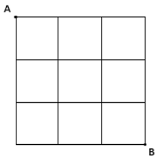

A. 14

B. 16

C. 20

D. 28

第 53 题 · 答案与解析

**参考答案（粉笔题库参考内容）**

C

**解析**

方法一：根据题意可知，从A移动到B每次移动1厘米，必然要经过6条线段，由于只能向右或者向下，所以向右需要3条线段，向下需要3条线段，只要在6条线段中选择3条向右移动即可，则有种方案。

方法二：根据题意，质点由A移动到B，每次只能沿方格向下或向右移动1厘米，可利用描点法解题，如下图所示：

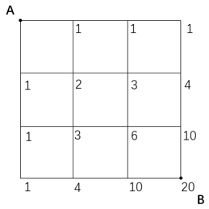

因此共有20种方案。

故正确答案为C。

### 第 54 题

某车间原计划生产产品M（290<M<300）件，平均分装成若干箱，已知M为奇数且不是3的倍数。现扩大产能，产品增加到900件，装箱增加12箱，每箱比原计划多装N件，问N是多少？（ ）

A. 10

B. 11

C. 12

D. 13

第 54 题 · 答案与解析

**参考答案（粉笔题库参考内容）**

D

**解析**

根据题意可知，290<M<300，M为奇数且不是3的倍数，则符合的情况有293、295、299。因产品可平均分装成若干箱，故可将这三个数因式分解为：293=1×293；295=1×295=5×59；299=1×299=13×23。设原计划每箱装x件，装有y箱。根据题意可列式为：（x+N）×（y+12）=900。结合选项可知N最小为10，则x和y取这三个数中任意一个数的1和其本身的约数时，结果都远大于900，不符合题意，故只有295=5×59和299=13×23两种情况，分别讨论如下：

①295=5×59：当x=5，y=59时，则有（5+N)×（59+12）=900，解得，排除；当x=59，y=5时，则有（59+N）×(5+12）=900，解得，排除；

②299=13×23：当x=13，y=23时，则有（13+N）×（23+12）=900，解得，排除；当x=23，y=13时，则有（23+N）×（13+12）=900，解得N=13。

故正确答案为D。

### 第 55 题

一个正整数n，各位数之和恰好为2023。当n为最小时，问该正整数有多少位？

A. 223

B. 225

C. 234

D. 246

第 55 题 · 答案与解析

**参考答案（粉笔题库参考内容）**

B

**解析**

根据题意可知，n为最小时，该正整数的位数应尽可能少，且当位数确定时，高位上的数尽可能小，其余位数上取9。2023÷9=224······7，即有224位取9，首位取7，故该正整数共有224+1=225位。

故正确答案为B。

### 第 56 题

从所给四个选项中，选择最合适的一个填入问号处，使之呈现一定规律性（ ）。

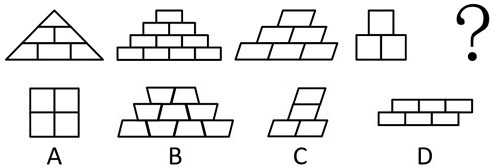

A. A

B. B

C. C

D. D

第 56 题 · 答案与解析

**参考答案（粉笔题库参考内容）**

B

**解析**

元素组成不同，且无明显属性规律，考虑数量规律。观察发现，题干图形均为从上到下每行增加1个小元素，只有B项符合。

故正确答案为B。

### 第 57 题

下列5个图形中，与其他4个规律不同的是（ ）。

A. A

B. B

C. C

D. D

第 57 题 · 答案与解析

**参考答案（粉笔题库参考内容）**

C

**解析**

观察发现，题干图形均由线条连接多个小元素构成，只有C项的线条穿过小元素内部，其他图形中线条均不穿过小元素内部，即C项与其他图形规律不同。

故正确答案为C。

### 第 58 题

从所给四个选项中，选择最合适的一个填入问号处，使之呈现一定规律性（ ）。

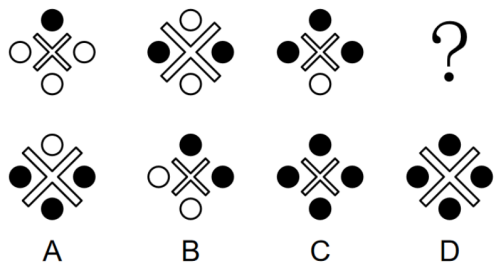

A. A

B. B

C. C

D. D

第 58 题 · 答案与解析

**参考答案（粉笔题库参考内容）**

D

**解析**

元素组成相似，考虑样式规律。观察发现，题干图形中黑球元素个数依次为1、2、3，故“？”处图形中的黑球元素个数应为4，排除A、B两项。比较C、D两项发现，“×”形状相同但大小不同，题干图形中“×”依次为小、大、小，故“？”处图形中的“×”应为大，只有D项符合。

故正确答案为D。

### 第 59 题

从所给四个选项中，选择最合适的一个填入问号处，使之呈现一定规律性（ ）。

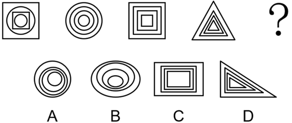

A. A

B. B

C. C

D. D

第 59 题 · 答案与解析

**参考答案（粉笔题库参考内容）**

C

**解析**

观察发现，题干每幅图形中各元素的重心均重合于中心一点，只有C项符合。

故正确答案为C。

### 第 60 题

从所给四个选项中，选择最合适的一个填入问号处，使之呈现一定规律性（ ）。

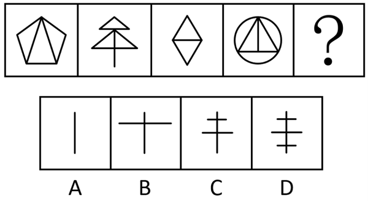

A. A

B. B

C. C

D. D

第 60 题 · 答案与解析

**参考答案（粉笔题库参考内容）**

A

**解析**

元素组成不同，且属性规律无答案，考虑数量规律。观察发现，题干出现“日”字形、多端点图形，考虑笔画数。题干图形均为一笔画图形，只有A项符合。

故正确答案为A。

### 第 61 题

从所给四个选项中，选择最合适的一个填入问号处，使之呈现一定规律性（ ）。

A. A

B. B

C. C

D. D

第 61 题 · 答案与解析

**参考答案（粉笔题库参考内容）**

C

**解析**

元素组成不同，且无明显属性规律，考虑数量规律。观察发现，题干图形均由灰色矩形和黑色矩形构成，优先考虑元素的种类和个数。题干图形中黑色矩形的数量依次为2、3、4、5、6，故“？”处图形黑色矩形的数量应为7，只有C项符合。

故正确答案为C。

### 第 62 题

下列4个图形中，与其他3个规律不同的是（ ）。

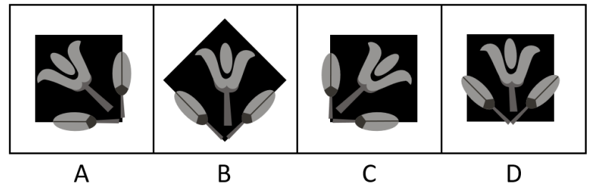

A. A

B. B

C. C

D. D

第 62 题 · 答案与解析

**参考答案（粉笔题库参考内容）**

D

**解析**

观察发现，题干图形均由花朵、叶子和黑色方块组成，A、B、C三项图形中的叶子中线均与黑色方块的边重合，而D项图形中的叶子中线与黑色方块的边不重合，即D项与其他3个图形规律不同。

故正确答案为D。

### 第 63 题

从所给四个选项中，选择最合适的一个填入问号处，使之呈现一定规律性（ ）。

A. A

B. B

C. C

D. D

第 63 题 · 答案与解析

**参考答案（粉笔题库参考内容）**

C

**解析**

元素组成不同，且无明显属性规律，考虑数量规律。观察发现，每幅图形中均由一种黑色小元素组成，且黑色小元素的个数=黑色小元素的边数，排除A项；继续观察发现，题干图形都存在一个与黑色小元素相同的白色区域，排除B、D两项，只有C项符合。

故正确答案为C。

### 第 64 题

从所给四个选项中，选择最合适的一个填入问号处，使之呈现一定规律性（ ）。

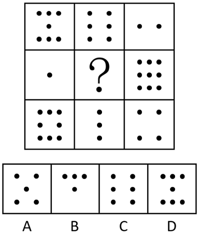

A. A

B. B

C. C

D. D

第 64 题 · 答案与解析

**参考答案（粉笔题库参考内容）**

A

**解析**

元素组成不同，且无明显属性规律，考虑数量规律。九宫格优先横向看，观察发现，第一行图形的黑点数依次为7、6、2，黑点数之和为15；第三行图形的黑点数依次为8、3、4，黑点数之和也为15，符合此规律；第二行应用此规律，“？”处图形的黑点数应为15-1-9=5，只有A项符合。

故正确答案为A。

### 第 65 题

从所给四个选项中，选择最合适的一个填入问号处，使之呈现一定规律性（ ）。

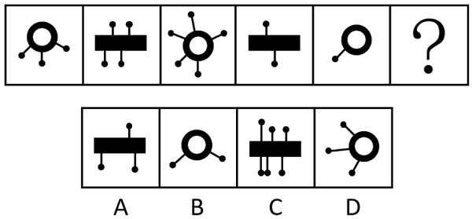

A. A

B. B

C. C

D. D

第 65 题 · 答案与解析

**参考答案（粉笔题库参考内容）**

C

**解析**

元素组成不同，优先考虑样式规律。观察发现，题干图形的主体部分为“圆环”和“矩形”交替出现，故“？”处图形的主体部分应为“矩形”，排除B、D两项；继续观察发现，题干图形主体部分伸出的“线条+小黑球”数量依次为3、4、5、2、1，数量呈现奇、偶交替出现的规律，故“？”处图形主体部分伸出的“线条+小黑球”数量应为偶数，只有C项符合。

故正确答案为C。

### 第 66 题

食品安全亦称食品卫生，是指使食品符合一定的卫生学标准，及不随摄食而给人体健康带来危害的措施。关注食品是否受到生物性、化学性或放射性物质等有害物的污染，以致给消费者带来潜在或现实的健康风险。

根据上述定义，下列符合食品安全的是（ ）。

A. L面包店每天都有打折销售的临期面包，而且离保质期越近价格越便宜

B. M餐厅规定进入凉菜间的食材必须是符合国家卫生标准的“净菜”

C. N餐馆的员工擦拭油污后，简单冲洗便直接用手抓面条加工凉面

D. 小李买回T厂生产的袋装饺子，煮熟食用后，肚子疼痛难忍

第 66 题 · 答案与解析

**参考答案（粉笔题库参考内容）**

B

**解析**

第一步：找出定义关键词。

“食品符合一定的卫生学标准”、“不随摄食而给人体健康带来危害”、“关注食品是否受生物性、化学性或放射性物质等有害物的污染”、“无潜在或现实健康风险”。

第二步：逐一分析选项。

A项：L面包店销售临期面包，“临期”代表食品接近保质期截止时间，无法直接等同于“符合卫生学标准”，无法确保“不随摄食而给人体健康带来危害”，不符合定义，排除；

B项：M餐厅规定进入凉菜间的食材必须是符合国家卫生标准的“净菜”，符合“食品符合一定卫生学标准”，符合定义，当选；

C项：N餐馆员工擦拭油污后简单冲洗就用手抓面条，手部残留的油污属于化学性污染物，简单冲洗无法清除，污染物会转移至面条，导致食品污染，不符合“关注食品是否受生物性、化学性或放射性物质等有害物的污染”、“无潜在或现实健康风险”，不符合定义，排除；

D项：小李食用T厂生产的袋装饺子后肚子疼痛，“腹痛”表明饺子存在卫生隐患，已造成现实健康危害，不符合“不随摄食而给人体健康带来危害”，不符合定义，排除。

故正确答案为B。

### 第 67 题

拜神教是以非物体的神灵为崇拜对象的宗教，人们从物体或身躯中分离出某种“主宰一切”的精神力量，予以顶礼膜拜。拜物教是指把某些特定物体想象为可支配人们命运的神而加以崇拜的宗教。某些人认为，这样的特定物体有灵性，对它祈祷、礼拜或祭献，即可获得好运与保护。

根据上述定义，下列属于拜物教的是（ ）。

A. 道教信奉的尊神为：玉清元始天尊、上清灵宝天尊和太清道德天尊

B. 印度教三大神为：创世之神梵天、守护之神毗湿奴和毁灭之神湿婆

C. 在某处人类早期祭祀遗址中，发现了祭拜仙神的祭品遗物

D. 某原始部落把雕刻的玉猪作为自己的保护神予以祭拜

第 67 题 · 答案与解析

**参考答案（粉笔题库参考内容）**

D

**解析**

第一步：找出定义关键词。

拜神教：“以非物体的神灵为崇拜对象的宗教”、“人们从物体或身躯中分离出某种‘主宰一切’的精神力量，予以顶礼膜拜”；

拜物教：“把某些特定物体想象为可支配人们命运的神而加以崇拜的宗教”。

第二步：逐一分析选项。

A项：道教信奉的玉清元始天尊、上清灵宝天尊、太清道德天尊均属于“非物体的神灵”，崇拜的是精神力量而非具体物体，不符合“把某些特定物体想象为可支配人们命运的神而加以崇拜的宗教”，不符合拜物教定义，排除；

B项：印度教的创世之神梵天、守护之神毗湿奴、毁灭之神湿婆是象征宇宙创世、守护、毁灭职能的“非物体神灵”，崇拜的是精神力量而非具体物体，不符合“把某些特定物体想象为可支配人们命运的神而加以崇拜的宗教”，不符合拜物教定义，排除；

C项：人类早期祭祀遗址中发现的“祭拜仙神的祭品遗物”，核心崇拜对象是“仙神”，“祭品”仅为祭拜时的辅助工具，并非崇拜对象本身，不符合“把某些特定物体想象为可支配人们命运的神而加以崇拜的宗教”，不符合拜物教定义，排除；

D项：原始部落把“雕刻的玉猪”作为“保护神”祭拜，“玉猪”是具体的物体，把它作为保护神予以祭拜，符合“把某些特定物体想象为可支配人们命运的神而加以崇拜的宗教”，符合拜物教定义，当选。

故正确答案为D。

### 第 68 题

地球表面的水热条件等环境要素，沿纬度或经度方向发生递变，从而引起植被沿纬度或经度方向呈水平更替，这种现象被称为植被分布的水平地带性，植被分布的水平地带性是地球表面植被分布的基本规律之一。

根据上述定义，下列体现了植被分布的水平地带性的是（ ）。

A. 根据水域环境条件的不同，水域动物可分为淡水动物群落和海洋动物群落

B. 受太阳辐射影响，地球北半球从南到北形成热带、亚热带、温带、寒带等不同的气候带

C. 香山的小溪中有绿藻，溪边有苔藓，岸上有草、蕨类，山坡上有桃树，山顶有松树

D. 我国温带沿海地区降水量大，分布着夏绿阔叶林，离海较远地区降水减少，分布着草原植被

第 68 题 · 答案与解析

**参考答案（粉笔题库参考内容）**

D

**解析**

第一步：找出定义关键词。

“地球表面的水热条件等环境要素”、“沿纬度或经度方向发生递变”、“从而引起植被沿纬度或经度方向呈水平更替”。

第二步：逐一分析选项。

A项：根据水域环境条件的不同，水域动物可分为淡水动物群落和海洋动物群落，其中“水域动物”不是“植被”，不符合“从而引起植被沿纬度或经度方向呈水平更替”，不符合定义，排除；

B项：地球北半球从南到北形成热带、亚热带、温带、寒带等不同的气候带，描述的是“气候带”的划分，未涉及“植被”的分布，不符合“从而引起植被沿纬度或经度方向呈水平更替”，不符合定义，排除；

C项：香山的小溪中有绿藻，溪边有苔藓，岸上有草、蕨类，山坡上有桃树，山顶有松树，描述的是从溪边到山顶的植被变化，是沿垂直高度的更替，不符合“从而引起植被沿纬度或经度方向呈水平更替”，不符合定义，排除；

D项：我国温带从沿海到内陆（沿经度方向），因降水量递变，植被从夏绿阔叶林更替为草原，符合“地球表面的水热条件等环境要素”、“沿纬度或经度方向发生递变”、“从而引起植被沿纬度或经度方向呈水平更替”，符合定义，当选。

故正确答案为D。

### 第 69 题

文化扩散分为接触扩散、等级扩散、刺激扩散。接触扩散是指某种文化现象易于为接触者所接受，几乎接触该文化现象的人，如同接触到易于传染的病菌一样，就自然地接受了这种文化现象，从而实现了其扩散；等级扩散是指该文化现象的传播，或接受该文化现象的人，在空间或人群等方面，存在等级现象；刺激扩散是指某种文化现象，受某种原因而无法在另一地存在，不得不将原文化现象做某种程度改变，使其得以在当地存在，得到传播。

根据上述定义，下列不属于文化扩散的是（ ）。

A. 唐人街作为中华文化在国外的展示处，每到春节时都热闹喧腾，吸引了许多当地人前来游玩参观

B. 高平镇是远近闻名的提琴技艺之乡，许多学艺者从高平镇学会了制琴技艺，到高新区附近建立了自己的提琴工厂

C. 蒙古族的祖先走出额尔古纳河两岸山林地带向蒙古高原迁徙，因自然环境制约，生产方式也随之从狩猎业转变为畜牧业

D. 沈阳故宫始建时保留了很多满文化的特色，清入关后北京故宫以汉文化为主基调成为官式建筑的典范。沈阳故宫改建时制度化的官式做法被应用其中

第 69 题 · 答案与解析

**参考答案（粉笔题库参考内容）**

C

**解析**

第一步：找出定义关键词。

接触扩散：“某种文化现象易于为接触者所接受”、“几乎接触该文化现象的人，如同接触到易于传染的病菌一样，就自然地接受了这种文化现象”、“从而实现了其扩散”；

等级扩散：“该文化现象的传播，或接受该文化现象的人”、“在空间或人群等方面，存在等级现象”；

刺激扩散：“某种文化现象”、“受某种原因而无法在另一地存在，不得不将原文化现象做某种程度改变”、“使其得以在当地存在，得到传播”。

第二步：逐一分析选项。

A项：该项指出唐人街的中华文化吸引当地人参观，当地人通过接触感知中华文化，符合“某种文化现象易于为接触者所接受”、“几乎接触该文化现象的人，如同接触到易于传染的病菌一样，就自然地接受了这种文化现象”、“从而实现了其扩散”，符合“接触扩散”定义，属于文化扩散，排除；

B项：该项指出高平镇的制琴技艺被学艺者接受，符合“该文化现象的传播，或接受该文化现象的人”，从高平镇到高新区建立工厂，符合“在空间方面，存在等级现象”，符合“等级扩散”定义，属于文化扩散，排除；

C项：该项指出蒙古族祖先因自然环境制约，生产方式从狩猎业转变为畜牧业，这是一种文化适应或内部演变过程，并未涉及文化的传播，不属于文化扩散，当选；

D项：该项指出北京故宫的“制度化官式做法”传播到沈阳故宫，被沈阳故宫改建时采用，其中官式做法是制度化的，即沈阳故宫改建时不得不将原文化现象做某种程度改变，使其得以在当地存在，符合“受某种原因而无法在另一地存在，不得不将原文化现象做某种程度改变”、“使其得以在当地存在，得到传播”，符合“刺激扩散”定义，属于文化扩散，排除。

本题为选非题，故正确答案为C。

### 第 70 题

道路养护是对原有技术标准过低的路线和构筑物及沿线设施进行分期改善和添建，逐步提高道路的使用性能和服务水平，不断满足全社会对道路的要求。

根据上述定义，下列不属于道路养护的是（ ）。

A. 针对急弯陡坡地段，在遇到降雪天气时，用清洁的粒砂、石屑或煤渣等物铺洒防滑

B. 用水泥混凝土铺补道路两边的岩石松动处，同时设立金属网以防坠落到路面上

C. 对过高并妨碍路面排水的土质路肩铲削整平，对低洼的路肩所存留的水可以及时排除

D. 收集城市道路相关数据（如道路平整度、结构承载力等），建设城市道路信息管理系统

第 70 题 · 答案与解析

**参考答案（粉笔题库参考内容）**

D

**解析**

第一步：找出定义关键词。

“对原有技术标准过低的路线和构筑物及沿线设施进行分期改善和添建”、“逐步提高道路的使用性能和服务水平”。

第二步：逐一分析选项。

A项：针对急弯陡坡地段在遇到降雪天气时用清洁的粒砂、石屑或煤渣等物铺洒防滑，符合“对原有技术标准过低的路线进行改善和添建”，符合定义，排除；

B项：用水泥混凝土铺补道路两边的岩石松动处，同时设立金属网以防坠落到路面上，符合“对原有技术标准过低的沿线设施进行改善和添建”，符合定义，排除；

C项：对过高并妨碍路面排水的土质路肩铲削整平，对低洼的路肩所存留的水可以及时排除，符合“对原有技术标准过低的沿线设施进行改善和添建”，符合定义，排除；

D项：收集数据建设城市道路信息管理系统，没有对实际的道路进行操作，不符合“对原有技术标准过低的路线和构筑物及沿线设施进行分期改善和添建”，不符合定义，当选。

本题为选非题，故正确答案为D。

### 第 71 题

智能：添：动力

A. 绿色：宜：环保

B. 生产：更：清洁

C. 节约：促：发展

D. 减排：利：节能

第 71 题 · 答案与解析

**参考答案（粉笔题库参考内容）**

C

**解析**

第一步：判断题干词语间逻辑关系。

智能指智能化技术或智慧手段，智能可以增添动力，智能有添动力的功能，第一个词与后两个词构成功能对应关系。

第二步：判断选项词语间逻辑关系。

A项：绿色象征着环保，二者为对应关系，与题干逻辑关系不一致，排除；

B项：生产需要更清洁的环境，第一个词与后两个词不构成功能对应关系，与题干逻辑关系不一致，排除；

C项：节约指节省、俭约的生活方式，节约可以促进发展，节约有促发展的功能，第一个词与后两个词构成功能对应关系，与题干逻辑关系一致，当选；

D项：减排和节能是两种不同的环保措施，二者为并列关系，与题干逻辑关系不一致，排除。

故正确答案为C。

### 第 72 题

耕海牧渔：海洋经济

A. 大棚蔬菜：设施农业

B. 植树防风：林业经济

C. 通信网络：信息产业

D. 治沙种粮：沙漠农业

第 72 题 · 答案与解析

**参考答案（粉笔题库参考内容）**

D

**解析**

第一步：判断题干词语间逻辑关系。

耕海牧渔指通过人工增殖放流等方式，结合生物工程技术和现代装备，建立可持续海洋渔业资源的开发模式。海洋经济包括为开发海洋资源和依赖海洋空间而进行的生产活动，以及直接或间接开发海洋资源及空间的相关产业活动。耕海牧渔是一种海洋经济，二者为种属关系，且耕海和牧渔均为动宾结构。

第二步：判断选项词语间逻辑关系。

A项：大棚蔬菜是设施农业的产物，二者为对应关系，与题干逻辑关系不一致，排除；

B项：植树防风是一种生态建设活动，不属于林业经济，与题干逻辑关系不一致，排除；

C项：通信网络是一种信息产业，二者为种属关系，但通信和网络均不是动宾结构，与题干逻辑关系不一致，排除；

D项：治沙种粮是一种沙漠农业，二者为种属关系，且治沙和种粮均为动宾结构，与题干逻辑关系一致，当选。

故正确答案为D。

### 第 73 题

食肉动物：水生动物

A. 挥拍运动：团体运动

B. 体育彩票：足球彩票

C. 铁碳合金：铁铝合金

D. 土壤监测：水质监测

第 73 题 · 答案与解析

**参考答案（粉笔题库参考内容）**

A

**解析**

第一步：判断题干词语间逻辑关系。

食肉动物和水生动物分别是从食物来源和生存环境的角度命名的，二者为交叉关系。

第二步：判断选项词语间逻辑关系。

A项：挥拍运动和团体运动分别是从击球动作和参与人数多少的角度命名的，二者为交叉关系，与题干逻辑关系一致，当选；

B项：足球彩票是一种体育彩票，二者为种属关系，与题干逻辑关系不一致，排除；

C项：铁碳合金和铁铝合金是两种不同的合金，二者为并列关系，与题干逻辑关系不一致，排除；

D项：土壤监测和水质监测是两种不同的环境监测类型，二者为并列关系，与题干逻辑关系不一致，排除。

故正确答案为A。

### 第 74 题

豌豆：豆菽：谷物

A. 恒星：行星：卫星

B. 冰雹：降水：气象

C. 节气：大暑：小暑

D. 文化：宗教：风俗

第 74 题 · 答案与解析

**参考答案（粉笔题库参考内容）**

B

**解析**

第一步：判断题干词语间逻辑关系。

菽为豆类的总称，豆菽类作物包括大豆、蚕豆、豌豆、绿豆、红小豆、芸豆等，豌豆是一种豆菽，二者是种属关系。谷物包括禾谷类、豆菽类和薯类等，豆菽是一种谷物，二者是种属关系。

第二步：判断选项词语间逻辑关系。

A项：恒星、行星和卫星是宇宙中的三种不同类型的天体，三者为并列关系，与题干逻辑关系不一致，排除；

B项：冰雹是降水的一种形式，二者是种属关系；降水是一种气象现象，二者是种属关系，与题干逻辑关系一致，当选；

C项：大暑和小暑是不同的节气，二者为并列关系，分别和节气构成种属关系，与题干逻辑关系不一致，排除；

D项：宗教和风俗都属于文化的范畴，分别和文化构成种属关系，但与题干词语顺序相反，且宗教和风俗不构成种属关系，与题干逻辑关系不一致，排除。

故正确答案为B。

### 第 75 题

传统武术 对于 （ ） 相当于 （ ） 对于 天体

A. 民间文学；系外行星

B. 太极拳；太阳系

C. 体育项目；黑洞

D. 竞技；宇宙

第 75 题 · 答案与解析

**参考答案（粉笔题库参考内容）**

C

**解析**

逐一代入选项。

A项：传统武术和民间文学没有明显逻辑关系；系外行星是一种天体，二者是种属关系，前后逻辑关系不一致，排除；

B项：太极拳是一种传统武术，二者是种属关系；天体是太阳系的组成部分，二者是组成关系，前后逻辑关系不一致，排除；

C项：传统武术是一种体育项目，二者是种属关系；黑洞是由广义相对论所预言的，存在于宇宙空间中的一种致密天体，是时空曲率大到光都无法逃脱的天体，黑洞是一种天体，二者是种属关系，前后逻辑关系一致，当选；

D项：有的传统武术可以用于竞技（例如比武），二者是对应关系；天体是宇宙的组成部分，二者是组成关系，前后逻辑关系不一致，排除。

故正确答案为C。

### 第 76 题

某演讲比赛最终确定了三名进入决赛的候选人，分别是楚某、沙某、秦某，对于他们中谁能够进入决赛，三位评委分别发表了各自的意见：

评委甲：秦某、沙某中只能进一个

评委乙：如果秦某不进，楚某就不进

评委丙：只有秦某或沙某不进，楚某才进

以下方案能同时满足三个评委意见的是（ ）。

A. 秦某、沙某、楚某都进

B. 楚某进，秦某、沙某不进

C. 秦某进，沙某、楚某不进

D. 沙某、楚某进，秦某不进

第 76 题 · 答案与解析

**参考答案（粉笔题库参考内容）**

C

**解析**

第一步：分析题干条件。

（1）秦某、沙某只能进一个；

（2）-秦某楚某；

（3）楚某秦某 或 -沙某。

第二步：根据题干条件进行推理。

题干信息确定，选项信息充分，优先考虑排除法。

根据条件（1）可知，秦某、沙某不能同时进，排除A项；

根据条件（2）可知，当秦某不进时，楚某也不能进，排除B、D两项。

经验证，C项能同时满足三个评委的意见。

故正确答案为C。

### 第 77 题

某单位调查员工的特长时发现，擅长踢足球的员工，在读大学本科期间一定参加过体育类的社团。甲、乙、丙、丁均为该单位员工。

根据上述条件，下列情况一定为真的是（ ）。

A. 甲大学本科毕业，且参加过体育类的社团，则甲擅长踢足球

B. 乙擅长踢足球并且参加过体育类的社团，则乙一定读过大学本科

C. 丙擅长踢足球，没有参加过体育类的社团，则丙没有读过大学本科

D. 丁不擅长踢足球，也没有参加过体育类的社团，则丁没有读过大学本科

第 77 题 · 答案与解析

**参考答案（粉笔题库参考内容）**

C

**解析**

第一步：翻译题干。

擅长踢足球 且 读过大学本科参加过体育类的社团；

甲、乙、丙、丁均为该单位员工。

第二步：逐一分析选项。

A项：翻译为：甲读过大学本科 且 参加过体育类的社团甲擅长踢足球，其中“参加过体育类的社团”是对题干的肯后，肯后无必然结论，无法推出，排除；

B项：翻译为：乙擅长踢足球 且 参加过体育类的社团乙读过大学本科，其中“参加过体育类的社团”是对题干的肯后，肯后无必然结论，无法推出，排除；

C项：翻译为：丙擅长踢足球 且 -参加过体育类的社团丙读过大学本科，其中“-参加过体育类的社团”是对题干的否后，否后必否前，可以推出：-丙擅长踢足球 或 -丙读过大学本科，已知“丙擅长踢足球”，根据或关系否一推一，可以推出：-丙读过大学本科，可以推出，当选；

D项：翻译为：-丁擅长踢足球 且 -参加过体育类的社团丁读过大学本科，其中“-擅长踢足球”是对题干的否前，否前无必然结论，无法推出，排除。

故正确答案为C。

### 第 78 题

2022年10月，某支股票的市场价格大幅度下跌。在下跌的几周内，股票的交易量也急速下跌，大大低于去年的周平均量。然而，该支股票整年的交易量与去年相比并没有明显下降。

如果下列说法正确，则能够解释上述说法中矛盾的是（ ）。

A. 股票投资者往往喜欢在低价的时候购入股票

B. 在2022年整年该支股票购买者的数量与去年相同

C. 某年内股票交易量越大，那一年股票市场的平均价格就越低

D. 在2022年的某个时期，该支股票的交易量高于该年的平均值

第 78 题 · 答案与解析

**参考答案（粉笔题库参考内容）**

D

**解析**

第一步：找出题干矛盾。

2022年10月，某支股票在几周内的交易量大大低于去年的周平均量。然而，该支股票整年的交易量与去年相比并没有明显下降。

第二步：逐一分析选项。

A项：选项指出股票投资者往往喜欢在低价的时候购入股票，但题干已经指出该支股票的市场价格下跌时，股票的交易量也急速下跌，与题干描述违背，无法解释题干矛盾，排除；

B项：选项指出在2022年整年该支股票购买者的数量与去年相同，但股票购买者数量相同不代表股票交易量相同，交易量还与每人购买股数相关，无法解释题干矛盾，排除；

C项：选项指出某年内股票交易量越大，那一年股票市场的平均价格就越低，表明股票交易量和平均价格相关，但并未指出2022年该支股票的平均价格，无法解释题干矛盾，排除；

D项：选项指出在2022年的某个时期，该支股票的交易量高于该年的平均值，可以解释为什么2022年10月该支股票在几周内的交易量很低，但整年交易量和去年相比却没有明显下降，可以解释题干矛盾，当选。

故正确答案为D。

### 第 79 题

目前的中学生普遍缺乏自然科学知识的学习和积累。最近一项调查显示，中学生中喜欢和比较喜欢人工智能科技的只占到被调查人数的19%。

以下哪项如果为真，最能质疑上述观点？（ ）

A. 中学生缺少对自然科学方面的指导，不懂得怎样去学习和积累

B. 中学生喜欢人工智能科技与学习积累自然科学知识不能混为一谈

C. 一些中学生既喜欢人工智能科技，又对其他自然科学知识有兴趣

D. 调查比例太小，不能反映中学生学习积累自然科学知识的真实情况

第 79 题 · 答案与解析

**参考答案（粉笔题库参考内容）**

B

**解析**

第一步：找出论点和论据。

论点：目前的中学生普遍缺乏自然科学知识的学习和积累。

论据：中学生中喜欢和比较喜欢人工智能科技的只占到被调查人数的19%。

本题论点讨论的是中学生缺乏“自然科学知识的学习和积累”，论据讨论的是中学生“喜欢人工智能科技”的比例，二者话题不一致，削弱优先考虑拆桥，即断开“喜欢人工智能科技”和“自然科学知识的学习和积累”之间的联系。

第二步：逐一分析选项。

A项：选项指出中学生缺少对自然科学方面的指导，不懂得怎样去学习和积累，解释了中学生普遍缺乏自然科学知识的学习和积累的原因，可以加强，无法削弱，排除；

B项：选项指出中学生喜欢人工智能科技与学习积累自然科学知识不能混为一谈，切断了“喜欢人工智能科技”和“自然科学知识的学习和积累”之间的联系，为拆桥项，可以削弱，保留；

C项：选项指出“一些”中学生既喜欢人工智能科技，又对其他自然科学知识有兴趣，但不明确中学生是否普遍缺乏自然科学知识的学习和积累，为不明确项，无法削弱，排除；

D项：选项指出调查比例太小，不能反映中学生学习积累自然科学知识的真实情况，削弱论据，可以削弱，保留。

对比B、D两项，B项为拆桥项，针对论据和论点之间的关系进行削弱，而D项仅针对论据中的调查方式进行削弱，故B项削弱力度更强，当选。

故正确答案为B。

### 第 80 题

有专家指出，纯净水在过滤掉有害物质的过程中，也一并将钾、镁、钙、铁等人体必需的矿物质元素给去掉了，常喝会导致缺钙。

以下哪项如果为真，最能质疑上述观点？（ ）

A. 我们摄入饮用水主要是为了补充水分，而不是补钙，目前也没有研究表明喝纯净水与缺钙之间存在着必然联系

B. 饮用水虽然对钙元素等矿物质的摄入能起到一定贡献，但贡献程度依据水质硬度的不同，存在较大差异

C. 按照每人每天饮用约1.2L水的平均水平来计算，正常情况下从饮用水中摄取的钙最多100毫克

D. 很多人更喜欢喝白开水而非纯净水，认为白开水中含有人体必需的矿物质元素

第 80 题 · 答案与解析

**参考答案（粉笔题库参考内容）**

A

**解析**

第一步：找出论点和论据。

论点：纯净水在过滤掉有害物质的过程中，也一并将钾、镁、钙、铁等人体必需的矿物质元素给去掉了，常喝会导致缺钙。

论据：无。

本题论点讨论的是常喝纯净水会导致缺钙，只有论点，没有论据，削弱优先考虑削弱论点。

第二步：逐一分析选项。

A项：选项指出摄入饮用水主要是为了补充水分，而不是补钙，目前也没有研究表明喝纯净水与缺钙之间存在着必然联系，质疑了论点中“常喝纯净水”和“缺钙”的因果关系，削弱论点，可以削弱，当选；

B项：选项指出不同硬度的饮用水对钙元素等矿物质摄入的贡献程度有差异，但不明确纯净水减少的钙摄入量与缺钙的关系，因此不明确“常喝纯净水”是否就会导致“缺钙”，无法削弱，排除；

C项：选项指出正常情况下从饮用水中摄取的钙最多100毫克，但不明确100毫克钙与缺钙的关系，因此不明确“常喝纯净水”是否就会导致“缺钙”，无法削弱，排除；

D项：选项指出很多人更喜欢喝白开水而非纯净水，认为白开水中含有人体必需的矿物质元素，而论点讨论的是常喝纯净水是否会导致缺钙，话题不一致，无法削弱，排除。

故正确答案为A。

### 第 81 题

一项研究结果指出：多吃蔬菜水果的人与少吃的人相比，20年之内的死亡风险降低了7%-8%。此次大规模调查证实了富含维生素和膳食纤维的蔬菜和水果对健康非常重要。研究人员根据受访者每天的果蔬摄取量，将他们由多至少分为五组进行死亡风险的分析。结果显示，在死亡风险方面，水果摄取量最多的组比摄取量最少的组低8%。同样的，蔬菜摄取量最多的组比摄取量最少的组低7%。

以下哪项如果为真，最能质疑上述研究结果？（ ）

A. 此次调查以11个地区的9.5万名40-69岁男女为对象，对他们的健康进行跟踪了解

B. 研究人员根据问卷结果推算受访者的果蔬摄取量，并将其分为五组进行死亡风险分析

C. 受访者在接受问卷调查过程中对实际情况有所隐瞒，果蔬摄入量与实际情况偏差较大

D. 除了果蔬摄入量的差别以外，受访人群的运动量、作息时间等生活习惯也有些许不同

第 81 题 · 答案与解析

**参考答案（粉笔题库参考内容）**

C

**解析**

第一步：找出论点和论据。

论点：富含维生素和膳食纤维的蔬菜和水果对健康非常重要。

论据：在死亡风险方面，水果摄取量最多的组比摄取量最少的组低8%。同样的，蔬菜摄取量最多的组比摄取量最少的组低7%。

本题论点在讨论蔬菜和水果对健康非常重要，论据在讨论吃蔬菜水果能够降低死亡风险，论据可以合理得到论点，因此论点和论据话题一致，削弱可以考虑削弱论点，也可以考虑削弱论据。

第二步：逐一分析选项。

A项：选项指出此次调查以11个地区的9.5万名40-69岁男女为对象，对他们的健康进行跟踪了解，仅描述调查选取的对象是怎样的，但无法对论点进行质疑，无法削弱，排除；

B项：选项指出研究人员根据问卷结果推算受访者的果蔬摄取量，并将其分为五组进行死亡风险分析，仅描述该研究方法是什么，但无法对调查本身进行质疑，也无法对论点进行质疑，无法削弱，排除；

C项：选项指出受访者在接受问卷调查过程中对实际情况有所隐瞒，果蔬摄入量与实际情况偏差较大，即指出调查所使用的指标不准确，可信度不高，质疑了调查的科学性，可以削弱，保留；

D项：选项指出除了果蔬摄入量的差别以外，受访人群的运动量、作息时间等生活习惯也有些许不同，即说明还存在其他的变量“可能”导致研究结果不准确，可以削弱，保留。

对比C、D两项，C项对调查数据的真实性进行质疑，直接削弱研究成果成立的前提；而D项并未指出“些许生活习惯的不同”与“死亡风险”的关系，即不明确存在的这些变量是否会直接影响到研究成果的成立，质疑力度较弱，故C项当选。

故正确答案为C。

### 第 82 题

近日有报道称，由于全球变暖导致海水升温，某国海军多艘舰艇发动机出现故障。专家认为，过于温暖的海水不仅无法起到冷却作用，反而有可能导致船舶发动机故障频发。

以下哪项如果为真，最能支持上述观点？（ ）

A. 海水温度上升，船舶主机冷却系统的工作效率会降低，影响动力系统散热，船舶的维护成本会随之增加

B. 海平面持续上升、极端天气频发等问题带来的一系列连锁反应，让该国港口面临被淹没的风险

C. 船舶主机冷却系统的任务是确保船舶动力系统正常工作，海水冷却是冷却系统中的重要一环

D. 由于气候变化导致各种自然灾害频发，国际社会需加强沟通协商，合力应对气候变化挑战

第 82 题 · 答案与解析

**参考答案（粉笔题库参考内容）**

C

**解析**

第一步：找出论点和论据。

论点：过于温暖的海水不仅无法起到冷却作用，反而有可能导致船舶发动机故障频发。

论据：由于全球变暖导致海水升温，某国海军多艘舰艇发动机出现故障。

论点和论据均讨论“海水升温”与“船舶发动机故障”的关系，话题一致，加强优先考虑补充论据。

第二步：逐一分析选项。

A项：该项指出海水温度上升会降低船舶主机冷却系统的工作效率，影响动力系统散热，但降低冷却系统的工作效率、影响散热并不代表会导致舰艇发动机发生故障，为不明确项，无法加强，排除；

B项：该项讨论海平面上升、极端天气使港口面临淹没风险，与论点“过于温暖的海水是否会导致船舶发动机故障频发”无关，话题不一致，无法加强，排除；

C项：该项指出船舶主机冷却系统的任务是确保船舶动力系统正常工作，海水冷却是冷却系统中的重要一环，说明过于温暖的海水无法起到冷却作用，从而使船舶动力系统不能正常工作，因此故障频发，解释了为什么过于温暖的海水会导致船舶发动机故障频发，补充论据，可以加强，当选；

D项：该项指出国际社会需合力应对气候变化挑战，与论点“过于温暖的海水是否会导致船舶发动机故障频发”无关，话题不一致，无法加强，排除。

故正确答案为C。

### 第 83 题

最新研究发现，通过对脊髓的特定刺激脉冲恢复大脑和手臂之间的连接，能在一定程度上使瘫痪患者执行日常生活任务。为了测试这项技术，研究员训练部分手臂瘫痪的猕猴去伸手、抓住和拉动杠杆，以得到它们最喜欢的食物。实验显示，有些猴子原本无法拿到食物，但当刺激器刺激它的脊髓时，它可以实现抓住食物。因此研究人员表示此技术未来能帮助数百万患者恢复活动能力。

以下哪项如果为真，最能质疑上述观点?（ ）

A. 人类的手臂神经无论是在复杂性还是灵敏度上都要强于猴子

B. 目前这种通过刺激脊髓来恢复手臂行动功能的技术还无法恢复写作或弹钢琴等精细活动能力

C. 实验一周后部分猴子可以抓住或拉动物体，但实验六周后，没有一只猴子能够控制自己的手指

D. 即使最简单的手臂动作，人类神经系统也须协调数百块肌肉，在实验室外，用直接电刺激脊髓来取代这种复杂神经控制并非易事

第 83 题 · 答案与解析

**参考答案（粉笔题库参考内容）**

D

**解析**

第一步：找出论点和论据。

论点：通过刺激脊髓来恢复手臂行动功能的技术，未来能帮助数百万瘫痪患者恢复活动能力。

论据：刺激手臂瘫痪的猕猴脊髓后，原本无法拿到食物的猕猴能实现抓握食物的动作。

论点讨论的是“该技术能帮助人类瘫痪患者恢复活动能力”，论据讨论的是“该技术能使原本无法拿到食物的猕猴实现抓握食物的动作”，论点侧重“使瘫痪患者执行日常生活任务”，论据基于“猕猴实验”，二者话题不一致，削弱可考虑拆桥，切断主体间的联系、切断实验与现实应用间的联系。

第二步：逐一分析选项。

A项：该项指出人类的手臂神经在复杂性和灵敏度上都要强于猴子，说明人类和猴子之间存在明显差异性，那么猴子的实验结果不一定适用于人类，即断开了“猕猴”与“人类”间的联系，为拆桥项，可以削弱，保留；

B项：该项指出技术暂时无法恢复写作、弹钢琴等“精细活动”，但论点仅提及恢复日常活动能力，精细活动不属于必要范畴，且 “目前做不到” 不代表未来无法实现，无法削弱，排除；

C项：该项指出实验一周后部分猴子可以抓住或拉动物体，实验六周后没有一只猴子能够控制自己的手指，即实验时长设置太短存在局限性，削弱论据，可以削弱，保留；

D项：该项一方面从生理层面说明人类手臂神经调控机制的复杂性，体现“猕猴”与“人类”的差异；另一方面从应用层面指出实验室的结论与现实应用之间的差异，为拆桥项，可以削弱，保留。

对比A、C、D三项，C项仅质疑猕猴实验的局限性，未涉及人类应用场景，属于削弱论据，力度最弱；A项仅体现人猴的生理差异，而D项从人猴的生理差异、实验室与现实场景的差异两个方面进行削弱，更为全面，力度最强。

故正确答案为D。

## 材料 1

对于晨跑和夜跑哪种方式对身体更好，甲和乙有以下看法：

甲：选择晨跑的人肯定是没时间睡懒觉了，所以晨跑在一定程度上让人改掉了睡懒觉的坏习惯，也提醒其要按时吃早饭。因此晨跑比夜跑更好。

乙：夜跑可以让人更加放松，缓解忙碌一天之后的压力。夜跑有利于减肥，对脂肪的燃烧很有利。而且夜晚身体血液中的血小板数量相对较少，这就能很好地避免血栓现象。因此夜跑比晨跑更好。

### 第 84 题

以下哪项如果为真，最能支持甲的结论？

A. 晨跑能让人从一夜的睡眠中清醒过来并维持全天良好身体状态

B. 晨跑的最佳时间根据季节而定，一般是太阳刚露脸的时候最佳

C. 统计显示，选择晨跑的人比选择夜跑的人多

D. 晨跑之前不能吃早餐，否则可能会引起胃病

第 84 题 · 答案与解析

**参考答案（粉笔题库参考内容）**

A

**解析**

第一步：找出论点和论据。

甲的论点：晨跑比夜跑更好。

甲的论据：晨跑在一定程度上让人改掉了睡懒觉的坏习惯，也提醒其要按时吃早饭。

本题论据说的是晨跑对生活习惯的改善，论点说的是晨跑比夜跑更好，通过论据可以合理得到论点，因此二者话题一致，加强优先考虑补充论据。

第二步：逐一分析选项。

A项：该项指出晨跑能让人从一夜的睡眠中清醒过来并维持全天良好身体状态，补充了晨跑的优势，说明晨跑比夜跑更好，补充论据，可以加强，当选；

B项：该项指出晨跑的最佳时间，未提及晨跑相较于夜跑的优势，与论点讨论的“晨跑比夜跑更好”无关，无法加强，排除；

C项：该项指出选择晨跑的人比夜跑多，未提及晨跑相较于夜跑的优势，与论点讨论的“晨跑比夜跑更好”无关，无法加强，排除；

D项：该项指出晨跑前吃早餐可能引发胃病，晨跑前吃早饭的副作用与晨跑本身无关，无法加强，排除。

故正确答案为A。

### 第 85 题

以下哪项如果为真，最能质疑乙的结论？

A. 跑步出汗后皮肤毛孔打开，这时频繁吹风，容易引起感冒等疾病

B. 夜晚不安全因素相对于白天增加，在夜间跑步时更容易发生意外

C. 数据显示，在夜间跑步的人较少

D. 没有科学证据表明夜跑比晨跑好

第 85 题 · 答案与解析

**参考答案（粉笔题库参考内容）**

B

**解析**

第一步：找出论点和论据。

论点：夜跑比晨跑更好。

论据：夜跑可以让人更加放松，缓解忙碌一天之后的压力。夜跑有利于减肥，对脂肪的燃烧很有利。而且夜晚身体血液中的血小板数量相对较少，这就能很好地避免血栓现象。

本题论据讨论的是夜跑在放松、减肥、健康方面的优势，论点是基于这些优势得出“夜跑比晨跑更好”的结论，通过论据可以合理得到论点，因此二者话题一致，削弱优先考虑削弱论点。

第二步：逐一分析选项。

A项：该项指出跑步出汗后频繁吹风易引起感冒，但并未明确指出是晨跑还是夜跑时更容易出现这种情况，为不明确项，无法削弱，排除；

B项：该项指出夜晚不安全因素比白天多，夜跑时更容易发生意外，说明夜跑存在安全风险，指出相较于晨跑，夜跑所具有的缺点，削弱论点，可以削弱，当选；

C项：该项指出夜间跑步的人较少，但人数与夜跑是否比晨跑更好无关，无法削弱，排除；

D项：该项指出没有科学证据表明夜跑比晨跑好，但这仅能说明该结论尚未得到证实，而无法证明实际夜跑是否比晨跑更好，为不明确项，无法削弱，排除。

故正确答案为B。

## 材料 2

2021年，全国共投入研究与试验发展（R&D）经费27956.3亿元，同比增长14.6%，增速比上年加快4.4个百分点；研究与试验发展（R&D）经费投入强度（与GDP之比）为2.44%，比上年提高0.03个百分点。

分活动类型看，基础研究经费所占比重为6.50%，比上年提升0.49个百分点；应用研究和试验发展经费所占比重分别为11.3%和82.2%；应用研究经费同比增长14.1%；试验发展经费同比增长14.0%。

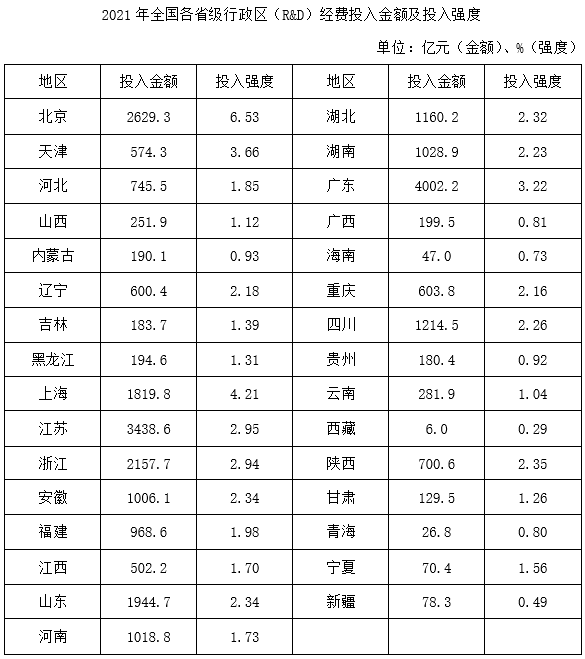

### 第 86 题

2021年，全国研究与试验发展（R&D）经费约比2019年增长了（ ）。

A. 22.1%

B. 24.8%

C. 26.3%

D. 31.3%

第 86 题 · 答案与解析

**参考答案（粉笔题库参考内容）**

C

**解析**

根据题干“2021年······约比2019年增长了”，结合选项为百分数，可判定本题为间隔增长率问题。定位文字材料第一段可得：2021年，全国投入研究与试验发展（R&D）经费同比增长14.6%（），增速比上年加快4.4个百分点。则2020年，全国投入研究与试验发展（R&D）经费同比增长14.6%-4.4%=10.2%（）。根据公式：，可得所求。

故正确答案为C。

### 第 87 题

关于2021年全国①基础研究经费和②试验发展经费占研究与试验发展（R&D）经费的比重与上年相比的情况，以下描述正确的是（ ）。

A. 仅①高于上年水平

B. 仅②高于上年水平

C. ①和②均高于上年水平

D. ①和②均低于上年水平

第 87 题 · 答案与解析

**参考答案（粉笔题库参考内容）**

A

**解析**

根据题干“关于2021年······占······比重与上年相比······”，可判定本题为两期比重问题。定位文字材料第一段可得：2021年，全国共投入研究与试验发展（R&D）经费同比增长14.6%；定位文字材料第二段可得：（2021年）基础研究经费所占比重为6.50%，比上年提升0.49个百分点；试验发展经费同比增长14.0%。则2021年全国基础研究经费占研究与试验发展（R&D）经费的比重与上年相比上升。根据两期比重比较结论：部分增长率<总体增长率，则比重下降，14.0%<14.6%，即2021年全国试验发展经费占研究与试验发展（R&D）经费的比重与上年相比下降。综上可知，2021年仅①基础研究经费的占比高于上年。

故正确答案为A。

### 第 88 题

2021年，研究与试验发展（R&D）经费投入强度高于全国总体水平的省级行政区有几个?

A. 3

B. 4

C. 5

D. 6

第 88 题 · 答案与解析

**参考答案（粉笔题库参考内容）**

D

**解析**

定位文字材料第一段可得：2021年，全国研究与试验发展（R&D）经费投入强度（与GDP之比）为2.44%；定位统计表可得：2021年，研究与试验发展（R&D）经费投入强度高于全国总体水平（2.44%）的省级行政区有北京（6.53%）、天津（3.66%）、上海（4.21%）、江苏（2.95%）、浙江（2.94%）、广东（3.22%），共6个。

故正确答案为D。

### 第 89 题

2021年，安徽GDP约是宁夏的多少倍？

A. 10

B. 15

C. 21

D. 26

第 89 题 · 答案与解析

**参考答案（粉笔题库参考内容）**

A

**解析**

根据题干“2021年······是······多少倍”，结合材料时间为2021年，可判定本题为现期倍数问题。定位统计表可得：（2021年）安徽共投入研究与试验发展（R&D）经费1006.1亿元，投入强度（与GDP之比）为2.34%；宁夏共投入研究与试验发展（R&D）经费70.4亿元，投入强度（与GDP之比）为1.56%。根据公式：整体，可得所求倍数倍。

故正确答案为A。

### 第 90 题

下列饼图反映了哪三个同一区域内的省级行政区2021年研究与试验发展（R&D）经费的占比关系？

A. 北京、天津、河北

B. 陕西、甘肃、宁夏

C. 黑龙江、吉林、辽宁

D. 江苏、浙江、上海

第 90 题 · 答案与解析

**参考答案（粉笔题库参考内容）**

D

**解析**

根据题干“······2021年······占比关系”，结合材料时间为2021年，可判定本题为现期比重问题。定位统计表可得2021年全国各省级行政区研究与试验发展（R&D）经费投入金额。结合饼图可知，三个省级行政区中，投入最高地区的经费金额小于其他两个区域之和，则各选项中大小关系分别为：

A项，北京的经费投入金额为2629.3亿元、天津的经费投入金额为574.3亿元、河北的经费投入金额为745.5亿元，2629.3>574.3+745.5，不满足题意，排除；

B项，陕西的经费投入金额为700.6亿元、甘肃的经费投入金额为129.5亿元、宁夏的经费投入金额为70.4亿元，700.6>129.5+70.4，不满足题意，排除；

C项，黑龙江的经费投入金额为194.6亿元、吉林的经费投入金额为183.7亿元、辽宁的经费投入金额为600.4亿元，600.4>194.6+183.7，不满足题意，排除；

D项，江苏的经费投入金额为3438.6亿元、浙江的经费投入金额为2157.7亿元、上海的经费投入金额为1819.8亿元，3438.6<2157.7+1819.8，满足题意，当选。

故正确答案为D。

## 材料 3

2022年，全国居民人均可支配收入36883元，同比增长5.0%。分城乡看，城镇居民人均可支配收入49283元，同比增长3.9%；农村居民人均可支配收入20133元，同比增长6.3%。

按收入来源分，2022年，全国居民人均工资性收入同比增长4.9%，占可支配收入的比重为55.8%；人均经营净收入同比增长4.8%，占可支配收入的比重为16.7%；人均财产净收入同比增长4.9%，占可支配收入的比重为8.8%；人均转移净收人同比增长5.5%，占可支配收入的比重为18.7%。

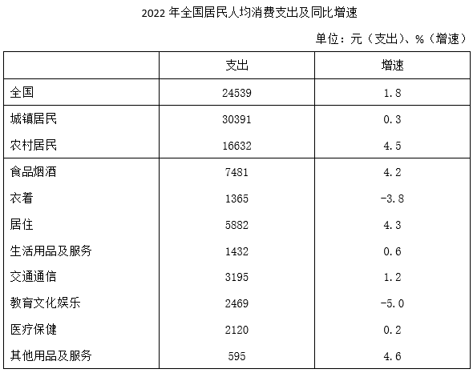

### 第 91 题

2022年，全国居民人均工资性收入同比增加了（ ）。

A. 不到800元

B. 800~1200元之间

C. 1200~1600元之间

D. 1600元以上

第 91 题 · 答案与解析

**参考答案（粉笔题库参考内容）**

B

**解析**

根据题干“2022年······同比增加了”，结合选项为具体单位，可判定本题为增长量计算问题。定位文字材料第一段可得：2022年，全国居民人均可支配收入36883元；定位文字材料第二段可得：2022年，全国居民人均工资性收入同比增长4.9%，占可支配收入的比重为55.8%。根据公式：部分=整体×比重，增长量，则题干所求为元，在B项范围内。

故正确答案为B。

### 第 92 题

2022年在全国①城镇居民收支差（收入-支出）和②农村居民收支差中，高于2021年水平的有哪些项？（ ）

A. 仅①高于2021年水平

B. 仅②高于2021年水平

C. ①和②均高于2021年水平

D. ①和②均不高于2021年水平

第 92 题 · 答案与解析

**参考答案（粉笔题库参考内容）**

C

**解析**

根据题干“2022年······收支差（收入-支出）······高于2021年水平······”，即需要2022年收支差>2021年收支差，可转化为2022年收支差同比增长率>0。因收支差=收入-支出，则收入=支出+收支差。结合材料给出收入与支出的同比增速，可判定本题为混合增长率问题。

定位文字材料第一段可得：2022年，全国城镇居民人均可支配收入同比增长3.9%；农村居民人均可支配收入同比增长6.3%。定位统计表可得：2022年，全国城镇居民人均消费支出同比增长0.3%；农村居民人均消费支出同比增长4.5%。根据混合增长率口诀“混合后居中”可知，；。

则2022年在全国①城镇居民收支差（收入-支出）和②农村居民收支差中，高于2021年水平的有①和②。

故正确答案为C。

### 第 93 题

2022年全国居民8类人均消费支出中，人均支出额超过人均总支出额10%的有几类？（ ）

A. 2

B. 3

C. 4

D. 5

第 93 题 · 答案与解析

**参考答案（粉笔题库参考内容）**

C

**解析**

根据题干“2022年······人均支出额超过人均总支出额10%······”，结合材料时间为2022年，可判定本题为现期比重问题。定位统计表可得：2022年，全国居民人均消费支出24539元。根据公式：部分=整体×比重，则2022年全国居民人均消费总支出的10%=24539×10%=2453.9元。故2022年全国居民8类人均消费支出中，人均支出额超过人均总支出额10%的有：食品烟酒（7481元），居住（5882元），交通通信（3195元），教育文化娱乐（2469元），共4类。

故正确答案为C。

### 第 94 题

假设城镇居民和农村居民各类人均消费支出占其总体人均消费支出的比重是相同的，则2022年全国农村居民人均衣着、食品烟酒和居住类支出之和约为多少万元?（ ）

A. 0.6

B. 0.8

C. 1.0

D. 1.3

第 94 题 · 答案与解析

**参考答案（粉笔题库参考内容）**

C

**解析**

根据题干“······占······比重······则2022年······支出之和约为多少万元，结合材料时间为2022年，可判定本题为现期比重问题。定位统计表可得：2022年，全国居民人均消费支出24539元，农村居民16632元，食品烟酒7481元，衣着1365元，居住5882元。

根据题干“城镇居民和农村居民各类人均消费支出占其总体人均消费支出的比重是相同的”与混合比重思维可知，。根据公式：部分=整体×比重，比重，可知题干所求元=1.0万元。

故正确答案为C。

### 第 95 题

以下饼图中，能够准确反映2022年全国居民人均消费支出总额中，人均食品烟酒支出（灰色）、人均居住支出（黑色）以及剩余各项人均支出之和（白色）占比关系的是（ ）。

A. 

B. 

C. 

D. 

第 95 题 · 答案与解析

**参考答案（粉笔题库参考内容）**

D

**解析**

根据题干“以下饼图中······2022年全国居民人均消费支出总额中······占比关系的是”，可判定本题为现期比重问题。定位统计表可得：2022年，全国居民人均消费支出24539元，食品烟酒7481元，居住5882元。通过观察可知，人均食品烟酒支出7481元（灰色)>人均居住支出5882元（黑色），排除A、C两项；根据公式：比重，则，即人均食品烟酒支出（灰色）和人均居住支出（黑色）之和占比超过一半，排除B项。

故正确答案为D。

## 材料 4

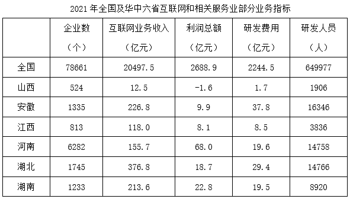

### 第 96 题

2021年，华中六省共有互联网和相关服务业企业多少家？

A. 不到1.15万家

B. 1.15万-1.2万家之间

C. 1.2万-1.25万家之间

D. 超过1.25万家

第 96 题 · 答案与解析

**参考答案（粉笔题库参考内容）**

B

**解析**

定位表格材料可得：2021年华中六省互联网和相关服务业企业数分别为524个、1335个、813个、6282个、1745个、1233个。则所求万家，在B项范围内。

故正确答案为B。

### 第 97 题

华中六省中，2021年互联网和相关服务业研发费用超过互联网业务收入10%的有几个?

A. 2

B. 3

C. 4

D. 5

第 97 题 · 答案与解析

**参考答案（粉笔题库参考内容）**

B

**解析**

根据题干“······2021年······超过互联网业务收入10%的有几个”，结合材料时间为2021年，可判定本题为现期比重问题。定位表格材料可得2021年华中六省互联网和相关服务业的互联网业务收入和研发费用。根据公式：部分=整体×比重，要求研发费用超过互联网业务收入10%，则所求需满足：研发费用>互联网业务收入×10%，验证如下：

山西，1.7亿元>12.5×10%=1.25亿元，符合；

安徽，37.8亿元>226.8×10%=22.68亿元，符合；

江西，8.5亿元<118.0×10%=11.8亿元，不符合；

河南，19.6亿元>155.7×10%=15.57亿元，符合；

湖北，29.4亿元<376.8×10%=37.68亿元，不符合；

湖南，19.5亿元<213.6×10%=21.36亿元，不符合。

综上可知，华中六省中，2021年互联网和相关服务业研发费用超过互联网业务收入10%的有3个。

故正确答案为B。

### 第 98 题

2021年华中六省互联网和相关服务业利润率（）最高的省份，其利润率约比全国平均水平高多少个百分点？

A. 16

B. 21

C. 26

D. 31

第 98 题 · 答案与解析

**参考答案（粉笔题库参考内容）**

D

**解析**

根据题干“2021年······利润率（）最高的省份，其利润率约比全国平均水平高多少个百分点”，结合材料时间为2021年，可判定本题为现期比重问题。定位表格材料可得2021年全国及华中六省互联网和相关服务业的互联网业务收入和利润总额。根据利润率，则华中六省利润率分别为：山西，；安徽，；江西，；河南，；湖北，；湖南，，比较可知，2021年华中六省互联网和相关服务业利润率最高的省份为河南，其利润率约比全国平均水平高，即约高31个百分点。

故正确答案为D。

### 第 99 题

2021年华中六省互联网和相关服务业平均每个企业研发人员最多的省份，其平均每名研发人员分配到的研发费用在华中六省中排名第几？

A. 1

B. 2

C. 3

D. 4

第 99 题 · 答案与解析

**参考答案（粉笔题库参考内容）**

A

**解析**

根据题干“2021年······平均每个企业研发人员最多的省份，其平均每名研发人员分配到的研发费用······”，结合材料时间为2021年，可判定本题为现期平均数问题。定位表格材料可得2021年华中六省互联网和相关服务业的企业数、研发费用、研发人员数量。根据平均每个企业研发人员数量，则华中六省互联网和相关服务业平均每个企业研发人员分别为：山西，；安徽，；江西，；河南，；湖北，；湖南，，则2021年华中六省互联网和相关服务业平均每个企业研发人员最多的省份为安徽。

根据平均每名研发人员分配到的研发费用，则华中六省平均每名研发人员分配到的研发费用分别为：

山西，万；

安徽，万；

江西，万；

河南，万；

湖北，万；

湖南，万。

比较可知，安徽平均每名研发人员分配到的研发费用在华中六省中排名第1。

故正确答案为A。

### 第 100 题

关于2021年全国和华中六省互联网和相关服务业发展状况，能够从上述资料中推出的是（ ）。

A. 华中六省利润总额占全国比重超过一成

B. 全国平均每个企业的研发费用超过300万元

C. 华中六省研发费用超过利润总额的省份仅有3个

D. 安徽、湖北研发人员数量超过华中六省总数量的一半

第 100 题 · 答案与解析

**参考答案（粉笔题库参考内容）**

D

**解析**

A项：定位表格材料可得，2021年全国及华中六省互联网和相关服务业的利润总额。则2021年华中六省利润总额=（-1.6）+9.9+8.1+68.0+18.7+22.8=125.9亿元。根据公式：比重，则华中六省利润总额占全国比重为，即不到一成，错误；

B项：定位表格材料可得，2021年全国互联网和相关服务业的企业数为78661个，研发费用为2244.5亿元。根据平均每个企业的研发费用，则所求亿=290万元<300万元，错误；

C项：定位表格材料可得，2021年华中六省互联网和相关服务业的利润总额和研发费用。比较可知，华中六省研发费用超过利润总额的省份为山西（1.7亿元>-1.6亿元）、安徽（37.8亿元>9.9亿元）、江西（8.5亿元>8.1亿元）、湖北（29.4亿元>18.7亿元），共4个省份，错误；

D项：定位表格材料可得，2021年华中六省互联网和相关服务业的研发人员数量。则华中六省研发人员总数量=1906+16346+3836人，根据公式：部分=整体×比重，则华中六省研发人员总数量的一半为60500×50%=30250人，安徽、湖北研发人员数量为人>30250人，正确。

故正确答案为D。

