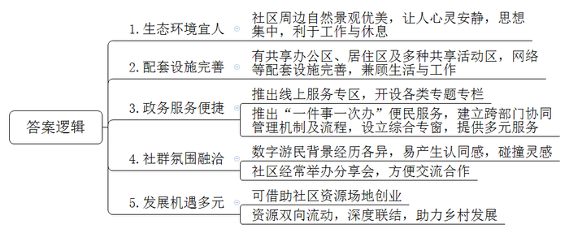
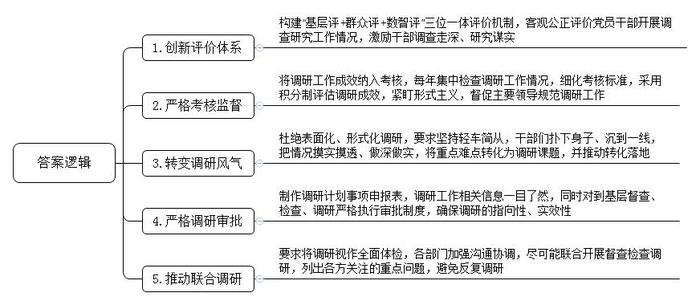
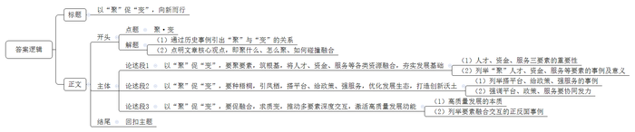

# 2025年公务员多省联考《申论》题（重庆一卷）

> 候选采集稿。参考答案及解析来自粉笔页面，不代表官方答案或真实高分答卷；来源使用许可与原卷对应关系仍需人工核实。

## 给定材料

### 材料 material-2f379a6218689691

黛湖社区是一个位于A区B村的数字游民社区。上午9时许，城市里早高峰的喧嚣还未退去，社区已经以另一种节奏开启了新的一天。明亮的共享办公区飘散着咖啡香，陆续有年轻人来到这里，有的围坐在圆桌旁展开讨论，有的敲着键盘沉浸于工作。推开门，外面便是绿树成荫、河水潺潺的美景。“这样的环境，仿佛置身于大自然的怀抱，让人心灵安静，思想集中，累了也能得到更好的休息。”设计师小李说。

数字游民，是指利用现代信息技术进行远程工作，不受工作地点束缚，凭着移动设备闯天下的人。“数字时代重塑了人与空间的关系，人与空间的联结更灵活、更多元。”程序员小石表示，“相比大城市到处可见的钢筋水泥，我更喜欢这里的绿水青山、鸟语花香。”小石来了3个星期，对这里已经熟悉了，周末还会和社区的伙伴们到村子里教小朋友弹吉他、画国画。“小朋友们很喜欢我们，有些大人也开始跟着学了，乡村的周末开始有了文艺风。”小石笑着说。

为了建设数字游民社区，区政府引进一家经验丰富的公司进行合作。“我们一开始就明确要求，要把这里打造成兼顾生活与工作、共居共创的理想栖息地。”区团委沈书记兼任数字游民社区专班负责人，负责统筹社区建设和发展的各项事务。沈书记说：“现在，社区内除了办公区和居住区，还建有小剧场、图书馆、会议室等共享活动区。”一年前，社区正式对外开放，区政府同步推出数字游民社区线上服务专区，开设社区服务、特色活动、资源对接等专题专栏，为数字游民提供精准专属服务，很快就有300余人报名。“他们来自全国各地、各行各业，拥有不同知识背景和经历，相互吸引，更容易产生出灵感的火花。同为数字游民，大家很容易产生认同感。”沈书记说，社区经常举办分享会，供大家交流经验，分享资源，或发布创业设想，帮助招募合伙人。

来自北京的小颜是一名保险经理人，她的工作是为客户提供养老规划。“在这里，我不仅新认识了生活中的朋友，也迅速找到了事业上的合伙人。”小颜说。在和另一名社区成员愉快相处的过程中，她获得了灵感。“这里有令人心驰神往的自然环境，也有开放包容的人文环境，可以在社区附近引入面向老年人的旅游兼居住项目。”小颜在社区分享会上提出了自己的想法，很快就和社区内有意向的游民达成合作。不久前，项目正式落地，迎来第一批客人。

“以前只有社区的人来喝咖啡，现在村子里来喝咖啡的人也多了起来。”数字游民小姚是一位咖啡师，借助社区的资源和场地实现了开一家咖啡店的梦想，如今店里聘用了八位当地村民，每月利润上万元。回想起当初办理营业执照的经历时，小姚忍不住夸赞：“我申请办理营业执照的当天，政府工作人员就把事情圆满办结，真正做到了‘只跑一次’，省时省力。”而这份高效源于区政务办联合社区所在镇政府共同推出的数字游民“一件事一次办”便民服务。区政府建立了跨部门协同管理机制和工作流程，设立数字游民“一件事一次办”综合专窗，提供社保医保参保、灵活就业登记、薪资劳动纠纷调解等服务。“数字游民很多是有想法、有技能的创业者或是想在乡村发展事业的探索者。”区政务办陈主任说，当地正持续改善营商环境，推动数字游民与乡村产生更多的联结，将数字游民吸纳到乡村振兴“人才池”，助力乡村发展。

黛湖社区是在B村旧茶厂的基础上扩建起来的，每年收取租金，村里还参与了社区的共享食堂投资建设，这为村集体每年带来20多万元的收入。村民老祝在黛湖社区当了一年保安，对数字游民的认识越来越深：“刚来社区工作时，我不明白什么叫‘数字游民’，后来才知道是只要有电脑就能工作的人。”老祝和很多数字游民熟悉起来了，经常帮他们接收快递、跑跑腿，“他们从老远的地方来，也挺不容易的，尽量帮帮他们。”村里还有不少像老祝这样的村民在黛湖社区工作，每月能拿到一份固定的工资。“我们这里有风景有地方，就是人气不够。”让老祝印象最深的是，自从社区建立以来，村子里热闹了起来，数字游民来了，参观游览的人也来了，村子里开起了好几家小吃店，村民种的蔬菜、水果也不用再挑到镇上去卖了，常常是刚采摘，就被数字游民们一抢而光。

“社区搭起年轻人与乡村‘双向奔赴’的桥梁，促进资源双向流动。”沈书记说。让他感到高兴的是，这群年轻人和当地村民的互动也在不断加深：社区里的年轻人会帮经常去的几家餐厅设计海报、门头、菜单等，他们还在网络平台直播村周边的吃喝游玩地、介绍村子里的特产……“5G网络已经实现了全覆盖，通往高速公路的道路正在拓宽，配套设施也在不断完善，工作生活将更加方便。”沈书记表示，B村数字游民社区二期项目建设正加快推进，将进一步盘活闲置农房等乡村存量资产资源，深化与村集体经济组织的合作，探索乡村振兴新模式。“届时将吸引更多年轻人‘游’来、留下，为美丽的乡村增添青春的亮眼色彩。”

### 材料 material-b82fbb5d635218e9

又是一年秋至，小麦到了收割的时间。“搁几年前，大中午也得下地干活，忙得团团转。”C县大雷村的村民老刘说，“如今从种到收再到销售，全过程托管，省心又省力。”老刘每天送完孙子去上学，就到村里的股份经济合作社打工。在老刘看来，合作社真是帮他解决了大问题。

老刘是当地种庄稼有名的“老把式”，自家的田地他都坚持自己耕种，后来随着年龄越来越大，儿女也一直在外工作，他逐渐感到有些力不从心了。“年轻人纷纷去城里打拼，村里种地的人越来越少。”村党支部叶书记表示，“当时，连老刘这种愿意种地的人都坚持不下去了。”

“为了有效破解我县农村农业发展的难题，我们引进了新的经营主体，积极开展多种形式的农业社会化服务。”县农业农村局韩局长介绍，2023年初，C县推广农业社会化服务的东风吹到了大雷村。在村党支部的推动下，大雷村很快成立了股份经济合作社，向村民提供农业生产托管服务。当年春耕开始前，就有120户村民与合作社签订合同，托管土地1万余亩。“不瞒你们，一开始我是反对的。”老刘有些不好意思，“我种了这么多年的地，他们能有我种得好吗？”为了动员老刘，叶书记开出条件：带地入社，还可以在合作社当农机手。老刘依然没松口。到了秋收，老刘发现，自己种的地和合作社的托管地紧挨着，收成却大不相同——托管地玉米每亩多收了50斤，大豆每亩多收了20斤。原来，除了提供托管服务、为农户统一供应农资农具、耕种及病虫害防治等服务外，合作社还聘请了省农业大学教授进行技术指导，大力推广一喷多防、水肥一体、智慧农机等大面积集成绿色增产技术，让高效农业新技术落到了田间地头。“比我们靠老经验好多了！”老刘说。第二年春耕前，不用人劝，老刘早早来到合作社，交钱、签单，把土地全部托管。至此，大雷村实现整村托管。

C县农田长期分散种植经营，东一块、西一块，田埂沟渠不但浪费耕地，也妨碍大规模机械化作业。“土地流转给合作社后，合作社开展细碎化整治工作，把一块一块的田地集中连片。”韩局长说，这不仅提高了土地利用率，也为开展大规模机械化工作奠定了基础。在大雷村，全村粮食生产由农户单家独户种植变为全村范围内集中连片规模种植。昔日的小田块被连片开阔的大田所替代，田块成方，沟渠成网，一望无际的金黄色麦田里，一台台无人驾驶的联合收割机正来回穿梭，构成一幅生机勃勃的乡村画面。合作社共流转土地3000余亩，其中通过整合边角零碎土地，为村集体新增耕地资源约200亩，不仅实现了“小田”变“大田”，每年还可为村集体增收20余万元。“利用这些新增加的收入，村里办起了小麦加工厂。”叶书记说，“以往农村产业链比较短，从小麦身上赚到的钱不多，现在有了小麦加工厂，就可以赚更多的钱了。”

“看，今年的小麦麦粒多饱满！”C县春华种植专业合作社社长老沈站在麦田里，把麦穗放在手里搓碎，又轻轻吹净麦皮，一把泛着清香的麦粒呈现在他的掌心。“今年种的是最新品种，通过科学种植，亩产可以达到1400斤，比去年平均亩产量多出了近200斤！”老沈的语气里透露着欣喜，“过去农户买种子，价格一直谈不下来。但我们现在是大批量购买，哪怕是新品种，价格也能优惠很多。不光是种子，农药、农具等农资，合作社去谈都能便宜不少。”在老沈看来，有了规模优势，农业生产的成本远远低于分散种植。就拿浇水来说，小麦返青、拔节、灌浆三个关键时期，要是都浇足水了，一亩就能多收两三百斤麦子。但浇一亩地一次得花100元左右，很多老百姓会少浇甚至“看天吃饭”。合作社把土地集中连片后，全面铺开改闸改水、水管铺设等基础设施建设，采取数字监控等科技手段，按需及时浇水，实现了每亩种植成本降低13%、粮食增产11%。

“丰收了也不愁不好卖。”老沈说，“以往农民自己去卖小麦，在市场上没有议价权，卖不上价格不说，还要额外付运输费、劳务费，我们合作社目前与一家农业产业化龙头企业合作，他们统一上门收购，每斤小麦还多卖5分钱。”

借助数字化时代浪潮推动农业社会化服务迈上新台阶，C县正在行动。“我县强化全域数字化服务，积极探索智慧农业建设，整合卫星遥感、北斗导航、多光谱分析、物联网、气象监测等技术，构建集采集、分析、预警、决策于一体的数字化动态监测体系，使社会化服务更加科学和精细。”韩局长表示，农业社会化服务让小农户也能搭上现代农业的快车，为推进乡村全面振兴注入了强劲动能。

### 材料 material-bfd076d297ba1b2f

“现在的调研越来越规范了，都是带着问题来，实地看情况，然后协调相关部门帮助解决。书面调研也不再对字数有硬性要求，而是统一下发模板，大家只需填上相关数据，逐条列出问题、工作方向就行，更加简洁了。”D县汝溪乡党委阳书记说。不久前，县领导带着调研组来汝溪乡调研农村基础设施建设，调研后帮助乡里硬化了12公里道路，改造升级了三个村的自来水管道。“和从前不一样了，我们现在是盼着领导来调研。”阳书记说。

转变源自D县制定的“做实每一项”调研工作机制。县委在调研工作机制中融入“基层评、群众评、数智评”的“三位一体”评价体系，客观公正评价党员干部开展调查研究工作情况，激励干部调查走深、研究谋实。县纪委将“做实每一项”调研工作成效纳入考核，每年集中检查县直单位和部门开展调研工作情况，细化考核标准，采用积分制评估县直单位调研成效，紧盯调研活动中的形式主义，督促主要领导规范本单位、本部门调研工作。“现在的调研要求坚持轻车简从，干部们必须下足真功夫，扑下身子、沉到一线，把情况摸实摸透、做深做实。”县纪委鲁书记表示，“接下来，我们将持续紧盯调研工作，抓好监督，查处不规范调研等问题，为基层减负松绑。”

说到调研风气的变化，福春镇党委孙书记也感触颇深。他坦言，以前的一些调研活动重点在于提交高要求的调研文章，这不仅给基层干部增加了负担，还让工作流于表面。“现在，我们按照‘做实每一项’的调研工作要求，让干部真正沉下去发现问题，将群众急难愁盼、镇村发展等重点难点转化为调研课题，然后想办法去解决。”为此，福春镇梳理了一批调研事项，由镇干部立足村情实际、群众所盼、干部所能、职责所在，围绕招商引才、低效土地盘活等项目化工作开展调研，让干部把更多精力聚焦到镇村经济社会发展上，减少低效调研。前不久，镇里就将黄沙村的“招引服务车厘子项目落地”纳入村调研规划，通过协调网格团队、镇村农业骨干、县农业农村局专家组建调研组，帮助车厘子项目成功落地。过去一年，福春镇12个调研主题全部转化落地。

截至2024年底，D县形成了特色商业外摆、打造汽车零部件行业资源共享等一大批接地气、解民忧的调研成果，全县各级党员干部的调研课题和认领难题办结率超95%。

“您觉得咱们小区垃圾分类情况怎么样？环保小屋设置方便吗？”在D县富华新城小区内的环保小屋前，调研组组长、县生态环境局赵局长正向居民了解情况。调研组由县生态环境、卫生、住建部门的4名同志组成，主要就生活垃圾分类管理进行调研。他们实地走访了厨余垃圾投放点、环保小屋、垃圾中转站、处理场、餐厨废弃物综合处理中心，并同社区居民、相关工作人员进行了交流。“调研组直奔一线查看生活垃圾的分类处理过程，和我们面对面了解情况，从全流程操作到我们的工作细节，问的问题都很实在，我们也没啥额外的负担。”垃圾处理场工作人员小马介绍。调研发现，部分居民对生活垃圾分类嫌麻烦，不够自觉，生活垃圾分类的设施和网点基本齐备，但分类分拣设备还不够完善，处理能力有待提高。赵局长说，“我们将出台针对性的整改措施，提高生活垃圾处理能力，明确主体责任，落实奖惩制度，真正解决生活垃圾分类及处置问题。”

在此次调研开展前，县生态环境局按“做实每一项”调研机制的规定，提交了调研计划事项申报表。在这张表上，调研名称、计划开展时间、牵头单位和参加单位、开展方式及对象范围、开展依据等信息一目了然。“县里对到基层督查、检查、调研严格执行审批制度，确保调研的指向性和实效性。”赵局长表示。除了对单独部门的调研作出规定，D县还要求各部门各单位加强沟通协调，尽可能联合开展督查检查调研。“一次调研就是一次全面体检，这样可以避免同一件事反复调研。”调研组出发前多次与发展改革、自然资源、商务和交通运输等部门沟通，列出各方关注的重点问题。“调研成果落了地，解决了问题，调研工作才能谈得上做实。”鲁书记说。

## 题目

### 第 1 题

**请根据****“给定资料**1**”，谈谈黛湖社区为什么能吸引数字游民“‘游’来、留下”。（15分）**

关联材料：material-2f379a6218689691

作答要求：

要求：分析全面，条理清晰。不超过300字。

### 第 2 题

**请根据****“给定资料**2**”，谈谈C县通过农业社会化服务破解了本地农村农业发展的哪些难题，又是如何破解的？（20分）**

关联材料：material-b82fbb5d635218e9

作答要求：

要求：

（1）提炼准确，归纳合理；

（2）层次分明，分条表述；

（3）不超过350字。

### 第 3 题

**请根据****“给定资料**3**”，谈谈D县“做实每一项”调研工作机制的“做实”体现在哪些地方？（25分）**

关联材料：material-bfd076d297ba1b2f

作答要求：

要求：全面、准确、有条理。不超过400字。

### 第 4 题

**不同的要素汇聚在一起时，可能会相互影响、碰撞融合，进而催生新变化。请以****“聚·变”为主题，参考全部给定资料，联系实际，自选角度，自拟题目，写一篇文章。（40分）**

关联材料：material-2f379a6218689691

作答要求：

要求：

（1）观点明确，见解深刻；

（2）参考给定资料，但不拘泥于给定资料；

（3）思路清晰，语言流畅；

（4）总字数1000-1200字。

## 答案与解析

第 1 题

**参考答案（粉笔题库参考内容）**

1.生态环境宜人。社区周边自然景观优美，让人心灵安静，思想集中，利于工作与休息。

2.配套设施完善。有共享办公区、居住区及多种共享活动区，网络等配套设施完善，兼顾生活与工作。

3.政务服务便捷。推出线上服务专区，开设各类专题专栏；推出“一件事一次办”便民服务，建立跨部门协同管理机制及流程，设立综合专窗，提供多元服务。

4.社群氛围融洽。数字游民背景经历各异，易产生认同感，碰撞灵感；社区经常举办分享会，方便交流合作。

5.发展机遇多元。可借助社区资源场地创业；资源双向流动，深度联结，助力乡村发展。

**解析**

**参考答案说明**：本参考答案从“生态环境宜人”“配套设施完善”“政务服务便捷”“社群氛围融洽”“发展机遇多元”五个方面展开。各条答案要点之间在内容上相互并列，没有交叉。

**考点**：考点原因类

**来源**：来源2025年公务员多省联考《申论》题（重庆一卷）

粉笔申论页面对本题只提供「解析视频」入口，该入口是会员推广位，页面无视频地址与文字解析。

第 2 题

**参考答案（粉笔题库参考内容）**

难题：

1.劳动力短缺。年轻人外出务工，乡村空心化。

2.分散种植经营。浪费耕地，妨碍大规模机械化作业；农资价格贵，生产成本高。

3.农村产业链短。农作物种植收入少。

4.销售困难。缺少议价权，销售价格低，额外付运输费、劳务费。

措施：

1.推动土地托管。成立股份经济合作社，提供农业生产托管服务；聘请专家进行技术指导，推广大面积集成绿色增产技术，让高效农业新技术落到田间地头。

2.规模化生产种植。流转土地，开展细碎化整治，田地集中连片，提高土地利用率，推动机械化种植；大批量采购农资，降低农业生产成本；全面完善基础设施建设，利用科技手段，降本增产。

3.延长产业链。建设加工厂，增加收入。

4.拓展销售渠道。合作社与农业产业化龙头企业合作，统一上门收购，提高产品售卖价格。

**解析**

**参考答案说明：**本参考答案分为“难题”和“措施”两个部分。其中“难题”部分从“劳动力短缺”“分散种植经营”“农村产业链短”“销售困难”四个方面展开；“措施”部分从“推动土地托管”“规模化成产种植”“延长产业链”“拓展销售渠道”四个方面展开。本参考答案做到了分类分条撰写，各条答案要点之间在内容上相互并列，没有交叉。

**考点**：考点多要素组合类

**来源**：来源2025年公务员多省联考《申论》题（重庆一卷）

粉笔申论页面对本题只提供「解析视频」入口，该入口是会员推广位，页面无视频地址与文字解析。

第 3 题

**参考答案（粉笔题库参考内容）**

1.创新评价体系。构建“基层评+群众评+数智评”三位一体评价机制，客观公正评价党员干部开展调查研究工作情况，激励干部调查走深、研究谋实。

2.严格考核监督。将调研工作成效纳入考核，每年集中检查调研工作情况，细化考核标准，采用积分制评估调研成效，紧盯形式主义，督促主要领导规范调研工作。

3.转变调研风气。杜绝表面化、形式化调研，要求坚持轻车简从，干部们扑下身子、沉到一线，把情况摸实摸透、做深做实，将重点难点转化为调研课题，并推动转化落地。

4.严格调研审批。制作调研计划事项申报表，调研工作相关信息一目了然，同时对到基层督查、检查、调研严格执行审批制度，确保调研的指向性、实效性。

5.推动联合调研。要求将调研视作全面体检，各部门加强沟通协调，尽可能联合开展督查检查调研，列出各方关注的重点问题，避免反复调研。

**解析**

**参考答案说明**：本参考答案从“创新评价体系”“严格考核监督”“转变调研风气”“严格调研审批”“推动联合调研”这五个方面展开，各条答案要点之间在内容上相互并列，没有交叉。

**考点**：考点概括措施类

**来源**：来源2025年公务员多省联考《申论》题（重庆一卷）

粉笔申论页面对本题只提供「解析视频」入口，该入口是会员推广位，页面无视频地址与文字解析。

第 4 题

**参考答案（粉笔题库参考内容）**

**以****“聚”促“变”，向新而行**

从春秋战国百家争鸣催生思想大解放，到工业革命时期技术、资本、劳动力的聚合引发生产力质变，历史实践反复印证：聚是变的序章，变是聚的华章，当多元要素如溪流汇聚，必然激荡出变革的浪花。时代发展的今天，要知道聚什么，怎么聚，还要知道如何碰撞融合。

**以****“聚”促“变”，要****聚要素，筑根基****，将****人才、资金、服务****等各类资源融合****，夯实发展基础****。**人才是第一资源，如同生产的引擎，提供源源不断的动力；服务是连接的纽带，串联资源网络，让各环节紧密连接，齿轮相和；资金是发展的润滑剂，滋养产业机体，让各环节畅通无阻，紧密配合，三者缺一不可。杭州未来科技城通过“人才+资本+孵化”模式，五年内集聚上万名海归人才，带动千亿级数字经济产业集群建设，诠释了要素协同的乘数效应。当人才获得资金支持与服务保障，当资本找到技术载体与政策依托，发展基础便如钢筋混凝土般坚实，就能为质变提供持久支撑。

**以****“聚”促“变”，要种梧桐****，引凤栖****，****搭平台、给政策、强服务，****优化发展生态，****打造创新沃土。**杭州未来科技城通过建设人工智能小镇，三年内集聚科创企业上千家，形成产业链“葡萄串效应”；深圳对战略新兴产业实施“三免三减半”税收优惠，吸引相关领域投资超千亿元，用政策杠杆撬动市场发展；苏州工业园推行“全生命周期”服务模式，企业开办时限压缩至半个工作日，吸引大量外资企业加入。平台是载体，政策是催化剂，服务是粘合剂，当三者协同发力时，就能形成百亿级产业集群。唯有通过生态闭环的建设，形成“磁场效应”，才能实现物理层面的聚集。

**以****“聚”促“变”，要****促融合，求质变****，****推动****多****要素深度交互，激活高质量发展动能****。**高质量发展本质是要促进要素碰撞，产生火花，引发质变。苏州工业园区的某汽车零部件制造企业，由于研发部门的设计数据与生产部门的系统未打通，导致新产品从设计到量产需要重复建模、人工转换数据，拖长了投产周期，而深圳光明科学城通过建立“产业-高校-实验室”三维对接平台，强化内部协作与沟通，将科研成果转化周期压缩，充分说明了要素深度交互，才能产生倍增效应。要素的简单叠加仅产生算术级增长，而有机融合才能触发几何级质变。

“聚”是“变”的前提，“变”是“聚”的目标，未来，唯有以系统思维编织要素网络，方能让每一次聚合都成为质变的序曲，在变革浪潮中向新而行。

**解析**

**文章分析**

**以****“聚”促“变”，向新而行**

【**标题的优点：**首先，范文的标题突出了“聚·变”这一主题。其次，形式上，文字简洁明快，不拖沓。】

（1）从春秋战国百家争鸣催生思想大解放，到工业革命时期技术、资本、劳动力的聚合引发生产力质变，历史实践反复印证：聚是变的序章，变是聚的华章，当多元要素如溪流汇聚，必然激荡出变革的浪花。（2）时代发展的今天，要知道聚什么，怎么聚，还要知道如何碰撞融合。

【**开头的优点：**★内容方面：范文的开头是紧扣“聚·变”这一主题展开的。首先，开头点出主题，做到了主题明确。其次，对“聚·变”这一主题进行了分析阐述：（1）通过历史事例引出“聚”与“变”的关系；（2）点明文章核心观点，即聚什么、怎么聚、如何碰撞融合。★文字表达方面：长短句配合使用，使语言表达有节奏感。】

**以****“聚”促“变”，要聚要素，筑根基，将人才、资金、服务等各类资源融合，夯实发展基础。**（1）人才是第一资源，如同生产的引擎，提供源源不断的动力；服务是连接的纽带，串联资源网络，让各环节紧密连接，齿轮相和；资金是发展的润滑剂，滋养产业机体，让各环节畅通无阻，紧密配合，三者缺一不可。（2）杭州未来科技城通过“人才+资本+孵化”模式，五年内集聚上万名海归人才，带动千亿级数字经济产业集群建设，诠释了要素协同的乘数效应。当人才获得资金支持与服务保障，当资本找到技术载体与政策依托，发展基础便如钢筋混凝土般坚实，就能为质变提供持久支撑。

【**论述段****1的优点：**★观点句：范文的观点句是紧扣“聚·变”这一文章主题提出的。形式上，它在段首处直接写出，位置突出，容易发现。内容上，关键词突出，内容要点明确，可以明显看出它是从“聚什么”这个角度入手。★论述内容：（1）指出人才、资金、服务三要素的重要性；（2）列举“聚”人才、资金、服务等要素的事例及意义。注意：以上两个方面的内容都是紧扣“以‘聚’促‘变’，要聚要素，筑根基，将人才、资金、服务等各类资源融合，夯实发展基础”这个观点句进行分析论述的，论述的针对性强，内容层次丰富。最后，在论述方法上主要采用了讲道理与举例子结合，做到了丰富多样。】

**以****“聚”促“变”，要种梧桐，引凤栖，搭平台、给政策、强服务，优化发展生态，打造创新沃土。**（1）杭州未来科技城通过建设人工智能小镇，三年内集聚科创企业上千家，形成产业链“葡萄串效应”；深圳对战略新兴产业实施“三免三减半”税收优惠，吸引相关领域投资超千亿元，用政策杠杆撬动市场发展；苏州工业园推行“全生命周期”服务模式，企业开办时限压缩至半个工作日，吸引大量外资企业加入。（2）平台是载体，政策是催化剂，服务是粘合剂，当三者协同发力时，就能形成百亿级产业集群。唯有通过生态闭环的建设，形成“磁场效应”，才能实现物理层面的聚集。

【**论述段****2****的优点：**★观点句：范文的观点句是紧扣“聚·变”这一文章主题提出的。形式上，它在段首处直接写出，位置突出，容易发现。内容上，关键词突出，内容要点明确，可以明显看出它是从“怎么聚”这个角度入手。★论述内容：（1）列举搭平台、给政策、强服务的事例；（2）强调平台、政策、服务要协同发力。注意：以上两个方面的内容都是紧扣“以‘聚’促‘变’，要种梧桐，引凤栖，搭平台、给政策、强服务，优化发展生态，打造创新沃土”这个观点句进行分析论述的，论述的针对性强，内容层次丰富。最后，在论述方法上主要采用了讲道理与举例子结合，做到了丰富多样。】

**以****“聚”促“变”，要促融合，求质变，推动多要素深度交互，激活高质量发展动能。**（1）高质量发展本质是要促进要素碰撞，产生火花，引发质变。（2）苏州工业园区的某汽车零部件制造企业，由于研发部门的设计数据与生产部门的系统未打通，导致新产品从设计到量产需要重复建模、人工转换数据，拖长了投产周期，而深圳光明科学城通过建立“产业-高校-实验室”三维对接平台，强化内部协作与沟通，将科研成果转化周期压缩，充分说明了要素深度交互，才能产生倍增效应。要素的简单叠加仅产生算术级增长，而有机融合才能触发几何级质变。

【**论述段****3****的优点：**★观点句：范文的观点句是紧扣“聚·变”这一文章主题提出的。形式上，它在段首处直接写出，位置突出，容易发现。内容上，关键词突出，内容要点明确，可以明显看出它是从“促融合”这个角度入手。★论述内容：（1）指出高质量发展的本质；（2）列举要素融合交互的正反面事例。注意：以上两个方面的内容都是紧扣“以‘聚’促‘变’，要促融合，求质变，推动多要素深度交互，激活高质量发展动能”这个观点句进行分析论述的，论述的针对性强，内容层次丰富。最后，在论述方法上主要采用了讲道理与举例子结合，做到了丰富多样。】

【**论述段之间的关系：**★内容的内在逻辑：范文的论述段之间是依照并列的逻辑展开的。论述段1先写了“以‘聚’促‘变’，要聚要素，筑根基，将人才、资金、服务等各类资源融合，夯实发展基础”，论述段2接着写了“以‘聚’促‘变’，要种梧桐，引凤栖，搭平台、给政策、强服务，优化发展生态，打造创新沃土”，论述段3最后写了“以‘聚’促‘变’，要促融合，求质变，推动多要素深度交互，激活高质量发展动能”。这三个论述段之间按照“聚什么”“怎么聚”“促融合”展开，相互并列，逻辑清晰。】

“聚”是“变”的前提，“变”是“聚”的目标，未来，唯有以系统思维编织要素网络，方能让每一次聚合都成为质变的序曲，在变革浪潮中向新而行。

【**结尾的优点：**范文的结尾回扣了“聚·变”这个主题，并且进行了总结展望。】

**考点**：考点文章写作题

**来源**：来源2025年公务员多省联考《申论》题（重庆一卷）

粉笔申论页面对本题只提供「解析视频」入口，该入口是会员推广位，页面无视频地址与文字解析。

