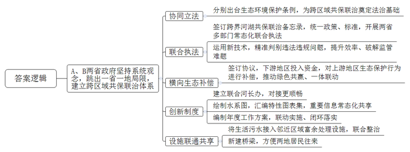
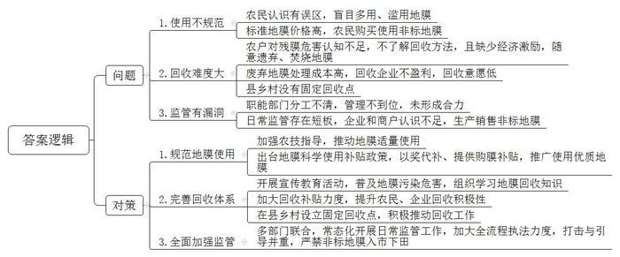

# 2025年公务员多省联考《申论》题（重庆三卷）

> 候选采集稿。参考答案及解析来自粉笔页面，不代表官方答案或真实高分答卷；来源使用许可与原卷对应关系仍需人工核实。

## 给定材料

### 材料 material-56bf76c1859cc61d

向南河上，波光潋滟、水天一色，乘船顺流而下，宛若穿行画中。谁能想到，这条美丽的河流曾经黑臭熏城，鱼虾难存。向南河贯通A、B两省多个行政区域，河流两岸开发强度高，生态环境容量有限，资源能源消耗量大，结构性污染突出，生态环境跨域性特征明显，无论是大气治理还是水环境治理，都不是某一方所能单独承担的。

如何做好生态环境跨域治理？“必须坚持系统观念，跳出一省一地的局限，建立跨区域的共保联治体系。”A省生态环境厅宋厅长表示。A、B两省人大常委会协同立法，分别出台向南河生态环境保护条例，为跨区域的共保联治奠定了法治基础。

“要想彻底治好向南河，单靠哪一段使劲儿都不灵，只有在‘联动’上做文章，才能真正解决污染。”向南河沿岸某市生态环境保护综合行政执法大队唐队长表示。向南河分属A、B两省管辖，过去因河道治理政策不同步、标准不统一，沿线企业跨省非法倾倒固体废弃物问题一直得不到有效解决。

这个“老大难”问题，现在终于“破题”：两省政府已经签订跨界河湖共保联治备忘录，统一政策、统一标准，开展两省水上公安、水务等部门常态化联合执法。两省联合执法队运用遥感影像和无人机遥测、移动采集系统等新技术手段，对生态违法违规问题精准判别，切实提升两省共保联治的工作效率，有效破解向南河流域广、监管工作量大的难题。“条件具备了，不管违法行为发生在哪边，我们都能迅速开展协同打击。”唐队长说。

今年，两省还签订了横向生态补偿协议。根据协议，B省以水生态产品量化补偿方式投入3000多万元，对A省向南河流域范围内青虾养殖区实施有序退养。这项跨界合作，形成了上下游政府、周边农户、两地企业绿色共赢格局，横向生态补偿机制进一步推动了两地一体联动。

“我们上个月下发了一批两省跨界河流协同处置问题清单，不到一个月，两地就报送了整改方案。”设在A省河长办的两省联合河长办公室内，老谭正在逐一核实上月交办的处置问题清单整改方案。老谭是来自B省的一位县级河长，是B省派往A省的第三批两省联合河长办工作人员之一。为什么两省要建立联合河长办？“这由我们两省的地理位置和河流特性决定。”老谭介绍，向南河贯穿两省，两省互为上下游，同在左右岸，山脉相连、水系同源，过去在跨界河流管护中，一直存在因行政壁垒导致的信息不畅、责任不清、目标不统一等问题，尤其是遇到跨省治理问题，基层政府解决不了，只能层层上报，一级一级协调解决，费时久，效率低。A、B两省多次会商，决定成立两省联合河长办公室来解决跨省涉河问题。如此一来，在统筹解决跨省涉河问题时，对接更加顺畅，共保联治的效率也提高了。过去，信息共享是跨界河流治理的一大难题。联合河长办建立后，双方联合绘制了跨界河流水系图，汇编了跨界河流特性图表集，将重要涉河信息纳入“一张图”管理，实现常态化共享。“联合河长办按年度编制工作方案，下发给两省相关部门、各级河长办。”老谭说，一个方案管两地，共同编制、联动实施、闭环落实，干什么、怎么干，变得一目了然。

A省通惠镇与B省江口镇一桥相连，向南河从两镇中间穿过。去年，这里的国控断面出现水质连续超标问题。两地在排查中发现，问题出在江口镇老街社区，居民将生活污水直排河道，对向南河水质产生了影响。江口镇老街社区没有建设污水处理厂和污水管网。“当时我们计划修建污水处理设施，但需要时间。同时我们又了解到，对岸的通惠镇污水处理厂的污水处理能力有富余。”江口镇党委陈书记说，于是他们便提出把老街社区的污水跨区域接入通惠镇污水处理厂。污水跨区域处理意味着通惠镇环卫分公司将面临大量复杂繁琐的工作，但公司徐经理想得很明白：“两个镇一衣带水，那边的排污问题不解决，这边把污水处理得再好也没用。”两地经协商达成一致，老街社区的生活污水接入通惠镇污水处理厂处理，向南河重新变得清澈见底。以这次合作为契机，两镇对域内向南河段联合进行了整治。“共保联治，两地受益。现在，河水绿了，河床宽了，河堤稳了，两岸种草坪、栽绿植、修步道，居民的生活环境大大改善了。”陈书记说，在整治过程中，两镇还在河上新建了一座桥，原本就亲如一家的两地居民往来更方便了。

共保联治促进了向南河“分段治”变“全域治”、“分片治”变“整体治”，推动了两省跨界流域共同治理、融合发展。“过去，向南河是分界线，把两地划分开来；现在，向南河是联结带，把两地结合起来。”宋厅长说。

### 材料 material-56da50f53ffb6f37

为加快构建农业绿色发展新格局，H县农业农村委近日召开了一场关于农用地膜科学使用、回收的座谈会，听取各方的意见建议。以下是座谈会的主要发言摘要：

县农科所专家：农用地膜使用，关系到生态环境保护，关系到粮食安全和群众的身体健康。但从我们县的情况来看，农户们对地膜使用认识有误区，盲目地多用、滥用，导致地膜污染没有得到有效治理。土壤中残留的地膜不仅给耕翻土地等田间管理带来不便，还极大地破坏了土壤的耕层结构。防治地膜污染需要切实做到减量、回收、替代。

D镇某驻村干部：我们镇有一些地方，地膜被遗弃在农田边上，没有人捡拾回收。有的农户对废膜危害认识不足，清理回收积极性不高，还有的农户不了解地膜回收的方法，就只是将农田里的地膜简单焚烧了事，燃烧过程中产生的化学残留物又被农机翻整埋入田里，这不只会污染农田，更损害了本地的农业生态环境。其实镇里很重视农用地膜的使用与回收，但目前县里各部门分工不够清晰，管理不够到位，单靠我们镇自己的力量很难做到标本兼治。

县农业环境保护监测站工作人员：不按规定使用、回收农用地膜是违法行为。国家在大力推广应用全生物可降解地膜、加厚高强度地膜，但不少农户觉得价格太高，还在购买使用那些厚度低于0.01毫米的非标地膜。我们监测到农田中地膜残留量已经达到了每亩3-5公斤，而且每年都有新的地膜沉积在农田中，这种趋势仍在继续。如果这个问题没有得到有效治理，农田污染将越来越严重。

某废品收购站负责人：地膜回收是一个难题。说实话，我们不爱收地膜，现在农户们用的地膜好多都不标准，即便是标准地膜，膜里含有大量泥土、农作物残渣，处理起来不仅耗费水电，人工成本也高，根本不划算。想让农户们处理好地膜再送过来，但跟他们沟通这个也挺麻烦。如果政府能出台政策，补贴一下地膜回收，这样可能会好一点。

某地膜回收企业负责人：我们处理一吨废弃标准地膜的成本接近2000元，回收的产品能卖300-500元。从2023年开始，企业每回收一吨废弃地膜，当地政府补贴2000元。但是，我们专门做过测算，非标膜去除杂质后，每吨能用来回收的原料最终只有460公斤，平均每吨的处理成本要4500多元。而我们现在回收来的大部分都是非标膜，即便有政府补贴，我们也得赔钱。

N镇农户代表：厚一点的地膜效果好，没危害，但比较贵，实在用不起。薄地膜的质量差点，但也能用。我们也知道碎地膜留在田里有危害，但要把埋在土里的残膜刨干净只能靠人工，平均每亩地要多花80元。把地膜送去回收没有钱赚，还得费好大的功夫，不划算。

M镇某种植大户：我现在都是使用强度高、耐候期长、易回收的地膜，这种地膜使土壤的增温、保墒、出苗性更好，而且能更好地抑制膜下杂草的生长，挺好用的，但确实成本会增加一些。前阵子，我到外县去参观，他们那边政府出台了地膜科学使用补贴政策，通过“以奖代补”和政府补贴的方式，推广使用优质地膜，据说效果不错，大家积极性挺高的。

Q镇某村主任：这几年，县里很重视废弃地膜回收，也出台了一些鼓励政策，但我觉得政策和资金支持得还不够，县、乡镇、村没有设立固定的废弃地膜回收点，靠自发回收不行，要统筹做好地膜回收利用工作。

L乡农技服务站站长：我们的农技人员费尽口舌，跟农户们宣传科学使用、回收地膜的好处，奈何人家农资店的诱惑更大，除了便宜，还能返利。我看，主要是生产销售非标地膜的太猖獗了，希望县里有关部门严格监管，打击与引导并重，让各部门、企业、农户都行动起来。这样，我们干起工作来，才会更加顺利。

县市场监管局相关负责人：2023年以来，我们定期开展相关执法检查，但日常监管还存在欠缺和短板，地膜生产、销售、使用、回收等环节尚未打通形成一个完整的链条。部分企业和商户对此认识不足，认为法不责众，导致违规使用非标地膜的情况屡禁不绝。接下来，我们会进一步联合有关部门，常态化开展日常监管工作，加大全流程执法力度，严禁非标地膜入市下田。

### 材料 material-719e6e252ed705af

“‘三资’（资产、资源、资金）治理不仅关系到村民富不富，也关系到乡村美不美。”F市八颗镇高新村党支部郑书记高兴地说，“‘三资’治理就是要摸清家底，规范使用，盘活资源。落实到村里，主要是测量盘点，把现有资源搞‘活’。通过治理，不仅资产明晰了，资源变现了，资金到位了，而且民心稳了，风气正了，村庄面貌也随之焕然一新。”

高新村属于典型的城郊村，村内企业占地较多，但过去一段时间，“三资”问题一直困扰着干部和群众。“不少地块都是本村村民在承包，但由于大伙签订合同的背景不一样，价格也存在差异，群众之间又有攀比心理，所以工作一直很难推进。”郑书记介绍，“一旦开展‘三资’清查，就要推翻很多过去已经签好的合同，涉及到村里很多企业的资金问题，要让商户和村民都接受、配合，的确很不容易。”

近年来，以市里乡村振兴工作计划“三资”治理专项实施为契机，高新村在市农业农村局指导下多次召开村两委联席会议，讨论制定了“三资”清查方案，成立了“三资”清查工作小组。

清查的第一步，就是摸清家底。为确保公正公开，高新村采取实地测量的方式，邀请企业方、测量方、村干部、村民代表等多方同时在场进行土地测量，测量结果需得到各方认可，在公示无异议后才能生效。“这是一项为村为民的好政策，就先从我家的大棚开始吧……”党员老纪不仅第一个接受实地测量，第一个重新签署合同、缴纳承包费，还主动加入工作小组，负责土地测量工作。像老纪一样，全村54名党员充分发挥先锋模范作用，以实际行动支持“三资”治理工作。在他们的影响下，原本心存疑虑的村民逐渐转变态度，纷纷配合入户进企实地测量，捋顺合同、明晰债权债务，开展企业租赁合同续签、改签等工作，使清查工作得到了有序推进。

自治理专项开展以来，F市进一步强化职能部门的对接、指导责任，及时督导镇村两级落实好主体责任，着力推动治理工作走深走实。截至目前，共清收各类闲置或被侵占的机动地、集体建设用地、四荒水面等10769亩，盘活15167亩，增收2832万元。摸排合同35194份，规范问题合同10344份，清收债权6418笔，金额共计6840万元。

在动态清查农村集体“三资”底数的同时，F市也在不断完善相应的监管制度。坚持“一村一账户”，将村级财务委托镇级代管，村集体与镇级业务部门签订协议，村级实行报账员制度。在各乡镇（街道）设立农村财务委托代理服务中心，在坚持村级集体资产所有权、使用权、财务审批权不变和会计核算主体不变的前提下，统一管理村级账目，实现现金、账本、凭证“三代管”。将所有村级账户纳入“银农直联”网络监管平台，依托平台对村集体资金实行全程留痕闭环管理，做到干部不经钱、会计不见钞，切实杜绝以往村集体现金交易不易被监管的现象。

最近，奎溪镇太安村的夜市成了当地居民的热门打卡地。每当夜幕降临，人们汇聚在此，不仅可以品尝近百种特色美食，还能观看灯光秀和演出。然而一年前，这里还是堆满建筑废料、生活垃圾的荒地，一到下雨天便污水横流。在“三资”治理专项实施过程中，这片荒地成为镇村干部关注的重点。镇村两级多次组织召开协商议事会，广泛征集干部和群众意见。“隔壁高新村的夜市搞得挺红火的，我们是不是也可以搞？”“对啊，我们周边人流量大，这个优势可得好好利用！”……经充分研究论证，太安村两委决定借助企业力量将荒地发展为夜市。奎溪镇第一时间将情况汇报给市农业农村局，并协助村两委将夜市招标信息发布至农村产权线上交易平台。

“几家企业竞价角逐，最终价高者得。与企业签订的合同中土地租金是一年26万元，超过了我们最初的预期。”太安村党支部杨书记说，“从申请报名到与企业签订土地租赁合同，前后也就半个多月时间。”

“村里的这笔交易做得好啊，我们有活干，村里有钱挣，人气也旺了。”夜市清洁员老赵说，除了退休工资，现在每月能增加1500元的收入。

近年来，F市依托省农村产权线上交易平台，积极探索市、镇、村三级农村产权交易体系，在市级成立农村产权交易中心，在乡镇（街道）设分中心，在村（社区）设信息点。同时，不断创新交易品种及服务方式，规范交易程序，完善市场监管，促进交易公开、公平、有序进行。

随着数字技术的发展和农村资源要素活力的释放，去年，F市又对交易平台进行了升级。目前，所有项目均采取公开竞价、网上报名、阳光交易的模式，部分交易项目溢价超3倍，为农村集体资源变现发挥着更加便捷、积极的作用。

## 题目

### 第 1 题

**请根据****“给定****资****料**1**”，谈谈向南河是怎样实现“分段治”变“全域治”、“分片治”变“整体治”的？（15分）**

关联材料：材料 material-56bf76c1859cc61d

作答要求：

要求：分析全面、准确、条理清晰。不超过300字。

### 第 2 题

**请根据****“给定****资****料**2**”，梳理当前H县在农用地膜使用、回收方面存在的问题，并提出相应的改进建议。（20分）**

关联材料：材料 material-56da50f53ffb6f37

作答要求：

要求：

（1）问题梳理全面、准确、有条理；

（2）所提建议有针对性、切实可行；

（3）层次分明，有逻辑性；

（4）不超过400字。

### 第 3 题

**假如你是市农业农村局的工作人员，请根据****“给定****资****料**3**”，就F市“三资”治理工作情况写一份情况简报，供领导参阅。（25分）**

关联材料：材料 material-719e6e252ed705af

作答要求：

要求：

（1）紧扣资料，内容全面；

（2）简明扼要，条理清晰；

（3）不超过450字。

### 第 4 题

**“给定****资****料**4**”中提到“分工的表象在分，但其实质是背后的合，真正考验的是合的能力”。请对此进行深入系统思考，参考给定材料，联系实际，自选角度，自拟题目，写一篇文章。（40分）**

关联材料：材料 material-56bf76c1859cc61d

作答要求：

要求：

（1）观点明确，见解深刻，内容充实；

（2）参考给定资料，但不拘泥于给定资料；

（3）思路清晰，语言流畅；

（4）字数1000～1200字。

## 答案与解析

第 1 题

**参考答案（粉笔题库参考内容）**

A、B两省政府坚持系统观念，跳出一省一地局限，建立跨区域共保联治体系。

1.协同立法。分别出台生态环境保护条例，为跨区域共保联治奠定法治基础。

2.联合执法。签订跨界河湖共保联治备忘录，统一政策、标准，开展两省多部门常态化联合执法；运用新技术，精准判别违法违规问题，提升效率、破解监管难题。

3.横向生态补偿。签订协议，下游地区投入资金，对上游地区生态保护行为进行补偿，推动绿色共赢、一体联动。

4.创新制度。建立联合河长办，对接更顺畅；绘制水系图，汇编特性图表集，重要信息常态化共享；编制年度工作方案，联动实施、闭环落实。

5.设施联通共享。将生活污水接入邻近区域富余处理设施，联合整治；新建桥梁，方便两地居民往来。

**解析**

**参考答案说明：**本参考答案呈“总-分”结构，首句先介绍了A、B两省围绕向南河进行整体治理的总体做法，接着从“协同立法”“联合执法”“横向生态补偿”“创新制度”“设施联通共享”五个进行了分条撰写。各条要点之间在内容上相互并列，没有交叉。

**考点**：考点概括措施类

**来源**：来源2025年公务员多省联考《申论》题（重庆三卷）

粉笔申论页面对本题只提供「解析视频」入口，该入口是会员推广位，页面无视频地址与文字解析。

第 2 题

**参考答案（粉笔题库参考内容）**

问题：1.使用不规范。农民认识有误区，盲目多用、滥用地膜；标准地膜价格高，农民购买使用非标地膜。2.回收难度大。农户对残膜危害认知不足，不了解回收方法，且缺少经济激励，随意遗弃、焚烧地膜；废弃地膜处理成本高，回收企业不盈利，回收意愿低；县乡村没有固定回收点。3.监管有漏洞。职能部门分工不清，管理不到位，未形成合力；日常监管存在短板，企业和商户认识不足，生产销售非标地膜。

对策：1.规范地膜使用。加强农技指导，推动地膜适量使用；出台地膜科学使用补贴政策，以奖代补、提供购膜补贴，推广使用优质地膜。2.完善回收体系。开展宣传教育活动，普及地膜污染危害，组织学习地膜回收知识；加大回收补贴力度，提升农民、企业回收积极性；在县乡村设立固定回收点，积极推动回收工作。3.全面加强监管。多部门联合，常态化开展日常监管工作，加大全流程执法力度，打击与引导并重，严禁非标地膜入市下田。

**解析**

**参考答案说明：**本参考答案从“问题”“对策”两部分进行展开，其中，问题又从“使用不规范”“回收难度大”“监管有漏洞”三个方面展开；“对策”则与之对应，分别从“规范地膜使用”“完善回收体系”“全面加强监管”三个方面进行了分条撰写。各条要点之间在内容上是并列关系，没有交叉。

**考点**：考点提出对策类

**来源**：来源2025年公务员多省联考《申论》题（重庆三卷）

粉笔申论页面对本题只提供「解析视频」入口，该入口是会员推广位，页面无视频地址与文字解析。

第 3 题

**参考答案（粉笔题库参考内容）**

关于F市“三资”治理工作情况的简报

F市农业农村局 XXXX年XX月XX日

近年来，我市开展“三资”治理专项工作，成果斐然，具体情况如下：

一、动态清查，摸清家底。强化职能部门的对接、指导责任，及时督导镇村两级落实好主体责任，将测量盘点落实到村，规范使用，盘活资源，实现资产明晰、资源变现、资金到位，稳定了民心，肃清了风气，村庄面貌焕然一新。

二、完善制度，加强监管。坚持“一村一账户”，将村级财务委托镇级代管，村镇签订协议，实现现金、账本、凭证“三代管”；依托“银农直联”网络监管平台，村集体资金全程留痕闭环管理，杜绝现金交易监管漏洞。

三、平台交易，公开透明。依托省农村产权线上交易平台，探索市镇村三级农村产权交易体系；创新交易品种及服务方式，规范交易程序，完善市场监管，促进交易公开、公平、有序进行；升级平台，项目公开竞价、网上报名、阳光交易，实现溢价交易，推动农村集体资源变现。

**解析**

**参考答案说明：**（1）格式方面，本参考答案写到了“报头”和“正文”两个部分。（2）正文部分，一方面从内容上来看，围绕“F市‘三资’治理工作”这一主题，本参考答案的开头先简单介绍了F市“三资”治理工作的背景；主体部分从“动态清查，摸清家底”“完善制度，加强监管”“平台交易，公开透明”三个方面介绍了F市的“三资”治理工作。另一方面，形式上，本参考答案做到了分段、分条撰写，整体上条理较为清晰。

**考点**：考点总结类

**来源**：来源2025年公务员多省联考《申论》题（重庆三卷）

粉笔申论页面对本题只提供「解析视频」入口，该入口是会员推广位，页面无视频地址与文字解析。

第 4 题

**参考答案（粉笔题库参考内容）**

**“分”****与****“合”**

管理中的“分”与“合”，恰似一枚硬币的两面，看似对立却密不可分。分工如同精密的齿轮，确保每个部件各司其职；协作配合则如同润滑剂，让这些独立运转的部件形成高效的整体。唯有理解“分”是“合”的表现，“合”是“分”的归宿，才能在复杂多变的组织环境中游刃有余，做好管理工作。

**管理工作中的****“****分****”是****通过专业化分工，有效提升****组织****效能。**一方面，要精准划分职能，不留真空地带，避免缺位；另一方面，要专业化分工，避免交叉，明确权责，提高工作效率。哈尔滨“毒豆芽”事件中，因农业、工商、食安等部门对生产、流通、服务环节的监管职责存在交叉模糊，导致非法添加行为陷入“三不管”困境，严重损害政府公信力；反观杭州“阳光厨房”项目，通过明确市场监管、商务、卫健等部门在餐饮监管、标准化改造、风险监测等环节的专业分工，实现食品安全投诉量显著下降。因此，社会治理新挑战需要持续创新制度设计，动态优化分工体系，才能不断提升治理效能。

**管理工作的****“合”是为了高效协作，科学统筹调配资源。**一方面，跨部门协作能够打破组织壁垒，形成治理合力；另一方面，系统化整合资源可以避免重复投入，提升整体效能。福特公司创始人曾说：“相聚只是一个开始，共处是一种进步，协作才是真正的成功。”揭示了现代公共治理的本质就是协作配合。杭州“城市大脑”项目，政府负责政策支持与资源协调，阿里巴巴侧重技术赋能与平台运营，通过合作实现红绿灯智能调控，降低了高峰拥堵率；天津构建多维监督网络，纪委监委筛选民生痛点提供线索，公安检查机关负责追查起诉，合力追回民生领域违规资金。“积力之所举，则无不胜也”，当多元主体如同交响乐团各司其职又默契配合，定能奏响治理现代化的和谐乐章。

**“分与合”关键在于提升“合”的能力，需加强****多部门间****沟通，完善体制机制，推进多部门的协作。**忽视“合”的协作效能将引发治理的危机，不仅会出现“九龙治水”管理困局，部门间推诿扯皮现象频发，还会诱发行政资源重复配置与低效消耗，造成公共财政的持续性浪费，甚至削弱政府治理效能，制约营商环境的提质升级。破解之道需构建“协同”机制，即需要顺应时代发展，搭建智能化的跨部门数据平台和常态化协商平台，实现政务数据的实时共享与业务协同，还需建立首接责任制与追溯问责制的双重保障体系，明确责任主体与处置时限，通过多维度联动打破行政壁垒，方能将机械分工升华为有机协同。

分是破茧成蝶的必经之路，合是百川归海的终极宿命。看破“分”与“合”智慧，走高质量发展之路。

**解析**

**文章分析**

**“分”与“合”**

【**标题的优点：**严格按照题目的要求，以“‘分’与‘合’”为标题。】

（1）管理中的“分”与“合”，恰似一枚硬币的两面，看似对立却密不可分。分工如同精密的齿轮，确保每个部件各司其职；协作配合则如同润滑剂，让这些独立运转的部件形成高效的整体。（2）唯有理解“分”是“合”的表现，“合”是“分”的归宿，才能在复杂多变的组织环境中游刃有余,做好管理工作。

【**开头的优点：**★内容方面。范文的开头是紧扣题目给定的“‘分’与‘合’”这一主题展开的。先分别明确“分”与“合”的重要性；后引出核心观点，强调正确处理好二者关系，才能做好管理工作。★文字表达方面。使用了“然而”“因此”等连接词，使语言表达有逻辑性。】

**管理工作中的****“****分****”是****通过专业化分工，有效提升组织效能。**（1）一方面，要精准划分职能，不留真空地带，避免缺位；另一方面，要专业化分工，避免交叉，明确权责，提高工作效率。（2）哈尔滨“毒豆芽”事件中，因农业、工商、食安等部门对生产、流通、服务环节的监管职责存在交叉模糊，导致非法添加行为陷入“三不管”困境，严重损害政府公信力；反观杭州“阳光厨房”项目，通过明确市场监管、商务、卫健等部门在餐饮监管、标准化改造、风险监测等环节的专业分工，实现食品安全投诉量显著下降。（3）因此，社会治理新挑战需要持续创新制度设计，动态优化分工体系，才能不断提升治理效能。

【**论述段****1的优点：**★观点句：范文的观点句是紧扣“‘分’与‘合’”这一文章主题提出的。形式上，它在段首处直接写出，位置突出，容易发现。内容上，关键词突出，内容要点明确，可以明显看出主要论述“管理工作中的‘分’”。★论述内容：（1）先指出了如何处理好管理中的“分”；（2）再通过正反事例，明确分工合作的重点性；（3）做出总结。注意：以上几个方面的内容都是紧扣“管理工作中的‘分’是通过专业化分工，有效提升组织效能”这个观点句进行分析论述的，论述的针对性强，内容层次丰富。在论述方法上主要采用了讲道理和摆事实结合的方式，论述清晰透彻。】

**管理工作的****“合”是为了高效协作，科学统筹调配资源。**（1）一方面，跨部门协作能够打破组织壁垒，形成治理合力；另一方面，系统化整合资源可以避免重复投入，提升整体效能。福特公司创始人曾说“相聚只是一个开始，共处是一种进步，协作才是真正的成功”揭示了现代公共治理的本质就是协作配合。（2）杭州“城市大脑”项目，政府负责政策支持与资源协调，阿里巴巴侧重技术赋能与平台运营，通过合作实现红绿灯智能调控，降低了高峰拥堵率；天津构建多维监督网络，纪委监委筛选民生痛点提供线索，公安检查机关负责追查起诉，合力追回民生领域违规资金。（3）“积力之所举，则无不胜也”，当多元主体如同交响乐团各司其职又默契配合，定能奏响治理现代化的和谐乐章。

【**论述段****2的优点：**★观点句：范文的观点句是紧扣“‘分’与‘合’”这一文章主题提出的。形式上，它在段首处直接写出，位置突出，容易发现。内容上，关键词突出，内容要点明确，可以明显看出主要论述“管理工作中的‘合’”。★论述内容：（1）先指出了管理中的“合”的重要性、必要性；（2）再通过正反事例加以论证；（3）最后做出总结。注意：以上几个方面的内容都是紧扣“管理工作的“合”是为了高效协作，科学统筹调配资源”这个观点句进行分析论述的，论述的针对性强，内容层次丰富。在论述方法上主要采用了讲道理和摆事实结合的方式，论述有理有据。】

**“分与合”关键在于提升“合”的能力，需加强多部门间沟通，完善体制机制，推进多部门的协作。**（1）忽视“合”的协作效能将引发治理的危机,不仅会出现“九龙治水”管理困局，部门间推诿扯皮现象频发，还会诱发行政资源重复配置与低效消耗，造成公共财政的持续性浪费，甚至削弱政府治理效能，制约营商环境的提质升级。（2）破解之道需构建“协同”机制，即需要顺应时代发展，搭建智能化的跨部门数据平台和常态化协商平台，实现政务数据的实时共享与业务协同，还需建立首接责任制与追溯问责制的双重保障体系，明确责任主体与处置时限，通过多维度联动打破行政壁垒，方能将机械分工升华为有机协同。

【**论述段****3的优点：**★观点句：范文的观点句是紧扣“‘分’与‘合’”这一文章主题提出的。形式上，它在段首处直接写出，位置突出，容易发现。内容上，关键词突出，内容要点明确，可以明显看出主要论述“‘分与合’关键在于提升‘合’的能力”。★论述内容：（1）先指出了忽视“合”的协作效能将引发治理的危机；（2）再点明如何做到提升“合”力。注意：以上几个方面的内容都是紧扣“‘分与合’关键在于提升‘合’的能力，需加强多部门间沟通，完善体制机制，推进多部门的协作”这个观点句进行分析论述的，论述的针对性强，内容层次丰富。在论述方法上主要采用了讲道理方式，论述清晰透彻。】

【**论述段之间的关系：**★内容的内在逻辑：范文的论述段之间是依照“管理工作中的‘分’”—“管理工作中的‘合’”—“‘分与合’关键在于提升‘合’的能力”的逻辑展开的。论述内容层层递进、逻辑紧密、论述清晰。】

分是破茧成蝶的必经之路，合是百川归海的终极宿命。看破“分”与“合”智慧，走高质量发展之路。

【**结尾的优点：**范文的结尾回扣了“‘分’与‘合’”这个主题，并且进行了总结提升。】

**考点**：考点文章写作题

**来源**：来源2025年公务员多省联考《申论》题（重庆三卷）

粉笔申论页面对本题只提供「解析视频」入口，该入口是会员推广位，页面无视频地址与文字解析。

