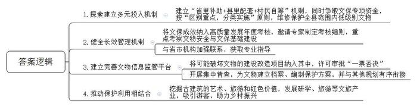
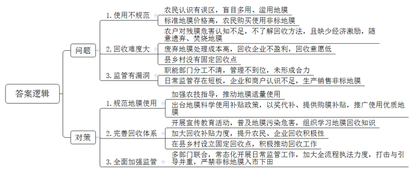
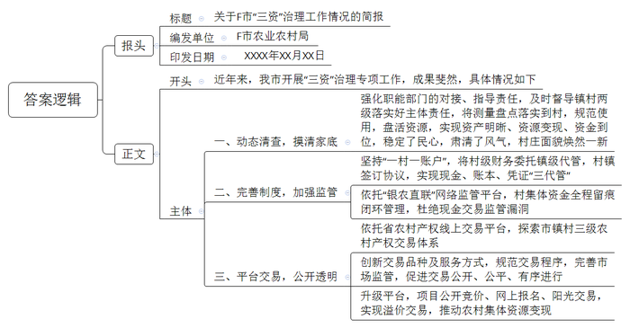
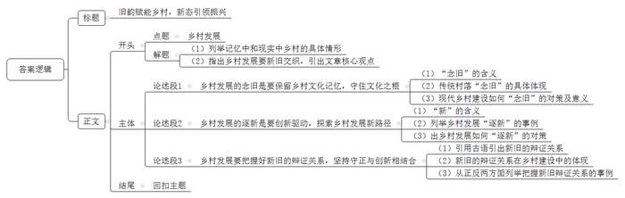

# 2025年公务员多省联考《申论》题（重庆二卷）

<!-- gwy:overview:start -->
> **重庆 · 2025 · 申论 · 二卷** ｜ 4 题 · 图片 4 处 · 答案随题折叠

导航：[题目](#题目) · [材料 1](#材料-1)
<!-- gwy:overview:end -->

> 候选采集稿。参考答案及解析来自粉笔页面，不代表官方答案或真实高分答卷；来源使用许可与原卷对应关系仍需人工核实。

## 给定材料

### 材料 1

近日，G县举行了“文保+文旅赋能乡村振兴”系列主题活动，县委宣传部门联合文保、文旅部门组织媒体参观了刚修护好的望月村古桥、古祠，观看了全县文物保护成果展，开展了文物保护知识竞答等活动。“之前我们想保护，但是有心无力，幸好文保部门介入，让这些古建筑都存留了下来，子孙都可以看到。”望月村村民老闵感慨道。

望月村古桥、古祠是第三次全国文物普查认定的明代文物建筑，但因年久失修，早已无法正常使用。三年前，借着文保专项行动的契机，G县以省里补助的25万元作为启动资金，同时按1：1进行配套，发动村民和乡贤进行自筹，为望月村的文物修护筹集了150余万元资金。在文保部门指导下，望月村聘请专业团队对古祠进行了抢救性修护。祠内还开办了村史馆，让村民沉浸式感受望月村的人文故事和历史变迁，一度濒临倒塌的古祠得到了有效保护利用。古桥新貌、古祠新生，这是G县开展文保专项行动破解低级别文物保护难题的一个缩影。

G县位于长江中下游，全县58平方公里土地上分布着21处不可移动文物，其中低级别文物有19处。低级别文物主要指的是市县级和尚未登记定级的文物。长期以来，这些低级别文物受制于政策、产权、资金、重视程度等因素，在保护利用上存在诸多问题。

两年前，为进一步加强文物保护力度，G县把文保工作成效作为新增指标纳入一年一度的高质量发展考核体系中，邀请专家科学制定考核细则，重点考察县文保部门加强文物安全和文保基础建设的情况。细则一经推出，效果立竿见影，县文物信息监管平台建设落后和文保专业人员不足等长期困扰G县文保工作的问题得以破解。“文物保护管理委员会加挂了‘文物保护中心’的牌子，和省市文物保护机构、博物馆加强了联系，现在邀请专业人员来指导、参加我们的工作也更方便了。”县委办龚主任说。

“我们进行街面改造那会儿，古桥破破烂烂，如果不是县里派人来指导，可能真就被我们拆除了。”每每提及此事，村党支部书记老沈无比庆幸。为避免在村容村貌升级改造过程中错拆文物，县文保部门主动介入，积极促成将可能破坏文物的建设、改造项目纳入文物信息监管平台，实行许可审批“一票否决”。每年9月份，县中心小学新入学的孩子都会聚集到古桥边，参加由文物保护中心组织的“瞧瞧桥”系列研学活动，通过聆听古桥故事，深入感受古桥历史，根植爱乡爱国的情怀。“像望月村古桥、古祠这样的低级别文物看似不起眼，却留存着许多重要历史记忆。”县博物馆廖馆长感慨地说。

开展专项行动，摸清家底、掌握实情是前提。G县文保部门开展了集中普查，令人欣喜的是，在普查中又新发现了3处未登记的低级别文物。文保部门对文物信息监管平台进行了及时完善，为每处文物都建立了信息档案，编制了专门保护方案，并将其与县里其他规划有序衔接，确保能够落实到位。

“财政无钱投、产权人没法投、社会不愿投，是低级别文物保护面临的普遍难题。”县文物保护中心何主任深有感触地说，“根据财政事权，尚未被认定为‘文保单位’的不可移动文物的保护资金由本级政府承担，但县里没有设立这笔专项资金，而大部分低级别文物产权归属不明，产权人维修无从谈起。此外，社会资金基于预期收益等考量，投资保护的积极性并不高。”针对这些现实困境，G县按照“省里补助一点，县里配套一点，村民自筹一点”的原则，积极探索建立多元投入机制。同时，积极争取文保专项资金，加大投入，按照“区别重点，分类实施”原则，对全县范围内的低级别文物进行维修保护。截至目前，已优先抢救性修复了8处古建筑。

“在保护的同时，要利用好这些乡愁记忆的载体，助力乡村振兴。为此，我们在实施分类保护的同时，也注重挖掘这些古建筑的艺术价值、旅游价值和红色价值。”何主任介绍，如今的望月村，古桥静卧、流水潺潺，古祠安详、垂柳依依，如画的风景吸引了不少游客前来打卡。

“中华大地文物资源浩如烟海。在我国76万余处不可移动文物里，超九成为低级别文物。”廖馆长说，“低级别并不意味着低价值，他们同样是历史的见证者，是中华文明的坚实基石，也是文化创新的不竭源泉。”

### 材料 2

为加快构建农业绿色发展新格局，H县农业农村委近日召开了一场关于农用地膜科学使用、回收的座谈会，听取各方的意见建议。以下是座谈会的主要发言摘要：

县农科所专家：农用地膜使用，关系到生态环境保护，关系到粮食安全和群众的身体健康。但从我们县的情况来看，农户们对地膜使用认识有误区，盲目地多用、滥用，导致地膜污染没有得到有效治理。土壤中残留的地膜不仅给耕翻土地等田间管理带来不便，还极大地破坏了土壤的耕层结构。防治地膜污染需要切实做到减量、回收、替代。

D镇某驻村干部：我们镇有一些地方，地膜被遗弃在农田边上，没有人捡拾回收。有的农户对废膜危害认识不足，清理回收积极性不高，还有的农户不了解地膜回收的方法，就只是将农田里的地膜简单焚烧了事，燃烧过程中产生的化学残留物又被农机翻整埋入田里，这不只会污染农田，更损害了本地的农业生态环境。其实镇里很重视农用地膜的使用与回收，但目前县里各部门分工不够清晰，管理不够到位，单靠我们镇自己的力量很难做到标本兼治。

县农业环境保护监测站工作人员：不按规定使用、回收农用地膜是违法行为。国家在大力推广应用全生物可降解地膜、加厚高强度地膜，但不少农户觉得价格太高，还在购买使用那些厚度低于0.01毫米的非标地膜。我们监测到农田中地膜残留量已经达到了每亩3-5公斤，而且每年都有新的地膜沉积在农田中，这种趋势仍在继续。如果这个问题没有得到有效治理，农田污染将越来越严重。

某废品收购站负责人：地膜回收是一个难题。说实话，我们不爱收地膜，现在农户们用的地膜好多都不标准，即便是标准地膜，膜里含有大量泥土、农作物残渣，处理起来不仅耗费水电，人工成本也高，根本不划算。想让农户们处理好地膜再送过来，但跟他们沟通这个也挺麻烦。如果政府能出台政策，补贴一下地膜回收，这样可能会好一点。

某地膜回收企业负责人：我们处理一吨废弃标准地膜的成本接近2000元，回收的产品能卖300-500元。从2023年开始，企业每回收一吨废弃地膜，当地政府补贴2000元。但是，我们专门做过测算，非标膜去除杂质后，每吨能用来回收的原料最终只有460公斤，平均每吨的处理成本要4500多元。而我们现在回收来的大部分都是非标膜，即便有政府补贴，我们也得赔钱。

N镇农户代表：厚一点的地膜效果好，没危害，但比较贵，实在用不起。薄地膜的质量差点，但也能用。我们也知道碎地膜留在田里有危害，但要把埋在土里的残膜刨干净只能靠人工，平均每亩地要多花80元。把地膜送去回收没有钱赚，还得费好大的功夫，不划算。

M镇某种植大户：我现在都是使用强度高、耐候期长、易回收的地膜，这种地膜使土壤的增温、保墒、出苗性更好，而且能更好地抑制膜下杂草的生长，挺好用的，但确实成本会增加一些。前阵子，我到外县去参观，他们那边政府出台了地膜科学使用补贴政策，通过“以奖代补”和政府补贴的方式，推广使用优质地膜，据说效果不错，大家积极性挺高的。

Q镇某村主任：这几年，县里很重视废弃地膜回收，也出台了一些鼓励政策，但我觉得政策和资金支持得还不够，县、乡镇、村没有设立固定的废弃地膜回收点，靠自发回收不行，要统筹做好地膜回收利用工作。

L乡农技服务站站长：我们的农技人员费尽口舌，跟农户们宣传科学使用、回收地膜的好处，奈何人家农资店的诱惑更大，除了便宜，还能返利。我看，主要是生产销售非标地膜的太猖獗了，希望县里有关部门严格监管，打击与引导并重，让各部门、企业、农户都行动起来。这样，我们干起工作来，才会更加顺利。

县市场监管局相关负责人：2023年以来，我们定期开展相关执法检查，但日常监管还存在欠缺和短板，地膜生产、销售、使用、回收等环节尚未打通形成一个完整的链条。部分企业和商户对此认识不足，认为法不责众，导致违规使用非标地膜的情况屡禁不绝。接下来，我们会进一步联合有关部门，常态化开展日常监管工作，加大全流程执法力度，严禁非标地膜入市下田。

### 材料 3

“‘三资’（资产、资源、资金）治理不仅关系到村民富不富，也关系到乡村美不美。”F市八颗镇高新村党支部郑书记高兴地说，“‘三资’治理就是要摸清家底，规范使用，盘活资源。落实到村里，主要是测量盘点，把现有资源搞‘活’。通过治理，不仅资产明晰了，资源变现了，资金到位了，而且民心稳了，风气正了，村庄面貌也随之焕然一新。”

高新村属于典型的城郊村，村内企业占地较多，但过去一段时间，“三资”问题一直困扰着干部和群众。“不少地块都是本村村民在承包，但由于大伙签订合同的背景不一样，价格也存在差异，群众之间又有攀比心理，所以工作一直很难推进。”郑书记介绍，“一旦开展‘三资’清查，就要推翻很多过去已经签好的合同，涉及到村里很多企业的资金问题，要让商户和村民都接受、配合，的确很不容易。”

近年来，以市里乡村振兴工作计划“三资”治理专项实施为契机，高新村在市农业农村局指导下多次召开村两委联席会议，讨论制定了“三资”清查方案，成立了“三资”清查工作小组。

清查的第一步，就是摸清家底。为确保公正公开，高新村采取实地测量的方式，邀请企业方、测量方、村干部、村民代表等多方同时在场进行土地测量，测量结果需得到各方认可，在公示无异议后才能生效。“这是一项为村为民的好政策，就先从我家的大棚开始吧……”党员老纪不仅第一个接受实地测量，第一个重新签署合同、缴纳承包费，还主动加入工作小组，负责土地测量工作。像老纪一样，全村54名党员充分发挥先锋模范作用，以实际行动支持“三资”治理工作。在他们的影响下，原本心存疑虑的村民逐渐转变态度，纷纷配合入户进企实地测量，捋顺合同、明晰债权债务，开展企业租赁合同续签、改签等工作，使清查工作得到了有序推进。

自治理专项开展以来，F市进一步强化职能部门的对接、指导责任，及时督导镇村两级落实好主体责任，着力推动治理工作走深走实。截至目前，共清收各类闲置或被侵占的机动地、集体建设用地、四荒水面等10769亩，盘活15167亩，增收2832万元。摸排合同35194份，规范问题合同10344份，清收债权6418笔，金额共计6840万元。

在动态清查农村集体“三资”底数的同时，F市也在不断完善相应的监管制度。坚持“一村一账户”，将村级财务委托镇级代管，村集体与镇级业务部门签订协议，村级实行报账员制度。在各乡镇（街道）设立农村财务委托代理服务中心，在坚持村级集体资产所有权、使用权、财务审批权不变和会计核算主体不变的前提下，统一管理村级账目，实现现金、账本、凭证“三代管”。将所有村级账户纳入“银农直联”网络监管平台，依托平台对村集体资金实行全程留痕闭环管理，做到干部不经钱、会计不见钞，切实杜绝以往村集体现金交易不易被监管的现象。

最近，奎溪镇太安村的夜市成了当地居民的热门打卡地。每当夜幕降临，人们汇聚在此，不仅可以品尝近百种特色美食，还能观看灯光秀和演出。然而一年前，这里还是堆满建筑废料、生活垃圾的荒地，一到下雨天便污水横流。在“三资”治理专项实施过程中，这片荒地成为镇村干部关注的重点。镇村两级多次组织召开协商议事会，广泛征集干部和群众意见。“隔壁高新村的夜市搞得挺红火的，我们是不是也可以搞？”“对啊，我们周边人流量大，这个优势可得好好利用！”……经充分研究论证，太安村两委决定借助企业力量将荒地发展为夜市。奎溪镇第一时间将情况汇报给市农业农村局，并协助村两委将夜市招标信息发布至农村产权线上交易平台。

“几家企业竞价角逐，最终价高者得。与企业签订的合同中土地租金是一年26万元，超过了我们最初的预期。”太安村党支部杨书记说，“从申请报名到与企业签订土地租赁合同，前后也就半个多月时间。”

“村里的这笔交易做得好啊，我们有活干，村里有钱挣，人气也旺了。”夜市清洁员老赵说，除了退休工资，现在每月能增加1500元的收入。

近年来，F市依托省农村产权线上交易平台，积极探索市、镇、村三级农村产权交易体系，在市级成立农村产权交易中心，在乡镇（街道）设分中心，在村（社区）设信息点。同时，不断创新交易品种及服务方式，规范交易程序，完善市场监管，促进交易公开、公平、有序进行。

随着数字技术的发展和农村资源要素活力的释放，去年，F市又对交易平台进行了升级。目前，所有项目均采取公开竞价、网上报名、阳光交易的模式，部分交易项目溢价超3倍，为农村集体资源变现发挥着更加便捷、积极的作用。

### 材料 4

农历逢八，L镇乡村市集的热闹如期而至。十里八乡的人们早早备齐要卖的货品，凌晨四、五点就从家里出发，到市集上支摊、摆放货物。“赶场”可是小镇和周边乡村民众的“大事”。家离得远的，一次就能买齐全家一周所需的物品；家离得近的，也要来赶个热闹，就算什么都不买，也要在市集上吃饱喝足了再回去，“图的就是热闹和生活的烟火气。”常来市集的小连说。

满满当当的市集里，有刚从地里摘的、从河里捞的农货土产，有老式胶鞋、锄头和铁镐，也有新潮时尚的服饰单品。人声鼎沸的摊位前，熙熙攘攘的人流中，出现了越来越多城里人的身影。“现在好多小物件城里都不好买，市集上的选择多了，而且总能发现新鲜玩意儿，价格还非常便宜。”家住市区的小齐，只要工作不忙，她都会开车带着母亲去市集买菜，“市集的蔬菜、杂粮、家畜都是周边农户自己种的养的，买得放心。”

“有时候不是爱逛市集，而是喜欢这里的人。”同样从市区来的章先生说，在挑选商品和付钱的间隙，摊主们经常会拉家常：“蔬菜都是我们自己家种的，现摘现卖，特别新鲜”“我摆摊30多年啦，好多人爱吃我做的包子，凌晨3点多就起来准备，都是现做的”……不管能否成交、无论卖出多少，摊主们都乐呵呵的。在这里，买到的不只是商品，更是一份好心情。

乡村市集，作为农村或小城镇定期商品交易的市场，似乎停留在人们久远的记忆里。但现在，L镇乡村市集带着清新的潮流之风，重回大众视野，除了绿色新鲜的农产品，还有农耕体验、手工艺品制作等好玩有趣的摊位。“市集是融入乡村生活最舒服的姿势。”周末，小曹驱车专程从另一座城市赶来，在他的眼里，这是一种另类的休闲方式。

而让人们乐此不疲的乡村市集，除了这份烟火气，还有一份新奇。L镇在传统市集日之外，还玩出了许多“花样”，不定期组织主题市集：主打自然野趣的农夫市集，卖的大多是有机绿色、城里人吃不到的稀奇果蔬；主打民俗风情的非遗市集，不仅能淘到制作精美的国潮文创产品，还能跟着非遗手艺人现场DIY；主打新潮时尚的露营市集，不仅能在现场开派对、享用美食，还能体验露天电影、听乐队演奏。非遗、古风、时尚……不同主题各自绽放，L镇乡村市集也因此被市里评为首批精品乡村市集。

L镇还引入了新潮的职业“策展人”。单是去年下半年，小云就带着她的团队，为L镇乡村市集办了三场策展活动。在“收获秋天·晒秋”快闪艺术市集里，有泼墨书法、乡村画作，充满多巴胺色彩；在“放牧的小孩”主题市集里，有艺术剪纸、手绘美术和草场游乐园等。“创意市集不该只是城市的配套，我们想做个拓荒的人，让乡村亮起创意市集的灯。”小云说，他们在为更多年轻人打样，传递乡村发展也拥有更多可能的声音。

L镇交通便利，乡村市集早先是周边村民出于交换需求自发形成的。现下，镇里将市集作为其乡土品牌的延伸，为小农户开设市集平台，带着他们一起奔共富。“我毕业后回到家乡，成为了一名‘新农人’，想着帮助村民们打开农产品的销路。这几年，我们团队通过发展观光采摘、电商销售等新业态，带领很多乡亲走上了创收之路。”作为L镇乡土人才孵化中心的负责人，小严的身影也经常活跃在市集上。近几年来，像小严这样的“农创客”“新农人”，越来越多地投身于品牌创建、包装宣传、电商运维等工作中，为L镇丰富市集业态、打响乡土品牌注入了新鲜血液。

借市集造势，L镇在不断探索更多“市集+”的模式。“赶集是我们这里的一种特定文化，最初的市集是农耕时代摆地摊式的以物易物。”L镇党委兰书记说。而现在，L镇乡村市集融合了艺术展演、公共教育、生态环保、文创等，被赋予了更加多元化的形式，成为了区域的文化交汇平台。

不久前，为期十天的“柿子红了”主题创意市集在L镇开展，最多时一天车流量突破2000辆，摊位营收额累计破100万元。一场市集，让L镇被更多人看到。“这个春日，我们准备将‘生态音乐节’与创意市集相结合，带动人群进入消费场景。”兰书记说，“我们想把市集的流量，变成乡村发展的‘留量’。”

从绵延不绝的烟火气到层出不穷的新创意，L镇乡村市集<u>一面逐新，一面念旧，在新与旧的交融中不断发展，迎来新生</u>。

## 题目

### 第 1 题

**请根据“给定资料1”，谈谈G县在保护低级别文物方面的做法。（15分）**

关联材料：材料 1

作答要求：全面、准确、有条理，不超过300字。

第 1 题 · 答案与解析

**参考答案（粉笔题库参考内容）**

1.‌探索建立多元投入机制。建立“省里补助+县里配套+村民自筹”机制，同时争取文保专项资金，按“区别重点，分类实施”原则，维修保护全县范围内低级别文物。

2.健全长效管理机制‌。将文保成效纳入高质量发展年度考核，邀请专家制定考核细则，重点考察文物安全与文保基础建设；与省市机构加强联系，获取专业指导。

3.建立完善文物信息监管平台。将可能破坏文物的建设改造项目纳入其中，许可审批“一票否决”；开展集中普查，为文物建立档案、编制保护方案，并与其他规划有序衔接。

4.推动保护利用相结合。挖掘古建筑的艺术、旅游和红色价值，发展研学、旅游等文旅产业，吸引游客，助力乡村振兴。

**解析**

**参考答案说明**：本参考答案从“‌探索建立多元投入机制”“健全长效管理机制”“建立完善文物信息监管平台”“推动保护利用相结合”四个方面展开，各条答案要点之间在内容上相互并列，没有交叉。

**考点**：概括措施类

**来源**：2025年公务员多省联考《申论》题（重庆二卷）

### 第 2 题

**请根据“给定资料2”，梳理当前H县在农用地膜使用、回收方面存在的问题，并提出相应的改进建议。（20分）**

关联材料：材料 2

作答要求：

（1）问题梳理全面、准确、有条理；

（2）所提建议有针对性、切实可行；

（3）层次分明，有逻辑性；

（4）不超过400字。

第 2 题 · 答案与解析

**参考答案（粉笔题库参考内容）**

问题：1.使用不规范。农民认识有误区，盲目多用、滥用地膜；标准地膜价格高，农民购买使用非标地膜。2.回收难度大。农户对残膜危害认知不足，不了解回收方法，且缺少经济激励，随意遗弃、焚烧地膜；废弃地膜处理成本高，回收企业不盈利，回收意愿低；县乡村没有固定回收点。3.监管有漏洞。职能部门分工不清，管理不到位，未形成合力；日常监管存在短板，企业和商户认识不足，生产销售非标地膜。

对策：1.规范地膜使用。加强农技指导，推动地膜适量使用；出台地膜科学使用补贴政策，以奖代补、提供购膜补贴，推广使用优质地膜。2.完善回收体系。开展宣传教育活动，普及地膜污染危害，组织学习地膜回收知识；加大回收补贴力度，提升农民、企业回收积极性；在县乡村设立固定回收点，积极推动回收工作。3.全面加强监管。多部门联合，常态化开展日常监管工作，加大全流程执法力度，打击与引导并重，严禁非标地膜入市下田。

**解析**

**参考答案说明：**（1）本参考答案从“问题”“对策”两部分进行展开，其中，问题又从“使用不规范”“回收难度大”“监管有漏洞”三个方面展开；“对策”则与之对应，分别从“规范地膜使用”“完善回收体系”“全面加强监管”三个方面进行了分条撰写。各条要点之间在内容上是并列关系，没有交叉。

**考点**：提出对策类

**来源**：2025年公务员多省联考《申论》题（重庆二卷）

### 第 3 题

**假如你是市农业农村局的工作人员，请根据“给定资料3”，就F市“三资”治理工作情况写一份情况简报，供领导参阅。（25分）**

关联材料：材料 3

作答要求：

（1）紧扣资料，内容全面；

（2）简明扼要，条理清晰；

（3）不超过450字。

第 3 题 · 答案与解析

**参考答案（粉笔题库参考内容）**

关于F市“三资”治理工作情况的简报

F市农业农村局 XXXX年XX月XX日

近年来，我市开展“三资”治理专项工作，成果斐然，具体情况如下：

一、动态清查，摸清家底。强化职能部门的对接、指导责任，及时督导镇村两级落实好主体责任，将测量盘点落实到村，规范使用，盘活资源，实现资产明晰、资源变现、资金到位，稳定了民心，肃清了风气，村庄面貌焕然一新。

二、完善制度，加强监管。坚持“一村一账户”，将村级财务委托镇级代管，村镇签订协议，实现现金、账本、凭证“三代管”；依托“银农直联”网络监管平台，村集体资金全程留痕闭环管理，杜绝现金交易监管漏洞。

三、平台交易，公开透明。依托省农村产权线上交易平台，探索市镇村三级农村产权交易体系；创新交易品种及服务方式，规范交易程序，完善市场监管，促进交易公开、公平、有序进行；升级平台，项目公开竞价、网上报名、阳光交易，实现溢价交易，推动农村集体资源变现。

**解析**

**参考答案说明：**（1）格式方面，本参考答案写到了“报头”和“正文”两个部分。（2）正文部分，一方面从内容上来看，围绕“F市‘三资’治理工作”这一主题，本参考答案的开头先简单介绍了F市“三资”治理工作的背景；主体部分从“动态清查，摸清家底”“完善制度，加强监管”“平台交易，公开透明”三个方面介绍了F市的“三资”治理工作。另一方面，形式上，本参考答案做到了分段、分条撰写，整体上条理较为清晰。

**考点**：总结类

**来源**：2025年公务员多省联考《申论》题（重庆二卷）

### 第 4 题

**“给定资料4”中提到“一面逐新，一面念旧，在新与旧的交融中不断发展，迎来新生”。请深入系统思考这句话，参考给定资料，联系乡村发展的实际，自选角度，自拟题目，写一篇文章。（40分）**

关联材料：材料 1、材料 2、材料 3、材料 4

作答要求：

（1）观点明确，见解深刻，内容充实；

（2）参考给定资料，但不拘泥于给定资料；

（3）思路清晰，语言流畅；

（4）总字数1000～1200字。

第 4 题 · 答案与解析

**参考答案（粉笔题库参考内容）**

**旧韵赋能乡村，新态引领振兴**

枯藤攀附黛瓦，老树守望阡陌，昏鸦掠过斜阳是记忆中的乡村，而现实的乡村却是传统与现代的二重奏，天上无人机飞翔过麦田、精密的光纤在青石板下蜿蜒、地上新农人架起云台在老樟树旁讲着新农村……乡村的发展在新旧交织中焕然一新、蓬勃向上。这幅新旧共生的美学图景，正在演绎乡村发展的辩证法。

**乡村发展的念旧是要保留乡村文化记忆，守住文化之根。**“念旧”并非简单的复古或守旧，而是守护记忆中的烟火气，留住植根于心底的乡愁，赓续根脉相融的文化血脉。传统村落中的建筑形制、农事节气、手工技艺等文化要素构成独特的符号系统，这些符号承载着人类与自然对话的集体记忆，是烟火气与乡愁的实质载体。新时代的乡村建设，要修旧如旧，保留乡村的原样原貌，让建筑肌理成为可触摸的文化基因图谱，也要建立非遗传承人培育机制，让传统有传承，让文化有声音，更要留住炊烟袅袅生活图景，惟其如此，方能让乡村在发展中留住本真模样，让乡愁记忆永续流淌在时代长河。

旧是新生的土壤，是发展的基石，是前行的源泉。“念旧”并非沉湎往昔，而是为“逐新”蓄力，让岁月沉淀在春风里萌发新芽，化腐朽为神奇。

**乡村发展的逐新是要创新驱动，探索乡村发展新路径。**“逐新”是突破传统发展模式，依托自身资源禀赋，用新思维发展新业态、新模式，实现乡村发展的凤凰涅槃。江西婺源篁岭村打造“晒秋”IP，“晒”出丰收之美；贵州丹寨县将苗族蜡染技艺与现代设计结合，在米兰碰撞出自信的火花；江苏兴化千垛菜花景区打造“农业观光+民宿经济+电商销售”产业链，展现产业融合的智慧……乡村文化的创新发展，让乡村走出了自己的路。新时代的乡村创新发展，需要构建“政策引导+市场运作+科技赋能+文化激活”的创新生态系统，实现乡村的“产业增值、生态增值、文化增值、人才增值”，走可持续发展之路。

**乡村发展要把握好新旧的辩证关系，坚持守正与创新相结合。**朱熹在注解儒家典籍时所阐发的“常则守经，变则行权” 的思想，诠释了守正与创新的辩证关系。乡村建设中，古村落的保护性开发、传统技艺的现代化转型，都是这种智慧的生动实践，借助新旧迭代，实现质的飞跃。浙江安吉余村保留千年竹编工艺、古民居群落等传统文化基因，引入生态旅游、数字农业等新兴产业，既守住了绿水青山，又创造出新型经济模式。但某些地区在城镇化进程中采取“破旧立新”的策略，拆除明清建筑群改建商业综合体，导致历史文脉断裂，游客量不增反降。一味破旧立新如断流之水，单纯因循守旧如无根之木，唯有守正创新，才能开辟新发展。

乡村的发展之道，当以守正为立世根基，以创新为前行罗盘，让传统智慧与现代精神在历史长河中交相辉映。

**解析**

**文章分析**

**旧韵赋能乡村，新态引领振兴**

【**标题的优点：**首先，范文的标题突出了“乡村发展”这一主题。其次，形式上，文字简洁明快，不拖沓。】

（1）枯藤攀附黛瓦，老树守望阡陌，昏鸦掠过斜阳是<u>记忆中的乡村</u>，而<u>现实的乡村却是传统与现代的二重奏</u>，天上无人机飞翔过麦田、精密的光纤在青石板下蜿蜒、地上新农人架起云台在老樟树旁讲着新农村……（2）<u>乡村的发展在新旧交织中焕然一新</u>、<u>蓬勃向上</u>。<u>这幅新旧共生的美学图景</u>，<u>正在演绎乡村发展的辩证法</u>。

【**开头的优点：**★内容方面：范文的开头是紧扣“乡村发展”这一主题展开的。首先，开头点出主题，做到了主题明确。其次，对“乡村发展”这一主题进行了分析阐述：（1）列举了记忆中和现实中乡村的具体情形；（2）指出乡村发展要新旧交织，引出文章核心观点。★文字表达方面：长短句配合使用，使语言表达有节奏感。】

**乡村发展的念旧是要保留乡村文化记忆，守住文化之根。**（1）“<u>念旧</u>”<u>并非简单的复古或守旧</u>，<u>而是守护记忆中的烟火气</u>，<u>留住植根于心底的乡愁</u>，<u>赓续根脉相融的文化血脉</u>。（2）<u>传统村落中</u>的建筑形制、农事节气、手工技艺等<u>文化要素构成独特的符号系统</u>，<u>这些符号承载着人类与自然对话的集体记忆</u>，<u>是烟火气与乡愁的实质载体</u>。（3）<u>新时代的乡村建设</u>，<u>要修旧如旧</u>，<u>保留乡村的原样原貌</u>，让建筑肌理成为可触摸的文化基因图谱，<u>也要建立非遗传承人培育机制</u>，让传统有传承，让文化有声音，<u>更要留住炊烟袅袅生活图景</u>，惟其如此，方<u>能让乡村在发展中留住本真模样</u>，<u>让乡愁记忆永续流淌在时代长河</u>。

【**论述段1的优点：**★观点句：范文的观点句是紧扣“乡村发展”这一文章主题提出的。形式上，它在段首处直接写出，位置突出，容易发现。内容上，关键词突出，内容要点明确，可以明显看出它是从“念旧”这个角度入手，指出了乡村发展“念旧”的内涵。★论述内容：（1）首先指出“念旧”的含义；（2）其次阐述传统村落“念旧”的具体体现；（3）最后指出现代乡村建设如何“念旧”的对策及意义。注意：以上三个方面的内容都是紧扣“乡村发展的念旧是要保留乡村文化记忆，守住文化之根”这个观点句进行分析论述的，论述的针对性强，内容层次丰富。最后，在论述方法上主要采用了讲道理的方式，论述深刻有力。】

旧是新生的土壤，是发展的基石，是前行的源泉。“<u>念旧</u>”<u>并非沉湎往昔</u>，<u>而是为</u>“<u>逐新</u>”<u>蓄力</u>，<u>让岁月沉淀在春风里萌发新芽</u>，<u>化腐朽为神奇</u>。

【**过渡段的优点：**范文过渡段分析了“念旧”对“逐新”的意义，此外，还要注意过渡段末尾的“‘念旧’并非沉湎往昔，而是为‘逐新’蓄力，让岁月沉淀在春风里萌发新芽，化腐朽为神奇”是用来引起下文的过渡句。】

**乡村发展的逐新是要创新驱动，探索乡村发展新路径。**（1）“逐<u>新</u>”<u>是突破传统发展模式</u>，<u>依托自身资源禀赋</u>，<u>用新思维发展新业态</u>、<u>新模式</u>，<u>实现乡村发展的凤凰涅槃</u>。（2）<u>江西婺源篁岭村</u>打造“晒秋”IP，“晒”出丰收之美；<u>贵州丹寨县</u>将苗族蜡染技艺与现代设计结合，在米兰碰撞出自信的火花；<u>江苏兴化</u>千垛菜花景区打造“农业观光+民宿经济+电商销售”产业链，展现产业融合的智慧……乡村文化的创新发展，让乡村走出了自己的路。（3）<u>新时代的乡村创新发展</u>，<u>需要构建</u>“政策引导+市场运作+科技赋能+文化激活”的<u>创新生态系统</u>，<u>实现乡村的</u>“<u>产业增值</u>、<u>生态增值</u>、<u>文化增值</u>、<u>人才增值</u>”，<u>走可持续发展之路</u>。

【**论述段2的优点：**★观点句：范文的观点句是紧扣“乡村发展”这一文章主题提出的。形式上，它在段首处直接写出，位置突出，容易发现。内容上，关键词突出，内容要点明确，可以明显看出它是从“逐新”这个角度入手，指出了乡村发展“逐新”的内涵。★论述内容：（1）首先指出“逐新”的含义；（2）其次列举乡村发展“逐新”的事例；（3）最后指出乡村发展如何“逐新”的对策。注意：以上三个方面的内容都是紧扣“乡村发展的逐新是要创新驱动，探索乡村发展新路径”这个观点句进行分析论述的，论述的针对性强，内容层次丰富。最后，在论述方法上主要采用了讲道理和举例子相结合，论述丰富多样。】

**乡村发展要把握好新旧的辩证关系，坚持守正与创新相结合。**（1）朱熹在注解儒家典籍时所阐发的“<u>常则守经</u>，<u>变则行权</u>”的思想，<u>诠释了守正与创新的辩证关系</u>。（2）乡村建设中，古村落的保护性开发、传统技艺的现代化转型，都是这种智慧的生动实践，借助新旧迭代，实现质的飞跃。（3）<u>浙江安吉余村保留</u>千年竹编工艺、古民居群落等<u>传统文化基因</u>，<u>引入</u>生态旅游、数字农业等<u>新兴产业</u>，既守住了绿水青山，又创造出新型经济模式。<u>但某些地区在城镇化进程中采取</u>“<u>破旧立新</u>”<u>的策略</u>，拆除明清建筑群改建商业综合体，导致历史文脉断裂，游客量不增反降。一味破旧立新如断流之水，单纯因循守旧如无根之木，唯有守正创新，才能开辟新发展。

【**论述段3的优点：**★观点句：范文的观点句是紧扣“乡村发展”这一文章主题提出的。形式上，它在段首处直接写出，位置突出，容易发现。内容上，关键词突出，内容要点明确，可以明显看出它是从“关系”这个角度入手，指出了乡村发展“念旧”和“逐新”的辩证关系。★论述内容：（1）首先引用古语引出新旧的辩证关系；（2）其次指出新旧的辩证关系在乡村建设中的体现；（3）最后从正反两方面列举把握新旧辩证关系的事例。注意：以上三个方面的内容都是紧扣“乡村发展要把握好新旧的辩证关系，坚持守正与创新相结合”这个观点句进行分析论述的，论述的针对性强，内容层次丰富。最后，在论述方法上主要采用了讲道理和举例子相结合，论述丰富多样。】

【**论述段之间的关系：**★内容的内在逻辑：范文的论述段之间是依照“并列”的逻辑展开的。论述段1先写了乡村发展“念旧”的内涵，论述段2接着写了乡村发展“逐新”的内涵，论述段3最后写了乡村发展“念旧”与“逐新”的关系。三个论述段相互并列，逻辑清晰。】

乡村的发展之道，当以守正为立世根基，以创新为前行罗盘，让传统智慧与现代精神在历史长河中交相辉映。

【**结尾的优点：**范文的结尾回扣了“乡村发展”这个主题，并且进行了总结提升。】

**考点**：文章写作题

**来源**：2025年公务员多省联考《申论》题（重庆二卷）

