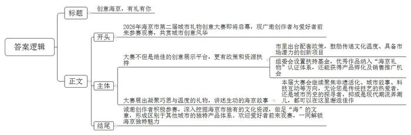
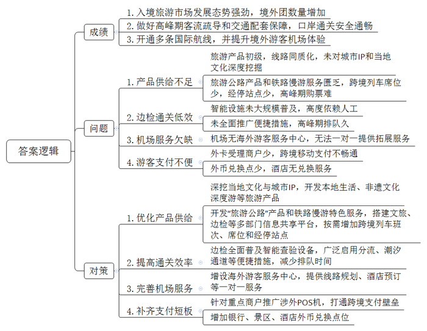
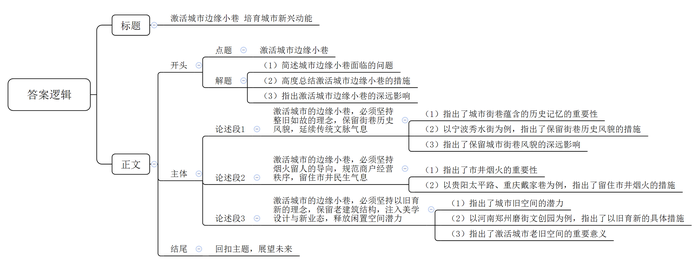

# 2026年公务员多省联考《申论》题（重庆一卷）

> 候选采集稿。参考答案及解析来自粉笔页面，不代表官方答案或真实高分答卷；来源使用许可与原卷对应关系仍需人工核实。

## 给定材料

### 材料 material-2a9f42dbaf60234d

A省L县坐拥丰富的竹林资源，这里云雾缭绕、层峦叠翠，得天独厚的生态环境孕育出“壁厚、节长、径大、质优”的好竹子。而今，这一根根L县竹正以更环保、更时尚、更高附加值的姿态漂洋过海，为世界讲述中国绿色发展的鲜活故事。

时间回到八年前，当时L县的竹资源优势尚未得到充分发掘，存在有想法没办法、有产品没产业、有销售没市场的问题。“要么卖原竹，要么做成箩筐、扁担卖，也就赚点辛苦钱。”竹农老高说。“当时县里确实也没捋清思路。”L县林业局刘局长介绍，“经过多次调研，我们对如何走好‘两山’转化的路子进行了深入思考，最后决定先学习别人的好经验。”

经过多番努力，2019年L县政府终于邀请到了国际竹藤组织专家团来县里考察指导，由此开启了竹产业国际化发展的历程。来自肯尼亚的卡玛是竹藤组织的林业专家，当时他站在竹海中，对随风摆动的阵阵“竹浪”惊叹不已：“这简直就是绿色的黄金！”卡玛告诉当地竹农，在他的家乡，木材资源短缺，很多地区不得不使用塑料制品，而竹子三到五年就能成材，是理想的木材替代品。

短短半个月时间，L县政府带着专家团走遍了全县竹林。按照专家团的建议，在接下来的两年中，县政府制定了竹产业发展路线图，再由有关部门结合实际制定配套措施：持续推进基础设施改造提升，如拓宽改善林区道路，建设冷链仓储物流设施，降低运输损耗；推出“竹艺贷”“碳汇竹林保险”等创新金融产品，为相关企业发展注入金融活水；与职业院校合作开设竹工艺相关专业，培育新型“竹匠”，强化企业人才保障。

在各方的努力下，L县的原竹销售和初级加工产业逐步建立，2021年新增竹林5万亩，组建竹业合作经济组织16家。九庄竹业就是其中一家以竹胶板为主要产品的公司。该公司和县林业局在竹山附近合作建设了一个竹材物理分解点，采伐队每日将新鲜竹材运至分解点进行初步的切割、干燥后再统一分拣装车，大大提升了效率。经粗加工后的竹材由专车运至工业园加工，通过国际竹藤组织的渠道销售至世界各地。公司成立不到2年，产值就突破了5000万元，成为了L县的明星企业。

2023年，L县物美价优的竹产品吸引了众多客户的关注，在国际竹藤组织的牵线下，L县接到了更多来自海外市场的订单。“第一次接到欧洲订单时，我们连客户需要的规格都很陌生。”L县竹产业协会杜会长回忆道，“特别是对方要求的防霉处理标准，我们听都没听过。”为了帮助企业，L县邀请了德国竹材处理专家汉斯博士。他在L县待了整整三个月，手把手教当地企业改进设备、改良工艺，产品最终达到欧盟标准。

“我们确实和先进水平还有差距。”杜会长介绍，“他们的原材料其实不如我们，但经过精深加工后能得到更优良的产品。”由此，L县下决心大力发展竹纤维、竹炭、竹基复合材料等精深加工产品，建设了竹产业创新服务中心，引进高校和科研院所共建实验室，邀请各国科研人员、设计师来交流、分享和学习，共同推动竹材在建筑材料、汽车内饰等领域的应用。如今，走进L县，处处可见国际合作的景象：实验室里，来自巴西的研究员正在测试竹基复合材料的强度；设计中心里，意大利设计师正与L县工匠热烈讨论着新款竹家具的细节；培训教室里，老师正向东南亚学员传授L县的传统竹编和竹材加工技术。布迪是一位来自印尼的年轻竹艺师，他被L县的传统竹编工艺所折服，“这次来培训，是想将这项技艺融入我的作品中，用国际化的思维进行设计。”布迪说，“竹子是世界的语言。”

2025年，老高的竹林里来了一群特殊的客人——来自国际竹藤组织的“竹海生态游”考察团。“那些外国朋友对我的砍竹方式特别感兴趣，还学着用传统工具编竹篮。”老高笑着说，“一位厄瓜多尔的专家告诉我，他们那也有大片竹林，但利用率远不如我们县。”这次交流让老高意识到，L县的经验正在被世界所需要。今年，他的儿子大学毕业后选择回乡，加入了县里的竹产业国际推广团队。“年轻人脑子活，会说外语，正在把我们L县的竹子故事讲给世界听。”老高语气中满是自豪。

在L县竹产业示范园，一座现代化的竹材加工厂正在运转。这里生产的竹建材，正源源不断地运往“一带一路”沿线国家。在埃塞俄比亚，L县技术支持建立的竹加工中心，已经能生产出符合当地需求的竹家具；在加纳，借鉴L县模式的竹林培育基地初见成效……

夕阳西下，竹影婆娑。L县的根根翠竹，正以最朴素的方式，连接起L县与世界，书写着国际合作助力绿色发展的生动篇章。

### 材料 material-ed079734b5df5485

“去一座城市，你会选择带什么回家？有人喜欢当地特产，有人青睐文创产品，有人则钟情传统手工艺品，而这些产品都有个共同的名称——城市礼物。打造城市礼物，展示城市魅力，海京市欢迎您的到来……”走进海京市国际会议中心，耳畔就响起亲切而热情的广播介绍。展厅里，人流穿梭不息，正在举行的首届城市礼物创意大赛，仿佛一个微缩的城市文化会客厅，吸引了许多爱好者前来参观。

“请您闭上眼睛，用手指细细感受这条丝巾。”在展厅东南角，织锦技艺非遗传承人徐女士正邀请观众体验她最新设计的作品。她手中的靛蓝色丝巾摒弃了常见的平面印花，布面呈现出细腻而立体的凹凸纹路。“我们运用海京独有的‘浮纹织锦’非遗技艺，将城市意象转化为可触摸的语言——这里是海浪的波纹，这里是老城石板的肌理，那里是望海楼窗棂的纹样……”

“徐老师的作品实现了非遗技艺从‘可视化’到‘可触化’的突破，让传统文化拥有了更亲切的现代表达。”市文旅局产业发展处张处长介绍，“近年来我们大力推动非遗走进现代生活，目前参赛的很多作品都引入了非遗元素。市里也出台了配套政策，鼓励这类既传递文化温度、又具备市场潜力的创新项目。”

来到茶文化展区，老字号“春香茶庄”的第五代传人赵师傅正在进行一个有趣的演示。他将热水缓缓淋在红木茶盒上，盒面雕刻的浪花纹路间逐渐“飞”出一只海鸥图案。“我们运用了自主研发的感温变色技术，让茶盒在遇热时‘活’起来。”赵师傅向记者介绍，“这是一套多感官交互系统，除了视觉惊喜，扫码还可聆听采集自城市的真实声音——清晨码头的汽笛、正午老街的喧闹、黄昏海浪的轻语，用沉浸式体验唤醒人们对城市的记忆。”据了解，这款茶盒上市半年已销售2.5万套，复购率达35%，被本市多家高端民宿选为特色礼品，还接到了来自海外主题酒店的批量订单。

在大厅中央，90后设计师小陈的“听海”互动礼盒前围满了人。礼盒里是以城市故事为主题的有声明信片，收录了30位普通市民的口述历史。“我们记录了渔村老人、灯塔守护者、咖啡馆主理人的故事。”小陈说，“其中有一位五代守塔之家的老党员，十九岁起孤守灯塔，他以‘人在灯亮’的信念四十年如一日守护着海上航行安全，用忠诚在无尽的海面上永远点亮一束光，照亮渔民归来的路。这些真实的故事引发了听众的记忆共鸣，在社交平台迅速走红。”

在展厅一角，三五成群的年轻人正围在一起看手机，不时发出惊喜的感叹——这里展示的是备受瞩目的“海京记忆”盲盒系列。“我们从一开始就想打破传统地标的陈旧印象，用年轻人喜爱的方式重新演绎海京故事。”展台前，年轻设计师小高正热情地介绍着手中的盲盒产品，“每个盲盒都不只是一座微缩建筑，更是一个等待被发现的潮流玩物。”她熟练地打开一个盲盒，里面是一座精致到连窗棂都清晰可见的红色砖楼：“我们将经典地标设计与潮流盲盒形式相结合，既保留了历史建筑的细节美感，又加入了拆盒的惊喜感和收藏乐趣。”

最吸引年轻群体的是其中融入的科技互动体验。“手机扫码即可‘唤醒’建筑，通过AR技术观看历史短片，就像在现实世界中解锁隐藏剧情。”小高笑着说，“历史不再是书本上枯燥的文字，而是变成了可以拿在手里、分享到朋友圈的潮玩体验。”更巧妙的是，产品的包装本身就延续着这份用心。盲盒的外盒轻轻折叠几下，就能变身成一个精巧的展示架，将微缩模型妥帖地安放在桌案之上。很多本地青年也把它当作“城市明信片”送给了外地朋友。

“所有创新最终都要回到一个原点：当游客拿着礼物说‘这就是海京’，那就是最大的成功。一座城市的发展，需要表达，而最好的礼物，是能让带走它的人，都变成这座城市的讲述者。”张处长表示，“为鼓励更多更好的作品参赛，全面提升赛事影响力，大赛组委会设置了专项扶持基金，优秀作品纳入‘海京礼物’认证体系，还可以获得产品孵化及销售推广机会。”

大赛评委、某高校美术学院李教授建议：“礼物开发要深入挖掘本地独有的文化资源，避免同质化竞争。海京市作为沿海历史文化名城，应该做足‘海’的文章，形成区别于其他城市的独特产品体系。”

展厅外，海京市的灯塔开始闪烁，与城内渐次亮起的万家灯火交相辉映。展厅内，那些凝聚着巧思与温度的礼物，仿佛在讲述着一个个生动的故事，将海京化作“可携带的城市”，即将被装入行囊带到五湖四海，完成一座城市与世界的温暖对话。

### 材料 material-ec237d01c6fdc84a

近年来，C省大力发展入境旅游产业，入境旅游市场逐渐繁荣。为进一步推动入境旅游高质量发展，省文旅厅近日举办了一场以“找不足、补短板”为主题的座谈会，以下是座谈会的主要发言摘要。

某大学周教授：作为传统旅游大省，C省不仅拥有多元独特的山水人文、网红城市的流量红利，还有便捷的免签政策、便利的跨境公路与铁路。我们通过调研发现，近年来C省依托区位优势和单双边免签、区域性免签等政策的施行，入境旅游市场呈现强劲发展态势。与此同时，我们也发现，目前的入境产品大多停留在“非山即博物馆”的初级阶段，线路设计千篇一律，缺乏对独特城市IP和当地文化的深度挖掘。海外游客渴望体验的是原汁原味的本地生活、非遗文化深度游以及类似City Walk的漫步体验，但现有市场供给还无法完全满足这些多样化、个性化的消费需求。

某国际旅行社张经理：海外游客对我省的城市人文、自然风光其实是非常感兴趣的。今年上半年，单单我们社就接待了近200个境外团。但在实际工作中，我们的“旅游公路”产品比较匮乏，铁路沿线也缺乏“慢游”等特色服务体系，交通优势未能很好转化为旅游产品优势。此外，虽然跨境铁路贯穿全省，但列车跨境旅客席位最多只有240个，经停站点也不多。在旅游高峰期，有很多旅行团因为买不到车票而被迫临时取消或延期。

C省铁路集团高总工程师：我接着张经理说的最后这一点展开谈一谈。其实我们也很想在高峰期增开跨境临时列车，但因为与旅行社和边检、文旅等部门的信息没有互联互通，无法提前掌握游客流量和行程安排，所以什么时候加开、开多少列，这都不好把握。

出入境边防检查站杨警官：这几年，边检系统加强了对口岸入境情况的监测，并及时发布入境客流信息，开足查验通道，稳妥做好高峰期客流疏导和交通配套综合保障，确保口岸通关的安全通畅。但面对不断增长的游客流量，我们现有的硬件设施还是显得有些捉襟见肘。比如，新一代验证台、入境卡自助填写打印机等智能设施还没有在全省边检站大规模推广普及，很多环节仍高度依赖人工操作。另外，大部分边检站没有启用分流、潮汐通道等便捷措施，导致游客在高峰期排队等候时间过长，容易产生焦躁情绪。

C省机场集团徐主管：入境客源在哪里，我们的国际航线就跟进到哪里。去年，我们开通了河内、曼谷、釜山、吉隆坡等14条国际航线。同时，我们通过优化托运流程、增加多语言服务、调整休息区设置等方式，努力为境外游客带来更加舒适和便捷的机场体验。但相比于兄弟省会城市的机场，我们现在还没有设立专门的海外游客服务中心，无法为游客一对一提供线路规划、酒店预订、门票购买等拓展服务，现有的问询台只能提供交通接驳咨询等有限的几项服务。

导游小龙：我的感觉是，如今外国游客不再仅仅满足于欣赏风景、走走看看，而是更倾向于沉浸式体验文化生活。我昨天带一对韩国夫妇参观省博物馆时，他们对馆内的冰箱贴、咖啡杯等文创产品非常好奇，一口气买了十几款产品，还拉着我一起“打卡”了博物馆旁的网红面馆。也有很多海外游客跟我说，他们到我们这里来，除了博物馆等少数几个地方可以刷卡消费外，其他地方只能用现金支付，不太方便。比如，我前段时间接待的一位越南游客，他到酒店办理入住后口渴了，想将手中的越南盾兑换成人民币买一瓶饮料，但就是找不到兑换点。

某国有银行C省分行经理：确实如此，目前包括我行在内，全省银行系统的外币兑换点不超过10个，没有一家酒店能提供外币兑换服务，全省可受理外卡的商户仅2145家。此外，跨境移动支付的互联互通也尚未完全实现。这些都给海外游客的消费带来了不便，是我们未来要努力改进的重点领域。

C省文旅厅林处长：刚才，各位同志都谈了对我省入境旅游市场发展现状的观察和体会。谈得都很实在，有成绩，也有不足。这说明，我们虽然坐拥多重优势，也积累了一定基础，但距离高质量发展还存在差距。接下来，我们要深入研究、找准对策、力求实效，早日将我省打造为国际知名的旅游目的地。也恳请各位继续为我省入境旅游产业的发展建言献策，谢谢！

## 题目

### 第 1 题

**请根据****“给定资料**1**”，概述L县通过国际交流合作发展竹产业的主要做法。****（****15分）**

关联材料：material-2a9f42dbaf60234d

作答要求：

要求：全面、准确、有条理。不超过250字。

### 第 2 题

**2026年，海京市将举办第二届城市礼物创意大赛。假如你是大赛主办方工作人员，请根据“给定资料**2**”，以“创意海京，有礼有你”为标题，拟写一份宣介材料，吸引更多人来参赛观赛。（20分****）**

关联材料：material-ed079734b5df5485

作答要求：

要求：

（1）内容全面，重点突出；

（2）逻辑清晰，语言生动；

（3）不超过350字。

### 第 3 题

**请根据****“给定资料**3**”，总结C省发展入境旅游所取得的成绩，梳理存在的问题，并提出相应的对策建议。（25分）**

关联材料：material-ec237d01c6fdc84a

作答要求：

要求：

（1）成绩和问题总结梳理全面、准确、有条理；

（2）对策建议有针对性、切实可行；

（3）层次分明，语言精炼；

（4）不超过500字。

### 第 4 题

**“给定资料**4**”提到：“那些‘被忽略的角落’，就像炉膛里的炭火，看似不旺，但只需要找到合适的时机与力道‘拨动’一下，便能释放意想不到的能量。”请深入思考这句话，参考给定资料，联系实际，自选角度，自拟题目，写一篇文章。****（****40分）**

关联材料：material-2a9f42dbaf60234d

作答要求：

要求：

（1）观点明确，见解深刻，内容充实；

（2）参考给定资料，但不拘泥于给定资料；

（3）思路清晰，语言流畅；

（4）字数1000-1200字。

## 答案与解析

第 1 题

**参考答案（粉笔题库参考内容）**

1.学习国外先进经验。邀请国际组织专家团前来考察指导，吸取专家团建议，制定竹产业发展路线图，结合实际制定配套措施。

2.借力拓展海外市场。国际竹藤组织牵线，获取海外订单；邀请国外专家，指导当地企业改进设备、改良工艺，使产品达到国际标准。

3.发展精深加工产品。建设竹产业创新服务中心，引进高校和科研院所共建实验室，邀请各国人才交流分享学习，拓展应用领域。

4.对外推广本县经验。组建竹产业国际推广团队，吸纳年轻人加入；为国外竹加工中心、竹林培育基地等提供技术和经验支持。

**解析**

**参考答案说明：**本参考答案从“学习国外先进经验”“借力拓展海外市场”“发展精深加工产品”“对外推广本县经验”四个方面展开，各条答案要点之间在内容上相互并列，没有交叉。

**考点**：考点概括措施类

**来源**：来源2026年公务员多省联考《申论》题（重庆一卷）

粉笔申论页面对本题只提供「解析视频」入口，该入口是会员推广位，页面无视频地址与文字解析。

第 2 题

**参考答案（粉笔题库参考内容）**

创意海京，有礼有你

2026年海京市第二届城市礼物创意大赛即将启幕，现广邀创作者与爱好者前来参赛观赛，共赏城市创意风华！

大赛不但是绝佳的创意展示平台，更有政策和资源扶持。市里出台配套政策，鼓励传递文化温度、具备市场潜力的创新项目；组委会设置扶持基金，优秀作品纳入“海京礼物”认证体系，还能获得产品孵化及销售推广机会。

大赛展出凝聚巧思与温度的礼物，讲述生动的海京故事。本届大赛会继续聚焦非遗活化、城市故事、科技互动等方向，无论您是传统技艺的热爱者，还是城市历史的探寻者，抑或是现代潮流弄潮儿，都可以在这里邂逅佳作。

诚邀创作者积极参赛，深入挖掘海京市独有的文化资源，做足“海”的文章，形成区别于其他城市的独特产品体系。欢迎爱好者前来观赛，一同解锁海京独特魅力！

**解析**

**参考答案说明：**（1）格式方面，本参考答案写到了“标题+正文”两个部分。（2）正文部分，从内容上来看，本参考答案的开头部分先介绍了第二届城市礼物创意大赛即将启幕并向创作者和爱好者发出邀请；接着，主体部分从“参赛”和“观赛”两个方面介绍了城市礼物创意大赛吸引创作者和观众参与的优势；最后，结尾部分提出创作要求并再次邀请创作者及观众参与。从形式来看，本参考答案做到了分段、分条撰写，整体上条理较为清晰。

**考点**：考点宣传类

**来源**：来源2026年公务员多省联考《申论》题（重庆一卷）

粉笔申论页面对本题只提供「解析视频」入口，该入口是会员推广位，页面无视频地址与文字解析。

第 3 题

**参考答案（粉笔题库参考内容）**

成绩：1.入境旅游市场发展态势强劲，境外团数量增加。2.做好高峰期客流疏导和交通配套保障，口岸通关安全通畅。3.开通多条国际航线，并提升境外游客机场体验。

问题：1.产品供给不足。旅游产品初级，线路同质化，未对城市IP和当地文化深度挖掘；旅游公路产品和铁路慢游服务匮乏，跨境列车席位少，经停站点少，高峰期购票难。2.边检通关低效。智能设施未大规模普及，高度依赖人工；未全面推广便捷措施，高峰期排队久。3.机场服务欠缺。机场无海外游客服务中心，无法一对一提供拓展服务。4.游客支付不便。外卡受理商户少，跨境移动支付不畅通；外币兑换点少，酒店无兑换服务。

对策：1.优化产品供给。深挖当地文化与城市IP，开发本地生活、非遗文化深度游等旅游产品；开发“旅游公路”产品和铁路慢游特色服务，搭建文旅、边检等多部门信息共享平台，按需增加跨境列车班次、席位和经停站点。2.提高通关效率。边检全面普及智能查验设备，广泛启用分流、潮汐通道等便捷措施，减少排队时间。3.完善机场服务。增设海外游客服务中心，提供线路规划、酒店预订等一对一服务。4.补齐支付短板。针对重点商户推广涉外POS机，打通跨境支付壁垒；增加银行、景区、酒店外币兑换点位。

**解析**

**参考答案说明：**本参考答案分为“成绩”“问题”和“对策”三个部分。其中“成绩”部分从旅游市场、口岸服务、航空出行三个方面展开；“问题”部分从“产品供给不足”“边检通关低效”“机场服务欠缺”“游客支付不便”四个方面展开；“对策”部分从“优化产品供给”“提高通关效率”“完善机场服务”“补齐支付短板”四个方面展开。本参考答案做到了分类分条撰写，各条答案要点之间在内容上相互并列，没有交叉。

**考点**：考点多要素组合类

**来源**：来源2026年公务员多省联考《申论》题（重庆一卷）

粉笔申论页面对本题只提供「解析视频」入口，该入口是会员推广位，页面无视频地址与文字解析。

第 4 题

**参考答案（粉笔题库参考内容）**

**激活城市边缘小巷** **培育城市新兴动能**

在城市化快速推进的宏大叙事中，人们的目光往往聚焦于高楼林立的中央商务区，而那些隐匿于都市繁华缝隙的背街小巷等“被忽略的角落”，却常面临活力消退的窘境。这些角落实则如同炉膛深处静默的炭火，蕴藏着巨大的势能。要引燃这炉炭火，关键在于用对力道去精准拨动：既要通过微更新留住文脉，也要以轻活化规范秩序，更要以街巷经济重塑业态。唯有让沉睡的存量空间“活”起来，方能绘就城市内涵式发展的崭新图景。

**激活城市****的边缘小巷，****必须坚持****整旧如故****的****理念****，保留街巷历史风貌，延续传统文脉气息。**城市的历史记忆，往往藏在不起眼的老砖旧瓦之中，它们是城市不可复制的精神标识，更是维系文化认同的核心载体。在宁波秀水街的修缮中，团队为寻觅匹配的老砖老瓦，跑遍周边村落，从废弃老屋中一块块甄别、回收，采用原生石材与传统木作工艺，精细复原古建的每一处肌理。物质空间是城市记忆的容器，唯有让修补的每一处细节都延续着真实的文脉气息，城市的历史记忆才能在这些老砖旧瓦中继续生长。如此，传统方能在日常空间中得以真实传承，城市文脉也才能在街巷深处永续流动。

**激活城市****的边缘小巷，****必须坚持烟火留人的导向，规范商户经营秩序，留住市井民生气息。**市井烟火是城市最动人的底色，更是老街巷生生不息的灵魂所在。从贵阳太平路“揭开河道盖板”，让老贯城河的滨水场景与龙井桥的历史风貌重现人间，到重庆戴家巷在垂直落差60多米的陡坡上修建崖壁步道，将繁华商圈的“背街”华丽转身为城市山水客厅的“门面”。这些生动的实践无不印证着：真正的城市更新，绝非大拆大建后的推倒重来，而是要在尊重在地文化与居民生活习惯的基础上，用精细化的“绣花功夫”去平衡商业活力与生活温度。

**激活城市****的边缘小巷，****必须坚持以旧育新的理念，保留老建筑结构，注入****美学设计与****新业态****，释放闲置空间潜力****。**旧空间绝非发展的包袱，而是商业焕新的富矿。无论是河南郑州磨街文创园保留老厂房肌理，围绕青年夜生活打造网红地标，还是沈阳红梅文创园将废弃味精厂的老车间活化，打造为集艺术展览与体育赛事于一体的夜间文旅消费集聚区，都生动诠释了“旧中出新”的辩证智慧。城市更新的本质，在于将“闲置存量”转化为“发展增量”。只有用新场景、新体验激活沉睡的空间资源，才能让老建筑在现代商业逻辑中重获新生，真正实现存量空间与新兴消费的完美共生。

方寸之间见天地，细微之处显担当。城市更新的征途，就是一场持续不断的“微雕”过程，唯有以绣花功夫持续深耕，才能让城市的每一寸肌理都充满温度，让高质量发展的活力在每一个角落竞相迸发。

**解析**

**文章分析**

**激活城市边缘小巷** **培育城市新兴动能**

【**标题的优点：**标题中含有主题词，使文章主题更突出、清晰；此外左右对称的结构，也不失为标题的一处亮点。】

（1）在城市化快速推进的宏大叙事中，人们的目光往往聚焦于高楼林立的中央商务区，而那些隐匿于都市繁华缝隙的背街小巷等“被忽略的角落”，却常面临活力消退的窘境。（2）这些角落实则如同炉膛深处静默的炭火，蕴藏着巨大的势能。（3）要引燃这炉炭火，关键在于用对力道去精准拨动：既要通过微更新留住文脉，也要以轻活化规范秩序，更要以街巷经济重塑业态。（4）唯有让沉睡的存量空间“活”起来，方能绘就城市内涵式发展的崭新图景。

【**开头的优点：**★内容方面。范文的开头是紧扣题目给定的“激活城市边缘小巷”这一主题展开的。首先，简述城市边缘小巷面临的问题；其次，指出城市边缘小巷的潜能；接着，高度总结激活城市边缘小巷的措施；最后，指出激活城市边缘小巷的深远影响。★文字表达方面。运用了“既要……也要……更要……”“唯有……方能……”等句式，使文章表述具有严谨的逻辑性。】

**激活城市的边缘小巷，必须坚持整旧如故的理念，保留街巷历史风貌，延续传统文脉气息。**（1）城市的历史记忆，往往藏在不起眼的老砖旧瓦之中，它们是城市不可复制的精神标识，更是维系文化认同的核心载体。（2）在宁波秀水街的修缮中，团队为寻觅匹配的老砖老瓦，跑遍周边村落，从废弃老屋中一块块甄别、回收，采用原生石材与传统木作工艺，精细复原古建的每一处肌理。物质空间是城市记忆的容器，唯有让修补的每一处细节都延续着真实的文脉气息，城市的历史记忆才能在这些老砖旧瓦中继续生长。（3）如此，传统方能在日常空间中得以真实传承，城市文脉也才能在街巷深处永续流动。

【**论述段****1的优点：**★观点句：范文的观点句是紧扣“激活城市边缘小巷”这一文章主题提出的。形式上，它在段首处直接写出，位置突出，容易发现。内容上，关键词突出，内容要点明确，可以明显看出主要论述从“坚持整旧如故的理念”方面入手。★论述内容：（1）指出了城市街巷蕴含的历史记忆的重要性；（2）以宁波秀水街为例，指出了保留街巷历史风貌的措施；（3）指出了保留城市街巷风貌的深远影响。注意：以上三个方面的内容都是紧扣“激活城市的边缘小巷，必须坚持整旧如故的理念，保留街巷历史风貌，延续传统文脉气息”这个观点句进行分析论述的，论述的针对性强，内容层次丰富。在论述方法上理论与事实论证相结合，论述有理有据、充实饱满。】

**激活城市的边缘小巷，必须坚持烟火留人的导向，规范商户经营秩序，留住市井民生气息。**（1）市井烟火是城市最动人的底色，更是老街巷生生不息的灵魂所在。（2）从贵阳太平路“揭开河道盖板”，让老贯城河的滨水场景与龙井桥的历史风貌重现人间，到重庆戴家巷在垂直落差60多米的陡坡上修建崖壁步道，将繁华商圈的“背街”华丽转身为城市山水客厅的“门面”。这些生动的实践无不印证着：真正的城市更新，绝非大拆大建后的推倒重来，而是要在尊重在地文化与居民生活习惯的基础上，用精细化的“绣花功夫”去平衡商业活力与生活温度。

【**论述段****2****的优点：**★观点句：范文的观点句是紧扣“激活城市边缘小巷”这一文章主题提出的。形式上，它在段首处直接写出，位置突出，容易发现。内容上，关键词突出，内容要点明确，可以明显看出主要论述从“坚持烟火留人的导向”方面入手。★论述内容：（1）指出了市井烟火的重要性；（2）以贵阳太平路、重庆戴家巷为例，指出了留住市井烟火的措施。注意：以上两个方面的内容都是紧扣“激活城市的边缘小巷，必须坚持烟火留人的导向，规范商户经营秩序，留住市井民生气息”这个观点句进行分析论述的，论述的针对性强，内容层次丰富。在论述方法上理论与事实论证相结合，论述有理有据、充实饱满。】

**激活城市的边缘小巷，必须坚持以旧育新的理念，保留老建筑结构，注入美学设计与新业态，释放闲置空间潜力。**（1）旧空间绝非发展的包袱，而是商业焕新的富矿。（2）无论是河南郑州磨街文创园保留老厂房肌理，围绕青年夜生活打造网红地标，还是沈阳红梅文创园将废弃味精厂的老车间活化，打造为集艺术展览与体育赛事于一体的夜间文旅消费集聚区，都生动诠释了“旧中出新”的辩证智慧。城市更新的本质，在于将“闲置存量”转化为“发展增量”。（3）只有用新场景、新体验激活沉睡的空间资源，才能让老建筑在现代商业逻辑中重获新生，真正实现存量空间与新兴消费的完美共生。

【**论述段****3****的优点：**★观点句：范文的观点句是紧扣“激活城市边缘小巷”这一文章主题提出的。形式上，它在段首处直接写出，位置突出，容易发现。内容上，关键词突出，内容要点明确，可以明显看出主要论述从“坚持以旧育新的理念”方面入手。★论述内容：（1）指出了城市旧空间的潜力；（2）以河南郑州磨街文创园为例，指出了以旧育新的具体措施；（3）指出了激活城市老旧空间的重要意义。注意：以上三个方面的内容都是紧扣“激活城市的边缘小巷，必须坚持以旧育新的理念，保留老建筑结构，注入美学设计与新业态，释放闲置空间潜力”这个观点句进行分析论述的，论述的针对性强，内容层次丰富。在论述方法上理论与事实论证相结合，论述有理有据、充实饱满。】

【**论述段****之间的关系****：**三个论述段都围绕着“激活城市边缘小巷”这一文章展开，首先论述了“坚持整旧如故的理念”，接着论述了“坚持烟火留人的导向”，最后论述了“坚持以旧育新的理念”，三段呈现出并列关系，论述清晰明了，内容丰富。】

方寸之间见天地，细微之处显担当。城市更新的征途，就是一场持续不断的“微雕”过程，唯有以绣花功夫持续深耕，才能让城市的每一寸肌理都充满温度，让高质量发展的活力在每一个角落竞相迸发。

【**结尾的优点：**范文的结尾回扣了“激活城市边缘小巷”这个主题，并且进行了总结与升华。】

**考点**：考点文章写作题

**来源**：来源2026年公务员多省联考《申论》题（重庆一卷）

粉笔申论页面对本题只提供「解析视频」入口，该入口是会员推广位，页面无视频地址与文字解析。

