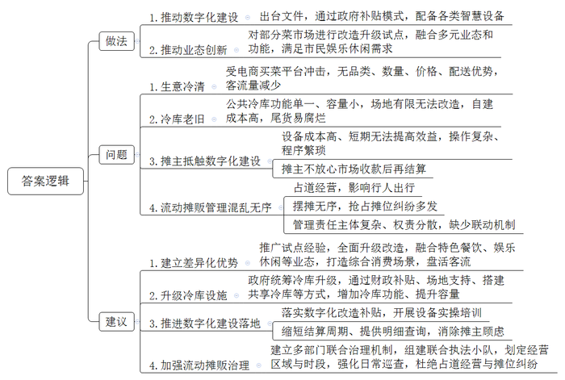
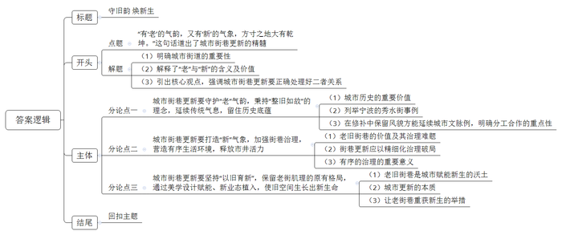

# 2026年公务员多省联考《申论》题（重庆二卷）

<!-- gwy:overview:start -->
> **重庆 · 2026 · 申论 · 二卷** ｜ 4 题 · 图片 4 处 · 答案随题折叠

导航：[题目](#题目) · [材料 1](#材料-1)
<!-- gwy:overview:end -->

> 候选采集稿。参考答案及解析来自粉笔页面，不代表官方答案或真实高分答卷；来源使用许可与原卷对应关系仍需人工核实。

## 给定材料

### 材料 1

A省L县坐拥丰富的竹林资源，这里云雾缭绕、层峦叠翠，得天独厚的生态环境孕育出“壁厚、节长、径大、质优”的好竹子。而今，这一根根L县竹正以更环保、更时尚、更高附加值的姿态漂洋过海，为世界讲述中国绿色发展的鲜活故事。

时间回到八年前，当时L县的竹资源优势尚未得到充分发掘，存在有想法没办法、有产品没产业、有销售没市场的问题。“要么卖原竹，要么做成箩筐、扁担卖，也就赚点辛苦钱。”竹农老高说。“当时县里确实也没捋清思路。”L县林业局刘局长介绍，“经过多次调研，我们对如何走好‘两山’转化的路子进行了深入思考，最后决定先学习别人的好经验。”

经过多番努力，2019年L县政府终于邀请到了国际竹藤组织专家团来县里考察指导，由此开启了竹产业国际化发展的历程。来自肯尼亚的卡玛是竹藤组织的林业专家，当时他站在竹海中，对随风摆动的阵阵“竹浪”惊叹不已：“这简直就是绿色的黄金！”卡玛告诉当地竹农，在他的家乡，木材资源短缺，很多地区不得不使用塑料制品，而竹子三到五年就能成材，是理想的木材替代品。

短短半个月时间，L县政府带着专家团走遍了全县竹林。按照专家团的建议，在接下来的两年中，县政府制定了竹产业发展路线图，再由有关部门结合实际制定配套措施：持续推进基础设施改造提升，如拓宽改善林区道路，建设冷链仓储物流设施，降低运输损耗；推出“竹艺贷”“碳汇竹林保险”等创新金融产品，为相关企业发展注入金融活水；与职业院校合作开设竹工艺相关专业，培育新型“竹匠”，强化企业人才保障。

在各方的努力下，L县的原竹销售和初级加工产业逐步建立，2021年新增竹林5万亩，组建竹业合作经济组织16家。九庄竹业就是其中一家以竹胶板为主要产品的公司。该公司和县林业局在竹山附近合作建设了一个竹材物理分解点，采伐队每日将新鲜竹材运至分解点进行初步的切割、干燥后再统一分拣装车，大大提升了效率。经粗加工后的竹材由专车运至工业园加工，通过国际竹藤组织的渠道销售至世界各地。公司成立不到2年，产值就突破了5000万元，成为了L县的明星企业。

2023年，L县物美价优的竹产品吸引了众多客户的关注，在国际竹藤组织的牵线下，L县接到了更多来自海外市场的订单。“第一次接到欧洲订单时，我们连客户需要的规格都很陌生。”L县竹产业协会杜会长回忆道，“特别是对方要求的防霉处理标准，我们听都没听过。”为了帮助企业，L县邀请了德国竹材处理专家汉斯博士。他在L县待了整整三个月，手把手教当地企业改进设备、改良工艺，产品最终达到欧盟标准。

“我们确实和先进水平还有差距。”杜会长介绍，“他们的原材料其实不如我们，但经过精深加工后能得到更优良的产品。”由此，L县下决心大力发展竹纤维、竹炭、竹基复合材料等精深加工产品，建设了竹产业创新服务中心，引进高校和科研院所共建实验室，邀请各国科研人员、设计师来交流、分享和学习，共同推动竹材在建筑材料、汽车内饰等领域的应用。如今，走进L县，处处可见国际合作的景象：实验室里，来自巴西的研究员正在测试竹基复合材料的强度；设计中心里，意大利设计师正与L县工匠热烈讨论着新款竹家具的细节；培训教室里，老师正向东南亚学员传授L县的传统竹编和竹材加工技术。布迪是一位来自印尼的年轻竹艺师，他被L县的传统竹编工艺所折服，“这次来培训，是想将这项技艺融入我的作品中，用国际化的思维进行设计。”布迪说，“竹子是世界的语言。”

2025年，老高的竹林里来了一群特殊的客人——来自国际竹藤组织的“竹海生态游”考察团。“那些外国朋友对我的砍竹方式特别感兴趣，还学着用传统工具编竹篮。”老高笑着说，“一位厄瓜多尔的专家告诉我，他们那也有大片竹林，但利用率远不如我们县。”这次交流让老高意识到，L县的经验正在被世界所需要。今年，他的儿子大学毕业后选择回乡，加入了县里的竹产业国际推广团队。“年轻人脑子活，会说外语，正在把我们L县的竹子故事讲给世界听。”老高语气中满是自豪。

在L县竹产业示范园，一座现代化的竹材加工厂正在运转。这里生产的竹建材，正源源不断地运往“一带一路”沿线国家。在埃塞俄比亚，L县技术支持建立的竹加工中心，已经能生产出符合当地需求的竹家具；在加纳，借鉴L县模式的竹林培育基地初见成效……

夕阳西下，竹影婆娑。L县的根根翠竹，正以最朴素的方式，连接起L县与世界，书写着国际合作助力绿色发展的生动篇章。

### 材料 2

“去一座城市，你会选择带什么回家？有人喜欢当地特产，有人青睐文创产品，有人则钟情传统手工艺品，而这些产品都有个共同的名称——城市礼物。打造城市礼物，展示城市魅力，海京市欢迎您的到来……”走进海京市国际会议中心，耳畔就响起亲切而热情的广播介绍。展厅里，人流穿梭不息，正在举行的首届城市礼物创意大赛，仿佛一个微缩的城市文化会客厅，吸引了许多爱好者前来参观。

“请您闭上眼睛，用手指细细感受这条丝巾。”在展厅东南角，织锦技艺非遗传承人徐女士正邀请观众体验她最新设计的作品。她手中的靛蓝色丝巾摒弃了常见的平面印花，布面呈现出细腻而立体的凹凸纹路。“我们运用海京独有的‘浮纹织锦’非遗技艺，将城市意象转化为可触摸的语言——这里是海浪的波纹，这里是老城石板的肌理，那里是望海楼窗棂的纹样……”

“徐老师的作品实现了非遗技艺从‘可视化’到‘可触化’的突破，让传统文化拥有了更亲切的现代表达。”市文旅局产业发展处张处长介绍，“近年来我们大力推动非遗走进现代生活，目前参赛的很多作品都引入了非遗元素。市里也出台了配套政策，鼓励这类既传递文化温度、又具备市场潜力的创新项目。”

来到茶文化展区，老字号“春香茶庄”的第五代传人赵师傅正在进行一个有趣的演示。他将热水缓缓淋在红木茶盒上，盒面雕刻的浪花纹路间逐渐“飞”出一只海鸥图案。“我们运用了自主研发的感温变色技术，让茶盒在遇热时‘活’起来。”赵师傅向记者介绍，“这是一套多感官交互系统，除了视觉惊喜，扫码还可聆听采集自城市的真实声音——清晨码头的汽笛、正午老街的喧闹、黄昏海浪的轻语，用沉浸式体验唤醒人们对城市的记忆。”据了解，这款茶盒上市半年已销售2.5万套，复购率达35%，被本市多家高端民宿选为特色礼品，还接到了来自海外主题酒店的批量订单。

在大厅中央，90后设计师小陈的“听海”互动礼盒前围满了人。礼盒里是以城市故事为主题的有声明信片，收录了30位普通市民的口述历史。“我们记录了渔村老人、灯塔守护者、咖啡馆主理人的故事。”小陈说，“其中有一位五代守塔之家的老党员，十九岁起孤守灯塔，他以‘人在灯亮’的信念四十年如一日守护着海上航行安全，用忠诚在无尽的海面上永远点亮一束光，照亮渔民归来的路。这些真实的故事引发了听众的记忆共鸣，在社交平台迅速走红。”

在展厅一角，三五成群的年轻人正围在一起看手机，不时发出惊喜的感叹——这里展示的是备受瞩目的“海京记忆”盲盒系列。“我们从一开始就想打破传统地标的陈旧印象，用年轻人喜爱的方式重新演绎海京故事。”展台前，年轻设计师小高正热情地介绍着手中的盲盒产品，“每个盲盒都不只是一座微缩建筑，更是一个等待被发现的潮流玩物。”她熟练地打开一个盲盒，里面是一座精致到连窗棂都清晰可见的红色砖楼：“我们将经典地标设计与潮流盲盒形式相结合，既保留了历史建筑的细节美感，又加入了拆盒的惊喜感和收藏乐趣。”

最吸引年轻群体的是其中融入的科技互动体验。“手机扫码即可‘唤醒’建筑，通过AR技术观看历史短片，就像在现实世界中解锁隐藏剧情。”小高笑着说，“历史不再是书本上枯燥的文字，而是变成了可以拿在手里、分享到朋友圈的潮玩体验。”更巧妙的是，产品的包装本身就延续着这份用心。盲盒的外盒轻轻折叠几下，就能变身成一个精巧的展示架，将微缩模型妥帖地安放在桌案之上。很多本地青年也把它当作“城市明信片”送给了外地朋友。

“所有创新最终都要回到一个原点：当游客拿着礼物说‘这就是海京’，那就是最大的成功。一座城市的发展，需要表达，而最好的礼物，是能让带走它的人，都变成这座城市的讲述者。”张处长表示，“为鼓励更多更好的作品参赛，全面提升赛事影响力，大赛组委会设置了专项扶持基金，优秀作品纳入‘海京礼物’认证体系，还可以获得产品孵化及销售推广机会。”

大赛评委、某高校美术学院李教授建议：“礼物开发要深入挖掘本地独有的文化资源，避免同质化竞争。海京市作为沿海历史文化名城，应该做足‘海’的文章，形成区别于其他城市的独特产品体系。”

展厅外，海京市的灯塔开始闪烁，与城内渐次亮起的万家灯火交相辉映。展厅内，那些凝聚着巧思与温度的礼物，仿佛在讲述着一个个生动的故事，将海京化作“可携带的城市”，即将被装入行囊带到五湖四海，完成一座城市与世界的温暖对话。

### 材料 3

作为一座城市里最具烟火气的地方，菜市场从热闹走向了安静，很多摊贩都在苦恼生意难做。为深入了解情况，《S市日报》记者近期对市内部分菜市场进行了实地采访。

东江菜市场是一家老牌菜市场。上午十时左右，偌大的菜市场里冷冷清清。“这带鱼多少钱？”一位小伙子问着带鱼的价格。摊主老楚立即热情地介绍起来：“这带鱼非常新鲜，个头也大，35元一斤，你随意挑。”小伙子犹豫了一会儿，最终没有选择购买。老楚叹了口气：“自从电商买菜平台上线后，瓜果蔬菜、家禽肉类，什么都能在手机上买，东西比我们多、比我们便宜，还能秒速送到。一些老客户慢慢地都不来了，来买菜的人也是越来越少喽。”

另一位摊主老王看着积压的一堆水果，愁得吃不下饭：“以前水果卖得快，就算是夏天也用不上冷库。现在来菜市场的人少，水果卖不动时我们只能放向公共冷库，但是这个菜市场已经开门运营二十多年了，公共冷库功能单一又很小，场地有限也没法改造，自建冷库成本又太高，有些尾货只能任其腐烂。听说其他地方有统一安排做改造升级，也不知道我们这里有没有。”

2023年，S市出台文件明确支持菜市场数字化建设，通过政府补贴的模式，为菜市场配备智慧电子大屏、智能电子秤等设备，但申报的不多。“我也知道配个电子大屏、装个系统好，顾客看菜价一清二楚，也不用担心缺斤少两。”北门菜市场经营者老唐说，“但是这些都配上的话，成本很高，短期内又无法提高运营效益，我自己一个个去和摊主说配上电子秤接入系统，人家也不乐意，还是再看看吧。”一些摊主认为智慧电子秤等产品操作复杂，新增农产品信息、扫码入库等程序繁琐。“我们习惯了直接收款，如果是市场收款，后面再和我们结算，心里不踏实。”摊主严姐坦言。

走出天星菜市场，外面竟还有个“露天菜市场”。不少贩卖家禽、果蔬的流动摊贩在道路两旁摆着摊位，挤占了该路段近三分之一的空间。由于大部分的人行道被商贩占据，一些行人只能在机动车道上穿行。无论是家住附近的居民，还是菜市场摊主，都对流动摊贩有些意见。“我早上着急送孩子上学，一到这儿就寸步难行，能不能来管管，早高峰就不要摆摊了！”居民孙大姐情绪激动地说。居民郑大爷则有不同想法：“多些摊位也是方便我们买菜，但是路本来就窄，摆得乱七八糟也没有人管，还经常有摊贩为了位置吵架。我看，要不就修修路，让我们好走些、位置更多点；要不就统一起来，大家也比较和谐。”

对天星菜市场的种种问题，不少摊主觉得管理混乱无序。有关部门也想过解决，但涉及到的管理责任主体复杂：市场外围的一圈门面属私人所有，而市场里面的区域属国有资产。另外，在市场秩序责任分工方面，商务部门负责指导建设和改造提升，市场监管部门负责经营行为综合监管，城市管理部门负责环境卫生、治理占道经营等……“我们想着如果摊位统一了，收拾干净了，管得好些，客流量是不是也能跟着大点。但是城管也找了，市场监管局也找了，几家单位跑来跑去反复沟通就是没有彻底解决。”摊主老黄感慨，“要是能跑一次就把这些单位都联系上、说清楚就好了。”

作为S市菜市场转型升级的代表，下午三点钟，荷花菜市场的多家小吃摊铺就已人头攒动。油墩儿、鱼圆、葱包烩、光头卤鸭……比起单纯卖菜，这里更为出名的是老字号小吃。“菜市场干饭”“挑战100元能买到多少种东西”……因食材丰富、价格实惠，在2023年改造后，荷花菜市场便时常冲上热搜，频频“出圈”。

为做好菜市场这一家门口民生工程，S市对部分菜市场进行了改造升级试点，探索推动各菜市场“老牌”打出“新意”：有的尝试融合餐饮，顾客买完菜，可以现场加工为成品，实现“去趟菜市场，端回一桌菜”；有的套嵌花店、烘焙店、火锅店等商业，有效扩大了消费群体；有的融入文化活动室、老人活动中心等公共空间，成为集食、购、娱等功能于一体的“品质生活场”……“我在这里出生、长大、工作，以前出门娱乐休闲基本上都是要去大型的商超或者综合体，现在逛菜市场就能逛很久，还比商超有烟火气多了！”谈到改造后的菜市场，市民小蔡不停称赞。

### 材料 4

五月的风裹着暖意，吹过南华社区大墙根儿的街巷。我终于站在这条朋友反复“种草”的厚德巷——它不到500米，青石板路蜿蜒向前，两侧是斑驳的院墙与探出墙头的绿意，游客络绎不绝，几乎每个人都要举着手机、相机一通狂拍——用镜头收藏老城，留下珍贵的印记。

朋友告诉我，这儿不仅是网红打卡地，更藏着一座城市更新的秘密。

三年前，南华社区还只是城边村核心地带中一片老旧的平房区，房屋低矮杂乱，写满岁月的痕迹。这里曾长期聚集着不少出租房与小店铺，拥挤的巷道里垃圾成堆。后来，社区启动了“微更新、轻改造”项目——保留最核心的“老街肌理”的格局。于是，三年的时间里，几条曾经逼仄的小巷在精心雕琢下，重新“活”了起来。

我慢慢向前走，指尖划过粗粝的砖墙。百年前，厚德巷曾是文人墨客荟萃之地，众多名人故居、老茶馆、旧书店沿街而建。后来，这里逐渐没落，老建筑也日渐斑驳。现在，整条巷子秉持的是“整旧如故”的理念。路上，恰好碰见一位正在修复砖雕的老师傅，“我们都是采用传统工艺修复这条街的门窗砖瓦，你看，我们特意从周边搜集相同年代的老材料，为的就是让咱这老街啊，修旧如旧。”往前走，一些老建筑的门前还挂着木牌，用中英双语静静讲述这座院落的往昔，传统的气息在这一刻真实可触。

转角处，一家名为“六六拾遗”的文创小店自然地融入巷景之中。老板娘六六是土生土长的本地人，她一边整理以老巷风貌为灵感制作的纸灯，一边感叹道：“改造后的厚德巷，不仅样子没变，连气质也还是从前那样。”她的小店，就像巷中其他铺子一样，并不追求时髦喧哗，而是以安静谦和的气质，与巷子的基调相得益彰。

走出厚德巷，穿过一条马路，空气突然变得热闹起来——香味、人声、炊烟扑面而来。这里是古早巷，海华社区最有烟火气的地方。

海华社区唐主任正好也在巷子里。她介绍，这里原本聚集了上百家小吃摊，臭豆腐、烤苕皮、瘦肉丸……虽然人气旺，却油烟弥漫、摊点杂乱，“很多人来了又走，留不住。”

但现在，古早巷并没有被清理一空，也没有赶走一家商户，反而更整洁、有序了。正在炸酥肉的大姐开心地说：“你看，社区不仅帮我们统一设计餐车，还装了油烟净化器，现在我们做生意更体面、更安心啦！”一路上，各式各样的小吃让人垂涎欲滴，我点了一份老伯卖的烤年糕。“我在这做了三十年，以前这里总是脏乱差，现在是名片！”老伯指着餐车上“古早巷老字号”的标识说，“这是社区给我们认证的，有了这个，老客更认，新客也更放心。”

晚上七点，巷子限制了机动车通行，变成了步行美食街。灯光渐渐亮起，暖黄色的光晕从檐角洒下，整条古早巷成了一条“地上的星河”。

“我们想做的，是让古早巷永留得住人，也留得住心。”唐主任说，“周末我们还经常举办‘夜市主题日’，很多家长都带着孩子来体验。”正说着，巷口突然响起锣鼓声——原来是一场非遗舞狮表演正在开场，人群欢呼涌动，运气真好，赶上他们的夜市主题活动！

而最让我惊艳的，是离古早巷不远的时光街：青绿的主色调、简洁的设计线条、潮流的店铺招牌，年轻人三三两两坐在户外咖啡座上聊天，像是从杂志里跨出来的一片理想街区。

谁能想到，它的前身竟是一个设施陈旧、货车扰民、居民抱怨连连的旧粮油市场？唐主任告诉我，改造的时候，社区并没有抹掉它的过去，而是在保留老建筑结构的基础上，注入美学设计与新业态。“那时候我们提出一个概念，叫‘以旧育新’。”她说道，“不是仿古，也不是复古，而是要让旧空间自己长出新的生命。”

在这里开设独立书店的主理人小陈坦言：“最初我们就想在这儿做文创，很多人都不看好，但社区推出了实实在在的扶持政策：不仅引入社会资本设立‘创新孵化基金’，还提供租金减免和品牌推广支持，让我们这样的小店也有了活下去的底气。”如今，时光街已成为本地青年文化的一个重要地标。曾经的仓库屋顶被改造成了开放式的露天剧场，旧货栈化身为充满设计感的概念书店，市集、音乐会、艺术节纷纷在此落地。

夜幕缓缓落下，我坐在时光街一角，写下最后一页游记——<u>有“老”的气韵，又有“新”的气象，方寸之地大有乾坤</u>。你若来，不要只记得拍照，你要触摸它的砖瓦，聆听它的故事，品尝它的小吃，感受它在旧物生长中的生机盎然。

## 题目

### 第 1 题

**请根据“给定资料1”，概述L县通过国际交流合作发展竹产业的主要做法。（15分）**

关联材料：材料 1

作答要求：

要求：全面、准确、有条理。不超过250字。

第 1 题 · 答案与解析

**参考答案（粉笔题库参考内容）**

1.学习国外先进经验。邀请国际组织专家团前来考察指导，吸取专家团建议，制定竹产业发展路线图，结合实际制定配套措施。

2.借力拓展海外市场。国际竹藤组织牵线，获取海外订单；邀请国外专家，指导当地企业改进设备、改良工艺，使产品达到国际标准。

3.发展精深加工产品。建设竹产业创新服务中心，引进高校和科研院所共建实验室，邀请各国人才交流分享学习，拓展应用领域。

4.对外推广本县经验。组建竹产业国际推广团队，吸纳年轻人加入；为国外竹加工中心、竹林培育基地等提供技术和经验支持。

**解析**

**参考答案说明：**本参考答案从“学习国外先进经验”“借力拓展海外市场”“发展精深加工产品”“对外推广本县经验”四个方面展开，各条答案要点之间在内容上相互并列，没有交叉。

**考点**：概括措施类

**来源**：2026年公务员多省联考《申论》题（重庆二卷）

### 第 2 题

**2026年，海京市将举办第二届城市礼物创意大赛。假如你是大赛主办方工作人员，请根据“给定资料2”，以“创意海京，有礼有你”为标题，拟写一份宣介材料，吸引更多人来参赛观赛。（20分）**

关联材料：材料 2

作答要求：

要求：

（1）内容全面，重点突出；

（2）逻辑清晰，语言生动；

（3）不超过350字。

第 2 题 · 答案与解析

**参考答案（粉笔题库参考内容）**

创意海京，有礼有你

2026年海京市第二届城市礼物创意大赛即将启幕，现广邀创作者与爱好者前来参赛观赛，共赏城市创意风华！

大赛不但是绝佳的创意展示平台，更有政策和资源扶持。市里出台配套政策，鼓励传递文化温度、具备市场潜力的创新项目；组委会设置扶持基金，优秀作品纳入“海京礼物”认证体系，还能获得产品孵化及销售推广机会。

大赛展出凝聚巧思与温度的礼物，讲述生动的海京故事。本届大赛会继续聚焦非遗活化、城市故事、科技互动等方向，无论您是传统技艺的热爱者，还是城市历史的探寻者，抑或是现代潮流弄潮儿，都可以在这里邂逅佳作。

诚邀创作者积极参赛，深入挖掘海京市独有的文化资源，做足“海”的文章，形成区别于其他城市的独特产品体系。欢迎爱好者前来观赛，一同解锁海京独特魅力！

**解析**

**参考答案说明：**（1）格式方面，本参考答案写到了“标题+正文”两个部分。（2）正文部分，从内容上来看，本参考答案的开头部分先介绍了第二届城市礼物创意大赛即将启幕并向创作者和爱好者发出邀请；接着，主体部分从“参赛”和“观赛”两个方面介绍了城市礼物创意大赛吸引创作者和观众参与的优势；最后，结尾部分提出创作要求并再次邀请创作者及观众参与。从形式来看，本参考答案做到了分段、分条撰写，整体上条理较为清晰。

**考点**：宣传类

**来源**：2026年公务员多省联考《申论》题（重庆二卷）

### 第 3 题

**请根据“给定资料3”，总结S市菜市场改造升级工作的具体做法；梳理记者实地走访菜市场期间所发现的问题，并提出相应的对策建议。（25分）**

关联材料：材料 3

作答要求：

要求：

（1）做法和问题总结需全面、准确、有条理；

（2）对策建议有针对性、切实可行；

（3）逻辑清晰，语言流畅；

（4）不超过500字。

第 3 题 · 答案与解析

**参考答案（粉笔题库参考内容）**

做法：1.推动数字化建设。出台文件，通过政府补贴模式，配备各类智慧设备。2.推动业态创新。对部分菜市场进行改造升级试点，融合多元业态和功能，满足市民娱乐休闲需求。

问题：1.生意冷清。受电商买菜平台冲击，无品类、数量、价格、配送优势，客流量减少。2.冷库老旧。公共冷库功能单一、容量小，场地有限无法改造，自建成本高，尾货易腐烂。3.摊主抵触数字化建设。设备成本高、短期无法提高效益，操作复杂、程序繁琐；摊主不放心市场收款后再结算。4.流动摊贩管理混乱无序。占道经营，影响行人出行；摆摊无序，抢占摊位纠纷多发；管理责任主体复杂、权责分散，缺少联动机制。

对策：1.建立差异化优势。推广试点经验，全面升级改造，融合特色餐饮、娱乐休闲等业态，打造综合消费场景，盘活客流。2.升级冷库设施。政府统筹冷库升级，通过财政补贴、场地支持、搭建共享冷库等方式，增加冷库功能、提升容量。3.推进数字化建设落地。落实数字化改造补贴，开展设备实操培训；缩短结算周期、提供明细查询，消除摊主顾虑。4.加强流动摊贩治理。建立多部门联合治理机制，组建联合执法小队，划定经营区域与时段，强化日常巡查，杜绝占道经营与摊位纠纷。

**解析**

**参考答案说明：**本参考答案包括“做法”、“问题”和“建议”三个部分，其中，“做法”部分从“推动数字化建设”和“推动业态创新”两个方面展开，“问题”部分从“生意冷清”“冷库老旧”“摊主抵触数字化建设”“流动摊贩管理混乱无序”四个方面展开，对策部分从“建立差异化优势”“升级冷库设施”“推进数字化建设落地”“加强流动摊贩治理”四个方面展开，各条答案要点之间在内容上相互并列，没有交叉。

**考点**：多要素组合类

**来源**：2026年公务员多省联考《申论》题（重庆二卷）

### 第 4 题

**“给定资料4”提到：“有‘老’的气韵，又有‘新’的气象，方寸之地大有乾坤。”请深入思考这句话，参考给定资料，联系实际，自选角度，自拟题目，写一篇文章。（40分）**

关联材料：材料 1、材料 2、材料 3、材料 4

作答要求：

要求：

（1）观点明确，见解深刻，内容充实；

（2）参考给定资料，但不拘泥于给定资料；

（3）思路清晰，语言流畅；

（4）字数1000～1200字。

第 4 题 · 答案与解析

**参考答案（粉笔题库参考内容）**

**守旧韵** **焕新生**

城市街巷，承载着记忆与乡愁，也映射着一座城市的气质与灵魂。“有‘老’的气韵，又有‘新’的气象，方寸之地大有乾坤。”这句话道出了城市街巷更新的精髓。所谓“老”的气韵，是历经岁月沉淀的历史底蕴、建筑肌理与人间烟火；所谓“新”的气象，是与时俱进的空间品质、治理效能与市井活力。城市街巷更新，既要守护“老”的气韵，也要打造“新”的气象，更需“以旧育新”，让历史底蕴与时代活力在方寸之间交融共生。

**城市街巷更新要守护“老”气韵，秉持“整旧如故”的理念，延续传统气息，留住历史底蕴。**城市的历史记忆，往往藏在不起眼的老砖旧瓦之中，它们是城市不可复制的精神标识，更是维系文化认同的核心载体。在宁波秀水街的修缮中，团队为寻觅匹配的老砖老瓦，跑遍周边村落，从废弃老屋中一块块甄别、回收，采用原生石材与传统木作工艺，精细复原古建的每一处肌理。物质空间是城市记忆的容器，唯有让修补的每一处细节都延续着传统风貌，城市的历史记忆才能在这些老砖旧瓦中继续生长。如此，传统气韵方能在日常空间中得以真实传承，城市文脉也才能在街巷深处永续流动。

**城市街巷更新要打造“新”气象，加强街巷治理，营造有序生活环境，释放市井活力。**老旧街巷承载着浓郁的烟火气，却也长期面临经营无序、环境杂乱等治理难题，制约街区发展。街巷更新应以精细化治理破局，让烟火气有序生长。福州达明路曾是知名美食聚集地，却因油烟呛人、摊点杂乱而令人却步。改造时，当地没有驱离老商户，而是统一规划餐车区域、强化油烟净化、提升排污系统，打造更亮、更美、更环保的美食街区。有序的治理既保留了市井业态与人间烟火，又破解了老旧街区的治理顽疾，让老街巷在整洁环境中持续聚拢人气、焕发活力。

**城市街巷更新要坚持“以旧育新”，保留老街肌理的原有格局，通过美学设计赋能、新业态植入，使旧空间生长出新生命。**老旧街巷从不是发展的阻碍，而是城市赋能新生、提质进阶的丰厚沃土。无论是河南郑州磨街文创园保留老厂房肌理，围绕青年夜生活打造网红地标，还是沈阳红梅文创园将废弃味精厂的老车间活化，打造为集艺术展览与体育赛事于一体的夜间文旅消费集聚区，都生动诠释了“旧中出新”的辩证智慧。城市更新的本质，在于将“闲置存量”转化为“发展增量”。只有用新场景、新体验激活沉睡的空间资源，才能让老街巷在时代发展中重获新生，真正实现历史底蕴与时代活力的有机统一。

守住根脉，焕发生机，方寸之地，自有乾坤。当青石板路遇见霓虹灯火，当老砖旧瓦拥抱新潮业态，城市街巷便在这方寸之间，写下了属于自己的诗与远方。

**解析**

**文章分析**

**守旧韵 焕新生**

【**标题的优点：**体现文章的主题，并且对仗工整。】

（1）城市街巷，承载着记忆与乡愁，也映射着一座城市的气质与灵魂。（2）“有‘老’的气韵，又有‘新’的气象，方寸之地大有乾坤。”这句话道出了城市街巷更新的精髓。所谓“老”的气韵，是历经岁月沉淀的历史底蕴、建筑肌理与人间烟火；所谓“新”的气象，是与时俱进的空间品质、治理效能与市井活力。（3）城市街巷更新，既要守护“老”的气韵，也要打造“新”的气象，更需“以旧育新”，让历史底蕴与时代活力在方寸之间交融共生。

【**开头的优点：**★内容方面。范文的开头是紧扣题目给定的“城市街道的守旧与新生”这一主题展开的。先明确城市街道的重要性；接着解释了“老”与“新”的含义及价值；最后引出核心观点，强调城市街巷更新要正确处理好二者关系。★文字表达方面。使用了“既”“也”“更”等连接词，使语言表达有逻辑性。】

**城市街巷更新要守护“老”气韵，秉持“整旧如故”的理念，延续传统气息，留住历史底蕴。**（1）城市的历史记忆，往往藏在不起眼的老砖旧瓦之中，它们是城市不可复制的精神标识，更是维系文化认同的核心载体。（2）在宁波秀水街的修缮中，团队为寻觅匹配的老砖老瓦，跑遍周边村落，从废弃老屋中一块块甄别、回收，采用原生石材与传统木作工艺，精细复原古建的每一处肌理。（3）物质空间是城市记忆的容器，唯有让修补的每一处细节都延续着传统风貌，城市的历史记忆才能在这些老砖旧瓦中继续生长。如此，传统气韵方能在日常空间中得以真实传承，城市文脉也才能在街巷深处永续流动。

【**论述段1的优点：**★观点句：范文的观点句是紧扣“城市街道的守旧与新生”这一文章主题提出的。形式上，它在段首处直接写出，位置突出，容易发现。内容上，关键词突出，内容要点明确，可以明显看出主要论述“守护‘老’气韵”。★论述内容：（1）城市历史的重要价值；（2）列举宁波的秀水街事例；（3）在修补中保留风貌方能延续城市文脉。注意：以上几个方面的内容都是紧扣“城市街巷更新要守护‘老’气韵，秉持‘整旧如故’的理念，延续传统气息，留住历史底蕴”这个观点句进行分析论述的，论述的针对性强，内容层次丰富。在论述方法上主要采用了讲道理和摆事实结合的方式，论述清晰透彻。】

**城市街巷更新要打造“新”气象，加强街巷治理，营造有序生活环境，释放市井活力。**（1）老旧街巷承载着浓郁的烟火气，却也长期面临经营无序、环境杂乱等治理难题，制约街区发展。（2）街巷更新应以精细化治理破局，让烟火气有序生长。福州达明路曾是知名美食聚集地，却因油烟呛人、摊点杂乱而令人却步。改造时，当地没有驱离老商户，而是统一规划餐车区域、强化油烟净化、提升排污系统，打造更亮、更美、更环保的美食街区。（3）有序的治理既保留了市井业态与人间烟火，又破解了老旧街区的治理顽疾，让老街巷在整洁环境中持续聚拢人气、焕发活力。

【**论述段2的优点：**★观点句：范文的观点句是紧扣“城市街道的守旧与新生”这一文章主题提出的。形式上，它在段首处直接写出，位置突出，容易发现。内容上，关键词突出，内容要点明确，可以明显看出主要论述“打造‘新’气象”。★论述内容：（1）老旧街巷的价值及其治理难题；（2）街巷更新应以精细化治理破局；（3）有序的治理的重要意义。注意：以上几个方面的内容都是紧扣“城市街巷更新要打造‘新’气象，加强街巷治理，营造有序生活环境，释放市井活力”这个观点句进行分析论述的，论述的针对性强，内容层次丰富。在论述方法上主要采用了讲道理和摆事实结合的方式，论述清晰透彻。】

**城市街巷更新要坚持“以旧育新”，保留老街肌理的原有格局，通过美学设计赋能、新业态植入，使旧空间生长出新生命。**（1）老旧街巷从不是发展的阻碍，而是城市赋能新生、提质进阶的丰厚沃土。无论是河南郑州磨街文创园保留老厂房肌理，围绕青年夜生活打造网红地标，还是沈阳红梅文创园将废弃味精厂的老车间活化，打造为集艺术展览与体育赛事于一体的夜间文旅消费集聚区，都生动诠释了“旧中出新”的辩证智慧。（2）城市更新的本质，在于将“闲置存量”转化为“发展增量”。（3）只有用新场景、新体验激活沉睡的空间资源，才能让老街巷在时代发展中重获新生，真正实现历史底蕴与时代活力的有机统一。

【**论述段3的优点：**★观点句：范文的观点句是紧扣“城市街道的守旧与新生”这一文章主题提出的。形式上，它在段首处直接写出，位置突出，容易发现。内容上，关键词突出，内容要点明确，可以明显看出主要论述“‘以旧育新’，正确处理二者关系”。★论述内容：（1）老旧街巷是城市赋能新生的沃土；（2）城市更新的本质；（3）让老街巷重获新生的举措。注意：以上几个方面的内容都是紧扣“城市街巷更新要坚持‘以旧育新’，保留老街肌理的原有格局，通过美学设计赋能、新业态植入，使旧空间生长出新生命”这个观点句进行分析论述的，论述的针对性强，内容层次丰富。在论述方法上主要采用了讲道理和摆事实结合的方式，论述清晰透彻。】

【**论述段之间的关系：**★内容的内在逻辑：范文的论述段之间是依照“守护‘老’气韵”—“打造‘新’气象”—“‘以旧育新’，正确处理二者关系”的逻辑展开的。论述内容层层递进、逻辑紧密、论述清晰。】

守住根脉，焕发生机，方寸之地，自有乾坤。当青石板路遇见霓虹灯火，当老砖旧瓦拥抱新潮业态，城市街巷便在这方寸之间，写下了属于自己的诗与远方。

【**结尾的优点：**范文的结尾回扣了“城市街道的守旧与新生”这个主题，并且进行了总结提升。】

**考点**：文章写作题

**来源**：2026年公务员多省联考《申论》题（重庆二卷）

