# 2008年陕西省公务员录用考试《行测》题

<!-- gwy:overview:start -->
> **陕西 · 2008 · 行测 · 统考** ｜ 140 题 · 图片 84 处 · 答案随题折叠

| 题型模块 | 题量 | 题号 |
| --- | ---: | ---: |
| 言语理解与表达 | 40 | 1–40 |
| 数量关系 | 20 | 41–60 |
| 判断推理 | 35 | 61–95 |
| 常识判断 | 25 | 96–120 |
| 资料分析 | 20 | 121–140 |
| **合计** | **140** | |

导航：[题型与作答说明](#题型与作答说明) · [题目](#题目) · [材料 1](#材料-1)
<!-- gwy:overview:end -->

> 候选采集稿。参考答案及解析来自粉笔页面，不代表官方答案或真实高分答卷；来源使用许可与原卷对应关系仍需人工核实。

## 题型与作答说明

言语理解与表达

（40题）

本部分中每道题要求你从四个选项中选出一个来完成陈述。注意：答案可能是完成对所给文字主要意思的提要，也可能是满足陈述中其他方面的要求，你的选择应与所提要求最相符合。

数量关系

（20题）

本部分包括数字推理与数学运算两种类型的试题。

判断推理

（35题）

本部分包括图形推理、定义判断、类比推理与逻辑判断四种类型的试题。

常识判断

（25题）

根据题目要求，在四个选项中选出一个正确答案。

资料分析

（20题）

所给出的图、表、文字或综合性资料均有若干个问题要你回答。你应根据资料提供的信息进行分析、比较、计算和判断处理。

## 题目

### 第 1 题

某国外媒体报道：中国政府保证从今年6月开始，停止生产超薄塑料购物袋。为此，中国官员还曾专程赴孟加拉国取经。孟加拉高级研究中心的负责人阿拉克·拉赫曼博士说：“中国的优秀在于，如果他们决定了做某事，他们就会去做。”世界环保组织也对此举表示欢迎。

对这段文字概括最恰当的是：

A. 中国积极促进全球反塑料袋行动

B. 孟加拉国塑料产业很发达

C. 世界环保组织的主要任务是限制塑料产业发展

D. 英国全国已经不使用塑料袋了

第 1 题 · 答案与解析

**参考答案（粉笔题库参考内容）**

A

**解析**

本题为中心理解题。

材料先用国外媒体的报道点出中国政府停止生产塑料袋的保证，并用中国官员去孟加拉取经来证明中国政府的积极态度。其后借孟加拉高级研究中心负责人之口赞美中国政府有下定决心坚持做事的优秀品质。最后表明世界环保组织对中国的反塑料行动表示欢迎。可见材料的主体词是“中国”。

因此，结合选项应该选择A。

选项B、C、D均没有体现主体词“中国”。

故正确答案为A。

**考点**：主题词

**来源**：2008年陕西省公务员录用考试《行测》题第1题

### 第 2 题

2006年电视剧《士兵突击》播出后，许三多这个形象在国内受到众多观众的欢迎，有评论指出他就是现实生活中普通人普遍具有的缺点和魅力的完美结合体。26岁的杭州大学生徐博是典型的三多迷，他说：“不光是我看，我的祖父、父亲和我的同学，我们都喜欢看许三多。我都看了三遍，每次看都哭了又哭。”

许三多这个形象之所以受欢迎，最可能的原因是：

A. 绝大多数的中国的观众都看过《士兵突击》

B. 喜欢许三多的观众都是大学生

C. 电视剧在中国有很大市场

D. 许三多具有的很多特质打动了观众

第 2 题 · 答案与解析

**参考答案（粉笔题库参考内容）**

D

**解析**

本题考查细节判断。

材料中先提到许三多这一形象受到欢迎，后紧接阐述了其受欢迎的原因。也就是说因为许三多具有“现实生活中普通人普遍的缺点和魅力”的特质，所以打动了观众，受到了观众的欢迎。

因此，结合选项应该选择D。

选项A不能解释许三多受欢迎的原因；选项B说法错误，由材料可知各年龄层的人群都喜欢许三多，此外选项B也不是许三多受欢迎的原因；选项C在材料中没有提到。

故正确答案为D。

**考点**：细节判断题

**来源**：2008年陕西省公务员录用考试《行测》题第2题

### 第 3 题

俗话说，行百里者半九十。世界上攀登珠穆朗玛峰的人很多，而能真正登顶成功的人是少之又少。因为攀登珠穆朗玛峰的人，如果不到巅峰插上旗帜，哪怕离登顶只剩下十米不到的距离，都不是真正的成功。

这段话主要想告诉我们：

A. 很多人都在攀登珠穆朗玛峰

B. 成功是有明确标准的

C. 大多数人都只能攀登到距离巅峰十米的位置

D. 只有插上旗帜才能证明成功了

第 3 题 · 答案与解析

**参考答案（粉笔题库参考内容）**

B

**解析**

本题为中心理解题，需进一步引申。

材料中先提出“行百里者半九十”，暗含“干事情越接近完成时越艰难、越关键”。然后用攀登珠穆朗玛峰登顶成功的人极少的事例来说明“差一点都不算成功”，可引申为“成功有明确的标准”。

因此，结合选项应该选择B。

A项只是材料中的一个字面事实，并不是通过引申得到的道理，故A项错误；C项本身说法错误，扭曲了材料的意思，材料中说大多数人没有登顶成功，不代表“大多数人都只能攀登到距离巅峰十米的位置”；D项是强干扰项，对于登山而言，其成功的标准是“插上旗帜”，但该选项就事论事，过于拘泥，没有适度引申。

故正确答案为B。

**考点**：分述句特征-举例子

**来源**：2008年陕西省公务员录用考试《行测》题第3题

### 第 4 题

调查发现，超过80%的公众认为跨国公司促进了中国的经济发展，其主要贡献最主要体现在“带来先进的管理经验”与“提供更优质的产品和服务”。但是，也有73.1%的人对跨国公司“把污染产业和工厂转移到中国来”表示强烈不满。有评论分析说，相对于国内的一些小企业来说，跨国公司污染环境的行为更加让人痛心疾首。对此，《人民日报》一署名文章呼吁：在关注经济指标的同时，要切实加强对跨国公司履行环境保护责任的监管。

这段文字意在说明：

A. 我国经济发展应该主要依靠自主创新

B. 跨国公司在我国严重缺乏环保意识

C. 我国大部分人不欢迎跨国公司来华投资

D. 我国公众对跨国公司心态矛盾

第 4 题 · 答案与解析

**参考答案（粉笔题库参考内容）**

D

**解析**

本题为中心理解题，需进一步引申。

整个材料构成分—总结构，材料前半部分说“有部分公众认为跨国公司促进了中国的经济发展”，后半部分说“有部分公众对跨国公司污染环境表示不满”，最后通过《人民日报》的一篇署名文章引导公众对待跨国公司要有正确的态度。这段文字主要讲了我国公众对跨国公司矛盾的心态。

因此，结合选项应该选择D。

选项A在材料中没有提到；选项B是强干扰项，“跨国公司在我国严重缺乏环保意识”只是材料提到的一部分，是我国公众对跨国公司心态矛盾的原因之一；选项C说法错误，由材料可以看出，公众对跨国公司心态矛盾。

故正确答案为D。

**考点**：分述句特征-引入铺垫

**来源**：2008年陕西省公务员录用考试《行测》题第4题

### 第 5 题

从所获得的最新数据看，2005至2006学年，有223543名美国学生在国外求学，他们占美国入学学生的1%，其中只有6000名学生选择留学中国。尽管69%的美国学生能在地图上找到中国，但只有18%的学生知道世界上使用人数最多的语言是汉语（74%的人认为是英语），有50%的学生认为中国的人口仅是美国人口的两倍（实际是四倍）。

这段文字主要想提醒我们：

A. 中国的留学生比美国的留学生多

B. 美国学生经常在网络上了解其他国家

C. 有必要加强美国人对中国的认识

D. 有必要多派中国学生到美国留学

第 5 题 · 答案与解析

**参考答案（粉笔题库参考内容）**

C

**解析**

本题为中心理解题。

材料第一句话说明选择留学中国的美国学生人数极少，第二句话说明美国学生对中国的了解极少，因此整个材料提醒我们“有必要加强美国人对中国的认识”。

因此，结合选项应该选择C。

选项A说法错误，材料中没有提到“中国的留学生”；选项B在材料中也未提及；选项D对象错误，材料中表示来中国留学的美国学生少，而不是到美国留学的中国学生少，无法得到“有必要多派中国学生到美国留学”的提醒。

故正确答案为C。

**考点**：关联词-对策

**来源**：2008年陕西省公务员录用考试《行测》题第5题

### 第 6 题

目前很多市场上的汽车，80%的材料使用了可再生物质。在时尚界中，也有了跟报废汽车结合的产物，瑞士两兄弟Markus和Daniel Freitag设计的FREITAG背包，就使用了集装箱卡车车厢涂焦油的防水布、汽车安全带以及报废自行车轮胎的内胎，这种充满创意的资源再利用也是一种为环境保护做贡献的途径。

对这段文字概括最准确的是：

A. 现在已经全部用可再生物质生产汽车了

B. 可再生材料及物质用途广泛

C. 瑞士两兄弟Markus和Daniel Freitag设计的产品都是用报废材料制作的

D. 时尚界使用的产品都很有创意

第 6 题 · 答案与解析

**参考答案（粉笔题库参考内容）**

B

**解析**

本题为中心理解题。

材料第一句讲了在汽车领域很多汽车的材料使用了可再生物质；第二句讲了在时尚界有创意设计与资源再利用相结合的产品。由此，整个材料说明了可再生材料及物质在多个领域都具有用途，即可再生材料及物质用途广泛。

因此，结合选项应该选择B。

选项A、C、D说法都过于绝对，予以排除。

故正确答案为B。

**考点**：主题词

**来源**：2008年陕西省公务员录用考试《行测》题第6题

### 第 7 题

“社会赞许与不赞许”是我们看待青少年行为最常选择的视角。对于不赞许的行为，就容易进行负面描述。因此不听话就成了叛逆（而不叫有自主性），不爱学习就成了不用功及偷懒（而不叫非学业性向较高），自然，喜欢上网也就成了网络上瘾（而不叫高度热衷网络）。

这段话意在说明：

A. 人们对青少年的评价总是围绕着“好与坏”的二元判断标准进行

B. 对青少年的评价多半是负面的

C. 青少年大部分都不听话

D. 青少年上网成瘾已成了社会现象

第 7 题 · 答案与解析

**参考答案（粉笔题库参考内容）**

A

**解析**

本题为中心理解题，需进一步引申。

材料中先提出人们对青少年的评价是围绕“社会赞许与不赞许”的判断标准进行的，之后列举说明“对于不赞许的行为，就容易进行负面描述”。在此基础上进一步引申为“人们对青少年的评价总是围绕着‘好与坏’的二元判断标准进行”。

因此，结合选项应该选择A。

选项B说法片面，人们对不赞许的行为容易进行负面描述，并不代表人们对青少年的评价多半是负面的；选项C、D是对材料的强加理解。

故正确答案为A。

**考点**：关联词-因果

**来源**：2008年陕西省公务员录用考试《行测》题第7题

### 第 8 题

别人的脸就像一面镜子，我们对别人的态度与别人对我们的态度是一样的。处理好人际关系的道理很简单，那就是“爱出爱返，仁往仁来；恨出恨进，怨往怨来”。

这段话告诉我们：

A. 和谐社会是人们的主观感受

B. 人的素质决定着为人处世的态度

C. 人与人的关系是相互影响的

D. 意识是对客观存在的如实反映

第 8 题 · 答案与解析

**参考答案（粉笔题库参考内容）**

C

**解析**

本题考查格言警句类道理推断的主旨，为中心理解题。

材料关键在于对最后引入的格言警句的理解，“爱出爱返，仁往仁来；恨出恨进，怨往怨来”就是人与人之间的相互影响。

因此，结合选项应该选择C。

A项“和谐”和“主观感受”的关系理解错误；B项“素质”在材料中没有提到，属于强加理解；D项为无关选项。

故正确答案为C。

**考点**：特殊问法

**来源**：2008年陕西省公务员录用考试《行测》题第8题

### 第 9 题

网络是大家熟知的东西，它为我国建设高效、透明、务实、廉洁的政府提供了物质技术条件，大大节约了行政成本，同时在一定程度上克服了信息传播的不对称性。我国各级政府积极利用网络技术，及时、准确发布政务信息以便于公众知情、参与和监督政府。

这段话意在强调：

A. 我国政府积极利用各种条件，贯彻落实对人民负责的原则

B. 我国政府积极创造各种条件，从经济活动中解放出来

C. 网络技术的广泛利用，减轻了政府负担，但削弱了国家宏观调控能力

D. 网络技术的广泛运用，提高了政府工作效率，其目的是吸引世界的目光

第 9 题 · 答案与解析

**参考答案（粉笔题库参考内容）**

A

**解析**

本题为中心理解题，需进一步引申。

材料第一句讲“网络对政府工作的好处”，第二句讲“我国政府积极利用网络技术”，整个材料说明我国政府积极利用各种有利条件来完成政府工作。在此基础上进一步引申，得到“我国政府积极利用各种条件，贯彻落实对人民负责的原则”。

因此，结合选项应该选择A。

B项说法错误，材料中只提到我国政府“利用”条件，不是“创造”条件，材料中也未提及“从经济活动中解放出来”；C项说法错误，材料中未提及“削弱了国家宏观调控能力”；D项说法错误，材料中未提及“目的是吸引世界的目光”。此外，这个材料对我国政府和网络技术都是肯定的态度，C、D项说法中含有贬义感情色彩。

故正确答案为A。

**考点**：分述句特征-引入铺垫

**来源**：2008年陕西省公务员录用考试《行测》题第9题

### 第 10 题

提起节日，中国人首先想到的是春节，贴窗花、写春联、吃饺子、放鞭炮等等，大多数西方人可能首先想到圣诞节，唱圣诞歌、互送圣诞礼物等等。

这告诉我们：

①民族节日蕴涵着民族生活中的风土人情、宗教信仰和道德伦理等文化因素

②民族节日展现出一个民族文化生活的全部内涵

③庆祝民族节日，是民族文化的集中展示

④透过各民族的传统节日我们可以领略不同民族文化的韵味

A. ①②③

B. ②③④

C. ①③④

D. ①②④

第 10 题 · 答案与解析

**参考答案（粉笔题库参考内容）**

C

**解析**

本题为中心理解题。

②说法过于绝对，民族节日能展现出一个民族文化生活的内涵，但不是“全部内涵”。

故正确答案为C。

**考点**：特殊问法

**来源**：2008年陕西省公务员录用考试《行测》题第10题

### 第 11 题

今年全国人大和全国政协会议期间，为了更好地反映民情民意，部分人大代表和政协委员在互联网上利用QQ、E-mail、Blog（博客）等现代信息交流方式征求网民意见，并及时予以反馈，深受网民欢迎。

这段文字表明：

①人大代表和政协委员由人民选举产生

②人大代表和政协委员对人民负责

③人大代表和政协委员的发言不受追究

④人大代表和政协委员受人民监督

A. ①③

B. ②③

C. ②④

D. ③④

第 11 题 · 答案与解析

**参考答案（粉笔题库参考内容）**

C

**解析**

人大代表和政协委员与网民交流的目的是“为了更好地反映民情民意”，表明了人大代表和政协委员“对人民负责”，故②正确；人大代表和政协委员“征求网民意见，并及时予以反馈”，表明了人大代表和政协委员“受人民监督”，故④正确。

①在材料中未提及；③属于强加理解，人大代表和政协委员可利用现代信息交流方式征求网民意见，不代表“发言不受追究”。

故正确答案为C。

**考点**：细节判断题

**来源**：2008年陕西省公务员录用考试《行测》题第11题

### 第 12 题

蝴蝶效应原本是一个气象学名词，说的是南美的蝴蝶扇动一下翅膀，最终将会在北美引起一场龙卷风。听起来这事似乎有些荒唐，但实际情况就是这样。一个微乎其微的细节，却可能造成一个谁都意想不到的结果。聪明的人，就应该从蝴蝶效应中及时看出日后的风暴。

可以印证这段话论点的文句是：

A. 勿以恶小而为之，勿以善小而不为

B. 尺有所短，寸有所长；物有所不足，智有所不明

C. 不登高山，不知天之高也；不临深溪，不知地之厚也

D. 不经一番寒彻骨，怎得梅花扑鼻香

第 12 题 · 答案与解析

**参考答案（粉笔题库参考内容）**

A

**解析**

文段详细解释了蝴蝶效应的概念，即细节也可以影响全局，造成无法想象的结果，与这一观点意思相同的是A项，不要认为好事很小就不去做，不要认为坏事很小就去做。因为一点点好事也会产生深远的积极效应，一点点坏事也会造成巨大的不良影响，要重视细节。

B项，比喻人和事物各有其长处和短处，再好的人或事物也有不足，再差的人或事物也有优点。

C项，意思是不攀登高山，就不知道天有多高；不下临深溪，就不知道地有多厚。指的是如果做事不从一点一滴中做起，那就不可能有所成就。

D项，意思是不经历严寒就不会孕育出梅花的芳香，指的是做任何事都要不怕艰难，要敢于经历磨砺，才能有所成就。

故正确答案为A。

**考点**：关联词-转折、分述句特征-引入铺垫

**来源**：2008年陕西省公务员录用考试《行测》题第12题

### 第 13 题

早发育的，身高增长开始的早，增长高峰出现的也早，增长停止也早，整个增长过程可能比较短。因此，早发育类型的孩子虽然开始时显得比同龄孩子高，但成年可能比晚发育的孩子个子矮，而体重比同样身高而晚发育的孩子要重些。

这段文字中，“增长高峰”和“增长过程”分别是指：

A. 最高身高和增长时间

B. 最高增长速度和增长高度

C. 最高身高和增长速度

D. 最高增长速度和增长时间

第 13 题 · 答案与解析

**参考答案（粉笔题库参考内容）**

D

**解析**

本题考查词语指代。

定位“增长高峰”进行理解，“增长高峰”与“增长开始”和“增长停止”相关性强，可知“增长高峰”指的是“最高增长速度”；定位“增长过程”进行词语替换，材料中提到“整个增长过程可能比较短”，只有“增长时间”能与“短”搭配，故“增长过程”指“增长时间”。

故正确答案为D。

**考点**：实词

**来源**：2008年陕西省公务员录用考试《行测》题第13题

### 第 14 题

人的尊严就在于思想。由于有了思想，人就比摧毁他的任何东西甚至整个宇宙都高贵得多；因此，人就能吞掉一个世界。

这段文字直接支持的观点是：

A. 人类是需要有思想的

B. 人类的思想是无处不在的

C. 人的尊严就在于人的思想

D. 无论哪种人都能改变整个世界

第 14 题 · 答案与解析

**参考答案（粉笔题库参考内容）**

C

**解析**

本题为中心理解题。

材料构成“提出观点—支撑观点”的总—分结构。第一句提出观点“人的尊严就在于思想”。

因此，结合选项应该选择C。

B、D为无关项，在材料中未提及；选项A是强烈干扰项，是引申的观点，不是直接观点。

故正确答案为C。

**考点**：分述句特征-其他

**来源**：2008年陕西省公务员录用考试《行测》题第14题

### 第 15 题

《三国演义》是明朝初期罗贯中作的历史演义小说，它取材于东汉末年的魏、蜀、吴三国鼎立的一段历史，为那个群雄逐鹿的动荡时代提供了全景式的历史画卷，创造了数以百计的栩栩如生的人物画廊。

最能准确复述这段文字主要意思的一项是：

A. 《三国演义》是一部历史演义小说

B. 历史演义小说《三国演义》的背景及主要内容

C. 《三国演义》的作者是明朝初期的罗贯中

D. 《三国演义》塑造了众多性格鲜明的人物

第 15 题 · 答案与解析

**参考答案（粉笔题库参考内容）**

B

**解析**

本题为中心理解题。

材料提到了《三国演义》的作者、题材、背景及主要内容。

因此，结合选项应该选择B。

选项A、C、D都是材料中提到的一个部分，不能概括文段主要意思。

故正确答案为B。

**考点**：关联词-并列、特殊问法

**来源**：2008年陕西省公务员录用考试《行测》题第15题

### 第 16 题

当雇员和雇主不共处一地的时候，管理工作就必须适应这种情况，要使每一个人学会把自己训练成为独当一面的生产能手，新的反馈机制必将形成、发展，老板和工人就能确定所做工作的质量了。

这段文字主要说明：

A. 管理工作对处理雇员和雇主雇佣关系的重要性

B. 在生产当中的老板与工人之间的新的反馈机制的作用

C. 老板与工人之间的关系

D. 新的反馈机制如何在老板与工人之间起作用

第 16 题 · 答案与解析

**参考答案（粉笔题库参考内容）**

B

**解析**

本题为中心理解题。

根据材料，可提取主题词“新的反馈机制”，主旨不能缺少，故排除选项A、C；材料后半部分说的是新的反馈机制的好处，没谈到起作用的过程，所以排除选项D。

故正确答案为B。

**考点**：主题词

**来源**：2008年陕西省公务员录用考试《行测》题第16题

## 材料 1

阅读下面的短文，回答以下各题：

        尽管具有人类学意义的工作相当古老——有两个例子，古希腊历史学家希罗多德和北非学者阿拉伯·英布·卡尔顿，在公元前5世纪和公元14世纪撰写的对他人的描述——但作为独立研究领域的人类学是相对较晚的西方文明的产物。例如，在美国，学院或大学（罗彻斯特大学）普通人类学含学分的第一次课程直到1879年才开设。倘若人们一直关心他们自己及其起源，以及其他人，那么为什么成体系的人类学学科这么长时间才问世呢？

        这一问题的答案就像人类历史一样复杂。在某种程度上说，它与人类的技术局限有关。在大部分历史中，人们一直受限于他们的地理范围。没有到世界遥远地方旅行的手段，对远远不同于人们自己的文化和民族的观察是艰难的——如果不是不可能的话——冒险。大范围的旅行通常是少数人独享的特权；只有当适当的运输和通信方式得到发展，对其他民族和文化的研究才可能盛行。

        这并不是说，人们一直没有注意到世界上与他们自己在看法和行为上不同的其他民族的存在。例如，圣经《旧约全书》与《新约全书》充分提到各种各样的民族，其中有犹太人、埃及人、赫梯人、巴比伦人、埃塞俄比亚人、罗马人等等。这些民族之间的差异，比起他们中任何人与澳大利亚、亚马逊森林、北极的北美原住民等的差异，就显得逊色了。借助于向真正遥远地方旅行的手段，人们有可能第一次遇到这类根本不同的民族。正是与迄今未知民族的大量接触——这开始于欧洲人试图把其贸易和政治统治扩大到世界各地之时——人们的注意力才集中于人类各种各样的差异。

        使人类学缓慢成长的另一个重要因素是，欧洲人只是逐渐认识到，在所有这些差异的掩饰下，他们可能与任何地方的人共享基本的“人性”。不与欧洲人共享基本文化价值的社会被贴上“未开化的”或“野蛮的”标签。直到18世纪中叶，相当多的欧洲人才开始认为这类人的行为与对他们自身的理解是完全相关的。这样一个时代到来了：人们越来越努力根据自然法来解释事情，对以权威文本为根据的传统解释表示怀疑，对人类多样性的兴趣日渐浓厚。

### 第 17 题

对插入语“如果不是不可能的话”的作用分析正确的一项是：

A. 强调在不同时期对同一文化同一民族观察的艰难性

B. 强调在不同时期对同一文化同一民族观察的可能性

C. 强调在同一时期对不同文化不同民族观察的艰难性

D. 强调在同一时期对不同文化不同民族观察的可能性

第 17 题 · 答案与解析

**参考答案（粉笔题库参考内容）**

C

**解析**

本题考查语句理解。

定位材料第二段，插入语是个双重否定句，强调“没有到世界遥远地方旅行的手段，对远远不同于人们自己的文化和民族的观察是艰难的”这句话。显然不是观察“同一文化同一民族”，且通过“到世界遥远地方旅行的手段”只能观察“同一时期”的文化，故排除A、B选项。要观察“不同于人们自己的文化和民族”有可能“冒险”，可见其“艰难性”。

故正确答案为C。

**来源**：2008年陕西省公务员录用考试《行测》题第17题

### 第 18 题

下面不属于导致人类学缓慢成长的原因的一项是：

A. 广阔的地理范围，造成交往的局限

B. 落后的旅行手段，造成沟通的不便

C. 显著的民族差异，导致理解的困难

D. 迟缓的认识发展，导致研究的滞后

第 18 题 · 答案与解析

**参考答案（粉笔题库参考内容）**

C

**解析**

本题考查细节判断。

根据第二自然段“在大部分历史中，人们一直受限于他们的地理范围。没有到世界遥远地方旅行的手段”，可判断A、B项是导致人类学缓慢成长的原因之一；根据第四自然段“使人类学缓慢成长的另一个重要因素是，欧洲人只是逐渐认识到……”和“直到18世纪中叶”等信息，可以判断D项是导致人类学缓慢成长的原因之一。

本题为选非题，故正确答案为C。

**来源**：2008年陕西省公务员录用考试《行测》题第18题

### 第 19 题

下面对“人类多样性”理解最恰当的一项是：

A. 不同民族的文化差异及其在年龄、性别、性格等方面的不同

B. 人类的不同起源和人们对不同民族、不同文化的独特看法

C. 民风习俗的差异和对“未开化的”或“野蛮的”民族的认同

D. 不同的民族在文化价值观念上的差异及其独特的行为方式

第 19 题 · 答案与解析

**参考答案（粉笔题库参考内容）**

D

**解析**

本题考查词语理解。

在材料第四自然段定位“人类多样性”，“人类多样性”指人类的差异。从材料第四自然段“不与欧洲人共享基本<u>文化价值</u>的社会被贴上‘未开化的’或‘野蛮的’标签”可知，不同民族的差异在于“文化价值”。

因此，结合选项应该选择D。

A项后半句“年龄、性别、性格等方面的不同”和B项“独特看法”在材料中未提及；C项对“‘未开化的’或‘野蛮的’民族的认同”是忽略“人类多样性”的原因之一，并非对“人类多样性”的理解。

故正确答案为D。

**来源**：2008年陕西省公务员录用考试《行测》题第19题

### 第 20 题

根据全文内容，下面说法不恰当的一项是：

A. 具有课程意义的人类学工作出现较早，但含有学分的人类学课程形成较晚

B. 人们较早关注到与己不同的民族的存在，但关注人类各种各样的差异却较晚

C. 北极的北美原住民与赫梯人之间的差异比犹太人与埃及人之间的差异要显著

D. 长期以来欧洲人没有意识到“野蛮人”的行为与对他们自身的理解密切相关

第 20 题 · 答案与解析

**参考答案（粉笔题库参考内容）**

A

**解析**

本题考查细节判断。

材料第一自然段提到“在美国，学院或大学（罗彻斯特大学）普通人类学含学分的第一次课程直到1879年才开设”，可知“含有学分的人类学课程”确实形成较晚，但不能说明“具有课程意义的人类学工作出现较早”。又根据“但作为独立研究领域的人类学是相对较晚的西方文明产物”等信息，可以判断A项说法错误。

因此，结合选项应该选择A。

根据第三自然段“这并不是说……不同的其他民族的存在”“这开始于欧洲人试图……人类各种各样的差异”，可以判断B项说法正确；根据第三自然段“其中有犹太人、埃及人……就显得逊色了”，可以判断C项说法正确；根据第四自然段“直到18世纪中叶，相当多的欧洲人才开始认为这类人的行为与对他们自身的理解是完全相关的”，可以判断D项说法正确。

本题为选非题，故正确答案为A。

**来源**：2008年陕西省公务员录用考试《行测》题第20题

### 第 21 题

下列词语中划横线的字，每对的读音完全相同的一组是：

A. <u>强</u>求/牵<u>强</u>　<u>纤</u>夫/<u>纤</u>尘不染　来日方<u>长</u>/拔苗助<u>长</u>

B. <u>宿</u>仇/<u>宿</u>将　<u>落</u>笔/失魂<u>落</u>魄　<u>差</u>可告慰/<u>差</u>强人意

C. <u>解</u>嘲/押<u>解</u>　<u>蹊</u>跷/另辟<u>蹊</u>径　一脉相<u>传</u>/名不虚<u>传</u>

D. <u>卡</u>片/关<u>卡</u>　<u>度</u>量/置之<u>度</u>外　方兴未<u>艾</u>/自怨自<u>艾</u>

第 21 题 · 答案与解析

**参考答案（粉笔题库参考内容）**

B

**解析**

此题属于语句表达的字音辨析题。

A项中的“强”均读作“qiǎng”，“纤夫”中的“纤”读作“qiàn”，“纤尘不染”的“纤”读作“xiān”，“来日方长”的“长”读作“cháng”，“拔苗助长”的“长”读作“zhǎng”；

B项中的“宿”均读作“sù”，“落”均读作“luò”，“差”均读作“chā”；

C项中“解嘲”的“解”读作“jiě”，“押解”中的“解”读作“jiè”，“蹊跷”中的“蹊”读作“qī”，“另辟蹊径”中的“蹊”读作“xī”，“传”均读作“chuán”；

D项中“卡片”的“卡”读作“kǎ”，“关卡”的“卡”读作“qiǎ”，“度”均读作“dù”，“方兴未艾”的“艾”读作“ài”，“自怨自艾”的“艾”读作“yì”。

故正确答案为B。

**来源**：2008年陕西省公务员录用考试《行测》题第21题

### 第 22 题

下列词语中没有错别字的一组是：

A. 忌讳　砥砺　蜚然成章　流水不腐　户枢不蠢

B. 刍议　安详　自鸣得意　愚者千虑　必有一得

C. 烦燥　闲暇　味同嚼蜡　金玉其外　败絮其中

D. 徇私　编纂　坚如磬石　盛名之下　其实难负

第 22 题 · 答案与解析

**参考答案（粉笔题库参考内容）**

B

**解析**

本题考查字形辨析。

A项“蜚然成章”应为“斐然成章”，“户枢不蠢”应为“户枢不蠹”；

B项没有错别字；

C项“烦燥”应为“烦躁”；

D项“坚如磬石”应为“坚如磐石”，“其实难负”应为“其实难副”。

故正确答案为B。

**来源**：2008年陕西省公务员录用考试《行测》题第22题

### 第 23 题

下列各句中\[    \]内的成语使用恰当的一项是：

A. 老张今年65岁，\[短小精悍\]，思维敏捷，干起活来一点也不比年轻人差

B. 这种首饰的款式非常新颖、时尚，一经推出，不少爱美的女士\[慷慨解囊\]抢购

C. 当中国女排捧回冠军奖杯时，举国\[弹冠相庆\]，无不佩服陈忠和教练的坚韧和勇气

D. 他三天两头到厂长办公室\[磨洋工\]，希望厂里解决职工子女上学难的问题

第 23 题 · 答案与解析

**参考答案（粉笔题库参考内容）**

A

**解析**

本题考查易用错语境的成语的辨析。

A项正确，“短小精悍”形容人身躯短小，精明强悍，也形容文章或发言简短而有力，符合句子的意思；

B项不正确，“慷慨解囊”形容毫不吝啬地拿出钱来帮助别人，不能用来形容拿出钱购买商品；

C项不正确，“弹冠相庆”比喻一个人做了官，其他人互相庆贺，将有官可做，多用于贬义，后指坏人得意的样子，与原句感情色彩不符；

D项不正确，“磨洋工”偏重指拖延时间，懒散拖沓，与原句语境不符。

故正确答案为A。

**来源**：2008年陕西省公务员录用考试《行测》题第23题

### 第 24 题

下列句子中，标点符号使用错误的一项是：

A. 人的一生，总是在不停地尝试，尝试拥有，尝试放弃；人的一生，又始终在不断地追求，追求自由，追求幸福。

B. 墙上挂着一幅画，画的题目取自宋朝临川（属江西）诗人谢无逸《千秋岁•咏夏景》中的“人散后，一钩新月天如水”。

C. 闲聊之中，我忍不住问她：为什么还要回到这曾让她伤心流泪的地方？她摇摇头，无奈地笑了。

D. “还愣着干嘛？”妈妈大声地训斥我：“还不快去把房间收拾收拾，等会儿老师来了，看你怎么办……”

第 24 题 · 答案与解析

**参考答案（粉笔题库参考内容）**

D

**解析**

本题考查标点辨析。

当“××说”插入到所说的话中间时，“××说”后面应用逗号，否则前面的话就没有着落。D项冒号应改为逗号，省略号应改为感叹号。

选项A、B、C标点符号使用正确。

故正确答案为D。

**来源**：2008年陕西省公务员录用考试《行测》题第24题

### 第 25 题

依次填入下面横线处的词语，最恰当的一组是：

方永刚既是“知者”，＿＿＿＿是一个“行者”，他通过脚踏实地地＿＿＿＿党的创新理论，使得党的创新理论的威力通过传播者知行统一的人格魅力更好地＿＿＿＿出来。

A. 也 躬身 体现

B. 更 躬行 发挥

C. 更 躬身 体现

D. 也 躬行 发挥

第 25 题 · 答案与解析

**参考答案（粉笔题库参考内容）**

B

**解析**

本题考查实词和虚词的混搭填空。

第一空，根据前后语意，并列关系和递进关系意思上都成立，然而根据语境理解，可知作者侧重强调方永刚是一个“行者”，因此选“更”表示递进更符合语意。

第二空，“躬身”指亲自、亲身；“躬行”指亲自施行。将词语填入原句发现“躬身党的创新理论”缺乏谓语，因此选“躬行”。

第三空，“党的创新理论的威力通过······更好地······出来”，可知横线处所填词语应该与“威力”相对应，满足要求的只有“发挥”一词。

故正确答案为B。

**考点**：混搭填空、词的辨析-搭配对象、词的辨析-程度轻重

**来源**：2008年陕西省公务员录用考试《行测》题第25题

### 第 26 题

将下列词语依次填入各句横线处，最恰当的一组是：

①近期，中国观众有幸目睹了来自意大利庞贝古城的遗珍，它们清晰地再现了古城被埋没前最后＿＿＿＿的情景。

②在休斯敦火箭队＿＿＿＿的姚明，出席“护鲨行动从我做起”的活动时说：“今后，本人在任何情况下都拒绝食用鱼翅。”

③书的封面设计＿＿＿＿于书籍出版发行的整体规划，同时必须结合书的内容特点和读者对象进行构思。

A. 时间　效劳　从属

B. 瞬间　效力　从属

C. 瞬间　效劳　归属

D. 时间　效力　归属

第 26 题 · 答案与解析

**参考答案（粉笔题库参考内容）**

B

**解析**

本题考查实词对象搭配的辨析和填空。

第一空，“时间”是概念的总称，表示一段或某一点时间，具有连续性；“瞬间”指极短的时间、眨眼之间，从“被埋没前最后”可以看出，此处应是“极短的时间”，故选“瞬间”。

第二空，“效劳”和“效力”都有为某人提供服务或出力为人工作、劳动的意思，但“效劳”含有自谦语气，第二空所在语句是以第三人称陈述客观事实，“效力”更符合语境。

第三空，“从属”有两层含义，一方面是指一事物全部包含在另一事物之内，如从属关系，另一方面指依附、附属；“归属”是指归于，确定所有权。根据句义，书的封面设计应该是包含于书籍出版发行的整体规划之中的，选择“从属”更为恰当。

故正确答案为B。

**考点**：实词填空、词的辨析-搭配对象、词的辨析-词义侧重

**来源**：2008年陕西省公务员录用考试《行测》题第26题

### 第 27 题

依次填入下列各句横线处的词句，最恰当的一项是：

①“＿＿＿＿”，今天不仅可以用来表达坚贞不渝的爱情，而且还可以用来赞美无私奉献的高尚情操。

②中国古代先贤以其强烈的人文关怀写下的大量精彩深刻的策论警语，体现了丰富的民族智慧，＿＿＿＿了伟大的民族精神。

③杨柳青木版年画里，孩童个个健硕丰腴，人人新衣新裤，所有器物＿＿＿＿，这都象征着生活的富足和吉祥。

A. 春蚕到死丝方尽，蜡炬成灰泪始干 积淀 精妙绝伦

B. 曾经沧海难为水，除却巫山不是云 积淀 完美无缺

C. 春蚕到死丝方尽，蜡炬成灰泪始干 积聚 精妙绝伦

D. 曾经沧海难为水，除却巫山不是云 积聚 完美无缺

第 27 题 · 答案与解析

**参考答案（粉笔题库参考内容）**

C

**解析**

本题考查诗词、实词和成语的混搭填空。

第一空，“春蚕到死丝方尽，蜡炬成灰泪始干”可以用来表达坚贞不渝的爱情，也可以用来赞美无私奉献的高尚情操；“曾经沧海难为水，除却巫山不是云”现在多用来表达坚贞不渝的爱情，而不能用来赞美无私奉献的高尚情操。

第二空，“积聚”指积累，与“精神”搭配；“积淀”指积累沉淀，与“精神”不搭配。

第三空，“精妙绝伦”指精致巧妙，独一无二，没有可以相比的；“完美无缺”指完备美好，没有缺点，与语境不符。

故正确答案为C。

**考点**：对应关系-前后呼应、混搭填空、词的辨析-搭配对象

**来源**：2008年陕西省公务员录用考试《行测》题第27题

### 第 28 题

举世瞩目的党的第十七次全国代表大会首次把人才强国＿＿＿＿和坚持党管人才＿＿＿＿一道写进党代会报告，标志着在新的历史时期，我国人才工作进入了一个新的发展阶段。

填入划横线部分最恰当的一项是：

A. 方略　规划

B. 方针　计划

C. 战略　原则

D. 战略　规划

第 28 题 · 答案与解析

**参考答案（粉笔题库参考内容）**

C

**解析**

本题考查近义实词词义侧重的辨析和填空。

第一空，“方针”是针对性的原则和指引；“方略”是计划、策略；“战略”是统筹全局的方略，更强调正式性的布局。“人才强国”是指导性的方略，故选“战略”。由此排除A、B两项。

第二空，“原则”是指言行所依据的准则；“规划”意为进行比较全面的长远的发展计划，是对未来整体性、长期性、基本性问题的思考、考量和设计未来整套行动方案。根据句义，“党管人才”应该是原则，而非规划。因此排除D项。

故正确答案为C。

**考点**：实词填空、对应关系-前后呼应、词的辨析-词义侧重

**来源**：2008年陕西省公务员录用考试《行测》题第28题

### 第 29 题

在天安门广场举行的＿＿＿＿仪式上，国家主席胡锦涛正式启动北京奥运会圣火全球＿＿＿＿活动。中央电视台对启动仪式进行了＿＿＿＿直播。

填入划横线部分最恰当的一项是：

A. 庄重　传送　当场

B. 庄严　宣传　现场

C. 隆重　传递　全程

D. 热烈　宣传　全国

第 29 题 · 答案与解析

**参考答案（粉笔题库参考内容）**

C

**解析**

此题考查实词的辨析与填空。

由第二空快速切入，奥运会圣火是在全球范围内进行传递活动，所以第二空应该选用“传递”，可排除A、B、D项。

第三空“当场”与“直播”搭配不妥，应该是“全程直播”。C正确。

此外，第一空中“庄重”指（言语、举止）不随便，不轻浮，多用来形容人的举止；“热烈”指具有强烈感情、激情或热情的，与“仪式”搭配不当；“庄严”指庄重而严肃，与奥运会圣火启动仪式的氛围不符；“隆重”是指盛大庄重，以盛大、庄严和特别注意形式为特征。根据语境，横线处填入“隆重”最为恰当。

故正确答案为C。

**考点**：实词填空、词的辨析-搭配对象

**来源**：2008年陕西省公务员录用考试《行测》题第29题

### 第 30 题

公务员工资按时＿＿＿＿发放，是＿＿＿＿公务员获得工资报酬权利的重要措施，也是维护工资制度＿＿＿＿的重要体现。

填入划横线部分最恰当的一项是：

A. 定额　保障　合理性

B. 足额　保障　严肃性

C. 定额　保护　严肃性

D. 足额　保护　合理性

第 30 题 · 答案与解析

**参考答案（粉笔题库参考内容）**

B

**解析**

本题考查近义实词的辨析与填空。

第一空，“定额”指规定的数量；“足额”指充足的数量。工资的数额是不定的，因此不能用“定额”，应选“足额”。

第二空，“保护”是相对口语化的说法；“保障”是书面化的、法律上的用语，根据原材料语境可知，选“保障”更适合。

第三空，“严肃”是指不允许随意改变或是违背，与前边按时发工资和已成的制度语境吻合；“合理”对应“不合理”，制度是已经规定的，按时发与不按时是对结果的评价，而非对制度合理性的质疑，故选“严肃性”。

故正确答案为B。

**考点**：实词填空、对应关系-前后呼应、词的辨析-搭配对象

**来源**：2008年陕西省公务员录用考试《行测》题第30题

### 第 31 题

只要挺得过那风沙，人们总会脱去厚厚的外装，活动一下＿＿＿＿的躯体，＿＿＿＿沉睡在灵魂里的种种追求。春天＿＿＿＿人类以希望。

填入划横线部分最恰当的一项是：

A. 僵直　叫醒　给予

B. 僵硬　唤醒　赋予

C. 冻僵　启发　施舍

D. 冷冻　启动　送给

第 31 题 · 答案与解析

**参考答案（粉笔题库参考内容）**

B

**解析**

本题考查近义实词的辨析与语境填空。

第一空，由原句可知，人们穿着“厚厚的外装”，因此不会被“冻僵”或“冷冻”，排除C、D项。

第二空，材料是散文性质的文字，文学色彩比较浓厚。“叫醒”过于口语化，且与“追求”搭配不妥，排除A项；“唤醒”指从心灵上或听觉上叫醒或使其明白某事，更侧重于精神层面，且拟人化的用法使其更具文学色彩。

第三空，“给予”常表示不含感情色彩的或双方平等的状态下使对方得到各种帮助、各种物质，也可以是精神上的付出（关心、爱护等）；“赋予”一般表示主观的，常用于非物质的形式，如赋予（物体）意义、象征等。根据语境，“赋予······希望”表达更为通顺。“施舍”、“送给”明显与语境不合。

故正确答案为B。

**考点**：实词填空、对应关系-前后呼应、词的辨析-搭配对象、词的辨析-程度轻重

**来源**：2008年陕西省公务员录用考试《行测》题第31题

### 第 32 题

刚见面，张家界就责问我为何＿＿＿＿。说来惭愧，二十六年来，我本来有机会一睹她的＿＿＿＿，只要往前再迈出半步。

填入划横线部分最恰当的一项是：

A. 姗姗来迟　芳颜

B. 飘然而至　容貌

C. 不请自来　真容

D. 不期而遇　面目

第 32 题 · 答案与解析

**参考答案（粉笔题库参考内容）**

A

**解析**

本题考查成语与实词的混搭填空。

第一空，“姗姗来迟”比喻走得缓慢从容，现在形容慢腾腾地很晚才到来；“飘然而至”形容悄悄地到来；“不请自来”相当于不速之客，没有邀请，就自己送上门来；“不期而遇”指意外碰见，没有约定而遇见。由材料中的“说来惭愧，二十六年来，我本来有机会······”可知，作者应该早来张家界，却来晚了，“姗姗来迟”一词符合语意。

第二空，“芳颜”是美称她人之容颜；“容貌”指容颜相貌；“真容”指真实容貌；“面目”指事物的外表、形态，面貌。根据材料，作者对张家界的景色充满赞美之情，因此“芳颜”一词更符合材料的感情色彩。

故正确答案为A。

**考点**：对应关系-前后呼应、混搭填空、词的辨析-感情色彩

**来源**：2008年陕西省公务员录用考试《行测》题第32题

### 第 33 题

是让圆明园保留＿＿＿＿的现状，还是应当重建？在国内的互联网上，围绕这个问题展开了激烈的＿＿＿＿。

填入划横线部分最恰当的一项是：

A. 遗迹 争执

B. 遗存 讨论

C. 废墟 争论

D. 废址 研讨

第 33 题 · 答案与解析

**参考答案（粉笔题库参考内容）**

C

**解析**

本题考查近义实词词义侧重的辨析与填空。

第一空，“遗迹”是古代人类通过各种活动遗留下来的痕迹；“遗存”指古代遗留下来的东西。由原句“重建”可知，第一空应强调圆明园的“废”，故可排除A、B项。“废址”强调地址，也不符合语意。故选“废墟”。

第二空，“讨论”强调的是“论”，即大家互相说明自己的观点；“研讨”强调的是“研究”。“讨论”和“研讨”反映的人们的心态都是理性的。“争论”强调的是“争”，即互相说明自己的观点之外，还要驳倒对方；“争执”强调的是“执”，即不论对错，都坚持自己的观点，毫不退步。“争论”和“争执”就含有非理性的因素，其中“争执”由于过于非理性，所以一般用于贬义的环境。“保留”与“重建”是两种截然不同的观点，“互联网”上应是各执己见，经常是非理性的，故可排除“讨论”和“研讨”。“争执”是僵持不下时的状态，不可能“激烈”，故第二空选“争论”。

故正确答案为C。

**考点**：实词填空、词的辨析-词义侧重

**来源**：2008年陕西省公务员录用考试《行测》题第33题

### 第 34 题

依次填入句中横线上的词语，最恰当的一组是：

①选择农村基层创业，已成为全国各地大学生创业的一个新＿＿＿＿。

②国家机关部门的＿＿＿＿结果表明，广东大亚湾核电站运行一年，废液、废气排放量均大大低于国家标准。

③在事件发生当日，由于看守民警值班期间未认真看管，＿＿＿＿离岗，外出吃饭，造成在押人脱管。

A. 热点 监测 私自

B. 热点 监控 擅自

C. 亮点 监测 擅自

D. 亮点 监控 私自

第 34 题 · 答案与解析

**参考答案（粉笔题库参考内容）**

C

**解析**

本题考查近义实词词义侧重的辨析与填空。

第一空，“热点”指某时期引人瞩目的地方或问题；“亮点”比喻有光彩而引人注目的人或事物。“亮点”突出“选择农村基层创业”的“好”，褒义倾向明显；“热点”为中性词，“亮点”更符合原句语境。

第二空，“监测”意思侧重在测量上；“监控”意思侧重在实施控制。依据原句中的“低于国家标准”，可知是测量结果，故选“监测”。

第三空，“擅自”指不经批准自作主张做职权以外的事情，比“私自”程度更重，带有较强责备的感情色彩，更符合语境，故选“擅自”。

故正确答案为C。

**考点**：实词填空、词的辨析-感情色彩、词的辨析-词义侧重

**来源**：2008年陕西省公务员录用考试《行测》题第34题

### 第 35 题

你必须意识到别人正在做什么，并＿＿＿＿他们的努力，＿＿＿＿他们的成功，＿＿＿＿他们的追求。当我们每个人都帮助另一个人时，人人都赢了。

填入划横线部分最恰当的一项是：

A. 欣赏 确认 配合

B. 关注 接受 欢迎

C. 歌颂 宣传 迎合

D. 赞赏 承认 激励

第 35 题 · 答案与解析

**参考答案（粉笔题库参考内容）**

D

**解析**

本题考查实词辨析和语境搭配。

从第三空切入，“迎合”带有贬义倾向，不符合语境，排除C项。

第二空，“确认”不能与“成功”搭配，排除A项。

第一空，“关注”没有主动的意思，体现不出“帮助”之意，与材料语境不符，排除B项。

故正确答案为D。

**考点**：实词填空、对应关系-前后呼应、词的辨析-感情色彩、词的辨析-搭配对象

**来源**：2008年陕西省公务员录用考试《行测》题第35题

### 第 36 题

科学发展观的第一要义是＿＿＿＿，核心是＿＿＿＿，基本要求是全面协调可＿＿＿＿发展。这三个方面相互联系、有机统一，其实质是实现经济社会又快又好发展。

填入划横线部分最恰当的一项是：

A. 发展 以人为本 持续

B. 和谐 经济建设 继续

C. 改革 依法治国 创造

D. 开放 增强国力 创新

第 36 题 · 答案与解析

**参考答案（粉笔题库参考内容）**

A

**解析**

本题是非典型的逻辑填空题，借助言语考时政常识。

根据热点政治可知，科学发展观的第一要义是“发展”，核心是“以人为本”，基本要求是全面协调可“持续”发展。也可根据日常熟悉的“可持续发展”快速选出正确答案。

故正确答案为A。

**思维拓展**：将热点政治放到言语中考查极少见，联考、国考不会出现。

**考点**：实词填空、词的辨析-搭配对象

**来源**：2008年陕西省公务员录用考试《行测》题第36题

### 第 37 题

依次填入下面一段文字横线处的语句，衔接最恰当的一组是：

天鹅悠闲自在、无拘无束，它时而在水上遨游，＿＿＿＿——似乎是很喜欢接近人的，只要它觉得我们不会伤害它。

①时而沿着水边

②回到有人的地方

③时而到岸旁嬉戏

④享受着与人相处的乐趣

⑤时而离开它的幽居

⑥藏到灯芯草丛中

A. ③①⑥⑤②④

B. ①④⑤⑥③②

C. ①②③⑥⑤④

D. ③②①④⑤⑥

第 37 题 · 答案与解析

**参考答案（粉笔题库参考内容）**

A

**解析**

本题考查排序填空。

第一步先依次分组。从题面的6个句子看，可以分三组：②句和④句都含有“人”，应分在一组，仔细比较，发现②④两句是紧承⑤句的，因此②④⑤三句分为一组；是①⑥两句分为一组，还是③⑥两句分为一组，需要仔细考查逻辑关系，灯芯草长在水边，因此应该把①⑥两句分成一组，③句单独为一组。
第二步组内排序。⑥句是紧接着①句的动作，应该排成①⑥两句；“离开”、“回到”、“享受”三个动词，十分连贯，所以应该排成⑤②④三句；③句单独。
第三步依句排次序。考虑到原句中破折号后面说天鹅“很喜欢接近人”，表明⑤②④三句应放在最后，起引导下文的作用。原句前面只有一句“时而在水上遨游”，接③句这单独一句，然后再接①⑥两句，句数从一句到两句，再到三句，音韵和谐。

整个语段体现了“在水上遨游——到岸旁嬉戏——沿着水边钻进幽居——从幽居出来回到有人的地方”这样一种活动线索。

故正确答案为A。

**考点**：确定捆绑、确定顺序、语句排序题、语句填空题混合题型

**来源**：2008年陕西省公务员录用考试《行测》题第37题

### 第 38 题

中国出现了儒教等传统文化＿＿＿＿的动向。部分官员也＿＿＿＿传统文化，把孔子的一些思想作为指导理论。国外媒体认为，这是因为随着经济的发展，中国人开始追求心灵的＿＿＿＿＿。

填入划横线部分最恰当的一项是：

A. 兴起 学习 寄托

B. 回流 审视 安详

C. 外动 记忆 完善

D. 复兴 重视 充实

第 38 题 · 答案与解析

**参考答案（粉笔题库参考内容）**

D

**解析**

本题考查实词语境搭配的辨析与填空。

第一空，材料主要介绍社会重新重视传统文化，传统文化又开始兴盛起来。“兴起”指开始出现并兴盛起来，没有再次兴盛的意思，意思不准确；“回流”指流过去或流出去的又流回，现还指一种社会潮流，如“人才回流”。传统文化是经历了兴盛—衰落—兴盛的过程，不是流出去又流回，意思也不准确；材料说的是在国内出现的新动向，因此“外动”一词也不符合；“复兴”指衰落后再次兴盛，符合语境。

第二空，根据“部分官员······把孔子的一些思想作为指导理论”可看出，这是对儒家思想的“重视”。其他选项意思均不准确。

第三空，“完善”、“安详”与“心灵”搭配不当。“寄托”可与“心灵”搭配，但“心灵的寄托”没有语境支撑，材料原意指“传统文化”原本就有，即“心灵的寄托”原本就有，不符合原句“开始追求”。传统文化“复兴的动向”只能使心灵变得更加“充实”，故第三空选“充实”。

故正确答案为D。

**考点**：实词填空、对应关系-前后呼应

**来源**：2008年陕西省公务员录用考试《行测》题第38题

### 第 39 题

作为领导者，要心胸宽广，对于不同的人和不同的意见，要既能坚持原则又能＿＿＿＿＿＿。

填入划横线部分最恰当的一项是：

A. 打击报复

B. 听之任之

C. 同情怜悯

D. 灵活处理

第 39 题 · 答案与解析

**参考答案（粉笔题库参考内容）**

D

**解析**

本题考查实词语体色彩的辨析与填空。

填入划线部分的词应与“坚持原则”相对应，并且感情色彩应有褒义倾向。

因此，结合选项应该选择D。

选项A、B、C感情色彩与语境不符。

故正确答案为D。

**考点**：关联关系-并列关系、实词填空、词的辨析-感情色彩

**来源**：2008年陕西省公务员录用考试《行测》题第39题

### 第 40 题

3月11日中国公布了外界期待已久的国务院机构改革计划，几大新部委的设置迅速在世界范围内引来多角度的＿＿＿＿。

填入划横线部分最恰当的一项是：

A. 猜忌

B. 揣测

C. 解读

D. 评议

第 40 题 · 答案与解析

**参考答案（粉笔题库参考内容）**

C

**解析**

本题考查实词理性意义的辨析与填空。

材料中说的是对于国务院机构改革计划中涉及的几大新部委的设置问题，世界各方从不同的角度阐述了对这一问题的理解和看法。“解读”一词与此意思相符。

因此，结合选项应该选择C。

“猜忌”指猜疑、嫉妒，怀疑别人对自己不利而心怀不满；“揣测”指对事物的发展及结局的判断和猜想；“解读”指理解、体会；“评议”指商讨、商议，经议论而评定。

故正确答案为C。

**考点**：实词填空、词的辨析-词义侧重

**来源**：2008年陕西省公务员录用考试《行测》题第40题

### 第 41 题

1，4，8，12，15，20，22，。

A. 28

B. 25

C. 30

D. 26

第 41 题 · 答案与解析

**参考答案（粉笔题库参考内容）**

A

**解析**

奇数项：1、8、15、22，公差为7的等差数列；

偶数项：4、12、20、(28)，公差为8的等差数列。

则未知项为28。

故正确答案为A。

**来源**：2008年陕西省公务员录用考试《行测》题第41题

### 第 42 题

0.2，0.23，0.234，（    ）

A. 0.0234

B. 0.1234

C. 0.2345

D. 0.2341

第 42 题 · 答案与解析

**参考答案（粉笔题库参考内容）**

C

**解析**

观察发现，各项的小数部分数位递增，且依次构成连续的自然数列，则所求项为0.2345。

故正确答案为C。

**来源**：2008年陕西省公务员录用考试《行测》题第42题

### 第 43 题

，，，。

A. 

B. 

C. 

D. 

第 43 题 · 答案与解析

**参考答案（粉笔题库参考内容）**

A

**解析**

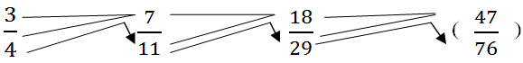

根据上图，后一项分数的分子等于前一项分数的分子加分母，后一项分数的分母等于前一项分数的分母加后一项分数的分子，因此递推数列最后一项是。

故正确答案为A。

**来源**：2008年陕西省公务员录用考试《行测》题第43题

### 第 44 题

，，，，。

A. 

B. 

C. 

D. 

第 44 题 · 答案与解析

**参考答案（粉笔题库参考内容）**

C

**解析**

分子部分：1、3、5、7、(9)，成等差数列；

分母部分：59、70、92、136、(224)，为二级等比数列，即相邻项后项减去前项构成的新数列为等比数列，即11、22、44、(88)。

则未知项为。

故正确答案为C。

**来源**：2008年陕西省公务员录用考试《行测》题第44题

### 第 45 题

11，22，33，55，。

A. 77

B. 66

C. 88

D. 99

第 45 题 · 答案与解析

**参考答案（粉笔题库参考内容）**

C

**解析**

原数列为递推和数列。

数列中，相邻两项之和等于下一项，规律如下：11+22=33，22+33=55，以此类推，则未知项为33+55=(88)。

故正确答案为C。

**来源**：2008年陕西省公务员录用考试《行测》题第45题

### 第 46 题

一个三位数除以43，商是a，余数是b，则a+b的最大值是：

A. 957

B. 64

C. 56

D. 33

第 46 题 · 答案与解析

**参考答案（粉笔题库参考内容）**

B

**解析**

假设被除数为M，则可得M＝43a＋b。由余数≥0，可知43a≤M≤999，解得a≤23。若a＝23，而M最大为999，此时得到余数最大为10，则a与b之和为33；若a＝22，由余数小于除数，即b＜43，可知b≤42，只需看b＝42是否能够取到，此时反向构造被除数＝43×22＋42＝988，仍为三位数，满足要求，此时a与b之和为64。注意题目中的A项显然不可能，在剩余三个选项中，64已经是最大值，无需继续尝试。

故正确答案为B。

**考点**：非典型最值问题

**来源**：2008年陕西省公务员录用考试《行测》题第46题

### 第 47 题

下表是“人人乐”超市某日早上开始营业后8分钟内对顾客进出超市情况的记录，其中正数表示进入，负数表示走出：

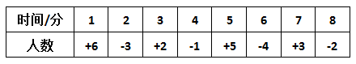

则8分钟内光顾该超市的顾客有多少位？

A. 13

B. 14

C. 15

D. 16

第 47 题 · 答案与解析

**参考答案（粉笔题库参考内容）**

D

**解析**

8分钟内光顾该超市的顾客数：6＋2＋5＋3＝16，把表格中的正数（表示进入超市的顾客数）相加即可。

故正确答案为D。

**来源**：2008年陕西省公务员录用考试《行测》题第47题

### 第 48 题

口袋中有6个黄球和若干个白球，它们除颜色外完全相同，从中任意摸出一球，若摸出黄球的可能性是，则白球比黄球少多少个？

A. 3

B. 4

C. 5

D. 6

第 48 题 · 答案与解析

**参考答案（粉笔题库参考内容）**

B

**解析**

摸出黄球的可能性是，则黄球:白球 =3:1，黄球有6个，因此白球有2个，即白球比黄球少4个。

故正确答案为B。

**考点**：概率问题-其他

**来源**：2008年陕西省公务员录用考试《行测》题第48题

### 第 49 题

一本书，小静第一天读了12.5%，第二天读了37.5%，第二天比第一天多读了32页，这本书共多少页？

A. 98

B. 108

C. 118

D. 128

第 49 题 · 答案与解析

**参考答案（粉笔题库参考内容）**

D

**解析**

设书的总页数为a，由题意可知，第二天比第一天多读了32页，第二天比第一天多读了书总页数的37.5%－12.5%＝25%，因此a×25%＝32，a＝128页。

故正确答案为D。

**考点**：和差倍比问题

**来源**：2008年陕西省公务员录用考试《行测》题第49题

### 第 50 题

在一条公路的两边植树，每隔3米种一棵树，从公路的东头种到西头还剩5棵树苗，如果改为每隔2.5米种1棵，还缺树苗115棵，则这条公路长多少米？

A. 700

B. 800

C. 900

D. 600

第 50 题 · 答案与解析

**参考答案（粉笔题库参考内容）**

C

**解析**

设公路长为n，根据双边植树问题公式可得：，解得n=900米。

故正确答案为C。

注：双边植树问题：。

**来源**：2008年陕西省公务员录用考试《行测》题第50题

### 第 51 题

给长方形的长增加2，宽增加5，恰好可以得到一个面积为100的正方形，则原长方形的周长是：

A. 13

B. 26

C. 40

D. 46

第 51 题 · 答案与解析

**参考答案（粉笔题库参考内容）**

B

**解析**

设长方形的长和宽分别为m、n，对长方形进行改造后，m+2=n+5，，解得m=8，n=5，则原长方形的周长为。

故正确答案为B。

**考点**：几何公式类-平面图形

**来源**：2008年陕西省公务员录用考试《行测》题第51题

### 第 52 题

在一条线段中间另有6个点，则这8个点可以构成多少条线段？

A. 15

B. 21

C. 28

D. 36

第 52 题 · 答案与解析

**参考答案（粉笔题库参考内容）**

C

**解析**

8个点中任意两点均可连成一条线段，则可得线段的条数为。

故正确答案为C。

**考点**：基础排列组合

**来源**：2008年陕西省公务员录用考试《行测》题第52题

### 第 53 题

一根竹笋从发芽到长大，如果每天长1倍，经过10天长到40分米，那么当长到2.5分米时，要经过多少天？

A. 6

B. 8

C. 4

D. 12

第 53 题 · 答案与解析

**参考答案（粉笔题库参考内容）**

A

**解析**

设原长为L，长到2.5分米时，要经过m天，故可得如下：

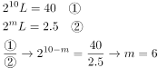

故正确答案为A。

**考点**：数列问题

**来源**：2008年陕西省公务员录用考试《行测》题第53题

### 第 54 题

某班一次数学测试，全班平均91分，其中男生平均88分，女生平均93分，女生人数是男生人数的多少倍？

A. 0.5

B. 1

C. 1.5

D. 2

第 54 题 · 答案与解析

**参考答案（粉笔题库参考内容）**

C

**解析**

设男生人数为m，女生人数为n，则可得88m+93n=91(m+n)，解得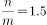。

故正确答案为C。

**考点**：和差倍比问题

**来源**：2008年陕西省公务员录用考试《行测》题第54题

### 第 55 题

某商店规定每4个空啤酒瓶可以换1瓶啤酒，小明家买了24瓶啤酒，他家前后最多能喝到多少瓶啤酒？

A. 30

B. 31

C. 32

D. 33

第 55 题 · 答案与解析

**参考答案（粉笔题库参考内容）**

C

**解析**

这是一个空瓶换水问题，由4个空瓶换一瓶啤酒，得到等价公式，3空瓶＝1瓶啤酒，买了24瓶啤酒，可以换到8瓶啤酒，因此他家前后最多能喝到24＋8＝32瓶啤酒。

故正确答案为C。

**来源**：2008年陕西省公务员录用考试《行测》题第55题

### 第 56 题

一项工程，工作效率提高四分之一，完成这项工程的时间将由原来的十小时缩短到几小时？

A. 4

B. 8

C. 12

D. 16

第 56 题 · 答案与解析

**参考答案（粉笔题库参考内容）**

B

**解析**

解析1：根据题意，工作效率提高了，可以对工作效率赋值一个数，为了简化计算过程，赋值一个4的倍数，即设工作效率为4，提高后，工作效率为5，原来10个小时完成，则工作量为4×10＝40，现在完成时间是40÷5＝8小时。

解析2：工程原来的完成时间为10小时，所以工作效率为，效率提高，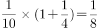，所以完成时间为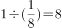小时。

故正确答案为B。

**考点**：给效率比例型

**来源**：2008年陕西省公务员录用考试《行测》题第56题

### 第 57 题

“火树银花楼七层，层层红灯倍加增，共有红灯三八一，试问四层几红灯？”

A. 24

B. 28

C. 36

D. 37

第 57 题 · 答案与解析

**参考答案（粉笔题库参考内容）**

A

**解析**

设最上面一层有a个，则第四层有个，观察选项，只有24为8的倍数。

故正确答案为A。

**考点**：数列问题

**来源**：2008年陕西省公务员录用考试《行测》题第57题

### 第 58 题

甲、乙、丙、丁四人比赛乒乓球，规定每两人之间均要赛一场，结果甲胜丁，甲、乙、丙三人胜的场数相同，那么丁胜了多少场？

A. 3

B. 1

C. 0

D. 2

第 58 题 · 答案与解析

**参考答案（粉笔题库参考内容）**

C

**解析**

四人比赛，一共有6场。因为甲、乙、丙三人胜的场数相同，故分别胜1场或2场。都胜1场时，丁胜3场，即丁分别战胜甲、乙、丙，不符合题意；甲、乙、丙都胜2场，此时丁胜0场，符合题意。

故正确答案为C。

**来源**：2008年陕西省公务员录用考试《行测》题第58题

### 第 59 题

一个两位数，十位上的数字是个位上的数字的，把十位上与个位上的数字调换后，新数比原数大18，则原来这个两位数的两个数字和是：

A. 12

B. 10

C. 8

D. 21

第 59 题 · 答案与解析

**参考答案（粉笔题库参考内容）**

B

**解析**

设十位数为m，个位数为n，则，又，联立解得m=4，n=6，m+n=10。

故正确答案为B。

**来源**：2008年陕西省公务员录用考试《行测》题第59题

### 第 60 题

某个月有五个星期六，已知这五个日期的和为85，则这个月中最后一个星期六是多少号？

A. 10

B. 17

C. 24

D. 31

第 60 题 · 答案与解析

**参考答案（粉笔题库参考内容）**

D

**解析**

一个月有五个星期六，日期和为85，则平均数为17，因为五个星期六的日期构成公差为7的等差数列，平均数即是第三个星期六的日期，则第五个星期六的日期为17+7+7=31。

故正确答案为D。

**考点**：数列问题

**来源**：2008年陕西省公务员录用考试《行测》题第60题

### 第 61 题

下面图形中，哪个与其他三个不同：

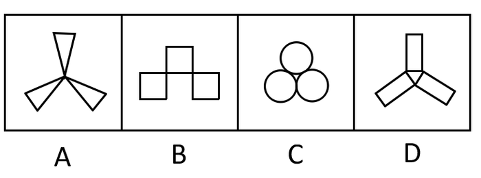

A. A

B. B

C. C

D. D

第 61 题 · 答案与解析

**参考答案（粉笔题库参考内容）**

B

**解析**

解法一：元素组成不同，优先考虑属性规律。观察发现，选项中的图形均为轴对称图形，其中A、C、D三项都有3条对称轴，而B项只有1条对称轴，故B项与其他三个图形不同。

解法二：元素组成不同，优先考虑属性规律。观察发现，A、B、D三项都是全直线图形，而C项是全曲线图形，故C项与其他三个图形不同。

由于选项中的图形具有明显的“三足鼎立”的特征，是考查对称性考点的重要图形特征，所以粉笔更倾向于解法一，将答案选给B项。

故正确答案为B。

**考点**：属性规律-对称性

**来源**：2008年陕西省公务员录用考试《行测》题第61题

### 第 62 题

定义A※B、B※C、C※D、D※B分别对应下列图形：

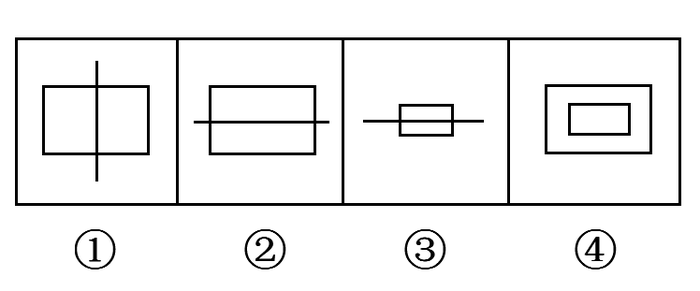

那么，下列图形可表示A※D、A※C的分别为：

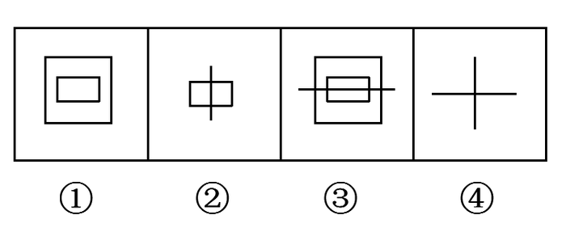

A. ①②

B. ②③

C. ②④

D. ①③

第 62 题 · 答案与解析

**参考答案（粉笔题库参考内容）**

C

**解析**

由题干知，A是一条竖线，B是大方框，C是一条横线，D是一个小方框，所以A※D、A※C所表示的图形应该有竖线。排除①③，故选择②④。

故正确答案为C。

**考点**：样式规律-加减同异

**来源**：2008年陕西省公务员录用考试《行测》题第62题

### 第 63 题

如果对应，那么对应：

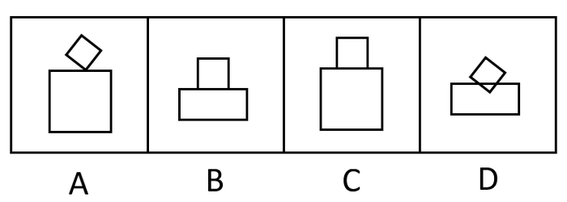

A. A

B. B

C. C

D. D

第 63 题 · 答案与解析

**参考答案（粉笔题库参考内容）**

B

**解析**

特殊考点，考查元素按照一定规律重新组合位置。右边图形的上半部分是左边大图形中的小图形，而且是逆时针倾斜45度；右边图形的下半部分是左边大图形的上半部分。所以未知图形的下半部分应为正方形的上半部分即长方形，上半部分应为已倾斜45度的正方形再逆时针倾斜45度。

故正确答案为B。

**考点**：位置规律-综合

**来源**：2008年陕西省公务员录用考试《行测》题第63题

### 第 64 题

下图中的正方体，如果把它展开，可以是：

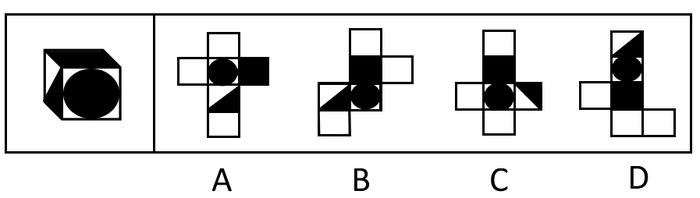

A. A

B. B

C. C

D. D

第 64 题 · 答案与解析

**参考答案（粉笔题库参考内容）**

B

**解析**

以正方体黑色圆所在格子为正面，上面格子是黑正方形，那么左边是黑三角形，且有一条直角边与黑色圆相切。

A、C两项中都不相切且位置不对，排除。D项中位置不对，排除。

故正确答案为B。

**考点**：空间类-空间重构-六面体

**来源**：2008年陕西省公务员录用考试《行测》题第64题

### 第 65 题

剪纸是中国的民间艺术，剪纸方法很多，下图是一种方法的图示（先将纸折叠，然后再剪，展开后得到图案）。

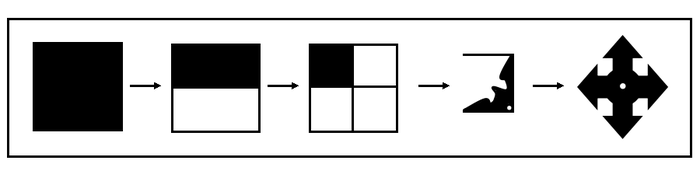

下面四个图案，不能用上述方法剪出的是：

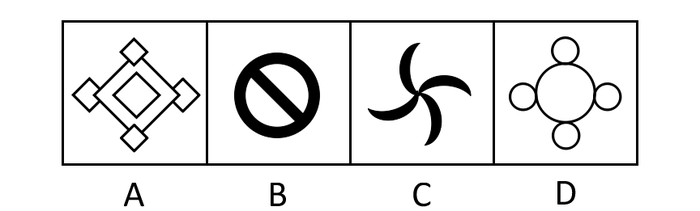

A. A

B. B

C. C

D. D

第 65 题 · 答案与解析

**参考答案（粉笔题库参考内容）**

C

**解析**

由题干可知，剪纸得到的图案均是轴对称的，至少满足横竖两个轴对称。

A、B、D三项均是轴对称图案。C项是中心对称图案，不是轴对称图案。

故正确答案为C。

**考点**：属性规律-对称性

**来源**：2008年陕西省公务员录用考试《行测》题第65题

### 第 66 题

以下四个图形中，阴影面积最大的是：

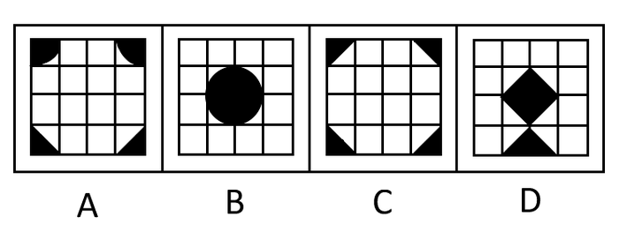

A. A

B. B

C. C

D. D

第 66 题 · 答案与解析

**参考答案（粉笔题库参考内容）**

B

**解析**

设小格子边长为1，A项图中上部分阴影面积之和是半径为1的圆面积的，下部分阴影面积之和是边长为1的小正方形面积，那么A项阴影面积是。B项图形阴影面积是半径为1的圆面积，即阴影面积为π。C项图形阴影面积是两个边长为1的小正方形面积之和，即阴影面积为2。D项阴影面积是三个边长为1的小正方形面积之和，即阴影面积为3。

由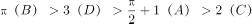可知，B项阴影面积最大。

故正确答案为B。

**考点**：黑白块类

**来源**：2008年陕西省公务员录用考试《行测》题第66题

### 第 67 题

所谓联觉就是各种器官能奇妙地混合在一起，大脑里通常互不相干的几个感觉区域之间产生沟通。

根据上述定义，下列属于联觉的情形是：

A. 王丽打开调频收音机，一听到主持人开口说话，就感到左大腿、肩膀甚至左耳都不舒服，不得不关掉收音机

B. 战士刘成武吃西瓜觉得很甜，多吃了几块，结果拉肚子

C. 某歌唱家听说有一首新歌正在找人首唱，便委托所属唱片公司与新歌制作人谈价钱，最后没有谈成

D. 聋哑少年黄大伟和家人交流，每次都是通过书写的方式进行，速度比较慢

第 67 题 · 答案与解析

**参考答案（粉笔题库参考内容）**

A

**解析**

第一步：抓住定义中关键词。

定义的关键词有“大脑里通常互不相干的几个感觉区域之间产生沟通”。

第二步：逐一判断选项。

A项中的“左大腿、肩膀甚至左耳”分别归大脑中不同的感官区域所控制，“不舒服”正是“感官区域之间产生沟通”；

B项吃西瓜觉得很甜和拉肚子不属于大脑感官区域；

C项“找人首唱”“谈价钱，最后没有谈成”和题干定义没有直接关系，属于无关项；

D项“通过书写的方式进行交流”不属于“大脑里通常互不相干的几个感觉区域之间产生沟通”。

故正确答案为A。

**考点**：主客体

**来源**：2008年陕西省公务员录用考试《行测》题第67题

### 第 68 题

什么是底线？底线是必须坚守的最低条件或限度。世界万事万物都有底线，越过了底线，意味着发生质变；守不住底线，就是把自己逼上绝地。

根据上述定义，下列哪一项情形属于“越过了底线”？

A. 某钢厂采购矿石，开始准备采购南方厂的，后来采购了北方厂的

B. 警察小刘在办案中抓住了犯罪嫌疑人，犯罪嫌疑人塞给他一万元，小刘放走了犯罪嫌疑人

C. 李红和丈夫闹矛盾，上法院申请离婚

D. 宏大律师事务所律师王某丢失了一起重大案件的关键证据，致使该案中的犯罪嫌疑人无罪释放，造成很大社会影响

第 68 题 · 答案与解析

**参考答案（粉笔题库参考内容）**

B

**解析**

第一步：抓住定义中关键词。

定义的关键词有“最低条件或限度”、“越过了底线，意味着发生质变”。

第二步：逐一判断选项。

A项中采购矿石没有涉及“最低条件或限度”，属于无关选项；

B项中警察的职责是除暴安良，维护社会正义，小刘因受贿而放走犯罪嫌疑人的举动显然越过了“最低条件或限度”“意味着发生质变”；

C项中虽已申请离婚，但仍是夫妻关系，没有发生质变，不符合“越过了底线”；

D项中“王某丢失了一起重大案件的关键证据”不属于“最低条件或限度”，不是律师王某没有守住自己的底线。

故正确答案为B。

**考点**：拆词

**来源**：2008年陕西省公务员录用考试《行测》题第68题

### 第 69 题

“哑巴英语”，是指只注重讲解语法，而忽视对学生实际语言运用能力的培养。过去我们培养了大量只会“哑巴英语”的学生，因为不会说，不会实际运用，学得快，忘得快，没有达到最初学习的真正目的。

根据上述定义，下列哪项措施促进“哑巴英语”问题解决的力度较弱？

A. 西安外国语大学改变教师主动讲和学生被动听的老模式，用精彩的活动形式提高学生的英语听说能力

B. 教育部新闻发言人透露，从上半年起，将正式启动万名英语外教到国内各外语学校任教的十年引进计划

C. 某外语学校召开研讨会，探讨教师职业道德与外语教育的关系问题

D. 某市教育局规定，九年义务教育阶段，在校学生必须接受至少半年以上的口语交际训练

第 69 题 · 答案与解析

**参考答案（粉笔题库参考内容）**

C

**解析**

第一步：抓住定义中关键词。

定义的关键词有“只注重讲解语法”、“忽视对学生实际语言运用能力的培养”。

第二步：逐一判断选项。

A项“用精彩的活动形式提高学生的英语听说能力”、B项“启动万名英语外教到国内各外语学校任教”、D项“在校学生必须接受至少半年以上的口语交际训练”都是通过各种形式来提高学生的实际运用能力，对“哑巴英语”问题解决有促进作用；

C项关于“教师职业道德与外语教育”的研讨会“对学生实际语言运用能力的培养”没有直接关系，对解决“哑巴英语”问题的促进力度比较弱。

故正确答案为C。

**考点**：拆词

**来源**：2008年陕西省公务员录用考试《行测》题第69题

### 第 70 题

耐药性，是指病原体与药物多次接触后，对药物的敏感性下降甚至消失，致使药物疗效降低或无效，多用来指人。社会这个大集体，同人一样，也会生出大大小小的疾病，如果在初犯的时候不能及时对症下药，彻底根治，也会产生耐药性，致使一些病症成为顽疾。

下列哪一项最符合“耐药性”定义的情形？

A. 湖南大学生成某早上突然感到不舒服，家人火速送院治疗，但服用什么药物都无好转，最后只好回家静养

B. 老王感冒后连续喝了三天感冒灵冲剂都没好转，结果在医院只打了一针就好了

C. 针对非法排污的法律法规几乎每年都在制定并出台，但是一些企业非法排污、超标排污的事件仍然屡见不鲜、屡禁不止，而且颇有扩大之势

D. 某保健品厂生产的保健减肥茶，经质检部门检验含有致癌物质，按照法律规定予以停产关闭

第 70 题 · 答案与解析

**参考答案（粉笔题库参考内容）**

C

**解析**

第一步：抓住定义中关键词。

定义的关键词有“与药物多次接触后”、“对药物的敏感性下降甚至消失”、“在初犯的时候不能及时对症下药，彻底根治”、“产生耐药性，致使一些病症成为顽疾”。

第二步：逐一判断选项。

A项中“服用什么药物都无好转”并未说明该大学生以前多次服用过这些药物，不符合“与药物多次接触后”；

B项中“连续喝了三天感冒灵冲剂都没好转，打了一针就好了”，不能说明“对药物的敏感性下降甚至消失”、“产生耐药性”；

C项中“法律法规几乎每年都在制定并出台”说明“在初犯的时候不能及时对症下药”，“非法排污、超标排污的事件仍然屡见不鲜、屡禁不止”符合“对药物的敏感性下降甚至消失”以及“产生耐药性，致使一些病症成为顽疾”；

D项中“经质检部门检验含有致癌物质，按照法律规定予以停产关闭”说明了“在初犯的时候能及时对症下药”，与定义矛盾。

故正确答案为C。

**考点**：大前提

**来源**：2008年陕西省公务员录用考试《行测》题第70题

### 第 71 题

外汇是指以外国货币表示的、用于国际结算的多种支付凭证。它包括外国货币（钞票、铸币）、外币有价证券（政府公债、国库券、公司债券、股票、息票等）、外币支付凭证（票据、银行存款凭证、邮政储蓄凭证等）以及其他可以在国外兑现的凭证。

根据上述定义，在法国下列不属于外汇范畴的是：

A. 西班牙政府发行的水利建设公债

B. 英国汇丰银行的存款凭证

C. 1000万俄罗斯卢布兑换成欧元后的现金存款凭证

D. 10亿欧元兑换成美元后的现金存款凭证

第 71 题 · 答案与解析

**参考答案（粉笔题库参考内容）**

C

**解析**

第一步：抓住定义中关键词。

定义的关键词有“以外国货币表示”、“用于国际结算”、“可以在国外兑现的凭证”。

第二步：逐一判断选项。

A项属于外国政府的公债，B项属于外国的银行存款凭证，D项属于外币支付凭证，所以A、B、D三项都属于外汇，符合“以外国货币表示”、“用于国际结算”、“可以在国外兑现的凭证”；

C项“卢布兑换成欧元后的现金存款凭证”可以在法国流通、兑现，不符合“以外国货币表示”。

本题为选非题，故正确答案为C。

**考点**：单定义-其他句式

**来源**：2008年陕西省公务员录用考试《行测》题第71题

### 第 72 题

人事行政培训是指通过有关的培训机构，由具有实际行政经验和行政科学理论知识的人员，教导政府公务人员掌握和提高行政工作所需的特定知识和技能的过程。

下列不属于人事行政培训的一项是：

A. 为了提高干部构建和谐社会的执政能力，省委组织县处级以上领导干部到中央党校学习

B. 某县近年来加大招商引资工作力度，因为工作需要按计划派相关人员到西安外国语大学学习外语

C. 某机关组织工作人员利用业余时间学习太极拳

D. 某县对2007年新录用的公务员在正式上岗前统一进行为期一个月的综合能力培训

第 72 题 · 答案与解析

**参考答案（粉笔题库参考内容）**

C

**解析**

第一步：抓住定义中关键词。

定义的关键词有“通过有关的培训机构”、“掌握和提高行政工作所需的特定知识和技能”。

第二步：逐一判断选项。

A项“领导干部到中央党校学习”、B项“相关人员到西安外国语大学学习外语”、D项“上岗前统一进行为期一个月的综合能力培训”都符合“通过有关的培训机构”，目的都是为了“掌握和提高行政工作所需的特定知识和技能”；

C项“学习太极拳”显然对“掌握和提高行政工作所需的特定知识和技能”没有关系。

本题为选非题，故正确答案为C。

**考点**：拆词

**来源**：2008年陕西省公务员录用考试《行测》题第72题

### 第 73 题

民族共同语是指同一个民族的人们在生产、生活中，彼此之间交流思想感情和交往联系所共同使用的语言。

下列语言不属于民族共同语言的是：

A. 藏语

B. 朝鲜语

C. 英语

D. 世界语

第 73 题 · 答案与解析

**参考答案（粉笔题库参考内容）**

D

**解析**

第一步：抓住定义中关键词。

定义的关键词有“同一个民族”、“交流思想感情和交往联系”、“共同使用”。

第二步：逐一判断选项。

A项藏语、B项朝鲜语均符合“同一个民族”、“共同使用”；

C项英语是多个民族的共同语，符合“交流思想感情和交往联系”、“共同使用”；

D项世界语是波兰医生柴门霍夫博士于1887年创制的一种语言，他希望人类借助这种语言，达到民族间相互了解，消除仇恨和战争，显然不符合“同一个民族”、“交流思想感情和交往联系”、“共同使用”。

本题为选非题，故正确答案为D。

**考点**：拆词

**来源**：2008年陕西省公务员录用考试《行测》题第73题

### 第 74 题

招标是招标人在买卖大宗商品、发包建设项目或者合作经营某项业务前，不经过一般交易磋商程序，而是公开征求应征人递盘竞争，最后由招标人选定交易对象订约的交易方式。

下列交易方式属于招标的是：

A. 张老板拟出售市郊别墅，声明在不低于二百万元人民币的基础上可以协商

B. 张老板拟将市郊别墅群的建设项目竞标，向省内外具有相应建设资质的单位发布通告

C. 张老板下属公司一位机要管理人员因故失踪，他决定悬赏10万元寻求知情者

D. 张老板欲以15元价格抛出他所持有公司60%的股票

第 74 题 · 答案与解析

**参考答案（粉笔题库参考内容）**

B

**解析**

第一步：抓住定义中关键词。

定义的关键词有“不经过一般交易磋商程序”、“公开征求应征人递盘竞争”、“由招标人选定交易对象订约”。

第二步：逐一判断选项。

A项“声明在不低于二百万元人民币的基础上可以协商”不符合“公开征求应征人递盘竞争”；

B项“将市郊别墅群的建设项目竞标”与“向省内外具有建设资质的单位发布通告”符合“公开征求应征人递盘竞争”；

C项属于悬赏，属于无关选项；

D项“张老板欲以15元价格抛出他所持有公司60％的股票”属于个人卖股票行为，不符合“公开征求应征人递盘竞争”、“由招标人选定交易对象订约”。

故正确答案为B。

**考点**：大前提

**来源**：2008年陕西省公务员录用考试《行测》题第74题

### 第 75 题

行政机关是依照宪法或行政组织法的规定而设置的行使国家行政职能的国家机关。其主要特征是：行使国家行政职权、管理国家行政事务；行政机关在组织体系上实行领导—从属制；行政机关在决策体系上实行首长负责制；行政机关行使职能通常是主动的、经常的和不间断的。

根据上述定义，下列属于行政机关的是：

A. 陕西省人民政府

B. 陕西省人民代表大会

C. 陕西省高级人民法院

D. 陕西省妇联

第 75 题 · 答案与解析

**参考答案（粉笔题库参考内容）**

A

**解析**

第一步：抓住定义中关键词。

定义的关键词有“行使国家行政职权、管理国家行政事务”、“领导—从属制”、“首长负责制”、“行使职能通常是主动的、经常的和不间断的”。

第二步：逐一判断选项。

A项人民政府是行政机关，符合“领导—从属制”、“首长负责制”以及“行使国家行政职权、管理国家行政事务”；

B项人民代表大会是权力机关，C项高级人民法院属于司法机关，B、C两项均不符合“行使国家行政职权、管理国家行政事务”；

D项妇联显然不是行政机关。

故正确答案为A。

**考点**：单定义-其他句式

**来源**：2008年陕西省公务员录用考试《行测》题第75题

### 第 76 题

学生：读书

A. 学者：做学问

B. 写作：素材

C. 老师：学校

D. 结果：调查

第 76 题 · 答案与解析

**参考答案（粉笔题库参考内容）**

A

**解析**

第一步：判断题干词语之间逻辑关系。

学生读书为主谓宾结构。

第二步：判断选项词语之间逻辑关系。

A项，学者做学问为主谓宾结构，与题干逻辑关系一致，当选；

B项，写作需要素材，二者为对应关系，与题干逻辑关系不一致，排除；

C项，老师在学校工作，二者为地点的对应关系，与题干逻辑关系不一致，排除；

D项，调查的结果，二者为偏正关系，与题干逻辑关系不一致，排除。

故正确答案为A。

**考点**：语法关系

**来源**：2008年陕西省公务员录用考试《行测》题第76题

### 第 77 题

清明：祭祖

A. 历史：借鉴

B. 粘土：沙子

C. 周日：休假

D. 秩序：遵守

第 77 题 · 答案与解析

**参考答案（粉笔题库参考内容）**

C

**解析**

第一步：判断题干词语间逻辑关系。

题干两个词是对应关系，在清明节祭祖，是日期与活动的对应关系。

第二步：判断选项词语间逻辑关系。

A项，借鉴历史，历史不是一个日期，与题干逻辑关系不一致，排除。

B项，粘土和沙子是并列关系，与题干逻辑关系不一致，排除。

C项，在周日休假，且周日是一个日期，与题干逻辑关系一致，当选。

D项，遵守秩序，秩序不是一个日期，与题干逻辑关系不一致，排除。

故正确答案为C。

**考点**：逻辑关系-对应关系

**来源**：2008年陕西省公务员录用考试《行测》题第77题

### 第 78 题

外交官：大学生

A. 食物：庄稼

B. 大炮：玩具

C. 大雁塔：琉璃瓦

D. 蔬菜：绿色植物

第 78 题 · 答案与解析

**参考答案（粉笔题库参考内容）**

A

**解析**

第一步：判断题干词语间逻辑关系。

有的大学生是外交官，有的不是，有的外交官是大学生，有的不是，二者是交叉关系，且是大学生毕业后才能当外交官，有先后的逻辑关系。

第二步：判断选项词语间逻辑关系。

A项：有的庄稼是食物，有的不是（比如棉花就不能被当作食物），有的食物是庄稼，有的不是，二者为交叉关系，且庄稼成熟后才能被当作食物，有先后的逻辑关系，与题干逻辑关系一致，当选；

B项：大炮不能当作玩具，与题干逻辑关系不一致，排除；

C项：大雁塔为建筑，琉璃瓦为瓦片，琉璃瓦不能是大雁塔，二者不是交叉关系，与题干逻辑关系不一致，排除；

D项：有的蔬菜是绿色植物，有的不是，有的绿色植物是蔬菜，有的不是，二者是交叉关系，但是二者之间没有先后的逻辑关系，与题干逻辑关系不一致，排除。

故正确答案为A。

**考点**：逻辑关系-交叉关系

**来源**：2008年陕西省公务员录用考试《行测》题第78题

### 第 79 题

民族：图腾

A. 国家：国旗

B. 人：精神

C. 瓷器：质地

D. 火药：硝酸

第 79 题 · 答案与解析

**参考答案（粉笔题库参考内容）**

A

**解析**

第一步：判断题干词语之间逻辑关系。

题干两词是对应关系，后者是前者的代表，一个民族的图腾代表着这个民族。

第二步：判断选项词语间逻辑关系。

A项，国旗是国家的一种标志性旗帜，是国家的象征，代表着这个国家，与题干逻辑关系一致。

B项，精神是人表现出的内在气质，不能代表人，与题干逻辑不一致。

C项，质地是瓷器的一个特征方面，不能代表瓷器，与题干逻辑不一致。

D项，硝酸是火药的成分之一，不能代表火药，与题干逻辑不一致。

故正确答案为A。

**考点**：逻辑关系-对应关系

**来源**：2008年陕西省公务员录用考试《行测》题第79题

### 第 80 题

兴高采烈：垂头丧气

A. 妻子：丈夫

B. 科学研究：旁门左道

C. 锦上添花：雪中送炭

D. 赞成：反对

第 80 题 · 答案与解析

**参考答案（粉笔题库参考内容）**

D

**解析**

第一步：判断题干词语之间逻辑关系。

题干两词是一对反义词。

第二步：判断选项词语之间逻辑关系。

A项属于并列关系；

B项“旁门左道”指非正统的学术流派或宗教派别，“科学研究”指科研手段和装备探索、认识未知事物，二者不是反义词；

C项属于近义词，组成关系与题干逻辑不一致；

D项“赞成”和“反对”是一对反义词。

故正确答案为D。

**考点**：语义关系-反义关系

**来源**：2008年陕西省公务员录用考试《行测》题第80题

### 第 81 题

电影：演员：观众

A. 蜜蜂：油菜花：蜂蜜

B. 运动员：足球：胜利

C. 政府：总理：工作报告

D. 酒店：建筑师：顾客

第 81 题 · 答案与解析

**参考答案（粉笔题库参考内容）**

D

**解析**

第一步：判断题干词语之间逻辑关系。

题干词语之间是对应关系，演员演电影给观众观看。

第二步：判断选项词语之间逻辑关系。

A、B、C三项组成的关系与题干逻辑不一致；

D项，建筑师设计酒店供顾客使用，与题干逻辑一致。

故正确答案为D。

**考点**：逻辑关系-对应关系

**来源**：2008年陕西省公务员录用考试《行测》题第81题

### 第 82 题

考试：学生：成绩

A. 网络：网民：电子邮件

B. 汽车：司机：驾驶执照

C. 工作：职员：工资待遇

D. 饭菜：厨师：色香味美

第 82 题 · 答案与解析

**参考答案（粉笔题库参考内容）**

C

**解析**

第一步：判断题干词语之间逻辑关系。

题干词语之间是对应关系，第二个通过第一个达到第三个目的。学生通过考试取得成绩。

第二步：判断选项词语之间逻辑关系。

A、B、D三项组成的关系与题干逻辑关系不一致；

C项，职员通过工作获得工资待遇，符合题干逻辑关系。

故正确答案为C。

**考点**：逻辑关系-对应关系

**来源**：2016年山东省选调应届优秀高校毕业生到基层工作考试《行测》试卷（精选）第55题

### 第 83 题

语言：工具：交流

A. 轮船：钢铁：运输

B. 书籍：阅读：印刷

C. 会议：方式：工作

D. 筷子：吃饭：餐具

第 83 题 · 答案与解析

**参考答案（粉笔题库参考内容）**

C

**解析**

第一步：判断题干词语间逻辑关系。

题干三个词属于对应关系，语言是一种交流工具，即“第一个词”是“第三个词”的“第二个词”。

第二步：判断选项词语间逻辑关系。

A项，轮船是一种运输工具，而不是“钢铁”，与题干不符。

B项，书籍是一种阅读工具，也是一种印刷制品，与题干不符。

C项，会议是一种工作方式，逻辑结构与题干一致，符合题意。

D项，筷子是一种吃饭的餐具，“吃饭”和“餐具”应该更换位置。

故正确答案为C。

**考点**：逻辑关系-对应关系

**来源**：2008年陕西省公务员录用考试《行测》题第83题

### 第 84 题

（    ）  对于  人性  相当于  正义  对于  （    ）

A. 良心 和谐

B. 良知 和谐

C. 良知 和平

D. 良心 和平

第 84 题 · 答案与解析

**参考答案（粉笔题库参考内容）**

B

**解析**

第一步：判断题干词语之间逻辑关系。

题干是包容关系，且是种属关系，前者是后者一种。

第二步：判断选项词语之间逻辑关系。

“良心”强调行为规范和价值标准，“良知”强调先天具有的道德意识，人性强调人的本性、天性，“良知”较“良心”更好地体现出了人性，所以排除A、D两项；

“和平”用来形容人的不激动或安逸的状态，指好的方面，“和谐”强调一种整体共存的状态和谐，较“和平”更符合题干逻辑。

故正确答案为B。

**考点**：逻辑关系-包容关系

**来源**：2008年陕西省公务员录用考试《行测》题第84题

### 第 85 题

领导 对于 人才 相当于 （    ） 对于 （    ）

A. 水 鱼

B. 启蒙老师 学生

C. 伯乐 千里马

D. 嘴唇　牙齿

第 85 题 · 答案与解析

**参考答案（粉笔题库参考内容）**

C

**解析**

第一步：判断题干词语之间逻辑关系。

题干是对应关系，第一个主要才能或职责是第二个。领导最主要的才能是知人善用。

第二步：判断选项词语之间逻辑关系。

A、B、D三项组成的关系与题干逻辑关系不一致；

C项，伯乐在古时候指善于相马的人，现在引申为善于发现、推荐、培养和使用人才的人，符合题干逻辑关系。

故正确答案为C。

**考点**：逻辑关系-对应关系

**来源**：2008年陕西省公务员录用考试《行测》题第85题

### 第 86 题

张三问李四：“你是否不承认那笔钱是你拿的？”这句话有一个隐含的前提是：

A. 李四从没拿那笔钱

B. 那笔钱是李四拿的

C. 李四应该承认那笔钱是他拿的

D. 那笔钱不是李四拿的

第 86 题 · 答案与解析

**参考答案（粉笔题库参考内容）**

B

**解析**

第一步：关注题干提问方式。

题干强调“是否不承认是你拿的”，前提肯定是张三假定李四拿了那笔钱才问这个问题的。

第二步：逐一判断选项。

A项“李四从没拿那笔钱”和D项“那笔钱不是李四拿的”表述不符合提问推断，排除；

B项强调李四拿了那笔钱，符合题意推断；

C项“应该承认那笔钱是他拿的”，“应该”强调情理上必然或必须如此，不符合题意推断。

故正确答案为B。

**考点**：日常结论

**来源**：2008年陕西省公务员录用考试《行测》题第86题

### 第 87 题

甲、乙、丙、丁在比他们的身高。甲说：“我最高。”乙说：“我不是最矮的。”丙说：“我没甲高，但还有人比我矮。”丁说：“我可能最矮。”实际测量的结果表明，只有一人说错了。

这四个人从高到矮的排列是：

A. 甲、乙、丙、丁

B. 乙、丙、甲、丁

C. 乙、甲、丙、丁

D. 甲、乙、丁、丙

第 87 题 · 答案与解析

**参考答案（粉笔题库参考内容）**

C

**解析**

第一步：找突破口。

本题突破口为丁，丁没有说错，因为如果丁说错了，这四个人就没有最矮的了。

第二步：看其他人的话。

丁没有说错，则乙也没有说错，那么甲和丙必有一个人说错了；假设甲说对了“我最高”，那么丙也说对了“我没有甲高，但还有人比我矮”，所以此假设不成立，即甲说错了，那么丙就说对了。这四个人的身高按从高到矮排列为：乙、甲、丙、丁。

故正确答案为C。

**考点**：假设

**来源**：2008年陕西省公务员录用考试《行测》题第87题

### 第 88 题

《中华人民共和国公务员法》规定：“对公务员的考核，按照管理权限，全面考核公务员的德、能、勤、绩、廉，重点考核工作实绩。”

由此可见：

A. 作为公务员最重要的是工作实绩，但也不可忽视其他方面的表现

B. 只要工作成绩突出，其他的都不怎么重要

C. 作为公务员，德才是最重要的

D. 公务员的德、能、勤、绩、廉是同等重要的

第 88 题 · 答案与解析

**参考答案（粉笔题库参考内容）**

A

**解析**

第一步：抓住题干的对象及关键词。

题干强调“全面考核”、“重点考核”。

第二步：逐一判断选项。

A项“最重要的是工作实绩，但也不可忽视其他方面的表现”符合“全面考核”、“重点考核”；

B项“其他的都不怎么重要”、C项“德才是最重要的”表述不符合“全面考核”；

D项“同等重要”表述不符合“重点考核”。

故正确答案为A。

**考点**：日常结论

**来源**：2008年陕西省公务员录用考试《行测》题第88题

### 第 89 题

在我国，中秋节是我国民间传统的五大节日之一，其核心的文化内涵是“祝愿社会和谐进步和家庭团圆幸福”。但令人遗憾的是，如今商业化将中秋节演变成了“月饼节”，“月饼越做越大，文化意义却越来越少”。

以下哪项是这段文字最有可能支持的观点？

A. 传统文化不能作为经济资源加以利用

B. 要挖掘和创新传统文化内涵，弘扬优秀民族文化

C. 要充分挖掘传统节日所蕴藏的巨大商机

D. 商业活动应以传承民族文化为主要目的

第 89 题 · 答案与解析

**参考答案（粉笔题库参考内容）**

D

**解析**

第一步：抓住题干的关键。

题干前一部分强调中秋节核心文化内涵，后一部分强调商业化中秋节使其失去本来的内涵。

第二步：逐一判断选项。

A项“不能作为经济资源加以利用”和C项“蕴藏的巨大商机”不符合题意；

B项，无中生有，不是题干所强调的内容；

D项，根据题干向下延伸，即“商业活动应以传统民族文化为主要目的”，符合题意。

故正确答案为D。

**考点**：日常结论

**来源**：2008年陕西省公务员录用考试《行测》题第89题

### 第 90 题

1992年三峡库区平均人口密度为282人／平方公里，高于全国(122人／平方公里)和四川（192人／平方公里）。库区的山地面积占总面积90%以上，海拔400m以下地带的人口密度为500-600人／平方公里。另外，库区耕地大部分是旱地，坡度在15度至25度的耕地占旱地的46.5%，坡度大于25度的耕地占旱地的25%。

从这段文字可以得出：

A. 三峡库区坡度在15度以下的耕地占旱地的35%

B. 四川平均人口密度也高于全国平均水平

C. 三峡库区绝大部分人生活在海拔400m以上

D. 陕西平均人口密度在全国倒数第一

第 90 题 · 答案与解析

**参考答案（粉笔题库参考内容）**

B

**解析**

第一步：抓住题干的关键。

题干强调了三峡库区地形特征及人口状况。

第二步：逐一判断选项的作用。

A项错误，根据题意可知，三峡库区坡度在15度以下的耕地占旱地的比例是100%－46.5%－25%＝28.5%；

B项符合推断，根据题干信息可知，四川人口密度是192人/平方公里，全国平均水平是122人/平方公里，那么四川平均人口密度高于全国平均水平；

C项无法推出，根据题干信息可知，库区的山地面积占总面积90%以上，而海拔400m以下地带的人口密度更大，C项错误；

D项题干没有涉及，属于无关项。

故正确答案为B。

**考点**：日常结论

**来源**：2008年陕西省公务员录用考试《行测》题第90题

### 第 91 题

中国的汽车厂家正在开发节能型汽车。其直接原因是汽油价格节节攀升，消费者的节能意识不断提高。开发节能汽车需要投入大量的资金。中国一汽集团在2015年之前将对以节能汽车为主的自主品牌汽车投入130亿元人民币的开发费用。上海汽车集团也计划在2012年之前投入214亿元人民币，用于新车的节能技术开发。节能汽车的开发竞争，可望加速中国汽车产业调整，改善大中小企业混杂的混乱局面。

以下哪一项最可能是中国汽车厂家投资开发节能汽车的原因？

A. 节能汽车在中国尚未普及

B. 节能汽车巨大的市场前景

C. 开发节能汽车需要投入大量资金

D. 节能汽车是汽车工业发展的趋势

第 91 题 · 答案与解析

**参考答案（粉笔题库参考内容）**

B

**解析**

第一步：抓住题干的对象及其关系。

前部分强调“汽油价格节节攀升，消费者的节能意识不断提高”，后部分说明汽车厂家投入大量的资金开发节能汽车。

第二步：判断整体关系。

“汽油价格节节攀升，消费者的节能意识不断提高”说明了一个道理，即节能汽车巨大的市场前景。而巨大的市场前景促使汽车厂家投入大量的资金开发节能汽车。

第三步：逐一判断选项的作用。

A项“尚未普及”不能作为原因，且题干没有涉及；

B项“巨大的市场前景”符合第二步推断；

C项“需要投入大量资金”就是对题干内容的简单重复，不能作为原因；

D项“节能汽车是汽车工业发展的趋势”可以作为结果，而不是原因。

故正确答案为B。

**考点**：日常结论

**来源**：2008年陕西省公务员录用考试《行测》题第91题

### 第 92 题

不少有识之士经常指出，一个国家、民族及文化的蓬勃发展，不仅需要高度物质的发展，还必须有进步信念的支撑。人的存在，总应该超出一般动物类的局限，具备更多智慧、信念、意志力等精神层面的东西。由此可以推出（    ）。

A. 对一个国家、民族及一个人来讲，精神和信念不可少

B. 精神比物质更重要

C. 精神就是指智慧、信念和意志力

D. 物质与精神是一个问题的两个方面

第 92 题 · 答案与解析

**参考答案（粉笔题库参考内容）**

A

**解析**

第一步：分析题干。

日常推理题需要几个原则：保持主题一致；排除无关概念；慎选宏观论断；优选可能论断。特别注意几个容易犯的错误：偷换概念；强加比较；夸大事实；无由猜测。

第二步：逐一分析选项。

A项，题干讲的就是一个国家、民族必须有进步信念的支撑；人的存在也需要具备更多精神层面的东西，符合题意，正确。

B项，题干没有比较精神和物质哪个更重要，强加比较，排除。

C项，智慧、信念、意志力是精神层面的东西，但不代表就是精神，偷换概念，排除。

D项，题干没有讲物质与精神是不是同一个问题，无由猜测，排除。

故正确答案为A。

**考点**：日常结论

**来源**：2008年陕西省公务员录用考试《行测》题第92题

### 第 93 题

碳酸钾溶于水时形成碱性物质容易使含有氮的气体逃到空气中散失掉，而草木灰里含碳酸钾，人类尿是氮肥，所以人类尿跟草木灰混用则：

A. 会减少肥料效果

B. 增加肥料的效用

C. 是明智之举

D. 是不可能的

第 93 题 · 答案与解析

**参考答案（粉笔题库参考内容）**

A

**解析**

第一步：抓住题干的对象及其关系。

前部分强调碳酸钾溶于水时产生的作用，后部分说明草木灰里含碳酸钾，人类尿是氮肥。

第二步：分析题干信息，并结合选项得出答案。

由题干可知，人类尿跟草木灰混用会使作为氮肥的人类尿中的氮失掉，氮的缺失显然会减少肥料效果。

A项符合题意；

B项错误，应该会减少肥料效用；

C、D两项片面，不符合题意，属于无关项。

故正确答案为A。

**考点**：日常结论

**来源**：2008年陕西省公务员录用考试《行测》题第93题

### 第 94 题

最高明的骗子可能在某个时刻欺骗所有的人，也可能在所有的时刻欺骗某一些人，但绝对不可能在所有的时刻欺骗所有的人。

按照上述说法，以下哪一项是不正确的？

A. 一个人可能在某个时段受骗

B. 骗人的人也可能被骗

C. 一个人可能在任何时刻都不受骗

D. 不存在某一时刻，所有人都受骗

第 94 题 · 答案与解析

**参考答案（粉笔题库参考内容）**

D

**解析**

第一步：翻译题干。

①可能在某个时刻欺骗所有的人；

②可能在所有的时刻欺骗某一些人；

③不可能在所有的时刻欺骗所有的人。

第二步：逐一分析选项。

A项：根据①可知，可能在某个时刻欺骗所有的人，所有的人包括某个人，所以可以推出一个人可能在某个时段受骗，排除；

B项：根据①可知，可能在某个时刻欺骗所有的人，所有的人包括骗子，所以可以推出骗人的人也可能被骗，排除；

C项：题干中①和②只是可能性的描述，没有明确指出所有人都必然会受骗，所以可能存在一个人在任何时刻都不受骗，排除；

D项：与①矛盾，不正确，当选。

本题为选非题，故正确答案为D。

**考点**：集合推理

**来源**：2008年陕西省公务员录用考试《行测》题第94题

### 第 95 题

某市教育专家建议，可以采取按照年龄、教授科目和职称等级将教师平均分配的办法来配置教育资源，这样就能实现教育公平，解决目前因上重点中学引起的社会问题。

以下哪项如果为真，最能削弱上述专家观点？

A. 很多原来重点中学的教师对此表示支持

B. 普通中学纷纷要求增加拨款加强学校硬件建议

C. 一些重点中学教师要求到该市以外中学任教

D. 绝大多数学生和家长表示反对

第 95 题 · 答案与解析

**参考答案（粉笔题库参考内容）**

B

**解析**

第一步：找出论点和论据。

论点：采取按照年龄、教授科目和职称等级将教师平均分配的办法来配置教育资源，就能实现教育公平，解决目前因上重点中学引起的社会问题。没有论据。

第二步：判断削弱方式。

提问句是削弱专家观点，而专家观点是论点，故本题削弱论点。

第三步：逐一判断选项的作用。

A项是支持专家的观点；

B项，论点中专家认为将教师平均分配就可以解决目前因上重点中学引起的社会问题，说明普通中学不如重点中学的问题不在于教师资源的分配，而在于学校硬件设施不到位，有力地削弱专家的观点；

C项说的是到该市以外的中学任教，跟通过分配教师资源来实现教育公平没有直接关系，无法削弱专家的观点；

D项只说学生和家长反对，没有说明反对的理由，无法削弱专家的观点。

故正确答案为B。

**考点**：削弱论点

**来源**：2008年陕西省公务员录用考试《行测》题第95题

### 第 96 题

对于法律事实分类正确的是：

A. 法律事件 法律后果

B. 法律后果 法律责任

C. 法律事件 法律行为

D. 法律行为 法律制裁

第 96 题 · 答案与解析

**参考答案（粉笔题库参考内容）**

C

**解析**

法律事实，就是法律规定的、能够引起法律关系产生、变更和消灭的现象。它分为法律行为和法律事件。

行为是指法律关系主体有意识的活动，能够引起法律关系发生变更和消灭的行为，包括作为和不作为两种表现形式，还可分为合法行为和违法行为。

事件是指不以合同法律关系主体的主观意志为转移而发生的，能够引起合同法律关系产生、变更、消灭的客观现象。

法律后果、法律责任、法律制裁皆不属于法律事实的分类范畴，排除A、B、D三项。

故正确答案为C。

**考点**：法理学

**来源**：2008年陕西省公务员录用考试《行测》题第96题

### 第 97 题

私营经济已经成为我国国民经济的有机组成部分，根据宪法规定，我国对于私营经济要实施何种方针？

A. 引导 监督 管理

B. 指导 限制 管理

C. 引导 限制 管理

D. 监督 限制 帮助

第 97 题 · 答案与解析

**参考答案（粉笔题库参考内容）**

A

**解析**

1988年《宪法》开始明确，国家保护个体经济、私营经济的合法的权利和利益。国家对个体经济、私营经济实行引导、监督和管理。 2004年《宪法修正案》做出进一步明确，国家保护个体经济、私营经济等非公有制经济的合法的权利和利益。国家鼓励、支持和引导非公有制经济的发展，并对非公有制经济依法实行监督和管理。所以含有“限制”的B、C、D三项皆为干扰项。

故正确答案为A。

**考点**：宏观经济与调控政策

**来源**：2008年陕西省公务员录用考试《行测》题第97题

### 第 98 题

根据《国家行政机关公文处理办法》的规定，下列说法不正确的是：

A. 陕西省人民政府与山西省人民政府可以联合行文

B. 陕西省公安厅和西安市人民政府可以联合行文

C. 陕西省人民政府和中共陕西省委可以联合行文

D. 省教育厅只有通过省政府办公厅才可以向各市县政府行文

第 98 题 · 答案与解析

**参考答案（粉笔题库参考内容）**

D

**解析**

《国家行政机关公文处理办法》第十六条规定，同级政府、同级政府各部门、上级政府部门与下一级政府可以联合行文。因此排除符合规定的A、B、C项。

D项，《国家行政机关公文处理办法》第十五条规定，政府各部门依据部门职权可以向下一级政府的相关业务部门行文。重大事件的行文需要抄送上级机关。所以省教育厅可以直接向下级政府相关业务部门行文，无需通过政府办公厅。

故正确答案为D。

**来源**：2008年陕西省公务员录用考试《行测》题第98题

### 第 99 题

小王是某县教育局的一位公务员，因为某种原因被辞退，他在得知处理决定后三十日内可以向哪个机关申请复核？

A. 县人民政府

B. 县教育局

C. 市教育局

D. 市人民政府

第 99 题 · 答案与解析

**参考答案（粉笔题库参考内容）**

B

**解析**

本题考查法律常识。

《公务员法》第九十五条第一款规定：“公务员对涉及本人的下列人事处理不服的，可以自知道该人事处理之日起三十日内向原处理机关申请复核；对复核结果不服的，可以自接到复核决定之日起十五日内，按照规定向同级公务员主管部门或者作出该人事处理的机关的上一级机关提出申诉；也可以不经复核，自知道该人事处理之日起三十日内直接提出申诉：

(一)处分；

(二)辞退或者取消录用；

(三)降职；

(四)定期考核定为不称职；

(五)免职；

(六)申请辞职、提前退休未予批准；

(七)不按照规定确定或者扣减工资、福利、保险待遇；

(八)法律、法规规定可以申诉的其他情形。”

故正确答案为B。

**考点**：行政法

**来源**：2008年陕西省公务员录用考试《行测》题第99题

### 第 100 题

《中华人民共和国公务员法》于何时开始施行？

A. 2006年1月1日

B. 2005年4月27日

C. 2006年10月1日

D. 2005年10月1日

第 100 题 · 答案与解析

**参考答案（粉笔题库参考内容）**

A

**解析**

A选项正确，《中华人民共和国公务员法》已由中华人民共和国第十届全国人民代表大会常务委员会第十五次会议于2005年4月27日通过，自2006年1月1日起施行；

B选项错误，该选项是通过时间，非施行时间。

故正确答案为A。

本题已过时。

新《公务员法》由2018年12月29日第十三届全国人民代表大会常务委员会第七次会议修订，并于2019年06月01日开始施行。

**考点**：行政法

**来源**：2008年陕西省公务员录用考试《行测》题第100题

### 第 101 题

中华人民共和国成立后，中央人民政府颁布的第一部法律是：

A. 《宪法》

B. 《刑事诉讼法》

C. 《婚姻法》

D. 《劳动法》

第 101 题 · 答案与解析

**参考答案（粉笔题库参考内容）**

C

**解析**

中华人民共和国第一部《婚姻法》是1948年华北解放区妇女工作会议后，由中央妇委起草，经过多次讨论和修改，于1950年5月1日颁布实施的法律。它也成为了中央政府在建国后颁布的第一部法律。第一部《宪法》是在1949年颁布的《共同纲领》基础上，几经修改在1954年颁布的，被称为“五四宪法”。《刑事诉讼法》在1979年通过，《劳动法》在1994年通过，所以排除A、B、D三项。

故正确答案为C。

**考点**：其他法律法规

**来源**：2008年陕西省公务员录用考试《行测》题第101题

### 第 102 题

“公民在法律面前人人平等”可以做出如下理解：

A. 公民的立法平等

B. 公民在立法、执法、守法上一律平等

C. 公民的执法平等

D. 公民在法律的适用上一律平等

第 102 题 · 答案与解析

**参考答案（粉笔题库参考内容）**

D

**解析**

本题考查法律常识。

A、B两项错误，公民在立法上是不平等的。因为法律体现的是统治阶级的意志，被统治阶级没有资格立法。

C项错误，公民自身没有执法权，公民在执法面前一律平等指的是公民作为执法的对象一律平等。

D项正确，根据《宪法》第三十三条第二款的规定：“中华人民共和国公民在法律面前一律平等。”公民在法律面前一律平等主要指的是公民在适用法律上一律平等，任何人没有超越法律的特权。

故正确答案为D。

**考点**：法理学

**来源**：2008年陕西省公务员录用考试《行测》题第102题

### 第 103 题

李某因触犯国家法律被判刑入狱，但并没有被剥夺政治权利，这意味着李某在服刑期间：

A. 没有选举权

B. 经过有关机关批准可以行使选举权

C. 可以行使选举权

D. 暂时被停止行使选举权

第 103 题 · 答案与解析

**参考答案（粉笔题库参考内容）**

C

**解析**

根据《刑法》第五十四条规定：“剥夺政治权利是剥夺下列权利：（一）选举权和被选举权；（二）言论、出版、集会、结社、游行、示威自由的权利；（三）担任国家机关职务的权利；（四）担任国有公司、企业、事业单位和人民团体领导职务的权利。”

A、D两项错误，本题目探讨选举权，因此未被剥夺政治权利意味着A、D错误；

C项正确，保留选举权意味着无需批准即可使用，B项错误，C项正确。

故正确答案为C。

**考点**：刑法

**来源**：2008年陕西省公务员录用考试《行测》题第103题

### 第 104 题

下列哪一条不属于我国制定法律的基本原则？

A. 以事实为依据

B. 公民在法律面前一律平等

C. 灵活性与原则性相结合

D. 群众与领导相结合

第 104 题 · 答案与解析

**参考答案（粉笔题库参考内容）**

B

**解析**

本题考查法律常识，主要涉及法的制定的基本原则。

法的制定的基本原则，是在法的制定的整个活动中贯彻始终的行为准则，它是指导思想的规范化和具体化，是指导思想体现的形式和落实的保证。我国制定法律的基本原则，一般来说要遵循以下基本原则：（一）实事求是，一切从实际出发的原则；（二）合宪性和法制统一原则；（三）总结国内实践经验和借鉴外国经验相结合的原则；（四）原则性和灵活性相结合的原则；（五）立足全局、统筹兼顾、适当安排的原则；（六）群众路线和专门机关工作相结合，民主与集中相结合的原则；（七）维护法的稳定性、连续性和严肃性与及时创、改、废相结合的原则。

ACD项正确，均属于我国制定法律的基本原则。

B项错误，“公民在法律面前一律平等”属于我国法律的适用原则，而不是立法的基本原则。

本题为选非题，故正确答案为B。

**考点**：法理学

**来源**：2008年陕西省公务员录用考试《行测》题第104题

### 第 105 题

张先生自己创办了一家化工生产厂并担任厂长，他可以被称为这个化工生产厂的：

A. 法人代表

B. 法人

C. 法定代表人

D. 法定代表

第 105 题 · 答案与解析

**参考答案（粉笔题库参考内容）**

C

**解析**

A项错误，法人代表一般指根据法人的内部规定担任某一职务，或由法定代表人指派代表法人对外依法行使民事权利和义务的人，法人代表依法定代表人的授权而产生，没有法定代表人的授权，就不能产生法人代表。张先生并非被授权，所以他不是法人代表。

B项错误，法人是具有民事权利能力和民事行为能力，依法独立享有民事权利和承担民事义务的组织。法人与自然人不同，是种无生命的社会组织体。

C项正确，《中华人民共和国民法典》第六十一条第一款规定：“依照法律或者法人章程的规定，代表法人从事民事活动的负责人，为法人的法定代表人。”题干中，张先生自己创办化工厂并担任厂长，是该工厂的负责人，代表该厂行使职权，故张先生可以被称为该厂（法人）的法定代表人。

D项错误，法定代表在此语境下并不存在，属于干扰项。

故正确答案为C。

**考点**：民法典

**来源**：2008年陕西省公务员录用考试《行测》题第105题

### 第 106 题

土地对农民具有重要意义，我国农民对土地享有：

A. 使用权

B. 转让权

C. 所有权

D. 所有权和使用权

第 106 题 · 答案与解析

**参考答案（粉笔题库参考内容）**

A

**解析**

本题考查新思想。

B项错误，我国实行的是土地集体所有制度，所以个体不享有转让权；

C、D项错误，我国属于社会主义国家，土地归全民所有，个人不享有所有权。

故正确答案为A。

**考点**：政治建设

**来源**：2008年陕西省公务员录用考试《行测》题第106题

### 第 107 题

行政诉讼是＿＿＿＿＿＿＿之间的活动。

A. 人民法院、原告和行政机关工作人员

B. 原告和人民法院

C. 人民法院和一切诉讼参与人

D. 行政机关和行政管理相对方

第 107 题 · 答案与解析

**参考答案（粉笔题库参考内容）**

C

**解析**

《行政诉讼法》是规范行政诉讼活动和诉讼法律关系的法律规范的总称，它是规定人民法院、诉讼当事人以及其他诉讼参与人进行诉讼活动，及其在诉讼活动中形成的诉讼法律关系的法律规范。

C选项正确，一切诉讼参与人包括诉讼当事人和其他诉讼参与人。

故正确答案为C。

**考点**：行政法

**来源**：2008年陕西省公务员录用考试《行测》题第107题

### 第 108 题

我国婚姻法中“凡直系血亲关系或三代以内旁系血亲关系者禁止结婚”的规定的出发点是：

A. 避免包办婚姻

B. 近亲结婚会大大增加遗传病的发病几率

C. 防止家庭势力过分膨胀

D. 出于伦理道德的考虑

第 108 题 · 答案与解析

**参考答案（粉笔题库参考内容）**

B

**解析**

A项错误，避免包办婚姻属于婚姻自由范畴，与禁止近亲结婚无关。

B项正确，近亲结婚的夫妇，从共同祖先那里获得了较多的相同基因，很容易使对后代生存不利的有害基因相遇和集合（遗传学上叫做纯合），从而加重了有害基因对后代的危害程度，容易生出素质低劣的孩子，并且后代死亡率高，常出现痴呆、畸形和遗传病。因此，《婚姻法》规定了禁止近亲结婚。

C项错误，我国《婚姻法》禁止近亲结婚与家庭势力无关。

D项错误，近亲结婚会提高遗传疾病的发病概率已经成为医学共识，道德伦理虽然也是禁止原因之一，但并非出发点。

故正确答案为B。

**考点**：民法典

**来源**：2008年陕西省公务员录用考试《行测》题第108题

### 第 109 题

对于我国案件审理程序的表述，下列哪一种说法正确？

A. 两审终审制，但最高人民法院一审判决即为终审判决

B. 单纯的两审终审制，两审后当事人不得上诉

C. 一审终审制，但当事人可以向上级人民法院提出复核

D. 一审终审制，但允许当事人上诉

第 109 题 · 答案与解析

**参考答案（粉笔题库参考内容）**

A

**解析**

两审终审制是指一个案件经过两级人民法院审理即告终结的法律制度。但最高人民法院审理的第一审案件是一审终审，因为最高人民法院是级别最高的法院。第一审判决、裁定作出后不存在上诉和抗诉的问题，判决、裁定一旦作出，即发生法律效力，这是两审终审制的例外。

故正确答案为A。

**考点**：法理学

**来源**：2008年陕西省公务员录用考试《行测》题第109题

### 第 110 题

赵某患有间歇性精神病，他在病发时手持利器将王某逼至一间旧房子，王某在无处可逃的情况下顺手向赵某扔了一块砖头，导致赵某头部受伤。王某的这种行为属于：

A. 正当防卫

B. 防卫过当

C. 故意伤害

D. 紧急避险

第 110 题 · 答案与解析

**参考答案（粉笔题库参考内容）**

A

**解析**

A项正确，D项错误，因王某行为只是针对不法侵害人本人实施，没有损害他人合法利益，所以属于正当防卫而不是紧急避险；

B项错误，因赵某手持利器，或对王某造成重大伤害，所以王某扔砖头的做法未超过必要限度，所以不构成防卫过当；

C项错误，王某行为是针对不法侵害实施的，不属于故意伤害。

故正确答案为A。

**考点**：刑法

**来源**：2008年陕西省公务员录用考试《行测》题第110题

### 第 111 题

张某是一位个体经营者，因生意关系与同行发生争执，动手将对方弄伤，但法院认为张某的行为情节显著轻微而且危害不大，因此并不追究法律责任。

对此我们应该做如下理解：

A. 张某的行为是犯罪但不以犯罪论处

B. 张某的行为不构成犯罪

C. 法院为了安定团结而采取的特殊策略

D. 张某贿赂了相关执法人员从而免于处罚

第 111 题 · 答案与解析

**参考答案（粉笔题库参考内容）**

B

**解析**

本题考查罪与非罪概念。题干表明，伤害并不严重，不追究法律责任，则法院应当判定的是张某行为非罪。

A项错误，自我矛盾；

C项错误，在题干中并没有体现；

D项错误，是干扰项。

故正确答案为B。

**考点**：刑法

**来源**：2008年陕西省公务员录用考试《行测》题第111题

### 第 112 题

我国的立法体制是中央统一领导下的：

A. 一级立法体制

B. 民主集中制立法体制

C. 中央与地方两级立法体制

D. 多级立法体制

第 112 题 · 答案与解析

**参考答案（粉笔题库参考内容）**

D

**解析**

我国是统一的、单一制的国家，各地方经济、社会发展又很不平衡。与这一国情相适应，在最高国家权力机关集中行使立法权的前提下，为了使我们的法律既能通行全国，又能适应各地方千差万别的不同情况的需要，在实践中能行得通，《宪法》和《立法法》根据《宪法》确定的“在中央的统一领导下，充分发挥地方的主动性、积极性”的原则，确立了我国的统一而又分层次的多级立法体制。

故正确答案为D。

**考点**：宪法

**来源**：2008年陕西省公务员录用考试《行测》题第112题

### 第 113 题

巡视员是对应于＿＿＿＿＿的非领导职务。

A. 厅局级正职

B. 县处级正职

C. 厅局级副职

D. 县处级副职

第 113 题 · 答案与解析

**参考答案（粉笔题库参考内容）**

A

**解析**

A项正确；

B项错误，巡视员和副（助理）巡视员是正厅局级和副厅局级的非领导职务；

C、D两项错误，调研员是处级。

故正确答案为A。

**考点**：行政法

**来源**：2008年陕西省公务员录用考试《行测》题第113题

### 第 114 题

社会主义法律的本质是由＿＿＿＿＿＿决定的。

A. 社会生产力水平

B. 社会经济基础

C. 党的政策

D. 全体社会的共同意志

第 114 题 · 答案与解析

**参考答案（粉笔题库参考内容）**

B

**解析**

A项错误，生产力决定生产关系，而生产关系是指人类利用自然、改造自然的能力，所以不符；

B项正确，经济基础决定上层建筑，而我国属于社会主义市场经济，决定了我国社会主义法律的上层建筑，所以本质上是由经济基础决定的。

故正确答案为B。

**考点**：法理学

**来源**：2008年陕西省公务员录用考试《行测》题第114题

### 第 115 题

江某在某超市购买了一台电动榨汁机，1个月后出现故障，要求超市处理。但超市“购物须知”规定：“在本超市购物有质量问题，请及时解决，自购物之日起超过15日的概不退换。”超市以此为由，拒绝受理，要求江某与生产厂家联系处理。

对本案纠纷的处理，下列观点错误的是：

A. 超市的规定是“霸王条款”，损害消费者权益，应当无效

B. 超市的规定是“要约”，消费者的购买是承诺，双方形成合同关系，所以规定有效

C. 超市的规定是“格式条款”，但免除了自己的责任，所以无效

D. 超市的规定与产品《质量法》的规定相抵触，所以无效

第 115 题 · 答案与解析

**参考答案（粉笔题库参考内容）**

B

**解析**

A项正确，该超市的“购物须知”规定是霸王条款，主要是指一些经营者单方面制定的逃避法定义务、减免自身责任的不平等的格式合同、通知、声明和店堂公告或者行业惯例等，这些条款损害消费者权益，不产生法律效力。

B项错误，在《合同法》实施之前，商业广告被视作是要约邀请。要约邀请指一方发出邀请对方或者引诱对方向自己发出要约的行为，在法律上发出要约邀请的一方一般不用承担法律后果。所以，前些年的商业广告往往极尽夸大、吹嘘之能事，欺骗、误导消费者。为了改变这种状况，新《合同法》第十五条第二款规定：“商业广告的内容符合要约规定的，视为要约。”要约是希望和他人订立合同的意思表示，接受要约的相对人一旦进行承诺，合同便成立，所以要约一经做出便对要约人产生法律上的约束力。超市并未要约江某，他们之间没有发生要约行为。

C项正确，《消费者权益保护法》第二十四条规定：“经营者不得以格式合同、通知、声明、店堂告示等方式作出对消费者不公平、不合理的规定，或者减轻、免除其损害消费者合法权益应当承担的民事责任。格式合同、通知、声明、店堂告示等含有前款所列内容的，其内容无效。”

D项正确，《产品质量法》第四条规定：“生产者、销售者依照本法规定承担产品质量责任。”超市规定与《产品质量法》相抵触，所以无效。

本题为选非题，故正确答案为B。

**本题相关知识点：**

格式条款又称格式合同，是指当事人为了重复使用而预先拟定、并在订立合同时未与对方协商的条款。如：保险合同、拍卖成交确认书等，都是格式合同。

**考点**：民法典

**来源**：2008年陕西省公务员录用考试《行测》题第115题

### 第 116 题

根据《行政诉讼法》，人民法院从立案之日起多长时间内必须作出第一审判决？

A. 15日

B. 1个月

C. 2个月

D. 6个月

第 116 题 · 答案与解析

**参考答案（粉笔题库参考内容）**

D

**解析**

本题考查法律常识。

A、B、C三项错误，D项正确。根据《行政诉讼法》第八十一条规定：“人民法院应当在立案之日起六个月内作出第一审判决。有特殊情况需要延长的，由高级人民法院批准，高级人民法院审理第一审案件需要延长的，由最高人民法院批准。”

故正确答案为D。

**考点**：行政法

**来源**：2008年陕西省公务员录用考试《行测》题第116题

### 第 117 题

李某酒后驾车在市内狂奔，连续冲撞数部车辆和行人，造成了一人死亡和多人受伤。李某的行为触犯了法律，严重危害了：

A. 公共安全

B. 社会管理秩序

C. 社会进步

D. 国家安全

第 117 题 · 答案与解析

**参考答案（粉笔题库参考内容）**

A

**解析**

《道路安全法》规定，醉酒驾车构成危害公共安全罪大类中的危险驾驶罪。如果酒精含量超过规定标准，还会处以拘役等刑罚。在本案例中，李某应当是醉驾并且严重危害公共安全，面临刑罚。

故正确答案为A。

**考点**：刑法

**来源**：2008年陕西省公务员录用考试《行测》题第117题

### 第 118 题

严老先生是一位富商，病故后留下了近五百万的遗产。其子严肃认为妹妹严英已经出嫁，不能继承遗产，而严英则认为她也应该享有继承权，同时严老先生的弟弟严富贵也要求继承财产。为此，严老先生的夫人张淑贞不知如何分割。根据我国法律的规定，严老先生的财产继承人应该是：

A. 严肃 严英

B. 张淑贞 严肃 严英 严富贵

C. 张淑贞 严肃

D. 张淑贞 严肃 严英

第 118 题 · 答案与解析

**参考答案（粉笔题库参考内容）**

D

**解析**

我国《中华人民共和国民法典》第一千一百二十七条规定，遗产按照下列顺序继承：

第一顺序：配偶、子女、父母。

第二顺序：兄弟姐妹、祖父母、外祖父母。

继承开始后，由第一顺序继承人继承，第二顺序继承人不继承。没有第一顺序继承人继承的，由第二顺序继承人继承。

由此规定可知，张淑贞、严肃、严英作为第一顺序的继承人依法享有继承权，而严老先生之弟作为第二顺序的继承人则无继承权。

故正确答案为D。

**考点**：民法典

**来源**：2008年陕西省公务员录用考试《行测》题第118题

### 第 119 题

在我国现行体制下，行政复议的主体是：

A. 作出具体行政行为的行政机关的党组织

B. 作出具体行政行为的行政机关

C. 作出具体行政行为机关的上级机关

D. 作出具体行政行为机关的同级监察机关

第 119 题 · 答案与解析

**参考答案（粉笔题库参考内容）**

C

**解析**

本题考查法律常识。

根据《行政复议法》第二十四条规定：“县级以上地方各级人民政府管辖下列行政复议案件：

（一）对本级人民政府工作部门作出的行政行为不服的；（二）对下一级人民政府作出的行政行为不服的；（三）对本级人民政府依法设立的派出机关作出的行政行为不服的；（四）对本级人民政府或者其工作部门管理的法律、法规、规章授权的组织作出的行政行为不服的。”可知，行政复议的主体在通常情况下是作出具体行政行为的上级行政机关。

故正确答案为C。

**考点**：行政法

**来源**：2008年陕西省公务员录用考试《行测》题第119题

### 第 120 题

某制药企业因为某种原因受到了市政府停止生产的处理决定，该企业对此处理决定不服，它应该向哪个机关申请复议？

A. 省政府

B. 市政府

C. 省人大

D. 市人大

第 120 题 · 答案与解析

**参考答案（粉笔题库参考内容）**

A

**解析**

本题考查法律常识。

根据《行政复议法》第二十四条规定：“县级以上地方各级人民政府管辖下列行政复议案件：

（一）对本级人民政府工作部门作出的行政行为不服的；（二）对下一级人民政府作出的行政行为不服的；（三）对本级人民政府依法设立的派出机关作出的行政行为不服的；（四）对本级人民政府或者其工作部门管理的法律、法规、规章授权的组织作出的行政行为不服的。”可知，某制药企业因为某种原因受到了市政府停止生产的处理决定，该企业对此处理决定不服，它应该向省政府申请复议。

故正确答案为A。

**考点**：行政法

**来源**：2008年陕西省公务员录用考试《行测》题第120题

## 材料 2

根据所给图表、文字资料回答以下各题。

全国各省、市、自治区2006年总人口和自然增长率

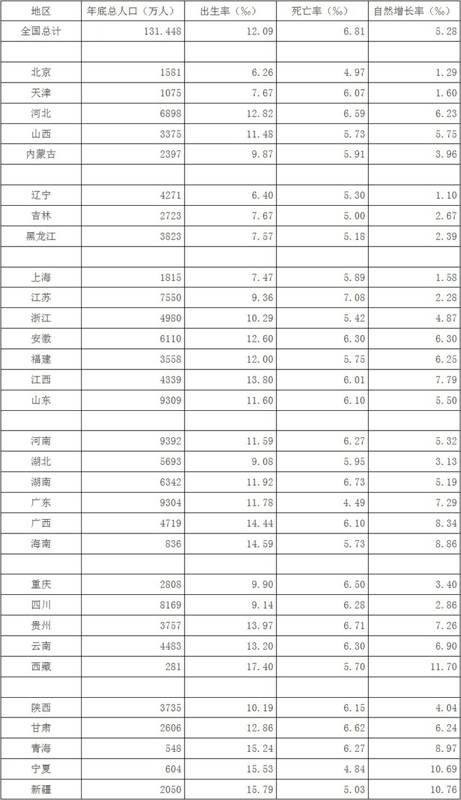

注1.全国数据根据抽样误差和调查误差进行了修正。

    2.全国数据为31个省，自治区、直辖市和中国人民解放军现役军人数据，不包括香港、澳门特别行政区和台湾省的数据。分省数据中未包括中国人民解放军现役军人数。

### 第 121 题

根据图表所示，2006年各大地区人口自然增长率的实际情况是：

A. 华北高于东北，西南高于西北

B. 华北高于东北，西北高于西南

C. 东北高于华北，西北高于西南

D. 东北高于华北，西南高于西北

第 121 题 · 答案与解析

**参考答案（粉笔题库参考内容）**

B

**解析**

华北地区包括北京、天津、河北、山西、内蒙古；西北地区包括宁夏、新疆、青海、陕西、甘肃；西南地区包括四川、云南、贵州、西藏、重庆；东北地区包括辽宁、吉林、黑龙江。对表格数据中的自然增长率按每个地区估算出平均数，华北地区，西北地区，西南地区，东北地区。因此华北高于东北，西北高于西南。

故正确答案为B。

**考点**：简单加减计算

**来源**：2008年陕西省公务员录用考试《行测》题第121题

### 第 122 题

陕西省的人口自然增长率处于什么水平？

A. 低于平均水平

B. 高于平均水平

C. 等于平均水平

D. 高于死亡率

第 122 题 · 答案与解析

**参考答案（粉笔题库参考内容）**

A

**解析**

人口自然增长率平均水平为全国人口自然增长率，即5.28‰，陕西省人口自然增长率为4.04‰，所以低于平均水平。

故正确答案为A。

**考点**：直接找数、统计表

**来源**：2008年陕西省公务员录用考试《行测》题第122题

### 第 123 题

下列出生率高于死亡率数量最大的省（区）是：

A. 新疆

B. 西藏

C. 宁夏

D. 四川

第 123 题 · 答案与解析

**参考答案（粉笔题库参考内容）**

B

**解析**

直接估算四个选项中的每个省的出生率和死亡率的差，新疆=15.79-5.03=10.76；西藏＝17.4－5.7=11.7；宁夏＝15.5－4.8=10.7； 四川＝9.2－6.3=2.9。因此西藏出生率和死亡率的差最大。

故正确答案为B。

**考点**：简单加减计算、统计表

**来源**：2008年陕西省公务员录用考试《行测》题第123题

### 第 124 题

年底总人口数量、出生率、死亡率、自然增长率最高的省（区）分别是：

A. 山东 新疆 江苏 西藏

B. 山东 新疆 湖南 西藏

C. 河南 西藏 江苏 西藏

D. 河南 新疆 湖南 西藏

第 124 题 · 答案与解析

**参考答案（粉笔题库参考内容）**

C

**解析**

从表格中可以观察到西藏的出生率为17.40 ‰，新疆的出生率是15.79‰，很明显西藏的出生率高于新疆的出生率，可以排除A、B、D三项。

故正确答案为C。

**考点**：直接找数、统计表

**来源**：2008年陕西省公务员录用考试《行测》题第124题

## 材料 3

根据所给图回答以下各题。

据我国教育专家的统计，从公元600年到公元1960年，世界上共有1243位科学家、发明家做出1911项重大科技发明。根据这些科技人才做出创造性贡献的年龄制成的科技人才成功曲线图如下：

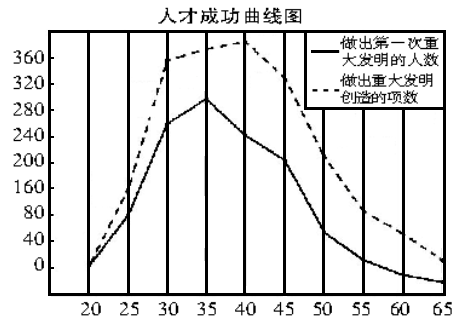

### 第 125 题

由上图可知，60%以上的重大发明创造是由哪个年龄段的人做出的：

A. 25~45岁

B. 30~35岁

C. 35~45岁

D. 25~35岁

第 125 题 · 答案与解析

**参考答案（粉笔题库参考内容）**

A

**解析**

计算出1911×60％≈1900×0.6＝1140，年龄段岁重大发明创造的项数＝80＋280＋320＋320＋240＝1240。

故正确答案为A。

**考点**：简单加减计算、综合资料

**来源**：2008年陕西省公务员录用考试《行测》题第125题

### 第 126 题

做出第一次重大发明的人的年龄集中在哪个阶段：

A. 30岁左右

B. 35岁左右

C. 40岁左右

D. 45岁左右

第 126 题 · 答案与解析

**参考答案（粉笔题库参考内容）**

B

**解析**

观察图中的虚线，从30岁到40岁曲线比较平滑，且这段位于曲线顶部，发明创造项数大于360，因此做出第一次重大发明的人的年龄集中在35岁左右。

故正确答案为B。

**考点**：直接找数、统计图

**来源**：2008年陕西省公务员录用考试《行测》题第126题

### 第 127 题

能由上图获得支持的说法是：

A. 20岁以下的人不可能有重大发明创造

B. 每个人的发明创造都是在中青年时期做出的

C. 每个科技人才做出创造性贡献的年龄是25~45岁

D. 科技人才做出创造性贡献的年龄大多是在中青年时期

第 127 题 · 答案与解析

**参考答案（粉笔题库参考内容）**

D

**解析**

折线图只是对我国科学家进行的统计，所以不能以偏概全，A、B两项明显以我国的数据得出绝对的结论；从图中可以看出45岁到65岁也有重大发明创造；观察折线图，有重大发明创造的人数从25岁开始迅速递增，从45岁开始迅速递减，因此科技人才做出创造性贡献的年龄大多集中在中青年时期，D项正确，A、B、C三项都过于绝对，很有可能是错误的。

故正确答案为D。

**考点**：统计图、综合分析

**来源**：2008年陕西省公务员录用考试《行测》题第127题

## 材料 4

根据下列三个图表完成各题。

表1：1986年至1991年获诺贝尔奖5人以上的18个国家

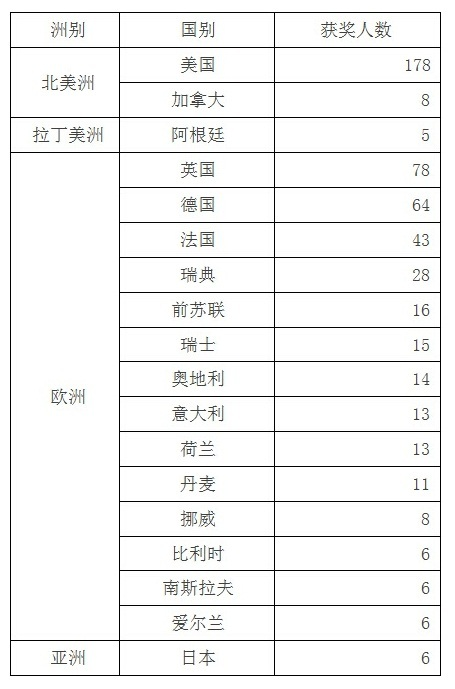

表2：世界科技人才密度表(人／平方公里)

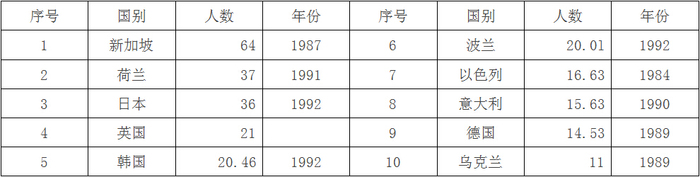

表3：世界科技人才密度表(人／百万人口)

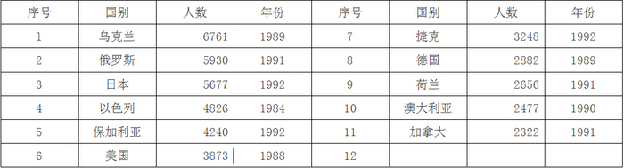

### 第 128 题

在世界范围内，高科技人才高度集中于：

A. 北半球

B. 南半球

C. 欧洲

D. 美洲

第 128 题 · 答案与解析

**参考答案（粉笔题库参考内容）**

A

**解析**

观察表1，表中数据是获得诺贝尔奖5人以上的18个国家和获奖人数，可以以此表分析高科技人才的密集度，南半球主要的国家有澳大利亚、巴西、阿根廷以及大部分南美洲，还有南非以及非洲南部一些小国家，所以表格中除了阿根廷，其余国家都在北半球，所以可判断高科技人才主要集中在北半球。

故正确答案为A。

**考点**：直接找数、统计表

**来源**：2008年陕西省公务员录用考试《行测》题第128题

### 第 129 题

可从表1获得支持的说法是：

A. 发达国家即“人才资源高地”

B. 有的“人才资源高地”仅是数量高地，并非质量高地

C. 美国是第一“人才资源高地”

D. 欧洲是“人才资源高地”

第 129 题 · 答案与解析

**参考答案（粉笔题库参考内容）**

D

**解析**

观察表1，可以用凑整法计算出欧洲的高科技人才人数明显高于美国（178人），因此可以得出欧洲是“人才资源高地”的结论。

欧洲高科技人才总人数约为：。

故正确答案为D。

**考点**：简单加减计算、统计表

**来源**：2008年陕西省公务员录用考试《行测》题第129题

### 第 130 题

可从表2获得支持的说法是：

A. 新加坡科技人才密度（人/平方公里）最大

B. 新加坡科技水平最高

C. 英国的科技人才密度最难统计

D. 上世纪后期亚洲科技人才的密度大于欧洲

第 130 题 · 答案与解析

**参考答案（粉笔题库参考内容）**

C

**解析**

表2中，各个国家科技人才密度数据的统计年份是不同的，故不能横向比较，不能得出新加坡科技人才密集度最大这个结论，A说法错误，同理，B说法也错误；

表2中，英国的科技人才只给出了密度数据，没有统计年份，故英国的科技人才密度最难统计，C说法正确；

表2中，国家大部分为欧洲国家，只有少数亚洲国家，统计年份也不同，所以不能比较上世纪后期亚洲和欧洲的科技人才密度，D错误。

故正确答案为C。

**考点**：统计表、综合分析

**来源**：2008年陕西省公务员录用考试《行测》题第130题

### 第 131 题

可从表3获得支持的说法是：

A. 经济发达国家科技人才密度小

B. 乌克兰科技人才密度（人/百万人口）最大

C. 由于统计年份的差异，科技人才统计结果存在一定的不可比性

D. 社会主义国家科技人才密度小

第 131 题 · 答案与解析

**参考答案（粉笔题库参考内容）**

C

**解析**

首先可以观察表格中的年份，统计每个国家科技人才密度的年份不统一，年份分布在年这个范围内，对不同国家进行横向比较时，统计年份必须是一样的，因此科技人才的统计结果存在一定的不可比性，所以不能得出A、B、D三项中的结论。

故正确答案为C。

**考点**：统计表、综合分析

**来源**：2008年陕西省公务员录用考试《行测》题第131题

## 材料 5

阅读下面文字资料，完成以下各题。

        世界报业协会在2003年度总报告中说，在全球报业表现低迷的形势下，中国报业发行量却增长了8.5%，从1997年到2002年5年累计增长30.3%。

        根据世界报业协会2003年6月13日发表的全球日报发行量排行榜，中国有3份报纸进入前20名：《参考消息》以日发行量270万份排在第9名，《人民日报》以日发行量186万份排在第18名，《羊城晚报》以日发行量150万份排在第20名。中国已成为世界最大的报纸消费国，日销量达8200万份。仅次于中国的是日本，日销量是7080万份。

        按照日销量8200万份、13亿人口计算，中国平均每千人拥有日报数量为63份，比1999年增长了7份，但数量仍然偏少。日本平均每千人拥有日报的数量为545份，美国平均每千人拥有日报的数量为198份。据联合国教科文组织公布，早在1996年，世界平均每千人拥有日报的数量就已经达到96份，发展中国家平均每千人拥有日报的数量为60份，发达国家平均每千人拥有日报的数量为226份。1999年，按平均每个人拥有日报的数量算，挪威排第一，每千人583份。

        美国是报业最发达的国家，根据E&P提供的数据，美国拥有日报1468种（2001年的数据），非日报7689种（2000年的数据）。人口远多于美国的中国报纸数量应该相应多于美国。美国的报业发达是建立在经济高度发达基础上的，因此目前两国还不具有可比性，但这至少说明2002年2137种报纸的数量远非中国报业规模的极限。

        然而，目前中国城乡人口比例悬殊，人口总体教育水平较低，人民生活水平及全国经济水平都处于较低阶段，对报纸的需求必然只能保持在一个有限的水平上。目前总体状况是：就数量而言，乡村人口报纸拥有量极度稀少，而城市人口拥有量相对饱和；就质量而言，前几年报业成长主要都是规模扩张、数量膨胀，在质量方面提高很小，优秀报纸的种数远未能满足读者的需求。因此，中国报业距离成熟尚需时日，还要允许有大量新产品进入市场。

        1992-2002年，全国报纸广告11年来以平均约32％的增长率迅速发展（见下表）。报纸广告的快速增长、占广告总市场超过20％的份额以及不断增长的占GDP的比重，说明报纸作为主流媒体的位置仍将持续相当长的一个时期。报纸广告业必将随着总体广告市场的扩张而同步扩张。

1992-2002年我国报纸年度广告总收入及增长率

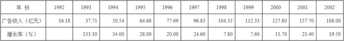

        近年来，以都市居民为主要读者的综合都市报（包括晚报、早报、时报、都市报）的广告得到了快速发展。据慧聪国际媒体研究中心统计的数据，2001年都市类报纸的广告刊登额达到205.92亿元，占全部报纸广告刊登额的66.18％，比2000年增长了15.72％，在各类报纸中增长率最高，市场占有率提高了将近6个百分点。2002年1-10月，综合都市报广告规模达到233.54亿元人民币，与2001年同期相比增长40.08％，占据了68.20％的报纸广告市场份额（见下图）。

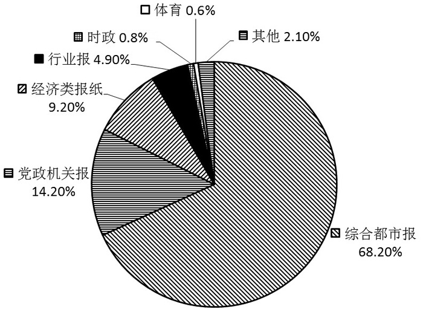

        这些数据表明，都市类报纸已经成为广告投放者最重要的广告媒体，都市报的广告规模在很大程度上决定着整个报业的广告规模。

### 第 132 题

下列说法不符合文意的一项是：

A. 不久前《参考消息》等3份中国报纸以其发行量巨大、国际影响深远而在全球日报发行量统计中名列前茅

B. 这几年国内报业在规模和数量上有了较大增长，城市人口拥有报纸的数量相对饱和，但质量有待提高

C. 根据资料统计，2002年全国报纸年度广告总收入又创新高，比10年前增加了约170亿元人民币

D. 目前，中国平均每千人拥有日报的数量，还不到上个世纪末世界平均每千人拥有日报的数量

第 132 题 · 答案与解析

**参考答案（粉笔题库参考内容）**

A

**解析**

对于A选项，根据材料第二段可知，世界报业协会2003年发表的排行榜是仅按全球日报发行量进行排名的，对排行榜里的日报的国际影响没有进行调查，A选项不符合文意；

对于B选项，根据材料第五段可知，目前城市人口拥有量相对饱和；就质量而言，前几年报业成长主要都是规模扩张、数量膨胀，在质量方面提高很小，优秀报纸的种数远未能满足读者的需求，B选项符合文意；

对于C选项，根据表格(1992~2002年我国报纸年度广告总收入及增长率)，1992年全国报纸年度广告总收入大约为16亿元，2002年为188亿元，故2002年比10年前增加了172亿元，C选项符合文意；

对于D选项，根据材料第三段，目前中国平均每千人拥有日报数量为63份，比1999年增长了7份，但数量仍然偏少，早在1996年，世界平均每千人拥有日报的数量就已经达到96份，D选项符合文意。

综合上述，A选项不符合文意。

本题为选非题，故正确答案为A。

**考点**：综合分析、综合资料

**来源**：2008年陕西省公务员录用考试《行测》题第132题

### 第 133 题

有人说，这篇文章有以下几个要点：

①近年来以都市居民为主要读者的综合都市报快速发展。

②报纸广告增长迅速，综合都市报占据主要广告份额。

③我国报纸发行量增速较快，但千人拥有量仍然偏低。

④目前我国报纸的种类和发行数量还大有增长空间。

你认为要点和顺序都正确的一项是：

A. ④③②①

B. ④②③

C. ③④①②

D. ③④②

第 133 题 · 答案与解析

**参考答案（粉笔题库参考内容）**

D

**解析**

对于要点①，根据材料第七段，近年来，以都市居民为主要读者的综合都市报(包括晚报、早报、时报、都市报)的广告得到了快速发展。因此材料中只是说明了综合都市报的广告得到了快速发展，这并不代表综合都市报纸的全面发展。故①不属于本文要点；

对于要点②，根据材料第七段，2002年月，综合都市报广告规模达到233.54亿元人民币，与2001年同期相比增长40.08%，占据了68.20%的报纸广告市场份额，所以可以说综合都市报占据主要的广告份额。故②属于本文要点；

对于要点③，根据材料第三段，按照日销量8200万份、13亿人口计算，中国平均每千人拥有日报数量为63份，比1999年增长了7份，但数量仍然偏少。故③属于本文要点；

对于要点④，根据材料第五段，就质量而言，前几年报业成长主要都是规模扩张、数量膨胀，在质量方面提高很小，优秀报纸的种数远未能满足读者的需求。因此，中国报业距离成熟尚需时日，还要允许有大量新产品进入市场。故要点④属于本文要点。

文章中主要分析了要点③④，要点②是本文的重点，要点①不属于本文要点。

故正确答案为D。

**考点**：综合分析、综合资料

**来源**：2008年陕西省公务员录用考试《行测》题第133题

### 第 134 题

从表格可以看出年报纸广告总收入不断增长。根据文意，其原因之一是：

A. 报纸发行量日渐增长

B. 报纸广告投放量上升

C. 报纸长期保持着作为主流媒体的地位

D. 报纸办得越来越好

第 134 题 · 答案与解析

**参考答案（粉笔题库参考内容）**

B

**解析**

本题属于“结果→原因”题，需要根据结论去分析原因。“年，全国报纸广告11年来以平均约32%的增长率迅速发展，报纸广告的快速增长、占广告总市场超过20%的份额以及不断增长的占GDP比重，说明报纸作为主流媒体的位置仍将持续相当长的一个时期，报纸广告业必将随着总体广告市场的扩张而同步扩张”。

故正确答案为B。

**考点**：直接找数、综合资料

**来源**：2008年陕西省公务员录用考试《行测》题第134题

### 第 135 题

上图在文中的作用是：

A. 说明各类报纸在广告市场中所占有的份额

B. 说明各类报纸的发行量份额

C. 说明各类报纸的读者量份额

D. 说明各类报纸的经营额

第 135 题 · 答案与解析

**参考答案（粉笔题库参考内容）**

A

**解析**

根据饼图，图中标出了综合都市报、党政机关报、经济类报纸、行业报等各种类型报纸所占据的广告市场份额。

故正确答案为A。

**考点**：直接找数、综合资料

**来源**：2008年陕西省公务员录用考试《行测》题第135题

### 第 136 题

上图的标题可以拟为：

A. 2001年我国综合都市报广告刊登占有率

B. 2001年1~10月我国综合都市报广告刊登占有率

C. 2002年我国各类报纸广告市场占有率

D. 2002年1~10月我国各类报纸广告市场占有率

第 136 题 · 答案与解析

**参考答案（粉笔题库参考内容）**

D

**解析**

根据材料第七段，2002年月，综合都市报广告规模达到233.54亿元人民币，与2001年同期相比增长40.08%，占据了68.20%的报纸广告市场份额。故此饼图标题可以拟为：2002年月我国各类报纸广告市场占有率。

故正确答案为D。

**考点**：现期比重、综合资料

**来源**：2008年陕西省公务员录用考试《行测》题第136题

## 材料 6

根据下图完成各题。

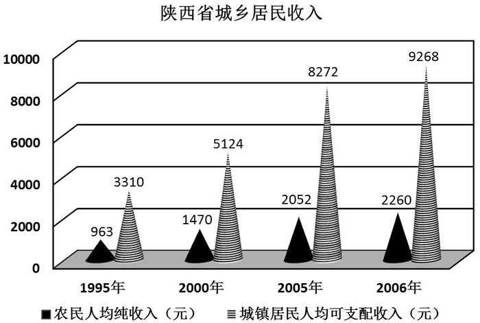

### 第 137 题

陕西省2006年城镇居民人均可支配收入比去年约增长了：

A. 15%

B. 14%

C. 13%

D. 12%

第 137 题 · 答案与解析

**参考答案（粉笔题库参考内容）**

D

**解析**

根据图中数据可得，根据估算法，。

故正确答案为D。

**考点**：一般增长率、统计图

**来源**：2008年陕西省公务员录用考试《行测》题第137题

### 第 138 题

陕西省2006年农民人均纯收入与1995年相比增加了：

A. 135%

B. 130%

C. 125%

D. 120%

第 138 题 · 答案与解析

**参考答案（粉笔题库参考内容）**

A

**解析**

由图可知，1995年农村人均纯收入为963元，2006年为2260元，计算增长率：。

故正确答案为A。

**考点**：一般增长率、统计图

**来源**：2008年陕西省公务员录用考试《行测》题第138题

### 第 139 题

根据上图可以推断出的选项是：

①城镇居民人均可支配收入增长速度越来越快。

②城乡之间的经济差距越来越大。

③城镇居民人均可支配收入增长速度比农民人均纯收入增长速度快。

④农民人均纯收入增长速度逐年趋缓。

A. ①

B. ②

C. ③

D. ④

第 139 题 · 答案与解析

**参考答案（粉笔题库参考内容）**

C

**解析**

①统计图中给出了1995年、2000年、2005年、2006年城镇居民可支配收入，数据时间跨度不一致，是时间段陷阱，因此算出的增长率没有可比性，故①错误；

②从统计图中虽然可以看出，城乡之间的人均收入差距越来越大，但是城乡之间的经济差距不能只看城乡之间的人均收入差距这一指标，还需要统计城乡之间的年度生产总值等经济指标，故②错误；

③从1995年到2006年城镇居民可支配收入从3310元增长到9268元，，增长率约为180%，农民人均纯收入从963元增长到2260元，，增长率约为135%，故城镇居民可支配收入增长速度比农民人均纯收入增长速度快，故③正确；

④统计图中给出了1995年、2000年、2005年、2006年农民纯收入，数据时间跨度不一致，不能比较逐年增长速度，同样是时间段陷阱，故④错误。

故正确答案为C。

**考点**：统计图、综合分析

**来源**：2008年陕西省公务员录用考试《行测》题第139题

### 第 140 题

根据上图，城镇居民人均可支配收入与农民人均纯收入相对差异最大的是：

A. 1995年

B. 2000年

C. 2005年

D. 2006年

第 140 题 · 答案与解析

**参考答案（粉笔题库参考内容）**

D

**解析**

用估算法计算城镇居民人均可支配收入与农民人均纯收入之间的差距。

1995年：3310－963≈3300－950＝2350；

2000年：5124－1470≈5000－1400＝3600；

2005年：8272－2052≈8200－2000＝6200；

2006年：9268－2260≈9000－2000＝7000。

2006年城镇居民人均可支配收入与农民人均纯收入之间的差异最大。

故正确答案为D。

**考点**：简单加减计算、统计图

**来源**：2008年陕西省公务员录用考试《行测》题第140题

