# 2013年陕西省公务员录用考试《行测》题

<!-- gwy:overview:start -->
> **陕西 · 2013 · 行测 · 统考** ｜ 140 题 · 图片 14 处 · 答案随题折叠

| 题型模块 | 题量 | 题号 |
| --- | ---: | ---: |
| 常识判断 | 30 | 1–30 |
| 言语理解与表达 | 40 | 31–70 |
| 数量关系 | 15 | 71–85 |
| 判断推理 | 35 | 86–120 |
| 资料分析 | 20 | 121–140 |
| **合计** | **140** | |

导航：[题型与作答说明](#题型与作答说明) · [题目](#题目) · [材料 1](#材料-1)
<!-- gwy:overview:end -->

> 候选采集稿。参考答案及解析来自粉笔页面，不代表官方答案或真实高分答卷；来源使用许可与原卷对应关系仍需人工核实。

## 题型与作答说明

常识判断

（30题）

根据题目要求，在四个选项中选出一个最恰当的答案。

言语理解与表达

（40题）

本部分包括表达与理解两方面的内容。请根据题目要求，在四个选项中选出一个最恰当的答案。

数量关系

（15题）

本部分包含数字推理和数学运算两个类型的试题。

判断推理

（35题）

本部分包括图形推理、定义判断、逻辑判断与类比推理四种类型的试题。

资料分析

（20题）

所给出的图、表、文字或综合性资料均有若干个问题要你回答，你应根据资料提供的信息进行分析、比较、计算和判断处理。

## 题目

### 第 1 题

2013年（     ），航天员（    ）在天宫一号中，为全国青少年进行太空授课。

A. 6月19日 王亚平

B. 6月19日 刘洋

C. 6月20日 王亚平

D. 6月20日 刘洋

第 1 题 · 答案与解析

**参考答案（粉笔题库参考内容）**

C

**解析**

本题考查科技常识。

6月20日上午10时许，神舟十号航天员在天宫一号中进行中国首次太空授课，王亚平担任主讲，成为中国首位“太空讲师”。

故正确答案为C。

**考点**：科技理论与成就

**来源**：2013年陕西省公务员录用考试《行测》题第1题

### 第 2 题

作为拉动陕西经济的火车头，陕西省的“一线两带”建设受到全国的广泛关注，下面关于“一线两带”的说法中，不正确的是：

A. 一线指陇海陕西段和宝潼高速

B. 两带指关中技术产业开发带和关中星火产业带

C. 一线两带以线串点，以点带面，形成高新、先进的产业体系

D. 它包括创新层、核心层、辐射层和制度层

第 2 题 · 答案与解析

**参考答案（粉笔题库参考内容）**

D

**解析**

A、B、C三项均正确，“一线两带”就是以西安为中心，以陇海铁路陕西段和宝潼高速公路为轴线，以国家级关中高新技术产业开发带和国家级关中星火产业带为依托，以线串点、以点带面形成的以高新技术和先进技术为特点的产业经济体系；

D项不正确，“一线两带”大体由三个层次构成：创新层、核心层、辐射层。

本题为选非题，故正确答案为D。

**考点**：中国地理

**来源**：2013年陕西省公务员录用考试《行测》题第2题

### 第 3 题

下列选项中，不属于陕西地方戏曲剧种的是：

A. 老腔

B. 眉户

C. 碗碗腔

D. 蒲州梆子

第 3 题 · 答案与解析

**参考答案（粉笔题库参考内容）**

D

**解析**

蒲剧，因兴起于山西南部的蒲州（今永济一带）而得名，亦称蒲州梆子或南路梆子，是晋南地区的主要剧种；而老腔、眉户戏、碗碗腔均为陕西地方戏曲剧种。

本题为选非题，故正确答案为D。

**考点**：文化常识

**来源**：2013年陕西省公务员录用考试《行测》题第3题

### 第 4 题

“天下兴亡，匹夫有责”是明末清初思想家（    ）的名言。

A. 戴震

B. 黄宗羲

C. 顾炎武

D. 王夫之

第 4 题 · 答案与解析

**参考答案（粉笔题库参考内容）**

C

**解析**

“天下兴亡，匹夫有责”最早是由顾炎武在《日知录·正始》中提出的概念，背景是清军入关。

故正确答案为C。

**考点**：文学常识

**来源**：2013年陕西省公务员录用考试《行测》题第4题

### 第 5 题

清代，中央政府正式任命的第一任台湾巡抚是：

A. 郑成功

B. 丘逢甲

C. 林则徐

D. 刘铭传

第 5 题 · 答案与解析

**参考答案（粉笔题库参考内容）**

D

**解析**

1885年，台湾正式建立行省，第一任巡抚是刘铭传。

故正确答案为D。

**考点**：中国历史

**来源**：2013年陕西省公务员录用考试《行测》题第5题

### 第 6 题

下列文学作品中，不属于莫言作品的是：

A. 《丰乳肥臀》

B. 《活着》

C. 《断手》

D. 《透明的红萝卜》

第 6 题 · 答案与解析

**参考答案（粉笔题库参考内容）**

B

**解析**

A项长篇小说《丰乳肥臀》、C项短篇小说《断手》、D项短篇小说集《透明的红萝卜》均为莫言的作品；B项长篇小说《活着》是余华的代表作。

本题为选非题，故正确答案为B。

**考点**：文学常识

**来源**：2013年陕西省公务员录用考试《行测》题第6题

### 第 7 题

习近平总书记在党的群众路线教育活动工作会议讲话中指出，党内脱离群众路线的现象大量存在，集中表现在“四风”上，这“四风”指的是：

A. 宣教经个

B. 教个享奢

C. 形官享奢

D. 经享个官

第 7 题 · 答案与解析

**参考答案（粉笔题库参考内容）**

C

**解析**

2013年6月18日，党的群众路线教育实践活动工作会议在京召开，习近平总书记在会上强调，这次教育实践活动的主要任务聚焦到作风建设上，集中解决形式主义、官僚主义、享乐主义和奢靡之风这“四风”问题。

故正确答案为C。

**来源**：2013年陕西省公务员录用考试《行测》题第7题

### 第 8 题

小张高中毕业，倘若参加工作，每年可挣得4万元，现在他进入某大学进行本科专业学习，学习期为4年，那么由于其读本科而未挣得的16万元，属于小张读本科的：

A. 沉没成本

B. 机会成本

C. 固定成本

D. 可变成本

第 8 题 · 答案与解析

**参考答案（粉笔题库参考内容）**

B

**解析**

在面临多方案择一决策时，被舍弃的选项中的最高价值者是本次决策的机会成本。本题中，小张二选一，读本科而未挣得的16万元显然是价值最高的，符合机会成本的定义。

故正确答案为B。

相关知识点：

沉没成本是指由于过去的决策已经发生了的，而不能由现在或将来的任何决策改变的成本。

固定成本（Fixed Cost），又称固定费用，相对于变动成本，是指成本总额在一定时期和一定业务量范围内，不受业务量增减变动影响而能保持不变的成本。

可变成本（Variable Costs），又称变动成本，是指在总成本中随产量的变化而变动的成本项目，主要是原材料、燃料、动力等生产要素的价值，当一定期间的产量增大时，原材料、燃料、动力的消耗会按比例相应增多，所发生的成本也会按比例增大，故称为可变成本。可变成本等于总成本减固定成本。

**考点**：微观经济

**来源**：2013年陕西省公务员录用考试《行测》题第8题

### 第 9 题

下列说法中能体现唯物主义和唯心主义根本分歧的是：

A. “生死有命富贵在天”与“物是观念的集合”

B. “世异则事异，事异则备变”与“天不变，道亦不变”

C. “气者，理之依也”与“理生万物”

D. “不入虎穴，焉得虎子”与“秀才不出门，全知天下事”

第 9 题 · 答案与解析

**参考答案（粉笔题库参考内容）**

C

**解析**

A项是客观唯心主义和主观唯心主义的对应，二者均为唯心主义范畴；

B项是唯物主义发展观和形而上学静止观的对应，二者均为辩证法范畴；

C项是朴素唯物主义与客观唯心主义的对应，前者主张物质第一性，后者支持意识第一性，体现了唯物主义与唯心主义的根本分歧；

D项二者均涉及实践与认识的关系，同属于唯物主义观点。

故正确答案为C。

**考点**：唯物论

**来源**：2013年陕西省公务员录用考试《行测》题第9题

### 第 10 题

宗教改革领袖加尔文说：“通过永恒的、不变的意图，上帝始终决定着谁可以被拯救，谁将被毁灭。”这反映了宗教改革的：

A. 圣经高于一切

B. 上帝永恒

C. 反对罗马天主教会

D. 信仰得救

第 10 题 · 答案与解析

**参考答案（粉笔题库参考内容）**

D

**解析**

加尔文是瑞典宗教改革的领袖，和马丁路德一样主张信仰得救；每个基督徒都有直接阅读和解释圣经的权利，而不是盲目听从教皇和教会的说教；简化宗教仪式，否定罗马教廷的权威，坚持国家权力高于教会等。这句话主要反映了信仰得救的主张。

故正确答案为D。

**考点**：文化常识

**来源**：2013年陕西省公务员录用考试《行测》题第10题

### 第 11 题

以下各项中，不属于太阳能利用的主要形式的是：

A. 光热

B. 光电

C. 风热

D. 光化学

第 11 题 · 答案与解析

**参考答案（粉笔题库参考内容）**

C

**解析**

太阳能的利用方式包括太阳能的光热利用、光电利用、光化学利用以及光生物利用，而风热属于风能的范畴。

本题为选非题，故正确答案为C。

**考点**：物理常识

**来源**：2013年陕西省公务员录用考试《行测》题第11题

### 第 12 题

唐朝诗人孟郊的《登科后》诗云：“春风得意马蹄疾，一日看尽长安花”生动描述了士子在参加完科举考试后获取功名时的愉悦心情，据此判断这位士子参加的是：

A. 会试

B. 乡试

C. 童试

D. 殿试

第 12 题 · 答案与解析

**参考答案（粉笔题库参考内容）**

D

**解析**

登科又称登第，指科举考中进士。殿试为科举考试中的最高一段，只有通过殿试阶段，才能得到进士的功名，唐朝的首都是长安，更加确定是殿试。

故正确答案为D。

**考点**：文化常识

**来源**：2013年陕西省公务员录用考试《行测》题第12题

### 第 13 题

下列表达中，正确的是：

A. 不满18周岁的人犯罪，不适用附加剥夺政治权利

B. 不满18周岁的人犯罪，应当从轻或减轻处罚

C. 不满18周岁的人犯罪，应当宣告缓刑

D. 不满18周岁的人犯罪，不适用无期徒刑

第 13 题 · 答案与解析

**参考答案（粉笔题库参考内容）**

B

**解析**

本题考查法律常识。

A、D两项错误，我国《刑法》并未对无期徒刑和剥夺政治权利作出年龄方面的限制。

B项正确，根据我国《刑法》第十七条规定：“已满十六周岁的人犯罪，应当负刑事责任。已满十四周岁不满十六周岁的人，犯故意杀人、故意伤害致人重伤或者死亡、强奸、抢劫、贩卖毒品、放火、爆炸、投放危险物质罪的，应当负刑事责任。已满十二周岁不满十四周岁的人，犯故意杀人、故意伤害罪，致人死亡或者以特别残忍手段致人重伤造成严重残疾，情节恶劣，经最高人民检察院核准追诉的，应当负刑事责任。对依照前三款规定追究刑事责任的不满十八周岁的人，应当从轻或者减轻处罚。因不满十六周岁不予刑事处罚的，责令其父母或者其他监护人加以管教；在必要的时候，依法进行专门矫治教育。”不满十八周岁的人犯罪的，应当从轻或减轻处罚。

C项错误，根据《刑法》第七十二条第一款规定：“对于被判处拘役、三年以下有期徒刑的犯罪分子，同时符合下列条件的，可以宣告缓刑，对其中不满十八周岁的人、怀孕的妇女和已满七十五周岁的人，应当宣告缓刑：（一）犯罪情节较轻；（二）有悔罪表现；（三）没有再犯罪的危险；（四）宣告缓刑对所居住社区没有重大不良影响。”不满十八周岁的人还需同时刑期等条件，才是应当宣告缓刑。

故正确答案为B。

**考点**：刑法

**来源**：2013年陕西省公务员录用考试《行测》题第13题

### 第 14 题

李俊在某服装店挑选衣服，店主向其推荐了一款风衣。李俊试穿后觉得不合适，脱下风衣后准备离开，店主却强迫李俊买下了这件风衣。店主的这一行为侵犯了李俊的：

A. 财产安全权

B. 损害求偿权

C. 维护尊严权

D. 选择商品自主权

第 14 题 · 答案与解析

**参考答案（粉笔题库参考内容）**

D

**解析**

《消费者权益保护法》第九条规定，消费者享有自主选择商品或者服务的权利。消费者有权自主选择提供商品或者服务的经营者，自主选择商品品种或者服务方式，自主决定购买或者不购买任何一种商品、接受或者不接受任何一项服务。店主强迫李俊买下风衣的行为，侵犯了李俊自主选择商品的权利。

故正确答案为D。

**考点**：民法典

**来源**：2013年陕西省公务员录用考试《行测》题第14题

### 第 15 题

下列活动中，属于司法活动范畴的是：

A. 某司法局审查并发放律师执业证

B. 陕西省高级人民法院向陕西省人民代表大会做工作报告

C. 交警对王某的交通违章进行罚款处罚

D. 检察机关对犯罪嫌疑人柳某的涉嫌受贿犯罪予以批准逮捕

第 15 题 · 答案与解析

**参考答案（粉笔题库参考内容）**

D

**解析**

司法，又称法的适用，通常是指国家司法机关及其司法人员依照法定职权和法定程序，具体运用法律处理案件的专门活动。

A、B项均不涉及处理案件，排除；

C项中交警不是刑法意义上的司法人员，且涉及行为只是单纯的行政处罚行为，排除；

D项符合司法所涉及的内容，当选。

故正确答案为D。

**考点**：法理学

**来源**：2013年陕西省公务员录用考试《行测》题第15题

### 第 16 题

张某受王某的委托，为王某画了一幅肖像，双方未就这幅画的版权归属作出约定。王某去世后，其继承人王一将这幅画卖给了李某，李某未经任何人同意，将这幅画复制出售。下列关于李某做法的认定中，表达正确的是：

A. 李某侵犯了张某的著作权

B. 李某侵犯了王某的著作权

C. 李某侵犯了王一的著作权

D. 李某的行为是合法行使权利的行为

第 16 题 · 答案与解析

**参考答案（粉笔题库参考内容）**

A

**解析**

根据《著作权法》第十七条规定：“受委托创作的作品，著作权的归属由委托人和受托人通过合同约定。合同未作明确约定或者没有订立合同的，著作权属于受托人。”本案例中双方并未就版权归属作出约定，所以著作权应属于受托人张某。而著作权包含复制权和发行权等多项权利，李某未经张某的同意，擅自复制出售，显然侵犯了张某的复制权和发行权，即侵犯了张某的著作权。

故正确答案为A。

**考点**：其他法律法规

**来源**：2013年陕西省公务员录用考试《行测》题第16题

### 第 17 题

某首饰店误将一枚银戒指当作铂金戒指卖给李某。首饰店的这一行为属于：

A. 犯罪行为

B. 无效的民事法律行为

C. 可撤销的民事法律行为

D. 有效的民事法律行为

第 17 题 · 答案与解析

**参考答案（粉笔题库参考内容）**

C

**解析**

我国《中华人民共和国民法典》第一百四十七条规定：“基于重大误解实施的民事法律行为，行为人有权请求人民法院或者仲裁机构予以撤销”。首饰店误将银戒指当作铂金戒指，对行为内容存在重大误解，属于可撤销的民事法律行为。

故正确答案为C。

**考点**：民法典

**来源**：2013年陕西省公务员录用考试《行测》题第17题

### 第 18 题

下列关系中，不属于我国法定人民团体的是：

A. 陕西省工商联

B. 陕西省作家协会

C. 陕西省妇女联合会

D. 西安某大学的学生会

第 18 题 · 答案与解析

**参考答案（粉笔题库参考内容）**

D

**解析**

中共中央党委序列包含中国人民政治协商会议（全国政协）和全国人民代表大会（全国人大）。工商联和妇联均属于中国人民政治协商会议（全国政协）组成界别；作协是经国务院批准免于登记的社会团体，属于全国人民代表大会（全国人大）组成界别。

A、B、C三项均为法律承认的人民团体。

D项中学生会是学生自发性成立的群众性组织，服从学校日常管理的需要，不属于法律上的人民团体范畴。

本题为选非题，故正确答案为D。

**考点**：其他法律法规

**来源**：2013年陕西省公务员录用考试《行测》题第18题

### 第 19 题

下列选项中，免征个人所得税的是：

A. 张某的存款利息

B. 王某的保险赔款

C. 李某的稿酬所得

D. 赵某的房屋出租所得

第 19 题 · 答案与解析

**参考答案（粉笔题库参考内容）**

B

**解析**

根据《个人所得税法》第四条规定：“下列各项个人所得，免征个人所得税：

（一）省级人民政府、国务院部委和中国人民解放军军以上单位，以及外国组织、国际组织颁发的科学、教育、技术、文化、卫生、体育、环境保护等方面的奖金;

（二）国债和国家发行的金融债券利息;

（三）按照国家统一规定发给的补贴、津贴;

（四）福利费、抚恤金、救济金;

（五）保险赔款;

（六）军人的转业费、复员费、退役金;

（七）按照国家统一规定发给干部、职工的安家费、退职费、基本养老金或者退休费、离休费、离休生活补助费;

（八）依照有关法律规定应予免税的各国驻华使馆、领事馆的外交代表、领事官员和其他人员的所得;

（九）中国政府参加的国际公约、签订的协议中规定免税的所得;

（十）国务院规定的其他免税所得。

前款第十项免税规定，由国务院报全国人民代表大会常务委员会备案。”

故正确答案为B。

本题选项设置不严谨，根据《财政部 国家税务总局关于储蓄存款利息所得有关个人所得税政策的通知》的规定，储蓄存款在2008年10月9日后（含10月9日）孳生的利息所得，暂免征收个人所得税。所以A项中张某的存款利息也免征个人所得税。

**考点**：其他法律法规

**来源**：2013年陕西省公务员录用考试《行测》题第19题

### 第 20 题

2013年3月5日，是毛泽东“向雷锋同志学习”题词发表（    ）周年纪念日。

A. 30

B. 40

C. 50

D. 60

第 20 题 · 答案与解析

**参考答案（粉笔题库参考内容）**

C

**解析**

本题考查毛中特。

1963年3月5日，毛泽东主席为沈阳部队某部因公牺牲的英雄战士雷锋的题词“向雷锋同志学习”在《人民日报》发表。此后，全国广泛开展学习雷锋的活动。于是每年的3月5日也便成了雷锋纪念日。

故正确答案为C。

**考点**：党的历史

**来源**：2013年陕西省公务员录用考试《行测》题第20题

### 第 21 题

关于中医，下列说法中不正确的是：

A. 《神农本草经》中，将药物分为上、中、下三品

B. 《黄帝内经》是黄帝所著的中国最早的医学理论典籍

C. 中医四诊是指望、闻、问、切

D. 针灸是两种不同治疗疾病方法的合称

第 21 题 · 答案与解析

**参考答案（粉笔题库参考内容）**

B

**解析**

B项说法不正确，《黄帝内经》为古代医者托黄帝之名所作，其具体作者已不可考，它既非一时之作，亦非出自一人之手，而是战国以前的许许多多的医学著作的总结。

本题为选非题，故正确答案为B。

**考点**：文化常识

**来源**：2013年陕西省公务员录用考试《行测》题第21题

### 第 22 题

下列说法中，正确的是：

A. 中国古代的五行学说认为，五行之间，相生相克，五行相克次序：金克土，土克水，水克火、火克木，木克金

B. 佛家的六根是指色、身、香、味、触、法

C. 唐玄宗时期，中国社会出现了繁荣景象，被史学家称为“贞观之治”

D. 《易经》中的八卦是指乾卦、坤卦、离卦、坎卦、兑卦、震卦、艮卦、巽卦

第 22 题 · 答案与解析

**参考答案（粉笔题库参考内容）**

D

**解析**

A项错误，五行相生相克，具体顺序：木克土→土克水→水克火→火克金→金克木；

B项错误，佛家六根是指眼、耳、鼻、舌、身、意；

C项错误，“贞观之治”指中国唐太宗在位期间的清明政治，并非唐玄宗时期；

D项正确，其关于八卦组成的表述正确。

故正确答案为D。

**考点**：文化常识

**来源**：2013年陕西省公务员录用考试《行测》题第22题

### 第 23 题

处置突发性公共事件的首要原则是：

A. 迅速性原则

B. 效率性原则

C. 安全性原则

D. 慎重性原则

第 23 题 · 答案与解析

**参考答案（粉笔题库参考内容）**

A

**解析**

突发性公共事件具有突发性、复杂性、破坏性、可控性等特点，因此，处置突发性公共事件必须迅速、及时，最大程度上控制局面，挽回损失。所以，处置突发性公共事件的首要原则应为迅速性原则。

故正确答案为A。

**考点**：生活常识

**来源**：2013年陕西省公务员录用考试《行测》题第23题

### 第 24 题

关于宋词，下列说法中不正确的是：

A. “有井水处即能歌柳词”说的是柳永

B. “樯橹灰飞烟灭”说的是官渡之战

C. 辛弃疾是宋代词人中“豪放派”代表之一

D. “人比黄花瘦”是女词人李清照的名句

第 24 题 · 答案与解析

**参考答案（粉笔题库参考内容）**

B

**解析**

“樯橹灰飞烟灭”出自苏轼的《念奴娇·赤壁怀古》，描述的是赤壁之战的情形，并非官渡之战。

本题为选非题，故正确答案为B。

**考点**：文学常识

**来源**：2013年陕西省公务员录用考试《行测》题第24题

### 第 25 题

下列不属于乾隆皇帝入藏“三希堂”的法帖是：

A. 《伯远帖》

B. 《中秋帖》

C. 《兰亭序》

D. 《快雪时晴帖》

第 25 题 · 答案与解析

**参考答案（粉笔题库参考内容）**

C

**解析**

三希堂原名“温室”，是清高宗弘历即乾隆帝的书房。乾隆帝曾将王羲之的《快雪时晴帖》、王珣的《伯远帖》、王献之的《中秋帖》收藏于此，称为“三希堂法帖”。

本题为选非题，故正确答案为C。

**考点**：文化常识

**来源**：2013年陕西省公务员录用考试《行测》题第25题

### 第 26 题

以下说法中，不正确的是：

A. 在加油站停车加油时，不能拨打手机

B. 室内装修应尽可能选择在冬季进行

C. 受到核辐射的人应适当服用稳定碘

D. 家用电冰箱的制冷剂氟利昂会破坏空气中的臭氧

第 26 题 · 答案与解析

**参考答案（粉笔题库参考内容）**

B

**解析**

B项不正确，冬季施工，与其他季节相比，需要用到额外的建筑材料，例如冷冻剂，会释放出大量氨气，室内污染更为严重。同时，由于冬季天气寒冷，人们室内活动时间增多，户外活动大量减少，导致室内污染物对人体的危害比其他季节更大，皮肤病、呼吸道系统疾病以及心血管疾病的发病率也随之增高。

本题为选非题，故正确答案为B。

**考点**：生活常识

**来源**：2013年陕西省公务员录用考试《行测》题第26题

### 第 27 题

党的十八大首次把（    ）与经济建设、政治建设、文化建设、社会建设并称为中国特色社会主义事业“五位一体”的总布局。

A. 党的建设

B. 制度建设

C. 法制建设

D. 生态文明建设

第 27 题 · 答案与解析

**参考答案（粉笔题库参考内容）**

D

**解析**

本题考查新思想。

党的十八大提出，建设中国特色社会主义事业总体布局由经济建设、政治建设、文化建设、社会建设“四位一体”拓展为包括生态文明建设的“五位一体”，这是总揽国内外大局、贯彻落实科学发展观的一个新部署。

故正确答案为D。

**考点**：生态文明建设

**来源**：2013年陕西省公务员录用考试《行测》题第27题

### 第 28 题

以下说法中，不正确的是：

A. 五岳之一的华山坐落在陕西省境内

B. 贾平凹是著名的陕西籍作家

C. “西安事变”是由著名的西北军将领杨虎城、张学良发动的

D. “泾渭分明”一词中所涉及的泾河和渭河的交汇处在陕西省

第 28 题 · 答案与解析

**参考答案（粉笔题库参考内容）**

C

**解析**

A项正确，华山位于陕西省西安以东120公里，历史文化故地渭南市的华阴市境内；

B项正确，贾平凹是陕西省商洛市丹凤县人；

C项错误，杨虎城为西北军领袖，而张学良是东北军领袖；

D项正确，泾河和渭河的交汇处在陕西省西安市高陵县陈家滩附近。

本题为选非题，故正确答案为C。

**考点**：文化常识

**来源**：2013年陕西省公务员录用考试《行测》题第28题

### 第 29 题

下列说法中，不属于习近平同志关于“中国梦”明确表述的是：

A. 国家富强

B. 民族振兴

C. 美丽中国

D. 人民幸福

第 29 题 · 答案与解析

**参考答案（粉笔题库参考内容）**

C

**解析**

本题考查新思想。

“中国梦”的本质内涵是实现国家富强、民族振兴、人民幸福、社会和谐。

本题为选非题，故正确答案为C。

**考点**：新思想总论

**来源**：2013年陕西省公务员录用考试《行测》题第29题

### 第 30 题

以下关于经济政策与经济行为的说法中，不正确的是：

A. 政府加大采购力度，有助于抑制通货膨胀

B. 当通货紧缩时，中央银行应降低存款利息

C. 当通货膨胀时，中央银行应提高存款准备金率

D. 政府购回已发售的债券，有助于抑制通货紧缩

第 30 题 · 答案与解析

**参考答案（粉笔题库参考内容）**

A

**解析**

A项错误，政府加大采购力度是增加财政支出的表现，增加财政支出属于扩张性财政政策，而扩张性财政政策主要用来治理通货紧缩，有助于提振经济，扩大社会需求。

本题为选非题，故正确答案为A。

**考点**：宏观经济与调控政策

**来源**：2013年陕西省公务员录用考试《行测》题第30题

### 第 31 题

在许多大城市中，无家可归者和失业者流落街头似已＿＿＿＿＿，没几个驾驶者会停下来给予施舍或提供援助，一般都会＿＿＿＿＿，毫无疑问，大多数人都听过这样的告诫：一味地给这些人钱，只会养成他们懒惰、依赖的生活方式。

依次填入画横线部分最恰当的一项是：

A. 习以为常 熟视无睹

B. 蔚然成风 视而不见

C. 司空见惯 呼啸而过

D. 见怪不怪 一笑而过

第 31 题 · 答案与解析

**参考答案（粉笔题库参考内容）**

C

**解析**

第一空，文段意在说明驾驶者经常看见无家可归者和失业者流落街头，并不奇怪。A项“习以为常”应表述为驾驶者对无家可归者和失业者流落街头习以为常，故排除；B项“蔚然成风”是形容一种事物逐渐发展、盛行，形成良好风气，显然流落街头的现象并不是好风气，故排除。

第二空，D项“一笑而过”形容一种洒脱的心态，文中说的是对流落街头者施舍得少，且并无潇洒的态度，与语境不符，故排除；C项“呼啸而过”符合驾驶者并不重视、飞奔而过的特点，当选。

故正确答案为C。

**考点**：成语填空、词的辨析-搭配对象、词的辨析-词义侧重

**来源**：2013年陕西省公务员录用考试《行测》题第31题

### 第 32 题

变老大概是一种对自己的放弃，不断放弃自尊，变得＿＿＿＿＿，却毫无愧色，仍能＿＿＿＿＿＿，渐渐溢出边界，直至失去了人应当有的轮廓，与朋友谈起那样的人，皆感慨，假如自己变成那样，真是＿＿＿＿＿＿，如此感慨，或许因为我们还不够老，老到某个时候，对自己就会宽容，无论变成什么样，都可以接纳。

依次填入画横线部分最恰当的一项是：

A. 一无是处 乐在其中 无地自容

B. 面目全非 自圆其说 生不如死

C. 一无是处 坦然自若 生不如死

D. 面目全非 怡然自得 无地自容

第 32 题 · 答案与解析

**参考答案（粉笔题库参考内容）**

B

**解析**

本题考查成语应用能力。

分析第一空，变老是一种放弃，是不断放弃自尊的过程。“一无是处”形容没有一点对的或者好的地方，过于绝对，不能说人变老了就没有一点好的地方了；“面目全非”指面孔变得完全不是原来的样子，也形容事物变化很大，多为贬义。因此用“面目全非”来形容人变老了之后改变得不成样子，更加适合。排除掉A、C。

第二空，“怡然自得”形容高兴而满足的样子。文中只提到了变老的人“毫无愧色”，并没有提到是否对变老这件事感到高兴或者满足。因此用“自圆其说”更适合。排除D。

第三空，“无地自容”指没有地方可以让自己容身，形容非常羞愧；“生不如死”指就是生活在这个世界，还不如死了，比喻心里极度难过，伤心，绝望，活着比死更难过。作者认为，变老“直至失去了人应当有的轮廓”是非常可怕的事情，填入“生不如死”搭配得当。

故正确答案为B。

【文段出处】张悦然：《鲤·变老》

**考点**：对应关系-前后呼应、成语填空、词的辨析-程度轻重

**来源**：2013年陕西省公务员录用考试《行测》题第32题

### 第 33 题

靠机制吸引人，而不是靠补贴吸引人，这是市场经济与计划经济在思维惯性上的＿＿＿＿＿，靠补贴的工程式的吸引人才的最大弊端是已经先入为主地假定谁是人才了，因此，你不能补贴所有人，不能给人们提供＿＿＿＿＿才能的社会氛围，梁文道在他所著的《常识》中写到，新加坡就很能够吸引人才了，但比起美国还是＿＿＿＿＿。

依次填入画横线部分最恰当的一项是：

A. 鸿沟 激发 略逊一筹

B. 差异 发挥 望尘莫及

C. 差别 触发 稍逊一筹

D. 区别 发挥 相去甚远

第 33 题 · 答案与解析

**参考答案（粉笔题库参考内容）**

A

**解析**

本题可从第二空入手。横线处搭配“才能”，应体现使才能显现之意，A项“激发”指通过刺激或引导，使潜在的情感、能力或行为表现出来，或使人奋发向上，B、D两项“发挥”指将内在性质或能力充分表现出来，均符合文意，且与“才能”搭配恰当，保留；C项“触发”指因触动而引发某种反应或事件的发生，一般搭配“机制”“条件”等，与“才能”搭配不当，排除。

第三空，根据“新加坡就很能够吸收人才了，但比起美国还是······”可知，新加坡在吸引人才方面已经做的很好，但与美国相比仍略显不足，横线处应体现“稍差一点”之意。A项“略逊一筹”指相较之下存在细微差距，符合文意，保留。B项“望尘莫及”比喻远远地落在了别人的后面，相差甚远，无法追上，D项“相去甚远”描述事物间存在显著差异，均形容差距很大，与文意不符，均排除。

第一空，代入验证。A项“鸿沟”比喻明显的界限或巨大差异，符合文意，且搭配恰当，当选。

故正确答案为A。

**考点**：关联关系-转折关系、混搭填空、词的辨析-搭配对象

**来源**：2013年陕西省公务员录用考试《行测》题第33题

### 第 34 题

在房价不断＿＿＿＿＿的当今中国，我们甚至有理由怀疑，中国的中产阶层已经被高房价消灭，受过良好教育的大学生是最有可能成为中产阶层的群体，然而，在这个遍地都是大学生的年代，我们看不到中产阶层成长的希望，毕业即失业已是一种＿＿＿＿＿＿，初入社会的他们，又不得不面对来自各方的压力，他们的生存空间不断被挤压，生活幸福感不断降低，房奴、孩奴＿＿＿＿＿，整个群体被焦虑和失败所＿＿＿＿＿＿。

依次填入画横线部分最恰当的一项是：

A. 攀升 现象 俯拾皆是 困惑

B. 上涨 趋势 层出不穷 纠缠

C. 上扬 潮流 无处不在 干扰

D. 飙升 常态 比比皆是 困扰

第 34 题 · 答案与解析

**参考答案（粉笔题库参考内容）**

D

**解析**

先看第二空，考查实词的应用，显然不能说“毕业即失业”是一种“潮流”，“毕业即失业”这种现象是可以改变的，而“潮流”是不可逆转的，代表一种大方向，所以排除C。

再看第四空，考查实词的应用，“困惑”不能与表被动的“所······”结构搭配，排除A；比较“纠缠”和“困扰”，“纠缠”是指遭人烦扰不休，而“焦虑和失败”是指人表现出来的心态，显然“困扰”更为合适，排除B。

故正确答案为D。

**考点**：对应关系-前后呼应、混搭填空、词的辨析-搭配对象、词的辨析-词义侧重

**来源**：2013年陕西省公务员录用考试《行测》题第34题

### 第 35 题

前些年，从＿＿＿＿＿＿的市中心搬家到尚未完全开发的新区，住宅临河，两岸绿竹簇簇，鸟叫蝉鸣，水流风动，空气清新；房侧有一池塘，水草繁茂，鲫鱼穿梭；前方田野开阔，一片葱茏，晚上，河滩上、池塘中、田野里，蛙声齐鸣，＿＿＿＿＿＿，恰似从几个立体音响发出的立体声，浑厚而＿＿＿＿＿＿。

依次填入画横线部分最恰当的一项是：

A. 纷繁复杂 交相辉映 沧桑

B. 纷纷扰扰 余音绕梁 优美

C. 热闹喧嚣 遥相呼应 和谐

D. 繁荣兴盛 此起彼伏 清晰

第 35 题 · 答案与解析

**参考答案（粉笔题库参考内容）**

C

**解析**

第一空，搭配“市中心”，且根据后文“搬家到尚未完全开发的新区”可知，横线处应体现繁华喧闹之意，C项“热闹喧嚣”形容场面繁盛活跃、声音杂乱不清净，与“市中心”搭配恰当，且符合文意，保留。A项“纷繁复杂”指头绪、表象多而且复杂，B项“纷纷扰扰”指凌乱的样子，也形容思绪纷乱，D项“繁荣兴盛”指经济、事业或国家蓬勃发展、兴旺发达，三者均与“市中心”搭配不当，排除。

第二空，代入验证，横线处形容蛙声齐鸣的场景，根据“恰似”可知，后文将“蛙声齐鸣的场景”比作“几个立体音响发出的立体声”，所填成语应体现蛙鸣声相互呼应、交织之意，C项“遥相呼应”指远远地相互照应、配合，符合文意，保留。

第三空，代入验证，根据文意可知，横线处应体现蛙声的特点，C项“和谐”指配合得适当，置于此处可以体现多处蛙声齐鸣的声音特点，符合文意，当选。

故正确答案为C。

**考点**：对应关系-前后呼应、对应关系-形象表达、混搭填空、词的辨析-搭配对象

**来源**：2013年陕西省公务员录用考试《行测》题第35题

### 第 36 题

在乡村，老牛与牧童彼此守望。庄稼人面朝黄土，把自己生命的期望播种进＿＿＿＿＿＿的泥土里，把一切梦想向季节里扔去，和庄稼、土地一起＿＿＿＿＿＿，一起金黄。在鲜润的土地上，将十指插入泥土，攥一把，闻一闻泥土的清香，然后把泥土捏出心中渴望的形状，那是老农一生重复了多少次的庄重礼仪和神奇享受。＿＿＿＿＿＿的身影和溅落的汗珠也被编为一个章节，使故事闪现着更加真实的光芒。乡村和农民真正的笑声，＿＿＿＿＿＿在季节深处的笑容和粗犷的酒歌里。

依次填入画横线部分最恰当的一项是：

A. 黝黑 葱郁 消瘦 镶嵌

B. 广袤 成长 清瘦 洒落

C. 湿润 葱郁 健硕 飘落

D. 厚重 成长 矫健 凝结

第 36 题 · 答案与解析

**参考答案（粉笔题库参考内容）**

A

**解析**

本题考查实词的应用。

先看第三空，此处的“身影”代指“老农”，显然“健硕”和“矫健”都不恰当，排除C、D。

再看第一空，“广袤”多用于形容土地和天空，也可以形容深沉的父爱，与“泥土”搭配不够恰当，排除B。

验证A，“黝黑”与后文的“金黄”构成了颜色上的对应，“葱郁”和“镶嵌”与其他选项相比，也更富于画面感。

故正确答案为A。

**考点**：实词填空、对应关系-前后呼应、词的辨析-搭配对象

**来源**：2013年陕西省公务员录用考试《行测》题第36题

### 第 37 题

罗马是一座古色古香、历史悠久、充满＿＿＿＿＿＿和艺术气息的城市，是用艺术品装饰得最多的地方，是＿＿＿＿＿＿的露天开放博物馆，具有独特风格，万般诱人，但也有人说，罗马＿＿＿＿＿＿，小偷多，骗子多，不如其他欧洲国家的首都好。

依次填入画横线部分最恰当的一项是：

A. 柔情蜜意 首屈一指 藏污纳垢

B. 诗情画意 美轮美奂 徒有虚名

C. 柔情蜜意 光怪陆离 乌烟瘴气

D. 诗情画意 包罗万象 破烂肮脏

第 37 题 · 答案与解析

**参考答案（粉笔题库参考内容）**

D

**解析**

本题考查成语的辨析填空。

第一空，“柔情蜜意”是指温柔甜蜜的情意，多用于修饰人，不能修饰城市，排除A、C。“诗情画意”是指如诗的感情，如画的意境，指文学作品中，所蕴涵的情趣，也指风景优美，耐人寻味，就像诗画里所描摹的能给人以美感的意境，与原文意相符。

第二空，罗马是“用艺术品装饰得最多的地方”，是“露天开放博物馆”，此部分重点在“最多”上，那么下文只能选择与“多”能够相互呼应的选项。B项“美轮美奂”形容新屋高大美观，也形容装饰、布置等美好漂亮，强调“美”，不能体现“多”之意，排除。

第三空，文段前半句在形容罗马的独特和诱人，且强调艺术品多，“但”表示转折，此处若填入“徒有虚名”，则认为罗马的历史性和艺术性是名不副实的，显然与文意相悖，“破烂肮脏”更为合适。

故正确答案为D。

**考点**：对应关系-前后呼应、成语填空、词的辨析-搭配对象

**来源**：2013年陕西省公务员录用考试《行测》题第37题

### 第 38 题

中国古代，士的人格风骨最令人敬仰，也最让后人＿＿＿＿＿＿，士在这方面的表现，是＿＿＿＿＿＿的史书中最＿＿＿＿＿＿的部分，也是人们看历史小说时最受感动的故事，虽然士眼中的人格，远没有人类现代文明中关于人的“健全的、完整的”意义，但其精神操守的价值却是永恒的。

依次填入画横线部分最恰当的一项是:

A. 羞愧 浩如烟海 感人至深

B. 汗颜 卷帙浩繁 光彩照人

C. 羞愧 洋洋洒洒 感人肺腑

D. 汗颜 汗牛充栋 精彩绝伦

第 38 题 · 答案与解析

**参考答案（粉笔题库参考内容）**

B

**解析**

第一空，根据“士的人格风骨最令人敬仰，也最让后人······”及选项设置可知，横线处所填词语应体现士的人格风骨让后人自觉惭愧，B、D两项中的“汗颜”指因羞惭而脸上出汗，泛指惭愧‌，符合文意，保留。A、C两项中的“羞愧”指因认识到自己的缺点、错误或不当行为而感到羞耻和惭愧的情绪‌，与文中因士的人格风骨而非自身缺点等惭愧不符，排除。

第二空，根据“是······的史书中最······的部分”可知，横线处所填成语应体现对于士的描写是史书中精彩的一部分，B项“卷帙浩繁”形容书籍很多或一部书的篇幅很长，D项“汗牛充栋”形容藏书非常多，均可用于修饰“史书”，保留。

第三空，对应“人格风骨最令人敬仰”，强调这部分内容极具感染力。B项“光彩照人”形容光辉灿烂、引人敬佩，契合“人格风骨”的褒义语境，当选。D项“精彩绝伦”侧重情节或内容精妙，多形容故事、表演，与“人格风骨”搭配不当，排除。

故正确答案为B。

**考点**：关联关系-并列关系、混搭填空、词的辨析-搭配对象

**来源**：2013年陕西省公务员录用考试《行测》题第38题

### 第 39 题

《物种起源》提出的进化论思想不仅推翻了达尔文之前两千多年来居于主导地位的上帝创造世界的观点，改变了人们关于自身和世界的＿＿＿＿＿＿，成为一种根本性的＿＿＿＿＿＿的变革，具有里程碑式的意义，而且达尔文理论犹如宇宙之酸，“它每浸入一种传统的观念后便会留下一种革命观”，在达尔文的进化论诞生一百多年以来，几乎没有一个科学领域没有受到进化思维的＿＿＿＿＿＿。

依次填入画横线部分最恰当的一项是：

A. 设想 不可逆转 渗透

B. 假象 无法遏制 影响

C. 想象 势不可挡 影响

D. 假定 难以控制 渗透

第 39 题 · 答案与解析

**参考答案（粉笔题库参考内容）**

A

**解析**

先看第三空，考查实词的应用，“渗透”比喻一种思想或势力逐渐向其它方面扩展，与前面的“它每浸入一种传统的观念后便会留下一种革命观”相互呼应，“影响”表义更单一，不够恰当，排除B、C。

再看第二空，考查成语的应用，“不可逆转”较之“难以控制”程度更深，与“根本性”搭配，更为恰当，排除D。

故正确答案为A。

**考点**：对应关系-前后呼应、混搭填空、词的辨析-程度轻重

**来源**：2013年陕西省公务员录用考试《行测》题第39题

### 第 40 题

创新活动还有一个特点：越是能对人类社会产生重大作用的创新，越要依赖于个人的天赋、努力和不可预知的＿＿＿＿＿＿，而不是集中的控制，并且，越是有价值的创新活动，也就越＿＿＿＿＿＿，因为，重大的发明往往在很多方面＿＿＿＿＿＿了人们对已知事物的理解，而集中控制所依据的，恰恰只能是这种理解。

依次填入画横线部分最恰当的一项是：

A. 随机性 坚强 超越

B. 必然性 虚弱 背离

C. 偶然性 脆弱 超出

D. 随意性 顽强 违背

第 40 题 · 答案与解析

**参考答案（粉笔题库参考内容）**

C

**解析**

第一空，根据“不可预知的”以及后文“而不是集中的控制”可知，横线处体现创新受不确定、无法预先知晓的因素影响。A项“随机性”侧重随机发生，C项“偶然性”指事情发生不确定、非必然，均符合文意，保留。B项“必然性”指事物必定会发生，与“不可预知”语意矛盾，排除；D项“随意性”侧重随主观意愿任意而为，创新并非人为随意产生，与文意不符，排除。

第二空，搭配“有价值的创新活动”，结合后文原因解释，重大发明会突破人们原有认知，依靠集中控制很难包容这类创新，说明高价值创新本身抗风险能力弱。C项“脆弱”指经不起挫折，容易受破坏，符合文意，保留。A项“坚强”侧重意志坚固不屈，多形容人，不能用来修饰“创新活动”，排除。

第三空，代入验证，横线处表达重大发明突破了人们原本对已知事物的理解。C项“超出”指超越、越过原有范围界限，符合文意，当选。

故正确答案为C。

**考点**：关联关系-因果关系、实词填空、对应关系-前后呼应

**来源**：2013年陕西省公务员录用考试《行测》题第40题

### 第 41 题

我蹲下身细看这块石头，它光滑、浑圆、细致的花纹呈现着天然的纹理美，忽然，我看到了一条＿＿＿＿＿＿的痕迹，是一块石头滚动时压出的，似乎还有流水的痕迹，这些欲隐不隐、欲显不显的迹象，一下子＿＿＿＿＿＿了我的心，让我觉得它像一张在沧桑中平静下来的脸，由于没有心理准备，我被忽然呈现的如此惊人的事实＿＿＿＿＿＿了。

依次填入画横线部分最恰当的一项是:

A. 惊天动地 抓住 震惊

B. 惊心动魄 震撼 征服

C. 震撼人心 充斥 惊呆

D. 若隐若现 揪住 震撼

第 41 题 · 答案与解析

**参考答案（粉笔题库参考内容）**

D

**解析**

本题考查成语和实词的应用。

由第一空可直接得到答案，根据后文的“欲隐不隐、欲显不显”可知，此处应填“若隐若现”，观察其他三项首词，均不能修饰“痕迹”，据此确定答案。

故正确答案为D。

**考点**：对应关系-前后呼应、混搭填空、词的辨析-搭配对象

**来源**：2013年陕西省公务员录用考试《行测》题第41题

### 第 42 题

城市环境和市民的生活方式是互相＿＿＿＿＿的，非汽车城市的环境，往往给运动留下诸多＿＿＿＿＿，鼓励人们从事体育锻炼，大家都喜欢户外运动，因而更加珍惜环境，愿意把一切都维护成这样，有了环境，则又＿＿＿＿＿更多的人参加户外活动，使更多的人关心环境，这就形成了良性循环。

依次填入画横线部分最恰当的一项是：

A. 融合 可能 促使

B. 塑造 便利 刺激

C. 补充 空间 迫使

D. 促进 便捷 导致

第 42 题 · 答案与解析

**参考答案（粉笔题库参考内容）**

B

**解析**

本题考查实词的应用。

先看第三空，“导致”多接不好的结果，“迫使”强调“强迫”，与后面的“良性循环”表述不一致，排除C、D；“非汽车城市的环境”给市民带来了实实在在的“便利”，而并非“可能”，排除A。

故正确答案为B。

**考点**：实词填空、对应关系-前后呼应、词的辨析-感情色彩

**来源**：2013年陕西省公务员录用考试《行测》题第42题

### 第 43 题

胡兰成和唐君毅二人在知己和论敌之间，见解多有抵牾，＿＿＿＿＿视对方为畏友，并未因观点相异而伤了和气，＿＿＿＿＿胡兰成偶有激烈之语，唐君毅也不以为意，常言“人之好不在其同而在于其各有所异”，他认为胡兰成的某些观点发人所未发，＿＿＿＿＿介绍他的同学与之通信。

依次填入画横线部分最恰当的一项是：

A. 且 虽然 但

B. 但 尽管 仍

C. 但 即使 还

D. 且 如果 却

第 43 题 · 答案与解析

**参考答案（粉笔题库参考内容）**

C

**解析**

本题考查虚词应用。第一空，根据“见解多有抵牾”指“视对方为畏友，并未因观点相异而伤了和气”可知，前后文构成转折关系，B、C两项，“但”表示转折，符合文意，保留。A、D两项，“且”用于递进或并列关系，无法体现转折关系，排除。

第二空，根据“胡兰成偶有激烈之语，唐君毅也不以为意”可知，横线处构成假设情况，C项“即使”表示假设关系，且常与“也”连用，符合文意，保留；B项“尽管”表示让步转折关系，常用于已经发生的事实，且一般与“但是”“却”“仍然”连用，与“也”搭配不当，排除。

第三空，代入验证。C项“还”表示递进，体现唐君毅不仅不介怀，反而主动引荐学生与其交流之意，符合文意，当选。

故正确答案为C。

**来源**：2013年陕西省公务员录用考试《行测》题第43题

### 第 44 题

法国当代著名政治哲学家皮埃尔·马南的《民主的本性——托克维尔的政治哲学》堪称研究托克维尔的众多著作中最精彩者之一，马南格外重视并不惜笔墨剖析民主的种种＿＿＿＿＿＿，很大程度上缘于他对欧洲民主当前遭遇的＿＿＿＿＿＿的感受，在马南看来，造成民主＿＿＿＿＿＿性的一个根本原因在于民主的教义除了强调个体的独立和自主外，缺乏更多的道德＿＿＿＿＿＿＿。

依次填入画横线部分最恰当的一项是：

A. 病理 危险 懦弱 素质

B. 弊端 痛苦 脆弱 品质

C. 病理 危机 脆弱 内涵

D. 弊病 痛苦 脆弱 品味

第 44 题 · 答案与解析

**参考答案（粉笔题库参考内容）**

C

**解析**

本题可从第二空入手。第二空，搭配“民主”，且根据文意可知，横线处应体现出当前欧洲民主所遭遇的问题，A项“危险”指有遭到损害或失败的可能，C项“危机”指严重困难的关头，均可与“民主”搭配，且能体现出当前欧洲民主所遭遇的问题，保留。B、D两项“痛苦”指身体或精神感到非常难受，一般搭配人，与“民主”搭配不当，排除。

第三空，搭配“民主”，C项“脆弱”指禁不起挫折、不稳固、不坚强，与“民主”搭配恰当，保留。A项“懦弱”指软弱无能，不坚强，多用来形容人的性格，与“民主”搭配不当，排除。

第一空，代入验证。C项“病理”指疾病发生发展的过程和原理，“剖析民主的种种病理”指深入分析民主存在的问题，符合文意，保留。

第四空，代入验证。C项“内涵”指内在的意义、内容，“道德内涵”为惯用搭配，当选。

故正确答案为C。

**考点**：实词填空、词的辨析-搭配对象、词的辨析-词义侧重

**来源**：2013年陕西省公务员录用考试《行测》题第44题

### 第 45 题

2012年，当每个中国人都在讨论《舌尖上的中国》里各式＿＿＿＿＿＿＿的美食时，“据说一个中国人死了，拍扁了就是一张元素周期表”的挖苦和自嘲在网络上流行，这源于中国人多年来对食品安全＿＿＿＿＿＿的焦虑和不安。在微博上，对食品安全的议论，比过去一年增加了近10倍。

依次填入画横线部分最恰当的一项是：

A. 令人垂涎 根深蒂固

B. 垂涎三尺 刻骨铭心

C. 千奇百怪 彻头彻尾

D. 花样繁多 深恶痛绝

第 45 题 · 答案与解析

**参考答案（粉笔题库参考内容）**

A

**解析**

第一空，横线处词语用来形容“美食”，显然以“令人垂涎”形容人们对美食的喜爱更为合适，基本锁定A项为正确答案。B项中的“垂涎三尺”不能作定语，前应加上“令人”，排除；C项中的“千奇百怪”侧重于奇怪，文段没有体现美食很奇怪，排除；D项中的“花样繁多”侧重于种类多，“花样”与文段中的“各式”语意重复，排除。

第二空，从文段中“焦虑和不安”和“多年来”可知，人们对食品安全的担心一直存在，与“根深蒂固”相对应，符合文意。

故正确答案为A。

**考点**：对应关系-前后呼应、成语填空、词的辨析-搭配对象、词的辨析-词义侧重

**来源**：2013年陕西省公务员录用考试《行测》题第45题

### 第 46 题

大众娱乐最需要的是一种浪漫化或庸俗浪漫化的激情，作者和读者都有强烈的自我代入欲望，所以这些作品中的主人公总是容貌出众、本领超群、所向无敌、极其多情，不停地拯救弱者，敌人和女人是最有戏剧性和冲击力的欲望对象。当这类娱乐英雄承担宣教任务的时候，总能让乏味的意识形态宣传变得＿＿＿＿＿＿＿＿。

填入画横线部分最恰当的一项是：

A. 脍炙人口

B. 惹人耳目

C. 引人入胜

D. 出神入化

第 46 题 · 答案与解析

**参考答案（粉笔题库参考内容）**

C

**解析**

本题考查成语的应用。

“惹人耳目”比喻用假象欺骗人，显然不符合语境，首先排除B；分析待选选项，此处应与前面的“乏味”正反对应，“引人入胜”最为恰当，从缺少趣味到特别吸引人，构成了对比。

故正确答案为C。

**考点**：对应关系-前后呼应、成语填空

**来源**：2013年陕西省公务员录用考试《行测》题第46题

### 第 47 题

二战之后，法国高等教育飞速发展，众多新生学科＿＿＿＿＿＿兴起。不过，在布尔迪厄眼中，这与其说是学术＿＿＿＿＿＿结果，不如说是资本转化的需要，以学位为标志的文化资本以其隐蔽性、＿＿＿＿＿＿、长期有效性成为资本掌握者＿＿＿＿＿＿资本的上佳选择。

依次填入画横线部分最恰当的一项是：

A. 突然 发展 合理性 运用

B. 逐渐 创新 规范性 再生

C. 猛然 延续 权威性 利用

D. 渐次 延拓 合法性 转化

第 47 题 · 答案与解析

**参考答案（粉笔题库参考内容）**

D

**解析**

本题考查实词的应用。

根据最后一空直接得到答案。由“不如说是资本转化的需要”可知，最后一空只能是“转化”。

故正确答案为D。

**考点**：实词填空、对应关系-前后呼应

**来源**：2013年陕西省公务员录用考试《行测》题第47题

### 第 48 题

去年美国有人闹过一阵抵制孔子学院的事，还没等我回过神来，这件事情倒＿＿＿＿＿＿了，估计八成是发现孔子书里塞不进什么意识形态，其实意识形态的生长对土壤特别＿＿＿＿＿＿，这都是常识了，美国佬这次有了觉悟便＿＿＿＿＿＿，不再害怕十三亿中国纳税人＿＿＿＿＿＿给他们上门送识字教育了。

依次填入画横线部分最恰当的一项是：

A. 平复 挑剔 志气陡长 慷慨解囊

B. 平复 适应 志气陡长 不顾一切

C. 安静 挑剔 意气风发 慷慨解囊

D. 安静 适应 意气风发 不顾一切

第 48 题 · 答案与解析

**参考答案（粉笔题库参考内容）**

A

**解析**

本题考查实词和成语的应用。

先看第一空，“安静”是一种状态，而文段中讲的是事态的发展，显然“平复”更为合适，排除C、D。

再看第二空，由“发现孔子书里塞不进什么意识形态”可知，此处只能是“挑剔”，而并非“适应”，排除B。

故正确答案为A。

**考点**：对应关系-前后呼应、混搭填空、词的辨析-搭配对象

**来源**：2013年陕西省公务员录用考试《行测》题第48题

### 第 49 题

中国真正进入全球化的坐标体系，也就在这短短三十多年。但就是在这三十多年里，我们写下了让世界＿＿＿＿＿的“中国故事”。从＿＿＿＿＿的革命时代，到＿＿＿＿＿的建设岁月，再到＿＿＿＿＿的改革时期，在不断的探索和奋斗中，我们形成和发展了中国特色社会主义道路。

依次填入画横线部分最恰当的一项是：

A. 惊异 战火纷飞 激情燃烧 轰轰烈烈

B. 惊叹 硝烟弥漫 激情燃烧 波澜壮阔

C. 惊异 战火纷飞 热情奔放 轰轰烈烈

D. 惊叹 硝烟弥漫 热情奔放 波澜壮阔

第 49 题 · 答案与解析

**参考答案（粉笔题库参考内容）**

B

**解析**

先看第一空，考查实词的应用，“惊异”强调“奇异”，“惊叹”强调“赞叹”，显然，中国的高速发展令世界都“赞叹”，排除A、C。

再看第三空，考查成语的应用，“热情奔放”指充满热情活力的样子，只用来形容人的状态，而此处主语为“建设岁月”，因此“激情燃烧”最为合适，排除D。

故正确答案为B。

**考点**：混搭填空、词的辨析-搭配对象、词的辨析-词义侧重

**来源**：2013年陕西省公务员录用考试《行测》题第49题

### 第 50 题

无论是战后一些国家飞速发展，还是“金砖五国”重构世界版图，奇迹也好，腾飞也罢，都是一步一个脚印干出来的，＿＿＿＿＿＿有利的发展机遇、＿＿＿＿＿＿更好的体制机制、＿＿＿＿＿＿地革除自身弊病、＿＿＿＿＿＿迎接风险挑战，这是一个长期积累的过程，也就是一个持续奋斗的过程。

依次填入画横线部分最恰当的一项是：

A. 控制 构建 坚决 自信

B. 把握 建设 勇敢 积极

C. 控制 建设 坚决 积极

D. 把握 构建 勇敢 自信

第 50 题 · 答案与解析

**参考答案（粉笔题库参考内容）**

D

**解析**

本题考查实词的应用。

先看第一空，“机遇”显然是无法“控制”的，排除A、C。

再看第二空，“构建”是指全方位、多角度、深层次地建立，多用于抽象事物，与“体制机制”搭配，显然比“建设”更为恰当，排除B。

故正确答案为D。

**考点**：实词填空、词的辨析-搭配对象、词的辨析-词义侧重

**来源**：2013年陕西省公务员录用考试《行测》题第50题

### 第 51 题

一本好书出了，不过如此，大奖拿上了，响动甚巨。原因是大奖调动了社会资源，与国家、权力、财力结合在一起，堂堂皇皇地闯入文学的象牙之塔，以世俗之力去干预有脱俗之心的语言艺术。这样，各种奖被传媒与大众所十分关注。而单枪匹马的作家，没有这种实力。

这段话的主要意思是：

A. 大奖比被奖的文学作品和作家更牛

B. 大奖能调动各种社会资源

C. 获奖的作品更有轰动效应

D. 世俗的力量会干预脱俗的语言艺术

第 51 题 · 答案与解析

**参考答案（粉笔题库参考内容）**

A

**解析**

本题为中心理解题。

文段首句介绍了要讨论的现象，对比好作品与大奖的反响落差，第二、三句对这一现象的原因、过程进行了分析：大奖调动各种社会资源来干扰对语言艺术的评判，使各种奖被传媒与大众关注，作家自身“没有这种实力”，文段的核心议题就是：大奖比获奖的作品和作家更受关注，影响更大，A项表述与之一致。

因此，结合选项应该选择A。

B项只概括了文段中关于“大奖”影响大的原因，没有全面涵盖文段的主要意思，故排除；C项偷换概念，“获奖的作品”与“大奖”不是一个概念，排除；D项与B项一样，只概括了文段中关于“大奖”影响大的原因，比较片面，排除。

故正确答案为A。

**考点**：关联词-因果

**来源**：2013年陕西省公务员录用考试《行测》题第51题

### 第 52 题

留学精英在国内形成的权威主义人格，在他们浸润于西方文化环境之后会有所改变，但他们作为成年人，其人格特征的改变是很难的。从权威主义人格到最终形成现代的民主人格，是一个漫长的过程，从中国人的整体上来看，需要几代人的进化。具体到一个留学精英，我们需要确认，他是处在怎样一个现代政治人格的形成阶段，他身上有多少权威主义人格特征，多少现代民主政治人格的因素。一个形成民主政治人格的人，无疑会认同和选择民主宪政的建国方案，即使他偶尔接受权威政治，也是不得已的权宜之计。但基本上属于权威主义人格的人，则会有两种情景：有的会选择民主宪政，但不会很彻底，容易动摇；大多会选择各种权威政治方案。

以下各项中，与以上文字说法相符的是：

A. 留学精英在西方文化影响下会迅速转化成民主政治人格

B. 民主主义人格的人绝不会接受权威政治方案

C. 留学精英多属于权威主义人格

D. 权威主义人格的人只会选择各种权威政治方案

第 52 题 · 答案与解析

**参考答案（粉笔题库参考内容）**

C

**解析**

由提问可知为细节判断题。

由文段首句“其人格特征的改变是很难的”可知，A项表述错误，排除；由“即使他偶尔接受权威政治”可知，B项表述错误，排除；由“基本上属于权威主义人格的人，则会有两种情景”可知，D项表述错误，排除。

故正确答案为C。

**考点**：细节判断题

**来源**：2013年陕西省公务员录用考试《行测》题第52题

### 第 53 题

按照世界银行的界定，基尼系数反映的是收入或消费支出在不同个人或家庭的分布。世界上大多数国家统计的是收入的分布，并且将收入界定为税后的可支配收入，但也有一些国家统计的是消费支出的分布，比如印度。由于边际消费倾向递减的因素，用消费支出计算的基尼系数会明显低于用收入计算的基尼系数，比如，2005年世界银行公布的印度基尼系数是0.33，但如果用收入指标衡量将超过0.6；反之，如果用消费支出法计算中国的基尼系数，则2005年中国基尼系数将只有0.26。

上述文字意在说明：

A. 印度的基尼系数计算存在问题

B. 目前基尼系数计算指标的差异性影响了各国之间的可比性

C. 使用税后收入计算基尼系数最合理

D. 中国的基尼系数被高估

第 53 题 · 答案与解析

**参考答案（粉笔题库参考内容）**

B

**解析**

本题为中心理解题。

文段主要介绍了基尼系数的两种计算指标：收入分布和消费支出分布，采用不同的计算指标，得出的基尼系数是不一样的。只有B项体现了“计算指标的差异性”。

因此，结合选项应该选择B。

文段只是客观描述了两种计算指标，没有说明孰优孰劣，A、C均表述不当；同时，也没有涉及基尼系数是否合理的问题，D为无中生有。

故正确答案为B。

**考点**：关联词-并列

**来源**：2013年陕西省公务员录用考试《行测》题第53题

### 第 54 题

促进生产要素合理流动和优化配置，实现区域优势互补，提高经济整体发展质量和效益，离不开健全的市场机制。实施区域发展总体战略，促进区域经济协调发展，需要在完善市场机制上下功夫，目前应强调两个方面。一是纠正要素价格扭曲现象，用价格杠杆引导各类生产要素合理流动，优化要素资源配置，提高经济效益，促进社会总财富增加。二是正确应对生产要素供需的结构性变化。

对上述文字的中心意思概括最恰当的一项是：

A. 要推进区域经济协调发展，需要完善市场机制，促进生产要素合理流动

B. 价格机制是调整资源配置的有效手段

C. 健全的市场机制是经济发展的充分条件

D. 促进生产要素的合理流动和优化资源配置

第 54 题 · 答案与解析

**参考答案（粉笔题库参考内容）**

A

**解析**

本题为中心理解题。

文段主要说明了完善市场机制的必要性以及相应的方法，四个选项中只有A、C涉及到了“完善市场机制”，相比之下，A显然比C更具体、更全面。

故正确答案为A。

**考点**：关联词-对策

**来源**：2013年陕西省公务员录用考试《行测》题第54题

### 第 55 题

作为一个生命个体，不仅是一个自然人也是社会人。全社会要大力宣扬生命道德，开展一场热爱生命的宣传运动，形成珍惜生命的良好风尚；要发动社会各界力量参与到生命道德教育中来；网络、电影电视、报刊等社会媒体要强化正面引导，减少对青少年的负面暗示和误导。学校、家庭、社会三位一体，合力推展，促使青少年欣赏生命之美好，珍惜生命之存在，尊重生命之个性，维护生命之权利。让每个人都能获得幸福人生，构建和谐的社会。

上述文字想要表达的中心意思是：

A. 开展生命道德教育刻不容缓

B. 青少年要珍惜生命

C. 要加强对青少年的生命道德教育

D. 生命道德建设需要家庭、学校和社会的共同努力

第 55 题 · 答案与解析

**参考答案（粉笔题库参考内容）**

C

**解析**

本题为中心理解题。

文段首句引出论题，二三两句具体说明了应该如何进行生命道德建设，由“对青少年”“促使青少年”等词可知青少年是开展生命道德建设的重要对象。

因此，结合选项应该选择C。

A项“刻不容缓”有误，文段中没有表达出急切的意思，排除；B项主体为青少年，而文段中并没有要求青少年要怎么做，“促使青少年”等等可以看出青少年是被动的，是被引导者，排除B项；比较C、D两项，C项为对策类表述，D项为道理类表述，作为意图选项C更恰当，而且D项并不全面，没有突出“青少年”这一对象，排除。

故正确答案为C。

**考点**：主题词

**来源**：2013年陕西省公务员录用考试《行测》题第55题

### 第 56 题

中国经济的高速发展首先保证了居民获得幸福的物质因素。城乡居民收入稳步提升，居民身体素质、寿命都得到提高。在市场经济的体制中，物质资源极大丰富，人们可以充分发挥自己的能动性，来获得最大的物质享受。城乡社会消费品零售总额稳步提升，说明居民的生活水平在提高，这些都是人们保持幸福的物质保障。然而，现实情况也告诉我们，很多收入颇丰的中产阶级甚至富裕阶层还往往比工薪阶层更容易“抑郁”。这当然不是因为“有钱”让人变得不幸福，而是因为“不差钱”让物质丰富这样一个幸福增长点消失了。

这段文字想要表达的意思是：

A. 中国的工薪阶层比中产阶层和富裕阶层更幸福

B. 亿万富翁多数是不幸福的

C. 物质丰富是幸福的基本保障，但它所能带来的幸福体验并不可持续

D. 幸福的程度与财富的多少成正比

第 56 题 · 答案与解析

**参考答案（粉笔题库参考内容）**

C

**解析**

本题为中心理解题。

由最后一句可知，“不差钱”使幸福增长点消失，但原有基础上的幸福感并没有因为“有钱”而降低，只是不会增加，由此可知A、B、D三项均不正确。

故正确答案为C。

**考点**：关联词-转折

**来源**：2013年陕西省公务员录用考试《行测》题第56题

### 第 57 题

在经济结构的扭曲度没有得到释放，甚至还越来越“扭”的情况下，在短时间内止住经济下滑趋势，稳住经济态势，建立市场预期，也只有靠投资拉动这一条路可走。这样做，实是无可奈何的无奈之举。但是，为了稳住一两个百分点的经济增长数字而动辄启动数万亿的投资项目，这样的“手笔”其实已经远远超过了所谓“稳增长”的需要。

根据上述文字，作者对于数万亿投资项目的态度是：

A. 赞赏

B. 讽刺

C. 中立

D. 否定

第 57 题 · 答案与解析

**参考答案（粉笔题库参考内容）**

D

**解析**

文段开篇指出在经济结构扭曲度未释放甚至加剧的情况下，靠投资拉动经济是无奈之举。接着通过转折“但是”强调，为稳住一两个百分点的经济增长而启动数万亿投资项目，其“手笔”已远超“稳增长”的实际需要。故文段对这种数万亿投资项目持不认可的态度，对应D项。

A项，“赞赏”传达出的情感是积极肯定的，与文段感情色彩相悖，排除；

B项，“讽刺”侧重用反语、挖苦、戏谑、嘲弄的语气表达不满，带有讥笑、调侃的情绪，文段只是表达了对该投资项目超过实际需求的否定，并非讽刺的态度，与文意不符，排除；

C项，作者明确表示该投资项目超过了“稳增长”的需要，并非持中立的态度，与文意不符，排除。

故正确答案为D。

**来源**：2013年陕西省公务员录用考试《行测》题第57题

### 第 58 题

①在无意义面前，大脑由于寻找不到答案而引发焦虑，当然这是积累到固定阈值之后的事情

②权利是伴随选择产生的，譬如电视机的频道转换器就给了观众看与不看的权利

③人的大脑有一种无法改变的功能，即不断地追索词语以及所有事情的意义

④如果在人权当中引申出一项“安静权”的话，公共场所的这些广告无疑损害了这项权利

⑤在城里，已经很难看到淳朴生动的脸了，这和多种因素相关，与无法回避的喧嚣也有关

⑥市场竞争正在剥夺这种权利，在无孔不入的资讯面前，人群中呈现着一张张冷漠的脸

将以上6个句子重新排列，语序正确的是：

A. ③①④⑤②⑥

B. ③①④②⑥⑤

C. ④③⑤①②⑥

D. ①④②③⑥⑤

第 58 题 · 答案与解析

**参考答案（粉笔题库参考内容）**

B

**解析**

本题考查语句的排序。观察首句，③句引出“意义”这一话题，而①句在具体阐述“无意义”的具体情况，故③句应在①句前面，且只有这两句围绕“意义”这一共同信息展开，故③①捆绑，排除C、D两项。再看④句提到了“权利”这一概念，②句是对“权利”这一概念的具体解释说明，故④②连在一起，排除A项。

故正确答案为B。

**考点**：确定捆绑、确定顺序

**来源**：2013年陕西省公务员录用考试《行测》题第58题

### 第 59 题

①再往后，不光城市有雕像，乡村也有，而且雕像不再是单独一尊放在那里，而是一群一群地站满全国每个城镇的街头巷尾

②达沃窦是玛西谷第四王朝的第五十五位皇帝，这个王朝以崇拜偶像著称，大大小小的城市里，林立着历代皇帝的石像

③由于雕像数目过多，连底座都配不上，只好直接安放在街道上

④他把父亲和爷爷的雕像全部推倒，改塑为自己的像，还重新采石新雕了更多石像

⑤到达沃窦即位，变了规矩

将以上5个句子重新排列，语序正确的是：

A. ②④③①⑤

B. ②③①④⑤

C. ②⑤④③①

D. ⑤②④③①

第 59 题 · 答案与解析

**参考答案（粉笔题库参考内容）**

C

**解析**

观察选项，确定首句，②句介绍达沃窦的身份以及玛西古第四王朝崇拜偶像、城市林立历代皇帝石像的背景，属于话题引入，符合首句特征，保留A、B、C三项。⑤句直接论述“到达沃窦即位，变了规矩”，缺少前文王朝背景和原有规矩的铺垫，不适合作首句，排除D项。

继续观察文段，④句出现指代词“他”，且详细说明推掉祖辈雕像、改塑自身雕像并新雕更多石像的具体做法，④句前面是①、②、⑤三句，⑤句提出“达沃窦即位，变了规矩”，“达沃窦”可与指代词“他”对应，“变了规矩“可与④句中的对于雕像的做法构成对应，因此⑤④两句构成紧密捆绑，C项保留。直接排除A、B两项。②句没有提到“变了规矩”，④句与②句捆绑不当，排除A项；①句没有提到具体的人物，无法与④句构成捆绑，排除B项。

故正确答案为C。

**考点**：确定顺序、确定首句-首句特征

**来源**：2013年陕西省公务员录用考试《行测》题第59题

### 第 60 题

纵观整个苹果产品组件的供应链，中国企业仍然处于价值增值的低端，利润微薄，仅能赚取低廉的加工费。亚洲开发银行的报告显示，一个iPhone(3G)的出口价值大约为179美元，在中国组装支出大约为6.5美元。也就是说，一个iPhone手机在中国的价值增值只占其出口价格的3.6%左右。显然，作为世界第二大经济体和世界工厂，中国制造业的发展依旧落后——科技含量低、利润率低。

这段文字意在强调：

A. 苹果手机在中国的价值增值非常小

B. 中国仍没有改变世界代工厂的低端地位

C. 苹果手机组件主要在中国加工

D. 中国在苹果产品组件供应链中处于重要的地位

第 60 题 · 答案与解析

**参考答案（粉笔题库参考内容）**

B

**解析**

本题为中心理解题。

文段首先指出“中国企业仍然处于价值增值的低端”，由此排除D；接着通过“苹果手机组件”加工增值的数据，说明了上面的观点，A是对这些数据的文字表述，不能概括全文的主旨，排除；C项“苹果手机组件主要在中国加工”是无中生有，文中没有体现中国加工所占的比例，由此排除；最后一句指出中国的世界工厂地位，再次说明科技含量低、利润率低，与首句呼应；结合首尾两句可得出“中国仍没有改变世界代工厂的低端地位”的观点。

故正确答案为B。

**考点**：分述句特征-数据资料

**来源**：2013年陕西省公务员录用考试《行测》题第60题

### 第 61 题

中国流失在海外的文物数量繁多，情况也十分复杂。如果不分情况，一味去用钱购买，就相当于承认了这部分文物的合法性，于情于理都难以接受。而中国文物无论是在什么地方，无论是在中国还是在世界任何一个国家，无论它是在国家手中还是在个人手中，只要你向公众展示，它代表的都是中国文化，这个文化是需要宣传的。你把它都收回来搁在库房里未必是一件好事，而且文物保护本身并不是目的，目的是在于利用它，利用它干嘛？就是宣扬我们的文化，把我们的无形文化变成有形的价值。

这段文字想要表达的意思是：

A. 中国流失海外的文物情况复杂

B. 文物保护的目的在于利用文物宣扬文化

C. 文物归还，要冷静思考、理性从事

D. 中国流失海外的文物合法性未得到承认

第 61 题 · 答案与解析

**参考答案（粉笔题库参考内容）**

C

**解析**

本题为中心理解题。

文段首句引出论题，对“一味用钱购买”流失在海外的文物这种行为进行了否定，然后又指出“文物保护本身并不是目的，目的是在于利用它宣扬我们的文化”，综合可知，作者意在说明文物归还需要采取合理方式，不能盲目购买。

因此，结合选项应该选择C项，因为C项表述与之一致。

A项、D项均为对文段引出论题部分语句的同义转述，排除；干扰选项B项讨论的主体是“文物保护”，而文段讨论的主体是“流失海外的中国文物”，“无论是在什么地方”“收回来搁在库房里”等句可以看出讨论的主题是流失在外的文物是否需要归还以及如何归还，B项偷换概念，排除。

故正确答案为C。

**考点**：关联词-对策

**来源**：2013年陕西省公务员录用考试《行测》题第61题

### 第 62 题

随着改革开放的深化，商品价格和劳动力价格迅速高度市场化，土地价格随拍卖而市场化，甚至股票价格也高度市场化了，但唯独最广大劳动者的最主要财产性收入即储蓄存款利息没有市场化。这种垄断性的利息制度，通过人为压低公众的财产性收入，既为企业（主要是大中型企业）提供了廉价资金，也为银行提供了丰厚的息差和低风险的客户。作为这种制度安排基础的，使广大储户变成了金融稳定的牺牲品。

上述文字想要表达的意思是：

A. 居民储蓄存款利息的制度垄断在全局规模上影响了收入和财富分配

B. 目前居民储蓄存款利息制度具有垄断性

C. 我国居民储蓄存款制度对于保持金融稳定有重要作用

D. 垄断的利息制度人为地压低了公众的财产性收入

第 62 题 · 答案与解析

**参考答案（粉笔题库参考内容）**

A

**解析**

本题为中心理解题。

B、D是对文段中句子的同义转换，属于以偏概全，排除；由文段最后一句可知，作者对这种垄断性的利息制度持批判的态度，C表述欠妥，排除；

A项“在全局规模上影响收入和财富分配”可以更全面地概括对企业、银行和储户等不同的影响，当选。

故正确答案为A。

**考点**：关联词-转折

**来源**：2013年陕西省公务员录用考试《行测》题第62题

### 第 63 题

人生所能有的成就有三：学问、事功、道德。历史上最成功的人是历朝的太祖高皇帝，刘邦因为项羽的不行而成功。如果项羽比他更行，他决不会成功。学问是个人之事，成功则与他人有关。康德成为大哲学家，并不是因为英国没有大哲学家。而希特勒能够横行，却是英国的纵容和法国的疏忽所致。历史上有些人实在配称英雄，可是碰到比他更厉害的人，却失败了。有的人原本很不行，可是碰着比他更不行的人，反能成功，所谓“世无英雄，遂令竖子成名”。

上述文字的主要观点是：

A. 历朝开国皇帝是最成功的人

B. 事功方面的成就靠命运的成分大

C. 康德比希特勒更成功

D. 学问的成就主要靠个人努力

第 63 题 · 答案与解析

**参考答案（粉笔题库参考内容）**

B

**解析**

本题为中心理解题。

文段主要论述了“事功”，通过刘邦、康德、希特勒的例子可知，事功多与他人有关，人的成功一定程度上受当时的对手和周围环境的影响，与个人努力关系不大。而自己主观以外的，可归纳为靠命运的成分大一些。

故正确答案为B。

**考点**：分述句特征-举例子

**来源**：2013年陕西省公务员录用考试《行测》题第63题

### 第 64 题

1970年，伦敦的一本消费者杂志突发奇想，测试一下钻石的投资价值，它花了400镑在一家珠宝商家买了两颗1.5克拉的钻石。1978年，当杂志的主编戴夫·瓦茨打算出售这两颗钻石时，大多数商店都拒付现金，瓦茨收到的最高的报价是500镑，如果考虑到当时的通货膨胀率，这个报价相当于1970年的167镑。

上述文字的主要观点是：

A. 钻石的价值相对稳定

B. 1970年至1978年间英国的通货膨胀率较高

C. 钻石并不保值

D. 通货膨胀是影响钻石保值的最主要原因

第 64 题 · 答案与解析

**参考答案（粉笔题库参考内容）**

C

**解析**

由文段可知，消费者杂志做实验的目的是为了测试钻石的投资价值，而考虑通货膨胀因素，从1970年的400英镑降到1978年的500镑（相当于1970年的167镑），可知钻石并不保值。

故正确答案为C。

**考点**：主题词

**来源**：2013年陕西省公务员录用考试《行测》题第64题

### 第 65 题

分享需要平等理念和机制，没有平等，关怀他人，甚至关怀“陌生人”的精神，人类生活共同体是不可能实现的。人们之间日常交往和共同联系需要制度保障，这种制度以道德为基础，而不是以市场交换为基础。只有在平等基础上，才能形成互相关怀的社区关系。当社区居民构建起自己的分享体系，价值意义上的社区才得以实现。

上述文字想要表达的意思是：

A. 平等对于构建社区的分享体系意义重大

B. 分享需要平等理念和机制

C. 价值意义上的社区的实现需要以制度为基础

D. 分享体系的构建对于实现价值意义上的社区非常重要

第 65 题 · 答案与解析

**参考答案（粉笔题库参考内容）**

A

**解析**

文段首先指出“分享”需要“平等”，并指出需要建立在道德基础上，之后通过必要条件关系引导词“只有······才······”强调“平等”对“社区”的重要性，最后又通过“······才······”强调“社区分享体系”的重要性，故文段在论述“分享”“平等”“社区”三者之间的关系，对应A项。

B项未提及核心话题“社区”，C、D两项均未提及核心话题“平等”，故排除B、C、D三项。

故正确答案为A。

**考点**：关联词-对策

**来源**：2013年陕西省公务员录用考试《行测》题第65题

### 第 66 题

日本经济近期的“景气”主要得益于重建需求和政府重启环保车补贴等政策刺激，并不具有可持续性。随着重建工作的逐步推进，重建需求对经济的刺激效果将持续减弱，而环保车补贴政策也将于9月前后到期，外需将成为日本经济下半年能否持续增长的关键因素。目前看来，由于欧债危机持续发酵、美国经济增长乏力、新兴国家经济增速减缓、日元持续高位等因素制约，未来日本经济或将艰难前行。

以下各项中，与上文说法不一致的是：

A. 环保车补贴政策促进了日本经济的发展

B. 美国经济增长乏力阻碍了日本经济的发展

C. 未来重建需求或难以刺激日本经济持续发展

D. 未来日本经济能否持续增长取决于多方面的因素

第 66 题 · 答案与解析

**参考答案（粉笔题库参考内容）**

B

**解析**

A项，根据文段“日本经济近期的‘景气’主要得益于重建需求和政府重启环保车补贴等政策刺激”可知，A项表述正确；

B项，根据文段“由于欧债危机持续发酵、美国经济增长乏力、新兴国家经济增速减缓、日元持续高位等因素制约，未来日本经济或将艰难前行”可知，B项“阻碍了日本经济的发展”时态错误；

C项，根据文段“重建需求对经济的刺激效果将持续减弱”可知，C项表述正确；

D项，根据文段“由于欧债危机持续发酵、美国经济增长乏力、新兴国家经济增速减缓、日元持续高位等因素制约，未来日本经济或将艰难前行”可知，D项“取决于多方面的因素”表述正确。

本题为选非题，故正确答案为B。

**考点**：细节判断题

**来源**：2013年陕西省公务员录用考试《行测》题第66题

### 第 67 题

在航母舰面上，各战位的人员身着五颜六色的服装，这与传统军舰上统一颜色的着装要求产生了极大的差别。职责不同，工作人员穿戴的头盔、马甲和长袖衫的颜色也不同：紫色代表燃油补给战位；红色代表着危险和安全管控；绿色代表起降和飞机维修战位；蓝色代表吊运和供气保障战位；白色代表安全、医务、政工战位和临时上舰人员；黄色代表指挥类战位；棕色代表机务。外行看起来，仿佛在甲板上看到了七彩的“彩虹”。

上述文字可能来自：

A. 一则散文

B. 科普读物

C. 一篇游记

D. 企业广告

第 67 题 · 答案与解析

**参考答案（粉笔题库参考内容）**

B

**解析**

文段开篇介绍航母舰面上，各站位人员身着服装颜色不同，接下来指出根据职责不同，服饰颜色不同。后文详细论述各颜色所代表的职务，故文段主要围绕航母舰面上工作人员服饰颜色与职责展开介绍，意在科普，对应B项。

A项“散文”主要为思想传递，文段并无思想传递，排除；

C项“游记”是对旅行经历的介绍，文段并无旅行，排除；

D项“广告”是对特定物品进行宣传，产生经济价值，与文段不符，排除。

故正确答案为B。

**考点**：特殊问法

**来源**：2013年陕西省公务员录用考试《行测》题第67题

### 第 68 题

下列各句，没有语病的是：

A. 城市发展论坛的与会专家普遍认为：我国城镇化研究主要集中在预测城镇化速度和趋势上，而对城镇化过程中公共政策的负面影响则明显被忽略。

B. 国家粮食安全具有全局性和普遍性，粮食主产区、产销平衡区和主销区的生产、加工、流通、储备等粮食产业发展状况构成了国家粮食安全。

C. 一首老歌往往会令我们感动得热泪盈眶，原因之一就是因为它能勾起人们对往事的回忆。

D. 学校南边的那片树林，早被人们砍光了。

第 68 题 · 答案与解析

**参考答案（粉笔题库参考内容）**

D

**解析**

A项句子结构混乱，“对”和“被”应删除其中之一；B项宾语残缺，句尾应补充“的重要基础”；C项成分赘余，“原因之一”和“因为”表义重复，应删除“因为”；D项无语病。

故正确答案为D。

**来源**：2013年陕西省公务员录用考试《行测》题第68题

### 第 69 题

纸质书是一个多页共存的实体，一件有其完整物质形态的物品，由封面、扉页、目录、前言、主体、后记等要素构成，其本身就是一个占据一定空间的艺术品。这是纸质书与电子书的根本区别。在传递信息这一功能上，电子书与纸质书没有区别；但二者一是虚拟，一是实体，一是单面，一是多页。纸质书多页共存，虽有笨拙不便之处，但在“有形的实体”方面，却有着独到的优势，电子书等虚拟形态固然轻便快捷、海量存储，但却满足不了人对“有形的物质实体”的需求。

上述文字意在说明：

A. 纸质书难以完全被电子书替代

B. 纸质书的多页共存的实体性是纸质书和电子书的根本区别

C. 电子书有着纸质书不可比拟的优势

D. 纸质书相比电子书存在明显劣势

第 69 题 · 答案与解析

**参考答案（粉笔题库参考内容）**

A

**解析**

本题为中心理解题。

由文段最后可知，电子书满足不了人对“有形的物质实体”的需求，而纸质书可以满足，意味着纸质书并不会完全被电子书替代。

因此，结合选项应该选择A，因为A表述与之相符。

B是强干扰项，它提到了二者的根本区别，但没有指出这种区别中，各自的优势劣势，表述片面，排除；由最后一句可知，纸质书和电子书各有优势劣势，C、D表述片面，排除。

故正确答案为A。

**考点**：关联词-转折

**来源**：2013年陕西省公务员录用考试《行测》题第69题

### 第 70 题

征服地中海世界以后，财富的增多、经济结构的变化和外来思想的涌入，使罗马人开始感到茫然失措，价值追求呈现出光怪陆离的景象，绝大多数罗马人抛弃了传统的社会美德，奉行快乐主义哲学，崇拜金钱，贪图安逸，沉溺美食与色相，罗马民族在人生价值取向上与传统美德渐行渐远，罗马帝国形成后，罗马人引以为豪的传统美德荡然无存，道德的解体导致了罗马帝国的衰亡。

上述文字的主要观点是：

A. 罗马人征服地中海世界后，开始抛弃传统社会美德

B. 道德决定了一个民族的兴衰

C. 道德沦丧导致了罗马帝国的衰亡

D. 罗马民族曾经拥有传统美德

第 70 题 · 答案与解析

**参考答案（粉笔题库参考内容）**

C

**解析**

本题为中心理解题。

文段主要分析了罗马帝国衰亡的原因。受多方面因素影响，罗马人抛弃了传统社会美德，道德的解体导致了罗马帝国的衰亡，最后一句点明文段主旨。

C项为该句同义表述，因此，结合选项应该选择C项。

A、D两项均叙述文段中的一个事实，过于片面；B项偷换了概念，文段只提到罗马帝国，而不是一个民族。

故正确答案为C。

**考点**：关联词-因果

**来源**：2013年陕西省公务员录用考试《行测》题第70题

### 第 71 题

0，5，8，17，24，（    ）

A. 37

B. 45

C. 51

D. 62

第 71 题 · 答案与解析

**参考答案（粉笔题库参考内容）**

A

**解析**

方法一：数列无明显规律，且做差后规律不明显，考虑做和。前项+后项可得新数列：5，13，25，41，（    ），新数列做差可得数列：8，12，16，（    ），是公差为4的等差数列，下一项为16+4=20，则所求项为41+20-24=37。

方法二：数列各项均在幂次数附近，考虑幂次数列。原数列可转化为：0=1^2−1，5 = 2^2 + 1，8=3^2−1，17 = 4^2 + 1，24 = 5^2 − 1，底数为公差为1的等差数列，修正项为-1，+1的周期数列，则所求项为6^2 + 1 = 37。

故正确答案为A。

**来源**：2013年陕西省公务员录用考试《行测》题第71题

### 第 72 题

17，29，43，61，87，（    ）

A. 167

B. 115

C. 259

D. 129

第 72 题 · 答案与解析

**参考答案（粉笔题库参考内容）**

D

**解析**

原数列为三级等比数列。

后项减去前项得到新数列：12、14、18、26、（    ）；后项再次减去前项得到新数列：2、4、8、（16），构成等比数列；因此未知项为16＋26＋87＝129。

故正确答案为D。

**来源**：2013年陕西省公务员录用考试《行测》题第72题

### 第 73 题

13，16，20，34，92，（    ）

A. 1124

B. 906

C. 1316

D. 832

第 73 题 · 答案与解析

**参考答案（粉笔题库参考内容）**

B

**解析**

后项减去前项得到新数列：3、4、14、58、（    ），相邻两项之积加上2等于下一项；具体为3×4+2=14，4 × 14 + 2 = 58；所以新数列的最后一项因为14×58＋2＝814，因此未知项为814＋92＝906。

故正确答案为B。

**来源**：2013年陕西省公务员录用考试《行测》题第73题

### 第 74 题

2，2，3，4，5，6，7，8，（    ）

A. 9

B. 10

C. 11

D. 12

第 74 题 · 答案与解析

**参考答案（粉笔题库参考内容）**

C

**解析**

原数列为交叉数列。

奇数项：2、3、5、7、（11）为质数数列。

偶数项：2、4、6、8为等差数列。

故正确答案为C。

**来源**：2013年陕西省公务员录用考试《行测》题第74题

### 第 75 题

2，6，30，60，130，210，（    ）

A. 340

B. 350

C. 360

D. 370

第 75 题 · 答案与解析

**参考答案（粉笔题库参考内容）**

B

**解析**

原数列为立方修正数列。

原数列：2、6、30、60、130、210、（350）；

立方项：1^3、2^3、3^3、4^3、5^3、6^3、（7^3），底数为等差数列；

修正项：+1、-2、+3、-4、+5、-6、（+7），自然数列正负交替出现。

则未知项为7^3 + 7 = 350。

故正确答案为B。

**来源**：2013年陕西省公务员录用考试《行测》题第75题

### 第 76 题

甲、乙二人分别从A、B两地同时出发，相向而行，甲的速度是乙的4倍，甲用时15分钟到达B地后立即返回，甲、乙第二次相遇后，乙再走多少分钟才能到达A地：

A. 40

B. 30

C. 45

D. 33.3

第 76 题 · 答案与解析

**参考答案（粉笔题库参考内容）**

A

**解析**

速度与时间成反比，乙从B到A需要15×4＝60分钟，即1小时，设两地路程为1，则甲速度为4，乙速度为1，从开始到第二次相遇可以看做一个运动追及问题。该过程中，甲比乙多走了1，二者相对速度为4－1＝3，则乙走了1/3，距离A地还有2/3，而乙走完全程要60分钟，则还需要60×2/3 = 40分钟。

故正确答案为A。

**考点**：相遇追及

**来源**：2013年陕西省公务员录用考试《行测》题第76题

### 第 77 题

某商店2万元购进一批商品，按原价卖出这批商品的五分之二后，由于市场情况发生变化，决定以七五折销售所剩商品，等商品全部卖出后结算发现这批商品亏损2000元，则降价前这批商品的利润率约为：

A. 6%

B. 7%

C. 8%

D. 9%

第 77 题 · 答案与解析

**参考答案（粉笔题库参考内容）**

A

**解析**

设原价为n，商品总数为1，则有n×2/5+n×3/5×3/4= 20000 - 2000，n = 18000/0.85，则利润率为n ÷ 20000 - 1 = 1/17 ≈ 6%。

故正确答案为A。

**考点**：经济利润问题

**来源**：2013年陕西省公务员录用考试《行测》题第77题

### 第 78 题

五年级一班共有55个学生，在暑假期间都参加了特长培训班，35人参加书法班，28人参加美术班，31人参加舞蹈班，其中以上三种特长培训班都参加的有6人，则有多少人只参加了一种特长培训班：

A. 45

B. 33

C. 29

D. 22

第 78 题 · 答案与解析

**参考答案（粉笔题库参考内容）**

D

**解析**

设只参加两种培训班的人数为x人，根据三集合容斥原理非标准公式：A+B+C-只满足两个条件的个数-2×满足三个条件的个数=总数-三个条件都不满足的个数，可得方程35+28+31-x-2×6=55，解得x=27，因此只参加一种特长培训班的人数=55-27-6=22.

故正确答案为D。

**考点**：三集合

**来源**：2013年陕西省公务员录用考试《行测》题第78题

### 第 79 题

现有100块糖，把这些糖分给10名小朋友，每名小朋友分得的糖数都不相同，则分得最多的小朋友至少分得多少块糖：

A. 13

B. 14

C. 15

D. 16

第 79 题 · 答案与解析

**参考答案（粉笔题库参考内容）**

C

**解析**

假设分得最多的小朋友至少分到n块，要保证100块分完，则有(n+n−9) × 10 ÷ 2 = 100，解得n=14.5，n应为整数，则最少为15块。

故正确答案为C。

**考点**：构造数列

**来源**：2013年陕西省公务员录用考试《行测》题第79题

### 第 80 题

某领导要把20项任务分配给三个下属，每个下属至少分得三项任务，则共有多少种不同的分配方式：

A. 28

B. 36

C. 54

D. 78

第 80 题 · 答案与解析

**参考答案（粉笔题库参考内容）**

D

**解析**

每个下属先分两项任务，剩下20 − 2 × 3 = 14项，利用插板法，即可保证三个下属各自至少再被分到一个任务，14个任务有13个空，则共有C_13^2=78种。

故正确答案为D。

**考点**：同素分堆问题

**来源**：2013年陕西省公务员录用考试《行测》题第80题

### 第 81 题

学校组织学生举行献爱心捐款活动，某年级共有三个班，甲班捐款数是另外两个班捐款总数的2/5，乙班捐款数是丙班的1.2倍，丙班捐款数比甲班多300元，则这三个班一共捐款多少元：

A. 6000

B. 6600

C. 7000

D. 7700

第 81 题 · 答案与解析

**参考答案（粉笔题库参考内容）**

D

**解析**

甲 = (乙 + 丙) × 0.4，乙=1.2丙，丙=甲+300，解得甲=2200元，乙=3000元，丙=2500元，因此一共捐款为2200＋2500＋3000＝7700元。

故正确答案为D。

**考点**：和差倍比问题

**来源**：2013年陕西省公务员录用考试《行测》题第81题

### 第 82 题

4艘轮船负责6个码头之间的货物调配任务，已知这6个码头所需装卸工的数量分别为12人、10人、6人、8人、3人、9人，现在让一部分装卸工跟随轮船移动，而不是在各自的码头等待轮船到来后才开始工作，这样一来，可以使得6个码头所需装卸工的总数减少，则在不影响任务的前提下，所需装卸工的最少人数为多少人？

A. 48

B. 39

C. 45

D. 31

第 82 题 · 答案与解析

**参考答案（粉笔题库参考内容）**

B

**解析**

有4艘轮船，最多有4个码头同时进行货物调配，即要保证6个码头的货物调配任务只考虑需要人数最多的4个码头同时进行货物调配所需的人数即可。所以至少需要12＋10＋9＋8＝39名装卸工人。

故正确答案为B。

**考点**：统筹规划问题

**来源**：2013年陕西省公务员录用考试《行测》题第82题

### 第 83 题

将700克14.3%的盐水与900克11.1%的盐水混合后，再加入200克盐，蒸发掉300克水后，该盐水的浓度为：

A. 22.2%

B. 24.3%

C. 26.7%

D. 28.6%

第 83 题 · 答案与解析

**参考答案（粉笔题库参考内容）**

C

**解析**

由题意可得，最后该盐水浓度为(700 × 14.3% + 900 × 11.1% + 200)/(700 + 900 + 200 − 300)= 400 ÷ 1500 ≈ 26.7%。

故正确答案为C。

**来源**：2013年陕西省公务员录用考试《行测》题第83题

### 第 84 题

某单位分为A、B两个部门，A部门有3名男性，3名女性，B部门有4名男性，5名女性，该单位安排三人出差，要求每个部门至少派出一人，则至少一名女性被安排出差的概率为：

A. 107/117

B. 87/98

C. 29/36

D. 217/251

第 84 题 · 答案与解析

**参考答案（粉笔题库参考内容）**

A

**解析**

每个部门至少派出一人的方法数为C_6^2 × C_9^1 + C_6^1 × C_9^2 = 351种；三人全是男性的方法数为C_3^2 × C_4^1 + C_3^1 × C_4^2 = 30种。因此至少有一名女性出差的概率为1 − 30/351 = 321/351 = 107/117。

故正确答案为A。

**考点**：给情况求概率

**来源**：2013年陕西省公务员录用考试《行测》题第84题

### 第 85 题

将一个边长为1的木质正方体削去多余部分，使其成为一个最大的木质圆球，则削去部分的体积为：

A. π/6

B. 1-π/6

C. π^2/6

D. 1-π^2/6

第 85 题 · 答案与解析

**参考答案（粉笔题库参考内容）**

B

**解析**

正方体体积为1^3=1，圆球直径最大为1，此时半径为R=1/2，体积V = 4/3 πR^3 = 1/6 π，因此削去部分的体积为1-1/6π。

故正确答案为B。

**考点**：几何公式类-立体图形

**来源**：2013年陕西省公务员录用考试《行测》题第85题

### 第 86 题

请选择最合适的一项填入问号处，使之符合之前四个图形的变化规律。

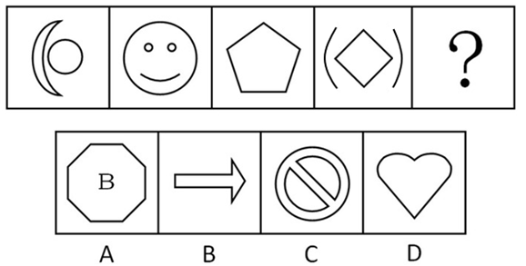

A. A

B. B

C. C

D. D

第 86 题 · 答案与解析

**参考答案（粉笔题库参考内容）**

B

**解析**

元素组成凌乱，数线——曲线和直线数量之和。

题干图形中包含的线条数依次为3、4、5、6，依次等量递增，因此问号处图形应包含7个线条，只有B符合条件。

故正确答案为B。

**考点**：数量规律-复合

**来源**：2013年陕西省公务员录用考试《行测》题第86题

### 第 87 题

请选择最合适的一项填入问号处，使之符合之前四个图形的变化规律。

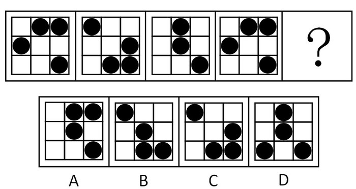

A. A

B. B

C. C

D. D

第 87 题 · 答案与解析

**参考答案（粉笔题库参考内容）**

C

**解析**

元素组成相同，考位置。

本题需要总体观察，第一个图形经过移动后与第四个图形相同，图形周期出现，且周期为3，故问号处图形应与第二个图形一致。

故正确答案为C。

**考点**：样式规律-遍历

**来源**：2013年陕西省公务员录用考试《行测》题第87题

### 第 88 题

请从所给的四个选项中，选择最合适的一项填在问号处，使之呈现一定的规律性。

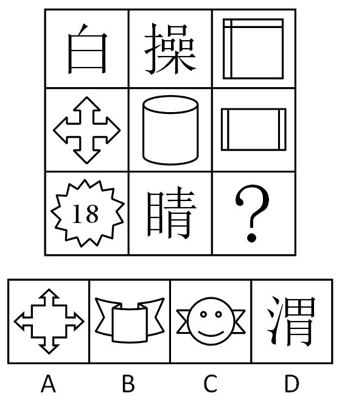

A. A

B. B

C. C

D. D

第 88 题 · 答案与解析

**参考答案（粉笔题库参考内容）**

C

**解析**

【解析一】元素组成不同，属性无明显规律，考虑数量规律。观察发现题干“窟窿”明显，优先考虑面数量，九宫格横行观察，第一行面数量依次为2、3、4，等差递增；第二行面数量依次为1、2、3，等差递增；第三行也应符合等差递增的规律，前两个图形的封闭区域分别为3、5，因此第三个图形应为7个封闭区域，只有C项符合。

【解析二】元素组成不同，属性无明显规律，考虑数量规律。观察发现题干“窟窿”明显，优先考虑面数量，九宫格竖行观察，可以发现，第一列面数量为2、1、3，即2+1=3；第二列面数量为3、2、5，即3+2=5，故第三列也应该满足该规律，即4+3=7，问号处应该选择7个面，只有C选项符合。

故正确答案为C。

**考点**：数量规律-面、文字/字母/数字类

**来源**：2013年陕西省公务员录用考试《行测》题第88题

### 第 89 题

把下面六个图形分成两类，使每一类图形都有各自共同的规律或特征，分类正确的一项是：

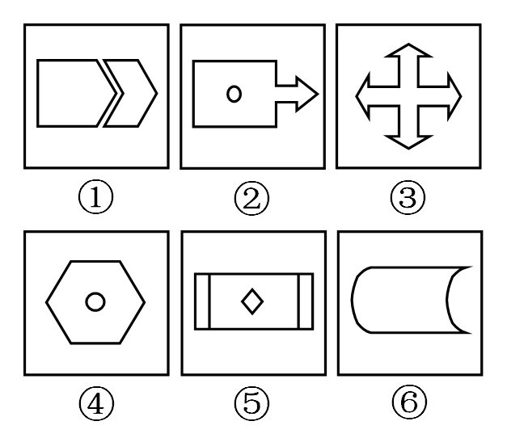

A. ①⑤⑥ ②③④

B. ①③⑤ ②④⑥

C. ①④⑥ ②③⑤

D. ①②⑥ ③④⑤

第 89 题 · 答案与解析

**参考答案（粉笔题库参考内容）**

D

**解析**

元素组成凌乱，考查对称轴的方向，图形①②⑥只有水平对称轴，③④⑤既有水平对称轴，也有竖直对称轴。

故正确答案为D。

注：图形①③⑤只包含直线，图形②④⑥既有直线，又有曲线。此时选B。综合考虑，对称轴的特性更具有代表性，因此解析以D为准。

**考点**：属性规律-对称性

**来源**：2013年陕西省公务员录用考试《行测》题第89题

### 第 90 题

把下面六个图形分成两类，使每一类图形都有各自共同的规律或特征，分类正确的一项是：

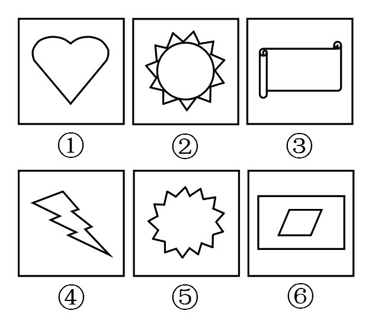

A. ①④⑤ ②③⑥

B. ①②④ ③⑤⑥

C. ①③⑥ ②④⑤

D. ①②⑤ ③④⑥

第 90 题 · 答案与解析

**参考答案（粉笔题库参考内容）**

A

**解析**

元素组成不同，且无明显属性规律，考虑数量规律。观察发现，图①④⑤都只有一个面，图②③⑥都有多个面，故图①④⑤为一组，图②③⑥为一组。

故正确答案为A。

**考点**：数量规律-面

**来源**：2013年陕西省公务员录用考试《行测》题第90题

### 第 91 题

根据我国《合同法》的规定，要约是希望和他人订立合同的意思表示，该意思表示经受要约人承诺，要约人即受该意思表示约束。

根据上述定义，下列选项中属于要约的是：

A. 甲对乙说：“我打算卖掉我的手机，价格1千元左右吧。”

B. 西安火车站的始发列车时刻表

C. 某报社征稿启事：“凡我报选用者按200元/千字从优支付稿酬。”

D. 某个培训机构打出广告：“高级领导班2000元每人，随到随学。”

第 91 题 · 答案与解析

**参考答案（粉笔题库参考内容）**

C

**解析**

第一步：找到定义关键词。

希望和他人订立合同。

第二步：逐一判断选项。

A中卖手机和B中列车时刻表均不需要订立合同，不符合定义，排除；

C项，该征稿启事列举了征用条件，可就该意思表示订立合同，说明报社希望通过征稿启事找到符合条件的人与之订立合同，符合定义，是答案；

D项打出的广告没有关于辅导班的具体内容，无法就该意思表示来订立合同，而是希望通过该广告让他人发出要约与自己订立合同，不符合定义的前后逻辑。

故正确答案为C。

**考点**：单定义-其他句式

**来源**：2013年陕西省公务员录用考试《行测》题第91题

### 第 92 题

我国《刑法》规定：在犯罪活动中，自动放弃犯罪或者自动有效地防止犯罪结果发生的，是犯罪中止。

根据上述定义，下列行为属于犯罪中止的是：

A. 甲趁乙熟睡之际潜入乙家杀乙，打开煤气阀一段时间后，又后悔了，遂将煤气阀关上，并将120叫来对乙进行抢救，乙遂脱险

B. 甲潜入乙家盗窃，突然听到旁边门响，误以为被发现，遂逃走

C. 甲去乙家行贿，到乙家后却发现乙不在，遂将行贿的五万元带回，准备改天再去

D. 甲在街上对乙进行抢劫，被过路的群众发现、制止并扭送至公安机关

第 92 题 · 答案与解析

**参考答案（粉笔题库参考内容）**

A

**解析**

第一步：找到定义关键词。

包含两种情况：自动放弃犯罪、自动有效地防止犯罪结果发生。

第二步：逐一判断选项。

A项，犯罪结果是乙死亡，最后乙经过抢救脱险，说明有效地防止犯罪结果发生，符合定义要件之一，是答案；

B项，甲误以为被发现，而不是自动放弃，不符合定义要件；

C项，乙不在家，行贿行为被推迟，而不是中止，不符合定义要件；

D项，甲的抢劫行为被群众制止，而不是自动放弃，不符合定义要件。

故正确答案为A。

**考点**：单定义-其他句式

**来源**：2013年陕西省公务员录用考试《行测》题第92题

### 第 93 题

一般来讲，耕作的涵义是指作物在种植之前，或在生长期间，为了改善作物生长条件，对土壤进行机械操作，耕作的目的有三个：（1）改良土壤结构；（2）把农作物残渣和有机肥掩埋并掺合到土壤中；（3）清除杂草和其他不需要的植株。

根据上述定义，下列选项中属于耕作的一项是：

A. 下雪后将板结的表土破碎

B. 在麦田旁挖排水沟

C. 在农田里种植绿肥作物

D. 喷洒杀虫剂以杀灭害虫

第 93 题 · 答案与解析

**参考答案（粉笔题库参考内容）**

A

**解析**

第一步：找出定义关键词。

时间为种植之前、生长期，通过机械操作，达到耕作三个目的之一，同时符合三个定义要件的行为即为耕作。

第二步：逐一分析选项。

A项是在种植之前，通过机械操作破碎表土，达到了改良土壤的目的，符合定义要件，当选；

B项没有达到任何目的，不属于耕作，排除；

C项属于种植过程，不是在种植前或生长期，不符合时间要件，不属于耕作，排除；

D项不是机械操作，所以不是耕作，排除。

故正确答案为A。

**考点**：大前提

**来源**：2013年陕西省公务员录用考试《行测》题第93题

### 第 94 题

法的适用是指国家司法机关根据法定的职权和法定的程序，具体应用法律处理案件的专门活动。

根据上述定义，下列行为属于法的适用的是：

A. 海关工作人员认为张某有走私嫌疑而对其进行查办

B. 检察机关根据群众举报对王某的受贿行为进行侦查

C. 李某根据国家有关法律规定，在某售楼部签订房屋买卖合同

D. 公安局长召开关于提高干警办案质量的工作会议

第 94 题 · 答案与解析

**参考答案（粉笔题库参考内容）**

B

**解析**

第一步：找出定义关键词。

“国家司法机关”，“应用法律处理案件”。

第二步：逐一分析选项。

A项中“海关工作人员”不是“国家司法机关”，不符合定义要点；

B项中主体是“检察机关”，属于“国家司法机关”，侦查“受贿行为”属于“应用法律处理案件”，符合两个定义要点，是答案；

C项中签订合同不属于“应用法律处理案件”，不符合定义要点；

D项中“公安局长”不是“国家司法机关”，“召开工作会议”不属于“应用法律处理案件”，两个定义要点均不符合。

故正确答案为B。

**考点**：主客体

**来源**：2013年陕西省公务员录用考试《行测》题第94题

### 第 95 题

知识产权是指在科学、技术、文化、教育、艺术等领域，人们对智力劳动创造的财富所享有的权利。

根据上述定义，下列选项中不属于知识产权的是：

A. 商标权

B. 发明权

C. 肖像权

D. 版权

第 95 题 · 答案与解析

**参考答案（粉笔题库参考内容）**

C

**解析**

第一步：找到定义关键词。

“科学、技术、文化、教育、艺术等领域”、“智力劳动创造的财富”。

第二步：逐一分析选项。

A项商标权是商业领域的，属于智力劳动创造的财富，是知识产权；

B项发明权属于科学领域的，属于智力劳动创造的财富，是知识产权；

C项肖像权不属于智力劳动创造的财富，不符合定义要件，因此不是知识产权；

D项版权是教育文化领域的，属于智力劳动创造的财富，是知识产权。

本题为选非题，故正确答案为C。

**考点**：单定义-其他句式

**来源**：2013年陕西省公务员录用考试《行测》题第95题

### 第 96 题

所谓联觉是指一种感觉引起另一种感觉，因另一种感觉的同时作用而得以加强的心理现象。

根据上述定义，下列选项中不属于联觉的是：

A. 有人在看到红色时会兴奋

B. 在炙热的阳光下，小刘戴上墨镜会感到舒服些

C. 小张想起昨天晚上的噩梦，依然会心存恐惧

D. 深色的服装比浅色的服装看上去有收敛的效果

第 96 题 · 答案与解析

**参考答案（粉笔题库参考内容）**

C

**解析**

第一步：找到定义关键词。

两种感觉“同时作用”。

第二步：逐一分析选项。

C项，恐惧是一种感觉，没有引起其他感觉，不属于联觉，是答案；

A项看到“红色”引起“兴奋”，B项“炙热”的阳光下“戴上墨镜”感到“舒服”，D项“深色衣服”有“收敛”的效果，三者为两种感觉“同时作用”，符合定义。

本题为选非题，故正确答案为C。

**考点**：原因结果

**来源**：2013年陕西省公务员录用考试《行测》题第96题

### 第 97 题

心境是一种微弱平静、持续时间较长、有弥散性的情绪状态。

根据上述定义，下列选项中不属于心境的是：

A. 热恋中的小王工作积极性明显高涨

B. 因前面车辆突然违规掉头，正在开车的小张情急之下破口大骂

C. 刚出国学习的小李最近闷闷不乐，变得少言寡语

D. 由于不愿意去幼儿园，小朋友莉莉最近不好好吃饭

第 97 题 · 答案与解析

**参考答案（粉笔题库参考内容）**

B

**解析**

第一步：寻找定义关键词。

微弱平静、持续时间较长、弥散性，全部符合即为心境。

第二步：逐一分析选项。

B项“情急之下破口大骂”显然没有“持续时间较长”，不符合定义要件，是答案；

A项因为“热恋”而“积极性明显高涨”，C项“出国学习”导致“闷闷不乐，变得少言寡语”，D项“由于不愿意去幼儿园”而“不好好吃饭”，均持续时间较长，且都引起附加的行为，具有弥散性，都符合定义要件。

本题为选非题，故正确答案为B。

**考点**：单定义-其他句式

**来源**：2013年陕西省公务员录用考试《行测》题第97题

### 第 98 题

公害是指各种污染源或其他人为原因对自然环境和生活环境所造成的社会性危害。

根据上述定义，下列选项中不属于公害的是：

A. 某化工厂的废水造成附近的农田污染

B. 某人养的小狗晚上狂吠，导致邻居无法休息

C. 一群人经常偷猎，致使周边山林内的动物减少

D. 丈夫与妻子发生口角，大打出手，致使妻子受伤住院

第 98 题 · 答案与解析

**参考答案（粉笔题库参考内容）**

D

**解析**

第一步：寻找定义关键词。

“污染源”、“人为原因”导致对“自然环境”和“生活环境”造成的“社会性危害”。

第二步：逐一分析选项。

A项，“废水”是“污染源”，“农田污染”是对“自然环境”的破坏，符合定义；

B项，“小狗晚上狂吠”属于“声音污染”，“导致邻居无法休息”是对“生活环境”的破坏，符合定义；

C项，“偷猎”是“人为原因”，“山林内的动物减少”是对“自然环境”的破坏，符合定义；

D项，“妻子受伤住院”是对个人的伤害，而不是“社会性伤害”，不属于公害，当选。

本题为选非题，故正确答案为D。

**考点**：原因结果

**来源**：2013年陕西省公务员录用考试《行测》题第98题

### 第 99 题

衰老是指机体从性成熟后开始或加速的一种持续发展且不可逆转的过程。

根据上述定义，下列选项中属于衰老的是：

A. 老年人身高下降，脊柱弯曲，皮肤松弛，须发脱落

B. 某干部退休后，睡眠不好，情绪烦躁，不愿与人交往

C. 某青年原本活泼好动，热情奔放，但因学业繁重而郁郁寡欢

D. 某工人因长期在噪音环境下工作，导致听觉能力下降

第 99 题 · 答案与解析

**参考答案（粉笔题库参考内容）**

A

**解析**

第一步：找到定义关键词。

持续发展且不可逆转。

第二步：逐一分析选项。

A项，老人的变化是不可逆转的，符合定义要件，是答案；

B项情绪烦躁，C项郁郁寡欢，D项听觉能力下降，都是由生活学习或工作环境造成的，是可以改变的，不符合定义要件。

故正确答案为A。

**考点**：单定义-其他句式

**来源**：2013年陕西省公务员录用考试《行测》题第99题

### 第 100 题

内在稳定器又称“自动稳定器”，是指财政制度中的自动稳定因素，当经济衰退或过热时，无需政府变动经济政策，便可自动地起到控制衰退或抑制经济过热的作用。

根据上述定义，下列选项中属于内在稳定器作用的是：

A. 由于税收制度上的累进税制，导致税收在经济过热时趋于上升，而在经济萧条时趋于下降，从而起到稳定经济的作用

B. 政府通过在经济萧条时加大投资力度，而在经济过热时减少投资来稳定经济

C. 政府在经济萧条时，加大货币供给，而在经济过热时，减少货币供给，从而对经济起到稳定作用

D. 在经济衰退时，政府通过制定鼓励出口的贸易政策来促进经济复苏

第 100 题 · 答案与解析

**参考答案（粉笔题库参考内容）**

A

**解析**

第一步：寻找定义关键词。

无需政府变动经济政策。

第二步：逐一分析选项。

A项，税收是随着经济状况自动变化的，政府没有变动经济政策，符合定义要件，是答案；

B、C、D项均由政府进行干预，不符合定义要件。

故正确答案为A。

**考点**：单定义-其他句式

**来源**：2013年陕西省公务员录用考试《行测》题第100题

### 第 101 题

A、B、C、D为四位漂亮女生，她们喜欢穿漂亮衣服，某天，她们穿的衣服颜色各不相同，有黄色、绿色、蓝色和红色四种，在问到她们各自衣服的颜色时。A说：“B的衣服不是黄色的”，B说：“C的衣服是绿色的”，C说：“D的衣服不是蓝色的”，D说：“A、B、C三人中有一个人的衣服是绿色的，而且只有这个人说的是实话。”

如果D说的是实话，那么以下说法中正确的是：

A. C的衣服是蓝色的，D的衣服是绿色的

B. B的衣服是蓝色的，C的衣服是红色的

C. A的衣服是绿色的，B的衣服是红色的

D. D的衣服是绿色的，A的衣服是红色的

第 101 题 · 答案与解析

**参考答案（粉笔题库参考内容）**

C

**解析**

本题为真假破案题型。

第一步：找到突破口。

由D的话可知，说实话的人的衣服是绿色的，只有B的话提到了绿色，可以以此为突破口。

第二步：根据突破口结合其他题干信息判断真假。

如果B为真，那么B、C的衣服都是绿色，矛盾；所以B的话为假，C的衣服不是绿色的，因此C说的也是假话，故D的衣服是蓝色的；穿绿色衣服的只能是A，A说的是真话，B的衣服不是黄色的，而是红色的；C的衣服是黄色。

综上，只有C符合条件。

故正确答案为C。

**考点**：框架题

**来源**：2013年陕西省公务员录用考试《行测》题第101题

### 第 102 题

陈华、刘刚、王明三人中，星期日只有一个人在家做作业，陈华说：“我在家做作业”，刘刚说：“我没在家做作业”，王明说：“陈华没有在家做作业”。

如果这三句话，只有一句话是真的，那么说真话的是：

A. 无法判断

B. 王明

C. 刘刚

D. 陈华

第 102 题 · 答案与解析

**参考答案（粉笔题库参考内容）**

B

**解析**

本题属于真假破案题型，且为一真题型（即只有一人的断定为真）。

第一步：找突破口。

三句话中，陈华和王明的话矛盾，必有一真。

第二步：看其余的话。

刘刚的话为假，故刘刚在家做作业。

第三步：判断突破口中两句话的真假。

因为只有一个人在家做作业，所以陈华和王明都没在家做作业，可确定王明的话为真，陈华的话为假。

故正确答案为B。

**考点**：只有一真/一假

**来源**：2013年陕西省公务员录用考试《行测》题第102题

### 第 103 题

致远高中的部分物理教师取得了硕士学位，取得硕士学位的物理教师都有三年以上的教学经历，有的女教师也具有三年以上的教学经历，所有女教师都已经结婚。

根据以上文字，下列选项中一定正确的是：

A. 所有物理教师都具有三年以上的教学经历

B. 可能有男教师尚未结婚

C. 所有取得硕士学位的物理教师都已结婚

D. 可能有取得硕士学位的物理教师为女教师

第 103 题 · 答案与解析

**参考答案（粉笔题库参考内容）**

D

**解析**

本题为关联词推导题型。

第一步：翻译题干。

（1）部分物理老师⇒硕士学位，（2）硕士学位⇒三年以上教学经历，（3）部分女教师⇒三年以上教学经历，（4）所有女老师已结婚（此为事实信息）。

第二步：从事实信息开始推导，得出结论。

部分已婚的女教师⇒三年以上教学经历，结合（1）和（2）可知，部分物理老师⇒三年以上教学经历。而部分已婚的女教师和部分物理老师可能是全同关系、交叉关系或全异关系，D项说的是可能，所以正确，当选。

已知，部分物理老师⇒三年以上教学经历，部分不能推出全部，A错误，排除；

B项也含有可能，但题干信息中没有涉及到男教师，排除；

由于部分已婚的女教师和部分物理老师包含多种关系，并不能得出C，排除。

故正确答案为D。

**考点**：集合推理

**来源**：2013年陕西省公务员录用考试《行测》题第103题

### 第 104 题

暑假期间，学校组织高二（五）班的同学于7月20日外出旅游，小明说：“如果我去，小强与小林就一定都会去。”小强说：“如果我去，那么小燕与小芬至少有一个人会去。”小燕说：“只有不下雨，我才会去。”小芬说：“只有气温在30摄氏度以下，我才会去。”天气预报显示，7月20日，小雨，32至37摄氏度。

根据以上文字，下列选项中可以推出的是（    ）。

A. 小明、小强、小林、小燕与小芬都没有外出旅游

B. 小燕、小芬没有外出旅游，但小明、小林与小强外出旅游

C. 小燕、小芬与小强没有外出旅游，但小明与小林外出旅游

D. 小明、小强、小林、小燕与小芬都外出旅游

第 104 题 · 答案与解析

**参考答案（粉笔题库参考内容）**

A

**解析**

第一步：翻译题干。

①小明→（小强 且 小林）；

②小强→（小燕 或 小芬）；

③小燕→不下雨；

④小芬→30℃以下。

第二步：根据题干信息进行推导。

从肯定信息“小雨、32℃~37℃”开始推理。根据小雨和③，利用逆否命题可知：下雨→非小燕，即小燕不去；根据32℃~37℃可知，气温不在30以下，利用逆否命题可知：非30℃以下→非小芬，即小芬不去。小燕不去且小芬不去，根据②的逆否命题可知：（非小燕 且 非小芬）→非小强，小强不去。根据①的逆否命题可知：（非小强 或 非小林）→非小明，所以，小明不去，即四人都没有去。

第三步：再次标注答案。

故正确答案为A。

**考点**：常规翻译

**来源**：2013年陕西省公务员录用考试《行测》题第104题

### 第 105 题

在《创新管理》课堂上，张教授对学生说：“企业创新成功与否是以创新绩效来衡量的，一个企业要么创新绩效高，要么创新绩效低，在我看来，一个企业要么创新成功，要么创新失败，由于创新绩效高的企业在我看来都是创新成功的企业，所以创新绩效低的企业在我看来都是创新失败的企业。”

为了使张教授的论证成立，下列假设中必须成立的一项是：

A. 由于企业所从事的业务领域不同，其创新绩效有不同的表现形式，因而很难对企业的创新绩效进行评判

B. 在张教授看来，创新绩效高的企业未必是创新成功的企业，创新绩效低的企业也未必是创新失败的企业

C. 在张教授看来，创新绩效高的企业就是创新成功的企业，创新绩效低的企业也就是创新失败的企业

D. 创新绩效高低具有客观评价标准，且张教授具有区分创新绩效高低的能力

第 105 题 · 答案与解析

**参考答案（粉笔题库参考内容）**

D

**解析**

第一步：分析论证过程。

论点：创新绩效低的企业在我看来都是创新失败的企业。

论据：创新绩效高的企业在我看来都是创新成功的企业。

题干论点和论据都在讨论“创新绩效的高低”与“企业创新是否成功”的关系，话题一致，题干问法为“假设”，考虑必要条件。

第二步：逐一分析选项。

A项，是对衡量标准的削弱，对加强论证无关，属于无关选项，排除；

B项，该项表达的意思与张教授所表达的意思相悖，排除；

C项，是对论据的重复，不是必要的，排除；

D项，如果为真，则该论证具有客观评价标准，那么企业的绩效高低才能被确认，当选。

故正确答案为D。

**考点**：必要条件

**来源**：2013年陕西省公务员录用考试《行测》题第105题

### 第 106 题

城市是一种生活方式，或者说是一种体验，而不是大小的区别。比如深圳，除了罗湖区，其他地区，依我个人的体验，皆为未完成之城区。道理很简单，城市需要若干年才能成熟，人气不是一天聚起来的。没有人生活的城区就是“鬼城区”。

下列选项中，最能支持上述观点的是：

A. 城市不仅是一种生活方式，而且是经济发展的动力源泉

B. 小城市更适合人们居住，因而更能代表独特的生活方式

C. 发展时间长的城市，聚集起来的人气比较旺，城市才成熟

D. 大城市人口规模大，发展也就成熟

第 106 题 · 答案与解析

**参考答案（粉笔题库参考内容）**

C

**解析**

本题属加强题型。

第一步：找出论点和论据。

论点：城市需要若干年才能成熟，人气不是一天聚起来的。没有明显论据。

第二步：判断加强方式。

本题没有论据，所以只需要加强论点。

第三步：逐一判断选项。

A项经济发展与论点无关，是无关项；

B、D项涉及到城市的大小，而论点强调发展时间的长短，范围不同，且与题干中“不是大小的区别”矛盾，不能增强论点；

C项直接支持了论点，是答案。

故正确答案为C。

**考点**：补充论据

**来源**：2013年陕西省公务员录用考试《行测》题第106题

### 第 107 题

民意调查在制造出一连串的精确数字的同时，却掩盖了一个硬性的事实，即大多数美国人对政治的无知是令人吃惊的，好比经典的“呼喊”，民调数据表达的是政治意志在一个瞬间的抽搐，而无需经过问题的慎思明辨。而且，民调是一种有效得多的“呼喊”形式，这是因为它看起来以严肃社会科学的冷静理性的发现取代了群众歇斯底里的视觉形象。

下列选项中，最能支持上述观点的是：

A. 美国民调能够以严肃社会科学的冷静理性表达出公民的真实意愿

B. 美国民调是最有效的“呼喊”形式，有助于政治目标的实现

C. 美国民调并不能反映公民的理性思考结果，反而成为实现政治目标的有效工具

D. 美国民调既反映公民的理性思考结果，又有助于政治目标的实现

第 107 题 · 答案与解析

**参考答案（粉笔题库参考内容）**

C

**解析**

本题属加强题型。

第一步：找出论点和论据。

论点：民调表达的是政治意志，而无需经过问题的慎思明辨。

论据：大多数美国人对政治的无知是令人吃惊的。

第二步：判断加强方式。

论点和论据之间存在因果关系，所以需要加强论点。

第三步：逐一判断选项。

A项和D项均直接削弱论点，排除；

B项混淆概念，“有效得多”不等同于“最有效”，且选项没有体现非理性这一点，不能加强论点，排除；

C项是对论点的同义表述，直接支持了论点，当选。

故正确答案为C。

**考点**：补充论据

**来源**：2013年陕西省公务员录用考试《行测》题第107题

### 第 108 题

改革开放以来，中国逐渐形成新旧两种政法话语与体制，两者相互寄生、斗争又合作。新政法体制的建立是通过寄生在旧政法体制之中逐步实现的，但随着新政法体制的逐步壮大并越来越具正当性，现在出现了反向寄生，即旧政法体制开始学会了新政法体制那套话语和做法，寄生在新政法体制之中，从之前的抵制转向了合作，甚至利用。

下列选项中，最能削弱上述观点的是：

A. 新旧两种政法体制是在斗争中并存的

B. 新旧两种政法体制相互独立，没有斗争，也没有合作

C. 新旧两种政法体制的关系分为两阶段：在第一阶段，新政法体制寄生于旧政法体制；在第二阶段，旧政法体制寄生于新政法体制

D. 新旧两种政法体制是一个问题的两个方面

第 108 题 · 答案与解析

**参考答案（粉笔题库参考内容）**

B

**解析**

本题是削弱题型。

第一步：找出论点和论据。

论点：新旧两种政法话语与体制，两者相互寄生、斗争又合作。

论据：没有明显论据。

第二步：判断削弱方式。

没有论据，需要削弱论点。

第三步：逐一判断选项。

A项直接支持论点，排除；

B项直接反驳了论点，最能削弱，当选；

C、D项均涉及到新旧两种政法话语与体制的关系，但没提到具体的关系，无法削弱论点，属于无关选项，排除。

故正确答案为B。

**考点**：削弱论点

**来源**：2013年陕西省公务员录用考试《行测》题第108题

### 第 109 题

在打击拐卖儿童犯罪的活动中，警方救获一名男孩，为了确定他的家乡，警方进行了调查：

知情人士A说，他可能是四川人，也可能是贵州人；

知情人士B说，他不可能是四川人；

知情人士C说，他肯定是四川人；

知情人士D说，他不是贵州人。

警方确定，只有一个人的话不可信。

根据以上信息，警方可以确定这名男孩的家乡是：

A. 四川

B. 贵州

C. 可能是四川，也可能是贵州

D. 无法判断

第 109 题 · 答案与解析

**参考答案（粉笔题库参考内容）**

A

**解析**

第一步：找出题干矛盾命题。

A：他是四川或贵州人；

B：他不是四川人；

C：他是四川人

D：他不是贵州人。

分析题干条件可知，B和C的说法为矛盾关系，必有一真一假。

第二步：根据题干条件推理。

由于警方确定只有一个人的话是假的，则假话一定在B、C中间，那么A和D说的是真话。由D的话可知，他不是贵州人，结合A的话可知他是四川人。

故正确答案为A。

**考点**：只有一真/一假

**来源**：2013年陕西省公务员录用考试《行测》题第109题

### 第 110 题

“成功”只是局部的麻醉。那些艺术家应该意识到他们只能在“那里”成功，而不能在“这里”成功，这本身就很可笑，很荒诞。这本身就是一种“失败”。更可笑的是，他们还想到了“回来”，戴着桂冠回来，这是一种陈腐不堪的情绪，这说明他们内心并不自由，这说明他们仍然是“这里”的奴隶。

下列选项中，最能削弱上述观点的是：

A. 艺术家在其所从事的领域取得成功，不精通其他领域，并不可笑

B. 艺术家不仅在所从事的领域取得成功，还能够在其他领域取得成功，他们内心自由

C. 艺术家在自身领域取得成功的同时，也想在其他领域取得成功

D. 艺术家从事自身领域以外的其他领域，并不是陈腐不堪

第 110 题 · 答案与解析

**参考答案（粉笔题库参考内容）**

B

**解析**

本题是削弱题型。

第一步：找出论点和论据。

论点：艺术家只能在自己从事的领域成功，而不能在别的领域成功，内心不自由。

第二步：判断削弱方式。

没有论据，需要削弱论点。

第三步：逐一判断选项。

B项直接反驳了论点，最能削弱，当选；

A、C、D项均就论点本身进行了评述，但没有推翻论点本身，不能削弱论点。

故正确答案为B。

**考点**：削弱论点

**来源**：2013年陕西省公务员录用考试《行测》题第110题

### 第 111 题

钡餐：硫酸钡：BaSO_4

A. 干冰：二氧化硫：SO_2

B. 纯碱：碳酸钠：NaCO_3

C. 石膏：碳酸钙：CaCO_3

D. 小苏打：碳酸氢钠：NaHCO3

第 111 题 · 答案与解析

**参考答案（粉笔题库参考内容）**

D

**解析**

第一步：判断题干词语间逻辑关系。

题干三词为全同关系，钡餐由硫酸钡构成，分子式为BaSO_4。

第二步：判断各个选项的关系，找出与题干一致的，即为答案。

A项，干冰由二氧化碳构成，并非二氧化硫，排除；

B项，碳酸钠分子式为Na_2CO_3，并非NaCO_3，排除；

C项，石膏由硫酸钙构成，并非碳酸钙，排除；

D项，与题干逻辑关系一致，小苏打由碳酸氢钠构成，分子式为NaHCO3，是答案，当选。

故正确答案为D。

**考点**：逻辑关系-全同关系

**来源**：2013年陕西省公务员录用考试《行测》题第111题

### 第 112 题

聂海胜：张晓光：王亚平

A. 杨利伟：费俊龙：聂海胜

B. 翟志刚：刘伯明：景海鹏

C. 景海鹏：刘旺：刘洋

D. 杨利伟：景海鹏：聂海胜

第 112 题 · 答案与解析

**参考答案（粉笔题库参考内容）**

C

**解析**

第一步：判断题干词语间逻辑关系。

题干三词为并列关系，聂海胜、张晓光和王亚平均为神舟十号飞船航天员，其中王亚平为女航天员。

第二步：判断选项词语间逻辑关系。

A项，杨利伟、费俊龙和聂海胜均为航天员，但其中没有女航天员，不符合题意，排除。

B项，翟志刚、刘伯明和景海鹏均为航天员，但其中没有女航天员，不符合题意，排除。

C项，景海鹏、刘旺和刘洋均为神舟九号飞船航天员，其中刘洋为女航天员，符合题意，当选。

D项，杨利伟、景海鹏和聂海胜均为航天员，但其中没有女航天员，不符合题意，排除。

第三步：再次标注答案。

故正确答案为C。

**考点**：逻辑关系-并列关系

**来源**：2013年陕西省公务员录用考试《行测》题第112题

### 第 113 题

中国：上海

A. 美国：华盛顿

B. 俄罗斯：莫斯科

C. 法国：巴黎

D. 澳大利亚：悉尼

第 113 题 · 答案与解析

**参考答案（粉笔题库参考内容）**

D

**解析**

第一步：判断题干词语间逻辑关系。

题干两词为包容关系，上海位于中国，且并非首都。

第二步：判断选项词语间逻辑关系。

只有D与题干逻辑关系一致，悉尼位于澳大利亚，且并非首都，是答案，当选。

A、B、C三项均为国家与首都的对应，与题干逻辑关系不一致，排除。

故正确答案为D。

**考点**：逻辑关系-包容关系

**来源**：2013年陕西省公务员录用考试《行测》题第113题

### 第 114 题

范雎：白起：秦国

A. 商鞅：李悝：魏国

B. 田忌：孙膑：齐国

C. 蔺相如：廉颇：赵国

D. 屈原：项燕：韩国

第 114 题 · 答案与解析

**参考答案（粉笔题库参考内容）**

C

**解析**

第一步：判断题干词语间逻辑关系。

题干三词，前两词为并列关系，与第三词构成对应关系，范雎是秦国的宰相，白起是秦国的将军，且二人的职位性质不同，即一文一武。

第二步：判断各个选项词语间的关系，找出与题干一致的，即为答案。

只有C与题干逻辑关系一致，蔺相如是赵国的宰相，廉颇是赵国的将军，是答案。

A项，商鞅是卫国人，且商鞅和李悝都是文臣，与题干逻辑关系不一致，排除；

B项，田忌和孙膑均为武将；

D项，屈原和项燕均为楚国人。

三项均与题干关系不一致。

故正确答案为C。

**考点**：逻辑关系-对应关系、逻辑关系-并列关系

**来源**：2013年陕西省公务员录用考试《行测》题第114题

### 第 115 题

牛皮夹克：上衣

A. 鞋套：鞋子

B. 建安诗人：诗人

C. 植物：动物

D. 陶瓷：餐具

第 115 题 · 答案与解析

**参考答案（粉笔题库参考内容）**

B

**解析**

第一步：判断题干词语间逻辑关系。

题干两个词为包容关系，牛仔夹克是上衣的一种，上衣包含牛仔夹克。

第二步：逐一分析选项。

A项，鞋套套在鞋子上，两者是对应关系，与题干关系不一致，排除。

B项，建安诗人是诗人的一个流派，诗人包含建安诗人，两者是包容关系，与题干逻辑关系一致，当选。

C项，植物和动物都是生物的类别，两者是并列关系，与题干关系不一致，排除。

D项，陶瓷是餐具的制作原料，二者为对应关系，与题干关系不一致，排除。

第三步：再次标注答案。

故正确答案为B。

**考点**：逻辑关系-包容关系

**来源**：2013年陕西省公务员录用考试《行测》题第115题

### 第 116 题

陕西 对于 （    ） 相当于 （    ） 对于 布达拉宫

A. 兵马俑 河南

B. 渭河 西藏

C. 大雁塔 西藏

D. 华山 北京

第 116 题 · 答案与解析

**参考答案（粉笔题库参考内容）**

C

**解析**

第一步：分别将选项代入题干，找出前后逻辑关系相同的一组。

代入A，兵马俑在陕西，布达拉宫不在河南，逻辑关系不一致；

代入B，渭河流经陕西，但不在陕西，布达拉宫在西藏，二者逻辑关系不完全一致；

代入C，大雁塔在陕西，布达拉宫在西藏，前后均为省份和景点的对应，逻辑关系一致；

代入D，华山在陕西，布达拉宫不在北京，二者逻辑关系不一致。

第二步：根据代入得到的关系，得出正确答案。

故正确答案为C。

**考点**：逻辑关系-对应关系

**来源**：2013年陕西省公务员录用考试《行测》题第116题

### 第 117 题

博弈论：经济学：纳什

A. 历史学：新儒学：钱穆

B. 小说：文学：梁启超

C. 日心说：天文学：哥白尼

D. 量子物理：物理学：薛定谔

第 117 题 · 答案与解析

**参考答案（粉笔题库参考内容）**

C

**解析**

第一步：判断题干词语间逻辑关系。

题干三词为对应关系，博弈论是纳什创立的一种经济学理论。

第二步：判断各个选项词语间的关系，找出与题干一致的，即为答案。

A项，历史学和新儒学的前后对应关系颠倒；

B项，小说并非梁启超创立的文学体裁；

C项，与题干逻辑关系一致，日心说是哥白尼创立的一个天文学理论；

D项，薛定谔创立的物理学理论是概率波动力学，并非量子物理。

故正确答案为C。

**考点**：逻辑关系-对应关系

**来源**：2013年陕西省公务员录用考试《行测》题第117题

### 第 118 题

考试：试卷

A. 血压：血压计

B. 考评：考评表

C. 温度：温度计

D. 湿度：湿度表

第 118 题 · 答案与解析

**参考答案（粉笔题库参考内容）**

B

**解析**

第一步：判断题干词语间逻辑关系。

题干两词为对应关系，试卷是考试的载体。

第二步：判断选项词语间的逻辑关系。

只有B项与题干逻辑关系一致，考评表是考评的载体，当选。

A、C、D三项均为指标和测量工具的对应关系，与题干对应关系不一致，排除。

故正确答案为B。

**考点**：逻辑关系-对应关系

**来源**：2013年陕西省公务员录用考试《行测》题第118题

### 第 119 题

企业：员工：经理

A. 军队：士兵：首长

B. 机关：公务员：领导

C. 学校：学生：教授

D. 医院：护士：大夫

第 119 题 · 答案与解析

**参考答案（粉笔题库参考内容）**

A

**解析**

第一步：判断题干词语间逻辑关系。

题干三词为对应关系，企业中，经理是员工的上级。

第二步：判断选项词语间逻辑关系。

A项，与题干逻辑关系一致，军队中，首长是士兵的上级；

B项，领导也是公务员，不能判断出上下级的关系；

C项，教授和学生是教学关系，并非上下级关系；

D项，护士和大夫是医院的工作人员，工作范围不一样，并非上下级关系。

故正确答案为A。

**考点**：逻辑关系-对应关系

**来源**：2013年陕西省公务员录用考试《行测》题第119题

### 第 120 题

吴承恩：《西游记》

A. 干宝：《搜神记》

B. 罗贯中：《三国演义》

C. 大仲马：《基督山伯爵》

D. 吴敬梓：《儒林外史》

第 120 题 · 答案与解析

**参考答案（粉笔题库参考内容）**

B

**解析**

第一步：判断题干词语间逻辑关系。

吴承恩是《西游记》的作者，二者为作者与作品的对应关系，且《西游记》为中国四大名著之一。

第二步：判断选项词语间逻辑关系。

A项：干宝是《搜神记》的作者，二者为作者与作品的对应关系，但《搜神记》不是中国四大名著之一，与题干逻辑关系不一致，排除；

B项：罗贯中是《三国演义》的作者，二者为作者与作品的对应关系，且《三国演义》为中国四大名著之一，与题干逻辑关系一致，当选；

C项：大仲马是《基督山伯爵》的作者，二者为作者与作品的对应关系，但《基督山伯爵》是外国名著，不是中国四大名著之一，与题干逻辑关系不一致，排除；

D项：吴敬梓是《儒林外史》的作者，二者为作者与作品的对应关系，但《儒林外史》不是中国四大名著之一，与题干逻辑关系不一致，排除。

故正确答案为B。

**考点**：逻辑关系-对应关系

**来源**：2013年陕西省公务员录用考试《行测》题第120题

## 材料 1

根据以下资料，回答下列试题。

        2011年末，我国城乡就业人数达到76420万人，比2002年增加3140万人。其中，城镇就业人数从25159万人增加到35914万人；乡村就业人数从48121万人减少到40506万人，随着工业化和城市化进程的不断推进，城镇吸收就业的能力不断增强。2011年，农民工总量达到25278万人。

        2011年，城镇居民人均可支配收入21810元，比2002年增长1.8倍，扣除价格因素，年均实际增长9.2%；农村居民人均纯收入6977元，比2002年增长1.8倍，扣除价格因素，年均实际增长8.1%；城乡居民收入年均增速超过1979年至2011年7.4%的年均增速，是历史上增长最快的时期之一，2010年、2011年农村居民收入增速连续两年快于城镇，城乡居民收入差距有所缩小。

        2011年，城乡居民家庭恩格尔系数分别为36.3%和40.4%，分别比2002年降低了1.4和5.8个百分点。2011年，城镇居民人均住房建筑面积32.7平方米，比2002年增加8.2平方米；农村居民人均住房面积36.2平方米，增加9.7平方米，主要耐用消费品拥有量大幅增长。2011年底，城镇居民家庭平均每百户拥有家庭汽车18.6辆，比2002年度增长20.1倍；拥有移动电话205.3部，增长2.3倍；拥有家庭电脑81.9台，增长3.0倍；农村居民家庭平均每户拥有电冰箱61.5台，比2002年度增长3.1倍；空调机22.6台，增长8.9倍；拥有移动电话179.7部，增长12.1倍。2011年，全国电话普及率达到94.90/百人，比2002年提高1.8倍。

        2011年末，全国城镇职工基本养老、城镇基本医疗、失业、工伤、生育保险参保人数分别达到28391万人、47343万人、14317万人、17696万人、13892万人。2011年底，2277万城市居民得到政府最低生活保障，5306万农村居民得到政府最低生活保障，分别比2002年增加212万人和4898万人。以低收入标准测算，农村贫困人口从2002年末的8645万人下降到2010年末的2688万人。2011年，中央决定将农民人均纯收入2033元（2010年不变价）作为新的国家扶贫标准，比2009年提高92%，按照新标准，年末扶贫对象为12238万人。

### 第 121 题

从2002年到2011年，城镇就业人数占我国城乡就业人数的比重增加了多少个百分点：

A. 14.1

B. 14.7

C. 16.1

D. 12.7

第 121 题 · 答案与解析

**参考答案（粉笔题库参考内容）**

D

**解析**

根据题干“从2002年到2011年······比重增加······”，可判定本题为两期比重问题。定位文字材料第一段可得：“2011年末，我国城乡就业人数达到76420万人，比2002年增加3140万人；城镇就业人数从25159万人增加到35914万人。”故从2002年到2011年，城镇就业人数占我国城乡就业人数的比重增加：35914/76420 − 25159/(76420 − 3140)≈ 36/76 - 25/73≈ 47% − 34%=13%，与D最为接近。

故正确答案为D。

**考点**：两期比重、文字资料

**来源**：2013年陕西省公务员录用考试《行测》题第121题

### 第 122 题

从2002年到2011年，城镇居民人均可支配收入增长量比农村居民人均纯收入增长量多多少元：

A. 9535.5

B. 5297.5

C. 8240.6

D. 11528.9

第 122 题 · 答案与解析

**参考答案（粉笔题库参考内容）**

A

**解析**

根据题干“······增长量多多少元”，可判定本题为增长量计算问题。定位文字材料第二段可得：“2011年，城镇居民人均可支配收入21810元，比2002年增长1.8倍，农村居民人均纯收入6977元，比2002年增长1.8倍。”代入增长量公式：现期量/(1 + r) × r，

故从2002年到2011年，城镇居民人均可支配收入增长量比农村居民人均纯收入增长量多：21810/(1 + 1.8) × 1.8−6977/(1+1.8)×1.8= (21810-6977)/(1+1.8)×1.8=14833/2.8×1.8=14833 × 9/14 =(14000 + 833)×9/14= 9000 + 833 × 9/14＜10000，显然高于9000且小于10000。

故正确答案为A。

**考点**：增长量计算、文字资料

**来源**：2013年陕西省公务员录用考试《行测》题第122题

### 第 123 题

2002年，农村居民恩格尔系数是城镇居民恩格尔系数的多少倍：

A. 1.1

B. 1.2

C. 1.3

D. 1.4

第 123 题 · 答案与解析

**参考答案（粉笔题库参考内容）**

B

**解析**

根据题干“2002年······多少倍”，结合材料所给数据为2011年，可判定本题为基期倍数问题。定位文字材料第三段可得：“2011年，城乡居民家庭恩格尔系数分别为36.3%和40.4%，分别比2002年降低了1.4和5.8个百分点。”故2002年，农村居民恩格尔系数比城镇居民恩格尔系数：(40.4%+5.8%)/(36.3%+1.4%)=46.2%/37.7%= (37.7 + 8.5)/37.7≈ 1 + 0.2=1.2。

故正确答案为B。

**考点**：基期倍数、文字资料

**来源**：2013年陕西省公务员录用考试《行测》题第123题

### 第 124 题

如果2002年底我国城镇居民为1.8亿户，那么2002年底我国城镇居民拥有家庭汽车多少万辆：

A. 159

B. 167

C. 195

D. 204

第 124 题 · 答案与解析

**参考答案（粉笔题库参考内容）**

A

**解析**

根据题干“如果2002年······那么2002年······多少万辆”，可判定本题为基期计算问题。定位文字材料第三段可得：“2011年底，城镇居民家庭平均每百户拥有家庭汽车18.6辆，比2002年度增长20.1倍。”故2002年底城镇居民家庭平均每百户拥有家庭汽车18.6/(1+20.1) ≈ 0.88辆。故2002年底我国城镇居民拥有家庭汽车1.8亿 × 0.88/100 = 158.4万辆。

故正确答案为A。

**考点**：基期计算、文字资料

**来源**：2013年陕西省公务员录用考试《行测》题第124题

### 第 125 题

根据以上资料，以下表述不正确的是：

A. 2011年，农民工总量占我国城乡就业人数的比重超过30%

B. 2002年，我国城镇居民人均住房建筑面积比农村居民小

C. 2002年，得到政府最低生活保障的农村居民超过城市居民的四分之一

D. 从2002年到2010年，农村贫困人口减少了将近六千万人

第 125 题 · 答案与解析

**参考答案（粉笔题库参考内容）**

C

**解析**

A项：定位文字材料第一段可得：“2011年城乡就业人数为76420万人，农民工总量达到25278万人。”故2011年，农民工总量占我国城乡就业人数的比重：25278/76420 ＞ 24000/80000=30%，正确；

B项：定位文字材料第三段可得：“2011年，城镇居民人均住房建筑面积32.7平方米，比2002年增加8.2平方米；农村居民人均住房面积36.2平方米，增加9.7平方米。”故2002年城镇居民人均住房建筑面积为32.7-8.2=24.5平方米，农村为36.2-9.7=26.5平方米。显然农村高于城镇，正确；

C项：定位文字材料第四段可得：“2011年底，2277万城市居民得到政府最低生活保障，5306万农村居民得到政府最低生活保障，分别比2002年增加212万人和4898万人。”则2002年得到政府最低生活保障城市居民数为2277-212=2065万人，农村为5306-4898=408万人。408/2065＜408/2040=20%，故2002年，得到政府最低生活保障的农村居民没有超过城市居民的四分之一，错误；

D项：定位文字材料第四段可得：“农村贫困人口从2002年末的8645万人下降到2010年末的2688万人。”故从2002年到2010年，农村贫困人口减少了8645 − 2688 ≈ 6000万人，正确。

注意题干“表述不正确”，本题为选非题。

本题为选非题，故正确答案为C。

**考点**：文字资料、综合分析

**来源**：2013年陕西省公务员录用考试《行测》题第125题

## 材料 2

根据下列资料，回答以下问题。

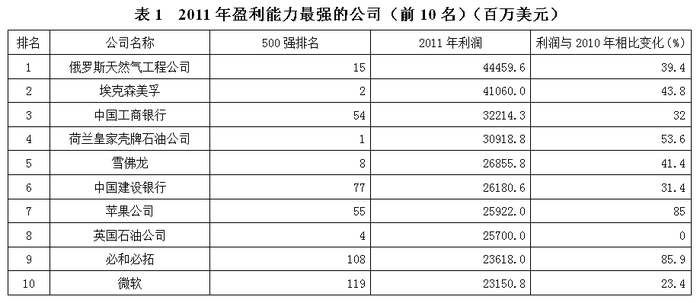

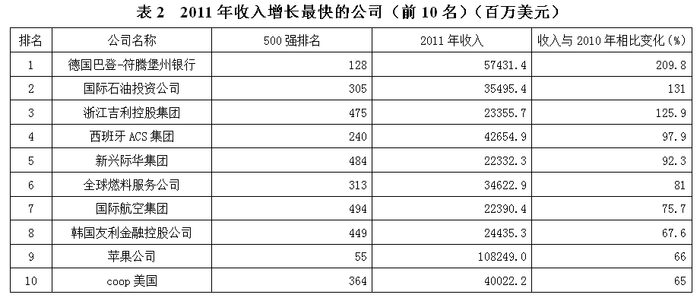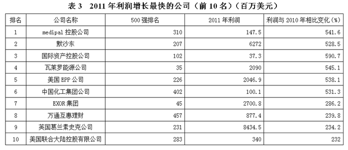

### 第 126 题

2011年盈利能力最强的公司（前10名）中，利润比2010年增长最多与最快的公司分别是：

A. 埃克森美孚、苹果公司

B. 俄罗斯天然气工程公司、必和必拓

C. 埃克森美孚、必和必拓

D. 俄罗斯天然气工程公司、苹果公司

第 126 题 · 答案与解析

**参考答案（粉笔题库参考内容）**

B

**解析**

根据题干“······增长最多与最快······”，可判定本题需要分别比较增长量和增长率。定位表1可知，利润增长率最大的是85.9%，对应的公司为必和必拓，所以利润比2010年增长最快的公司是必和必拓，排除A、D。

结合B、C，比较俄罗斯天然气工程公司和埃克森美孚的增长量。定位表1可得：“2011年，俄罗斯天然气工程公司利润额为44459.6百万美元，同比增长39.4%；埃克森美孚利润额为41060.0百万美元，同比增长43.8%。”代入增长量公式：增长量=现期量/(1+r)×r，故2011年俄罗斯天然气工程公司利润额增长量为44459.6/(1+39.4%) × 39.4% ≈ 12566百万美元；埃克森美孚利润额增长量为41060.0/(1 + 43.8%) × 43.8% ≈ 12506百万美元。因此增长量前者＞后者，利润比2010年增长最多的公司是俄罗斯天然气工程公司。

故正确答案为B。

**考点**：增长量比较、统计表

**来源**：2013年陕西省公务员录用考试《行测》题第126题

### 第 127 题

2011年收入增长最快的公司（前10名）中，2010年收入最高的公司的收入是收入最低的公司的多少倍？

A. 4.7

B. 4.8

C. 5.5

D. 6.3

第 127 题 · 答案与解析

**参考答案（粉笔题库参考内容）**

D

**解析**

根据题干“2011年收入增长最快的公司（前10名）中，2010年······多少倍”，可判定本题为基期倍数问题。定位表2可得：2011年收入增长最快的公司（前10名）中，2010年收入最高的公司应该是2011年的收入较高而增长率较低，因此是苹果公司，其收入为108249.0百万美元，同比增长66%；而收入最低的公司应该是2011年的收入较低而增长率较高，因此是浙江吉利控股集团，其收入为23355.7百万美元，同比增长125.9%。代入基期倍数公式：A/B×(1+b)/(1+a)，故2010年收入最高的公司的收入是收入最低的公司的= (108249.0/23355.7) ×(1+125.9%)/(1+66%)≈ 108/23 × 2.3/1.7=108/1.7×2.3/23= 108/17 ＞ 6倍。

故正确答案为D。

**考点**：基期倍数、统计表

**来源**：2013年陕西省公务员录用考试《行测》题第127题

### 第 128 题

2011年利润增长最快的公司（前10名）中，利润比上一年增加最多的公司的利润增加了多少亿美元：

A. 59.1

B. 54.1

C. 40.6

D. 17.3

第 128 题 · 答案与解析

**参考答案（粉笔题库参考内容）**

A

**解析**

根据题干“······增加了多少亿美元”，可判定本题为增长量计算问题。定位表3可得：默沙东和英国葛兰素史克公司利润明显高于其他公司，比较二者。2011年，默沙东利润额为6272百万美元，同比增长528.5%；英国葛兰素史克公司利润额为8434.5百万美元，同比增长234.2%。代入增长量公式：现期量/(1 + r) × r，故2011年默沙东利润额增长量= 6272/(1 + 528.5%)×528.5%≈ 6300/(1+5.3) × 5.3= 1000 × 5.3=5300百万美元；英国葛兰素史克公司利润额增长量= 8434.5/(1 + 234.2%)×234.2%≈8400/(1+2.3)×2.3= 8400 × 2.3/3.3＞8400×2/3=5600百万美元。显然后者更大，且大于5600百万美元=56亿美元，只有A符合条件。

故正确答案为A。

**考点**：增长量计算、统计表

**来源**：2013年陕西省公务员录用考试《行测》题第128题

### 第 129 题

2011年既是盈利能力最强的公司（前10名）之一，又是收入增长最快的公司（前10名）之一的公司，在2011年利润占收入的比重与2010年相比：

A. 资料不足，无法判断

B. 正好相等

C. 上升了

D. 下降了

第 129 题 · 答案与解析

**参考答案（粉笔题库参考内容）**

C

**解析**

根据题干“······2011年利润占收入的比重与2010年相比”，结合选项，可判定本题为两期比重比较问题。定位表1和表2可知：苹果公司既是盈利能力最强的公司（前10名）之一，又是收入增长最快的公司（前10名）之一。2011年，苹果公司利润增长率a=85%，收入增长率b=66%。根据两期比重比较理论，当a＞b，比重上升，即2011年利润占收入的比重高于2010年。

故正确答案为C。

**考点**：两期比重、统计表

**来源**：2013年陕西省公务员录用考试《行测》题第129题

### 第 130 题

根据以上资料，以下说法中正确的是：

A. 2011年盈利能力最强的公司（前10名）基本上就是同年利润增长最快的公司（前10名）

B. 2011年盈利能力最强的公司（前10名）在世界500强中的排名，与收入增长最快的公司（前10名）、利润增长最快的公司（前10名）总体持平

C. 2011年收入增长最快的公司（前10名）中，收入与上一年的相对变化差别不大

D. 中国金融行业公司数目在2011年盈利能力最强的公司（前10名）中所占比重既超过在收入增长最快的公司（前10名）中所占的比重，又超过在利润增长最快的公司（前10名）中所占的比重

第 130 题 · 答案与解析

**参考答案（粉笔题库参考内容）**

D

**解析**

A项：定位表1和表3可知，两者没有相同的公司，错误；

B项：定位表1、表2和表3可知，表1中的公司在500强排名大都在100名以内，而表2和3中的公司在500强排名基本在200名开外，所以排名并不持平，错误；

C项：定位表2可知，10个公司的收入与2010年相比，增长率较高，变化较大，错误；

D项：定位表1、表2和表3可知，表1中中国金融企业有2个，而表2和3中则没有，符合题意，正确。

故正确答案为D。

**考点**：统计表、综合分析

**来源**：2013年陕西省公务员录用考试《行测》题第130题

## 材料 3

根据以下资料，回答以下问题。

        2003年至2011年，我国第一产业年均增长4.6%，第二产业年均增长11.9%，第三产业年均增长11.1%，均保持较快发展态势。2010年，我国制造业产出占世界的比重为19.8%，超过美国成为全球制造业第一大国。2011年，服务业增加值占国内生产总值的比重上升到43.1%，比2002年提高1.6个百分点。2011年，内需对经济增长的贡献率由2002年的92.4%提高到104.1%，外需贡献率则由2002年7.6%转化为负4.1%。2011年，我国城镇化率首次突破50%，达到51.3%，比2002年提高12.2个百分点，我国城乡结构发生历史性变化。2011年，中部地区、西部地区国内生产总值占全国的比重分别为20.1%、19.2%，分别比2002年提高了1.3和2.0个百分点。2011年，中部地区、西部地区、东北地区全社会固定资产投资占全国的比重分别为23.2%、23.5%和10.7%，分别比2002年提高5.5、3.2和2.4个百分点。

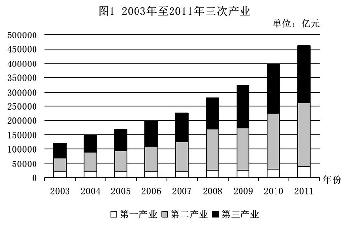

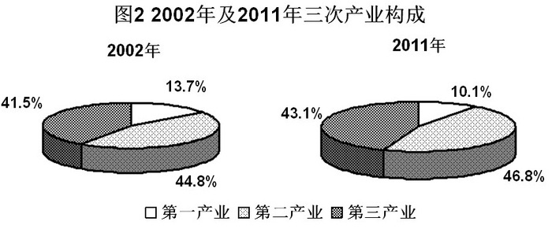

### 第 131 题

如果2010年我国制造业生产总值为135000亿元，那么2010年世界制造业生产总值约为多少万亿元：

A. 67

B. 68

C. 71

D. 72

第 131 题 · 答案与解析

**参考答案（粉笔题库参考内容）**

B

**解析**

根据题干“······2010年世界制造业生产总值约为多少万亿元”，定位文字材料第一段可得“2010年，我国制造业产出占世界的比重为19.8%”，可判定本题为现期比重问题。故2010年世界制造业生产总值= 135000/19.8%＞ 135000/20%= 675000亿元=67.5万亿元，略大于67.5万亿元，只有B符合。

故正确答案为B。

**考点**：现期比重、综合资料

**来源**：2013年陕西省公务员录用考试《行测》题第131题

### 第 132 题

从2002年到2011年，外需对经济增长的贡献率：

A. 增长了3.5个百分点

B. 增长了11.7%

C. 下降了3.5个百分点

D. 下降了11.7%

第 132 题 · 答案与解析

**参考答案（粉笔题库参考内容）**

D

**解析**

定位文字材料可得：“2011年，外需贡献率则由2002年7.6%转化为负4.1%。”故从2002年到2011年，外需对经济增长的贡献率下降了7.6%-(-4.1%)=11.7%。

故正确答案为D。

**考点**：简单加减计算、综合资料

**来源**：2013年陕西省公务员录用考试《行测》题第132题

### 第 133 题

与2002年相比，2011年其他地区（除中部地区，西部地区以外的地区）国内生产总值占全国的比重：

A. 降低了3.3%

B. 上升了3.3个百分点

C. 降低了9.2%

D. 上升了9.2个百分点

第 133 题 · 答案与解析

**参考答案（粉笔题库参考内容）**

A

**解析**

定位文字材料可知：“2011年，中部地区、西部地区······分别比2002年提高了1.3和2.0个百分点”，则其他地区2011年比2002年降低了1.3+2.0=3.3个百分点，即降低了3.3%。

故正确答案为A。

**考点**：简单加减计算、综合资料

**来源**：2013年陕西省公务员录用考试《行测》题第133题

### 第 134 题

如果2002年、2011年我国国内生产总值分别为115000亿元、470000亿元，那么2011年第三产业生产总值是2002年的多少倍：

A. 1.04

B. 1.06

C. 4.24

D. 5.35

第 134 题 · 答案与解析

**参考答案（粉笔题库参考内容）**

C

**解析**

根据题干“······2011年第三产业生产总值是2002年的多少倍”，可判定本题为现期倍数问题。定位图2可知：2002年第三产业比重为41.5%，2011年第三产业比重为43.1%。故2011年第三产业生产总值是2002年= (470000 × 43.1%)/(115000 × 41.5%)=470/115×43.1/41.5= 4^+ × 1^+＞4倍，略大于4倍，只有C符合。

故正确答案为C。

**考点**：现期倍数、综合资料

**来源**：2013年陕西省公务员录用考试《行测》题第134题

### 第 135 题

根据以上资料，以下说法中不正确的是：

A. 从2003年到2011年，我国国内生产总值逐年稳步增长

B. 从2003年到2011年，我国三次产业生产总值均呈现出稳步增长的趋势

C. 从2002年到2011年，我国全社会固定资产投资占全国的比重增长最快的地区为中部地区

D. 与2002年相比，2011年我国三次产业的比例结构更加协调

第 135 题 · 答案与解析

**参考答案（粉笔题库参考内容）**

D

**解析**

A项：定位图1可知：从2003年到2011年，我国国内生产总值逐年稳步增长，正确；

B项：定位图1可知：从2003年到2011年，我国三次产业生产总值均呈现出稳步增长的趋势，正确；

C项：定位文字材料可知：2011年，中部地区、西部地区、东北地区……分别为23.2%、23.5%和10.7%，分别比2002年提高5.5、3.2和2.4个百分点，显然中部地区最高，正确；

D项：定位图2可知：相对于2002年，2011年第二产业和第三产业占比进一步加大，第一产业进一步被压缩，相对差距越发悬殊，错误。

本题为选非题，故正确答案为D。

**考点**：综合分析、综合资料

**来源**：2013年陕西省公务员录用考试《行测》题第135题

## 材料 4

2011年，某省全社会研发经费达612.93亿元，R&D（研发）经费占GDP的比重达1.9%，比2010年提高0.12个百分点。2011年，该省R&D人员达26.288万人，每万名就业人员中的研发人员比例达0.72%。2011年，该省专利申请量和授权量分别达16.5万件和13万件，同比增长35%和11.7%。2011年，该省技术市场合同成交额68.2968亿元。2011年，该省每万元GDP能耗0.590吨标准煤。

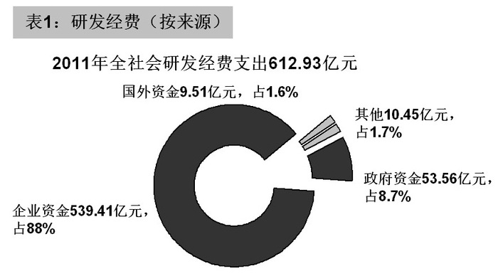

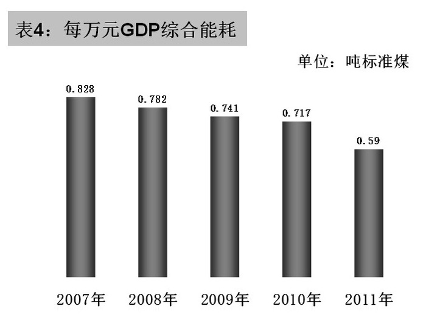

### 第 136 题

2011年，平均就业人员创造的GDP为：

A. 23.316万元

B. 1227.1563万元

C. 3.864万元

D. 88355元

第 136 题 · 答案与解析

**参考答案（粉笔题库参考内容）**

D

**解析**

根据题干“2011年，平均······创造的GDP为”，结合材料数据为2011年，可判定本题为现期平均数问题。定位文字资料可得：“2011年，某省全社会研发经费达612.93亿元，R&D（研发）经费占GDP的比重达1.9%。2011年，该省R&D人员达26.288万人，每万名就业人员中的研发人员比例达0.72%。”则2011年GDP=612.93/1.9%≈610/2%=30500亿元，就业人员=26.288/0.72%≈26/0.7%≈3700万人，故2011年，平均就业人员创造的GDP=30500/3700≈8万元，与D最为接近。

故正确答案为D。

**考点**：现期平均数、综合资料

**来源**：2013年陕西省公务员录用考试《行测》题第136题

### 第 137 题

2011年企业对于每名研发人员的经费支出大约为多少万元？

A. 24

B. 25

C. 26

D. 27

第 137 题 · 答案与解析

**参考答案（粉笔题库参考内容）**

B

**解析**

根据题干“2011年······每名······多少万元”，结合材料数据为2011年，可判定本题为现期平均数问题。定位表1和表2可知：工业企业经费支出为539.41亿元和工业企业研发人员为21.711万人。故2011年工业企业对于每名研发人员的经费支出= 539.41/21.711＞539/22=24.5万元，略大于24.5，只有B符合。

故正确答案为B。

**考点**：现期平均数、综合资料

**来源**：2013年陕西省公务员录用考试《行测》题第137题

### 第 138 题

按照2007—2011年增长最快的增长率算，2012年技术合同成交金额一定超过多少亿元？

A. 110

B. 100

C. 90

D. 80

第 138 题 · 答案与解析

**参考答案（粉笔题库参考内容）**

D

**解析**

根据题干“按照2007—2011年增长最快的增长率算，2012年······”，可判定本题为现期计算问题。定位文字材料和表3可得：“2011年技术合同成交额为68.2968亿元；表3中增长率最高的显然是2008年，2007年、2008年技术合同成交额分别为45.4184亿吨、58.9189亿吨。”代入现期量公式：基期量×(1+r)，故2012年技术合同成交额= 68.2968 × 58.9819/45.4184≈ 68 × 59/45=68/45 × 59 ≈3/2×59=88.5亿元，一定超过80亿元。

故正确答案为D。

**考点**：现期计算、综合资料

**来源**：2013年陕西省公务员录用考试《行测》题第138题

### 第 139 题

2011年该省GDP总耗能约为多少亿吨标准煤？

A. 359.5

B. 361.6

C. 1.9

D. 4533

第 139 题 · 答案与解析

**参考答案（粉笔题库参考内容）**

C

**解析**

根据题干“2011年该省GDP总耗能······”，结合文字材料“2011年每万元GDP耗能0.59吨标准煤”，可判定本题为现期平均数问题。由上面题目可知GDP为612.93/1.9%亿元，故2011年该省GDP总耗能=(612.93/1.9%)×10000×0.59≈613 × 10000×0.6/0.02=613 × 10000×30吨=1.839亿吨，与C最接近。

故正确答案为C。

**考点**：现期平均数、综合资料

**来源**：2013年陕西省公务员录用考试《行测》题第139题

### 第 140 题

根据以上资料，以下说法不正确的是：

A. 2010年，该省专利授权率（授权量占申请量的比重）低于2011年

B. 2011年，该省研发经费的不同来源部分差别较大

C. 2011年，该省研发人员以工业企业中的研发人员为主体

D. 从2007年到2011年，该省每万元GDP综合能耗呈现出逐年递减的趋势

第 140 题 · 答案与解析

**参考答案（粉笔题库参考内容）**

A

**解析**

A项：定位文字材料可得，2011年，该省专利授权量同比增速a=11.7%、申请量同比增速b=35%，根据两期比重比较结论，当a＜b时，比重下降，即2011年的授权率低于2010年，错误；

B项：定位表1可得，2011年，该省研发经费的不同来源部分差别较大，企业资金占比高达88%，而国外资金仅占1.6%，正确；

C项：定位表2可得，2011年，该省研发人员中工业企业的研发人员占比高达83%，即以工业企业的研发人员为主体，正确；

D项：定位表4可得，从2007年到2011年，该省每万元GDP综合能耗呈现出逐年递减的趋势，正确。

注意题干“以下说法不正确”，本题为选非题。

本题为选非题，故正确答案为A。

**考点**：综合分析、综合资料

**来源**：2013年陕西省公务员录用考试《行测》题第140题

