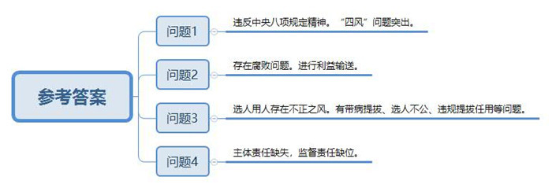
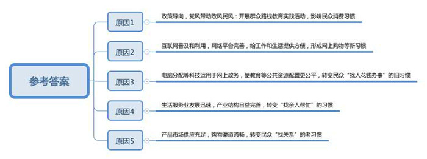
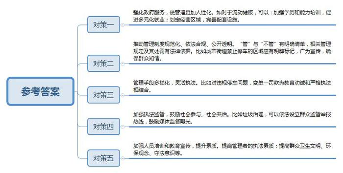
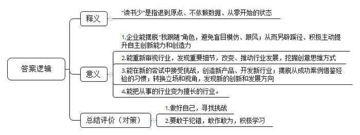
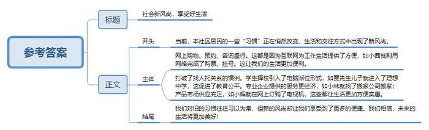
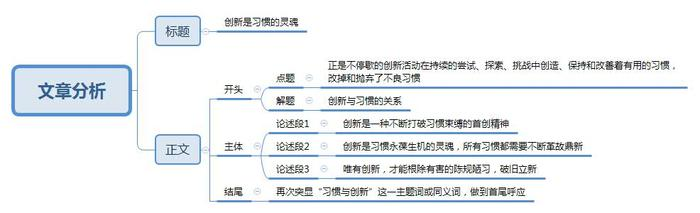

# 2015年公务员多省联考《申论》题（陕西卷）

<!-- gwy:overview:start -->
> **陕西 · 2015 · 申论 · 统考** ｜ 6 题 · 图片 6 处 · 答案随题折叠

导航：[题目](#题目) · [材料 1](#材料-1)
<!-- gwy:overview:end -->

> 候选采集稿。参考答案及解析来自粉笔页面，不代表官方答案或真实高分答卷；来源使用许可与原卷对应关系仍需人工核实。

## 给定材料

### 材料 1

2014年第三轮中央巡视的13份“巡视清单”已全部向社会公布。从中央巡视组反馈的情况看，这一轮被巡视单位存在不少突出的共性问题。

巡视发现，中国联通有的领导干部收受客户所送有价证券，收受贵重礼品；有的接受供应商安排打高尔夫、外出旅游；“四风”方面，超标准使用办公室、公车问题突出。东风公司公款出国（境）旅游问题突出，管理失控，出国（境）办理公务审批管理不严，任务重复、超天数、超人数现象普遍；“四风”整改不力，顶风违纪问题突出，存在公款吃喝、公车私用、公款购买赠送购物卡等违反中央八项规定精神的问题。中石化有的领导人员住房违规问题严重，部分下属企业公款吃喝、旅游问题频发。中国海运个别领导人员顶风违反中央八项规定精神，公款打高尔夫球，违规购买购物卡等。南航集团公款吃喝时有发生，公款打高尔夫球问题屡禁不止。

巡视还发现，神华集团煤炭灭火工程存在利益输送“黑洞”，一些私人老板打着灭火工程旗号大肆开采和销售煤炭，甚至故意制造煤田火点，谎报灭火项目。灭火工程成为少数人的“暴利工程”，形成“链条式”腐败。中国联通有的领导和关键岗位人员利用职权与承包商、供应商内外勾结，搞权钱、权色交易；有的在子女出国留学、就业等方面接受供应商利益输送。中船集团物资采购领域腐败问题易发多发，有的企业领导人员及其亲属违规经商办企业，从事关联交易；有的企业建立的供应商体系比较单一，部分物资长期由一家供应商提供，或以各种理由指定供应商。华电集团在煤矿并购中违规支付并购款，违规向民营企业让利，造成国有资产流失。东风公司部分领导干部的亲属违规经商办企业、与东风公司存在关联交易，“靠山吃山”问题突出。中石化有的领导人员在工程建设、物资供应、油品销售、合资合作、海外经营中搞利益输送和交换。中国海运一些领导人员及亲友和特定关系人围绕航运业务开办关联公司进行利益输送，“靠船吃船”问题突出。有的虚构业务往来，侵吞国有资产，或在职时照顾关联企业，退休后被关联企业高薪聘用。南航集团营销领域贪污问题多发，在协调航线、编排航班、客货销售中存在权钱交易、利益输送问题。

选人用人上的不正之风和腐败问题，历来是中央巡视工作关注的重点。本轮被巡视单位在这方面或多或少都存在一些问题。巡视发现，中国联通干部带病提拔、选人不公问题反映强烈。华电集团选人用人工作中存在带病提拔和跑官要官、买官卖官等违规提拔、任用干部问题。东风公司选人用人中带病提拔影响恶劣，干部交流不够。中国国际广播电台选人用人工作不够规范，个别部门干部调整变动过于频繁，少数干部违规破格提拔。南航集团干部选拔任用不规范不严格，买官卖官、带病提拔等问题反映较多。

被巡视单位之所以出现各类问题，究其根本原因就在于，旧有习惯积重难返，各种关系盘根错节，主体责任缺失，监督责任缺位。巡视发现，神华集团部分纪检监察机构监督责任严重缺失，既存在监督不力和形同虚设问题，又存在个别人掩盖腐败和自身腐败问题。中国联通公司党组执行党风廉政建设责任制不到位，重业务轻党建，纪检监察机构履行监督责任不力。中船集团党风廉政建设责任制没有落实到位，对物资采购、劳务外包、工程建设等重点领域的监督制约机制不健全。华电集团监管问责不力，对一些案件的处理存在偏软、偏轻的问题，对干部群众反映强烈的煤矿并购中违规造成损失的问题没有进行责任追究。东风公司对公司发生的典型违纪违法案件没有进行通报和警示教育，对多起举报违反中央八项规定精神的问题没有及时组织查处。全国工商联党组落实主体责任不到位、不严格，个别领导干部不能坚持“一岗双责”，机关纪委查处案件不力、处理偏轻偏软。环境保护部多数部属单位未配备纪检干部，致使履行监督责任的组织保障缺失。

### 材料 2

自从开展党的群众路线教育实践活动，贯彻执行中央“八项规定”，狠刹“四风”以来，各地公款消费现象得到有效遏制，以致一些酒店、歌厅的生意也大不如前，甚至门庭冷落，让经营者感到很纠结。

张某开了一家中等规模的海鲜饭店，生意一直都还不错。他最倚重的是每逢周末、节假日，各种同学聚会、生日宴请、结婚喜宴、活动庆典等等，虽然让他忙得不可开交，但也乐在其中，用他的话说，这是饭店的“经济支柱”。然而，这两年的情形有点不大对，这类生意量急剧下降。2014年夏天，高考成绩公布，张某以为一波接一波的“谢师宴”将会像往年一样闪亮登场，早早备好了每桌1888元到5888元不同档次的菜单，准备赚一笔。可奇怪的是，今年一桌也没有预订出去。一打听，不是学生和家长不请了，而是老师们都纷纷谢绝了。张某有点费解：“这谢师宴又不是公款消费，学生和家长掏自个儿的腰包感谢老师的培养，这种人之常情难道也有错儿？”

即使跟公款消费毫无关系的顾客自掏腰包的消费，也比过去有了很大改观。人少菜多、浪费严重的现象越来越少，饭后“打包”、“光盘”行动日益普遍。“这个嘛……唉！我的钱还怎么赚呐？”张某摇着头，心情颇为复杂。

### 材料 3

互联网的日益普及和开发利用，不断为人们的工作和生活提供方便，网上购物、网上预约、网上咨询等等风靡中国。尤其对年轻人来说，他们更习惯于依靠网络解决各种困难，24岁的小茜对此深有体会。以前逢年过节要回家探亲，买火车票是最让她头疼的事。裹着大衣在寒冷的夜里排队购票、托关系找人购票、买“黄牛党”高价票等等，这些都曾亲身经历过。现在有了网络购票，别提多方便省事了。前不久小茜跟母亲通电话，听说母亲想到当地一家医院看“专家门诊”，可是排队很长时间还不一定能挂上号。小茜立刻到网上替母亲挂上了专家号。

李先生一直为儿子小学毕业上哪所初中犯愁。同事给他支招，赶紧找人托关系打招呼，该花钱就花钱。李先生知道，这是多年来老百姓为孩子上学求人的“惯例”。即使心里一万个不乐意，可是为了孩子，求人花钱，也是正常。谁知今年区里实行了“新政”，学区内八成小学生通过电脑派位的形式进入学区初级中学学习。学生可填报两次志愿，第一批次可填报不少于4所学校，第二批次可填报不少于5所学校。第一批次志愿面对全区所有学生，不设身份限制，全区所有优质资源品牌学校将拿出15%的比例用于第一批次派位。第二批次志愿学生只可填报自己所在学区内的中学，电脑根据志愿随机分配。结果，李先生的儿子顺利进入一所理想的中学。

小林买了一套装修好的二手房，准备利用国庆假期搬家。他的父母特地从老家赶来，还带了舅舅、表哥等三四个人来帮忙。谁知小林早已请好了搬家公司，总共花了800元，半天时间东西全部搬上楼安置妥当。小林在楼下饭店请父母舅舅们吃饭，舅舅说：“没帮上忙，还害你花钱请吃饭。早知道这样我们就不来了。”表哥说：“你们长辈的老习惯今后可以改改了。找亲友帮忙搬家，人累得够呛不说，钱也不少花，光是一顿饭加上烟酒钱，就够付人家搬家费了。”父亲说：“搬新家是喜事，找人帮忙是老习惯，请人吃饭感谢感谢，也是人之常情嘛。不过，要是光算经济账，看来还真不如请搬家公司。”

小辉父母家里的一台老式电视机坏了，要买台新的。早已养成办事“找关系”习惯的小辉父亲，有个经常一起钓鱼的好朋友，儿子在家电商场工作。小辉父亲不知打哪儿听说商场职工买东西可以打九折，就打算请这位朋友吃顿饭，请他的儿子帮忙，能便宜一二百块钱。小辉听说后连忙阻止了父亲。他上网一查，同样一款电视机，网上价格比商场便宜300多块。他从网上订购了一台，第三天电视机就送到家里，父母非常高兴。小辉跟父亲说：“现在不比从前了，像电视机这样的东西，市场供应那么充足，还用得着找关系吗？”

### 材料 4

X市建东街华润万家超市前面是一个空旷的停车场，停车场两侧有很多便民实惠的小饭店。进城陪孩子读书的石女士决定在停车场北侧支摊卖袜子。尽管寒风凛冽，为了给女儿提供好一点的生活条件，石女士几乎每天都会坚守在她的“工作岗位”上。然而她的“工作岗位”显然并不稳定，一旦遇到城管清理，她便得赶快收摊挪地儿，有时候跑不了便得接受罚款。

“11月13日那天下午，来了八九个城管，他们开了一张暂扣单便抬走了我的摊架和袜子。”石女士拿起摊架上的袜子无奈地说，“这一摊袜子才值多少钱呀？我去找过他们两次，他们的解释是违规占用主干道，当时需要交2000元的罚款再能领回东西，我没有那么多钱，只能眼睁睁地等那批袜子被扣一个月，到时候交500元，就能领回东西了。”

城市聚集着众多的公共资源，对于大多数农村进城者来说，生活在城市意味着更多的优质资源和就业机会。但从另一个方面来说，由于学历和能力的种种限制，大多数的进城农民不得不选择在街头巷尾摆摊设点来谋生。这种生存方式虽然成本低、风险小，但由于游走在“管”与“不管”的灰色地带，所以这种生意经常会被他们说成“赌运气”，运气好就少被处罚几次，运气不好也许一个月的起早贪黑就白忙活了。

### 材料 5

一天，崔先生在X市兴善寺东街打算去买个汉堡，因为看路边没有明确的禁止停车标识，就把车停在道边，前后大概不过10分钟的时间就被贴了两次罚单。握着手里的两张《违法停车告知单》，崔先生无奈地说：“我把第一张罚单撕下来，看到玻璃上有胶水印，就去对面商店买了瓶水过来准备擦掉，中间没有5分钟，又被贴了一张，一个汉堡二百多！真是 ‘醉’了，但是也没办法，下次注意吧。”

为此，崔先生还说他专门去问过交警队，交警队的说法是，只要路边没有划停车位的地方都不允许停车。“首先不说这个规定合不合法，问题是现在X市还有很多地方明明划着停车位，但停了还是被罚款，再去问，说这块车位已经被取消了。”

“平时开车出门一不小心就会被贴罚单，为了买一个澡巾，刚从超市出来就发现车被贴了一张罚单，这里又没说不能停车!”在凤城六路买东西的肖先生无奈的说，“罚款又不是万能管理手段。”

### 材料 6

“城中村”环境卫生脏乱差一直是制约城市化进程的严重问题。据一份《X市X区X村环境卫生管理情况调查》的报告显示，该村“垃圾随处可见，各种广告贴满墙壁”。记者看到，村里的确张贴着不少落款是该村村委会治安办的标语。“多少年了，乱扔垃圾问题越来越严重，但一直解决不了。”一名村干部说，由于该村属于城中村，流动人口多，关于乱扔垃圾的问题，村委会想了诸多办法都无法解决。他介绍说：“村里曾派保洁员现场盯守，但经常一去吃饭，垃圾又遍地是，罚款有时候都不管用，我们反而还总被人冤枉。”由此看来，简单罚款有时并不能解决根本问题。

### 材料 7

以下是根据一位资深广告人在某会议上的发言录音整理的部分内容：

现在是一个大数据的时代，我们被逼跟着数据在走。我们在继续往前走的时候，要倒退到原点回顾一下你当初为什么要做这件事情，这是世界各地尤其是国内比较欠缺的东西。很多中国的企业都在扮演“我跟随”的角色，别的行业有这个东西，我也就要做。

我们都在寻找我们能做什么，其实我们都忽略了很重要的一点，我们更要知道你不能做什么，你不要做什么。我们常常看到很多广告和传播说你要做你自己，这是废话，你除了做你自己还做谁呀，你不能做周杰伦，周杰伦给周杰伦做了，刘德华也不行，你只有做你自己，但你要做得比周杰伦和刘德华还好。

这几年我称自己是一个下岗的广告民工，我反而看到很多当时我身在广告业中看不到的东西，因为越来越平民化，越来越农民化，我看到的东西都是很小的东西，但这些东西都很可能举足轻重，能够改变很多东西。数据引导我们，我们会本着数据做很多东西，但千万不要把数据变成一个依据，你要在数据中找到有什么东西可以挑战，而不是变成一个护身符，数据说这样，我们就这样，在这个时代，创意的思维方式可能超过以往任何时候。

做任何事情，大到做人、做行业，小到你要做的事情、要找的东西，都应该考虑，到底有没有挑战？不能因为别的企业做了这样的东西，你就也要去做。你要想一想，你做的东西有没有挑战你的企业，会不会挑战你的员工，最主要有没有挑战你本身？尤其现今社会，人类基本上没有自信心。因为我们没有狼牙虎爪，我们连乌龟壳也没有，所以，我们需要包装，我们需要洋房、汽车、美容，再不行把面孔也改了，手机的美化软件就是应此而生。现在的手机我真的试过45度拍，脸真的尖了，现在的手机还可以让你美白，眼睛变大，大家可能也看过那种手机美女和真人对比，把你吓死。

国外一个电视台访问过很多最近新兴的小企业家，你会发现他们有一个共同点，他们都在新的尝试中找到挑战，基本上他做的不是他原来做的东西。所以，一定希望在你做的东西中找出你的挑战......不然的话，你如果只是想，尤其在中国大陆只是想明天过得比今天好一点，那太没有意思了。我估计在场每个人的学历和资历都会比我高，<u>但我能有今天就是因为我读书少</u>，在下只有中学的学历，现在再把我送去高考，我还是会考不上，但我有自知之明，我读书少，我不会的东西多，从第一天开始，我到现在仍然有这个习惯，从零开始。在座各位可能觉得这个理论大家常听说，这个东西可能是任何行业最难做的东西——从零开始，人性的习惯会使你习惯于从你前一个案例，尤其是成功的案例去借鉴，你希望做得更好，但是，以我冷眼旁观，这里面有很多问题。最近我被邀请回新加坡，我现在被收录到新加坡档案局里，是以一个非典型而被记录，因为以我的背景我不可能有这一天，但是因为这个“零”有很多的意义，因为我什么都不懂，什么都不会，结果这变成我最擅长的一个行业。

所以，各位如果有机会的话，能否像我一样，我每天都逼着让自己客户归零，归零后一般人想出来的东西都和立场不一样。

我常常鼓励学生，我也会鼓励任何人不要怕犯错误，错误是一个很大的动力，当你不怕错误的时候，你差不多什么都敢做。我的能量来自什么？我学历不够，我甚至没有修过广告学。不要怕失败，我们常说失败是成功之母。所以，敢于去犯错误，我们有很多成语故事教过我们这样做，但我们是否真的从中学到过任何东西呢？

### 材料 8

创客是指利用开源硬件和互联网将各种创意变为实际产品的人，他们将制造业搬到了自己桌面上，电子服装、健康手环、智能手表、导电墨水、食物烹饪器等等，用户能想到的产品都有可能在创客手中实现。创客在带有加工车间和工作室功能的软硬件开放实验室（创客空间）将创意变成产品原型，实现从0到1。

对很多中国人而言，“创客”还是个较为陌生的概念，但凭借蓬勃生命力和强劲发展势头，创客正在悄然影响着传统制造业。许多创客空间在产品设计和原型创造基础上，还延伸了兼具产品孵化和企业孵化的功能，在这里不仅可以实现从0到1再到100，即从创意到产品原型再到小批量产品，还能给创客提供创业场地、管理咨询、投融资、渠道销售等服务。在用户体验和互联网推动下，创客产品成为热门的个性化定制商品；也有小部分创客产品经过市场检验获得大众需求的认可，成为工业化生产的大众商品。无论哪种形式，都完成了从创意向创业的转化过程，这种转化也正是创客文化繁荣发展的本质。

创客运动在中国的兴起时间虽短却发展迅猛，国内强大的制造业生态体系，丰富的人力资源，雄厚的资本和艺术沉淀是创客扎根成长的肥沃土地，它所迸发出的潜力是未来工业体系和经济发展的重要机遇。深圳是国内创客产业链最完整的城市，被誉为创客天堂。创客在这里可以找到齐全的电子元器件、各类加工厂和技术工程人员，快速完成从创意到产品原型再到小批量生产的全过程；与深圳的务实高效相比，上海的创客显得气定神闲、回归本质，具有国外兴趣使然的创新氛围；北京的创客则更具跨界协同创新及创业精神，因为北京是顶尖技术人才，文艺人才和资本机构云集的城市。

创客群体没有职业范围和身份限制，任何有创意且有激情将创意变为现实的人都能成为创客。在创客空间，既看不到高精端的大型仪器设备，也看不到众多发明专利和成果，创客空间里有的是热爱创造的人，他们以兴趣为导向，以创意为起点，以体验为动力，通过自我满足的创业方式将大众群体中蕴藏的巨大创新力挖掘和释放出来。

传统制造业以满足大众基本需求为目标，规模化生产出利润丰厚的热门产品。但随着热门产品的同质化发展和激烈竞争，大众需求会逐渐向个性化需求分解，这是经济发展给消费者选择产品带来的必然趋势。创客在这种趋势利导下产生，引领制造业从中心化和大规模形态朝着个体式和去中心化的方向发展，根据个性化需求来生产小众商品，给个体式制造业带来机遇。

2013年11月，英国《经济学家》杂志刊发的一篇题为《中国制造》的文章让“中国创客”成为焦点。该文指出，中国创客的力量不可小觑，其潜在优势就是他们与所谓的山寨制造体系密切联系。企业之所以山寨是因为没有设计和创意，依靠模仿他人产品来生产制造，而创客恰恰是设计和创意的源泉和载体。在互联网时代，软件开源和硬件开源给中国企业提供了难得的平等创新机会，若能将创客的设计和创意嫁接于低端仿造企业，让创客的巨大创造性和制造需求与山寨企业完备的供应链资源和制造能力优势互补，或许能迸发出惊人的能量，这未必不是山寨企业转型的一条出路。

2013年11月4日，清华大学启动创客驻校计划，计划每年聘请国内外知名创客进驻学校创客空间，鼓励学生主动参与创新实践，提升跨学科的技术与创意交流。此外，多所大学甚至一部分中学和职业院校也积极推动创客教育，各具特色、充满活力的教育创客空间盘活了院校科技资源，加强了教学与实践、教育与产业之间联动，培养出具有创新创业精神的一流人才。国内每年毕业的几百万大学生是创客运动的最佳人选，他们能将学业中萌发的创意思想和积累的研究成果衍变为创客项目，用自主创业的方式实现就业。这些创客项目转化为创业公司以后，会吸引更多不同层次的社会人才加入其中。麦肯锡2013年研究报告指出，由于机器人和网络技术的突飞猛进，过去10年大型制造企业的雇佣人数持续减少，因为规模制造对自动化生产系统的紧密依赖逐步取代了人工参与。而创客运动引领的个体式制造业根据用户个性化需求来定制生产商品，对技术、工程、艺术等各行各业人工劳动力的需求巨大，必然创造出大量新的就业岗位。

有人感叹：创客啊，耗费了多少脑汁和心思，颠覆了多少传统和习惯，获得了多少惊喜和满足，蕴藏了多少期待和愿景？真让人“爱也难，不爱更难！”

## 题目

### 第 1 题

**根据“给定材料1”，概括中央巡视组反馈的央企普遍存在的几类突出的共性问题。（10分）**

关联材料：材料 1

作答要求：

要求：全面、准确、简明、有条理，60~100字。

第 1 题 · 答案与解析

**参考答案（粉笔题库参考内容）**

一、违反中央八项规定精神。“四风”问题突出。

二、存在腐败问题。进行利益输送。

三、选人用人存在不正之风。有带病提拔、选人不公、违规提拔任用等问题。

四、主体责任缺失，监督责任缺位。

**解析**

**参考答案说明：**本参考答案从“违反中央八项规定精神”“存在腐败问题”“选人用人存在不正之风”“责任缺失”等不同的话题进行了分条撰写。各条要点之间在内容上相互并列，没有交叉。并且撰写每条要点时，都提炼出了概括性强的总括词并前置，满足了题干中“概括……几类”这一要求。

**考点**：问题类

**来源**：2015年公务员多省联考《申论》题（陕西卷）

### 第 2 题

**“给定资料2~3”反映了人们在过去的工作和生活方面形成的很多“惯例”或“习惯做法”正在悄然改变。请分析导致这种改变发生的主要原因。（15分）**

关联材料：材料 2、材料 3

作答要求：

要求：准确、具体、简明、条理清楚，150~200字。

第 2 题 · 答案与解析

**参考答案（粉笔题库参考内容）**

1.政策导向，党风带动政风民风：开展群众路线教育实践活动，影响民众消费习惯。2.互联网普及和利用，网络平台完善，给工作和生活提供方便，形成网上购物等新习惯。3.电脑分配等科技运用于网上政务，使教育等公共资源配置更公平，转变民众“找人花钱办事”的旧习惯。4.生活服务业发展迅速，产业结构日益完善，转变“找亲人帮忙”的习惯。5.产品市场供应充足，购物渠道通畅，转变民众“找关系”的老习惯。

**解析**

**参考答案说明：**参考答案从政策、互联网、科技、产业结构、市场等方面对答案要点进行了分条撰写。各条要点之间是并列关系，没有交叉。

**考点**：原因类

**来源**：2015年公务员多省联考《申论》题（陕西卷）

### 第 3 题

**“给定材料4—6”反映了城市管理的复杂性与管理过程中的习惯做法，“一罚了之”的管理方式往往令百姓难以接受。请就此难题提出你的解决之道。（20分）**

关联材料：材料 4、材料 5、材料 6

作答要求：

要求：简明、具体、符合实际、有可行性，200~300字。

第 3 题 · 答案与解析

**参考答案（粉笔题库参考内容）**

一、强化政府服务，使管理更加人性化。如对于流动摊贩，可以：加强学历和能力培训，促进多元化就业；划定经营区域，完善配套设施。

二、推动管理制度规范化、依法合规、公开透明。“管”与“不管”有明确清单，相关管理规定及其处罚有法律依据。比如城市街道禁止停车的区域应有明牌标记，广为宣传，确保群众知情。

三、管理手段多样化，灵活执法。比如对违规停车问题，变单一罚款为教育劝诫和严格执法相结合。

四、加强执法监督，鼓励社会参与、社会共治。比如垃圾治理，可以依法设立群众监督举报热线，鼓励媒体监督曝光。

五、加强人员培训和教育宣传，提升素质。提高管理者的执法素质；提高群众卫生文明、环保观念、守法意识等。

**解析**

**参考答案说明：**答案从“管理服务”“完善法律法规”“执行法律”“反馈监督”“树立思想观念”五个不同的层面进行了分条撰写，每条要点之间内容上没有交叉。

**考点**：提出对策类

**来源**：2015年公务员多省联考《申论》题（陕西卷）

### 第 4 题

**阅读“给定资料7”，谈谈你对其中划线部分“我能有今天就是因为我读书少”的理解。（25分）**

关联材料：材料 7

作答要求：

要求：全面、准确、解读充分，条理清楚。200~300字。

第 4 题 · 答案与解析

**参考答案（粉笔题库参考内容）**

“读书少”是指退到原点、不依赖数据、从零开始的状态。

这使我们“有今天”：1.企业能摆脱“我跟随”角色，避免盲目模仿、跟风；从而另辟蹊径、积极主动提升自主创新能力和创造力。2.能重新审视行业，发现重要细节，改变、推动行业发展，挖掘创意思维方式。3.能在新的尝试中接受挑战，创造新产品、开发新行业；摆脱从成功案例借鉴经验的习惯；转换立场和视角，发现新的创新和发展方向。4.能把从事的行业变为擅长的行业。

因此，我们应：1.做好自己，寻找挑战。2.要敢于犯错，敢作敢为，积极学习。

**解析**

**参考答案说明**：在思路方面，本参考答案按照词句解释题“释义+分析相关要素+总结评价”的一般答题思路展开。在内容方面，本参考答案先对“我能有今天就是因为我读书少”的含义进行了解释；“分析相关要素”部分分析了“归零（读书少）”的意义；最后简要提出了对策。词句表达方面，本参考答案加上了“这使我们‘有今天’：……”“因此，我们应：……”等连接词来承接上下文，使表达更流畅。

**考点**：词句解释类

**来源**：2015年公务员多省联考《申论》题（陕西卷）

### 第 5 题

**根据“给定资料3”，假设你是一名社区工作者，资料中反映的事例都发生在你所工作的XX社区内，请你以“社会新风尚”为主题，给社区网站写一篇新闻稿。（30分）**

关联材料：材料 3

作答要求：

要求：内容生动、全面、语言流畅，300~400字。

第 5 题 · 答案与解析

**参考答案（粉笔题库参考内容）**

社会新风尚，享受好生活

本网讯 当前，本社区居民的一些“习惯”正在悄然改变，生活和交往方式中出现了新风尚。

网上购物、预约、咨询盛行。这都是因为互联网为工作生活提供了方便，如小茜就利用网络完成了购票、挂号。这让我们的生活更加便利。

打破了找人托关系的惯例。学生择校引入了电脑派位形式，如李先生儿子就进入了理想中学，这促进了教育公平。专业企业提供的服务更经济，如小林就找了搬家公司搬家；产品市场供应充足，如小辉就在网上订购了电视机，这些都让生活更加方便实惠。

我们对旧的习惯往往习以为常，但新的风尚却让我们享受到了更多的便捷。我们相信，未来的生活将更加美好！

**解析**

**参考答案说明：**（1）格式方面，本参考答案写到了“标题”和“正文”两部分。（2）正文部分，一方面从内容来看，围绕着“社区新风尚”这一主题，本参考答案的开头先写到了社区出现了新风尚；主体部分从“网上预约、网上咨询成为新习惯”“打破找人托关系的惯例”等几个方面具体介绍了社区存在哪些新风尚。另一方面，形式上，本参考答案做到了分段、分条撰写，整体上条理较为清晰。

**考点**：总结类

**来源**：2015年公务员多省联考《申论》题（陕西卷）

### 第 6 题

**从“给定资料”可以看出，随着社会发展进步，很多“习惯”发生了改变，创新改变了人们的工作与生活。请你以“习惯与创新”为主题，自拟题目，写一篇文章。（50分）**

关联材料：材料 1、材料 2、材料 3、材料 4、材料 5、材料 6、材料 7、材料 8

作答要求：

要求：结合给定资料，观点合理，内容充实，结构完整，条理清晰，语言流畅。800~1200字。

第 6 题 · 答案与解析

**参考答案（粉笔题库参考内容）**

参考范文一：

**创新是习惯的灵魂**

哲学家休谟讲过，习惯是人生的伟大指南。这种说法掩盖了创新精神的作用——正是不停歇的创新活动在持续的尝试、探索、挑战中创造、保持和改善着有用的习惯，改掉和抛弃了不良习惯。习惯因创新不断生成和改善，正是人类社会进步的源泉。在这个意义上，习惯才足以成为人生的伟大指南。据此，就创新和习惯的关系而言，我认为：**创新是习惯的活水源头和灵魂。新的习惯需要创新精神来创造，有益的习惯需要革故鼎新才能发展完善；有害的习惯也需要创新来根除。**

习惯是个人在思想、行为，社会交往等方面形成的一些惯例。好的习惯确实是人生指南，坏的习惯却可能成为桎梏和死胡同。创新的要义就在于敢于从虚空、一无所有、从零开始，去试验、探索、创造……而使那些有益的尝试积淀成习惯。**创新创造新习惯，改善旧习惯，革除坏习惯。**

**创新是一种不断打破习惯束缚的首创精神。**我们总是孜孜不倦的去观察、去总结别人的做法，盲目的跟着做，生怕落伍掉队。个人是这样，企业也是这样。这种过分跟随别人经验数据和惯例的做法其实是非常懒惰、怯懦、不自信的，会使个人和企业失去创造出伟大事物，臻于卓越的机会。尤其对于我国企业来说，这种“我跟随”的做法，必然会扼杀掉创意思维和创新能力，失去创造新兴行业、制定行业标准的机遇。因此，革新的精神呼吁一种归零心态，回到一无所有的原点，从零开始，进行尝试，接受挑战，重新发现个人、企业和国家发展的新的可能性、新的机遇。当前，大众创业、万众创新的时代背景下，创客运动在祖国大地蓬勃发展。革新精神正是创客的根本动力。创客运动据此才能催生出从未有过的新兴产业，比如个体式制造产业。

**创新是习惯永葆生机的灵魂，所有习惯都需要不断革故鼎新。**正是革新精神推动了技术进步，改善了社会惯例，让生活变得更美好。比如随着互联网技术的推广运用，网上订票、网上咨询、网络购物，电脑排位、摇号等新生活风尚开始流行，改变了过去现场排队、托人、找关系、花钱打点等惯例和习惯做法。这种改变无疑使生活变得更加便捷、省事、省时、经济和环保。正是革新精神改善了老习惯，创造和积淀着新风尚——而这就是社会发展进步的本质。

**唯有创新，才能根除有害的陈规陋习，破旧立新。**比如，过去不受监督的公款消费增加了百姓负担，败坏了党风政风；民间“谢师宴”等各种宴请消费中，人少菜多、浪费现象严重。贯彻落实中央“八项规定”以来，这类不良习惯才得到遏制。再比如，我国城市居民乱扔混丢生活垃圾的老习惯就亟需革新改造，形成垃圾分类、废物回收的良好习惯。在革新社会陋习，培育形成好习惯方面，政府要积极有为。

有人说，习惯能让我们少犯错误，是创新的基础和摇篮，这是有一定道理的。但与此同时，我们不能忘记：正是从零开始，不断假设、猜想、探索、尝试、创造着的创新精神，才是一些习惯之优劣的试金石。习惯需要不断接受创新大潮的冲刷，才能在大浪淘沙后留下真金，照亮我们生活和创业的康庄大道。

**解析**

**文章分析**

**创新是习惯的灵魂**

【**标题的优点：**首先，范文的标题“创新是习惯的灵魂”突出了“习惯与创新”这一主题。其次，形式上，文字简洁明快。】

哲学家休谟讲过，习惯是人生的伟大指南。这种说法掩盖了创新精神的作用——正是不停歇的创新活动在持续的尝试、探索、挑战中创造、保持和改善着有用的习惯，改掉和抛弃了不良习惯。习惯因创新不断生成和改善，正是人类社会进步的源泉。在这个意义上，习惯才足以成为人生的伟大指南。据此，就创新和习惯的关系而言，我认为：**创新是习惯的活水源头和灵魂。新的习惯需要创新精神来创造，有益的习惯需要革故鼎新才能发展完善；有害的习惯也需要创新来根除。**

【**开头的优点：**★内容方面。范文的开头是紧扣题目给定的“习惯与创新”这一主题展开的。首先，**开头第一句话点出主题，做到了主题明确。其次，对“习惯与创新”这一主题进行了分析阐述，指出了（1）“习惯与创新”的关系。**★文字表达方面：使用了“据此”“我认为”等连接词，使语言表达有逻辑性。】

习惯是个人在思想、行为，社会交往等方面形成的一些惯例。好的习惯确实是人生指南，坏的习惯却可能成为桎梏和死胡同。创新的要义就在于敢于从虚空、一无所有、从零开始，去试验、探索、创造……而使那些有益的尝试积淀成习惯。**创新创造新习惯，改善旧习惯，革除坏习惯。**

【**过渡段的优点：**范文过渡段分析了“习惯”“创新”的含义，此外，还要注意过渡段末尾的“创新创造新习惯，改善旧习惯，革除坏习惯”是用来引起下文的过渡句。】

**创新是一种不断打破习惯束缚的****首创精神****。**（1）我们总是孜孜不倦的去观察、去总结别人的做法，<u>盲目的跟着做</u>，<u>生怕落伍掉队</u>。个人是这样，企业也是这样。（2）这种过分跟随别人经验数据和惯例的做法其实是非常懒惰、怯懦、不自信的，<u>会使个人和企业失去创造出伟大事物，臻于卓越的机会</u>。尤其对于我国企业来说，这种“我跟随”的做法，<u>必然会扼杀掉创意思维和创新能力</u>，<u>失去创造新兴行业</u>、<u>制定行业标准的机遇</u>。（3）因此，<u>革新的精神呼吁一种归零心态</u>，回到一无所有的原点，从零开始，进行尝试，接受挑战，重新发现个人、企业和国家发展的新的可能性、新的机遇。当前，大众创业、万众创新的时代背景下，创客运动在祖国大地蓬勃发展。革新精神正是创客的根本动力。创客运动据此才能催生出从未有过的新兴产业，比如个体式制造产业。

【**论述段1的优点：**★观点句：范文的观点句是紧扣“习惯与创新”这一文章主题提出的。形式上，它在段首处直接写出，位置突出，容易发现。关键词突出，内容上，关键词突出，内容要点明确，可以明显看出它是从“首创精神”入手，指出了“创新就是要打破习惯束缚的首创精神”。★论述内容：（1）介绍了“企业和个人盲目跟随别人的经验和惯例”的问题；（2）介绍了“过分跟随别人经验数据和惯例的做法”的危害；（3）介绍了打破习惯束缚的对策。注意：以上几个方面的内容都是紧扣“创新是一种不断打破习惯束缚的首创精神”这个观点句进行分析论述的，论述的针对性强，内容层次丰富。并且这几个方面的论述是有内在逻辑顺序的，先讲问题，然后讲危害，最后讲对策。最后，在论述方法和论据的选取上做到了讲道理与举例子相结合，做到了丰富多样。】

**创新是习惯永葆生机的灵魂，所有****习惯都需要不断革故鼎新****。**正是革新精神<u>推动了技术进步</u>，<u>改善了社会惯例</u>，<u>让生活变得更美好</u>。比如随着互联网技术的推广运用，网上订票、网上咨询、网络购物，电脑排位、摇号等新生活风尚开始流行，改变了过去现场排队、托人、找关系、花钱打点等惯例和习惯做法。这种改变无疑使生活变得更加便捷、省事、省时、经济和环保。正是革新精神<u>改善了老习惯</u>，<u>创造和积淀着新风尚</u>——而这就是社会发展进步的本质。

【**论述段2的优点：**★观点句：范文的观点句是紧扣“习惯与创新”这一文章主题提出的。形式上，它在段首处直接写出，位置突出，容易发现。关键词突出，内容上，关键词突出，内容要点明确，可以明显看出它是从“对习惯进行革故鼎新”入手，指出了“创新是习惯永葆生机的灵魂，所有习惯都需要不断革故鼎新”。★论述内容：介绍了“革新精神”的意义。最后，在论述方法和论据的选取上做到了讲道理与举例子相结合，做到了丰富多样。】

**唯有创新，才能****根除有害的陈规陋习****，****破旧立新****。**比如，过去不受监督的公款消费增加了百姓负担，败坏了党风政风；民间“谢师宴”等各种宴请消费中，人少菜多、浪费现象严重。（1）<u>贯彻落实中央“八项规定”以来，这类不良习惯才得到遏制</u>。再比如，我国城市居民乱扔混丢生活垃圾的老习惯就亟需革新改造，形成垃圾分类、废物回收的良好习惯。（2）<u>在革新社会陋习</u>，<u>培育形成好习惯方面</u>，<u>政府要积极有为</u>。

【**论述段3的优点：**★观点句：范文的观点句是紧扣“习惯与创新”这一文章主题提出的。形式上，它在段首处直接写出，位置突出，容易发现。关键词突出，内容上，关键词突出，内容要点明确，可以明显看出它是从“破旧立新”入手，指出了“创新能够根除有害的陈规陋习，破旧立新”。★论述内容：（1）介绍了“创新对习惯”的意义；（2）介绍了革新社会陋习的对策。最后，在论述方法和论据的选取上做到了讲道理与举例子相结合，做到了丰富多样。】

【**论述段之间的关系**：★内容的内在逻辑：范文的论述段之间是依照“创新与习惯的关系”的逻辑展开的。论述段1先写了“创新是一种不断打破习惯束缚的首创精神”，论述段2再写了“创新是习惯永葆生机的灵魂，所有习惯都需要不断革故鼎新”，论述段3接着写了“唯有创新，才能根除有害的陈规陋习，破旧立新”。】

有人说，（1）<u>习惯</u>能让我们少犯错误，是<u>创新</u>的基础和摇篮，这是有一定道理的。但与此同时，（2）我们不能忘记：正是从零开始，不断假设、猜想、探索、尝试、创造着的创新精神，才是一些习惯之优劣的试金石。<u>习惯需要不断接受创新大潮的冲刷</u>，才能在大浪淘沙后留下真金，照亮我们生活和创业的康庄大道。

【**结尾的优点**：范文的结尾回扣了“习惯与创新”这一主题。（1）再次总结了“习惯与创新”；（2）阐述了深远意义。】

参考范文二：

**论创新与习惯**

哲学家休谟讲过，习惯是人生的伟大指南。这种说法似乎更应该说成是：好习惯是人生的伟大指南。毕竟，如今是需要创新、发展、进步的年代，是需要与时俱进的年代，那些不良的、落后的、陈旧的习惯，就应该是我们革新的对象。革新能够改变我们一些落后的传统、固化的思维、不良的陋习。旧有的不良习惯需要革新来根除，新的习惯也需要通过革新去创造。

**革新能改变我们的传统行业，带来新产品、新体验、新机遇。说到革新或创新，我们首先就会想到企业的创新或行业的革新。**只是长久以来，各类企业都经常孜孜不倦地观察、总结别人的做法，然后盲目跟风。这种过分跟随别人经验和惯例的做法其实是非常懒惰、怯懦和不自信的表现。而在当前大众创业、万众创新的时代背景下，创客运动在祖国大地蓬勃发展，实现了创意的从0到1，则让人们看到了革新带来的创意和产品，让消费者有了优于以往的消费体验，更让传统行业特别是传统制造业看到了转型的机遇和发展的希望。革新对于传统行业的冲击和改变，也让我们真正认识到了革新精神才是创新和发展的根本动力。

**革新能改变人们已经固化的思维模式和行为模式，让人勇于挑战、持续发展、获得成功。**准确的说，改变传统是一种革新，从零开始则更是一种难得的革新。只是，人们往往沉迷于过去的辉煌，习惯安于现状，很少有人能将自己所重视、在乎的东西从心里彻底清空。但恰恰是那些勇于挑战、敢于抱有“归零”心态的人，那些敢于将大胆的想法付诸实践的人，才能在自己的人生中以平静、客观的态度，处处谦虚谨慎、时时努力学习，最终收获人生的大幸运、大满足。这就好像：计算器只有清零，才能重新计算；一杯水只有倒掉，才能重新装满……

**也唯有革新，才能改变我们的生活方式，破旧立新，营造社会新风尚。**比如，网络这一典型的“革新”产物，早已为我们带来了网络购物、网上预约等“新习惯”，让我们享受到了便利和公平。又如，过去不受监督的公款消费增加了百姓负担，败坏了党风政风；民间“谢师宴”等各种宴请消费中，人少菜多、浪费现象严重……但从贯彻落实中央“八项规定”以来，这类不良习惯得到及时有效地遏制，既改变了民众的生活方式，也营造了社会新的风尚。当然，改变旧习惯往往不是一蹴而就的，例如我国城市居民乱扔混丢生活垃圾的老习惯就长期存在，政策落实不尽如人意。因此，在革新社会风尚，培育形成好习惯方面，政府仍然大有可为。

所以，我们应该在保留良好习惯的基础上敢于革新、勇于归零。我们既可以利用民间智慧，用创意去引领发展；也可以利用先进技术，用科技去改变生活；还可以发挥政府职能，营造良好风气。

有人说，习惯能让我们少犯错误，为革新提供现实土壤，这是有一定道理的。但与此同时，我们不能忘记：习惯本身也需要不断接受革新大潮的冲刷，只有从零开始，不断假设、猜想、探索、尝试、创造和革新，才能让我们永葆前行的动力。

**考点**：文章写作题

**来源**：2015年公务员多省联考《申论》题（陕西卷）

