# 2015年425联考《行测》题（陕西卷）

<!-- gwy:overview:start -->
> **陕西 · 2015 · 行测 · 统考** ｜ 125 题 · 图片 107 处 · 答案随题折叠

| 题型模块 | 题量 | 题号 |
| --- | ---: | ---: |
| 常识判断 | 20 | 1–20 |
| 言语理解 | 40 | 21–60 |
| 数量关系 | 10 | 61–70 |
| 判断推理 | 35 | 71–105 |
| 资料分析 | 20 | 106–125 |
| **合计** | **125** | |

导航：[题型与作答说明](#题型与作答说明) · [题目](#题目) · [材料 1](#材料-1)
<!-- gwy:overview:end -->

> 候选采集稿。参考答案及解析来自粉笔页面，不代表官方答案或真实高分答卷；来源使用许可与原卷对应关系仍需人工核实。

## 题型与作答说明

常识判断

（20题）

常识判断

言语理解

（40题）

言语理解

数量关系

（10题）

数量关系

判断推理

（35题）

判断推理

资料分析

（20题）

资料分析

## 题目

### 第 1 题

2015年1月在中共中央政治局常务委员会会议上，习近平总书记指出，坚持党的领导，一条根本的政治规矩是首先要坚持：

A. 四项基本原则

B. 党中央的集中统一领导

C. 人民民主专政

D. 党的群众路线

第 1 题 · 答案与解析

**参考答案（粉笔题库参考内容）**

B

**解析**

在1月16日的中央政治局常委会上，习近平进一步提出，“坚持党的领导，首先是要坚持党中央的集中统一领导，这是一条根本的政治规矩”。

故正确答案为B。

### 第 2 题

2015年，陕西省确定的政府工作总基调是：

A. 依法行政

B. 稳中求进

C. 深化改革

D. 多快好省

第 2 题 · 答案与解析

**参考答案（粉笔题库参考内容）**

B

**解析**

2015年陕西省政府工作报告中指出：“2015年，政府工作的总体思路是：全面贯彻落实党的十八大、十八届三中、四中全会和习近平总书记系列重要讲话精神，坚持稳中求进工作总基调，以打造内陆改革开放新高地为统领，以提高发展质量和效益为中心，围绕保持经济运行在合理区间统筹推进转方式、调结构、促改革、惠民生、防风险工作。”

故正确答案为B。

### 第 3 题

下列关于陕西的描述，不正确的是：

A. 陕西南部的秦巴山地包括秦岭、巴山和汉江谷地

B. 陆游诗句“铁马秋风大散关”中的“大散关”位于陕西境内

C. 陕西的气候类型属于大陆季风性气候

D. 渭河是黄河最大的支流，也是陕西最大的河流

第 3 题 · 答案与解析

**参考答案（粉笔题库参考内容）**

D

**解析**

陕西南部的秦巴山地指秦岭以南的陕西南部区域，包括了秦岭和大巴山（也称巴山），以及在两座山脉之间的汉江谷地，A项正确；“大散关”为周朝散国之关隘，故称散关，位于宝鸡市南郊秦岭北麓，自古为“川陕咽喉”，故B项正确；陕西省地跨北温带和亚热带，整体属大陆季风性气候。气候总特点是：春暖干燥，降水较少，气温回升快而不稳定，多风沙天气；夏季炎热多雨，间有伏旱；秋季凉爽，较湿润，气温下降快；冬季寒冷干燥，气温低，雨雪稀少。陕西省纵跨三个气候带，南北气候差异较大。秦岭是中国南北气候分界线，陕南属北亚热带气候，关中及陕北大部属暖温带气候，陕北北部长城沿线属中温带气候，故C项正确；渭河是黄河最大的支流，但是汉江才是陕西境内第一大河流，故D项错误。

本题为选非题，故正确答案为D。

### 第 4 题

下列雕塑作品表现唐太宗李世民生平战功的是：

A. 马踏匈奴

B. 击鼓说唱俑

C. 昭陵六骏

D. 乾陵石雕

第 4 题 · 答案与解析

**参考答案（粉笔题库参考内容）**

C

**解析**

C项昭陵六骏是指陕西醴泉（今礼泉县）唐太宗李世民陵墓昭陵北面祭坛东西两侧的六块骏马青石浮雕石刻，六骏是李世民在唐朝建立前先后骑过的战马，分别名为“拳毛騧”“什伐赤”“白蹄乌”“特勒骠”“青骓”“飒露紫”。

A项马踏匈奴是表现霍去病战功的；B项击鼓说唱俑是表现汉代说唱艺术的；D项乾陵石雕是唐高宗李治与武则天（690–705年在位）的合葬墓。

故正确答案为C。

### 第 5 题

目前我国正大力推进文化制度改革，特别是对国内的动漫产业和影视剧通过内部管理的方式促进其发展，下列不属于行政手段的是：

A. 规定各级电视台每日播出境外各类影视节目时间

B. 设立专项经费用于鼓励本土作家创作优秀剧本

C. 国家出台“限娱令”规范娱乐节目播出类型

D. 每年引进的境外动漫作品同类题材数量设置上限

第 5 题 · 答案与解析

**参考答案（粉笔题库参考内容）**

B

**解析**

行政手段，是国家通过行政机构，采取带强制性的行政命令、指示、规定等措施，来调节和管理国家各项事务的手段。A、C、D三项均符合行政手段的定义，排除。B项属于运用经济手段，而非强制性手段，不属于行政手段，当选。

本题为选非题，故正确答案为B。

### 第 6 题

下列诗句背景与科举制实行无关的是：

A. 慈恩塔下题名处，十七人中最少年

B. 太宗皇帝真长策，赚得英雄尽白头

C. 黑发不知勤学早，白首方悔读书迟

D. 春风得意马蹄疾，一日看尽长安花

第 6 题 · 答案与解析

**参考答案（粉笔题库参考内容）**

C

**解析**

A项，“慈恩塔下题名处，十七人中最少年”，是白居易27岁时参加科举，考中之后与其他同僚一起到西安的慈恩塔下游玩，所写的诗。表现了作者当时少年得志，意气风发的心情。因此与科举制度有关。B项，“太宗皇帝真长策，赚得英雄尽白头”，“长策”意为长远的政策，在这里指“科举制度”。C项，“黑发不知勤学早，白首方悔读书迟”语出颜真卿《劝学》，意为年轻时不知道勤奋学习，年老时读书就晚了。与科举制度无关。D项，“春风得意马蹄疾，一日看尽长安花”，出自唐朝诗人孟郊的《登科后》，这两句诗也成为千古名句。“春风得意”原指读书人考中后的得意心情，现在一般形容事情办成功，达到目的后那种得意洋洋的情态。与科举制度有关。

本题为选非题，故正确答案为C。

### 第 7 题

所谓硬水是指水中存在较多的矿物质成分，水的硬度指的是水中钙、镁离子的总和。下列关于硬水的说法错误的是（    ）。

A. 加入石灰能降低水的硬度

B. 可以用肥皂水鉴别软硬水

C. 将水煮沸可以降低水的硬度

D. 可以长期饮用硬度较高的水

第 7 题 · 答案与解析

**参考答案（粉笔题库参考内容）**

D

**解析**

本题主要考查硬水相关的常识。

A项正确，生石灰中的氧化钙与水反应生成氢氧化钙，水中所溶解的碳酸氢钙和碳酸氢镁，在煮沸的过程中会变成难溶于水的碳酸钙和氢氧化镁，这样就形成了水垢。水中的钙、镁离子含量低了，水的硬度也就降低了。

B项正确，水的硬度是指水中钙镁离子的含量。钙镁离子的含量越高，水的硬度就越高，即硬水；钙镁离子的含量越低，水的硬度就越低，即软水。肥皂的主要成分为硬脂酸钠，硬脂酸钠溶于水会产生硬脂酸根离子和钠离子。硬脂酸根离子会与硬水中大量的钙离子和镁离子结合生成硬脂酸镁和硬脂酸钙，二者都是不溶于水的白色沉淀。而软水中不含或者只含微量的的钙镁离子，因此将肥皂放入软水中不会产生或只会产生极少量沉淀。

C项正确，硬度指在水中的钙、镁等离子，想要降低水的硬度，最简单的方法就是煮沸。水中所溶解的碳酸氢钙和碳酸氢镁，在煮沸的过程中会变成难溶于水的的碳酸钙和氢氧化镁，这样就形成了水垢。水中的钙、镁离子含量低了，水的硬度也就降低了。

D项错误，钙、镁离子是人体每天必需的营养素，如果水有一定硬度，通过饮水可以补充一定量的钙镁离子。但水的硬度太高和太低都不好。如果水硬度较高，不利于血液流通。在水硬度较高地区，人群心血管疾病发病率较低，但肾结石发病率却随水的硬度升高而升高。因此长期饮用硬度较高的水对人体健康有利也有弊，不可一概而论。

本题为选非题，故正确答案为D。

### 第 8 题

结合化学知识和生活经验，下列做法不能减少环境污染的是：

A. 将废弃的塑料袋、一次性塑料餐具等塑料制品集中堆放焚烧

B. 将汽车发动机产生的尾气通过放有氧化钯催化剂的排气管后排放

C. 在燃烧前对煤进行净化，去除原煤中的硫成分和灰成分

D. 城市公交车和出租车采用液化天然气（LNG）代替普通汽油

第 8 题 · 答案与解析

**参考答案（粉笔题库参考内容）**

A

**解析**

A项错误，将废弃塑料集中焚烧，会造成各种有毒气体，造成更严重的大气污染。

B项正确，放有氧化钯催化剂的排气管可以将发动机排出的一氧化碳、碳氢化合物和氮氧化物等废气转化为二氧化碳、氮气和水。

C项正确，含硫的煤燃烧生成的二氧化硫会污染空气，原煤脱硫的目的是减少二氧化硫的生成；灰分是原煤中的有害杂质，可燃成分相对降低，发热量减小，且影响煤的着火与燃烧，使燃烧效率下降，并且会随烟气排入大气，造成对环境的污染，原煤脱灰可以减少环境污染。

D项正确，液化天然气（简称LNG），主要成分是甲烷，被公认是地球上最干净的化石能源。以LNG取代燃油后可以减少90%的二氧化硫排放和80%的氮氧化物排放，环境效益十分明显，是汽车的优质代用燃料｡

本题为选非题，故正确答案为A。

### 第 9 题

下列关于水生动物的说法错误的是：

A. 鲨鱼用鳃呼吸，鲨鱼属于鱼类

B. 黄鳝的鳃严重退化无法用鳃呼吸，黄鳝不属于鱼类

C. 蓝鲸没有鳃，用肺进行呼吸，蓝鲸属于哺乳动物

D. 海龟没有鳃，用肺进行呼吸，海龟不属于哺乳动物

第 9 题 · 答案与解析

**参考答案（粉笔题库参考内容）**

B

**解析**

黄鳝的鳃已经退化，不能独立完成水中呼吸，所以口腔及咽腔壁膜帮助呼吸，常将头伸露水面外进行呼吸。水枯竭时，尚能退到低湿处或钻入淤泥内较长时间而不致死亡。但黄鳝仍属于鱼类。A、C、D三项均正确。

本题为选非题，故正确答案为B。

### 第 10 题

中国古代小说塑造了很多莽汉形象，他们外表威猛阳刚，性格天真似儿童，深受读者的喜爱。下列小说中莽汉的时代顺序排列正确的是：

1、张飞 2、程咬金 3、李逵 4、牛皋

A. 2134

B. 2143

C. 4213

D. 1234

第 10 题 · 答案与解析

**参考答案（粉笔题库参考内容）**

D

**解析**

1、张飞是三国时期人物，2、程咬金是隋唐时期人物，3、李逵为水浒传人物（北宋），4、牛皋是南宋抗金名将岳飞的部下，则排列顺序为1234。

故正确答案为D。

### 第 11 题

党的十八届三中全会审议通过了《中共中央关于全面深化改革若干重大问题的决定》（以下简称《决定》），对全面深化改革作出了总体部署。在未来一个阶段，《决定》对普通公民的生活可能带来的改变有：

1、如果你要考大学，那么可能不必文理分科

2、如果你是“单独家庭”，那么可以生育第二胎

3、如果你是农村户口，那么宅基地可以私有

4、如果你是劳动者，那么可能可以延迟退休

A. 123

B. 234

C. 124

D. 1234

第 11 题 · 答案与解析

**参考答案（粉笔题库参考内容）**

C

**解析**

第1项正确，《决定》第十二项“推进社会事业改革创新”中指出：“探索全国统考减少科目、不分文理科、外语等科目社会化考试一年多考。”

第2项正确，《决定》第十二项“推进社会事业改革创新”中指出：“坚持计划生育的基本国策，启动实施一方是独生子女的夫妇可生育两个孩子的政策，逐步调整完善生育政策，促进人口长期均衡发展。”

第3项错误，《宪法》第十条规定：“农村和城市郊区的土地，除由法律规定属于国家所有的以外，属于集体所有；宅基地和自留地、自留山，也属于集体所有。”所以宅基地不论什么情况下都不可以私有。

第4项正确，《决定》第十二项“推进社会事业改革创新”中指出：“研究制定渐进式延迟退休年龄政策。”

故正确答案为C。

### 第 12 题

下列行为中，不属于无效民事法律行为的是：

A. 15岁的乙与某销售公司签订购买2部手机的合同

B. 不能辨认自己行为的精神病人甲与他人签订房屋购买合同

C. 丙雇佣丁的商船走私品牌手机，并与丁达成利润分成协议

D. 戊通过向领导行贿的方式与某国有公司签订销售合同

第 12 题 · 答案与解析

**参考答案（粉笔题库参考内容）**

A

**解析**

本题考查法律常识。

A项错误，根据《中华人民共和国民法典》第十九条规定：“八周岁以上的未成年人为限制民事行为能力人，实施民事法律行为由其法定代理人代理或者经其法定代理人同意、追认；但是，可以独立实施纯获利益的民事法律行为或者与其年龄、智力相适应的民事法律行为。”15岁的乙购买手机属于超出其年龄、智力相适应的行为，故为效力待定的民事法律行为，而非无效民事法律行为。

B项正确，根据《中华人民共和国民法典》第二十一条第一款规定：“不能辨认自己行为的成年人为无民事行为能力人，由其法定代理人代理实施民事法律行为。”《中华人民共和国民法典》第一百四十四条规定：“无民事行为能力人实施的民事法律行为无效。”因此精神病人甲的行为属于无效民事法律行为。

C项正确，根据《中华人民共和国民法典》第一百五十三条第一款规定：“违反法律、行政法规的强制性规定的民事法律行为无效。但是，该强制性规定不导致该民事法律行为无效的除外。”丙的行为违反了法律的强制性规定，属于无效民事法律行为。

D项正确，根据《中华人民共和国民法典》第一百五十三条第一款规定：“违反法律、行政法规的强制性规定的民事法律行为无效。但是，该强制性规定不导致该民事法律行为无效的除外。”因此戊的行为属于无效民事法律行为。

本题为选非题，故正确答案为A。

### 第 13 题

某重点高校20岁的大二学生王晓，起诉要求父亲王军支付大学期间的教育费和生活费，但王军因收入有限拒绝支付。对此，下列观点正确的是：

A. 甲认为王晓仍为在校生，王军有义务支付其在校期间的教育费和生活费

B. 乙认为王晓虽已成年，但无独立生活来源，王军仍有支付的义务

C. 丙认为王晓已成年，王军没有义务继续支付王晓教育费和生活费

D. 丁认为王军在能力所及的范围内有义务支付王晓教育费和生活费

第 13 题 · 答案与解析

**参考答案（粉笔题库参考内容）**

C

**解析**

根据《中华人民共和国民法典》第一千零六十七条规定：父母不履行抚养义务时，未成年的或不能独立生活的子女，有要求父母付给抚养费的权利。

根据《最高人民法院关于适用中华人民共和国民法典婚姻家庭编的解释(一)》第四十一条规定：尚在校接受高中及其以下学历教育，或者丧失、部分丧失劳动能力等非因主观原因而无法维持正常生活的成年子女，可以认定为民法典第一千零六十七条规定的“不能独立生活的成年子女”。该题中20岁的大二学生王晓不符合“不能独立生活的子女”的条件。故其父亲王军没有义务继续支付王晓教育和生活费用。

故正确答案为C。

### 第 14 题

呼吸作用是生物体细胞把有机物氧化分解并产生能量的过程，没有氧气参与的呼吸称为无氧呼吸，无氧呼吸是指细胞在缺氧的条件下，通过酶的催化作用把葡萄糖等有机物分解为尚未彻底氧化的产物。下列现象与无氧呼吸有关的是：

A. 人剧烈运动后肌肉酸痛

B. 用糯米和酒曲酿造米酒

C. 农作物受涝时短时间内不会死亡

D. 把生水果和熟苹果放在密闭的缸里催熟

第 14 题 · 答案与解析

**参考答案（粉笔题库参考内容）**

A

**解析**

呼吸作用是指有机物在细胞内经过一系列的氧化分解，生成二氧化碳或其他产物，并释放出能量、生成ATP的过程。有氧呼吸是指细胞在氧的参与下，通过多种酶的催化作用，把葡萄糖等有机物彻底氧化分解，产生二氧化碳和水，释放能量，生成大量ATP的过程；无氧呼吸是指在没有氧气参与的情况下，葡萄糖等有机物经过不完全分解，产生少量能量的过程。

A项正确，人在剧烈运动时，氧气供应不足，导致一部分葡萄糖进行无氧分解，产生乳酸，乳酸是酸性的，会对肌肉产生刺激，造成肌肉酸痛。该过程与无氧呼吸有关。

B项错误，用糯米和酒曲（含酵母菌）酿造米酒属于发酵过程。有机物在微生物的作用下发生分解的过程叫发酵。酒曲酿酒的过程首先需要酵母菌进行有氧呼吸，大量繁殖，之后进行无氧呼吸，产生酒精。这一过程既有有氧呼吸，也有无氧呼吸。相对而言，A项更符合题意。

C项错误，农作物受涝之所以会死亡，是因为洪涝使土壤中溶解氧浓度降低，植物根细胞在缺氧条件下进行无氧呼吸产生酒精，酒精对根细胞会产生毒害作用，导致农作物根系受损甚至坏死。短时间内未死亡，是因为农作物利用残存的氧气进行有氧呼吸，此时不涉及无氧呼吸。

D项错误，生水果被熟苹果催熟，是因为熟苹果会释放出一种叫做“乙烯”的气体，这种气体会加快果实的成熟，与无氧呼吸无关。

故正确答案为A。

### 第 15 题

若遇到突发事件，下列做法正确的是：

A. 发生胸腹损伤事故时，应该使病人平躺，保持呼吸通畅

B. 发现有人触电，应迅速用手将触电者拉离电源

C. 夜间发现煤气泄漏时，应尽快打开油烟机或排气扇稀释燃气浓度

D. 在半山腰遇见森林火灾时，应迅速向山顶奔跑逃生

第 15 题 · 答案与解析

**参考答案（粉笔题库参考内容）**

A

**解析**

B选项中发现人触电时首先要切断电源或用绝缘体将电线挑开，不能直接用手去拉，这样做也会触电；C选项中煤气泄漏时不应开关电器，开关电器可能产生电火花引燃煤气一起爆炸；D选项发生森林火灾时，一般由于温度高的原因，火会往山上燃烧，所以被大火包围在半山腰时，要快速向山下或有道路的两侧跑，切忌往山上跑；A选项胸腹受伤后，为了避免二次伤害及保证伤者呼吸顺畅，应使病人平躺。

故正确答案为A。

### 第 16 题

“旅行者1号”空间探测器经过36年的人类星际探索，沿途探索①木星、②土星、③土卫二、④土卫六是否存在生命迹象，并发回资料。阅读表格，依据探测资料判断将来最有可能孕育生命的天体是：

A. ①

B. ②

C. ③

D. ④

第 16 题 · 答案与解析

**参考答案（粉笔题库参考内容）**

C

**解析**

现代科学证明，液态水是天体中有生命存活的基础。因为只有在适宜的温度条件下水才能以液态形式存在。因此，温度与水密切结合成一切生命现象的环境与资源基础。四个选项中只有C符合。

故正确答案为C。

### 第 17 题

古人记月除常用的序数法外，还以物候的特点来命名，或以孟、仲、季来命名各季节的三个月。那么，下列对应关系正确的是：

A. 孟春—桃月

B. 仲夏—荷月

C. 仲秋—桂月

D. 季冬—菊月

第 17 题 · 答案与解析

**参考答案（粉笔题库参考内容）**

C

**解析**

A项孟春是正月，桃月是农历三月，排除；B项仲夏是农历五月，荷月指的是农历六月，排除；C项仲秋和桂月都是农历八月，当选；D项季冬是腊月，菊月是农历九月，排除。

故正确答案为C。

### 第 18 题

马航MH370航班失踪之后，国际海事卫星组织试图利用多普勒原理计算出失踪航班的下落。多普勒原理，源于这样的一种物理现象（多普勒效应）：随着飞机高速接近（或远离）接受微波信号的卫星，卫星所侦测到的微波频率都会越来越高（或越来越低）。下列描述的现象中，哪一种也体现了同样的多普勒效应：

A. 站在铁轨附近的人，听到鸣笛的火车由远及近高速驶来时，汽笛的音调逐渐变得尖锐

B. 一束自然光射入三棱镜，射出时，被分解为不同的颜色

C. 向平静的湖面投入一颗小石子，激起涟漪呈圆形逐渐向周围扩散

D. 在日环食的过程中，观测到太阳黑子的存在

第 18 题 · 答案与解析

**参考答案（粉笔题库参考内容）**

A

**解析**

多普勒效应主要内容是当波源与观察者的相对位置发生变化时，观察者接收到的波的频率与波源发出的频率不同的现象。A项满足定义描述。B项的原理为色散，因为同一种介质对各种单色光的折射率不同，所以通过三棱镜时，各单色光的偏折角不同。因此，白色光通过三棱镜会将各单色光分开，形成红、橙、黄、绿、蓝、靛、紫七种色光。C项的原理为波的传导的一种表现，即机械振动的传递构成的机械波。D项太阳黑子是一种太阳活动，是出现在光球层（太阳大气层的最内层）上的黑斑点。太阳黑子区域温度比周围低，因此颜色看上去深一些，与题干无关。

故正确答案为A。

### 第 19 题

通过云计算技术可以实现共享软硬件资源和信息。下列直接使用到云计算技术的是（    ）。

A. 将ADSL升级为光纤线路

B. 设计并制作Web网站页面

C. 向ISP申请注册网站域名

D. 使用Google App Engine服务，部署个人网站

第 19 题 · 答案与解析

**参考答案（粉笔题库参考内容）**

D

**解析**

本题考查科技常识。云计算是一种基于互联网的计算方式，通过这种方式，共享的软硬件资源和信息可以按需求提供给计算机各种终端和其它设备。

A项，ADSL是利用电话线加载宽带信号传送到用户家中，通过分离器将语音和数字分开的宽带接入方式。光纤是以光脉冲的形式来传输信号，以玻璃或有机玻璃等为网络传输介质。将ADSL升级为光纤线路，是一种传输介质的改变升级，没有直接使用到云计算技术。该项应排除。

B项，网页设计是指使用HTML/JavaScript/CSS语言，通过一系列设计、建模和执行的过程，没有使用云计算技术。该项应排除。

C项，向ISP申请注册网站域名是需要通过线下申请而注册网站域名的，没有使用云计算技术。该项应排除。

D项，Google App Engine 是一种可以在Google的基础架构上运行的网络应用程序。Google App Engine，不再需要维护服务器，只需上传应用程序，便可立即为用户提供服务，直接使用到云计算技术。该项应选。

故正确答案为D。

### 第 20 题

第二次世界大战中，发生了一系列重大事件：①斯大林格勒保卫战②德黑兰会议③开罗会议④意大利投降。

上述事件按照先后顺序排列正确的是：

A. ①②③④

B. ②①③④

C. ①③④②

D. ①④③②

第 20 题 · 答案与解析

**参考答案（粉笔题库参考内容）**

D

**解析**

本题考查历史知识。

①斯大林格勒保卫战，时间自1942年7月17日至1943年2月2日为止；

②德黑兰会议是第二次世界大战期间，美、英、苏三国首脑罗斯福、丘吉尔和斯大林在1943年11月28日至12月1日在伊朗首都德黑兰举行的会议；

③1943年11月22-26日，美国、中国、英国三国政府首脑在埃及首都开罗举行的盟国会议；

④1943年9月3日意大利签署了无条件投降书，1943年9月8日意大利投降。

因此本题的排列顺序是①④③②。

故正确答案为D。

### 第 21 题

求学者如果孜孜于衣食居住的安适，一定谈不上好学。同样，好学的目的也不是为了＿＿＿＿＿＿，心灵之养甚于居养之安。学习的目的是成为“有道”之人，名闻利养并非先务。这不是＿＿＿＿物质，而是强调学习就是学习，不要附带上物质目的。

依次填入画横线部分最恰当的一项是：

A. 养尊处优 否定

B. 丰衣足食 摈斥

C. 锦衣玉食 排斥

D. 肥马轻裘 抵触

第 21 题 · 答案与解析

**参考答案（粉笔题库参考内容）**

C

**解析**

第一空，“如果孜孜于衣食居住的安适，一定谈不上好学”之后出现“同样”一词，根据语境的对应可知，后面一句话的意思为：好学的目的也不是为了衣食的安适，即想生活得更好，与“衣”“食”含义相关。C项“锦衣玉食”指精美的衣食，形容豪华奢侈的生活，最符合语境，保留。A项“养尊处优”是指生活在富贵优裕的环境中，一般作形容词用，可排除；B项“丰衣足食”的程度没有“锦衣玉食”重，不能反映出生活得更好的意思，可排除；D项“肥马轻裘”是指骑肥壮的骏马，穿轻暖的皮衣，形容生活豪奢，强调的是生活方式的阔绰，而非生活水平的富足，不符合语境，且“同样”这个词在文段中表并列，前文谈到“求学者孜孜于衣食居住的安适”所以横线处用肥马轻裘和前文相比语义过重，形成不了并列，可排除。

第二空，代入验证，这里文中想要强调的是不要将学习功利化的意思。故C项“排斥”一词准确、恰当。

故正确答案为C。

【出处】广州日报：刘伟见《孔子的好学观（上）》

### 第 22 题

从“抢盐风波”到“各地发生地震”，网络造谣滋生的“网络炸弹”影响甚远。虽然很多情况下，我们可以凭借自身的常识去分析，但每个人都有自己的知识盲点，不可能完全应付得了，一不留神，便可能成为受害者。因此，必须打击网络谣言，才能＿＿＿＿舆论的正义，＿＿＿＿社会正常的理性和诚信。

依次填入画横线部分最恰当的一项是：

A. 庇护 修复

B. 维护 恢复

C. 保卫 重建

D. 护卫 匡复

第 22 题 · 答案与解析

**参考答案（粉笔题库参考内容）**

B

**解析**

第一空，搭配“正义”，B项“维护”指维持保护，使免于遭受破坏，与“正义”搭配恰当，保留。A项“庇护”指包庇袒护，与“正义”搭配不当，排除；C项“保卫”指护卫使不受侵犯，与“正义”搭配不当，排除；D项“护卫”指保护、防卫，侧重防卫之意，与“正义”搭配不当，排除。

第二空，代入验证。搭配“理性与诚信”，B项“恢复”指使变成原来的样子，与“理性和诚信”搭配恰当，且符合文意，当选。

故正确答案为B。

### 第 23 题

在如今浅阅读盛行的时代，一边是快餐式、碎片式阅读的轻松，一边是慢读、细读的沉重，经典自然免不了有点＿＿＿＿＿＿＿＿的味道。就阅读是一种学习、一种对自我的提升而言，浅阅读并不是真正的阅读，长久沉浸在浅阅读的习惯之中，也只会让人离那些最好的书籍愈来愈远。然而，只是＿＿＿＿对经典的珍重，却不如对于经典真实的理解更为重要。

依次填入划横线部分最恰当的一项是：

A. 阳春白雪 提倡

B. 曲高和寡 呼唤

C. 孤芳自赏 强调

D. 凄风苦雨 苛求

第 23 题 · 答案与解析

**参考答案（粉笔题库参考内容）**

B

**解析**

第一空，根据“在如今浅阅读盛行的时代”可知阅读经典的人比较少，所填成语搭配“经典”，且要体现经典无人读的现状。B项“曲高和寡”是指曲调高深，能跟着唱的人很少，旧指知音难得，现比喻言论或作品不通俗，能了解的人很少，D项“凄风苦雨”形容天气恶劣，现用来比喻境遇悲惨凄凉，均可体现阅读经典的人少之意，保留。A项“阳春白雪”泛指高深的不通俗的文学艺术，体现不出“少”的意思，排除；C项“孤芳自赏”比喻自命清高、自我欣赏。文段中强调阅读经典的人少，并非表达“经典”自我欣赏、自命清高，不符合文意，排除。

第二空，分析横线所在语句，“却”表转折，转折后强调“对经典真实的理解”，故横线处应体现没有真正理解经典，只是表达对经典的重视，B项“呼唤”指口头上的倡导、呼吁，与文意相符，当选。D项“苛求”指严苛、过分的要求，文段并未有此意，排除。

故正确答案为B。

【成语积累】

凄风苦雨：形容天气恶劣。现用来比喻境遇悲惨凄凉。

曲高和寡：是指曲调高深，能跟着唱的人很少。旧指知音难得。现比喻言论或作品不通俗，能了解的人很少。

【文段出处】《浅阅读时代更需对经典的理解》

### 第 24 题

2015年的奥斯卡最佳影片候选单上，不乏＿＿＿＿＿＿的佳作，其中《少年时代》、《布达佩斯大饭店》和《鸟人》等几部影片尤受瞩目。值得注意的是，它们所获得的关注更多在于其风格化的拍摄技法——人们＿＿＿＿＿＿其“炫技”之处，并争相去“发现”一些戏里戏外令人称奇的细节。

依次填入画横线部分最恰当的一项是：

A. 可圈可点 津津乐道

B. 交口称赞 全神贯注

C. 博人眼球 聚精会神

D. 精彩绝伦 绞尽脑汁

第 24 题 · 答案与解析

**参考答案（粉笔题库参考内容）**

A

**解析**

本题从第二空入手，横线处搭配“炫技”，B项“全神贯注”形容注意力高度集中，C项“聚精会神”意为集中精神，专心致志，D项“绞尽脑汁”形容费尽心思，此三者都用以形容做某事的状态，后面无法直接搭配宾语，均排除。A项“津津乐道”指（对某事）很有兴趣地说个不停，搭配恰当，符合文意，保留。

第一空，代入验证，A项“可圈可点”形容某人、某物表现出色，值得赞美，用在此处形容奥斯卡影片出色，符合文意，当选。

故正确答案为A。

【文段出处】《时间的魔方》

### 第 25 题

在西安走访陕西省博物馆，由正门大厅沿着台阶进入地下层，参观唐代壁画珍品馆，隐隐约约感到，自己正穿越时空，走入了地下的墓室。可以想象，在秦汉帝陵的黄土地下，过去的盗墓贼打了坑道，进入墓室的时候，提心吊胆，移动着\_\_\_\_的脚步，怕触动了机关，牵动从暗处射出的毒箭，或是坠入满布毒蒺藜的陷坑，那种\_\_\_\_着危险的兴奋，接近金银财宝的诱惑，在黑暗中\_\_\_\_不可告人的邪恶，已经重复上演不知多少次了。

依次填入划横线部分最恰当的一项是：

A. 忐忑 夹杂 散发

B. 沉重 裹挟 折射

C. 欢快 压抑 弥漫

D. 慌张 包裹 映射

第 25 题 · 答案与解析

**参考答案（粉笔题库参考内容）**

A

**解析**

第一空考查语义对应。与前文中“提心吊胆”及后文中“怕触动了机关”的对应可知，空格处用以形容“脚步”的词语怀有一种害怕的紧张感，A项“忐忑”意为心神不定，害怕胆怯，与文意恰好对应。而B项“沉重”意为心情不开朗、思想负担重，侧重于强调不开心不高兴，与文意不符；C项“欢快”与文意恰好相反；D项“慌张”侧重于强调不冷静，不沉着，亦不同于文意。故基本可确定正确答案为A项。

再以第二空、第三空进行验证。“夹杂着危险的兴奋”“散发不可告人的邪恶”搭配均可。

故正确答案为A。

### 第 26 题

中国改革已进入攻坚期和深水区，需要解决的问题格外艰巨，都是难啃的硬骨头。这个时候就要一鼓作气，＿＿＿＿＿＿、畏葸不前不仅不能前进，而且可能＿＿＿＿＿＿。

依次填入画横线部分最恰当的一项是：

A. 优柔寡断 半途而废

B. 三心二意 功败垂成

C. 迟疑不决 功亏一篑

D. 瞻前顾后 前功尽弃

第 26 题 · 答案与解析

**参考答案（粉笔题库参考内容）**

D

**解析**

本题从第二空入手，横线处通过“不仅······而且”与前文构成递进结构，语义与“不仅不能前进”相同，程度加深。B项“功败垂成”与C项“功亏一篑”均比喻一件事情只差一点而没有成功，与前文“不能前进”无法对应，均排除；A项“半途而废”指中途停止，形容做事有始无终，不能坚持到底,与前文“不能前进”语义相同，无法形成递进关系，排除；D项“前功尽弃”指以前的功劳、成绩完全丢失或以前的努力完全白费，与“不能前进”语义相近且程度更重，当选。

第一空代入验证，“瞻前顾后”原形容做事谨慎，考虑周密，现也形容顾虑太多，犹豫不决。与“畏葸不前”构成并列结构。

故正确答案为D。

【文段出处】中国网：《习近平一年印象：是反腐硬汉也是吃包子的习大大》

### 第 27 题

我国著名语言学家罗常培说过：语言文字是一个民族文化的结晶。这个民族过去的文化靠着它来流传，未来的文化也仗着它来＿＿＿＿。我们可以从诸多文字现象中，如汉字的造字、构词，汉字词义的形成和＿＿＿＿中找寻中国文化形成与发展的理据。

依次填入划横线部分最恰当的一项是：

A. 推动 变革

B. 提升 演进

C. 弘扬 变迁

D. 推进 演变

第 27 题 · 答案与解析

**参考答案（粉笔题库参考内容）**

D

**解析**

第一空，根据文段“过去的文化靠着它来流传，未来的文化也仗着它来······”可知，为相同句式表并列，故横线处应与“流传”语义相近，强调随着时间一代代地传下去。B项“提升”指向较高的水平发展，与“流传”无法对应，排除。

第二空，填入的词语应与前文的“词义”搭配。A项“变革”指改变事物的本质，多用于形容社会制度等宏观事物，与“词义”搭配不当，排除。C项“变迁”指事物的变化转移，如社会变迁、时代变迁，多用于宏观的变化，与“词义”搭配不当，排除。D项“演变”指变化发展，与“词义”搭配恰当，当选。

故正确答案为D。

【出处】光明日报：每个汉字背后都是一部历史——访《中国汉字听写大会》解说专家郦波

### 第 28 题

今年的“双十一购物节”让外界＿＿＿＿中国热闹异常的电子商务产业。美国媒体感叹中国的“双十一”一天的销售规模已经赶超美国两大网上购物日，预计电子商务将＿＿＿＿中国在2015年成为全球最大的零售市场。

依次填入画横线部分最恰当的一项是：

A. 惊诧 力推

B. 关注 助推

C. 热议 襄助

D. 聚焦 助力

第 28 题 · 答案与解析

**参考答案（粉笔题库参考内容）**

D

**解析**

第一空，由“热闹异常”与“美国媒体感叹”说明“双十一购物节”引起外界的注意，C项“热议”、D项“聚焦”均符合文意，且在语义程度上与“热闹异常”对应恰当，保留。A项“惊诧”意为感到惊讶诧异，多用作“惊诧于某事”或“某事令人惊诧”，填入横线处与文段语句搭配不当，排除。B项“关注”一词程度比较轻，无法体现“热闹异常”的程度，排除。

第二空，电子商务是使得“中国在2015年成为全球最大的零售市场”助推剂中的一部分。C项“襄助”意为辅助，过于书面化，与文段风格不符，排除。D项“助力”意为提供帮助、出力，能体现出电子商务在中国成为最大零售市场中起到了很大作用的特点，当选。

故正确答案为D。

【出处】IT时代周刊：《“双十一”电商购物节呼唤理性》

### 第 29 题

在漫长的历史\_\_\_\_\_\_中，公民社会作为关于人类社会认知的一个范畴，可以说一直走在时代的前面。如同引领人类思想和社会进步的一把火炬，它从希腊城邦激辩的淬火中走出，经历了罗马深厚的法律文明、中世纪城市文明、宗教革命与政治变革的\_\_\_\_\_\_，经历了资产阶级革命与民主共和的政治\_\_\_\_\_\_，见证了东西方文明冲突和演变。

依次填入画横线部分最恰当的一项是：

A. 进程 冲击 磨炼

B. 演进 洗礼 历练

C. 演变 影响 磨砺

D. 发展 交替 锤炼

第 29 题 · 答案与解析

**参考答案（粉笔题库参考内容）**

B

**解析**

第一空，与“漫长”搭配，漫长形容一段时间、过程，D项“发展”搭配不当，可以用“快”“慢”形容发展，发展得慢，但不能说发展“漫长”，故排除；A项“进程”意为事物发展变化的过程；B项“演进”与C项“演变”的区别在于，前者重在强调进化，一般为逐渐向好的一种变化，而后者仅强调变化。此三词对于第一空而言均可搭配使用。

第二空，与“经历”搭配，且由“公民社会一直走在时代的前面，如同引领······”可知，横线处所填词语的感情色彩应为积极的，B项“洗礼”比喻经历了重大的考验或锻炼，搭配恰当，且感情色彩较为积极，符合文意，保留。C项“影响”搭配不当，排除。A项“冲击”感情色彩偏消极，排除。

第三空，代入验证，“经历政治历练”搭配得当，B项当选。

故正确答案为B。

【出处】《多重视角透析公民社会》

### 第 30 题

哈佛大学的一位校长曾提出这样的思考：我们培养出来的青年人该用什么样的方式来回报这所学校？是选择自己更好的生活，还是更好地为公众服务？150年过去了，这个问题仍然可以＿＿＿＿当下。这位校长希望有朝一日能够在学校的纪念碑上，＿＿＿＿选择后者的毕业生的名字。今天，在中国，已经有越来越多的青年人作出了这样的人生抉择。

依次填入划横线部分最恰当的一项是：

A. 叩问 雕刻

B. 质问 铭刻

C. 拷问 镌刻

D. 追问 铭记

第 30 题 · 答案与解析

**参考答案（粉笔题库参考内容）**

C

**解析**

第一空考查词语含义。A项“叩问”是指打听、询问，语义较轻，不符合语境；B项“质问”是指根据事实提出的疑问，多直接搭配质问的对象，与文段中“当下”一词搭配不当，故排除A、B两项。C项“拷问”原指拷打审问，现多将此词用于较为抽象的搭配，文段中将“问题”拟人化，表示对当下社会的警醒思考，符合题意；D项“追问”是指追根究底地查问，与文意亦可搭配。

第二空考查词语的搭配。C项“镌刻”指雕刻、雕凿，D项“铭记”指牢牢地记住，文段中与前文“纪念碑”搭配，显然“镌刻”更为合适。

故正确答案为C。

【出处】人民日报：左妍冰《青年人小追求见大格局》

### 第 31 题

本土的东西要想传承，一定要拥有充分的文化自信，要善于理解并\_\_\_\_\_多元的文化门类，从自己的世界走到更加丰富多彩的世界中去。毕竟，世界上没有一种文化是因为封闭和自锁而实现持久传扬的，不勇于迎接挑战，不在挑战的磕碰中\_\_\_\_\_、革新、发展，就难像浴火的凤凰一样，实现自身的\_\_\_\_\_。

依次填入划横线部分最恰当的一项是：

A. 吸收 反省 升华

B. 包容 自省 涅槃

C. 吸纳 醒悟 突破

D. 兼容 觉醒 重生

第 31 题 · 答案与解析

**参考答案（粉笔题库参考内容）**

B

**解析**

本题突破口为第三空。横线前以“浴火的凤凰”做比喻，而“凤凰涅槃”为最常见的搭配，D项中的“重生”意思也可，但不如“涅槃”更符合语境。所以， 先排除A、C两项。

再以前两空做验证。第二空考查语境词义搭配。填入的词和“革新、发展”是层层递进关系，在“革新”之前我们需要的是“自我反思”即“自省”。D项中的“觉醒”含义不符，且放在此处程度过重，排除。第一空填入“包容”符合文意，B项当选。

故正确答案为B。

【文段出处】云南日报：刘薇薇《原生态文化交融与突围》

### 第 32 题

与形象相比，声音更是一种让人甚感扑朔迷离的东西。记得几年前一次上课，我突然感觉好像被自己营造的诗意场景带入了云端。那一瞬间，我忘掉了自己，教室里的同学似乎也变得\_\_\_\_\_。华光普照的水光潋滟之间，似乎只有声音的涟漪在教室上空\_\_\_\_\_，其他一切不见。这是一种袅袅上升的声音，是一种与一切物质现象相剥离的明朗或华美。

依次填入划横线部分最恰当的一项是：

A. 虚置 飘荡

B. 空幻 飘舞

C. 虚无 飘荡

D. 虚幻 缥缈

第 32 题 · 答案与解析

**参考答案（粉笔题库参考内容）**

C

**解析**

第一空考查词语辨析。“虚置”为专业名词，意为白白搁置，与文意完全不符，故排除A项。

第二空考查近义词辨析及搭配。“缥缈”是指隐隐约约，若有若无的样子，形容空虚渺茫。而此处其他景象不见，只剩声音涟漪，排除D项。“飘荡”为在空中随风飘动或飞扬的动作。“飘舞”意为飘动、舞动。文段是说声音的涟漪，涟漪能发出的动作，明显“飘荡”更适合，排除B项。

故正确答案为C。

【出处】中国艺术报：刘成纪《陌生的声音》

### 第 33 题

孔子文化节不仅是一场文化盛宴，更是对“郁郁乎文哉”的文明盛象的具体呈现。从最初的“孔子诞辰故里游”到今天的“孔子文化节”，变化的不只是名称，更是不断饱满的文化＿＿＿＿和不断厚植的文化＿＿＿＿。

依次填入划横线部分最恰当的一项是：

A. 涵养 继承

B. 素养 传承

C. 内蕴 沉积

D. 内涵 积淀

第 33 题 · 答案与解析

**参考答案（粉笔题库参考内容）**

D

**解析**

第一空，考查词语辨析。“涵养”指能控制情绪的功夫。“素养”是指平日的修养，二者多用于人，主体不对，且与“饱满”不搭，故排除A、B两项。“内蕴”是指事物内部蕴含的东西，内蕴丰富；“内涵”指内在的涵养或富含的哲理。二者都可与“不断饱满”相搭配。

第二空，考查词语的辨析以及固定搭配。“文化积淀”为固定搭配，同时C项“沉积”是动词，意为沉淀、堆积、聚积；“积淀”可作名词使用，意为积累沉淀（的思想、文化等），故“积淀”更为恰当，故排除C项。

故正确答案为D。

【出处】光明网：凌国华《孔子文化节：各美其美，大美与共》

### 第 34 题

没有心痛的感觉，认识不到中国科学界与世界的差距，这不是科学的态度；没有＿＿＿＿思考，对国外的获奖者一味地追捧，也不是科学的态度；没有＿＿＿＿考证，对国内的科研人员一味求全责备，也不是科学的态度；没有＿＿＿＿精神，对获奖者背后付出的多年努力视而不见，一味看重奖项的荣耀，更加不是科学的态度。但喧哗过后，我们更应对诺贝尔奖热多几分“冷”思考。

依次填入划横线部分最恰当的一项是：

A. 严谨的 独立的 奉献的

B. 辩证的 细致的 独立的

C. 独立的 严谨的 思辨的

D. 深刻的 思辨的 严谨的

第 34 题 · 答案与解析

**参考答案（粉笔题库参考内容）**

C

**解析**

第一空，根据横线后“对国外的获奖者一味地追捧”可知，横线处是想表达中国科学家应该具有自己的见解，C项“独立的”，符合文意，保留。A项“严谨的”，B项“辩证的”，D项“深刻的”均不能体现有自己见解的意思，排除。

第二空，代入验证，C项“严谨的”填入文段体现不能盲目地说中国研究人员能力不行，而是要谨慎地调查考证才能下结论，符合文意，保留。

第三空，代入验证，C项“思辨的”填入文段体现对获奖者的努力视而不见，一味看重奖项的荣耀是缺乏全面考量的“思辨”精神，符合文意，当选。

故正确答案为C。

【文段出处】中国科学报：周一平《诺奖热背后的冷思考》

### 第 35 题

高油价时代，如何节油成为车主们关注的焦点，于是各种节能产品\_\_\_\_\_，汽油清净剂、节油贴、节油丸、省油精等等\_\_\_\_\_。

依次填入划横线部分最恰当的一项是：

A. 应运而生 层出不穷

B. 供不应求 五花八门

C. 应接不暇 举不胜举

D. 琳琅满目 屡见不鲜

第 35 题 · 答案与解析

**参考答案（粉笔题库参考内容）**

A

**解析**

本题考查成语辨析，都是常见常考的成语。A项“应运而生”是指顺应时机而产生，符合文中提到的“节油成为关注的焦点”这一个时机，保留；B项“供不应求”即供应不能满足需求，文中没有表明供求之间的关系，可排除；C项“应接不暇”是形容来人或事情太多，应付不过来，放在此处搭配不当，可排除；D项“琳琅满目”形容美好的事物很多，不符合语境，排除。故基本确定正确答案为A项。

以第二空做验证，“层出不穷”体现出不断出现的动态发展过程，符合文意。

故正确答案为A。

【出处】东方网：《汽车稳压节油器：是高科技还是大忽悠？》

### 第 36 题

冰川，顾名思义，冰之河流也。不同的是，河流动如脱兔，冰川＿＿＿＿＿＿，河流一泻千里，冰川却只能往前蠕动。当然，二者也有相似之处：河流可以载舟也可以覆舟，冰川也是一样。河流或哗哗流淌，像在低吟；或翻腾咆哮，像在高歌。冰川有时会劈啪作响，像在＿＿＿＿＿＿；有时会震天怒吼，像在＿＿＿＿＿＿。

依次填入划横线部分最恰当的一项是：

A. 镇定自如 鼓掌欢呼 愤怒焦虑

B. 静若处子 自言自语 大声疾呼

C. 幼稚调皮 嬉戏玩耍 激愤抗议

D. 纯洁剔透 出声思考 激动欢呼

第 36 题 · 答案与解析

**参考答案（粉笔题库参考内容）**

B

**解析**

第一空，横线处对应前文“河流动如脱兔”，对应固定搭配的B项“静若处子”，初步锁定正确答案为B项。

第二空，代入验证，“自言自语”对应冰川“劈啪作响”，搭配恰当；

第三空，代入验证，“大声疾呼”对应“震天怒吼”，符合文意。

故正确答案为B。

### 第 37 题

空间探测器拍摄的大量照片和探测仪器的取样分析，揭开了被测行星的大气环境和表面景观的\_\_\_\_\_，让人看到了它们的真实面目。1997年美国“探路者号”探测器及“索杰纳号”火星车拍摄的大量照片和检测结果显示，如今一片荒凉的火星曾经是一个温暖、潮湿的地方，而且可能曾是一个\_\_\_\_\_和维持过生命的星球。

依次填入画横线部分最恰当的一项是：

A. 面纱 孕育

B. 伪装 诞生

C. 谜底 萌发

D. 帷幕 繁衍

第 37 题 · 答案与解析

**参考答案（粉笔题库参考内容）**

A

**解析**

第一空，横线处所填词语应与“揭开”搭配，且根据后文“让人看到了它们的真实面目”可知，探测器探测到了原来未知的情况。A项“面纱”、C项“谜底"均符合文意，保留。根据“揭开了被测行星的大气环境和表面景观”可知，文段描述生动形象，并无消极色彩，B项“伪装”语义过于消极，且文段并无探测器曾受过误导的提示，与文意不符，排除；D项“帷幕”与“揭开"搭配，意指刚刚开始，与文意不符，排除。

第二空，横线处所填词语与“维持”构成递进关系，均与“生命”搭配。A项“孕育”符合文意，且搭配恰当，当选。C项“萌发”与“生命”搭配不当，排除。

故正确答案为A。

### 第 38 题

火星上是否有生物存在？长期以来，科学家们争论不休，也曾引起＿＿＿＿。美国和前苏联自20世纪60年代以来进行长期探测，美国先后向火星发射了一系列探测器，前苏联也发射过相应的探测器。他们对火星上有巨石人面像、金字塔等类似城市遗迹先是＿＿＿＿＿＿，20世纪80年代后期才逐渐向公众披露。

依次填入画横线部分最恰当的一项是：

A. 轰动 秘而不宣

B. 争议 不置可否

C. 质疑 各执一端

D. 反响 视而不见

第 38 题 · 答案与解析

**参考答案（粉笔题库参考内容）**

A

**解析**

本题从第二空入手，根据文段“先是······后期才······”可知，横线处与“披露”语义相反，“披露”指发表、公布，A项“秘而不宣”指保守秘密，不肯宣布，符合文意，锁定。

B项“不置可否”指不表示赞同，也不表示反对；C项“各执一端”指每个人都有自己的看法；D项“视而不见”指不注意，不重视，睁着眼却没看见，均与“披露”语义不相反，排除。

第一空，代入验证，引起“轰动”，搭配恰当，A项符合文意，当选。

故正确答案为A。

【文段出处】无

### 第 39 题

赛场上的竞技仿佛象征了民族之间的较量，金牌成了民族荣誉的证明，一切都似乎＿＿＿＿＿＿。人们如此＿＿＿＿地以民族主义观念包装各种体育竞技，以至于没有多少人愿意指出，这仅仅是某一个特殊场合人为的临时规定。因为一项竞技失利，运动员的自责是“对不起国家”，利用体育赛事证明民族国家的强盛似乎已经＿＿＿＿＿＿。

依次填入画横线部分最恰当的一项是：

A. 天经地义 娴熟 约定俗成

B. 不容置疑 肯定 天经地义

C. 自然而然 骄傲 不容置疑

D. 自然天成 开心 不约而同

第 39 题 · 答案与解析

**参考答案（粉笔题库参考内容）**

A

**解析**

本题从第二空入手，根据“没有多少人愿意指出，这仅仅是某一个特殊场合人为的临时规定”可知，这一行为是人们已经习以为常的，经常、普遍这样做的。A项“娴熟”意为十分熟练，恰好体现了人们做法的普遍、经常。B、C、D三项均体现不出“经常”的意思，排除，故正确答案锁定A项。

第一空代入验证，“天经地义”常与“似乎”一词连用，后文往往会有转折，表示对前文观点的不认同，符合文意，保留。

第三空代入验证，“约定俗成”指事物名称或行为习惯，是在长期社会实践中共同认定而形成的，与“已经”的时态对应恰当，当选。

故正确答案为A。

### 第 40 题

自然界的各种物种之间，都有着\_\_\_\_\_的联系，共同编织着错综复杂的生物链条。每一根链条的断裂，都会或多或少地影响到整个生态系统的平衡，进而可能招致一些未知的灾难。生活在这个\_\_\_\_\_的世界，每一个物种都有着它独有的\_\_\_\_\_，不要等到它成了稀有物种才想着去保护。

依次填入划横线部分最恰当的一项是：

A. 千头万绪 休戚与共 意义

B. 千丝万缕 互利共荣 价值

C. 唇齿相依 互惠共赢 属性

D. 密不可分 弱肉强食 贡献

第 40 题 · 答案与解析

**参考答案（粉笔题库参考内容）**

B

**解析**

第一空，横线处搭配“自然界各种物种之间的联系”。B项“千丝万缕”多形容相互之间种种密切而复杂的联系，C项“唇齿相依”比喻关系极为密切，相互依靠，D项“密不可分”形容关系紧密，不可分割，均符合文意，保留。A项“千头万绪”比喻事情的开端、头绪非常多。也形容事情复杂纷乱，与“联系”搭配不当，排除。

第二空，对应前文物种之间有着紧密联系，横线处应表达出联系紧密之意。B项“互利共荣”指互相对对方都有利,双方都可以取得成功和荣誉， C项“互惠共赢”指互惠互利，共赢发展，均符合文意，保留。D项“弱肉强食”比喻弱的被强的吞并，与文意不符，排除。

第三空，根据后文“保护”可知，横线处应该体现出保护的价值、意义。C项“属性”指本质特性，与文意不符，排除。

故正确答案为B。

### 第 41 题

专家认为，家庭氛围不和谐、缺少父母关爱是导致青少年出现心理精神问题，继而迷上网游的原因之一。家庭是孩子体验情感，发展情商的关键场所。如果家庭中不能给孩子提供需要的安全感、尊重、亲密与爱，孩子很有可能在网游中逃避恐惧和孤独，寻求安慰。忙于工作的父亲和爱批评唠叨的母亲往往“善于”制造这样的情感生态。如果一个充满冒险精神追求刺激的男孩过着单调和一成不变的生活时，网游世界自然显得精彩无限。

这段文字的主要观点是：

A. 应尽可能地保证孩子的情感供给

B. 情感缺位容易使孩子沉迷于网游

C. 亲子关系和谐可使孩子冷落网游

D. 应创造满足孩子个性的情感生态

第 41 题 · 答案与解析

**参考答案（粉笔题库参考内容）**

B

**解析**

文段为“观点+解释说明”的“总—分”结构，首句专家观点为中心句，后文对其做进一步解释说明。专家观点为家庭氛围不和谐、缺少父母关爱导致青少年“迷上网游”，故根据“网游”这一主题词排除A、D两项。

B项：“情感缺位”对应专家观点中“家庭氛围不和谐、缺少父母关爱”，“孩子沉迷于网游”对应“青少年出现心理精神问题、继而迷上网游”，是对中心句的同义替换，且“容易”一词使用较为温和，当选。

C项：文段一直在论述家庭氛围不和谐、缺少父母关爱的情况，故此项表意没有B项明确，且“可使”表意绝对，排除。

故正确答案为B。

【文段出处】《专家指导：亲子关系糟糕让孩子沉迷网络》

### 第 42 题

随着计算机技术向着千万亿次乃至更高的级别迈进，处理器速度已经超越了传输速度，这就在应用领域产生了一个技术瓶颈，阻碍了应用的进一步发展，任何尝试过拨号上网看流媒体视频的人都有所体会，再快的处理器也不能提高文件加载速度。而在大数据和云计算的当今，在服务器之间有大量的信息进行交互。一种激光器件——垂直腔面发射激光器，可以用来在光纤网络中高速传输数据。其相比传统电缆系统可以以更快的速度传输更大的数据量。

下列说法与原文不符的是：

A. 计算机处理器与数据传输速度不成正比

B. 计算机处理器速度已不能满足应用需求

C. 数据高速传输技术长期未取得实质突破

D. 科学家在激光通讯技术上取得重要进展

第 42 题 · 答案与解析

**参考答案（粉笔题库参考内容）**

B

**解析**

A项，根据“处理器速度已经超越了传输速度”可知，二者的速度不成正比，表述正确，排除；

B项，根据“处理器速度已经超越了传输速度”及“再快的处理器也不能提高文件加载速度”可知，计算机处理速度能满足应用需求，而数据传输速度不能满足应用需求，选项将“数据传输技术”偷换成“计算机处理器速度”，与文意不相符，当选；

C项，根据“处理器速度已经超越了传输速度，这就在应用领域产生了一个技术瓶颈”可知，数据高速传输技术在一段时期内确实未有实质性突破，表述正确，排除；

D项，根据“一种激光器件——垂直腔面发射激光器，可以用来在光纤网络高速传输数据。其相比传统电缆系统可以以更快的速度传输更大的数据量”可知，表述正确，排除。

本题为选非题，故正确答案为B。

【文段来源】激光制造网：《我国将实现每秒40G高速网络传输速度》

### 第 43 题

相对于影响范围较小、较方便找到污染源头的水污染、噪音污染，大气污染的成因复杂，往往是跨地域的工业污染、汽车排放乃至烹饪油烟等等，再加上特定的天气因素共同造成了雾霾等灾害性天气。这就很难将某天的雾霾归因于具体的哪个、哪几个企业的污染，那么受大气污染损害的公民该向谁索赔？又如何抗辩自身罹患的疾病等是由大气污染造成，而不是其他原因造成的？如果公民真的起诉一长串的可能的污染企业，那么结果就是众多污染企业摊薄了赔偿款，不能起到震慑污染企业的作用。

作者接下来最有可能讲述的是：

A. 介绍大气污染索赔的成功案例

B. 如何规制企业的大气污染行为

C. 进行大气污染索赔的法律依据

D. 进行大气污染索赔的现实困境

第 43 题 · 答案与解析

**参考答案（粉笔题库参考内容）**

A

**解析**

文段主要介绍了目前进行大气污染索赔的现实困境，这些困境使此类索赔案件无法起诉或成功率低，那么下文最有可能介绍的就是如何破解这一困境的策略。而参考以往的成功案例是找到解决问题方法的重要环节。A项与文段衔接最为紧密，当选。B项没有提到“大气污染索赔”，与文段主题不一致，且“规制企业的行为”也并不能对企业起到震慑作用，排除。C项与原文衔接不够紧密，从原文可知现实困难并不在于法律依据，而在于具体实施过程，排除。D项为文段已经提到的内容，不是下文介绍的重点，排除。

故正确答案为A。

【出处】《公民大气污染索赔权如何落实》

### 第 44 题

“商业信誉”无疑指向的就是“信用”和“名誉”。它是指社会公众对具体商业主体的经济能力、信用状况等所给予的社会评价。在刑法上，并不是所有“损害”商业信誉的行为都将构成犯罪。如该商业主体自身存在问题，经媒体曝光后信誉大跌、名誉扫地，这种损害实则是由主体自身的问题所带来的。而媒体行使舆论监督权并无违法，反而应该得到法律的保护。

这段文字意在强调：

A. 媒体曝光商家不守信誉的行为不违法

B. 商家自身问题造成信誉损害不受法律保护

C. 法律对损害商业信誉行为的认定十分审慎

D. 应出台法律保护媒体对商家进行舆论监督

第 44 题 · 答案与解析

**参考答案（粉笔题库参考内容）**

A

**解析**

文段首句介绍了“商业信誉”的含义，随后提出“在刑法上，并不是所有‘损害’商业信誉的行为都将构成犯罪”这一情况，后文进一步具体论述到媒体曝光“因商家自身存在的问题而导致的不良行为”，并不构成犯罪，故文段重在说明这一现象是受到法律保护的，对应A项。

B项，缺少文段核心话题“媒体”，且表述与文段不符，文段强调的是由于商家自身行为存在问题，媒体行使监督权的做法是受法律保护的，并未指出商家是否受法律保护的问题，排除；

C项，文段并未探讨法律对侵犯商业信誉行为认定的态度问题，无中生有，排除；

D项，现今已有法律保护媒体，故不需要再出台法律，表述有误，排除。
故正确答案为A。
【出处】《冷静看待涉嫌损害商业信誉》

### 第 45 题

近年来我国中小学音乐课程在许多地区还是没有受到足够的重视，教材内容不能与时俱进，一些音乐教师只注重技能培养而忽略了音乐教育的主旨首先应当是“树德立志”。在教授学生一部音乐作品之前，教师首先应该理解其中所表现的道德思想，然后以多样化的形式对学生的身心进行正面教育。作为音乐教师当以此为己任，使孩子们真正热爱音乐，在他们的心灵中种下一颗真、善、美的健康种子。

这段文字意在强调：

A. 音乐教育应注重作品的道德教化

B. 教师应以培养孩子真善美为己任

C. 音乐教育以强调树德立志为主旨

D. 音乐教育的内容、主旨都需转变

第 45 题 · 答案与解析

**参考答案（粉笔题库参考内容）**

A

**解析**

文段首句从“不重视”“内容不能与时俱进”“忽略‘树德立志’”这几个方面提出目前我国音乐教育存在的不足之处。后文阐述如何应对这一问题，即重视道德思想，对学生进行正面教育，对应A项。

B项，“教师”范围扩大，文段强调的是“音乐教师”，排除；

C项，仅说明音乐教育的主旨是什么，非重点，且非文段的对策转述，排除；

D项，音乐教育的主旨不需要改变，文段表述为忽略了树德立志的主旨，重视即可，排除。

故正确答案为A。

【文段出处】《传播正能量，严肃音乐义不容辞》

### 第 46 题

含羞草是很奇妙的：你碰它一下，它的叶子会合拢起来，又垂下去，像害羞似的。这其中，因为“含羞”的程度不一样，预示的天气也不一样：如果被触动的含羞草，叶子很快合拢、下垂，之后需经过相当长的时间才能恢复原态，则说明天气将艳阳高照，晴空万里；反之，叶子受触后收缩缓慢、下垂迟缓，或叶子稍一闭后即张开，则预示着风雨即将来临。

上述文字意在说明：

A. 含羞草的生长习性

B. 含羞草能预测天气

C. 含羞草的奇妙之处

D. 天气会影响含羞草

第 46 题 · 答案与解析

**参考答案（粉笔题库参考内容）**

B

**解析**

文段首句以介绍含羞草的奇妙机理作为铺垫，随后引出重点“因为‘含羞’的程度不一样，预示的天气也不一样”。冒号后面通过两种形态对这一中心句进行具体的解释说明。可见文段意在说明的是含羞草预示天气的能力，B 项当选。

A 项：“生长习性”是指生物生长过程中所需要的适宜的温度、湿度、水分、土壤等因素，反推文段中并未提及，排除。

C 项：“奇妙之处”为文段第一句话意思的表述，非重点，且表述不明确，排除。

D 项：表述错误，文段强调的重点为“含羞草能够预示天气”，并非“天气会影响含羞草”，排除。

故正确答案为B。

【出处】《植物预测天气拾趣》

### 第 47 题

研究表明，进入雷云的宇宙射线，使得雷云中的空气产生电离，进而便在周围产生许多悬浮的自由电子。已在云层中的电场，则使自由电子带有更高的能量。当空气中的现有电子和水分子碰撞时，释放出更多的电子，研究者将其称为高能量微粒的雪暴，最终产生一次“逃逸崩溃”，这种放电过程就是人们所认为的闪电。

下列说法与原文不符的是：

A. 闪电因宇宙射线而产生

B. 雪暴放电过程产生闪电

C. 闪电因云朵碰撞而产生

D. 电子与水分子碰撞引起闪电

第 47 题 · 答案与解析

**参考答案（粉笔题库参考内容）**

C

**解析**

由文段可知，闪电由宇宙射线引起，是因“电子和水分子的碰撞”而产生，C项偷换概念成“云朵”，故与原文不符，当选。A项，由“进入雷云的宇宙射线，使得······，进而······自由电子”可知，该项表述符合文意，排除；B、D两项表述与原文相符，根据“当空气中现有的电子和水分子碰撞时，会释放出更多的电子，研究者将其称之为高能量微粒的雪暴······这种放电过程就是人们所认为的闪电”可知，均排除。

本题为选非题，故正确答案为C。

【出处】《更多证据表明闪电由宇宙射线引起而非云层碰撞》

### 第 48 题

渔人在捕鱼，一只鸟飞下，叼走了一条鱼。有无数只乌鸦看见了，便去追逐这只叼着鱼的鸟。这只鸟无论飞东飞西，满天的乌鸦都紧追不舍，无处可逃，只能疲累地飞行，心神涣散时鱼就从嘴里掉下来了。那群乌鸦就朝着鱼落下的方向继续追逐。这只鸟如释重负，栖息在树枝上，内心反倒平静了下来，没有了恐惧。

最适合这段文字的标题是：

A. 徒劳无功

B. 坚忍不拔

C. 损人害己

D. 以舍为得

第 48 题 · 答案与解析

**参考答案（粉笔题库参考内容）**

D

**解析**

文段为一则寓言，选择标题时应从这则寓言中总结出有启示的道理。文段中的鸟舍弃了嘴里的鱼，换来了平静，即D项“以舍为得”。

A、C两项道理过于消极，排除；B项与文段内容相反，排除。

故正确答案为D。

### 第 49 题

当我们在承受某些心理痛苦——比如孤独、社会孤立、自我怀疑、负面情绪、觉得人生无意义时，怀旧可以起到应对机制的作用。这些烦恼使大脑开始筛选自己的记忆库，总结出一些有特定叙事特色的片段。我们通过怀旧，让过去的成功经历和亲密的人际关系重新浮出水面，那些时候我们的生活有安全感也有秩序。心理学家解释道：“你在向自己重申‘我做过很棒的事情’，也希望这句话能预测未来的发展。‘虽然我现在不甚确定，但看看我的过去，就知道我是个可爱的人。我命中注定要成就大事。’”

下列说法与原文不符的是：

A. 怀旧会让我们逃避现实

B. 怀旧是我们前进的动力

C. 怀旧有情感缓冲的作用

D. 怀旧能使我们变得乐观

第 49 题 · 答案与解析

**参考答案（粉笔题库参考内容）**

A

**解析**

文段主要介绍怀旧能够对某些心理痛苦起到应对机制的作用，让人的情感得到缓冲，产生积极的心理暗示。可见作者对于“怀旧”持有积极态度，重点阐述怀旧对于心理调适的重要作用。B项“前进的动力”、C项“情感缓冲”、D项“变得乐观”都表意积极，只有A项中的“让我们逃避现实”的感情色彩偏消极，与文段不一致。

本题为选非题，故正确答案为A。

【文段来源】《80后，我们怀旧怀的是什么？》

### 第 50 题

科学家最近成功破译白鳍豚全基因组图谱。科学家的努力当然是可贵的，30多年前中国科学家就开始了对白鳍豚的研究，其成果当然不止一张“全基因组图谱”。但其对于保护这些可怜的物种究竟起了多大的作用，恐怕还不敢断言，而且我们更多的是从白鳍豚身上找到可以“利用”的特点。如果科学家的研究不能成为保护这些生命的力量，如果有朝一日我们只能对着一个个浸泡在福尔马林里的标本来谈论它的习性，用基因图谱来证明它们的存在，这不是科学的善意，而是人类的罪恶。

这段文字意在强调：

A. 白鳍豚全基因组图谱得以成功地破译

B. 白鳍豚全基因组图谱解开生命的密码

C. 科学研究应对保护物种负起应有的责任

D. 应该反思人类活动对动物犯下的罪恶

第 50 题 · 答案与解析

**参考答案（粉笔题库参考内容）**

C

**解析**

作者介绍了科学家成功破译白鳍豚全基因组图谱这一事实，并以此为引子提出自己的观点：这些科学研究对于物种的保护作用有多大还不敢断言，而更多的是从白鳍豚身上找到可以“利用”的特点。尾句强调如果科学研究不能为物种提供保护，那么这是人类的罪恶。可见作者意在强调科学研究应以保护为前提，应负起保护物种的应有责任。C项表述正确，当选。

A、B两项围绕白鳍豚这个引子设计选项，并非文段重点，排除；

D项“犯下罪恶”出现在反面论证当中的结果部分，并且文段的前提是“如果对着标本来谈论习性”才会导致人类犯下罪恶，故该结果并没有真正发生，属于假设变现实，排除。

故正确答案为C。

【文段来源】《白鳍豚全基因组图被破译似哀伤的“祭文”》

### 第 51 题

①员工一般通过深层扮演和表层扮演这两种方式来实现情绪劳动

②情绪劳动是指员工为了给顾客提供更为优质的服务而表达出组织所需情绪的行为

③此时员工的情绪体验并没有改变，改变的只是对其服务对象的情绪表达

④从本质上来说，深层扮演是员工改变自己情绪体验的过程

⑤情绪劳动对组织而言有更多的积极效应，对员工个人来说则消极影响更多

⑥表层扮演是员工通过掩饰、夸大或抑制等方式来调整自己的情绪表达

将以上6个句子重新排列，语序正确的是：

A. ②③①④⑥⑤

B. ②①④⑥③⑤

C. ⑤②③①④⑥

D. ⑤①④⑥②③

第 51 题 · 答案与解析

**参考答案（粉笔题库参考内容）**

B

**解析**

从选项中确定首句，对比②⑤两句，②句介绍了“情绪劳动”这一概念的含义，为常作首句的“下定义”句式，而⑤句是对“情绪劳动”影响的具体介绍，相比之下②句更适合作为首句，通过定义开启下文，故排除C、D两项。再观察A、B两项，A项②句后为③句，根据③句内容，“此时”应指代某个时刻，而②句中没有出现此意，构不成指代，故排除A项。

故正确答案为B。

【出处】《情绪调节提升劳动者深层扮演能力》

### 第 52 题

目前，各城市的城管机构设置不尽相同，一般分为城建监察大队、城市管理局、城市管理行政执法局、城市管理委员会四种。由于城管工作实际是各自为政，没有一部专门的全国性法律来指导，各地方政府根据立法权限制定了一些地方性条例，但差异很大，难以系统化，并由此导致近年来各地不断出现一些“城管暴力执法”事件，影响到社会安定。

这段文字意在说明：

A. 当前我国城市多头管理之“乱”

B. 城管执法问题是社会关注的焦点

C. 城管纳入法制轨道是当务之急

D. 有必要制定全国性的城管法规

第 52 题 · 答案与解析

**参考答案（粉笔题库参考内容）**

D

**解析**

文段介绍了目前城市管理工作所面临的问题：各自为政，地方性条例差异很大，难以系统化，并由此导致了一系列不良事件，影响社会安定。由此可以看出，要解决目前城市管理工作所面临的问题，首要措施是消除地方性条例的差异，统一管理，对应D 项。

A 项：强调当下多头管理之“乱”，是问题表述，非文段重点，重点应是如何“治乱”，排除；

B 项：“社会关注的焦点”无中生有，排除；

C 项：“纳入法制轨道”与文意不符，文段强调当下城市管理并非无“法”，而是“法”太多、太乱，并非不在“法制轨道”之内，排除。

故正确答案为D。

### 第 53 题

所谓“环境资源商品化”就是赋予自然以经济价值，并将环境纳入市场经济体系中，将环境转化成像其他商品那样也可以进行分析的产品。只要在经济决策中赋予环境适当的价值，环境就能得到更好的保护。这种观点认为，各种生态环境问题的出现，正是由于资源环境没有被视为“商品”，没有拿到市场上进行交易造成的。

这段文字意在说明：

A. 自然和环境应被赋予经济的价值

B. 环境是当今市场经济中的重要元素

C. 环境资源商品化可以更好地对环境进行保护

D. 生态问题的出现与资源环境未被视为与“商品”有关

第 53 题 · 答案与解析

**参考答案（粉笔题库参考内容）**

C

**解析**

文段首句介绍了“环境资源商品化”的内涵，随后强调赋予环境适当的价值，环境就能得到更好的保护，接着进一步解释说明，故文段的重点在于强调环境资源商品化对于环境的作用，对应C项。

A项没有文段的主题词“环境资源商品化”，脱离文段核心，排除；B项表述为无中生有，排除；D项属于原因的论述，本身非重点，排除。

故正确答案为C。

【出处】《人与自然的矛盾及其化解》

### 第 54 题

古文明一般形成于中纬度大河沿岸的内陆地区，适宜的气候、肥沃的土壤条件较适宜于人类活动。而随着科学技术的发展，这些要素逐渐被弱化，人类活动已经从内陆转向沿海，出现了现代沿海向内陆的经济梯度。对比古文明与现代沿海文明的环境差异，其中最核心的是交通和可接近性对相关环境要求的改变。但高速公路和铁路等陆上交通的发展，又使内陆地区发展进入新机遇。

根据文段，可以得出的结论是：

A. 不同时期文明对环境要素的要求不同

B. 环境要素是某一时期文明形成至关重要的要素

C. 科学技术的发展能改变某一时期文明对环境要素的要求

D. 交通能够在不同时期给某一区域的发展带来新机遇

第 54 题 · 答案与解析

**参考答案（粉笔题库参考内容）**

D

**解析**

文段第一句话讲述古文明形成受到环境要素的影响。接下来阐述随着科学技术的发展，这些要素逐渐被弱化，且人类活动转向了沿海，形成这种差异最核心的要素之一是交通。尾句通过转折词“但”引出“高速公路和铁路等陆上交通的发展，又使内陆地区发展进入新机遇”，由沿海和内陆这两个部分的对比可以看出，曾经交通这一因素让内陆的发展渐渐落后于沿海地区，而当今内陆交通的发展又为其提供了新的机遇，故文段意在强调交通十分重要，给人们带来新的机遇，对应D项。

A、B两项，“环境要素”对应“但”转折之前的内容，非重点，排除；

C项，对应文段第二句话，即“科学技术的发展弱化环境要素”，非重点，文段重在强调“交通”这一要素，排除。

故正确答案为D。

【文段出处】《黄河沿岸人地关系与发展》

### 第 55 题

分布于不同地方的语言使用者，在长期的发展过程中，积累了生产生活的共同或独特的经验，这些经验或知识体系都凝聚在语言之中。而各个语言群体对自然界的认识分别在不同的方面达到了不同的深度，形成了认识结构的互补分布，共同构成了人类广博精深的知识体系。

这段文字意在说明：

A. 语言促进了各个群体知识体系的分化

B. 人类群体通过语言将经验和知识加以发扬和运用

C. 人类知识体系通过不同群体以语言的方式保存和建构

D. 人类各群体的经验和知识体系在深度和广度上各不相同

第 55 题 · 答案与解析

**参考答案（粉笔题库参考内容）**

C

**解析**

文段为并列结构，首句介绍了不同地方的语言使用者积累的经验或知识体系凝聚在语言中，“而”表并列，紧接着介绍了各个语言群体对自然界的认识分别在不同的方面达到了不同的深度，最终形成了知识体系，对两部分进行概括，即不同语言在不同的方面达到了不同的深度，由此构成了人类广博精深的知识体系，对应C 项。

A 项：“语言促进······分化”与文意相悖，文段中说的是“互补分布”，排除；

B 项：与文段主体不一致，文段主体为“人类知识体系”，而非“人类群体”，且“发扬和运用”在文段中未提及，属于无中生有，排除；

D 项：对应并列的一个方面，表述片面，排除。

故正确答案为C。

### 第 56 题

上世纪90年代以来，随着科学技术的发展，地震预测研究开拓了新领域。一些国家应用现有卫星信息开展各方面研究，并初步显示出地震活动与区域性和地方性异常相关联。上世纪后期，一系列全球重大地球科学计划的实施取得了许多重要进展，为人类探索地球、了解其内部结构提供了大量科学资料，并为地震预测研究提供了新的基础。

对这段文字概括最恰当的是：

A. 科学技术的发展为地震预测的发展带来了更多可能性

B. 目前的地震预测准确度已经达到了一个较高的程度

C. 区域性和地方性异常能较为准确地预测地震的发生

D. 目前的地震预测能力尚处于初级阶段，与社会需求相距甚远

第 56 题 · 答案与解析

**参考答案（粉笔题库参考内容）**

A

**解析**

文段为“观点+解释说明”的结构。首句提出科学技术的发展为地震预测研究开拓了新领域，随后通过地震活动的区域性关联这一研究结果，以及一系列全球重大地球科学计划取得的进展，对首句观点展开具体解释说明。故首句为中心句，同义替换为A项。

B、D两项：B项“准确度已经达到了一个较高的程度”以及D项“与社会需求相距甚远”在文段中均未提及，无中生有，排除；

C项：“区域性和地方性异常”对应文段解释说明的一个方面，表述片面且非重点，排除。

故正确答案为A。

### 第 57 题

我们是否想过，当看到一个非常精彩的东西时，你就匆匆忙忙把它拍下来，发出去，然后被转发，但是在这个过程中，其实你并没有看清楚它，更没有看清楚它与我们之间的关系。如何能够实现精神上的真正交流，这才是我们应该追问的。

这段文字要表达的主要意思是：

A. 图像时代，当我们转发美丽的东西时，要看清楚它与人们之间的联系

B. 图像时代，与人们分享精彩的东西时，一定要看清楚它是否真的精彩

C. 图像时代，人与人之间缺乏精神上的交流

D. 图像时代，人们越来越满足于视觉化效果，缺乏思考

第 57 题 · 答案与解析

**参考答案（粉笔题库参考内容）**

D

**解析**

文段以“看到精彩的东西便匆匆拍下，发出去，被转发”的过程引入，提出在这一期间人们并未看清亦并未思考精彩的东西与我们之间的关系，进而缺乏精神层面的真正意义上的交流，由此可知，D项为文段重点的同义表述。

A项虽提出对策，但前文“当我们转发美丽东西时”的这一时间限定不够准确，原文并非强调转发时，而是强调观看时便要认真看清楚，认真思考。

B项亦提出对策，但此对策表述有误，并非要“看清楚它是否真的精彩”，而是要认真思考它与我们之间的联系。

C项为迷惑选项，文段提出的真正问题并非人与人之间缺乏精神交流，而是人对自身与所看到的事物、图像、景象等之间的关系缺少精神上的思考。

故正确答案为D。

【文段来源】《成功归因于自身》

### 第 58 题

部分人在讨论冤假错案时总是倾向于把公安干警给极端化为一个亢奋的、具有惩办冲动、合法伤害动机的怪兽，由此进一步解释或暗示警察在调查过程中的罗织和构陷。非但如此，他们还用“命案必破”为代表的职务晋级机制暗示公安干警办案的晋升“所欲”，从而让自己在舆论场中居于一种道义上的优势，因为他们的话里至少暗示着公安干警侦破案件不是为了“保一方平安”，而是为了自己的位子和帽子。

这段文字的目的是：

A. 揭示公安干警侦破案件的真实动机

B. 解释部分人对公安干警办案工作的误解

C. 指出“命案必破”要求的不合理性

D. 探讨冤假错案产生的体制机制原因

第 58 题 · 答案与解析

**参考答案（粉笔题库参考内容）**

B

**解析**

文段从把公安干警形象极端化、符号化以及对“命案必破”要求的理解两个方面详细阐述部分人在讨论冤假错案时对公安干警工作的一些看法，通读文段可知，作者对于“部分人”的观点并不认同，即作者认为这是“部分人”对公安干警工作的一种误读，由此可知B项为这一重要观点的同义替换。

A项“真实动机”无中生有，排除；

C项“命案必破”表述片面，此外“不合理性”表述错误，排除；

D项“冤假错案”表述片面，此外“体制机制的原因”无中生有，排除。

故正确答案为B。

【文段来源】《真是“命案必破”导致冤假错案吗？》

### 第 59 题

要讲一些极端的例子，任何时代、任何制度都有，但就人们的日常生活而言，如何对待生命、他人、痛苦、恐惧、尊严或他人的成就，则最能显现一个国家里支配着人们日常行为的普遍性的价值观念。对汽车撞死人熟视无睹，不去搀扶摔倒的老人，还有各种五花八门的欺诈和作弊，所有的一切，在价值观念上所显示出的弊端也许比战场上的逃兵、抗议游行中的冲突和死亡更为触目惊心，只是由于它太日常化了，真的已经为我们所习惯了。

若要在上述文字前加一个中心句，最恰当的是：

A. 所谓价值观，是指人们认定事物、辨别是非的一种思维或取向

B. 所谓的价值观，应该体现在人民的日常生活中

C. 我们已经丧失了几千年来人类的某种习惯性的道德承诺

D. 价值观念的缺失是某些社会群体面临的重要问题

第 59 题 · 答案与解析

**参考答案（粉笔题库参考内容）**

B

**解析**

若要在文段前加一个中心句，一方面要注意对文段的概括，另一方面注意与文段话题的衔接。

通过转折关联词“但”可知，文段重点强调日常生活对于价值观的影响。之后举出具体实例对这一观点进行论证。由此可知，文段重点论述的是价值观和日常生活之间的联系，B项为文段中心观点的同义替换，当选。

A项，给价值观下定义，没有涉及与日常生活的关系，偏离文段中心，排除；

C项，文段两个主题词“日常生活”“价值观”均未包含，排除；

D项，“缺失”表述有误，文段强调的是价值观与日常生活的关系，并非强调没有价值观念，排除。

故正确答案为B。

### 第 60 题

如果把人的自然生命视为一条某一天开始流淌、某一天必须消失的河流，对于作家、诗人、画家等而言，从这条河流会派生出另外的一条河流来，那就是你活着时创作的作品的生命时间。曹雪芹活了大约四十几岁，而《红楼梦》写就约250年，似乎今天才进入生命盛期。没有人能让曹雪芹重新活过来，也没有人有能力让《红楼梦》悄然死去。

这段文字想要表达的主要意思是：

A. 生命的意义不在于结果而在于奋斗的过程

B. 人生就是一条奔流不息的河流

C. 一个伟大作家的伟大作品需要经过时间的检验

D. 创作对于作家等群体而言可以增生自然生命存在的意义

第 60 题 · 答案与解析

**参考答案（粉笔题库参考内容）**

D

**解析**

首句阐述人的生命如同河流，具体讲到作家、诗人等群体，提出对其而言，创作可以为其派生出另外的一条河流，随后以曹雪芹为例进一步论证此观点，文段为观点+解释说明结构。D项为文段中心意思的同义替换，当选。

A、B两项都未提及作家等这一主要群体，排除；C项未提到创作，偏离文段重点，排除。

故正确答案为D。

### 第 61 题

现有若干支铅笔，若只平均分给一年级一班的女生，每名女生可以得到15支，若只平均分给该班的男生，每名男生可以得到10支。现将这些铅笔平均分给该班的所有同学，则每名同学可以得到多少支铅笔：

A. 4

B. 5

C. 6

D. 7

E. 8

F. 9

G. 10

H. 11

第 61 题 · 答案与解析

**参考答案（粉笔题库参考内容）**

C

**解析**

设共有30支铅笔。则女生人数为30÷15＝2人，男生人数为30÷10＝3人。平均分给班里所有同学，每名同学可得到30÷（2+3）＝6支。

故正确答案为C。

### 第 62 题

把一个正方形的四个角分别切除一个等腰三角形，剩下一个长宽不等的矩形。若被切除部分的总面积为400平方厘米，且切除的三角形的直角边的长度均为整数，则所剩矩形的面积为多少平方厘米：

A. 320

B. 336

C. 360

D. 384

E. 400

F. 420

G. 441

H. 464

第 62 题 · 答案与解析

**参考答案（粉笔题库参考内容）**

D

**解析**

如图所示：

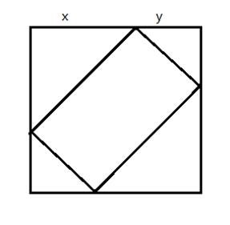

分别设两个等腰三角形的腰分别为x、y，被切除的面积为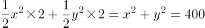，根据x、y为整数和常见勾股数可得x=16，y=12，原正方形的边长为16+12=28厘米，则剩余矩形面积=正方形面积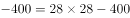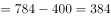平方厘米。

故正确答案为D。

### 第 63 题

一辆汽车从A地运货到B地，若该车的速度增加20千米/小时，可以提前45分钟到达B地，若该车的速度减少12千米/小时，到达B地的时间将延迟45分钟，则A地与B地之间的距离为多少千米：

A. 164

B. 176

C. 180

D. 196

E. 200

F. 212

G. 244

H. 256

第 63 题 · 答案与解析

**参考答案（粉笔题库参考内容）**

C

**解析**

设汽车的正常速度为v，所用时间为t。依据题意，则

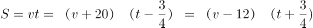，解得v=60千米/小时，t=3小时，则路程S=3×60=180千米。

故正确答案为C。

### 第 64 题

若销售团队有5个人，每个人把其他四个人的年龄相加，所得到的和分别为95、102、100、99、104，则这五个人中年龄最大的人为多少岁：

A. 25

B. 26

C. 27

D. 28

E. 29

F. 30

G. 31

H. 32

第 64 题 · 答案与解析

**参考答案（粉笔题库参考内容）**

F

**解析**

设5个人的年龄分别为：a、b、c、d、e，则：

a+b+c+d=95

a+b+c+e=102

a+c+d+e=100

b+c+d+e=99

a+b+d+e=104

5个方程加和=4a+4b+4c+4d+4e=95+102+100+99+104。则5人年龄之和为125岁。最大年龄＝年龄总和－最小年龄四人总和=125-95=30岁。

故正确答案为F。

### 第 65 题

设有编号为1，2，3，······，10的10张背面向上的纸牌，现有10名游戏者，第1名游戏者将所有编号是1的倍数的纸牌翻成另一面向上的状态，接着第2名游戏者将所有编号是2的倍数的纸牌翻成另一面向上的状态，······，第n名（n≤10）游戏者将所有编号是n的倍数的纸牌翻成另一面向上的状态，如此下去，当第10名游戏者翻完纸牌后，那些纸牌正面向上的最大编号与最小编号的差是：

A. 2

B. 3

C. 4

D. 5

E. 6

F. 7

G. 8

H. 9

第 65 题 · 答案与解析

**参考答案（粉笔题库参考内容）**

G

**解析**

第1张纸牌，只能是1的倍数，所以只被第1名游戏者翻转1次，最后是正面向上。正面向上最小编号纸牌可以确定是1。

第10张纸牌，是1、2、5、10的倍数，所以会被第1、2、5、10名游戏者翻转4次，最后是背面向上。不符合题目要求。第9张纸牌，是1、3、9的倍数，所以会被第1、3、9名游戏者翻转3次，最后是正面向上，所以正面向上最大编号纸牌是9。

正面向上的最大编号与最小编号的差是9-1=8。

故正确答案为G。

### 第 66 题

针对100名旅游爱好者进行调查发现，28人喜欢泰山，30人喜欢华山，42人喜欢黄山，8人既喜欢黄山又喜欢华山，10人既喜欢泰山又喜欢黄山，5人既喜欢华山又喜欢泰山，3人喜欢这三个景点，则不喜欢这三个景点中任何一个的有多少人：

A. 20

B. 18

C. 17

D. 15

E. 14

F. 13

G. 12

H. 10

第 66 题 · 答案与解析

**参考答案（粉笔题库参考内容）**

A

**解析**

设不喜欢这三个景点中任何一个的有x人，根据三集合容斥原理标准型公式可得：28+30+42–8–10–5+3=100–x，解得x=20。

故正确答案为A。

### 第 67 题

余梅今年4岁，爱吃泡泡糖，她现有10颗完全相同的泡泡糖，妈妈只允许她每次吃一颗或两颗，则她共有多少种不同的组合方法吃完这些泡泡糖：

A. 72

B. 89

C. 95

D. 107

E. 112

F. 124

G. 136

H. 144

第 67 题 · 答案与解析

**参考答案（粉笔题库参考内容）**

B

**解析**

若余梅每次只吃一颗泡泡糖，则一共吃了10次，只有1种吃法；

若余梅有且仅有一次吃了两颗泡泡糖，则一共吃了9次，共有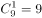种吃法；

若余梅有两次吃了两颗泡泡糖，则一共吃了8次，共有种吃法；

若余梅有三次吃了两颗泡泡糖，则一共吃了7次，共有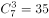种吃法；

若余梅有四次吃了两颗泡泡糖，则一共吃了6次，共有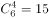种吃法；

若余梅有五次吃了两颗泡泡糖，则一共吃了5次，只有1种吃法。

故余梅一共有1+9+28+35+15+1=89种吃法。

故正确答案为B。

### 第 68 题

植树节到来之际，120人参加义务植树活动，共分成人数不等且每组不少于10人的6个小组，每人只能参加一个小组，则参加人数第二多的组最多有多少人：

A. 32

B. 33

C. 34

D. 35

E. 36

F. 37

G. 38

H. 39

第 68 题 · 答案与解析

**参考答案（粉笔题库参考内容）**

E

**解析**

要让第二多的组人数最多，则其他组人数尽量少，设第二多的组人数为x，则第一多的组为x+1，第三多到最少的分别为13、12、11、10，x+x+1+10+11+12+13=120，解得x=36.5，取36。

故正确答案为E。

### 第 69 题

小明从A地出发，需要先走一段平路，再爬一段上坡路才能到达B地，到达B地后，他停留一小时后按原路返回A地。小明走平地的速度为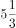千米/小时，上坡速度为4千米/小时，下坡速度为8千米/小时。小明从出发到返回共用7小时，则A、B两地的距离为多少千米：

A. 10

B. 12

C. 15

D. 16

E. 18

F. 24

G. 30

H. 无法计算

第 69 题 · 答案与解析

**参考答案（粉笔题库参考内容）**

D

**解析**

根据等距离平均速度公式可得上下坡的平均速度为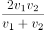\=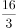，与平路的速度相等，故可推知全程的平均速度为，由于中途停留了一小时，因此路程为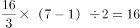千米。

故正确答案为D。

### 第 70 题

某展览馆的门票价格为：成人票6元，儿童票3元，两位购买全票的成年人可以免费带一名儿童入馆，任何五个人都可以购买总价为22元的团体票。现有三位成年人带领14名儿童前来参观。则他们购买门票至少花费多少元：

A. 64

B. 63

C. 62

D. 61

E. 60

F. 59

G. 58

H. 57

第 70 题 · 答案与解析

**参考答案（粉笔题库参考内容）**

H

**解析**

依据题意，五人购买22元团体票，每人需花费22÷5=4.4元，相比儿童票并不占优，故应让儿童尽可能的买儿童票。两个成年人免费带一名儿童，然后剩余人全买单人票，如此花费最少，共花费6×2+6+13×3=57元。

故正确答案为H。

### 第 71 题

从所给四个选项中，选择最合适的一个填入问号处，使之呈现一定的规律性：

A. A

B. B

C. C

D. D

第 71 题 · 答案与解析

**参考答案（粉笔题库参考内容）**

B

**解析**

图形元素组成相似，优先考虑样式规律。图形中出现黑白块，且黑块数量不同，因此考虑黑白运算。九宫格优先横着看，观察第一行图形可知，阴影（看作黑）与空白的叠加规律为：黑+白=黑，白+黑=黑，黑+黑=白，白+白=黑。第二行图形验证此规律成立。第三行图形应用此规律，故问号处图形右下角应满足黑+白=黑，排除A、D两项。左下角应满足白+白=黑，排除C项。

故正确答案为B。

### 第 72 题

从所给四个选项中，选择最合适的一个填入问号处，使之呈现一定的规律性：

A. A

B. B

C. C

D. D

第 72 题 · 答案与解析

**参考答案（粉笔题库参考内容）**

D

**解析**

图形元素组成不同，且属性无明显规律，因此考虑数量规律。图形封闭面特征明显，因此优先数面。各图面的数量分别为4、5、6，需要选择7个面的选项。A项是6个面，B项是4个面，因此排除A、B两项，C、D两项都是7个面，继续观察题干图形，发现题干图形的外边框的边数分别为3、4、5，问号处应选外边框为6边形的图形，因此排除C项。

故正确答案为D。

### 第 73 题

将下面的六个图形分成两类，使每一类图形都有各自的共同特征或规律，分类正确的一项是：

A. ①②⑥；③④⑤

B. ①④⑤；②③⑥

C. ①②⑤；③④⑥

D. ①②③；④⑤⑥

第 73 题 · 答案与解析

**参考答案（粉笔题库参考内容）**

A

**解析**

各个图形拟物化，考虑图形的共有特性。观察可知，所有的图形均为轴对称图形，且图①②⑥只有一条对称轴，图③④⑤有三条对称轴。

故正确答案为A。

### 第 74 题

从所给四个选项中，选择最合适的一个填入问号处，使之呈现一定的规律性：

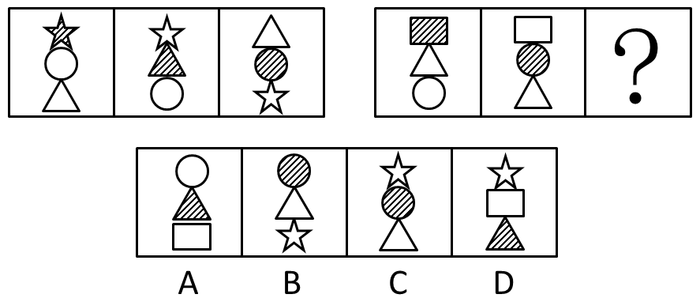

A. A

B. B

C. C

D. D

第 74 题 · 答案与解析

**参考答案（粉笔题库参考内容）**

A

**解析**

各图构成元素相似，考虑样式规律。第一组图形中每幅图组成样式的元素相同，第二组应该符合此规律，因此，选择由四边形、三角形和圆构成的图形。

故正确答案为A。

### 第 75 题

左边给定的是纸盒的外表面，下列哪一项能由它折叠而成：

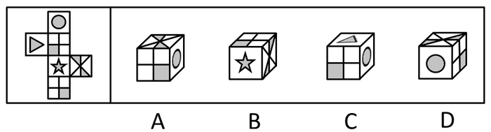

A. A

B. B

C. C

D. D

第 75 题 · 答案与解析

**参考答案（粉笔题库参考内容）**

D

**解析**

A项：如下图所示，若“田”字面为原图面1，其与圆面的公共边为全白，但A项为半黑半白，错误。若“田”字面为原图面2，其与面3的公共边为半黑半白，但A项为全白，错误。故A项排除。

B项：如下图所示，原图中五角星面和面3之间的公共边与面3中上面的黑色三角形挨着，B项中五角星面和面3的公共边与面3中下面的黑色三角形挨着，因此和题干不符，排除。

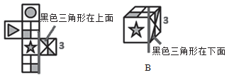

C项：画边法，如下图所示，从三角形顶点边开始在三角形面上顺时针画边，原图三角形面与圆形面的公共边为边4，而C项三角形面与圆形面的公共边为边2，与题干不符，排除。

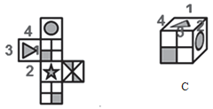

故正确答案为D。

### 第 76 题

碳信用又称碳权，指在经过联合国或联合国认可的减排组织认证的条件下，国家或企业以增加能源使用效率，减少污染或减少开发等方式减少碳排放，因此得到可以进入碳交易市场的碳排放计量单位，一个碳信用相当于一吨二氧化碳排放量。某燃煤发电厂去年碳排放额超标，根据上述定义，该电厂对应做法不包括（    ）。

A. 将该厂从城市郊区迁到海边

B. 减少该厂全年的发电总产量

C. 改进设备提高热源转化效率

D. 购买碳信用来实现排放达标

第 76 题 · 答案与解析

**参考答案（粉笔题库参考内容）**

A

**解析**

第一步：判断题干中的关键词。

方式：“增加能源使用效率、减少污染或开发。”

目的：“减少碳排放。”

第二步：逐一分析选项。

A项，该做法没有减少污染，也没有减少碳排放，不符合题意，当选。

B项，该做法可以减少碳排放，符合题意，排除。

C项，该做法可以增加能源使用率，从而减少碳排放，符合题意，排除。

D项，碳信用可以进入市场交易，所以可以通过购买排放权实现排放达标，符合题意，排除。

本题是选非题，故正确答案为A。

### 第 77 题

行政不作为是行政机关对于公民、法人和其他组织的符合条件的申请依法应该实施某种行为或履行某种法定职责却无正当理由拒绝履行或拖延履行的行政违法行为。

根据上述定义，下列选项中行政机关行为不属于行政不作为的是：

A. 王某要求所在地交通局告知有关汽车养路费标准，三个月未答复

B. 陈某在某市建设局工作多年，符合职称评定申请，申请职称评定被拒绝

C. 林某投诉某医药公司贩卖假药，该市药监局以不属于主管范围而拒绝

D. 何某因制止违章建筑施工被打伤，公安机关以对违章建筑无权处理不理睬

第 77 题 · 答案与解析

**参考答案（粉笔题库参考内容）**

B

**解析**

第一步：找出定义关键词。

“行政机关”“对于公民、法人和其他组织的符合条件的申请依法应该实施某种行为或履行某种法定职责”“无正当理由拒绝履行或拖延履行”“行政违法行为”。

第二步：逐一分析选项。

A项：王某提出汽车养路费标准的告知申请，符合定义中公民的申请，交通局三个月未答复，交通局符合行政机关，且体现交通局本应依法履行却无正当理由拒绝或拖延履行，符合定义，排除；

B项：陈某提出职称评定申请，符合定义中公民的申请，虽然职称评定被拒绝，但申请职称评定不属于该建设局“依法应该实施的行为”，也不属于“某种法定职责”，并且该行为是在行政机关及其内部职工之间发生的，不符合“行政违法行为”，因此不符合定义，当选；

C项：林某向药监局投诉某医药公司贩卖假药，符合定义中公民的申请，药监局符合行政机关，最终以不属于主管范围而拒绝，体现药监局本应依法履行却无正当理由拒绝履行，符合定义，排除；

D项：何某因制止违章建筑施工被打伤，公安机关以对违章建筑无权处理不理睬，由“不理睬”可以看出何某有诉求，体现公民的申请，公安机关属于行政机关，且体现出公安机关本应依法履行却无正当理由拒绝履行，符合定义，排除。

本题为选非题，故正确答案为B。

### 第 78 题

“公众参与”是一种有计划的行动。它通过政府部门与公众之间双向交流，使公民能参加行政决策过程并且防止和化解公民和政府机构与开发单位之间、公民与公民之间的冲突。

下列选项与上述定义最不符合的是（    ）。

A. 某市宣传部发布倡议书，号召全体市民“绿色出行”，十万人回应支持

B. 居民多次向某市人大投诉规划局违规审批项目，该项目在实施前被叫停

C. 某县政府拟在工业园区内引进两条茶籽油生产线，组织附近村民座谈

D. 某市政府公开新建垃圾填埋场选址方案，因收到10万条反对意见而缓行

第 78 题 · 答案与解析

**参考答案（粉笔题库参考内容）**

A

**解析**

第一步：找出定义关键词。

关键词为“政府部门与公众之间双向交流”、“公民参加行政决策”、“防止和化解公民和政府机构与开发单位之间、公民与公民之间的冲突”。

第二步：逐一分析选项。

A项：政府发布倡议书，号召民众“绿色出行”，市民回应支持，并没有体现市民参与行政决策，也未体现防止和化解任何冲突，不符合定义，当选；

B项：居民通过向市人大进行投诉，叫停违规审批项目，参与了决策，化解了居民与规划局之间的冲突，符合定义，排除；

C项：村民与县政府之间通过座谈会进行沟通，村民参与到引进生产线的决策中，防止了村民与县政府就此项目产生的矛盾，符合定义，排除；

D项：市政府公开新建垃圾填埋场选址方案，民众提出反对意见，为双向交流的过程，项目缓行是民众参与决策的结果，防止了市政府与民众就垃圾填埋场选址产生的矛盾，符合定义，排除。

本题为选非题，故正确答案为A。

### 第 79 题

乌比冈效应是指人的一种总觉得什么都高出平均水平的心理倾向，即给自己的许多方面打分高过实际水平。

根据上述定义，下列不属于乌比冈效应的是：

A. 94%的人认为，他们的幽默感高出普通人的平均水平

B. 80%的司机认为，他们比一般的司机驾驶技术更加娴熟

C. 某心理学家安排了一个演员做了一场毫无意义的演讲，90%的听众认为其演讲非常具有启示性

D. 某作家在描述其家乡小镇的乡亲时说，所有的女人都很好强，所有的孩子都不同凡响

第 79 题 · 答案与解析

**参考答案（粉笔题库参考内容）**

C

**解析**

第一步：找出定义关键词。

关键词为“给自己的打分高过实际水平。”

第二步：逐一分析选项。

A、B两项：大部分的人认为自己水平高于常人，故可得出有些人给自己打分高过实际水平，符合定义，排除；

C项：“90%的听众认为其演讲非常具有启示性”，并未涉及为自己打分，与题干关键词不符，当选；

D项：描述自己家乡小镇时，所描述特点高于实际水平，是给自己的乡亲打分高出平均水平，符合定义，排除。

本题为选非题，故正确答案为C。

### 第 80 题

近因原则是保险人对于承保范围的保险事故作为直接的、最接近的原因引起的损失承担保险责任，而对于承保范围以外的原因造成的损失不负赔偿责任。按照该原则，承担责任并不取决于时间上或空间上的接近，而是取决于导致保险标的损失的风险事故是否在承保范围内，如果存在多个原因导致损失，其中最直接、最有效、起决定作用的原因，以及不可避免会产生事故作用的原因就是近因。

根据上述定义，下列原因不属于近因的是：

A. 张某夜间打猎不慎摔伤，在等待救援时受凉感冒引发肺炎导致死亡，其死亡原因是摔伤

B. 王某的保险车辆遇暴雨浸泡汽缸进水，他强行启动车辆时发动机受损，受损原因是暴雨

C. 暴雨致电线杆倒塌，电线短路引发火花引燃仓库，库存商品燃烧殆尽，损失原因是暴风雨

D. 船舶进水，所载皮革进水腐烂，糜烂恶臭致邻舱的烟草变质，烟草受损原因是船舶进水

第 80 题 · 答案与解析

**参考答案（粉笔题库参考内容）**

B

**解析**

第一步：找到题干定义关键词。

定义关键词：“最直接、最有效、起决定作用的原因，以及不可避免会产生事故作用的原因就是近因”。

第二步：逐一分析选项。

A项：张某打猎摔伤，等待救援时感冒受凉引发肺炎，肺炎是摔伤引发的必然性结果，也就是说没有摔下来的话也就不会引发肺炎，因此摔伤属于决定性的原因，即近因，符合定义，排除；

B项：驾驶员启动汽车时没有检查汽车进气管有无进水，而是强行启动发动机，导致发动机受损，因此强行启动发动机才是事故的近因，不符合定义，当选；

C项：仓库火灾起决定性因素的是暴风雨，暴风雨属于近因，符合定义，排除；

D项：烟草受损起决定性因素为船舶进水，船舶进水属于近因，符合定义，排除。

本题为选非题，故正确答案为B。

### 第 81 题

功利主义道德观，是指完全根据行为结果即所获取的功利来评价人类行为善恶的一种道德观，即能给行为影响所及的大多数人带来最大利益的行为才是善的。

根据上述定义，下列属于功利主义道德观的是：

A. 销售业绩高的员工就是好员工

B. 己所不欲，勿施于人

C. 各级政府应充分尊重和保护人权

D. 管理者不能因种族、肤色、性别等因素而对部分员工进行歧视

第 81 题 · 答案与解析

**参考答案（粉笔题库参考内容）**

A

**解析**

第一步：关键词查找。

定义关键词为：“完全根据行为结果评价”、“能给行为影响所及的大多数人带来最大利益的行为才是善的”。

第二步：逐一分析选项。

A项：销售业绩高的员工就是好员工，以销售业绩（带来利益）评判员工好坏，销售业绩高即是好，符合“能给行为影响所及的大多数人带来最大利益的行为才是善的”，当选；

B、C、D三项均不符合“完全根据行为结果评价”，不符合定义关键词，排除。

故正确答案为A。

### 第 82 题

绿色技术是指遵循生态原理和生态经济规律，节约资源和能源，避免、消除或减轻生态环境污染和破坏，生态负效应最小的“无公害化”或“少公害化”技术、工艺和产品的总称。

根据上述定义，下列不属于绿色技术的是：

A. 红树林快速恢复和重建技术

B. 污染控制和预防技术

C. 循环再生技术

D. 废弃物最少化技术

第 82 题 · 答案与解析

**参考答案（粉笔题库参考内容）**

A

**解析**

第一步：关键词查找。

定义关键词为：“节约资源和能源”、“生态负效应最小的‘无公害化’或‘少公害化’技术、工艺和产品”。

第二步：逐一分析选项。

A项：恢复、重建技术，不属于“节约资源和能源”，与定义相悖，当选；

B、C、D三项均符合定义“节约资源和能源”、“生态负效应最小的‘无公害化’或‘少公害化’技术、工艺和产品”，排除。

本题为选非题，故正确答案为A。

### 第 83 题

交易成本，是指在协商、谈判和履行协议等交易性活动中，为达成合作所需要支付的各种资源的总和。只要存在交易活动就存在交易成本，它已经成为人类社会中不可分割的组成部分。

下列选项不属于交易成本的是：

A. 某公司为了搜索交易信息消耗了两天时间

B. 某工厂为了开拓生产花费五十万元购买专利

C. 老王在购房中为契约向中介支付了五千元

D. 某企业因违反合同而支付五百万元的违约金

第 83 题 · 答案与解析

**参考答案（粉笔题库参考内容）**

B

**解析**

第一步：找出定义关键词。

“在协商、谈判和履行协议等交易性活动中”、“为达成合作所需要支付的各种资源的总和”。

第二步：逐一分析选项。

A项：公司搜索交易信息，是为交易活动做的前期准备，属于交易期间。而消耗的两天时间，是为了达成交易活动而支付的成本，符合定义，排除；

B项：为开拓生产花费的五十万元，目的是为了扩大生产，并不是为了达成交易活动而支付的成本，不符合定义，当选；

C项：购房是一项交易活动，支付中介费是为了达成交易活动而支付的成本，符合定义，排除；

D项：某企业因违反合同而支付违约金，说明之前签订了相关合同，有合同存在肯定有交易，在履行合同的过程中，不按合同办事而支付违约金，符合履行协议等交易性活动，而支付五百万元的违约金是在支付金钱这一资源成本，符合定义，排除。

本题为选非题，故正确答案为B。

附：百度百科说明

### 第 84 题

包容性创新是指企业通过创新举措满足处于社会底层的低收入消费者的需求，从而达到企业和消费者的共赢。追求“共赢”是包容性创新的核心理念：一方面，消费者从包容性创新中获得对产品和服务需求的满足，改善生活质量，乃至提高收入；另一方面，企业通过包容性创新发现新市场，获得赢利，实现可持续发展。

根据以上定义，下列不属于包容性创新的是：

A. 某医疗企业开发出成本只有几十元的白内障手术技术，为贫穷地区数十万患者进行了手术

B. 某企业使用绿色建筑技术在地震灾区捐建了三所希望小学

C. 某银行向农村妇女提供无需抵押，利率较低的微型贷款，鼓励其创业

D. 某公司发明棉花剥壳机，在农村大受欢迎

第 84 题 · 答案与解析

**参考答案（粉笔题库参考内容）**

B

**解析**

第一步：找出定义关键词。

“满足处于社会底层的低收入消费者的需求”、“达到企业和消费者的共赢”。

第二步：逐一分析选项。

A项：符合定义“满足处于社会底层的低收入消费者的需求”、“达到企业和消费者的共赢”，排除。

B项：某企业捐建希望小学，并不是以盈利为目的，不符合“满足处于社会底层的低收入消费者的需求”、“达到企业和消费者的共赢”，不符合定义，当选。

C项：符合定义“满足处于社会底层的低收入消费者的需求”、“达到企业和消费者的共赢”，排除。

D项：符合定义“满足处于社会底层的低收入消费者的需求”、“达到企业和消费者的共赢”，排除。

本题为选非题，故正确答案为B。

### 第 85 题

隐性课程是指学校课程计划中未明确规定的、非正式和无意识的学校学习经验。

根据上述定义，下列不属于隐性课程范畴的是：

A. 高校组织学生参加两天军训，以培养和锻炼学生的意志力

B. 儿童在学习数学课程的时候，培养了学习数学的兴趣

C. 某高校设立校园文化节，让学生认识了该校的校训、学风

D. 教师和学生一起参加课程活动，建立平等融洽的师生关系

第 85 题 · 答案与解析

**参考答案（粉笔题库参考内容）**

A

**解析**

第一步：找出定义关键词。

“未明确规定的”、“非正式和无意识的学校学习经验”。

第二步：逐一分析选项。

A项：根据《中华人民共和国国防教育法》规定，除大学、高中生外，还有中小学生也应接受军训，所以军训是有预期的课程安排，在学校课程计划中明确规定了有学分要求的课程，希望通过军训培养学生纪律性等，故军训是有明确规定的学习经验，不符合“未明确规定的”，不符合定义，当选；

B项：数学课程虽然是学校计划中的必修课，但学习期间培养的对于数学的兴趣是非正式且无意识的，符合“非正式和无意识的学校学习经验”，符合定义，排除；

C项：文化节不属于学校课程计划中明确规定的学校学习经验，符合“未明确规定的”，符合定义，排除；

D项：课程活动不属于学校课程计划中明确规定的学校学习经验，符合“未明确规定的”，符合定义，排除。

本题为选非题，故正确答案为A。

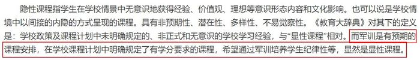

### 第 86 题

人生：困难

A. 经济：危机

B. 事业：挫折

C. 混乱：管理

D. 爱情：分手

第 86 题 · 答案与解析

**参考答案（粉笔题库参考内容）**

B

**解析**

第一步：判断题干词语间逻辑关系。

根据造句法解题，人生会遇到困难。

第二步：判断选项间逻辑关系。

A项：经济会遇到危机，保留；

B项：事业会遇到挫折，保留；

C项：不符合题干逻辑关系，排除；

D项：爱情与分手之间并无必然联系，不符合题干逻辑关系，排除。

将A、B两项与题干对应，考虑竖向对比。人生与事业，困难与挫折，概念更为相似，含义更加贴近，比A项更加贴合题干。

故正确答案为B。

### 第 87 题

五行：木火土金水

A. 五经：诗书礼易大学

B. 五音：宫商韵征羽

C. 五色：青黄赤白绿

D. 五味：酸苦甘辛咸

第 87 题 · 答案与解析

**参考答案（粉笔题库参考内容）**

D

**解析**

第一步：判断题干词语间逻辑关系。

五行指“木火土金水”，二者为全同关系。

第二步：判断选项词语间逻辑关系。

A项：五经指“诗书礼易春秋”，而非“诗书礼易大学”，与题干逻辑关系不一致，排除；

B项：五音指“宫商角徵羽”，而非“宫商韵征羽”，与题干逻辑关系不一致，排除；

C项：五色指“青黄赤白黑”，而非“青黄赤白绿”，与题干逻辑关系不一致，排除；

D项：五味指“酸苦甘辛咸”，二者为全同关系，与题干逻辑关系一致，当选。

故正确答案为D。

### 第 88 题

高雅：阳春白雪

A. 自信：趾高气扬

B. 怀疑：三心二意

C. 矛盾：南辕北辙

D. 独立：自力更生

第 88 题 · 答案与解析

**参考答案（粉笔题库参考内容）**

D

**解析**

第一步：判断题干词语间逻辑关系。

阳春白雪形容高雅，二者为比喻象征义。

第二步：判断选项词语间逻辑关系。

A项：趾高气扬形容高傲，而非自信，与题干逻辑关系不一致，排除；

B项：三心二意形容不专心，而非怀疑，与题干逻辑关系不一致，排除；

C项：南辕北辙代表行动与目的相反，而非矛盾，与题干逻辑关系不一致，排除；

D项：自力更生形容独立，与题干逻辑关系一致，当选。

故正确答案为D。

### 第 89 题

李尧棠：巴金：作家：家春秋

A. 聂耳：聂守信：音乐家：义勇军进行曲

B. 徐寿康：徐悲鸿：画家：愚公移山图

C. 舒庆春：老舍：作家：子夜

D. 李东壁：李时珍：医学家：本草纲目

第 89 题 · 答案与解析

**参考答案（粉笔题库参考内容）**

B

**解析**

第一步：判断题干词语间逻辑关系。

巴金原名李尧棠，是一名作家，著有《家春秋》，其中第一项为原名，第二项为笔名，第三项为属性，第四项为代表作。

第二步：判断选项间逻辑关系。

A项：第一项“聂耳”为笔名，与题干顺序不符，排除；

B项：对应全部正确，当选；

C项：《子夜》为茅盾的作品，并非老舍，对应错误，排除；

D项：李时珍，字东壁，而非原名东壁，与题干笔名并不对应，排除。

故正确答案为B。

### 第 90 题

古为今用：天罗地网

A. 阴晴圆缺：里应外合

B. 左顾右盼：深入浅出

C. 好逸恶劳：旗开得胜

D. 刻舟求剑：叶公好龙

第 90 题 · 答案与解析

**参考答案（粉笔题库参考内容）**

B

**解析**

第一步：判断题干词语间逻辑关系。

古为今用是指吸收古代的优点，摒弃缺点，以使现代更进步，天罗地网原义是天上、地下到处是罗网，比喻防范布置得极为严密而无法逃脱 ，二者无语义关系，考虑拆分。古今中外第一个字“古”和第三个字“今”为反义关系，天罗地网第一个字“天”和第三个字“地”为反义关系。

第二步：判断选项间逻辑关系。

A项：阴晴圆缺第一个字“阴”和第三个字“圆”不是反义关系，与题干逻辑关系不一致，排除；

B项：左顾右盼第一个字“左”和第三个字“右”为反义关系，深入浅出第一个字“深”和第三个字“浅”为反义关系，与题干逻辑关系一致，当选；

C项：旗开得胜第一个字“旗”和第三个字“得”不是反义关系，与题干逻辑关系不一致，排除；

D项：刻舟求剑第一个字“刻”和第三个字“求”不是反义关系，与题干逻辑关系不一致，排除。

故正确答案为B。

### 第 91 题

汉文帝：刘恒：文景之治

A. 宋太祖：赵匡胤：杯酒释兵权

B. 唐太宗：李世民：贞观之治

C. 清圣祖：爱新觉罗·玄烨：康乾盛世

D. 秦始皇：嬴政：焚书坑儒

第 91 题 · 答案与解析

**参考答案（粉笔题库参考内容）**

C

**解析**

第一步：判断题干词语间逻辑关系。

刘恒即汉文帝，二者是全同关系。汉文帝和汉景帝统治时期，历史上称之为“文景之治”，汉文帝仅为文景之治主角之一。

第二步：判断选项词语间逻辑关系。

A项：杯酒释兵权主角即为宋太祖赵匡胤，并不涉及其他主角，排除；

B项：贞观之治主角即为唐太宗李世民，并不涉及其他主角，排除；

C项：爱新觉罗·玄烨即为清圣祖（康熙皇帝），康熙、雍正、乾隆三代皇帝的统治时期，历史上称之为“康乾盛世”，爱新觉罗·玄烨仅为康乾盛世主角之一，与题干关系一致，当选；

D项：焚书坑儒的主角为秦始皇嬴政，并不涉及其他主角，排除。

故正确答案为C。

### 第 92 题

企业：研发：生产：销售

A. 医生：诊断：治疗：安慰

B. 农民：播种：除草：收割

C. 学生：上课：考试：毕业

D. 作家：构思：写作：投稿

第 92 题 · 答案与解析

**参考答案（粉笔题库参考内容）**

D

**解析**

第一步：判断题干词语间逻辑关系。

企业（主体）研发（探索阶段）后可以生产（实施阶段），生产完成后可以对外销售（最终目的）。四项分别为主体与过程的顺承关系。

第二步：判断选项间逻辑关系。

A项：安慰并不属于医生诊断治疗的一个最终目的，与题干逻辑关系不一致，排除；

B项：播种并不属于一个探索阶段，与题干逻辑关系不一致，排除；

C项：上课并不属于一个探索阶段，与题干逻辑关系不一致，排除；

D项：作家（主体）构思（探索阶段）后开始写作，写作完成后可以投稿（最终目的），与题干逻辑关系一致，当选。

故正确答案为D。

### 第 93 题

细胞：器官：消化系统：狗：动物

A. 原子：分子：芳香烃：苯：有机物

B. 员工：团队：部门：小米公司：企业

C. 床单：被罩：床上用品：席梦思：家具

D. 甲骨文：金文：汉语：英语：语言

第 93 题 · 答案与解析

**参考答案（粉笔题库参考内容）**

B

**解析**

第一步：判断题干词语间逻辑关系。

题干前四项为逐一包容关系，概念范围逐步扩大。其中，细胞与器官，器官与消化系统，消化系统与狗均为组成关系，狗与动物为种属关系。

第二步：判断选项词语间逻辑关系。

A项：苯属于芳香烃，二者为种属关系，概念出现了缩小，与题干关系不能对应，排除；

B项：员工与团队，团队与部门，部门与小米公司均为组成关系，且小米公司属于一个企业，为种属关系，与题干关系完全对应，当选；

C项：床单与被罩为并列关系，非包容关系，与题干关系不能对应，排除；

D项：汉语与英语为并列关系，非包容关系，与题干关系不能对应，排除。

故正确答案为B。

### 第 94 题

家属：亲属：家族

A. 而立：不惑：古稀

B. 助教：讲师：教授

C. 蓝领：粉领：白领

D. 事故：事变：事情

第 94 题 · 答案与解析

**参考答案（粉笔题库参考内容）**

D

**解析**

第一步：判断题干词语间逻辑关系。

家属、亲属、家族之间概念范围逐步扩大，三者之间为逐一包容关系。

第二步：判断选项词语间逻辑关系。

A项：三者之间为并列关系，排除；

B项：三者之间为并列关系，排除；

C项：三者之间为并列关系，排除；

D项：事故、事变、事情概念范围逐步扩大，三者之间依次为包容关系，事情包含事变，事变包含事故，当选。

故正确答案为D。

### 第 95 题

赛事 对于（  ）相当于（  ）对于 编辑

A. 裁判；书稿

B. 运动；校对

C. 哨子；文字

D. 进取；精确

第 95 题 · 答案与解析

**参考答案（粉笔题库参考内容）**

A

**解析**

逐一代入选项。

A项：“裁判”判决“赛事”，“编辑”整理“书稿”，前后均为主宾关系，前后逻辑关系一致，当选。

B项：“运动”与“赛事”无明显逻辑关系；“校对”与“编辑”都是书刊初版工作中的工序，二者属于并列关系。前后逻辑关系不一致，排除。

C项：“哨子”是“赛事”使用的工具，二者属于对应关系；“编辑”“文字”是动宾关系。前后逻辑关系不一致，排除。

D项：“赛事”与“进取”无明显逻辑关系，“精确”与“编辑”无明显逻辑关系，排除。

故正确答案为A。

### 第 96 题

三位办案人员在办理一刑事案件。甲说：“犯罪嫌疑人向东逃跑了。”乙说：“犯罪嫌疑人没有向东逃跑。”丙说：“犯罪嫌疑人没有向南逃跑。”

已知两个人的断定与事实不符，由此可以推出：

A. 犯罪嫌疑人向南逃跑了

B. 犯罪嫌疑人没有向东逃跑

C. 甲的断定与事实相符

D. 丙的断定与事实相符

第 96 题 · 答案与解析

**参考答案（粉笔题库参考内容）**

A

**解析**

由“甲：向东；乙：—向东；丙：—向南”，可知甲与乙之间为矛盾关系，必有一真一假。因有两个人的断定与事实不符，故丙也为假，即犯罪嫌疑人向南跑了。

故正确答案为A。

### 第 97 题

甲乙丙丁四人外出旅游，旅游地点为桂林、三亚、杭州、张家界。一个人只去一个地方，且每个地方都有人去。在问到他们各自去哪旅游时，甲说：“乙没有去桂林。”乙说：“丁没有去杭州。”丙说：“我去了张家界。”如果甲乙丙三人中有一个人去了张家界，而且只有这个人的陈述与事实相符，那么去桂林旅游的人是：

A. 甲或乙

B. 乙或丙

C. 丙或丁

D. 丁或甲

第 97 题 · 答案与解析

**参考答案（粉笔题库参考内容）**

B

**解析**

根据题干条件，假设丙说的话为真，则丙去了张家界。因只有丙的话为真，甲、乙说的话则为假。则乙去了桂林，丁去了杭州，丙去了张家界，甲去了三亚。

假设丙说的话为假，则丙没有去张家界，那么甲、乙之中有一个人去了。

若甲去了张家界，则乙说的话为假，则丁去了杭州，乙去了三亚，丙去了桂林。

若乙去了张家界，则甲说的话为假，乙便又去了桂林，与条件矛盾，排除，此情况。

综上推导，则去桂林旅游的人可能为丙或乙。

故正确答案为B。

### 第 98 题

甲乙丙丁四辆车要经过A、B、C、D四个路段，每辆车只经过其中一个路段且每个路段都有车经过。已知A路段星期三禁行，B路段星期一禁行，C路段星期一与星期四禁行，D路段只在星期二、星期四和星期六通行，星期天四个路段都禁行。某天，甲乙丙丁四辆车的司机进行交谈，甲车司机说：“我所经过的路段前天禁行。”乙车司机说：“我所经过的路段明天禁行。”丙车司机说：“我所经过的路段今天禁行，明天就不禁行了。”丁车司机说：“从今天起，我所经过的路段四天都不禁行。”那么甲车所经过的路段为：

A. D

B. C

C. B

D. A

第 98 题 · 答案与解析

**参考答案（粉笔题库参考内容）**

A

**解析**

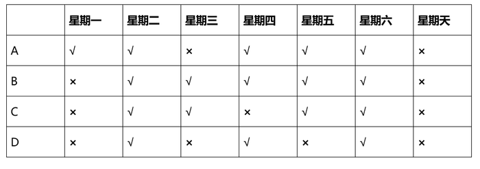

由丁“从今天起，我所经过的路段四天都不禁行”可知，今天只能为星期二或星期三，且丁只能走B路段；

由丙“我所经过的路段今天禁行，明天就不禁行了”可知，今天不为星期二，因为星期二四个路段都不禁行，则今天为星期三；

由乙“我所经过的路段明天禁行”，因今天星期三，星期四禁行的只有C路段，故乙走的为C路段；

由甲“我所经过的路段前天禁行”，且不能为B路段（丁行走）和C路段（乙行走）可知，甲走的为D路段。

故正确答案为A。

### 第 99 题

五位同学对毕业去向进行讨论。小张说：“小王去了百度，小李去了顺丰。”小王说：“小李去了阿里，小赵去了浦发。”小李说：“小赵去了顺丰，小周去了浦发。”小赵说：“小周去了腾讯，小李去了阿里。”小周说：“小张去了阿里，小李去了腾讯。”

已知每个人所去的单位不同，而且每个人的去向都有人说对。那么，每个人的毕业去向为：

A. 小李去了阿里，小赵去了百度，小张去了腾讯，小王去了顺丰，小周去了浦发

B. 小周去了阿里，小王去了百度，小赵去了腾讯，小张去了顺丰，小李去了浦发

C. 小张去了阿里，小王去了百度，小李去了腾讯，小赵去了顺丰，小周去了浦发

D. 小赵去了阿里，小李去了百度，小周去了腾讯，小张去了顺丰，小王去了浦发

第 99 题 · 答案与解析

**参考答案（粉笔题库参考内容）**

C

**解析**

因每个人的去向都有人说对，可采用代入排除求解。

代入A项：若小赵去了百度，题干中并没有人说对，可知A项错误，排除；

代入B项：若小周去了阿里，题干中并没有人说对，可知B项错误，排除；

代入D项：若小赵去了阿里，题干中并没有人说对，可知D项错误，排除；

代入C项：所有去向都被人说对过，当选。

故正确答案为C。

### 第 100 题

尽管苹果电脑产业链中的上下游企业估计也在羡慕、甚至怨恨苹果公司的丰厚利润，但却鲜有企业会公开反对。为什么？因为这些企业知道自己尽管利润不高，但是成为苹果供应商对自己也是有益的事；如果不是成为苹果的供应商，或许还无法赚取目前所拥有的利润。也正是如此，尽管苹果对其供应商有着苛刻的要求，但还是有很多企业趋之若鹜。

如果以下各项为真，最能支持以上观点的是？

A. 苹果公司的利润远大于其上下游企业的利润

B. 苹果公司为其上下游企业带来了足够的利润

C. 有些企业为成为苹果公司的上下游企业而自豪

D. 苹果公司的模式可以被其他公司所仿效

第 100 题 · 答案与解析

**参考答案（粉笔题库参考内容）**

B

**解析**

第一步：找出论点和论据。

论点：尽管苹果对其供应商有着苛刻的要求，但还是有很多企业趋之若鹜。

论据：如果不是成为苹果的供应商，或许还无法赚取目前所拥有的利润。

第二步：逐一分析选项。

A项：苹果公司的利润远大于其上下游企业的利润。并不能说明苹果公司为其上下游企业带来任何好处，故不能加强题干论证，排除；

B项：苹果公司为其上下游企业带来了足够的利润。说明苹果公司为其上下游企业带来了足够的好处，故导致虽然苹果对其供应商有着苛刻的要求，但还是有很多企业趋之若鹜。是对论据的补充说明，可以加强题干论证，当选；

C项：有些企业为成为苹果公司的上下游企业而自豪。“自豪”与论据“利润”无关，不能加强论证，排除；

D项：苹果公司被其他公司效仿，属于无关项，排除。

故正确答案为B。

### 第 101 题

蚊子可传播多种疾病，如疟疾、丝虫病、乙型脑炎等。有人担心由于蚊子叮咬了HIV感染的人而在叮咬下一位时会将存在蚊子体内的HIV在人际间传播。但研究人员指出这样的担心大可不必。

如果以下各项为真，最能支持研究人员观点的是：

A. HIV感染的人血液中并不总是拥有高水平的HIV病毒

B. 蚊子叮咬HIV感染的人后不一定立即去叮咬下一个人

C. 蚊子通过食管吸入血液，这种血液的吸入总是单向的

D. 孩子容易被蚊子叮咬，但他们身上极少发生HIV感染

第 101 题 · 答案与解析

**参考答案（粉笔题库参考内容）**

C

**解析**

第一步：找到论点论据。

论点：蚊子叮咬了HIV感染的人而在叮咬下一位时不会将存在蚊子体内的HIV在人际间传播。

本题无论据。

第二步：逐一分析选项。

A项，HIV感染的人血液中是否拥有高水平的HIV病毒与题干无关，属无关选项，排除；B项，蚊子叮咬HIV感染的人后不一定立即去叮咬下一个人，无法证明下一个人被叮咬后是否会感染，无法支持，排除；C项，血液的吸入是单向的，说明蚊子只会吸入血液，而被吸者不会感染血液，因此，不会被感染HIV病毒，加强论点，当选；D项，孩子是否容易被蚊子叮咬与题干无关，属无关选项，排除。

故正确答案为C。

### 第 102 题

国际经验表明，在经济快速发展期，房地产市场容易出现投机投资性需求增多的趋势。如不及时有效抑制，一方面，投机投资性需求将非正常推高房价，迫使一些自主性需求被“挤出”市场，导致市场需求畸形化；另一个方面，投机投资性需求的盲目扩张，往往出现资产泡沫膨胀，造成市场大起大落，甚至引发金融风险、影响经济平稳发展。

由此可以推出：

A. 若进行及时有效抑制，投机投资性需求就将不会非正常推高房价且不会盲目扩张

B. 若投机投资性需求没有非正常推高房价且没有盲目扩张，则一定进行了及时有效地抑制

C. 若投机投资性需求非正常推高房价且盲目扩张，则一定没有进行及时有效抑制

D. 即使进行及时有效抑制，投机投资性需求也有可能非正常推高房价且盲目扩张

第 102 题 · 答案与解析

**参考答案（粉笔题库参考内容）**

B

**解析**

第一步：翻译题干。

题干的逻辑形式为：-及时抑制非正常推高房价 且 盲目扩张。

第二步：逐一分析选项。

A项：及时抑制非正常推高房价 且 -盲目扩张，“及时抑制”是对题干条件的否前，否前得不到确定性的结论，无法推出，排除；

B项：-非正常推高房价 且 -盲目扩张及时抑制，是题干条件的逆否命题，可以推出，当选；

C项：非正常推高房价 且 盲目扩张及时抑制，“非正常推高房价 且 盲目扩张”是对题干条件的肯后，肯后得不到确定性结论，无法推出，排除；

D项：“即使······也······”不是逻辑关联词，一般不翻译，比如即使你不同意，我们也会在一起，这句话就是在强调“我们会在一起”这个结果一定会发生，而本题文段没有“投机投资性需求也有可能非正常推高房价且盲目扩张”一定会发生的意思，故不能推出，排除。

故正确答案为B。

### 第 103 题

据统计，2011年，我国医院门诊病人次均医药费用为179.8元，住院病人人均医药费用为6632.2元。一次住院费接近城镇居民年人均收入的三分之一，几乎相当于农民一年的人均纯收入。可见，医药费用是群众生活中一项沉重的负担，无怪乎人民看病住院时都会感慨“真的病不起”。

如果以下各项为真，最能加强以上论证的是：

A. 医药费用成为群众生活的负担，这是医患关系紧张的根源所在

B. 我国的医疗费用过高，一些医生滥用药物，在必要时，应使用行政手段进行干预

C. 改革开放以来，我国经济长足发展，人民生活水平日益提高，但医药费用增长过快

D. 不管是城镇居民还是农民的医疗保险参与率都不高，在生病就医时得不到保险支持

第 103 题 · 答案与解析

**参考答案（粉笔题库参考内容）**

D

**解析**

第一步：找出论点和论据。

论点：医药费用是群众生活中一项沉重的负担。

论据：一次住院费接近城镇居民年人均收入的三分之一，几乎相当于农民一年的人均纯收入。

本题提问是加强论证，优先考虑搭桥和必要条件。题干论点和论据都在说医药费用负担重，话题一致，故考虑加强论证寻找说明医药费用成为负担的必要条件的选项。

第二步：逐一分析选项。

A项：医患关系与群众负担无关，属于无关项，排除；

B项：加强题干论证就应指出群众的医药负担确实重，与“行政手段干预”无关，排除；

C项：医药费增长过快，是对题干论据的具体说明，可以加强题干论证，保留；

D项：在生病就医时得不到保险支持。医药费用重，群众收入低，而又得不到保险支持，是导致医药费用成为负担的必要条件，可以加强，保留。

对比C、D两项，C项为补充论据，而D项为必要条件，D项的加强力度更强，当选。

故正确答案为D。

### 第 104 题

研究者发现细菌就像人类的简化版本，它们有自我意识，有自己的语言，群居，既交友也树敌，喜欢偷窥邻居家的隐私，还能以讹传讹，甚至杀害手足。各种细菌在自己的地盘上各司其职，相互配合，促进社会的稳定。

如果以下各项为真，最能质疑上述论断的是：

A. 通过释放某种物质，细菌可召集群体成员执行各种任务

B. 新型研制的阻断细菌交流的药物可以代替普通的抗菌素

C. 细菌的生活极其单调，不是在单独进食，就是在自我繁殖

D. 霍乱、肺炎和食物中毒，实际就是各种细菌聚集的后果

第 104 题 · 答案与解析

**参考答案（粉笔题库参考内容）**

C

**解析**

第一步：找到论点论据。

论点：各种细菌在自己的地盘上各司其职，相互配合，促进社会的稳定。

本题无论据。

第二步：逐一分析选项。

A项，说明细菌可以群体活动，互相配合，加强结论，排除；B项，阻断交流可以抗菌，说明交流确实是存在的，加强结论，排除；C项，说明细菌生活单调，各自行动，削弱论点，当选；D项，讨论细菌聚集的危害，也在印证前文“群居”的说法，不能削弱，排除。

故正确答案为C。

### 第 105 题

有关研究表明，手机比电脑更伤人，因为手机屏幕小，玩手机时注意力更投入，目不转睛，因此更伤眼。使用电脑时，人们的肢体还能活动活动，可是“手机控”往往很少活动，这对身心健康更为不利。

如果以下各项为真，最能削弱上述论断的是：

A. 电脑在使用过程中，显示屏会发出电磁、电离辐射

B. 科学研究表明使用手机与脑瘤和癌症的发病率无关

C. 电脑背景光比手机更容易引起使用者视力下降和头痛

D. 长期使用电脑人群容易患鼠标手、颈椎病等“电脑病”

第 105 题 · 答案与解析

**参考答案（粉笔题库参考内容）**

C

**解析**

第一步：找出论点和论据。

论点：手机比电脑更伤人。

论据：手机屏幕小，玩手机时注意力更投入，目不转睛，因此更伤眼。使用电脑时，人们的肢体还能活动活动，可是“手机控”往往很少活动。

第二步：逐一分析选项。

A项，仅说明电脑会产生电磁、电离辐射。只是说明电脑不好，但是没有和手机进行比较，手机是否会产生此类辐射与辐射是否对人体有害均无阐述，无法看出手机是否更伤人，不能削弱，排除；B项，仅说明使用手机与癌症发病率的关系，说明手机有其他害处，但是未提到电脑，无法削弱论点，属无关选项，排除；C项，将手机与电脑对比，说明相比手机，电脑更易使人视力下降和头痛，削弱论证，当选；D项，仅说明电脑产生的另类病症，手机是否会产生此类病症并未表明，不能削弱，排除。

故正确答案为C。

## 材料 1

2013年二季度，我国税收月收入同比增速逐步提高，分别为7.9%、8.3%和12.9%。截至2013年6月，全国税收总收入完成59260.61亿元，同比增长7.9%，较上年同期回落1.9个百分点。其中，国内增值税、企业所得税同比分别增长6.6%和14.2%，较上年同期增速分别回落1.5和3.1个百分点；房产税同比增长11%，比上年同期增速回落19.1个百分点；进口货物增值税消费税和关税同比分别下降17.1%和16%，比上年同期增速分别回落24.5和22.9个百分点。

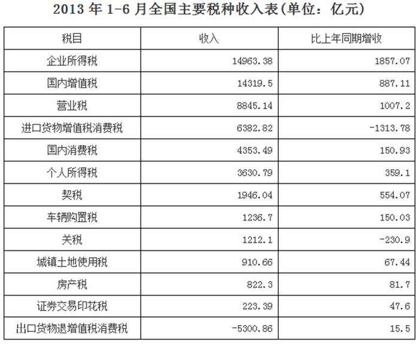

### 第 106 题

2012年1-6月，全国税收总收入比2011年同期增加了：

A. 4901.94亿

B. 3108.78亿

C. 5168.68亿

D. 4726.35亿

第 106 题 · 答案与解析

**参考答案（粉笔题库参考内容）**

A

**解析**

根据题干“2012年1-6月，全国税收总收入比2011年同期增加了”，结合选项为亿，可判定本题为增长量计算问题。由材料第一段“截至2013年6月，全国税收总收入完成59260.61亿元，同比增长7.9%，较上年同期回落1.9个百分点”可知，2012年同比增长率为7.9%+1.9%=9.8%。则2012年1-6月，全国税收总收入比2011年同期增加了：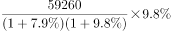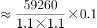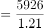亿元。

故正确答案为A。

### 第 107 题

2013年上半年，房产税、城镇土地使用税及契税三项增收之和占全国税收增收比重为：

A. 1.2%

B. 6.2%

C. 11.2%

D. 16.2%

第 107 题 · 答案与解析

**参考答案（粉笔题库参考内容）**

D

**解析**

根据题干“2013年上半年······比重为”，可判定本题为现期比重问题。由表格材料可得房产税、城镇土地使用税和契税的增收之和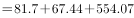亿元；根据文字材料第一段“截至2013年6月，全国税收总收入完成59260.61亿元，同比增长7.9%”可得，2013年上半年全国税收增长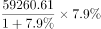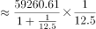 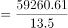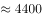亿元。因此，2013年上半年房产税、城镇土地使用税及契税三项增收之和占全国税收增收比重为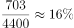，与D项最接近。

故正确答案为D。

### 第 108 题

2011年1-6月，全国关税收入约为：

A. 1300亿

B. 1350亿

C. 1380亿

D. 1540亿

第 108 题 · 答案与解析

**参考答案（粉笔题库参考内容）**

B

**解析**

根据“2011年1-6月，全国关税收入约为”，结合材料时间为2013年，可判定本题为基期计算问题。表格中提供了2013年现期量和增长量，文字材料可以推出2012年的增速，则2011年1-6月全国关税收入为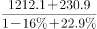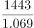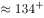，选项差距较小，保留3位有效数字直除，与B项最接近。

故正确答案为B。

### 第 109 题

2013年上半年与上年同期相比，下面四个税种中增速最快的税种是：

A. 企业所得税

B. 国内增值税

C. 出口货物退增值税消费税

D. 契税

第 109 题 · 答案与解析

**参考答案（粉笔题库参考内容）**

D

**解析**

前两项增速直接在材料中可以找到，企业所得税为14.2%，国内增值税为6.6%，而出口货物退增值税消费税的增速为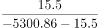&lt;0，负增长。契税的增速为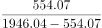≈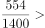33%，所以增速最快的是契税。

故正确答案为D。

### 第 110 题

下列说法与资料相符合的有几个？

①2013年第一季度我国税收总收入同比增速低于7.9%

②2013年我国税收总收入预计可以达到118520亿元

③若2013年上半年进口货物增值税消费税维持上年同期水平，那么，2013年上半年我国税收总收入同比增长将比2012年提高约1.5个百分点

④2013年我国上半年企业所得税、国内增值税两项之和不到同期税收总收入的50%

A. 0

B. 1

C. 2

D. 3

第 110 题 · 答案与解析

**参考答案（粉笔题库参考内容）**

C

**解析**

①：2013年前6个月税收总收入同比增速为7.9%，其中4月为7.9%，5月为8.3%，6月为12.9%。根据混合增长率口诀，可知2013年第一季度的同比增长率低于7.9%，正确。

②：材料中仅指出2013年上半年的税收收入，下半年无从得出，错误。

③：若2013年上半年进口货物增值税消费税维持上年同期水平，则2013年全年税收总收入比实际多1313.78亿元，这个增量带来的增速约为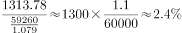，而今年实际增速比去年低1.9个百分点，若多2.4个百分点，则比去年高出0.5个百分点，错误。

④：企业所得税与国内增值税之和为亿元，乘以2倍得29282×2=58564，但是实际值是59260.61，不到50%，正确。

综上所述，与资料相符合的说法有2个。

故正确答案为C。

## 材料 2

经过50多年的发展，我国台湾地区资本市场建立起由“证券交易所集中市场—上柜市场—兴柜市场”构成的完善成熟的多层级资本市场体系。今年由于金融海啸、欧债危机等因素影响，台湾多层次资本市场总体成交值从2010至2012年连续3年下降，2012年较2011年衰退23.38%。周转率也呈现逐年下降趋势，2012年证券交易所集中市场周转率为97%，上柜市场周转率为175%，兴柜市场周转率为27%。

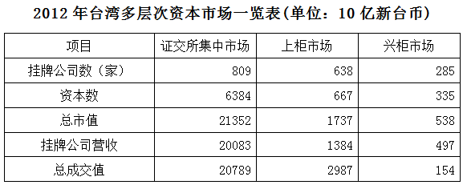

        台湾资本市场第一层次是证券交易所集中市场。在准入门槛方面，台湾证交所要求上市企业实收资本6亿新台币以上；从设立年限来看，要求上市企业设立满3年以上；从获利能力来看，要求上市企业最近1个会计年度无累计亏损，且税前利润占财务报表中的比率最近5个年度达到3%以上，或最近2个年度都达6%。至2012年底止，上市公司有809家，资本额6.384兆新台币，台湾证券交易所总市值在世界交易所联合会（WFE）会员中排名与前一年相同，为第22名，所占比重仍为1.34%；成交值排名第15名，排名不变，所占比重由1.41%略降至1.39%；周转率排名为第9名，较2011年下降2名。

        台湾资本市场第二层次是上柜市场。在准入门槛方面，上柜市场要求公司实收资本额必须在新台币5000万元以上；从获利能力来看，上柜公司要求个别及合并财务报表获利能力最近年度达4%以上，且其最近一个会计年度结算无积累亏损，或最近二个年度获利能力均达2%以上。至2012年底，上柜公司有638家，资本额0.667兆新台币，总市值1.737兆新台币。

        台湾资本市场第三层次为兴柜市场。在准入门槛方面，兴柜市场没有营业利润、资本额、设立年限的限制，只需符合已经申报上市或上柜辅导且两家以上证券商书面推荐。至2012年底，兴柜公司285家，资本额0.335兆新台币，总市值0.538兆新台币。

### 第 111 题

2012年，台湾某企业实收资本额为2亿新台币，该企业最近2个年度会计报表获利能力均为3%，该企业最适合进入台湾哪个层次资本市场：

A. 证券交易所集中市场

B. 上柜市场

C. 兴柜市场

D. 无法进入

第 111 题 · 答案与解析

**参考答案（粉笔题库参考内容）**

B

**解析**

根据题干问“最适合进入台湾哪个层次资本市场”和文字材料给出了各个选项的准入门槛判断本题为直接找数问题。根据文字材料第三段判断该企业实收资本2亿新台币，符合准入门槛5000万元以上的要求；最近2个年度会计报表获利能力均为3%，符合获利能力中的“最近2个年度获利能力均达2%以上”。所以该企业最适合进入台湾上柜市场。

故正确答案为B。

## 材料 3

经过50多年的发展，我国台湾地区资本市场建立起由“证券交易所集中市场-上柜市场-兴柜市场”构成的完善成熟的多层级资本市场体系。今年由于金融海啸、欧债危机因素影响，台湾多层次资本市场总体成交值从2010至2012年连续3年下降，2012年较2011年衰退23.38%。周转率也呈现逐年下降趋势，2012年证券交易所集中市场周转率为97%，上柜市场周转率为175%，兴柜市场周转率为27%。

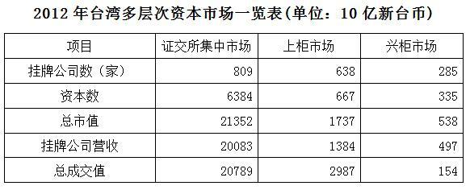

        台湾资本市场第一层次是证券交易所集中市场。在准入门槛方面，台湾证交所要求上市企业实收资本6亿新台币以上；从设立年限来看，要求上市企业设立满3年以上；从获利能力来看，要求上市企业最近1个会计年度无累计亏损，且税前利润占财务报表中的比率最近5个年度达到3%以上，或最近2个年度都达6%。至2012年底止，上市公司有809家，资本额6.384兆新台币，台湾证券交易所总市值在世界交易所联合会(WFE)会员中排名与前一年相同，为第22名，所占比重仍为1.34%；成交值排名第15名，排名不变，所占比重由1.41%略降至1.39%；周转率排名为第9名，较2011年下降2名。

        台湾资本市场第二层次是上柜市场。在准入门槛方面，上柜市场要求公司实收资本额必须在新台币5000万元以上；从获利能力来看，上柜公司要求个别及合并财务报表获利能力最近年度达4%以上，且其最近1个会计年度结算无累计亏损，或最近2个年度获利能力均达2%以上。至2012年底，上柜公司有638家，资本额0.667兆新台币，总市值1.737兆新台币。

        台湾资本市场第三层次为兴柜市场。在准入门槛方面，兴柜市场没有营业利润、资本额、设立年限的限制，只需符合已经申报上市或上柜辅导且有两家以上证券商书面推荐。至2012年底，兴柜公司有285家，资本额0.335兆新台币，总市值0.538兆新台币。

### 第 112 题

2012年世界交易所联合会（WFE）会员总市值为：

A. 894.73兆新台币

B. 1593.43兆新台币

C. 1799.73兆新台币

D. 2135.22兆新台币

第 112 题 · 答案与解析

**参考答案（粉笔题库参考内容）**

B

**解析**

从表格可知，台湾证券交易所总市值为213520亿新台币，即21.352兆新台币。从文字材料第二段可知台湾证券交易所总市值所占比重为1.34%，所以世界交易所联合会（WFE）会员总市值为兆新台币，与B项最接近。

故正确答案为B。

### 第 113 题

2012年台湾证券交易所集中市场平均每家公司成交值是兴柜市场平均每家公司成交值的多少倍：

A. 17.6

B. 27.6

C. 37.6

D. 47.6

第 113 题 · 答案与解析

**参考答案（粉笔题库参考内容）**

D

**解析**

本题考查倍数计算。根据题意列式有，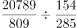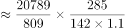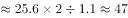，与D项最接近。

故正确答案为D。

### 第 114 题

2011年台湾三个层次资本市场的总成交值为：

A. 15.441兆新台币

B. 23.931兆新台币

C. 31.233兆新台币

D. 45.023兆新台币

第 114 题 · 答案与解析

**参考答案（粉笔题库参考内容）**

C

**解析**

2012年总成交值为20789＋2987＋154＝23930。从第一段材料可知，2012年较2011年下降23.38%，所以2011年总成交值为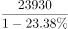。因为计算值一定大于23.931，所以可以排除A、B项；而D选项45.023，接近23.93的两倍，不符合增长率23.38%的情况。

故正确答案为C。

### 第 115 题

根据以上资料，下列说法中正确的是：

A. 2012年世界交易联合会（WFE）会员总成交值约为1721.58兆新台币

B. 2012年台湾证券交易所成交值在世界交易联合会（WFE）会员中排名未发生变化

C. 2012年在台湾三层次资本市场中，最好的资本市场上的挂牌公司营收平均值比最差市场的16倍还多

D. 周转率越高，挂牌公司的营收平均值越高

第 115 题 · 答案与解析

**参考答案（粉笔题库参考内容）**

B

**解析**

A项：2012年世界交易所联合会（WFE）会员总成交值为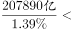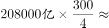兆，错误；

B项：直接查看材料可知，2012年台湾证券交易所成交值在世界交易联合会（WFE）会员中排名未发生变化，正确；

C项：最好的资本市场挂牌公司营收额平均值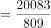，最差的营收额平均值=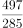，故最好的约为最差的：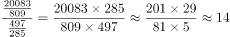倍，错误；

D项：定位文字材料第一段可知，2012年证券交易所集中市场周转率为97%，上柜市场周转率为175%，兴柜市场周转率为27%；定位表格材料可知，2012年证券交易所集中市场营收200830亿新台币，挂牌公司数809家；上柜市场营收13840亿新台币，挂牌公司数638家。则证券交易所集中市场营收平均值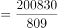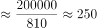亿新台币/家；上柜市场营收平均值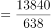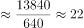亿新台币/家。175%＞97%，而22亿新台币/家＜250亿新台币/家，并非周转率越高，营收平均值越高，错误。

故正确答案为B。

## 材料 4

2012年末，中国大陆总人口135404万人，全年出生人口1635万人，死亡人口966万人。从性别结构看，男性人口69395万人，同比增加327万人；女性人口66009万人，同比增加342万人；从城乡结构看，城镇人口71182万人，同比增加2103万人；乡村人口64222万人，同比减少1434万人。

        2012年末全国就业人员76704万人，比上年末增加284万人。其中城镇就业人员37102万人，比上年末增加1188万人；乡村就业人员39602万人。

        2012年末，0~14岁（含不满15周岁）人口22287万人，占总人口的16.5%；15~59岁（含不满60周岁）劳动年龄人口93727万人，占总人口的69.2%；60岁及以上人口19390万人，占总人口的14.3%。

        2012年全国农民工总量26261万人，比上年增加983万人，增长3.9%。其中本地农民工9925万人，增长5.4%；外出农民工16336万人，增长3.0%。

### 第 116 题

2011年中国大陆总人口是：

A. 133769万人

B. 136370万人

C. 134735万人

D. 136103万人

第 116 题 · 答案与解析

**参考答案（粉笔题库参考内容）**

C

**解析**

根据题干中“2011年中国大陆总人口”和材料第一段“2012年全年出生人口1635万人，死亡人口966万人”确定本题为简单加减计算。2012年新增人口=出生人口–死亡人口=1635–966=669万人，则2011年中国大陆总人口=135404–669，尾数为5，直接判定为C项。

故正确答案为C。

### 第 117 题

相较于2011年，2012年乡村就业人员的变化为：

A. 增加904万人

B. 减少904万人

C. 增加1472万人

D. 减少1472万人

第 117 题 · 答案与解析

**参考答案（粉笔题库参考内容）**

B

**解析**

根据题干中“乡村就业人员变化”和材料第二段“全国就业人员增加284万人，其中城镇增加1188万人”，可求得乡村就业人员变化，需用总增加–城镇增加。故本题为简单加减计算问题。2012年乡村就业人员变化为284–1188=–904，减少904万人。

故正确答案为B。

### 第 118 题

2012年中国男性人口、女性人口、城镇人口的同比增长率按大小排序正确的是：

A. 城镇人口>男性人口>女性人口

B. 城镇人口>女性人口>男性人口

C. 女性人口>男性人口>城镇人口

D. 女性人口>城镇人口>男性人口

第 118 题 · 答案与解析

**参考答案（粉笔题库参考内容）**

B

**解析**

根据题干中“增长率按大小排序”确定本题为一般增长率比较问题。根据材料第一段可知城镇、男性、女性人口的现期量和增加量，代入增长率计算公式，可得城镇人口增长率；

男性人口增长率；

女性人口增长率。

观察发现，分母相差不多，分子很明显城镇最大，因此城镇增速最大；女性的增长量（分子）大于男性，而总量（分母）小于男性，那么女性增速必然大于男性增速。则城镇人口增长率>女性人口增长率>男性人口增长率。

故正确答案为B。

### 第 119 题

2012年，中国大陆1～14岁（含不满15周岁）的人口数量为：

A. 20652万人

B. 23922万人

C. 22287万人

D. 1635万人

第 119 题 · 答案与解析

**参考答案（粉笔题库参考内容）**

A

**解析**

定位文字资料第一段“2012年末······全年出生人口1635万人”，定位文字资料第三段“2012年末，0~14岁（含不满15周岁）人口22287万人”，则1~14岁（含不满15周岁）的人口数量=22287-1635=20652万人，故A项符合。

故正确答案为A。

### 第 120 题

根据上述资料，可以推出的是：

A. 2012年城镇男性人口数量大于城镇女性人口数量

B. 2012年本地农民工的增加量小于外出农民工的增加量

C. 在不存在人口跨境流动的前提下，2026年中国大陆人口15-59（含不满60周岁）人数最多比2012年多22287万人

D. 2012年乡村人口转移进城市变成城镇人口的数量最多不超过1434万人

第 120 题 · 答案与解析

**参考答案（粉笔题库参考内容）**

C

**解析**

根据题干中“可以推出的是”确定本题为综合分析问题，可逐项分析选择出可以推出的一项。

A项：因为材料中并没有划分城镇男性人口和城镇女性人口，所以错误；

B项：根据材料最后一段，本地农民工增长量=万人（采用百化分估算：），，496＞490，错误；

C项：根据材料第三段，在2026年，原本（2012年末）0～14岁（含不满15周岁）的人大部分会进入15～59岁（含不满60周岁）的范围。原本（2012年末）45～59岁（含不满60周岁）的人口也会有部分从此范围出去，所以15～59岁（含不满60周岁）的人口除了有增加的部分，也会有减少的部分，故增加的部分最多不超过2012年0~14岁人口总数22287万人，正确；

D项：根据材料第一段，2012年末，乡村人口同比减少1434万人。若减少的乡村的人口数量全部转到城镇人口，则从乡村人口转移进城市变成城镇人口的数量为1434万人。乡村人口减少数=乡村人口转移进城镇人数+死亡人数-出生人数-城镇人口转移进乡村人数，而此时未考虑出生人数与死亡人数问题以及城镇人口转移进乡村的情况，若2012年乡村人口中出生人数与城镇人口转移进乡村人数之和大于死亡人数，则乡村人口转移进城镇人口的数量应多于1434万人，错误。

故正确答案为C。

## 材料 5

2012年，全国国内旅游人数29.57亿人次，比上年增长12.0%。其中，城镇居民19.33亿人次。2012年，全国国内旅游收入22706.22亿元，比上年增长17.6%。2012年，全年入境外国游客人数比上年增长0.3%，其中，亚洲市场入境人数1664.88万人次，与上年基本持平，占入境外国游客人数61.2%；欧洲市场入境人数592.16万人次，增长0.2%；美洲市场入境人数317.95万人次，减少0.7%；大洋洲市场入境人数91.49万人次，增长6.5%；非洲市场入境人数52.49万人次，增长7.4%。

### 第 121 题

2012年全国国内旅游收入比2011年增加了约：

A. 3098.45亿元人民币

B. 3398.21亿元人民币

C. 3996.29亿元人民币

D. 4849.87亿元人民币

第 121 题 · 答案与解析

**参考答案（粉笔题库参考内容）**

B

**解析**

由材料可知，2012年国内旅游收入22706.22亿元人民币，比上年增长17.6%，故比2011年增加了，与B项最接近。

故正确答案为B。

### 第 122 题

2012年，农村居民国内旅游人数占全国国内旅游人数的比例约为：

A. 30.53%

B. 32.43%

C. 34.63%

D. 38.83%

第 122 题 · 答案与解析

**参考答案（粉笔题库参考内容）**

C

**解析**

由材料中“2012年，全国国内旅游人数29.57亿人次，其中，城镇居民19.33亿人次”可得，农村旅游人数=29.57-19.33=10.24亿人次。则农村旅游人数所占全国比重=，略大于，只有C项符合。

故正确答案为C。

### 第 123 题

2011年，欧洲入境游客人数占入境外国游客人数的比例约为：

A. 32.4%

B. 27.6%

C. 25.3%

D. 21.8%

第 123 题 · 答案与解析

**参考答案（粉笔题库参考内容）**

D

**解析**

由题干“2011年······占······比例约为”，结合材料时间是2012年，可判定本题为基期比重问题。定位文字材料“2012年，全年入境外国游客人数比上年增长0.3%，其中，亚洲市场入境人数1664.88万人次，与上年基本持平，占入境外国游客人数61.2%；欧洲市场入境人数592.16万人次，增长0.2%”可知：

2011年入境外国游客人数；

则2011年，欧洲入境游客人数占入境外国游客人数的比例约为：，与D项最接近。

故正确答案为D。

### 第 124 题

2011年，除美国、加拿大以外的美洲国家游客入境旅游人数约为：

A. 13.8万人次

B. 23.8万人次

C. 33.8万人次

D. 43.8万人次

第 124 题 · 答案与解析

**参考答案（粉笔题库参考内容）**

C

**解析**

求除美国、加拿大以外的美洲国家游客入境旅游人数=2011年美洲国家的人数-2011年美国人数-2011年加拿大人数万人次。

故正确答案为C。

### 第 125 题

根据上述资料，不能推出的是：

A. 2012年，韩国为我国第一大入境客源国

B. 2012年，在20个主要客源国中，六成来自亚洲

C. 2012年，非洲地区入境游客量约占入境外国游客总量的2%

D. 2012年，越南是入境旅游人数增长最快的客源国

第 125 题 · 答案与解析

**参考答案（粉笔题库参考内容）**

D

**解析**

A项：查看图表可得，韩国在我国主要客源国数据中排名第一，故A项表述正确；

B项：在图表20个主要客源国中，有12个位于亚洲，占总数的60%，故B项表述正确；

C项：非洲入境人数为52.49万人，占外国游客总量的比重，故C项表述正确；

D项：根据表格材料只能得到在主要客源国中越南增长最快，但不知道其它非主要客源国的增长情况，所以无法确定越南一定是增长最快的客源国，表述错误。

本题为选非题，故正确答案为D。

