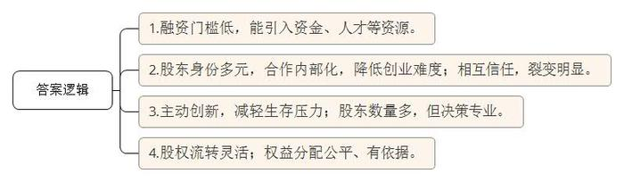
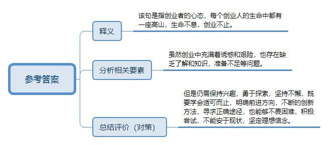
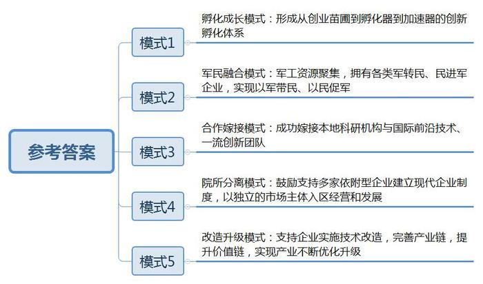
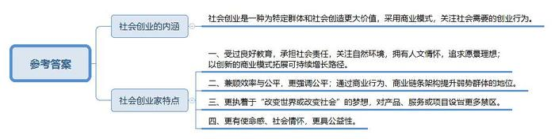
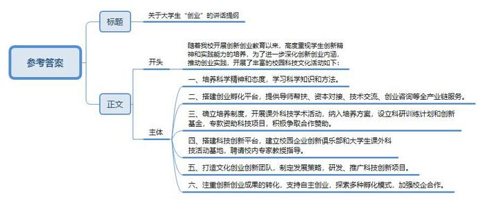
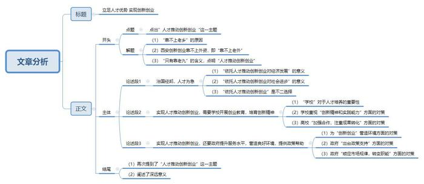

# 2016年公务员多省联考《申论》题（陕西卷）

<!-- gwy:overview:start -->
> **陕西 · 2016 · 申论 · 统考** ｜ 6 题 · 图片 6 处 · 答案随题折叠

导航：[题目](#题目) · [材料 1](#材料-1)
<!-- gwy:overview:end -->

> 候选采集稿。参考答案及解析来自粉笔页面，不代表官方答案或真实高分答卷；来源使用许可与原卷对应关系仍需人工核实。

## 给定材料

### 材料 1

2015年3月，在陕西某大学春季高校双选会上，从该校走出来的毕业生创业公司——蒜泥科学有限公司，短短一天就收到428份简历，其中该校学生102人。刚刚成立1年多的蒜泥科学有限公司在学弟学妹心中，充满神圣。

公司联合创始人是该校2012届研究生，从大学二年级开始，便带领着自己的团队走上了机器人与3D打印的创新创业之路。在校期间，他完成了五代机器人的设计与研发工作，多次获得国家级奖项。2014年9月，凭借着智能机器人项目，杨少毅获得中国中央电视台《中国创业榜样》“未来之星”奖，同年被评为“陕西省大学生自主创业明星”。在校大学生获此荣誉，是该奖项创立以来的首次。

1988年，该校团委推出了首届“星火杯”科技竞赛。经过26年的发展，校园科技文化活动走出了一条从无到有、从小到大、从零散自发到规范组织的蓬勃发展之路。

“星火杯”点燃了学生科技创新的“星星之火”，为大学生挥洒求知热情、展示聪明才智架起了广阔舞台，进一步引导广大学生努力培养科学精神和科学态度，积极学习科学知识和科学方法。从1988年到现在，“星火杯”每年举办一次，并逐步形成班级组织、个人申报、指导老师推荐、各个学院组织初评、学校组织优秀作品竞赛的规范化工作程序。参加竞赛的学生人数和作品数量也逐年增加。到2014年的第26届“星火杯”竞赛时，有8000余名大学生提交了3600余件优秀作品参加决赛，作品内容包括科技发明制作、计算机软件开发设计、自然科学类论文、哲学社会科学类社会调查报告和论文等5大类，涉及电子、通信、机械、环保、管理、经济等多个领域。

为进一步深化大学生创新创业内涵，推动大学生创业实践，学校重点建设了“文化科技创意创业工作坊、移动互联网创业工作坊、智能硬件创业工作坊”三大创业工作坊；并依托创业工作坊，建设“1931创业咖啡厅”，以“天天有咖啡、周周有沙龙、月月有路演”的运营思路，为该校学子搭建起一个具有导师帮扶、资本对接、技术交流、创业咨询等服务功能的“创业苗圃”，打造具有全产业链服务能力的创新型创业孵化平台。

该校是我国电子信息技术领域高层次人才培养和科学研究的重要基地，学校一向高度重视学生创新精神和实践能力的培养，围绕“创新”和“实践”来进行育人已成为学校特色之一。正是看到了“星火杯”竞赛活动对于学校育人的重大作用，该校将课外科技学术活动已经纳入本科培养方案，形成了经常化、基地化、规范化的工作局面。设立了大学生科研训练计划和大学生科技创新基金，每年拨出专款用于学生科技项目的资助，同时积极争取校内单位和社会各界的合作赞助。

有了制度保证，校园科技活动逐步形成了由团委和学生团体牵头组织，校内各单位全力支持、学生积极参与、教师热心指导的良好氛围。近几年来，为同学们搭建科技创新平台，帮助同学们提高工程实践能力，促进学生、学校、企业三方共同发展，校团委联合知名企业、研究所，建立起了近20个校园企业创新俱乐部，聘请校内专家教授作为俱乐部指导老师，并先后建立起15个大学生课外科技活动基地。课余时间，一大批富有创新热情的学生如鱼得水，在这里参与教师的课题研究或在老师的指导下从事自己感兴趣的研究。

此外，该校“大学生文化科技创意团队”是全国高校第一只文化科技创意团队，以“品牌化”、“系列化”、“阵地化”、“产品化”为发展策略，致力研发、推广融合传统文化的科技创新项目。2014年9月，团队“妙趣剪纸”项目获全国大学生创业大赛移动互联网创业专项赛金奖，是西北高校唯一一个金奖。创业团队获得10万元创业基金和1万元现金奖励。学校另外两个参赛项目“微客信息科技有限公司”和“西安学生汇电子商务有限公司”获得铜奖。

该校开展创新创业教育以来，不仅重视创新意识、创新精神的培养，还注重创新创业的成果的转化和学生自主创业的支持，按照“内创、外创、出售”三种孵化模式，和企业加强合作，截止2015年3月，校企创新创业俱乐部已达到50多个。

### 材料 2

在北京西北部一栋办公楼冷飕飕的地下室里，一群想要成为企业家的人正聚集在计算机屏幕前，注视着他们最新的项目雏形。而在几公里之外，在一个暖意融融、装修更为豪华的地下演讲厅里，30多名经理和创业者也在讨论有关新产品和新公司的创意。这两群人都验证着中国社会对创业热潮日益增长的兴趣。英语在线教学服务“英语流利说”创始人王某表示：“初创是令人迷恋的新事物。”“中国的创业精神呈现一种上升趋势。顶级风投公司正在寻找年轻的创业者——整套生态系统逐步形成。”

据不完全统计，从2013年5月至今，中央层面已经出台至少22份相关文件促进创业创新。各地方政府也纷纷出台政策，简政放权，从财税、金融、保障服务、政策激励等方面支持创新型企业特别是创新型小微企业发展，使各种创新资源向企业集聚，让更多金融产品和服务对接创新需求，用创新的翅膀使中国企业飞向新高度。2015年10月19日，在全国“大众创业 万众创新”活动周启动仪式上，李克强总理被现场热烈气氛所感染而登台发表即席演讲，称“要为创新创业者站台”。李克强总理指出，大企业员工和草根创业者通过创新创业都可以成为更多财富的创造者和拥有者。这既是收入分配结构调整的重要内容，也促进了社会公平正义。双创为所有人提供了公平竞争的机会，让有能力的人通过自身奋斗获得上升通道。

### 材料 3

2014年12月12日，西安诺瓦科技在北京荣获2014年度“十佳LED显示屏周边设备”称号。作为一家出货量稳居行业首位、租赁市场占有率超过80%的小微企业，从2008年成立之初的主营收入仅有11万元，而现在主营收入达到6500万元。诺瓦科技在西安高新区这方创业投资的热土上，实现了质的飞跃。

近年来，像西安诺瓦这样的“小巨人”科技型中小微企业在西安高新区如雨后春笋般成长起来。据悉，2014年高新区企业总数累计超过3万家，90%以上属中小微企业。在电子信息、先进制造、生物医药、现代服务四大产业中，中小微企业数量分别占到总数的94.9%、82.8%、85.4%、97.2%。

这是一个惊人的数字。对于西安高新区这个“不沿江、不沿海、不沿边”的地方来说，中小微企业的绝对占比和蓬勃发展说明了什么？中小微企业在这片热土上的发展经历了怎样的阶段？还存在哪些困难？记者近日就此专门走访了相关部门和部分企业。

“基于西安高新区的自然区位状况，自成立之初，西安高新区的历任主任和现任管理者都坚持‘靠不上老乡、靠不上老外、只有靠老九’的思路。核心是立足本地科技人才资源，大力营造局部优化的发展环境、支持培育本土中小科技企业、发展高新技术产业的路子。”西安高新区党工委副书记、管委会主任说。

近年来，西安高新区始终遵循市场法则，不断拓宽发展思路，打造了层次丰富、类型多样的中小微企业群落，初步形成了促进中小微科技企业创新发展的五种模式。一是孵化成长模式。西安高新区形成了从创业苗圃到孵化器到加速器的创新孵化体系，累计孵化毕业企业1047家，在孵企业2200余家，成为全国孵化功能最全、成活率最高的孵化器之一。二是军民融合模式。目前区内军转民企业达到56家，民进军企业发展到69家，初步形成了“以军带民、以民促军、军民融合”的路子。三是合作嫁接模式。以西安炬光科技与光机所合作为例，实现了本地科研机构与国际前沿技术、一流创新团队的成功嫁接，为发展高功率半导体激光器这一战略性新兴产业赢得先机。四是院所分离模式。西安高新区鼓励支持140多家依附型企业建立现代企业制度，以独立的市场主体入区经营和发展。如理工晶科的前身是西安某高校校办工厂，2007年脱离母体并进入高新区发展后，迅速成为我国人工晶体生长设备制造的高科技主导企业，产品国内市场占有率达70%以上，多种产品远销欧美等国家。五是改造升级模式。西安高新区支持企业实施技术改造，完善产业链，提升价值链，实现产业不断优化升级。如陕西利安电子商务公司，承担了国家科技部“科技支撑计划”和国家发改委“国家信息化试点示范工程”，从原来代理水、电、气、火车票、飞机票、保险等便民业务的民营一站式社区服务点，实现了向延伸居民服务的“最后500米”、线上与线下有效互动的成功转型。

“因为西安高新区的创业氛围和支持政策，才让我们这样的中小企业有了从一个‘小鸡蛋’孵化着地的可能性。”回顾三年创业时期，擎天软件负责人说。

事实上，尽管有高新区的政策支持，但自身“小、散、弱”，融资难、成本高、用工难等问题仍困扰着众多中小微企业的发展。

从日本回国的杨先生创立了西安优括软件科技有限公司，主营跨境电商贸易和利用O2O（Online to Offline）辅助线下药店连锁提供智能终端服务。成立之初，企业便遭遇发展障碍，“首先，国内行业信息匮乏，很少看到及时的官方或者协会数据，市场方向很难判断。其次，对于互联网行业来说找到合适的合伙人很关键，特别在西安这样的内陆城市，但是西安本地成长起来的人比较缺乏创新能力和执行能力。专业背景能力比较好的人到西安对工资的要求要高于一线城市。再次，本地投资者追求投资盈利的时效性，这对于初创的互联网公司来说不太现实。”

西安风潮智能有限公司白某表示：“创业初期，公司遇到的最大问题是市场的开发。陕西互联网应用开发、软件开发行业虽然快速发展，但与北京、上海等一线城市相比，依然有较大差距，市场还不够成熟。用户对互联网应用开发这些新兴行业缺乏了解，依然处于传统的商业模式思维，对于全新的互联网商业模式方缺乏认同。”西安知格信息技术有限公司付某也表达了同样的困惑：“虽然成立之初定位为教育行业，但实际上对教育客户的资源信息掌握非常有限。”

在对众多企业主采访中我们了解到，融资难、运营成本高、创新不足、市场了解有限等因素对不同行业造成不同程度的困难。其中，融资难是中小微企业发展最大的绊脚石。为培育更多优秀的科技企业“小巨人”，高新区将从直接支持项目这只“有形的手”，逐渐转向通过市场引导这只“无形的手”，顺应市场规律，通过引导尝试对财政资金的支持方式进行改革，重点聚焦于贷款贴息、风险投资奖励、股权投资等方式，助力科技企业“小巨人”发展。

### 材料 4

乔治·马洛里是英国探险家，他曾就读于温切斯特公学和剑桥大学，曾是英国著名公学查特豪斯的教师。马洛里18岁的时候就喜欢上了登山，在那个被称为“阿尔卑斯登山的黄金年代”的日子里，年轻的马洛里并不是欧洲大陆最优秀的攀登者。然而，他对山有着巨大的兴趣，1921年到1924年，乔治·马洛里参加了人类前三次征服珠穆朗玛峰的尝试。

当马洛里随着登山队第一次来到珠峰脚下，第一次见到他心中的女神时，他将她描述为“梦境中最狂野的造物”，是那样巨大、美丽而又可怕！这一次他们到达了海拔6985米的地方，由于缺乏地形知识，全队处于极端疲惫的状态，他们没有向更高的地方前进，但是他们终于找到通向顶峰的路。除此之外，这次攀登让他们在“阿尔卑斯攀登方式”之外，找到了更适合于8000米山峰的“金字塔攀登方式”。

马洛里第二次攀登珠峰时，到达了8300米之处，离顶峰只有500米之遥。这一年最大的收获是发现了氧气的确切效用，并确立了高山氧气设备的基本模式——气瓶、气管、面罩，后世的人们只增加了一个调节器。

1924年6月，马洛里辞去了剑桥大学讲师职务，第三次来到珠峰的脚下，这一年他已38岁，有幸福祥和的家庭，有深爱着他的美丽妻子，有三个可爱的孩子和稳定的工作。当《纽约时报》的随队记者在追问他“你为什么要攀登珠峰”时，马洛里说，“因为山在那里！”。不久，当他和伙伴欧文再次向顶峰冲击时，他们永远留在了那里……

从某种意义上说，每个真正创业的人在他的内心深处都有一座高山，而生命不息，创业不止，正是绝大多数创业者的常态。

### 材料 5

深圳的创业者田峥想要做一款智能耳机，他发现，60%的人都会在跑步过程中听歌，并用手机APP记录运动数据。如果有产品能同时解决跑步人群运动数据记录和听歌的需求，又能通过音乐来实现运动激励，会有很好的市场前景。田峥对记者说，他想针对每个人的身体特征，设计和提供有效的音乐服务产品，做到每一个硬件设备都是针对个人定制的。

可是，光有好点子不行，初始创业的田峥，面临既缺资金、又缺人才的尴尬，他尝试着用股权众筹的方式来实现自己的创业梦想。在众筹网上，他发布了自己的股权众筹商业计划书，以出让公司10%股份的方式，融资187万元，最低投资额1万元。最终，吸引了16名投资者参与。田峥告诉记者，这些投资者为他引入了互联网、音乐、体育领域的强大资源，其中，几个最志同道合的投资人干脆直接加入了创业团队。

### 材料 6

在北京大学东门外一处不起眼的楼里，有一处名曰“一八九八咖啡馆”的休闲场所。它成立于2013年10月，虽然看起来很简朴，但成立以来，它每天都在吸引着大批“咖粉”流连忘返，且不少是业界大佬。它究竟有何魅力？

董事长杨勇认为，“在传统的创业中，第一步要找投资人，这就很难，能拿到钱更不容易。第二步，找完投资人之后，要把产品卖出去，也挺难的，所以每步都是一个坎。为什么那么多创业公司都死掉，为什么那么多中小企业发展不了？就是因为每一个坎都不容易走过去。众筹就把这个模式改变了，每个人都是投资人，每个人都是消费者，每个人也是传播者，这种方式的改变，你就发现，做公司容易了。所以某种意义上消费者就是投资者和生产者。”

杨勇说：“传统的创业特别辛苦，就是因为你老要求人，或者叫做外部交易，今天要找一个银行的人，去求管银行的人，给他什么好处帮我办个事情，这叫外部交易。现在众筹是什么呢？你缺什么就让谁来当股东，你把你未来要求的人全部变成股东了，把原来外部的交易变成内部的合作了，内部合作就非常容易。”

“200人聚在一起就有很大的能量。实际上，它真正意义在后面的裂变，每一个项目做完之后，会带出一堆项目出来，原因就是通过众筹找了200个非常靠谱的人，这些人再有非常多的合作机会，所以基本上一个项目出来会带一堆项目。一八九八咖啡馆实现众筹之后，项目太多了，很大原因就是因为找了一群可以相互信任，相互背书，又都不错的人，而这些人本身又是跨界又是组合，非常容易谈成生意，所以这个裂变的过程，力量会特别巨大。”

浏览股东花名册，200位发起人涵盖了北京大学近30年来不同届别、不同院系、不同专业的毕业生，皆为各领域中的知名人士、企业家、高层管理者。这些联合创始人所在的行业涉及金融、移动互联网、新能源、新媒体、教育、法律，高科技等多个领域。杨勇表示，“通过众筹，聚集众多资源。每天跟像打了鸡血一样，所以创业的生存问题解决了。”“这200人股东，可能我把他们伺候好了，每月就会有一两百万收入，这就挺好，公司就能存续下来。而创新是怎么来的？创新就是因为大家能够很轻松地做自己的事情了，就会主动去创新，每天为了生存去创业的时候，你就不可能去创新。”

### 材料 7

“如果你真的想做一件事，全世界都会帮助你”，时下正风靡的众筹让这句话以更直接的方式照进现实。2014年初，在广东某大学就读的刘永杰和3个小伙伴萌生了开一间咖啡馆的创业想法。这时，众筹模式走入了他们的视野，众筹咖啡馆“比逗BEPOTATO”的计划也就被列入了日程。

为了考察众筹在校园的可行性，2014年4月，创业团队在当地两所高校进行了300份以上的问卷调查，高达70％的参与众筹意愿给予了团队正式启动的信心。随后，他们以这两所学校的学生为目标群体进行股东招募。他们的众筹计划是：众筹股东每股1000元，每位最少需出资1000元，最多5000元，享有1至5股的分红权。经过一个多月的招募，他们共有170多位众筹股东和70多万元的启动资金。筹得了资金后，下一步就是选址。经过一段时间的考察，他们在五山地铁站附近租了一间临街的铺位。170多位众筹股东都竭力宣传这间咖啡馆，不仅自己来消费，也拉朋友来消费，开业两个月以来，咖啡馆的生意也越来越好。

在咖啡馆最显眼的地方，整个墙面挂满了印有比逗LOGO的马克杯，仔细一看，这些马克杯上都刻着名字和编号。张林向记者介绍，每一个马克杯代表咖啡馆的一位众筹股东。由于股东数量庞大，不少众筹咖啡馆最后变成了“看上去很美”而实际运营却举步维艰，落得散伙的下场。为了避免这种情况发生，咖啡馆建立了自己的董事会，由核心运营团队、校园股东、社会股东等7人构成，虽然每个众筹股东都拥有建议权，但最终的决策权是在专业的核心运营团队手中。“尽管有摩擦，但大家都奉行‘专业的事给专业的人做’的原则，合作很顺利。”刘永杰说。

为解决学生股东“毕业”带来的流动问题，“比逗 BEPOTATO”设置了学生股东毕业的股权流转计划。对于第一批学生股东，两年之后按贡献度排名，挑选一部分成为永久股东，其余在毕业时需将股份流转给附近高校在校生。对于之后加入的股东，均需要在毕业时将股份流转给合适的在校大学生。

利用校园优势，比逗将咖啡馆主题定位为“创业交流”。除了承接许多校园社团活动外，他们还承办“广东天使会”等线下交流活动。通过举办类似的创业交流活动，店铺也获得了更多的创业资源，一些更富有经验的专业团队还能够给予他们诸如薪酬制度设计的指导。一些兴趣小组也自发找到了比逗，如锤子科技、 海星会、微博读书会等等，都在“比逗”举办了线下活动。

“比逗”还在进行面向所有众筹股东的APP研发，主要目的是加强股东之间的交流、提高股东活跃度等。张林举例说，可以将股东对店铺的贡献设置成一个一个的任务，例如来店消费或发布一篇推介文章就能获得“经验值+1”，带朋友来消费就能够获得更多经验值。张林还举例说，店铺中要增加一幅壁画，以此设置一个任务，那么股东就可以通过APP来领取这个任务，在股东中找队友一起执行，完成后就获得相应的奖励。通过这样的任务完成获得的奖励积分，就可以更直观地看到每个股东对咖啡馆的贡献值，今后的分红、股权流转等就有据可依。

### 材料 8

在众多的创业者中还有这样一些与众不同的人，人们把他们的创业形式称之为社会创业。

年轻女孩小丁，为了解决残疾人和行动迟缓的老年人穿脱衣裤不便的问题，研发生产出了可拆卸的特制衣裤，并在这些特制衣裤上增加了加热、中药、磁极、按摩等辅助功能，患者试用后，好评如潮，目前产品已经投入市场。他们还为此申请了专利，注册了有限责任公司。

行为心理学认为，人对任何付出都是希望能有所回报的。一直以来，我国公益项目对捐赠人的奖励多是精神奖励，捐赠人的心理难以得到很好的满足，限制了公益事业的发展。小韩和小张创立了“路人甲”公众小额捐赠平台。他们希望把鼓励捐赠行为实体化物质化，能用商业的手段，解决这个社会问题。“路人甲”的“惠捐模式”在中国是首创，即用户在捐赠10元后即可兑换一张答谢券，凭着这张答谢券可享受众多合作商家的超值优惠和在线服务。这样一来受助者有尊严，捐赠人有答谢，商家得客户，捐赠人、商业机构和公益项目（或受助人）三者之间形成一个非常好的公益的价值闭环，互惠共赢，同时也挖掘了优质捐款户背后的巨大价值。

人们把小丁、小韩、小张这样的创业者称为社会创业家。第二届芝华士“赢之有道”社会创业家大赛的评委们用自己独特的视角与丰富的经验表达了对这些人的理解。

著名经济学家A：我所理解的社会创业家是新一代企业家，他们通常受过良好的教育，承担社会责任，关注自然环境，拥有人文情怀，追求愿景理想，他们以创新的商业模式拓展可持续增长的路径，在为企业和社会创造财富的同时，也回应社会挑战，贡献社会进步。作为评委，我关注参赛者的激情与智慧、理想与务实的平衡。

资深财经评论员B：社会资源的发展有两个终极目标，第一个是效率，第二个公平。普通的创业者一般的商业诉求是解决效率问题，并且通过提高效率来获得商业利润上的诉求。但是人类社会追求的另外一个目标就是公平。有的时候效率和公平之间是有矛盾的，社会创业家就是兼顾效率和公平的这样一批创业者，他们和一般创业者最大的区别就是他们更多强调的是公平。对于整个社会资源分配当中的一些处于弱势的群体，通过商业的行为、商业的链条架构来提升他们的地位，我觉得这是社会创业家与一般创业者最大的不同。

技术创业投资基金合伙人C：首先，我不认为哪个企业家是和社会脱离关系的。他们不论是提供产品还是提供服务，哪种方式都或多或少对社会产生了影响或创造了价值。如果有的创业家所做的事情是完全公益的，那么我佩服他。但是在毫不盈利的前提下，我并不建议这样做。

风险投资人D：社会创业家创业的第一动机更多是想实现“改变世界或改变社会”的目的，跟“发明者”和“追梦者”类似，不是以传统利润模式导向而是出于更高一层的梦想和驱动创业。这些创业者会比一般创业者对自己的产品、服务或项目设的禁区更多，但也比一般创业者对自己的梦想有着更超乎一般的执着和理念。用自己的优势结合梦想找到一个更有颠覆性的产品和思路是很重要的。

甘客科技创始人E：社会创业者就是创业者中的NGO(非政府组织)。他们创业是源于为特定群体、社会创造更大的价值。因此，他们的责任感、使命感更强，更有社会情怀，而非简单地追求个人财富的积累。这是创业的新型价值体系，更具有社会公益意义。

## 题目

### 第 1 题

**根据给定资料5—7，概括众筹的特点。（10分）**

关联材料：材料 5、材料 6、材料 7

作答要求：

要求：

（1）概括准确，内容全面，表述清晰；

（2）60-100字。

第 1 题 · 答案与解析

**参考答案（粉笔题库参考内容）**

1.融资门槛低，能引入资金、人才等资源。2.股东身份多元，合作内部化，降低创业难度；相互信任，裂变明显。3.主动创新，减轻生存压力；股东数量多，但决策专业。4.股权流转灵活；权益分配公平、有依据。

**解析**

**参考答案说明：**本参考答案从“融资”“股东”“运营”“股权”等不同方面进行了分条撰写。各条要点之间在内容上是并列关系，没有交叉。

**考点**：特点类

**来源**：2016年公务员多省联考《申论》题（陕西卷）

### 第 2 题

**给定资料4中英国登山家乔治·马洛里的名言“因为山在那里！”影响了无数勇于探索、勇于进取的人。请你结合实际，谈谈对这句话的理解。（15分）**

关联材料：材料 1、材料 2、材料 3、材料 4、材料 5、材料 6、材料 7、材料 8

作答要求：

要求：

（1）理解准确；

（2）思路清晰;

（3）120-200字。

第 2 题 · 答案与解析

**参考答案（粉笔题库参考内容）**

该句是指创业者的心态，每个创业人的生命中都有一座高山，生命不息，创业不止。

虽然创业中充满着诱惑和艰险，也存在缺乏了解和知识，准备不足等问题。

但是仍需保持兴趣，勇于探索，坚持不懈，既要学会适可而止，明确前进方向，不断的创新方法，寻求正确途径，也能够不畏困难，积极尝试，不能安于现状，坚定理想信念。

**解析**

**参考答案说明：**宏观上，本参考答案按照词句解释题的一般思路“释义+分析相关要素+总结评价（对策）”展开。内容方面，本参考答案先对“因为山在那里”的含义进行了解释；“分析相关要素”部分分析了“登山”即创业的原因，以及存在的困难、问题；最后给出如何“创业成功”的对策。

**考点**：词句解释类

**来源**：2016年公务员多省联考《申论》题（陕西卷）

### 第 3 题

**请你根据给定资料3，总结出西安高新区促进中小微科技企业创新发展的不同模式。（20分）**

关联材料：材料 3

作答要求：

要求：

（1）准确全面，条理清楚；

（2）180-300字。

第 3 题 · 答案与解析

**参考答案（粉笔题库参考内容）**

西安高新区促进中小微科技企业创新发展的不同模式如下：

一、孵化成长模式：形成从创业苗圃到孵化器到加速器的创新孵化体系。

二、军民融合模式：军工资源聚集，拥有各类军转民、民进军企业，实现以军带民、以民促军。

三、合作嫁接模式：成功嫁接本地科研机构与国际前沿技术、一流创新团队。

四、院所分离模式：鼓励支持多家依附型企业建立现代企业制度，以独立的市场主体入区经营和发展。

五、改造升级模式：支持企业实施技术改造，完善产业链，提升价值链，实现产业不断优化升级。

**解析**

**参考答案说明：**本参考答案从“孵化成长模式”“军民融合模式”“合作嫁接模式”“院所分离模式”“改造升级模式”五个方面进行额分条撰写。各条要点之间在内容上是并列关系，没有交叉。

**考点**：其他类

**来源**：2016年公务员多省联考《申论》题（陕西卷）

### 第 4 题

**给定资料8提到了“社会创业”和“社会创业家”两个概念，请你根据给定资料指出：(1)“社会创业”的主要内涵；(2)“社会创业家”的主要特点。（25分）**

关联材料：材料 8

作答要求：

要求：

（1）分析透彻，表达准确；

（2）180-300字。

第 4 题 · 答案与解析

**参考答案（粉笔题库参考内容）**

社会创业是一种为特定群体和社会创造更大价值，采用商业模式，关注社会需要的创业行为。

社会创业家特点：一、受过良好教育，承担社会责任，关注自然环境，拥有人文情怀，追求愿景理想；以创新的商业模式拓展可持续增长路径。二、兼顾效率与公平，更强调公平；通过商业行为、商业链条架构提升弱势群体的地位。三、更执着于“改变世界或改变社会”的梦想，对产品、服务或项目设置更多禁区。四、更有使命感、社会情怀，更具公益性。

**解析**

**参考答案说明**：本参考答案宏观上分成“内涵”与“特点”两个要素。在“内涵”内部，用“一种……创业行为”的句式解释了“社会创业”。在“特点”内部，又从“良好教育”“兼顾效率与公平”“执着梦想”“有使命感”等不同的方面进行了分条撰写。各条要点之间在内容上相互并列，没有交叉。

**考点**：多要素组合类

**来源**：2016年公务员多省联考《申论》题（陕西卷）

### 第 5 题

**假如你是某大学就业指导中心的工作人员，受邀为即将毕业的大学生做一次关于“创业”的专题报告，请你结合给定资料1，草拟一份讲话提纲。（30分）**

关联材料：材料 1

作答要求：

要求：

（1）观点明确，切实可行；

（2）条理清晰，逻辑性强；

（3）300-400字。

第 5 题 · 答案与解析

**参考答案（粉笔题库参考内容）**

关于大学生“创业”的讲话提纲

随着我校开展创新创业教育以来，高度重视学生创新精神和实践能力的培养，为了进一步深化创新创业内涵，推动创业实践，开展了丰富的校园科技文化活动如下：

一、培养科学精神和态度，学习科学知识和方法。

二、搭建创业孵化平台，提供导师帮扶、资本对接、技术交流、创业咨询等全产业链服务。

三、确立培养制度，开展课外科技学术活动，纳入培养方案，设立科研训练计划和创新基金，专款资助科技项目，积极争取合作赞助。

四、搭建科技创新平台，建立校园企业创新俱乐部和大学生课外科技活动基地，聘请校内专家教授指导。

五、打造文化创业创新团队，制定发展策略，研发、推广科技创新项目。

六、注重创新创业成果的转化，支持自主创业，探索多种孵化模式，加强校企合作。

**解析**

**参考答案说明：**（1）格式方面，本参考答案写到了“标题”“正文”。（2）正文部分，一方面从内容来看，围绕着“大学生创业”这一主题，本参考答案的开头先写到了“大学生创业”的背景、意义；主体部分从“培养科学精神和态度”“搭建创业孵化平台”“确立培养制度”“搭建科技创新平台”“打造文化创业创新团队”“注重创新创业成果的转化”这六个方面给出了具体的活动举措。另一方面，形式上，本参考答案做到了分段、分条撰写，整体上条理较为清晰。

**考点**：总结类

**来源**：2016年公务员多省联考《申论》题（陕西卷）

### 第 6 题

**给定资料3提到“靠不上老乡、靠不上老外、只有靠老九”，请你根据对这句话的理解，自选角度，自拟题目，写一篇文章。（50分）**

关联材料：材料 1、材料 2、材料 3、材料 4、材料 5、材料 6、材料 7、材料 8

作答要求：

要求：

（1）立意准确，思路清晰；

（2）结构完整，语言流畅；

（3）请勿规模摘录给定资料内容；

（4）总字数1000—1200字。

第 6 题 · 答案与解析

**参考答案（粉笔题库参考内容）**

**立足人才优势 实现创新创业**

与资本雄厚，群体庞大的徽商、晋商相比，陕西既没有悠久的民间经商历史，又缺乏带动区域发展的企业及企业家，经济发展靠不上老乡。同样，不同于长三角、珠三角的黄金地理位置，“不沿江、不沿海、不沿边”的西安，创新创业也靠不上外资的帮助。然而，西安却拥有较高的劳动力文化素质，丰富的人力资源，因此，推动创新创业只能靠老九！靠有知识，有文化，有能力的科学、技术、管理等人才。创新是引领发展的第一动力，创新驱动的实质是人才驱动。

**治国经邦，人才为急**。一方面，只有依托人才开辟创新创业之路，才能为经济发展注入原动力。创新创业的人才是现代化的，他们有热情，有兴趣，有智慧，他们把创意变成产品，依托我国制造业生态体系，丰富的人力资源和艺术沉淀，迅速整合资源，实现创业和带动就业，给经济发展带来机遇。另一方面，只有依托人才开辟创新创业之路，才能为社会进步添砖加瓦。新时代下，社会创业家不同于以往任何一种创业的形式，他们具备社会情怀、社会责任、公民意识，平衡在商业效率与社会公平之间，通过有效经营，为顾客提供优质产品，优良服务，行为商之德，让创业少了一份功利，多了一份温暖。可见，依托现代化人才推动创新创业已然成为不二的选择。

**实现人才推动创新创业，需要学校开展创业教育，培育创新精神**。学校是创新人才培养的孵化园。无论中小学，还是高等院校都需要将培养学生创新精神、创新能力、创新热情作为教育战略的重要一环。尤其是当代高等院校，作为祖国人才储备的基地，应该高度重视学生创新精神和实践能力的培养，围绕“创新”和“实践”教书育人，为学生搭建起一个具有导师帮扶、资本对接、技术交流、创业咨询等服务功能的“创业苗圃”。此外，高校应积极联合知名企业、研究所，注重创新创业的成果转化，实现产学研一体化式发展。

**实现人才推动创新创业，还要政府提升服务水平，营造良好环境，提供政策帮助。**双创为所有人提供了公平竞争的机会，李克强总理称“要为创新创业者站台”，让他们通过创新创业成为更多财富的创造者和拥有者。这既需要中央及地方政府出台政策，从财税、金融、保障服务、政策激励等方面支持创新型企业。又需要顺应市场规律，让市场在人才资源配置中起决定性作用，健全市场化、社会化的人才管理服务体系，保障落实用人主体自主权，以法治化思维探求政府与市场在人才管理服务领域的边界。

“一年之计，莫如树谷；十年之计，莫如树木；终身之计，莫如树人。”把人才资源开发放在创新创业最优先的位置，这些创新型人才是国家创新活力之所在，是科技发展希望之所在。

**文章分析**

**立足人才优势 实现创新创业**

【**标题的优点：**首先，范文的标题“立足人才优势 实现创新创业”突出了“人才推动创新创业”这一主题。其次，它在形式上采用对称式结构，使标题更加完整、饱满。】

与资本雄厚，群体庞大的徽商、晋商相比，（1）陕西既<u>没有</u>悠久的民间<u>经商历史</u>，又缺乏带动区域发展的<u>企业及企业家</u>，<u>经济发展靠不上老乡</u>。同样，不同于长三角、珠三角的黄金地理位置，（2）“不沿江、不沿海、不沿边”的西安，<u>创新创业也靠不上外资的帮助</u>。然而，西安却拥有较高的劳动力文化素质，丰富的人力资源，因此，（3）<u>推动创新创业只能靠老九</u>！靠有知识，有文化，有能力的科学、技术、管理等人才**。**创新是引领发展的第一动力，创新驱动的实质是人才驱动。

【**开头的优点：**★内容方面。范文的开头是紧扣题目给定的“靠不上老乡、靠不上老外、只有靠老九”这句话展开的。首先，**开头开门见山的点出主题，做到了主题明确。其次，对“**人才推动创新创业**”这一主题进行了分析阐述，指出了（1）“**靠不上老乡**”的原因。（2）西安创新创业靠不上外资，即“靠不上老外”。（3）“**只有靠老九**”的含义，点明“人才推动创新创业”**。★文字表达方面：使用了“与……相比……”“同样……”“然而……因此……”等关联词，使语言表达有逻辑性。】

**治国经邦，**<u><b>人才为急</b></u>。一方面，（1）只有<u>依托人才开辟创新创业</u>之路，才能<u>为经济发展注入原动力</u>。创新创业的人才是现代化的，他们有热情，有兴趣，有智慧，他们把创意变成产品，依托我国制造业生态体系，丰富的人力资源和艺术沉淀，迅速<u>整合资源</u>，<u>实现创业和带动就业</u>，<u>给经济发展带来机遇</u>。另一方面，（2）只有<u>依托人才开辟创新创业</u>之路，才能<u>为社会进步添砖加瓦</u>。新时代下，社会创业家不同于以往任何一种创业的形式，他们具备社会情怀、社会责任、公民意识，<u>平衡在商业效率与社会公平之间</u>，通过有效经营，为顾客提供优质产品，优良服务，行为商之德，让创业少了一份功利，多了一份温暖。（3）可见，<u>依托现代化人才推动创新创业已然成为不二的选择</u>。

【**论述段1的优点：**★观点句：范文的观点句是紧扣“人才推动创新创业”这一文章主题提出的。形式上，它在段首处直接写出，位置突出，容易发现。内容上，关键词突出，内容要点明确，可以明显看出它是从“经济发展和社会进步”这两个角度入手，指出了“人才的重要性”。★论述内容：（1）介绍了“依托人才推动创新创业对经济发展”的意义；（2）介绍了“依托人才推动创新创业对社会进步”的意义；（3）“依托人才推动创新创业”是不二选择。注意：以上三个方面的内容都是紧扣“治国经邦，人才为急”这个观点句进行分析论述的，论述的针对性强，内容层次丰富。并且这三个方面的论述按照“总-分-总”的逻辑展开，先讲“人才推动创新创业对经济”的意义，然后再从“人才推动创新创业对社会”的意义，最后进行总结。★论述方法：采取了讲道理说理的论证方式，做到了论述深刻。】

**实现人才推动创新创业，需要**<u><b>学校开展创业教育</b></u>**，**<u><b>培育创新精神</b></u>。（1）<u>学校是创新人才培养的孵化园</u>。无论中小学，还是高等院校都需要将<u>培养学生创新精神</u>、<u>创新能力</u>、<u>创新热情</u>作为教育战略的重要一环。尤其是（2）当代高等院校，作为祖国人才储备的基地，<u>应该高度重视学生</u>创新精神和实践能力的培养，围绕“创新”和“实践”教书育人，<u>为学生搭建起一个</u>具有导师帮扶、资本对接、技术交流、创业咨询<u>等服务功能的“创业苗圃”</u>。此外，（3）高校应<u>积极联合</u>知名企业、研究所，<u>注重创新创业的成果转化</u>，<u>实现产学研一体化式发展</u>。

【**论述段2的优点：**★观点句：范文的观点句是紧扣“人才推动创新创业”这一文章主题提出的。形式上，它在段首处直接写出，位置突出，容易发现。内容上，关键词突出，内容要点明确，可以明显看出它是从“学校”的角度入手，指出了实现人才推动创新创业发展的对策。★论述内容：（1）先介绍了“学校”对于人才培养的重要性；（2）然后介绍了学校重视“创新精神和实践能力”方面的对策；（3）最后介绍了高校“加强合作，注重成果转化”方面的对策。注意：以上三个方面的内容都是紧扣“实现人才推动创新创业，需要学校开展创业教育，培育创新精神”这个观点句进行分析论述的，论述的针对性强，内容层次丰富。★论述方法：采取了讲道理说理的论证方式，做到了论述深刻。】

**实现人才推动创新创业，还要**<u><b>政府提升服务水平</b></u>**，**<u><b>营造良好环境</b></u>**，提供**<u><b>政策帮助</b></u>**。**（1）双创为所有人<u>提供了公平竞争的机会</u>，李克强总理称“要为创新创业者站台”，让他们通过创新创业成为更多财富的创造者和拥有者。（2）这既需要中央及地方<u>政府出台政策</u>，从财税、金融、保障服务、政策激励等方面支持创新型企业。（3）又需要<u>顺应市场规律</u>，让<u>市场在人才资源配置中起决定性作用</u>，健全市场化、社会化的人才管理服务体系，保障落实用人主体自主权，以法治化思维探求政府与市场在人才管理服务领域的边界。

【**论述段3的优点：**★观点句：范文的观点句是紧扣“人才推动创新创业”这一文章主题提出的。形式上，它在段首处直接写出，位置突出，容易发现。内容上，关键词突出，内容要点明确，可以明显看出它是从“政府”的角度入手，指出了实现人才推动创新创业发展的对策。★论述内容：（1）先介绍了为“创新创业”营造环境方面的对策；（2）然后介绍了政府“出台政策支持”方面的对策；（3）最后介绍了政府“顺应市场规律，转变职能”方面的对策。注意：以上三个方面的内容都是紧扣“实现人才推动创新创业，还要政府提升服务水平，营造良好环境，提供政策帮助”这个观点句进行分析论述的，论述的针对性强，内容层次丰富。★论述方法：采取了讲道理说理的论证方式，做到了论述深刻。】

【**论述段之间的关系**：★内容的内在逻辑：范文的论述段之间是依照要素的角度展开的。论述段1先写了“人才推动创新创业对治国经邦的重要意义”；论述段2再从“学校”的角度入手，指出了实现人才推动创新创业发展的对策；论述段3最后从“政府”的角度入手，指出了实现人才推动创新创业发展的对策。★段与段的外在衔接：论述段1尾处的句子“可见，依托现代化人才推动创新创业已然成为不二的选择”，起到了承接论述段2和论述段3的作用。】

“一年之计，莫如树谷；十年之计，莫如树木；终身之计，莫如树人。”（1）把<u>人才资源</u>开发放在<u>创新创业</u>最优先的位置，（2）这些创新型人才是国家<u>创新活力</u>之所在，是<u>科技发展希望</u>之所在。

【**结尾的优点**：范文的结尾回扣了“人才推动创新创业”这一主题。（1）再次提到了“人才资源”和“创新创业”。（2）阐述了深远意义。】

**解析状态：unknown（来源未提供）**

**考点**：文章写作题

**来源**：2016年公务员多省联考《申论》题（陕西卷）

