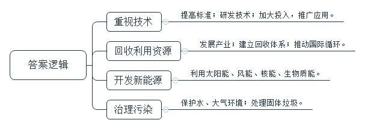
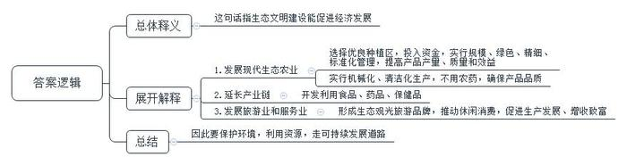
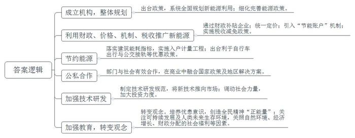
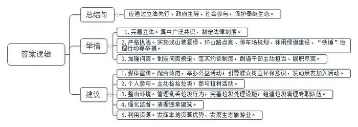
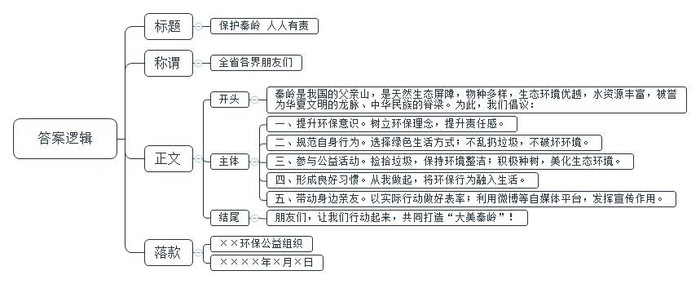
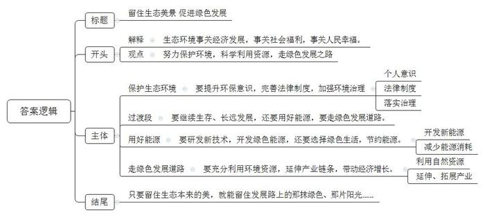

# 2017年公务员多省联考《申论》题（陕西卷）

<!-- gwy:overview:start -->
> **陕西 · 2017 · 申论 · 统考** ｜ 6 题 · 图片 6 处 · 答案随题折叠

导航：[题目](#题目)
<!-- gwy:overview:end -->

> 候选采集稿。参考答案及解析来自粉笔页面，不代表官方答案或真实高分答卷；来源使用许可与原卷对应关系仍需人工核实。

## 给定材料

### 材料 material-4109376d957de505

自美国人卡逊于1962年发表《寂静的春天》，对传统工业文明造成环境破坏作了反思后，引起各界对环境保护的重视。1972年，罗马俱乐部发表了《增长的极限》，对西方工业化国家高消耗、高污染的增长模式的可持续性提出了严重质疑。1987年，世界环境与发展委员会发表《我们共同的未来》，强调通过新资源的开发和有效利用，提高现有资源的利用效率，同时降低污染排放。1989年，英国环境经济学家皮尔斯等人在《绿色经济蓝图》中首次提出了绿色经济的概念。

我国社会各界已经充分认识到经济发展和环境保护统一的极端重要性，通过对资源环境产品和服务进行适当的估价，作出了相应的发展战略抉择。近年来，我国加强资源节约、环境保护技术的研发和引进消化，对重点行业、重点企业、重点项目以及重点工艺流程进行技术改造，提高资源生产效率，控制污染物和温室气体排放。制定更加严格的环境、安全、能耗、水耗、资源综合利用技术标准，严格控制高耗能、高污染工业规模。依法关闭一批浪费资源、污染环境和不具备安全生产的落后产能。采用信息技术改造提升传统产业。据测算，我国技术可行、经济合理的节能潜力超过4亿吨标准煤，可带动上万亿元投资。要加大节能关键和共性技术、装备与部件研发和攻关力度，重点攻克低品位余热发电、高效节能电机、高性能隔热材料、中低浓度瓦斯利用等量大面广的节能技术装备。要采取财政、税收等措施，促进成熟的技术、装备和产品的推广应用，大力发展节能服务产业。我国累计堆存工业固体废弃物近70亿吨，大量的废旧资源没有得到回收利用，随着蓄积量的不断增加，产业发展空间很大。要组织开展共伴生矿产资源和大宗固体废物综合利用、“城市矿产”餐厨废弃物资源化利用、秸秆综合利用等循环经济重点工程。要大力推动再制造产业发展。要加强再生资源回收体系建设，尽快建设完善以城市社区和乡村分类回收站和专业回收为基础、集散市场为核心、分类加工为目的的“三位一体”再生资源回收体系。要推动再生资源国际大循环，增强国际再生资源的获取能力。

新能源具有低碳清洁的特点，目前几乎供应着世界电力的1/5。其中风能发电正以每年30%的增长速度增长，太阳能增速超过40%。有关机构预计，到2050年清洁能源占一次能源结构的比重将达到32.2%。我国新能源发展潜力巨大，每年可再生能源资源可获得量达73亿吨标准煤，而现在开发量不足5000万吨标准煤，提升空间巨大。近年来，我国新能源快速发展。太阳能集热面积居世界首位；2009年风电装机容量突破2000万千瓦，已居世界第二位，在建规模达到1000万千瓦；在建百万千瓦级的核电机组已达19台；国内第一个兆瓦级大型太阳能光伏发电示范项目已经开展。生物质能利用也得到了较快发展。要加强水环境保护，加快城镇污水处理厂及配套网建设，推进重点领域水污染防治，推动严重缺水城镇污水再生利用设施建设。要加强大气环境保护，深入推进燃煤电厂脱硫设施建设，加快推进重点耗能行业二氧化硫综合整治；加快实施燃煤电厂和机动车氮氧化物处理设施建设，加快城镇生活垃圾处理设施建设，推动垃圾焚烧发电场建设，大力推进污垢无害化处置和医疗废物及危险废物处理设施建设，加强重金属污染综合治理。

### 材料 material-bf9368f43e9053e6

在陕南，茶产业既是绿色产业、生态产业，更是富民产业、朝阳产业。陕南三市是南水北调工程水源保护地和涵养地，水和空气洁净，是我国第二大富硒区，茶叶生态条件在全国独树一帜。茶叶农业总产值在陕南“茶，畜，桑”三大产业中居首位。2016年，全省茶园面积达222.17万亩，茶叶加工企业1280多家，产值300亿元。茶产业正成为陕南绿色发展最亮色。

浩渺云烟，茶叶梯田坡坡相偎，缕缕茶香的清新空气沁人心脾。茶山上云雾缭绕，万亩茶园郁郁葱葱。独特的地缘和生态环境，成就了陕茶卓越的品质。

“陕南是中国茶区中纬度最北的江北茶区，冬无严寒，夏无酷暑，气候温润，与高温高湿的南方茶区相比，病虫害发生概率低，群众极少使用农药。”汉中市茶产业办公室主任接受记者采访时说，汉中市在8个县随机抽取了18个样品送往中国茶科所进行检验检测，报告显示，不但农药残留及重金属含量都为零，茶多酚、氨基酸、硒、锌等含量在国检范围内均高于全国平均水平。

中共中央总书记、国家主席习近平曾指示强调，生态文明建设是“五位一体”总布局和“四个全面”战略布局的重要内容。各地区各部门要切实贯彻新发展理念，树立“绿水青山就是金山银山”的强烈意识，努力走向社会主义生态文明新时代。绿色，陕南发展经济的主色调，也恰恰是陕南茶产业的生态命脉。

在拥有优良气候条件、土壤环境、物质资源等优势的情况下，如何把每一片茶园管理好，让每一棵茶树长出优质的好茶叶，促进茶产业健康发展？西乡县大力推进茶叶种植区域战略转移，集中在良田好地发展良种茶叶园，规模发展，绿色种植，精细管理，标准采摘，不断提高茶叶产量、质量和效益。从2011年起，县政府每年安排不少于1000万元茶产业发展专项资金，镇村予以配套补助，以奖代补支持无性系良种茶园建设。在西乡县罗镇延宾茶园绿色安全基地，一块块黄板与翠绿的茶园形成鲜明对比。每亩茶园放置25张黄板与防虫灯一起，就可以实现绿色防控，提高茶叶品质。

“为了保证茶叶品质，我和收购茶叶的老板签了合同，不能使用农药，而且施肥要用有机肥。”与延宾茶园有着“合作”关系的村民胡先生帮茶园人工除草、施肥。茶园显得干净疏朗。

记者走访城固、西乡、南郑等县一些茶叶公司的车间均看到，各种大型的制茶机器一应俱全，传统茶乡正快步走在现代化发展的路子上。实行清洁化不落地生产，精制加工实行无菌化操作，车间里面的所有员工都需先消毒才可以进入，参观人员只有隔着一层玻璃才可以看到车间的工人们的工作流程，包装环节。

如今在陕南，独具特色的茶歌、茶舞、茶艺等民间艺术和集“采茶、制茶、品茶、购茶、茶艺、茶食”为一体的茶园生态观光旅游品牌已经形成。

陕南三市依托独一无二的生态资源优势，走出了一条将生态资源持续不断转化为经济优势的特色之路。汉中、安康、商洛三市28个县区有22个县区种茶、产茶。其中茶叶生产覆盖了西乡县全县18个乡镇和75%的农民，成为当地经济的重要支柱和农民收入的主要来源。在西乡、紫阳、平利、商南等县，茶产业总产值已占到当地GDP的20%以上。绿色，不只是色彩，是陕南发展的基因，更是农民增收的“法宝”。

现在，随着一大批茶园景观打造、道路绿化等工程实施，陕南天空更蓝了、山更绿了、水更清了、空气更清新了、村庄更美了、集镇更靓了。茶产业的快速发展，还带动了陕南地区茶食品、茶药品、茶保健品的开发利用。茶馆、茶楼、茶叶贸易、茶叶包装、休闲农业和乡村旅游逐渐升温。陕南茶农发展生产、增收致富的路子越走越宽。

### 材料 material-3955f8a999c17a6d

1976年，丹麦政府专门设立能源署，之后于2008年，又专门设置了丹麦气候变化政策委员会。1976年的“丹麦能源政策”作为丹麦第一部能源领域的整体规划明确提出：进口天然气来源限于北海和德国；利用发电废水供热；发展区域供暖系统；大力发展风能；增加国家支持的能效技术、新能源技术研发投入；鼓励工业和生活节能等。在随后的数十年中，丹麦不断细化和完善相关能源政策，例如利用财政补贴和价格激励，推动可再生能源进入市场，包括对“绿色”用电和近海风电的定价优惠，对生物质能发电采取财政补贴激励。丹麦采用固定的风电价格，以保证风能投资者的利益，风能发电进入电网可采用优惠价格，在卖给消费者之前国家对所有电能增加一个溢价，这样消费者买的电价都是统一的。另如，丹麦政府在建筑领域引入了“节能账户”的机制。所谓节能账户，就是建筑所有者每年向节能账户支付一笔资金，金额根据建筑能效标准乘以取暖面积计算，分为几个等级，如达到最优等级则不必支付资金。经过能效改造的建筑可重新评级，作为减少或免除向节能账户支付资金的依据。

丹麦能源政策法规的积极影响在本世纪初受到欧盟乃至全世界的关注和认可，欧盟于2012年提出“欧盟能效指令”即是最佳例证。该指令提出欧洲国家需要参考丹麦的绿色发展经验，于2014-2020年间创造能效投资2600亿欧元，节省能源成本5000亿欧元，并要求能源类企业到2020年前，每年节约能源成本至少达到营业额的1.5%。如果说丹麦的国土面积、人口数量、经济体量与中国相距甚远，其绿色发展经验对于中国来说参考价值有待商榷的话，那么欧盟在制定能源政策法规过程中，学习借鉴丹麦经验的做法本身，则值得注意研究。

丹麦的能源税包括从2008年开始提高原来的二氧化碳税，并从2010年开始实施更加严格的氮氧化物税标准。另一方面，丹麦政府对于节能环保的产业与行为进行税收减免。例如，为了鼓励对风电的投资，丹麦政府在20世纪80年代初期到90年代中期对风机发电所得的收入一直没有征税。在运输领域，对电动汽车则实行免税，并要求生物燃料的使用占运输燃料消耗的比重进一步提升。这种税收优惠与减免政策起到了很好的导向作用，对排碳量少的新能源收税低，促使更多人自觉通过经济调节，选择价格和污染相对较低的能源。

在另一个能耗重点领域——建筑行业，丹麦拟定了严格划分的建筑节能标准。一方面，政府对已有建筑的节能改造提供补贴，而且租售房屋前，业主必须提供建筑的能耗评级证书，不同等级的能耗评级对房价构成直接影响。另一方面，丹麦要求新建筑必须遵循严格的能耗指标，同时，丹麦计划到2020年前完成电、热、气、水的入户计量工程，这种能耗计量方式的普及对激励居民主动减少生活能耗效果显著。而且在实际生活中，由于有了法律法规的正面引领，促使建筑业也更具有前瞻性。近些年来，大量新建筑不仅是严格按照“2015建筑能耗规定”（BR2015）设计建造，有的甚至依照“2020建筑能耗规定”（BR2020），使得能耗标准再多减低25%。

值得一提的是，政府出台有利于自行车出行的道路安全与公交接轨等优惠政策和具体措施后，自行车成为包括王室人员及政府高官在内多民众日常出行的首选。如今，全国人口550万，自行车拥有量超过420万辆，人均拥有量为0.83辆（中国现为0.32辆），成为名副其实的“自行车王国”。

丹麦绿色发展战略的基础是公私部门和社会各界之间的有效合作。国家和地区在发展绿色大型项目时，在商业中融合自上而下的政策和自下而上的解决方案，这种公私合作可以有效促进领先企业、投资人和公共组织在绿色经济增长中取长补短，更高效地实现公益目标。哥本哈根将于2025年建成全球第一个零碳首都；第二大城市奥胡斯2030年实现碳中和；在南部森讷堡地区致力于2029年建成零碳社区。上述“零碳项目”均是公私合作的典型案例。

丹麦政府和国民具有强烈的忧患意识，把发展创新节能技术和可再生能源技术作为发展的根本动力，究其原因有三：首先，丹麦是资源贫乏的小国，受气候变化影响较大；第二，全球气候变化和应对气候变化的呼声日高，给丹麦企业界和研究界提供了动力和商机，把提高能源效率和发展可再生能源作为减排温室气体的最有效手段；第三，由于美国页岩气的价格十分低廉，所以无论是丹麦，还是中国、日本，其能源价格和电价都高于美国（国际能源署预估美国的优势将持续20年），丹麦企业要与美国企业竞争，必须借助于创新的节能减排技术提高竞争力，弥补能源价格方面的竞争劣势。

近年来，能源科技已成为丹麦政府的重点公共研发投入领域。通过制定《能源科技研发和示范规划》，确保对能源的研发投入快速增长，以最终将成本较高的可再生能源技术推向市场。此外，丹麦绿色发展模式调动了全社会的力量，在政府立法税收的引领下，新的能源政策始终强调加大对能源领域的研发投资力度，工业界积极参与，投入大量资金与人力进行技术创新，催生出一个巨大的绿色产业。通过多年努力，丹麦已经掌握许多与减排温室气体相关的节能和可再生能源技术，使丹麦的绿色技术远远走在了世界前列，丹麦成为欧盟国家中绿色技术的最大输出国。

丹麦今天“零碳转型”的基础，与其一百多年前从农业立国到工业化现代化转型的基础一样，均是依靠丹麦特有的全民终生草根启蒙式的“平民教育”，通过创造全民精神“正能量”而达到物质“正能量”，从而完成向着更以人为本、更尊重自然的良性循环发展模式的“绿色升级”。自从上世纪70-80年代两次世界性能源危机以来，丹麦人不断反思，从最初对国家能源安全的焦虑，进而深入到可持续发展及人类未来生存环境的层级，关照到自然环境、经济增长、财政分配的社会福利等各方面因素，据此勾勒出丹麦的绿色发展战略。

### 材料 material-99ba88e078d51d20

秦岭不仅为中国南北气候分界线，长江黄河的分水岭，更以其深厚的历史内涵和文化遗产、人文景观成为中国的父亲山，正因为有秦岭的气候屏障，才有了八百里秦川的风调雨顺；正因为有秦岭的水源滋润，才有了周、秦、汉、唐的绝代风华；正因为有秦岭的终年庇护，才造就了盛世长安的繁华景象。

秦岭作为我国天然生态屏障，物种多样，生态环境优越，水资源丰富，自古被誉为华夏文明的龙脉，中华民族顶天立地的脊梁。《中国国家地理》曾经这样评价：作为中国人的中央国家公园，假如没有秦岭，中国将不称其为中国。2015年2月，习总书记在陕西视察指出：“这样的自然生态美景，谁都不能破坏。”

只有实行最严格的制度、最严密的法治，才能为生态文明建设提供可靠保障。保护秦岭生态环境，最根本的是要集中广泛共识，形成科学完善、具有较强执行力的法律制度。

2007年11月，省十届人大常委会第34次会议通过的《陕西省秦岭生态环境保护条例》（以下简称《条例》），成为我国首部为一座山脉所进行的地方立法，对于促进秦岭地区生态环境保护和人与自然和谐起到了重要作用。

秦岭保护，北麓尤为关键，其中，西安又是关键中的关键。为保护秦岭生态的有效机制，2013年，《西安市秦岭生态环境保护条例》正式施行。以《西安市秦岭生态环境保护条例》实施为契机，西安市通过实施浅山坡复绿、环山路点亮、停车场规划、休闲绿道建设、“铁锤”治理行动等一系列举措，生态建设取得明显成效。为进一步加强对秦岭的保护，《西安市秦岭生态环境保护管理办法》已通过西安市政府常务会议审议，自2016年12月25日起施行。

2017年1月21日，西安市召开秦岭生态环境集中整治会议，西安市政府主要负责人提出，要加快制定秦岭保护工作问责规定，落实约谈制度，用刚性的制度管人、管事，用问责机制层层传导压力，倒逼各级干部主动担当、认真履职尽责，对失职渎职行为进行严肃问责，坚决保护好秦岭生态环境。

## 题目

### 第 1 题

**根据给定资料**3**，概括我国近年来经济发展的产业着力点。（10分）**

关联材料：材料 material-4109376d957de505

作答要求：

要求：全面、准确，简明，50~100字。

第 1 题 · 答案与解析

**参考答案（粉笔题库参考内容）**

1.重视技术。提高标准；研发技术；加大投入，推广应用。

2.回收利用资源。发展产业；建立回收体系；推动国际循环。

3.开发新能源。利用太阳能、风能、核能、生物质能。

4.治理污染。保护水、大气环境；处理固体垃圾。

**解析**

**参考答案说明：**本参考答案从“重视技术”“回收利用资源”“开发新能源”“治理污染”四个不同的方面进行了分条撰写。各条答案要点之间在内容上相互并列，没有交叉。

**考点**：考点概括措施类

**来源**：来源2017年公务员多省联考《申论》题（陕西卷）

### 第 2 题

**给定资料**4**中说“绿水青山就是金山银山”，请简要陈述你对这句话的理解。（15分）**

关联材料：材料 material-bf9368f43e9053e6

作答要求：

要求：全面、准确，条理清晰，150~200字。

第 2 题 · 答案与解析

**参考答案（粉笔题库参考内容）**

一、这句话指生态文明建设能促进经济发展。

二、以陕南为例：1.发展现代生态农业。选择优良种植区，投入资金，实行规模、绿色、精细、标准化管理，提高产品产量、质量和效益；实行机械化、清洁化生产，不用农药，确保产品品质。2.延长产业链。开发利用食品、药品、保健品。3.发展旅游业和服务业。形成生态观光旅游品牌，推动休闲消费，促进生产发展、增收致富。

三、因此要保护环境，利用资源，走可持续发展道路。

**解析**

**参考答案说明：**思路方面，本参考答案按照词句解释题“总体释义+展开解释+总结”的一般答题思路展开。内容方面，本参考答案先对“绿水青山就是金山银山”的含义进行了解释；“展开解释”部分以陕南为例，从“发展现代生态农业”“延长产业链”“发展旅游业和服务业”三个方面介绍了生态文明建设对经济发展的促进作用；最后进行了总结。词句表达方面，本参考答案加上了“因此……”等连接词来承接上下文。

**考点**：考点词句解释类

**来源**：来源2017年公务员多省联考《申论》题（陕西卷）

粉笔申论页面对本题只提供「解析视频」入口，该入口是会员推广位，页面无视频地址与文字解析。

### 第 3 题

**给定资料**5**所反映的丹麦发展模式，对我国的绿色发展有哪些可借鉴之处？（20分）**

关联材料：材料 material-3955f8a999c17a6d

作答要求：

要求：内容精确，切合实际，200-300字。

第 3 题 · 答案与解析

**参考答案（粉笔题库参考内容）**

一、成立机构，整体规划。出台政策，系统全面规划新能源利用；细化完善能源政策。

二、利用财政、价格、机制、税收推广新能源。通过财政补贴企业；统一定价；引入“节能账户”机制；实施税收减免政策。

三、节约能源。落实建筑能耗指标，实施入户计量工程；出台利于自行车出行与公交接轨等优惠政策。

四、公私合作。部门与社会有效合作，在商业中融合国家政策及地区解决方案。

五、加强技术研发。制定技术研发规范，将新技术推向市场；调动社会力量，加大投资力度。

六、加强教育，转变观念。培养忧患意识，创造全民精神“正能量”；关注可持续发展及人类未来生存环境，关照自然环境、经济增长、财政分配的社会福利等因素。

**解析**

**参考答案说明：**本参考答案从“成立机构，整体规划”“利用财政、价格、机制、税收推广新能源”“节约能源”“公私合作”“加强技术研发”“加强教育，转变观念”这六个方面对丹麦推进绿色发展的经验进行了分条撰写。各条答案要点之间在内容上是并列关系，没有交叉。

**考点**：考点经验启示类

**来源**：来源2017年公务员多省联考《申论》题（陕西卷）

粉笔申论页面对本题只提供「解析视频」入口，该入口是会员推广位，页面无视频地址与文字解析。

### 第 4 题

**请根据给定资料**1**和**2**，总结现有秦岭生态保护系列举措，并就此提出自己的建议。（25分）**

关联材料：材料 material-99ba88e078d51d20

作答要求：

要求：总结全面，内容具体，切合实际，200-300字。

第 4 题 · 答案与解析

**参考答案（粉笔题库参考内容）**

应通过立法先行、政府主导、社会参与，保护秦岭生态。

一、举措： 1.完善立法。集中广泛共识，制定法律制度。2.严格执法。实施浅山坡复绿、环山路点亮、停车场规划、休闲绿道建设、“铁锤”治理行动等举措。3.加强问责。制定问责规定，落实约谈制度，倒逼干部主动担当、履职尽责。

二、建议：1.媒体宣传。配合政府，举办公益活动；引导群众树立环保意识，发动亲友加入活动。2.个人参与。主动捡拾垃圾；参与植树活动。3.整治环境。管理乱丢垃圾行为；完善垃圾处理设施；组建垃圾清理专职队伍。4.强化监督。清理违章建筑。5.利用资源。发挥本地资源优势，发展生态旅游业。

**解析**

**参考答案说明：**宏观上：本参考答案给出了秦岭保护的总结句并“保护举施”和“提出建议”这两个方面进行了分段撰写。微观上：其中“举施”这一部分从“完善立法”“严格执法”“加强问责”三个方面进行了分条撰写；“建议”这一部分从“媒体宣传”“个人参与”“整治环境”“强化监督”“利用资源”五个方面进行了分条撰写。各条答案要点之间在内容上相互并列，没有交叉。

**考点**：考点多要素组合类

**来源**：来源2017年公务员多省联考《申论》题（陕西卷）

### 第 5 题

**请以某环保公益组织的名义，以“从我做起，打造大美秦岭”为主题，写一篇致全省人民的倡议书。（30分）**

关联材料：材料 material-99ba88e078d51d20

作答要求：

要求：内容具体，层次分明，语言流畅，300-400字。

第 5 题 · 答案与解析

**参考答案（粉笔题库参考内容）**

保护秦岭 人人有责

全省各界朋友们：

秦岭是我国的父亲山，是天然生态屏障，物种多样，生态环境优越，水资源丰富，被誉为华夏文明的龙脉、中华民族的脊梁。为此，我们倡议：

一、提升环保意识。树立环保理念，提升责任感。

二、规范自身行为。选择绿色生活方式；不乱扔垃圾，不破坏环境。

三、参与公益活动。捡拾垃圾，保持环境整洁；积极种树，美化生态环境。

四、形成良好习惯。从我做起，将环保行为融入生活。

五、带动身边亲友。以实际行动做好表率；利用微博等自媒体平台，发挥宣传作用。

朋友们，让我们行动起来，共同打造“大美秦岭”！

××环保公益组织

××××年×月×日

**解析**

**参考答案说明：**（1）格式方面，本参考答案写到了“标题”“称谓”“正文”和“落款”。（2）正文部分，一方面从内容来看，围绕着“从我做起，打造大美秦岭”这一主题，开头先总体介绍“秦岭”的基本情况；主体部分从“提升环保意识”“规范自身行为”“参与公益活动”“形成良好习惯”“带动身边亲友”五个方面给出了具体的对策。另一方面，形式上，本参考答案做到了分段、分条撰写，整体上条理较为清晰。

**考点**：考点宣传类

**来源**：来源2017年公务员多省联考《申论》题（陕西卷）

粉笔申论页面对本题只提供「解析视频」入口，该入口是会员推广位，页面无视频地址与文字解析。

### 第 6 题

**给定资料**1**中提到“这样的自然生态美景，谁都不能破坏”，请以这句话为主题，联系社会实际，自选角度，自拟题目，写一篇文章。（50分）**

关联材料：材料 material-99ba88e078d51d20

作答要求：

要求：观点明确，见解深刻，论证充分，结构合理，语言流畅，1000-1200字。

第 6 题 · 答案与解析

**参考答案（粉笔题库参考内容）**

**留住生态美景，促进绿色发展**

习总书记在陕西视察指出：“这样的自然生态美景，谁都不能破坏。”这句话清晰的说明了生态环境的重要性。的确，生态环境事关经济发展，事关社会福利，事关人民幸福。我们想要青山绿水，就要努力保护环境，科学利用能源，走绿色发展之路，让“绿色”成为社会发展的主色调。

**要保护生态环境，就要提升环保意识，完善法律制度，加强环境治理。**所有污染都来源于人，因此每个人都要树立环保理念，选择绿色生活方式，多参与环保公益活动，养成良好的行为习惯。同时，还要出台科学完善、执行力强的法律制度和环保问责制度，如此才能让环保有“刚性”的制度保障，让相关领导干部能主动担当、认真履责。最后，还要进一步落实法律制度，通过完善基础设施建设、惩戒环境污染行为等手段，遏制人们的“恣意妄为”。我国的父亲山秦岭，就是通过意识的提升、制度的完善、环境的治理保护了优越的环境。

保护环境只是基础，我们若要继续生存、长远发展，还要用好能源，要走绿色发展道路。

**要用好能源，就要研发新技术，开发绿色能源，还要选择绿色生活，节约能源。**煤炭等传统资源虽然利用广泛，但终归会污染环境，且储量有限；而风能、水能、太阳能、生物质能等绿色能源则具有低碳清洁等特点。所以，我们应研发新技术，充分挖掘新能源的巨大潜力。丹麦就一直在加强新能源的技术研发，通过制定研发规范，吸引社会投资等手段，配合政府的激励政策等方法推广新能源，并因此取得了巨大成功。同时，现阶段我们的新能源利用毕竟受技术限制，尚未能全面普及，这就需要我们养成良好习惯，如节约用水用电，选择绿色出行方式等，以此来节约能源，减少对环境资源的损耗。

**要走绿色发展道路，就要充分利用环境资源，延伸产业链条，带动经济增长。**对环境最好的保护就是利用，用环境资源发展产业，进而带动经济。过去，我们靠山吃饭，环境养育了我们；今天，我们更能依靠自然，打造绿色品牌，促进绿色经济循环发展。如我国陕南地区，就充分利用了当地的自然环境资源，发展茶产业，并进一步延伸了茶食品、茶药品、茶保健品等产业链条，甚至还开发了休闲农业和乡村旅游等项目，拓展了第三产业，全面带动了当地经济发展。再如美国，也是因其具有页岩气资源，才有了低价的能源优势，从而保持了其在国际能源市场上的长期竞争力。

我们想要留住生态美景，说起来似乎“冠冕堂皇”，但其实并非是什么“了不起”的工程。我们只是还自然一个“本来”面目，让人与自然有着最原始、最和谐的关系。我们相信，只要留住生态本来的美，就能留住发展路上的那抹绿色、那片阳光……

**解析**

**文章分析**

**留住生态美景，促进绿色发展**

【**标题的优点：**一方面，范文的标题“留住生态美景，促进绿色发展”突出了“保护自然生态美景”这一主题。另一方面，形式上，采用了对仗形式，文字简洁明快。】

（1）习总书记在陕西视察指出：“这样的自然生态美景，谁都不能破坏。”这句话清晰的说明了生态环境的重要性。的确，生态环境事关经济发展，事关社会福利，事关人民幸福。（2）我们想要青山绿水，就要努力保护环境，科学利用能源，走绿色发展之路，让“绿色”成为社会发展的主色调。

【**开头的优点：****★**内容方面：范文的开头是紧扣“保护自然生态美景”这一主题展开的。首先，开头即点出主题，做到了主题明确。其次，对“保护自然生态美景”这一主题进行了分析阐述，指出了（1）“生态环境的重要性”；（2）“保护生态环境的做法”。文字表达方面：使用了“想要……就要……”等关联词，使语言表达有逻辑性，】

**要保护生态环境，就要提升环保意识，完善法律制度，加强环境治理。**（1）所有污染都来源于人，因此每个人都要树立环保理念，选择绿色生活方式，多参与环保公益活动，养成良好的行为习惯。（2）同时，还要出台科学完善、执行力强的法律制度和环保问责制度，如此才能让环保有“刚性”的制度保障，让相关领导干部能主动担当、认真履责。（3）最后，还要进一步落实法律制度，通过完善基础设施建设、惩戒环境污染行为等手段，遏制人们的“恣意妄为”。我国的父亲山秦岭，就是通过意识的提升、制度的完善、环境的治理保护了优越的环境。

【**论述段****1的优点：**★观点句：范文的观点句是紧扣“保护自然生态美景”这一文章主题提出的。形式上，它在段首处直接写出，位置突出，容易发现。内容上，内容要点明确，可以明显看出它是从“保护生态环境”等入手，指出了“如何保护自然生态美景”。★论述内容：（1）介绍了“提升个人意识”；（2）介绍了“出台法规制度”（3）介绍了“落实法律制度”。注意：以上三个方面的内容都是紧扣“要保护生态环境，就要提升环保意识，完善法律制度，加强环境治理”这个观点句进行分析论述的，论述的针对性强，内容层次丰富。在论述方法和论据的选取上做到了讲道理和举例子相结合，做到了丰富多样。】

保护环境只是基础，我们若要继续生存、长远发展，还要用好能源，要走绿色发展道路。

【**过渡段的优点**：范文过渡段分析了“保护自然生态美景”的对策，并且用来引起下文。】

**要用好能源，就要研发新技术，开发绿色能源，还要选择绿色生活，节约能源。**（1）煤炭等传统资源虽然利用广泛，但终归会污染环境，且储量有限；而风能、水能、太阳能、生物质能等绿色能源则具有低碳清洁等特点。所以，我们应研发新技术，充分挖掘新能源的巨大潜力。丹麦就一直在加强新能源的技术研发，通过制定研发规范，吸引社会投资等手段，配合政府的激励政策等方法推广新能源，并因此取得了巨大成功。（2）同时，现阶段我们的新能源利用毕竟受技术限制，尚未能全面普及，这就需要我们养成良好习惯，如节约用水用电，选择绿色出行方式等，以此来节约能源，减少对环境资源的损耗。

【**论述段****2的优点：**★观点句：范文的观点句是紧扣“保护自然生态美景”这一文章主题提出的。形式上，它在段首处直接写出，位置突出，容易发现。内容上，内容要点明确，可以明显看出它是从“用好能源”等入手，指出了“如何保护自然生态美景”。★论述内容：（1）介绍了“开发新能源”；（2）介绍了“减少能源损耗”。注意：以上两个方面的内容都是紧扣“要用好能源，就要研发新技术，开发绿色能源，还要选择绿色生活，节约能源”这个观点句进行分析论述的，论述的针对性强，内容层次丰富。在论述方法和论据的选取上做到了讲道理和举例子相结合，做到了丰富多样。】

**要走绿色发展道路，就要充分利用环境资源，延伸产业链条，带动经济增长。**（1）对环境最好的保护就是利用，用环境资源发展产业，进而带动经济。过去，我们靠山吃饭，环境养育了我们；今天，我们更能依靠自然，打造绿色品牌，促进绿色经济循环发展。（2）如我国陕南地区，就充分利用了当地的自然环境资源，发展茶产业，并进一步延伸了茶食品、茶药品、茶保健品等产业链条，甚至还开发了休闲农业和乡村旅游等项目，拓展了第三产业，全面带动了当地经济发展。再如美国，也是因其具有页岩气资源，才有了低价的能源优势，从而保持了其在国际能源市场上的长期竞争力。

【**论述段****3的优点**：★观点句：范文的观点句是紧扣“保护自然生态美景”这一文章主题提出的。形式上，它在段首处直接写出，位置突出，容易发现。内容上，内容要点明确，可以明显看出它是从“绿色发展”等入手，指出了“如何保护自然生态美景”。★论述内容：（1）介绍了“利用自然资源”；（2）介绍了“延伸、拓展产业”。注意：以上两个方面的内容都是紧扣“要走绿色发展道路，就要充分利用环境资源，延伸产业链条，带动经济增长”这个观点句进行分析论述的，论述的针对性强，内容层次丰富。在论述方法和论据的选取上做到了讲道理和举例子相结合，做到了丰富多样。】

【**论述段之间的关系**：★内容的内在逻辑：范文的论述段之间是依照并列逻辑展开的。论述段1先写了“保护生态环境”，论述段2再写了“用好能源”，论述段3接着写了“走绿色发展道路”。过渡段“保护环境只是基础，我们若要继续生存、长远发展，还要用好能源，要走绿色发展道路”起到了承接论述段1，引起论述段2、3的作用。】

我们想要留住生态美景，说起来似乎“冠冕堂皇”，但其实并非是什么“了不起”的工程。我们只是还自然一个“本来”面目，让人与自然有着最原始、最和谐的关系。我们相信，只要留住生态本来的美，就能留住发展路上的那抹绿色、那片阳光……

【**结尾的优点**：范文的结尾回扣了“保护自然生态美景”这一主题。（1）提到了“保护自然生态美景”的原因；（2）发出了展望。】

**考点**：考点文章写作题

**来源**：来源2017年公务员多省联考《申论》题（陕西卷）

粉笔申论页面对本题只提供「解析视频」入口，该入口是会员推广位，页面无视频地址与文字解析。

