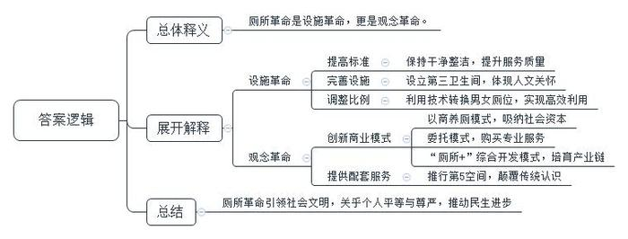
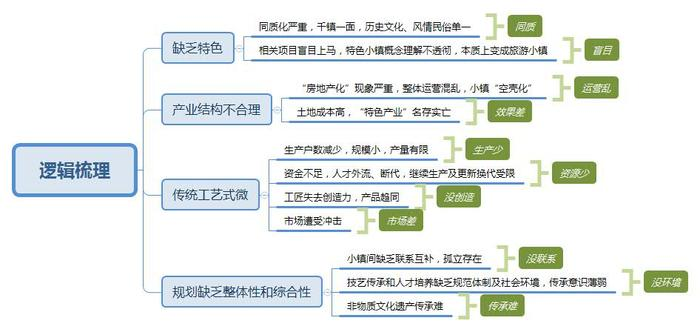
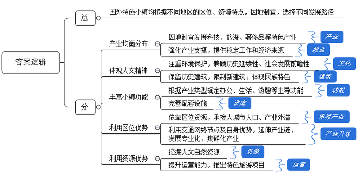
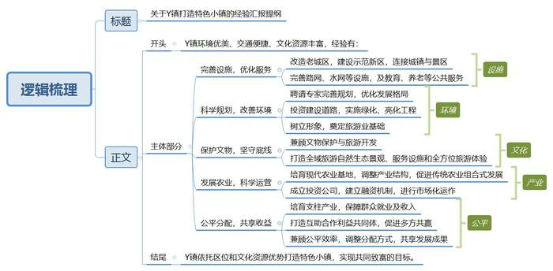
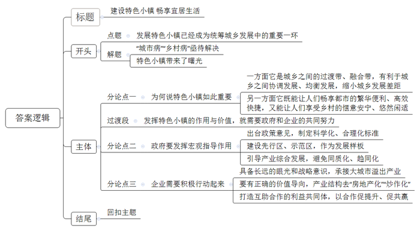

# 2018年公务员多省联考《申论》题（陕西卷）

<!-- gwy:overview:start -->
> **陕西 · 2018 · 申论 · 统考** ｜ 5 题 · 图片 5 处 · 答案随题折叠

导航：[题目](#题目) · [材料 1](#材料-1)
<!-- gwy:overview:end -->

> 候选采集稿。参考答案及解析来自粉笔页面，不代表官方答案或真实高分答卷；来源使用许可与原卷对应关系仍需人工核实。

## 给定材料

### 材料 1

厕所是人类生活的必需空间，也是社会文明程度的一面镜子。长期以来，我国厕所存在供给不足、分布不均衡、管理不到位等问题，成为社会文明和公共服务体系的“短板”，也是我国旅游业发展的薄弱环节。厕所问题不是小事情，是城乡文明建设的重要方面，不但景区、城市要抓，农村也要抓。“厕所革命”应运而生，它既是设施革命，更是观念革命。

事实上，近年来，随着乡村旅游的兴起，各种特色小镇由于在厕所基础设施、管理模式等方面不完善，旅游中“如厕难”“厕所脏乱差”也一直是一个投诉率很高的问题。“厕所革命”之风，也吹进了特色小镇。有的特色小镇设立“第三卫生间”(家庭卫生间)，解决特殊游客群体的如厕需求，体现“厕所革命”的人文关怀。修订标准调整男女厕位比例，根据不同的人流情况给出了具体的比例计算方式，并增加儿童便位设置的相关规定。通过利用大数据技术实现男女厕位转换，采用“互联网+”技术，使系统能精确计算如厕人员数量，并根据等候情况，智能转换男女厕位，实现卫生间高效利用。“厕所革命”已成为引领文明旅游、引领文明新风的重要窗口，成为文明示范工程。卫生间虽小，却关系着每个人的平等与尊严，每个人均等地享受公共服务。“厕所革命”背后是“民生进步”。“第三卫生间”的出现，正是对人民群众的悉心体贴，所解决的正是人人可能遇到，但至今还需解决的难题。

有的小镇推行以商养厕模式，厕所与相应商业门面“捆绑”起来，公开向社会招标，鼓励社会资本承包经营。有的小镇推行委托模式，业主通过购买服务，委托专业保洁公司承担厕所管理，提高厕所专业化、规模化管理水平。有的小镇推行“厕所+”综合开发模式，充分发挥厕所集聚人流的功能，拓展厕所配套服务功能，建设城乡公共卫生综合体，使厕所成为微型商业中心，培育厕所产业链。

许多小镇新建和改建厕所严格落实旅游厕所国家标准，均达到了A级以上标准，多数地区旅游厕所面目一新、整洁漂亮、干净卫生，厕所服务质量显著提升，基本实现“数量充足、干净无味、管理有效、实用免费”的目标。

有的小镇厕所推行“第5空间”，一改厕所以往只能“解决内急”的单一功能，将覆盖wifi，可以给手机、电动汽车充电，完成量血压、心率、尿检等体检项目。甚至可以缴水电费、在ATM机上取款、购买热饮等。“厕所革命”，颠覆了人们对厕所的传统认识，引发了观念的革命。

小厕所“链接”着大民生。建设美丽中国要从最不美丽的地方抓起，向往美好生活要从人民最切近的利益入手。<u>由旅游厕所革命所引发的系列深刻革命，的确已成为名副其实的革命</u>。

### 材料 2

通常而言，概念都是美好的，但现实总是差那么一点点。特色小镇不是“镇”，它不是单纯的行政地域划分；特色小镇不是“区”，它不是传统的工业功能区、旅游区等产业功能区块；特色小镇也不是“加”，它不是简单的“产业园+风景区+博物馆或学校”式的“大拼盘”。

说起陕西的特色小镇，可能很多人脑海里第一个蹦出来的词就是“民俗村”，这样理解确实也没错，尤其是在陕西这片文化厚重的土地上。由于陕西的特色小镇旅游+民俗的通俗模式，一不留神就成为陕西小吃扎堆的农家乐一日游，这个镇和那个镇本质上都差不多，“特色”两字很容易被千镇一面稀释得一干二净。“全域旅游”同样是近几年兴起的概念，在国家相关政策的大力支持下，“旅游+”和“+旅游”都能和特色小镇搭配使用。陕西推进全域旅游的同时，一大批相关项目竞相上马，特色小镇的概念还未理解透彻，单一的历史文化、风情民俗已经蜂拥而至，把特色小镇变成了旅游小镇。

火热的特色小镇建设，正成为一些房地产企业新的“掘金点”。顶着特色小镇的名头，土地价格自然而然降了下来，对于房地产企业来说，向政府拿地的成本相对较低。然而地拿到手了，“特色产业”则很可能名存实亡。特色小镇的整体运营本可以成为独立存在的闭环，然而，“房地产化”的特色小镇很可能导致企业在盈利后放弃经营管理，人的流失造成小镇的“空壳化”，最终只剩下高额的土地成本，特色小镇也就违背初衷、名存实亡了。不过特色小镇的建设也不能完全脱离房地产企业。有分析指出，特色小镇的房地产开发主要是要成为：就业者与本地居民的第一居所、大城市与周末旅游居住的第二居所以及养老与度假居住的第三居所等。

### 材料 3

被誉为“东方古瓷艺术活化石”的C镇位于黄土高原与关中平原交界的陕西省某市，是中国古代名窑耀州窑的发祥地之一，也是耀州窑唯一遗存“炉火千年不绝”的烧造基地。漫步小镇，古风瓷韵随处可见。古窑场历历在目，古瓷片俯拾皆是。当地人深谙废物回收利用之道，用废弃的匣钵、残破的缸瓮垒起状如蜂房的罐罐院墙，又用残碎瓷片装点出各色图案来铺设乡间小道。就连烟囱上、房顶上、树上，都用陶壶陶杯陶碗装饰。原汁原味的耀瓷传统制作工艺和民俗民居，不仅是游人，也让许多陶瓷专家、摄影家等专业人都又找到根的感觉。

千余年来主要用作生活器皿的耀瓷，今日却日渐式微。烧窑的户数逐渐减少，最近只剩下几十户。号称炉火“千年不熄”的C古镇，正面临着“熄火”的尴尬。近年来由于南瓷北上，东瓷西进，再加上塑料和金属制品等现代工艺的流行，C镇粗瓷的市场受到冲击。而且传统的纯手工制作和旧式私人家庭作坊生产，难以实现大规模生产，产量有限。资金不足又导致人才外流、断代，继续生产以及产品的更新换代受限。

现在很多人都在用现代化的设备来烧窑，因为能控制火候，成品率高；同时大批量的生产，赚钱也容易。因此，传统的家庭式烧窑逐渐失去了市场，C古镇烧窑的户数大幅减少。不过，现代化设备的使用虽然提高了生产率，却让瓷器没有了“窑变”的惊喜，也让工匠没有了创造力，所有的制成品千篇一律，失去了灵魂。

近日，中国陕西C古镇旅游发展规划论坛举办。与会专家各抒己见，畅所欲言，发表了许多精辟的见解。

专家甲认为，C古镇旅游要和周边的旅游整合起来，打陶瓷耀州窑这张牌，就必须和H镇联系起来，不能把二者孤立起来，它俩一个是前期的中心，一个是后期的中心，要让它们成为一个有机体，要互补。

专家乙指出，考虑C镇的规划要体现综合性，不能就C古镇来规划C古镇，要让技艺在这里传承。如何将烧造技艺传承复原？古镇不能只能让人来看，还要繁荣它的技艺，要培养新人，来传承技艺。

有人问专家丙，“非物质文化遗产的传承为什么难？”专家丙反问他，“你先问问你自己，你为什么不传承？”得到的回答是因为他们有更好的选择。“培养一个传承人比培养一个研究生更难，研究生培养有一个规范化的体制，但是传承人没有，没有一个社会环境。”他觉得这种现象不能归咎于某一个体，而是应该对整个社会环境有一个认识。

### 材料 4

19世纪60年代，工业化和城镇化的高速发展导致大城市人口过度集聚、拥堵不堪，乡村出现“空心化”。为分流大城市人口，发达国家启动小城镇建设。特色小镇的提出源于世界主要发达国家的发展经验。截至目前，英美韩日等经济发达体均已经完成了对小城镇的开发培育工作，小城镇已成为这些国家经济、人口和产业的主要发展载体。

小城镇聚集了这些发达国家六成以上的人口。其中，美、德等发达国家六成以上的居民都生活在10万人以下的小城镇。根据美国人口普查数据显示，2010年美国总人口3.09亿，63.0%的人口居住在人口5万以下的小城镇；根据2016年德国统计年鉴数据显示，截止2014年底德国总人口8119.75万人，其中80%的人口居住在人口10万以下的小城镇。

作为人口及产业的核心载体，特色小镇已成为发达国家城乡均衡发展的重要经济活力点。例如，美国高科技小镇集聚的硅谷人口不到美国的1%，但GDP占比却高达4%-5%，纳帕谷综合性乡村休闲文旅小镇集群每年接待国内外游客500万人次，仅旅游经济收益就达6亿美元，提供17000多个工作机会，税收达到2.21亿美元；法国格拉斯小镇每年仅香水业就创造6亿欧元财富。产业均衡分布，让小镇有了产业支撑，也让小镇和周边居民不离乡土就能拥有稳定的工作和经济来源。

欧洲城镇规划体现人文主义精神，注重环境保护，兼顾历史的延续性和社会发展的前瞻性，使之能和谐地统一在城镇建设上。在欧洲，特色小镇建筑以独立式和连排式住宅为主，动辄数百年的建筑屡见不鲜，而居民改建、新建房屋都需要审批，无论是外观还是层高都有严格限制。放眼世界，许多国家小镇建筑有着强烈的民族特色，历史风貌与现代生活的融合自然流畅，深厚的文化内涵与活力得以兼顾。

国外的特色小镇往往既有企业生产办公功能，也有社区居住生活功能，还有游憩等功能。当然由于产业类型的不同，其主导功能有所差异。被誉为会议小镇的瑞士达沃斯小镇，因日内瓦商学院克劳斯·施瓦布教授1971年创建的“世界经济论坛”每年初在这里召开而蜚声世界。小镇除了拥有当地居民生活的设施外，还配套有旅游服务中心、呼吸系统疾病治疗所、天然溜冰场、国会中心、冰雪体育馆等设施，已发展成为以温泉度假、国际会议、运动度假产业为特色，融生活、旅游等于一体的小镇。

### 材料 5

英美等发达国家数以万计的小城镇当中，能够成为全球特色小镇范本的也属凤毛麟角，可见，并非所有的小镇都具备成功基因。

有学者将国外的特色小镇分为三类，即大城市依托型小镇、网络节点型小镇和孤点分布型小镇。

大城市依托型小镇，区位大多位于大城市1-2小时交通圈内，主要承接大城市的人口、产业外溢，同时具备良好的产业培育条件。它又分为产业型小镇和文旅型小镇两类。产业型特色小镇：法国内陆型工业城镇维特雷在巴黎和省会城市雷恩2小时交通圈内，19世纪50、60年代，凭借良好生活环境和较低房价吸引巴黎和雷恩的工程师，承接从巴黎、雷恩机械工业和分包工业的溢出，形成了包括机械、分包加工、芯片业、印刷厂在内的现代产业体系，成为全球内陆型工业城镇成功转型案例。文旅型特色小镇：英国距离伯明翰50分钟车程的斯特拉特福德镇以莎士比亚故乡为核心要素发展旅游业，年游客量均列英国城市之最。

网络节点型小镇，位于交通网络节点，产业基础深厚，同时具备良好的历史、自然因素。作为全球纺织品企业总部的瑞士朗根塔尔小镇位于伯尔尼到苏黎世的途中，并且在瑞士中央铁路线上，历史上是重要集镇和亚麻生产中心，拥有专业技术熟练的劳动力和生产经营能力，在政府规划和资金支持下，不断延伸产业链，成为高端纺织产业高度专业化、集群化的产业小镇。

孤点分布型小镇，具备得天独厚的资源禀赋和强大运营能力，足以抵消区位不利影响。西班牙胡斯卡小镇2011年之前的区位、生态旅游资源均毫无特色，每年游客不超300人，但2011年因盛产蘑菇被索尼影业选为3D动画片蓝精灵的宣传基地，所有的白墙红瓦的房子全部被刷成蓝色，借助动画片宣传一年内游客暴增400余倍。当地政府和居民以此为契机，相继推出主题乐园、蓝精灵集市、蘑菇节等旅游项目，创造了因一种颜色走向复兴的小镇奇迹。

从区位和类型交叉分析来看，大城市依托型、网络节点型更依托于产业发展，孤点分布型多以文旅为特色资源。大城市依托型和网络节点型特色小镇，产业型均超半数，占比分别达到53.3%和51.9%，产业型及产业+旅游型累计占比分别为66.7%和77.8%；孤点分布型小镇文旅产业占比高达76%。

### 材料 6

陕西某县Y镇北依唐昭陵九嵕山，东临泾河，南靠泔河，依山傍水，环境优美。关中环线、唐昭陵旅游专线穿境而过，交通便捷，唐昭陵博物馆就坐落在其境内，是省内外游客的向往之地。

如果一个地方能有一处在全省乃至全国叫得响的文化资源，那是十分幸运的，可Y镇不仅拥有世界上最大的皇家陵园唐昭陵，而且还有全省乃至全国民俗旅游声名显赫的关中民俗传奇村落A村。无疑，Y镇是幸运中的幸运。

离Y镇老城区不到2公里就是A村民俗旅游区，这无疑对于Y镇的城镇化建设是一种机遇，更是一个挑战。建设城镇决不能忽视A村的存在，而A村的进一步发展也离不开城镇配套服务和支撑。于是，Y镇决定在改造老城区的同时，在老城区与A村之间以标准化模块推动重点示范镇新区建设，从而将城镇与A村景区连接在一起。Y镇新区建设主要以路网、水网等基础设施为主和建立学校、敬老院、供水管理等公共服务体系为主。

城镇建设，规划先行，只有科学合理的规划，才能引领城镇的可持续发展。当地聘请某大学城市规划设计研究院对Y镇总体规划及各项控制性详细规划进行了修编完善，结合产城一体化要求，突出文物保护，精心谋划、错位发展、优化空间布局、拉大城市框架，形成“一城四区”(一城：县域副中心；四区：关中民俗区、生态旅游体验区、老镇商贸区、滨河休闲度假区)的发展格局，为全镇的发展描绘了一个美丽的蓝图。此外，Y镇先后投资9500余万元，实现了镇内9条道路的建成通车，并对镇区的市政道路进行了绿化和亮化工程。这些项目的实施，不仅将Y镇的形象树立起来了，更为重要的是为今后旅游业进一步发展奠定了基础。

在Y镇境内的唐昭陵是世界上最大的皇家陵园，仅陪葬墓就有190余座，如何在保护这一世界级文物群落的同时，能让旅游产业有序发展，成为摆在Y镇面前的一道难题。Y镇严格遵守《昭陵文物保护总体规划》中的各项要求，所有建设用地避开文物保护范围，并将此作为一切发展的底线。在此基础上，全面打造全域旅游自然生态景观、全域旅游服务设施和全方位旅游体验。

按照“一景一业、一村一品”的发展思路，Y镇根据旱腰带和平原各行政村村情发展实际，分区优化，新栽植湾里御石榴300亩、韩窑优质花椒园500亩，山地御杏500亩，培育了一批“四季有花、御果遍地”的新型现代农业基地。2016年，结合脱贫攻坚，Y镇着力实施产业结构调整，促进传统果业向养殖、种植和旅游多业混合的现代田园组合式发展。2017年，Y镇还根据发展的需要，成立重点示范镇建设投资有限公司，公司采取“盘活土地资金、面向市场引资金、包装项目争资金”等工作思路，建立“社会投资、企业投资、财政补助、项目倾斜”的融资机制，通过市场化运作的方式，运用PPP和政府购买服务等形式，推进项目融资，全力抓好项目建设的落实。

Y镇紧紧围绕大唐文化和关中民俗文化深度开发，通过发展乡村旅游，培育支柱产业，让人民群众收入有来源、有保障、有支撑；通过搭建户社合作、户企合作、村企合作、村社合作平台，打造互助合作的利益共同体，以合作促提升，以合作促共赢；通过采取“以长补短”、“以强扶弱”、“以点带面”的方法，在兼顾公平效率的前提下，调整利益分配方式，缩小收入差距，实现发展成果让群众共享。

特别是发挥A村的“旗帜”和“标杆”作用，依靠A村在乡村旅游上闯出的路子、积攒的人气、集聚的商气和树立的品牌，以A村为龙头，推行“一点促全城，一村带十村”的乡村旅游发展模式，集中周边十个村，联合建设A村大社区，实现了“富一村带一片”的效果。A村先后组织周边村近千户群众在A村开展产业增收、经营特色小吃、参与股份合作、从事社区服务。针对经营户收入高低不均的现实，A村将盈利高的商户变为合作社，分出一部分股份给盈利低的、必不可少的商户，将高收益、低收益的商户利益绑定在一起，消除了“不平衡”心理，实现了“家家有生意、户户能赚钱、大家齐致富”的共富目标。

### 材料 7

自1978年以来，我国城镇化经历了快速发展阶段和加速发展阶段，2016年城镇化率达到57.35%，较1978年大幅提升39.45%。与此同时，大城市人口膨胀、交通拥堵、房价飞涨的问题已不利于企业、人才发展，部分大型企业已经选择搬离一线城市，而乡村则面临土地流失、宅地废弃、人口转移诸多问题，高速城市化导致的“大城市病”和“乡村病”日益加剧。在此背景下，发展特色小镇、统筹城乡发展已经成为国内城镇化建设的关键一环。特色小镇一头连着城市，一头连着农村，是一个极其重要的战略节点。需要有眼光的优秀企业家和有作为敢担当的政府来联袂合作，共同努力。

2016年10月，国家发改委下发《关于加快美丽特色小(城)镇建设的指导意见》。2017年2月24日，陕西省发改委出台了《关于加快发展特色小镇的实施意见》，提出到2020年，重点示范镇将建成县域副中心，成为农民进镇创业和城乡融合发展的示范样板；未来旅游名镇将建成宜居宜业宜游的观光富民小镇，成为农民脱贫和承载乡愁的重要平台。

在高楼林立的都市中穿梭，你会觉得自己像蚂蚁一样的卑微并产生无处不在的压迫感；在旷野的村庄里生活，你又会觉得自己脱离了整个世界而感到莫名的孤寂。城市装不下肉身，农村装不下灵魂。这世上还有没有一处既可以畅享城市的便利，又可在内心找到那一刻安宁的地方？在陕西Y镇、在西班牙胡斯卡小镇……通过生活在这里一个个鲜活的人和他们的故事，让大家看到了正是这些不断变化的特色小镇，使他们不但实现了自己的梦想，也帮我们重新找到了理想的归宿和生活的本真。

## 题目

### 第 1 题

**结合给定资料1，谈谈你对画线句子****“由旅游厕所革命所引发的系列深刻革命，的确已成为名副其实的革命”****的理解。（15分）**

关联材料：材料 1

作答要求：

要求：紧扣材料，准确全面，150～200字。

第 1 题 · 答案与解析

**参考答案（粉笔题库参考内容）**

厕所革命是设施革命，更是观念革命。

一、设施革命：1.提高标准。保持干净整洁，提升服务质量。2.完善设施。设立第三卫生间，体现人文关怀。3.调整比例。利用技术转换男女厕位，实现高效利用。

二、观念革命：1.创新商业模式。以商养厕模式，吸纳社会资本；委托模式，购买专业服务；“厕所+”综合开发模式，培育产业链。2.提供配套服务。推行第5空间，颠覆传统认识。

厕所革命引领社会文明，关乎个人平等与尊严，推动民生进步。

**解析**

**参考答案说明：**本题参考答案按照词句解释题的作答方法，先整体解释，再分别从“设施革命”和“观念革命”两个方面分条进行具体分析，并对每条要点提炼出了总括词并前置。最后进行总结，逻辑清晰，有条理。

**考点**：词句解释类

**来源**：2018年公务员多省联考《申论》题（陕西卷）

### 第 2 题

**结合给定资料2和3，概括陕西特色小镇建设中存在的主要问题。（20分）**

关联材料：材料 2、材料 3

作答要求：

要求：准确全面，条理清晰，200～300字。

第 2 题 · 答案与解析

**参考答案（粉笔题库参考内容）**

一、缺乏特色。同质化严重，千镇一面，历史文化、风情民俗单一；相关项目盲目上马，特色小镇概念理解不透彻，本质上变成旅游小镇。

二、产业结构不合理。“房地产化”现象严重，整体运营混乱，小镇“空壳化”；土地成本高，“特色产业”名存实亡。

三、传统工艺式微。生产户数减少，规模小，产量有限；资金不足，人才外流、断代，继续生产及更新换代受限；工匠失去创造力，产品趋同；市场遭受冲击。

四、规划缺乏整体性和综合性。小镇间缺乏联系互补，孤立存在；技艺传承和人才培养缺乏规范体制及社会环境，传承意识薄弱；非物质文化遗产传承难。

**解析**

**参考答案说明：**答案从“缺乏特色”“产业结构不合理”“传统工艺式微”“规划缺乏整体性和综合性”这四个不同的方面进行了分条撰写。每条要点之间内容上没有交叉，并对每条要点提炼出了总括词并前置。

**考点**：问题类

**来源**：2018年公务员多省联考《申论》题（陕西卷）

### 第 3 题

**根据给定资料4和5，总结国外特色小镇建设的主要经验。（30分）**

关联材料：材料 4、材料 5

作答要求：

要求：总结全面，条理清楚，语言精炼，200～300字。

第 3 题 · 答案与解析

**参考答案（粉笔题库参考内容）**

国外特色小镇均根据不同地区的区位、资源特点，因地制宜，选择不同发展路径。具体有：一、产业均衡分布。因地制宜发展科技、旅游、奢侈品等特色产业；强化产业支撑，提供稳定工作和经济来源。二、体现人文精神。注重环境保护，兼顾历史延续性、社会发展前瞻性；保留历史建筑，限制新建筑，体现民族特色。三、丰富小镇功能。根据产业类型确定办公、生活、游憩等主导功能；完善配套设施。四、利用区位优势。依靠区位资源，承接大城市人口、产业外溢；利用交通网络节点及自身优势，延伸产业链，发展专业化、集群化产业。五、利用资源优势。挖掘人文自然资源；提升运营能力，推出特色旅游项目。

**解析**

**参考答案说明：**答案从“产业分布”“人文精神”“小镇功能”“区位优势”“资源优势”不同的方面进行了分条撰写，且对每条要点提炼出了总括词并前置。每条要点之间内容上没有交叉。

**考点**：经验启示类

**来源**：2018年公务员多省联考《申论》题（陕西卷）

### 第 4 题

**针对给定资料6中Y镇打造特色小镇的经验，写一份供领导参阅的汇报提纲。（35分）**

关联材料：材料 6

作答要求：

要求：内容具体，条理清楚，语言准确，结构完整，300～400字。

第 4 题 · 答案与解析

**参考答案（粉笔题库参考内容）**

关于Y镇打造特色小镇的经验汇报提纲

Y镇环境优美、交通便捷、文化资源丰富，经验有：

一、完善设施，优化服务。改造老城区，建设示范新区，连接城镇与景区；完善路网、水网等设施，及教育、养老等公共服务。二、科学规划，改善环境。聘请专家完善规划，优化发展格局；投资建设道路，实施绿化、亮化工程；树立形象，奠定旅游业基础。三、保护文物，坚守底线。兼顾文物保护与旅游开发；打造全域旅游自然生态景观、服务设施和全方位旅游体验。四、发展农业，科学运营。培育现代农业基地，调整产业结构，促进传统农业组合式发展；成立投资公司，建立融资机制，进行市场化运作。五、公平分配，共享收益。培育支柱产业，保障群众就业及收入；打造互助合作利益共同体，促进多方共赢；兼顾公平效率，调整分配方式，共享发展成果。

Y镇依托区位和文化资源优势打造特色小镇，实现共同致富的目标。

**解析**

**参考答案说明：**（1）本题只要求写“提纲”，所以不必考虑格式，不放心的话可以以“关于+事由+文种”形式作为标题。（2）内容上，本题答案由开头、主体部分和结尾构成，开头介绍汇报提纲的背景，主体部分分别从“完善设施，优化服务”“科学规划，改善环境”“保护文物，坚守底线”“发展农业，科学运营”“公平分配，共享收益”这几个层面展开，并将总结性词汇前置，以使答案具备逻辑性和条理性，结尾则是做出了总结。（3）本参考答案能够结合题目要求“语言准确”，在语言表达上做到了规范、无主观臆断。

**考点**：总结类

**来源**：2018年公务员多省联考《申论》题（陕西卷）

### 第 5 题

**根据给定资料7，自选角度，自拟题目，写一篇文章。（50分）**

关联材料：材料 1、材料 2、材料 3、材料 4、材料 5、材料 6、材料 7

作答要求：

要求：角度新颖，观点明确，结构完整，思路清晰，论证充分，语言流畅，1000～1200字。

第 5 题 · 答案与解析

**参考答案（粉笔题库参考内容）**

**建设特色小镇 畅享宜居生活**

改革开放四十年来，我国城镇化建设成绩斐然。但本该热闹而繁华，有幢幢高楼林立，有万千灯火霓虹，有人群熙来攘往，有交通车水马龙的城市，却被困在人口膨胀、交通拥堵、房价飞涨等“城市病”之中；本该宁静而宜居、资源天然、人杰地灵的农村，却萦绕在土地流失、宅地废弃、人口迁移等“乡村病”之中，失去了往日该有的模样。幸运的是，“特色小镇”带来了曙光，**发展特色小镇已经成为统筹城乡发展中的重要一环。**

为何说特色小镇如此重要？**一方面它是城乡之间的过渡带、融合带，有利于城乡之间协调发展、均衡发展，缩小城乡发展差距；另一方面它既能让人们畅享都市的繁华便利、高效快捷，又能让人们享受乡村的惬意安宁、悠然闲适。**物欲横流、纷繁复杂的时代，瞬息万变、高速发达的城市化虽带来了高收入、高利益，医疗、教育、住房都是高质量、高水准，但与此同时也拉大了城乡发展的距离。人们在城市当中虽可以得到物质生活的满足，但却缺少了心灵的抚慰。有这样一个地方——特色小镇，它一头连着城市，一头连着农村，把城乡完美融合，不仅平衡了城乡之间的资源发展差距，也让我们在享受大城市便利的同时，感受到乡村的宁静致远。

只有政策支持、产业兴旺、环境宜人，特色小镇才能吸引人、发展人、留下人。同样要最大化的发挥特色小镇的作用与价值，就需要政府和企业的共同努力。

**政府要发挥宏观指导作用，出台政策意见，制定科学化、合理化标准；同时建设先行区、示范区，作为发展样板；此外还需要引导产业综合发展，避免同质化、趋同化。**特色小镇的建设政府需要做好科学规划指导，提供政策、资金支持；需要结合本地实际，因地制宜出台特色小镇建设的指导和实施意见，同时建设县域副中心，为农民进镇创业和城乡融合发展提供工农业示范平台。为避免产业发展的雷同化，政府还应鼓励发展旅游业、特色经济等多种产业，建成诸如茅台、横店、普罗旺斯等旅游名镇，打造特色小镇综合体。

**企业需要积极行动起来，不仅要具备长远的眼光和战略意识，承接大城市溢出产业，而且要有正确的价值导向，产业结构去“房地产化”“炒作化”，还需打造互助合作的利益共同体，以合作促提升、促共贏。**在政府综合性政策红利的支持下，企业要具备长远眼光，根据区位、资源等特点，承接从大城市转移出来的产业、人口等，站在大城市的“肩膀上”形成自己的产业体系。同时又要冷静理智的对待特色小镇房地产投资热，避免炒作，以新经济、新业态为突破口，发展小镇特色产业、特色经济、特色文化，促使特色小镇产业结构合理化。另外，企业可以通过搭建户社合作、户企合作、村企合作、村社合作平台，打造利益共同体，让人民群众收入有来源、有保障、有支撑，实现互惠、互利、互赢。

特色小镇是当今城乡发展的方向，也是未来城乡发展的必然趋势。特色小镇产业兴旺、环境优美，宜居宜业宜游。在这里有梦想，有归宿，有乡愁，也有生活的本真。

**解析**

**文章分析**

**建设特色小镇 畅享宜居生活**

【**标题的优点：**一方面，范文的标题“建设特色小镇，畅享宜居生活”突出了“建设特色小镇”这一主题。另一方面，形式上，采用了对仗形式，文字简洁明快。】

（1）改革开放四十年来，<u>我国城镇化建设成绩斐然</u>。（2）但本该热闹而繁华，有幢幢高楼林立，有万千灯火霓虹，有人群熙来攘往，有交通车水马龙的城市，却被困在<u>人口膨胀</u>、<u>交通拥堵</u>、<u>房价飞涨等</u>“<u>城市病</u>”之中；本该宁静而宜居、资源天然、人杰地灵的农村，却萦绕在<u>土地流失</u>、<u>宅地废弃</u>、<u>人口迁移等</u>“<u>乡村病</u>”之中，失去了往日该有的模样。幸运的是，“<u>特色小镇</u>”<u>带来了曙光</u>，**发展特色小镇已经成为统筹城乡发展中的重要一环。**

【**开头的优点：★**内容方面：范文的开头是紧扣“建设特色小镇”这一主题展开的。首先，开头即点出主题，做到了主题明确。其次，对“建设特色小镇”这一主题进行了分析阐述，指出了（1）我国城镇化建设成绩斐然；（2）城镇化建设中存在的问题。**★**文字表达方面：使用了“但”“却”等关联词，使语言表达有逻辑性，此外长短句配合使用，使语言表达有节奏感。】

为何说特色小镇如此重要？**一方面它是城乡之间的过渡带、融合带，有利于城乡之间协调发展、均衡发展，缩小城乡发展差距；另一方面它既能让人们畅享都市的繁华便利、高效快捷，又能让人们享受乡村的惬意安宁、悠然闲适。**（1）物欲横流、纷繁复杂的时代，瞬息万变、高速发达的城市化虽带来了高收入、高利益，医疗、教育、住房都是高质量、高水准，<u>但与此同时也拉大了城乡发展的距离</u>。人们在城市当中<u>虽可以得到物质生活的满足</u>，<u>但却缺少了心灵的抚慰</u>。有这样一个地方——特色小镇，它一头连着城市，一头连着农村，（2）<u>把城乡完美融合</u>，不仅<u>平衡了城乡之间的资源发展差距</u>，也<u>让我们在享受大城市便利的同时</u>，<u>感受到乡村的宁静致远</u>。

【**论述段1的优点：**★观点句：范文的观点句是紧扣“建设特色小镇”这一文章主题提出的。形式上，它在段首处直接写出，位置突出，容易发现。内容上，关键词突出，内容要点明确，可以明显看出它是从“协调城乡发展”“”享受城市的繁荣和乡村的安宁”等入手，指出了“建设特色小镇的意义”。★论述内容：（1）介绍了“城镇化建设存在的问题”；（2）介绍了“特色小镇得积极作用”。注意：以上两个方面的内容都是紧扣“一方面它是城乡之间的过渡带、融合带，有利于城乡之间协调发展、均衡发展，缩小城乡发展差距；另一方面它既能让人们畅享都市的繁华便利、高效快捷，又能让人们享受乡村的惬意安宁、悠然闲适”这个观点句进行分析论述的，论述的针对性强，内容层次清晰。在论述方法上采用了道理论证，做到了论述有力。】

只有政策支持、产业兴旺、环境宜人，特色小镇才能吸引人、发展人、留下人。同样要最大化的发挥特色小镇的作用与价值，就需要政府和企业的共同努力。

【**过渡段的优点**：范文过渡段分析了特色小镇产业兴旺，环境宜居，要发挥特色小镇的价值，就需要政府和企业的共同努力。过渡段末尾的“要最大化的发挥特色小镇的作用与价值，就需要政府和企业的共同努力”是用来引起下文的过渡句。】

**政府要发挥宏观指导作用，出台政策意见，制定科学化、合理化标准；同时建设先行区、示范区，作为发展样板；此外还需要引导产业综合发展，避免同质化、趋同化。**（1）特色小镇的建设<u>政府</u>需要<u>做好科学规划指导</u>，<u>提供政策</u>、<u>资金支持</u>；<u>需要结合本地实际</u>，因地制宜<u>出台</u>特色小镇建设的<u>指导和实施意见</u>，（2）<u>同时建设县域副中心</u>，为农民进镇创业和城乡融合发展<u>提供工农业示范平台</u>。（3）为避免产业发展的雷同化，政府还应<u>鼓励发展旅游业</u>、<u>特色经济等多种产业</u>，建成诸如茅台、横店、普罗旺斯等旅游名镇，打造特色小镇综合体。

【**论述段2的优点：**★观点句：范文的观点句是紧扣“建设特色小镇”这一文章主题提出的。形式上，它在段首处直接写出，位置突出，容易发现。内容上，关键词突出，内容要点明确，可以明显看出它是从“政府”这一主体入手，指出了“如何建设特色小镇”。★论述内容：（1）介绍了“政府出台政策意见”；（2）介绍了“建设工农业示范平台”；（3）介绍了“鼓励发展多种产业”。注意：以上三个方面的内容都是紧扣“政府要发挥宏观指导作用，出台政策意见，制定科学化、合理化标准；同时建设先行区、示范区，作为发展样板；此外还需要引导产业综合发展，避免同质化、趋同化”这个观点句进行分析论述的，论述的针对性强，内容层次丰富。在论述方法上以讲道理的方式为主，做到了论述有力。】

**企业需要积极行动起来，不仅要具备长远的眼光和战略意识，承接大城市溢出产业，而且要有正确的价值导向，产业结构去“房地产化”“炒作化”，还需打造互助合作的利益共同体，以合作促提升、促共贏。**（1）在政府综合性政策红利的支持下，企<u>业要具备长远眼光</u>，根据区位、资源等特点，<u>承接从大城市转移出来的产业、人口等</u>，站在大城市的“肩膀上”<u>形成自己的产业体系</u>。（2）同时又要<u>冷静理智的对待特色小镇房地产投资热</u>，<u>避免炒作</u>，以新经济、新业态为突破口，发展小镇特色产业、特色经济、特色文化，<u>促使特色小镇产业结构合理化</u>。（3）另外，企业可以通过搭<u>建户社合作</u>、<u>户企合作</u>、<u>村企合作</u>、<u>村社合作平台</u>，<u>打造利益共同体</u>，让人民群众收入有来源、有保障、有支撑，<u>实现互惠</u>、<u>互利</u>、<u>互赢</u>。

【**论述段3的优点**：★观点句：范文的观点句是紧扣“建设特色小镇”这一文章主题提出的。形式上，它在段首处直接写出，位置突出，容易发现。内容上，关键词突出，内容要点明确，可以明显看出它是从“企业”这一主体入手，指出了“如何建设特色小镇”。★论述内容：（1）介绍了“要具备长远眼光，承接大城市溢出产业”；（2）介绍了“理智对待房地产投资热，促使产业结构合理化”；（3）介绍了“打造利益共同体”。注意：以上三个方面的内容都是紧扣“企业需要积极行动起来，不仅要具备长远的眼光和战略意识，承接大城市溢出产业，而且要有正确的价值导向，产业结构去‘房地产化’‘炒作化’，还需打造互助合作的利益共同体，以合作促提升、促共贏。”这个观点句进行分析论述的，论述的针对性强，内容层次丰富。在论述方法上以讲道理的方式为主，做到了论述有力。】

【**论述段之间的关系：**★内容的内在逻辑：范文的论述段之间有2层逻辑。第一层，整体上是从先介绍“建设特色小镇的重要性”到“建设特色小镇的对策”这一逻辑展开。第二层，其中观点2和观点3又是从“主体”出发，论述段2先写了“政府要发挥宏观指导作用，出台政策意见，制定科学化、合理化标准；同时建设先行区、示范区，作为发展样板；此外还需要引导产业综合发展，避免同质化、趋同化”，论述段3再写了“企业需要积极行动起来，不仅要具备长远的眼光和战略意识，承接大城市溢出产业，而且要有正确的价值导向，产业结构去‘房地产化’‘炒作化’，还需打造互助合作的利益共同体，以合作促提升、促共贏。”。★段与段的外在衔接：论述段1之后的过渡段“只有政策支持、产业兴旺、环境宜人，特色小镇才能吸引人、发展人、留下人。同样要最大化的发挥特色小镇的作用与价值，就需要政府和企业的共同努力”起到了承接论述段1、引出了论述段2和论述段3的作用。】

（1）<u>特色小镇</u>是<u>当今城乡发展的方向</u>，<u>也是未来城乡发展的必然趋势</u>。（2）特色小镇<u>产业兴旺</u>、<u>环境优美</u>，<u>宜居宜业宜游</u>。在这里<u>有梦想</u>，<u>有归宿</u>，<u>有乡愁</u>，<u>也有生活的本真</u>。

【**结尾的优点**：范文的结尾回扣了“建设特色小镇”这一主题。（1）再次总结了“建设特色小镇”；（2）阐述了“建设特色小镇”的深远意义。】

**考点**：文章写作题

**来源**：2018年公务员多省联考《申论》题（陕西卷）

