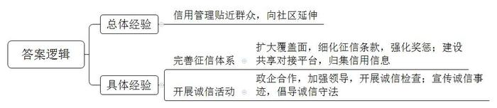
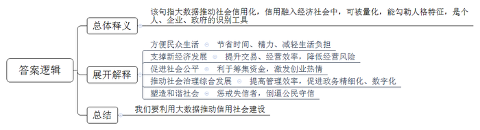
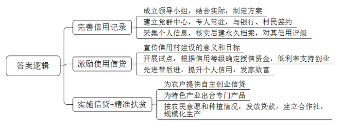
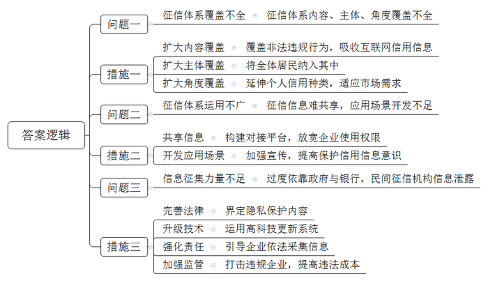
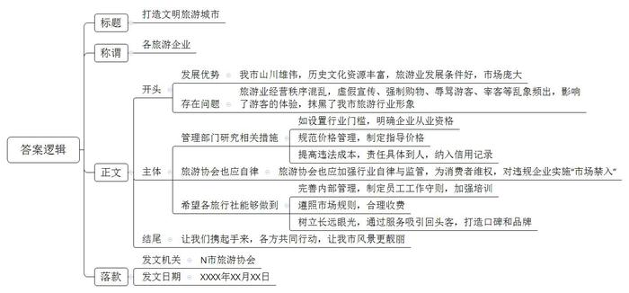
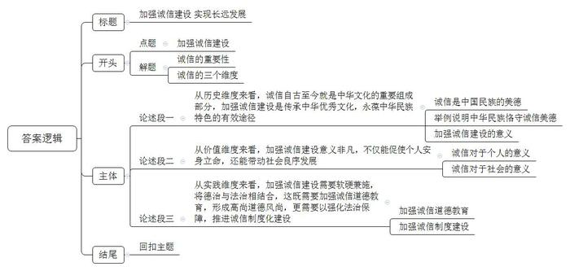

# 2019年公务员多省联考《申论》题（陕西A卷）

> 候选采集稿。参考答案及解析来自粉笔页面，不代表官方答案或真实高分答卷；来源使用许可与原卷对应关系仍需人工核实。

## 给定材料

### 材料 material-4fc4e949713bc2a7

“不乱扔杂物、不乱搭乱建、不违规饲养宠物，倡导邻里文明停车、和睦共处，积极配合社区的各项工作，共筑美丽幸福家园，争做诚信居民，为‘信用社区’贡献力量！”在先锋街道举行的“争做诚信居民，共建信用社区”千人誓师大会上，社区居民代表一起郑重宣誓。

经历4年探索实践，X市今年成功获批社会信用示范城市。地处市中心的先锋街道围绕如何让信用管理走进群众日常生活，开展了一系列基层管理创新，全面开展了诚信社区建设活动，将诚信建设向社区延伸。

“我们街道的光明社区2015年就率先开展了征信体系建设工作，4000名常住居民每人都有‘诚信身份证’！”街道办事处负责人介绍，光明社区是X市首个建立征信管理体系的社区。3年来，社区居民对征信有了实实在在的认识。随着征信体系的建立和完善，征信已经渗透到光明社区每个角落，扎根在每一个居民心中。“信用信息平台里的分数高，好处很多。自己的口碑好，别人都爱和你交往。”社区居民毕女士说。孟先生开办了社区国画公益课堂并担任授课老师，免费教授居民国画。提起创建国画公益课程的初衷，他说：“我本身就是搞美术的，所以想让更多居民喜欢、了解国画。”让孟先生没有想到的是，一心做好的“份内事”竟然让自己得到20分的征信加分，成为社区居民学习的榜样。“我开办国画公益课堂不是为了加分，但是街道和社区给了这份荣誉，我也特别高兴。”孟先生说。

光明社区的居民征信条款是与市征信办多次沟通协调后最终制定的，社区征信管理有一套严格的流程和评价体系。社区建立了社会信用信息共享平台及门户网站，并将之与市信用平台对接。社区通过平台和网站推进信用信息归集，目前已归集行政许可和行政处罚公示数据20169条，信用数据4187条，“红黑”名单数据311条。居民信用等级根据分数不同，分为五个星级，可在政策扶持、岗位招考、评先选优、发展党员、银行贷款等领域作为考量指标。居民在好人好事、保护社区环境等方面有所作为的，每次加5分；对随意倾倒杂物或者造谣生事等行为，每次扣5分。行为更加恶劣的，还要提报市级征信平台。社区负责人介绍，社区正在开展“诚信楼宇”“诚信家庭”“诚信个人”“诚信商铺”等活动，通过展示墙、电子宣传栏等展播诚信事迹，“我们要充分发挥榜样的激励作用，尤其要发挥党员干部的模范带头作用。今后我们还要推动窗口单位和工作人员的诚信建设，把基层管理和服务融入到诚信社区的建设中。”

先锋街道的上岭社区也积极响应建设“诚信社区”活动的号召，开展“诚信社区”创建活动。社区及时成立“诚信社区”创建领导小组，由社区书记担任组长，主任担任副组长。领导小组深入研究社区的实际情况，针对社区内商家和工厂较多的情况，决定以这些商家和工厂的诚信建设为重点，带动诚信社区的全面建设。

社区安排工作人员对辖区20余家经营门店发放了“诚信经营”倡议书，并对辖区的超市、餐饮门店等开展食品安全检查。在检查中，社区工作人员还向广大商户大力宣传《食品安全法》等法律知识，增强食品经营户的法律意识，强化守法经营理念。社区联合X市市场监督管理局在菜市场门前举办“百城万店讲诚信”主题活动，通过设置咨询台、投诉举报台、发放宣传资料、现场讲解等方式，向广大群众普及了安全消费、识药用药、生产等常识，引导消费者养成科学、健康、文明的消费习惯，倡导广大商家和群众争做诚信的传播者、践行者与维护者。

上岭社区联合市场监督管理局等有关部门对社区各商户和菜市场各个摊位进行多次巡查。经过巡查，社区内商户全部诚信经营，信誉良好，得到了周围居民的一致好评。各有关部门还在菜市场进行“诚信经营”大走访活动，对市场内商家的交易秤进行检查。结果显示，菜市场商家都能够做到诚信经营。

上岭社区联合社区各企业开展“质量第一、诚信做产品”活动。社区书记讲解了开展活动的目标、内容和意义。随后，企业负责人就提高产品质量、诚信做产品等方面做的工作进行了介绍，并与员工签订了《产品质量诚信承诺书》。通过此次活动，进一步强化了生产企业的信用观念。

人无信不立，业无信不兴。诚信不仅是个人安身立命的根本，也是社会良序发展的基石。

党的十八大以来，党和国家高度重视诚信建设。习近平总书记在多个不同场合围绕诚信主题发表了一系列重要论述，从战略高度为新时代中国的诚信建设提供了基本遵循。他从历史维度、价值维度、实践维度对诚信问题进行了深刻阐述，进一步指出中华文化关于诚信的思想和理念，不论过去还是现在，都有其鲜明的民族特色，都有其永不褪色的时代价值。他强调，要运用法治手段解决道德领域突出问题。对突出的诚信缺失问题，既要抓紧建立覆盖全社会的征信系统，又要完善守法诚信褒奖机制和违法失信惩戒机制，使人不敢失信、不能失信。对见利忘义、制假售假的违法行为，要加大执法力度，让败德违法者受到惩治、付出代价。

为全面推进诚信建设，党和国家作出了一系列重要部署。中共中央办公厅印发的《关于培育和践行社会主义核心价值观的意见》强调：“以诚信建设为重点，加强社会公德、职业道德、家庭美德、个人品德教育，形成修身律己、崇德向善、礼让宽容的道德风尚。”中央文明委发布《关于推进诚信建设制度化的意见》，明确规定通过曝光失信当事人、限制严重失信者高消费行为等手段打击失信行为，这是我国第一份强调从制度层面推进国家诚信建设的中央文件。国务院先后发布《关于建立完善守信联合激励和失信联合惩戒制度加快推进社会诚信建设的指导意见》《关于加快推进失信被执行人信用监督、警示和惩戒机制建设的意见》，建立起社会诚信奖惩制度，并进一步完善了失信惩戒制度。诚信建设从注重教育走向教育与制度建设并重。

### 材料 material-8d1b88837743c592

一年前，小张从北京到杭州工作。在租房时，她惊喜地被中介告知，由于她的信用记录良好，所以不用缴纳两倍于月租的租房押金。而北京的胡先生，却遇上了一件让他颜面尽失的事情：原本在假期准备租辆宝马车和朋友外出自驾游玩，没想到却被租车公司拒绝。原来，胡先生由于欠款许久未还，已经被列入了“老赖”的名单，导致自己的信用数据不佳，被禁止租车。

2018年2月起，到E市妇女儿童医疗中心就诊的病患们发现，只要自己的信用度足够好，在医疗中心就可以“先诊疗后付费”，而无需一次次在诊室、检查室和交费处之间奔波，大大节省了自己的时间和精力。

信用骑车、信用住店、信用借书、公交车扫码乘车……这一幕一幕都告诉我们中国正在迈进信用社会。随着大数据时代的来临，信用成为每个人的“第二张身份证”。每个人、每个机构的信用度都可以被量化，曾经“看不见”“摸不到”的信用，正在逐步“变现”。

信用也提升了交易效率，为新经济提供支撑。对于废旧手机回收利用创业者向先生而言，信用就为他解决了“先收手机还是先付款”的难题。“先收手机，用户不放心。先付款，我们也怕损失。”向先生说，引入信用后，对高分用户优先付款，订单量上浮一倍，也没有出现违约情况。

有了信用的助力，企业经营效率变得更高。目前，多家共享单车企业已实现信用免押金，大大方便了新用户开通使用。一些共享汽车、共享租衣企业也在研究信用梯度收费等模式，最大限度吸引用户。用户对信用的珍视也令人惊喜。以租车为例，引入信用分后，行业租金欠款率下降了52%，违章罚款欠款率下降了27%。

在网络高度发达的今天，资源的分布不再局限于有形市场，很多资源分布在网络上。资金资源不再集中在类似于银行这种金融机构身上，而是通过互联网分散分布。一个人只要拥有足够的信用水平，在网络上就能够筹集到资金。所以，信用社会给予人们一个公平发展的环境。“信用既是商业社会的内在原则，也创造价值和财富。”某研究员说，随着信用体系不断完善，每个人都能在社会中获得公平发展的机会，这将大大激发全社会创业创新热情。

在某信用机构负责人看来，10年后，国内绝大多数城市都将成为信用城市。诚实守信的市民和商家，会享受到非常大的便利，政府的管理效率也将大大提高。信用体系的建立可以推动整个社会综合治理的发展。

在S市，26万老人领取养老金不用亲自跑腿去现场，只需要在手机上进行一次信用认证。购房者提取公积金时也不需要准备大量证明材料，柜台的人脸识别系统扫描后，他的相关信用信息迅速呈现……在促进政务精细化管理方面，“信用”正在发挥越来越重要的作用，有着高信用值的市民在通过实名认证之后，越来越多的业务都可以通过互联网进行办理，“刷脸”即可，而无需到窗口排队。

凑一堆人就走的“中国式过马路”、不走寻常路玩“跨越”、开车煲电话粥、没事打开远光灯……这些交通违规行为带来安全隐患，给城市管理增加了困难。当前，有的城市把这些交通违规行为纳入个人信用记录，已经能实现这样的应用场景：一名过马路闯红灯的路人，被监控系统识别身份，达到一定次数将扣除相应信用分，降低信用等级，严重的甚至会影响贷款。这种做法背后的逻辑是：一个不尊重交规的人，也可能做出不尊重其他公共规则的行为。个人信用信息就是对个人的一种人格勾勒。在一个公民素质发育成熟的社会，对公民的信用评估，往往是以公民在公共事务中的态度和做法为基本出发点的。信用既是一种道德品质，也是一种制度和规则。信用体系全面建立的意义不仅在于解决押金带来的纠纷，更在于塑造一个和谐的社会，换言之，每个人都更规矩——因为违反社会规则，将令你寸步难行。

### 材料 material-7a9e166fa12cb7ea

老潘是G县龙台村农民，前些年一直在沿海某省的服装厂打工，收入也很稳定。但由于离家远，无法照顾子女，于是萌生了在家开服装加工厂的念头。可是租厂房、找工人、买机器设备几乎花光了所有的积蓄，周转资金的事让老潘一筹莫展。万般无奈之下，妻子提出了找银行贷款的主意。令他们没有想到的是，仅仅两天，老潘就如愿获得了5万元的贷款，服装厂顺利开工了。老潘说，不用担保人，也无需资产抵押，简简单单就贷到款了。这样的便捷，就是因为“信用村”这个称号。

龙台村以农业为主，几年前，村民因既无合法抵押物和担保人，又无任何社会信用记录，无法获得银行贷款，基本生产资金靠民间借贷，更谈不上高投入、高产出。近年来，当地政府和银行成立“创建信用村”领导小组，结合该村实际情况，制定了《龙台村创建信用村实施方案》。政府建立“党群服务中心”，并派专人常驻办公，相关银行全力参与。政府、银行和村民三方共同签订守信合约，合约约定村民用身份证在银行代办网点登记建立个人基本信息，银行核实后为村民建立永久信用基础信息档案，对农户进行信用评级。此外，还对贫困户分别制定扶贫计划和脱贫致富奔小康规划，做到“一户一策，精准扶贫”。

在创建信用村过程中，针对部分农户不愿参与的情况，领导小组利用各种载体，广泛宣传信用村建设工作的重要意义和目标要求，采取“以先进带后进，正向激励形成面”的思路，发展一批、争取一批“信用户”，根据信用等级对其授信2至3万元，及时为其提供低利率的创业及经营资金，让农户看到当上“信用户”的实惠，同时，“信用户”积极帮扶一般农户争创“信用户”，带领其维护和提升个人信用，发展养殖、种植发家致富。“这样做不仅有利于工作开展，还能促进村民之间信任互助的关系，形成良好的民风。”龙台村党支部书记说。

为强化“信贷+扶贫”的引领作用，针对农户不同的情况，领导小组量身定制不同扶贫信贷模式。像老潘这样有能力、有特长、缺资金的农户，银行发放信用贷款支持其自主创业，针对当地药材种植这一优势特色产业，专门出台信贷产品“药农贷”，支持药材种植户。此外，领导小组还在自愿的基础上，根据当地村民普遍种植红薯的情况，发放专门的项目扶贫贷款。该村红薯种植合作社成立后，吸收了48户贫困户入社，银行发放扶贫项目贷款70万元，支持他们种植红薯，这些农户因种植红薯户均收入大幅增加。

### 材料 material-bf21b3d4abb520a1

“你有多少分了？”正成为F市市民茶余饭后的话题，这里的“分”指的是个人信用积分。信用积分高的市民，可在24小时自助图书馆免押金借书，还可享受部分公交线路票价八折优惠、部分医院就医优先等。“信用越来越有用”，恰如网友评价，信用正成为个人和社会的一笔宝贵财富，“无形”的信用给守信者带来“有形”的便利。

与此同时，在动车上吸烟、在飞机上寻衅滋事、逾期未履行行政罚没款缴纳义务……这些长期以来为人们深恶痛绝的行为，将面临“寸步难行”的处罚。近日，123名限制乘坐火车严重失信人和381名限制乘坐民用航空器严重失信人名单新载入“诚信中国网站”最新公示的名单上。“干得漂亮！就是要让失信者寸步难行！”网友的评论，代表了广大群众的心声。

伴随着我国现代化进程的加快，传统“熟人社会”逐渐瓦解，利益主体更趋多元，经济社会交往常常在陌生地、陌生人之间进行，对全社会诚信水平提出了更高要求。党的十八大以来，从制定全国统一的信用信息采集和分类管理标准，到初步形成守信联合激励和失信联合惩戒机制，再到全面实施统一社会信用代码制度，基本建成统一的信用信息共享平台，国家社会信用体系建设的步伐明显加快。“一处失信、处处受限”的联合惩戒大格局逐步呈现，“守信受益、失信难行”的良好势头初步形成：在法院执行领域，254万失信被执行人慑于信用惩戒，主动履行义务；在税收征管领域，各级税务机关累计公布税收违法“黑名单”案件9341件，共有1170户“黑名单”当事人在主动缴清税款、滞纳金和罚款后，被从“黑名单”中撤出；在电子商务领域，发布电子商务领域失信“黑名单”，共计987家企业，并通过全国信用信息共享平台推送至地方开展专项治理工作……基于制度建设的社会信用体系正呼之欲出。

但是我们也要看到社会信用体系建设依然任重道远，与社会期望还存在一定差距。在不少地方，类似机动车交通违章、社区违建、路边非法占道经营等行为，并没有纳入信用体系；而对于一些企业来说，招聘财务、中高级管理岗位等职位时，也常常因为难以获得有效个人信用信息，不得不消耗大量精力调查应聘者的职业素养。

根据一家咨询公司数据，我国信用体系覆盖人口大约三到四亿，覆盖度约为35%。“民间征信系统虽然吸收了更全面的互联网信用信息，但多集中在购物消费、金融信贷方面，角度比较单一，难以真正反映一个人的信用状况，与规模巨大的市场需求相比仍然杯水车薪。”一家信用机构的负责人说，目前我国信用应用场景仅仅开发了1%，还有很多人对信用信息不够重视，不知道运用信用信息。

建立社会信用体系离不开对信用信息的征集，过去我国的征信工作主要由政府和银行主导，随着时代的发展，这已越来越不能满足社会的需要，放开市场引进民营征信机构势在必行。民营机构做个人征信是否会泄露个人信息，成为公众关注的焦点。一家网站的专题调查显示，3000多名投票网友里六成不看好民营征信发展前景，绝大部分都是出于对个人信息保护的担忧。“个人信息泄露了谁来负责？”这是网友问得最多的问题。信用体系建设，既要获取更多数据勾勒人格特征，也要注重保护每个人的隐私。对个人隐私的保护，不仅考验企业的技术能力，也考验企业的责任感和担当感。有专家说，“即便用户授权，也只采集合法、相关、必要的信息。”我国现在尚无专门的隐私权保护法，对于哪些数据涉及隐私权需要保护，缺乏明确的法律界定。“作为新生事物，对民营征信公司不宜求全责备，但相关立法和监管工作要加紧跟上。”

### 材料 material-bc39ad51fee0e845

随着社会的发展，旅游已成为一种对美好生活的要求，是老百姓生活中一道亮丽的风景线。N市山川雄伟，拥有丰富的历史文化资源，而且经济发展迅速，市民收入水平高，具有得天独厚的发展旅游业的条件。该市旅游业正在飞速发展，相关企业、从业人员和游客数量众多，旅游市场庞大，但遗憾的是，该市旅游业一直比较混乱，经常受到诟病。

余先生近日报名参加了一家旅行社组织的环城周边三日游。“在一家景区就进了七八家购物店，导游一直向我们推荐玉石和银器。我们进店不买东西，导游不肯带人离开。有一个购物店我们足足待够了2个小时，行程安排上的景点多数只停留一刻钟，拍拍照就草草结束了。标榜的豪华游最后变成了购物游。”余先生说，“有的团员没有购买任何东西，导游不仅不给好脸色，还对游客言语攻击。”

李先生一家趁着小孩子放暑假的机会报名参加了某旅行社的亲子游。旅游即将结束时，导游向他们推荐不在旅游范围内的另一个风景点。在听了天花乱坠的“描述性推介”后，听说每个人只需要150元，李先生一家觉得价钱好像也不贵，而且时间也刚好来得及，就决定掏钱一游。回来后李先生在网上一查，原来到那个风景点去旅游最高也就90元，李先生连呼“上当”，旅游的好心情顿时化为乌有。

此类现象缘何屡禁不止？在N市经营旅行社的王经理认为：“某些旅行社管理混乱，不重视服务质量，一味以低价诱惑顾客，导致旅游行业很不规范。”随着旅游行业成为朝阳产业，旅行社犹如春笋般破土而出，近两年，N市大大小小旅行社达百余家，其中难免鱼龙混杂，泥沙俱下。在王经理看来，有些旅行社根本就是“不怕你不上当，就怕你不来。”报价低得出奇，不可能有利润，就是想引诱顾客，然后千方百计“宰客”。他们多做“一锤子买卖”，不指望什么“回头客”。旅行社经营秩序混乱的问题，已引起有关部门重视，旅游部门整顿过很多次。但是，这些旅行社往往抱着“逮着了就认罚，没逮着我狠”的态度，我行我素，大不了换身行头重新登场。“很重要的原因就是惩罚太轻，违法成本太低。”该市的旅游协会曾会长说，一些不合理低价旅游已经形成了灰色利益链条。受利益驱动，很多旅行社把“宝”全部押在游客身上，有的甚至将游客“转卖”给导游，收取人头费牟利，导游需要先期支付现款，一旦游客不买或者买的少，导游就难以获得回扣，这个团就难以获利，甚至有可能大面积亏损。导游为了赚回成本及利润，就不得不依靠回扣，设法让游客多购物。游客购物多，导游服务态度就好；购物少，导游便冷嘲热讽。

最近，N市提出打造文明旅游城市。但没有良好的旅游市场，文明旅游城市只能是空中楼阁。曾会长说，守住底线关键在于增加失信违法的成本。专家建议，将处罚责任具体到人，并通过全国联网的信用记录等方式，“让失信者寸步难行”。监管和维权体系要更广泛，不仅政府要发挥自身职能，还应包括行业组织。在欧洲一些国家，相关的行业组织以行业自律形式切实为消费者维权，拒不履行义务的企业有可能面临“市场禁入”的严惩。古诗有云“人面桃花相映红”。桃花再红，也需“人”来欣赏；人与风景同在，旅途才会更美。相信在各方的共同推动下，N市的风景会更靓丽。

### 材料 material-8cb4b85c6a5ac4c0

“诚”从字源上看，由“言”和“成”两个部分组成，是“实现所讲的话”的意义。诚与信有着密切的联系。诚是人内在的德性，信则是诚的外在表现。诚于中，必信于外。“诚信”是中华民族几千年来始终崇尚的一个基本的美德，诚就是真实不欺，既不自欺，也不欺人，对自己，要真心实意地为善去恶，以诚进德；对他人，要开诚布公，无所隐瞒。信是“五常”之一，其含义也是诚实不欺，主要是指在与他人交往中应当遵守诺言、实践成约。

古代先哲们都认为，诚是一切道德行为的基础和从事道德修养的前提，无诚则无德，诚也是一个人为学和立业的根本，无诚则事难成，而信以诚为基础，以义为准绳，诚信要求人们守信履约，不弄虚作假，不欺诈为恶，而婚姻是一种夫妻权利和义务关系的契约，在婚姻关系中，本身就应当履行诚实无妄、信守诺言、言行一致的美德。人对婚姻的诚信包括对人的诚信和对婚姻关系的诚信。

改革开放以来，随着经济社会的迅速发展，公民个人财产构成出现了新情况，财产价值日益增大，夫妻财产改变了过去仅有单一的简单生活资料及简单生产工具的状况，不动产及生产资料大大增加，价值已由以往的数百元、数千元变为今天的数十万元乃至数以亿计，越来越多的居民拥有价值巨大的个人财富，而妇女的普通就业，其经济地位有了较大的提高，基本上改变了经济上依赖丈夫的被动局面。这一切为夫妻在财产权利上的现实平等，提供了一定的基础。然而，随着社会的进步，我国婚姻的走势也越来越西化。离婚率的增加，男女爱情观念的变化，一度引起了很多人关注。离婚的法律后果不仅表现为夫妻双方人身关系的分离，也表现为夫妻财产的分割。好在时代对诚信的要求，也在慢慢地进入难以驾驭的离婚领域，甚至被一些道德观念较强的男人或者女人们接受和时兴。人的素质和诚信意识的提高，让越来越多的人开始自觉遵守诚信的道德准则，特别在离婚过程中，在减少伤害对方的同时为对方未来的幸福打好物质基础，离婚男女也在打造“诚信”品牌。“诚信”的介入，离婚族的家财分割便不会给双方造成更大的伤害。

## 题目

### 第 1 题

**根据材料**2**，概括X市打造信用城市的经验。（10分）**

关联材料：material-4fc4e949713bc2a7

作答要求：

要求：简明、准确、50-100字。

### 第 2 题

**材料**3**中提到，随着大数据时代的来临，信用成为每个人的“第二张身份证”，谈谈对这句话的理解。（15分）**

关联材料：material-8d1b88837743c592

作答要求：

要求：分析准确、内容全面、150-200字。

### 第 3 题

**G县准备在全县范围内开展诚信农村建设，根据材料**4**中龙台村诚信建设的做法谈谈有什么启示。（20分）**

关联材料：material-7a9e166fa12cb7ea

作答要求：

要求：准确、简洁、条理清晰，不超过200字。

### 第 4 题

**根据给定材料**5**，指出当前诚信社会建设的问题，并针对这些问题提出解决措施。（25分）**

关联材料：material-bf21b3d4abb520a1

作答要求：

要求：准确、具体、简明、具有可行性，不超过300字。

### 第 5 题

**你是****N市旅游协会的会长，针对材料**6**中出现的问题，以“打造文明旅游城市”为主题给该市的旅游企业写一篇倡议书。（30分）**

关联材料：material-bc39ad51fee0e845

作答要求：

要求：层次分明，语言简练，不超过400字。

### 第 6 题

**材料**2**中提到，习近平总书记对于诚信问题分别从历史维度、价值维度和实践维度进行了阐释，任选维度写一篇议论文。（50分）**

关联材料：material-8cb4b85c6a5ac4c0

作答要求：

要求：

（1）自选角度，立意明确；

（2）联系实际，不拘泥于“给定资料”；

（3）思路清晰，语言流畅；

（4）1000-1200字。

## 答案与解析

第 1 题

**参考答案（粉笔题库参考内容）**

信用管理贴近群众，向社区延伸。

1.完善征信体系。扩大覆盖面，细化征信条款，强化奖惩；建设共享对接平台，归集信用信息。

2.开展诚信活动。政企合作，加强领导，开展诚信检查；宣传诚信事迹，倡导诚信守法。

**解析**

**参考答案说明**：本参考答案整体按照“总分”逻辑呈现，按照总体经验“信用管理贴近群众，向社区延伸”，具体经验“完善征信体系”和“开展诚信活动”，三个方面进行分条撰写，各条要点在内容上是无交叉的。

**考点**：考点经验启示类

**来源**：来源2019年公务员多省联考《申论》题（陕西A卷）

粉笔申论页面对本题只提供「解析视频」入口，该入口是会员推广位，页面无视频地址与文字解析。

第 2 题

**参考答案（粉笔题库参考内容）**

该句指大数据推动社会信用化，信用融入经济社会中，可被量化，能勾勒人格特征，是个人、企业、政府的识别工具。

信用的作用：1.方便民众生活。节省时间、精力，减轻生活负担。2.支撑新经济发展。提升交易、经营效率，降低经营风险。3.促进社会公平。利于筹集资金，激发创业热情。4.推动社会治理综合发展。提高管理效率，促进政务精细化、数字化。5.塑造和谐社会。惩戒失信者，倒逼公民守信。

我们要利用大数据推动信用社会建设。

**解析**

**参考答案说明**：思路方面，本参考答案按照“总体释义+展开解释+总结”的答题思路展开。内容方面，本参考答案先对“随着大数据时代的来临，信用成为每个人的‘第二张身份证’”这句话进行了解释：“展开解释”部分从“方便民众生活”“支撑新经济发展”“促进社会公平”“推动社会治理综合发展”“塑造和谐社会”等不同角度分析了“信用建设”的作用；最后进行了总结。

**考点**：考点词句解释类

**来源**：来源2019年公务员多省联考《申论》题（陕西A卷）

粉笔申论页面对本题只提供「解析视频」入口，该入口是会员推广位，页面无视频地址与文字解析。

第 3 题

**参考答案（粉笔题库参考内容）**

1.完善信用记录。成立领导小组，结合实际，制定方案；建立党群中心，专人常驻，与银行、村民签约；采集个人信息，核实后建永久档案，对其信用评级。

2.激励使用信贷。宣传信用村建设的意义和目标；开展试点，根据信用等级确定授信资金，低利率支持创业；先进带后进，提升个人信用，发家致富。

3.实施信贷+精准扶贫。为农户提供自主创业信贷；为特色产业出台专门产品；按农民意愿和种植情况，发放贷款，建立合作社，规模化生产。

**解析**

**参考答案说明：**本参考答案从“完善信用记录”“激励使用信贷”“实施信贷+精准扶贫”这三个方面进行了分条撰写。各条要点之间在内容上相互并列，没有交叉。

**考点**：考点经验启示类

**来源**：来源2019年公务员多省联考《申论》题（陕西A卷）

粉笔申论页面对本题只提供「解析视频」入口，该入口是会员推广位，页面无视频地址与文字解析。

第 4 题

**参考答案（粉笔题库参考内容）**

一、问题：征信体系覆盖不全。征信体系内容、主体、角度覆盖不全。措施：1.扩大内容覆盖。覆盖非法违规行为，吸收互联网信用信息。2.扩大主体覆盖。将全体居民纳入其中。3.扩大角度覆盖。延伸个人信用种类，适应市场需求。  
二、问题：征信体系运用不广。征信信息难共享，应用场景开发不足。措施：1.共享信息。构建对接平台，放宽企业使用权限。2.开发应用场景。加强宣传，提高保护信用信息意识。  
三、问题：信息征集力量不足。过度依靠政府与银行，民间征信机构信息泄露。措施：1.完善法律。界定隐私保护内容。2.升级技术。运用高科技更新系统。3.强化责任。引导企业依法采集信息。4.加强监管。打击违规企业，提高违法成本。

**解析**

**参考答案说明：**本参考答案宏观上从“问题”和“措施”两个方面展开。在“问题”方面，又从“征信体系覆盖不全”“征信体系运用不广”“信息征集力量不足”等不同的方面进行分条撰写；在“措施”方面，针对“征信体系覆盖不全”的问题，从“扩大内容覆盖”“扩大主体覆盖”“扩大角度覆盖”三个方面提出对策；针对“征信体系运用不广”的问题，从“共享信息”“开发应用场景”两个方面提出对策；针对“信息征集力量不足”的问题，从“完善法律”“升级技术”“强化责任”“加强监管”四个方面提出对策。各条要点之间在内容上相互并列，没有交叉，且问题与对策是一一对应的。

**考点**：考点提出对策类

**来源**：来源2019年公务员多省联考《申论》题（陕西A卷）

粉笔申论页面对本题只提供「解析视频」入口，该入口是会员推广位，页面无视频地址与文字解析。

第 5 题

**参考答案（粉笔题库参考内容）**

打造文明旅游城市

各旅游企业：

我市山川雄伟，历史文化资源丰富，旅游业发展条件好，市场庞大。但旅游业经营秩序混乱，虚假宣传、强制购物、辱骂游客、宰客等乱象频出，影响了游客的体验，抹黑了我市旅游行业形象。

对此，管理部门研究相关措施：如设置行业门槛，明确企业从业资格；规范价格管理，制定指导价格；提高违法成本，责任具体到人，纳入信用记录。同时，旅游协会也应加强行业自律与监管，为消费者维权，对违规企业实施“市场禁入”。希望各旅行社能够做到：完善内部管理，制定员工工作守则，加强培训；遵照市场规则，合理收费；树立长远眼光，通过服务吸引回头客，打造口碑和品牌。

让我们携起手来，各方共同行动，让我市风景更靓丽！

N市旅游协会

XXXX年XX月XX日

**解析**

**参考答案说明：**（1）格式方面，本参考答案写到了“标题”“称谓”“正文”“落款”。（2）正文部分，一方面从内容来看，围绕着“打造文明旅游城市”这一主题，本参考答案的开头先写到了N市打造文明旅游城市的优势、问题；主体部分从“管理部门”“旅游协会”“旅行社”这三个主体出发给出了具体的建议；结尾进行总结、呼吁。另一方面，形式上，本参考答案做到了分段、分条撰写，整体上条理较为清晰。（3）本参考答案能够结合“倡议书”的特点，在语言表达上做到了有感染力、流畅。

**考点**：考点宣传类

**来源**：来源2019年公务员多省联考《申论》题（陕西A卷）

粉笔申论页面对本题只提供「解析视频」入口，该入口是会员推广位，页面无视频地址与文字解析。

第 6 题

**参考答案（粉笔题库参考内容）**

**加强诚信建设** **实现长远发展**

“人无信不立，业无信不兴。”诚信不仅关乎国人生存发展，还关涉经济产业兴旺，更关系国家民族建设。诚信丰富的内涵、重要的作用等不言而喻，既可以从历史维度论述诚信文化是中华文化的重要内容，又可以从价值维度论述诚信对个人、社会发展具有重要作用，还可以从实践维度论述加强诚信建设需要将法治和德治相结合，有效推进诚信制度化建设。

**从历史维度来看，诚信自古至今就是中华文化的重要组成部分，加强诚信建设是****传承中华优秀文化，永葆中华民族特色的有效途径。**诚信自古以来就是中华民族始终尊崇的基本美德。其中，“诚”就是对自己诚实诚恳、真心实意，对他人开诚相见、无所欺瞒，“信”就是信守诺言、实践成约。从曾子信守承诺而杀猪，到商鞅立木而取信，再到“全国诚信模范”窦兰英坚守替女还债的诺言，都说明中华民族历来恪守诚信美德，这是华夏民族永不褪色的鲜明风采。可以说，加强诚信建设不仅可以弘扬传统美德，传承优秀传统文化，还可以延续民族性格特色，彰显大国国民风范。

**从价值维度来看，加强诚信建设意义非凡，不仅能促使个人安身立命，还能带动社会良序发展。**正所谓：“无诚则无德，无信则事难成。”的确，诚信是一切道德行为的基础，是个人为学立业的根本。无论岁月如何变迁，不管形势如何变化，诚信都是令人崇敬的道德品质，都是人们安身立命的前提。同时，诚信是稳定社会关系的纽带，是社会有序运转的润滑剂。它能促进社会成员互信，促成不同主体良性互动，促使市场主体加强合作，为社会交易减少摩擦，为市场活动减少矛盾，进而有效维护社会秩序，促进社会和谐稳定发展。

无论是从历史维度看，还是从价值维度看，加强诚信建设势在必行。为此，需要将诚信建设付诸实践，大力提高社会信用水平。

**从实践维度来看，加强诚信建设需要软硬兼施，将德治与法治相结合****，这既需要加强诚信道德教育，形成高尚道德风尚，更需要以强化法治保障，****推进诚信制度化****建设。**加强诚信建设的有效路径为对诚信对象实施软办法和硬约束。一方面，要通过宣传诚信典型事迹，培育和践行社会主义核心价值观，加强社会公德、职业道德、家庭美德、个人品德教育等，提高民众自身修养，为诚信建设提供软约束力。另一方面，要从制度层面推进诚信建设，以法治的力量培育诚信文化。这需要完善社会信用体系，扩大信用体系覆盖内容、覆盖主体和覆盖角度，创新研发最新技术，强化信用体系场景应用，壮大信用信息征集主体力量；又需要健全相关法律，完善守法诚信褒奖机制和违法失信惩戒机制，并加大监管打击力度，提高失信成本，形成诚实守信的硬约束力。

“人无忠信，不可立于世。”诚信是个人立世之本，也是社会发展、国家进步之基。我们需要通过道德教育与制度建设来推进诚信社会建设，唯有此，才能实现诚信社会、诚信国家的目标，进而助力社会主义现代化建设！

**解析**

**文章分析**

**加强诚信建设** **实现长远发展**

【**标题的优点：**标题体现了“诚信”这一主题，文章主题突出、清晰。】

（1）“人无信不立，业无信不兴。”诚信不仅关乎国人生存发展，还关涉经济产业兴旺，更关系国家民族建设。（2）诚信丰富的内涵、重要的作用等不言而喻，既可以从历史维度论述诚信文化是中华文化的重要内容，又可以从价值维度论述诚信对个人、社会发展具有重要作用，还可以从实践维度论述加强诚信建设需要将法治和德治相结合，有效推进诚信制度化建设。

【**开头的优点：**★内容方面。范文的开头是紧扣题目给定的“诚信”这一主题展开的。首先，开头第一句话点出主题，做到了主题明确。其次对“诚信”这一主题进行了分析阐述，指出了：（1）“诚信”的重要性；（2）从三个维度阐释“诚信”。★文字表达方面。使用了“不仅……还”“既……又”等关联词，语言表达清晰有逻辑。】

**从历史维度来看，诚信自古至今就是中华文化的重要组成部分，加强诚信建设是****传承中华优秀文化，永葆中华民族特色的有效途径。**（1）诚信自古以来就是中华民族始终尊崇的基本美德。其中，“诚”就是对自己诚实诚恳、真心实意，对他人开诚相见、无所欺瞒，“信”就是信守诺言、实践成约。（2）从曾子信守承诺而杀猪，到商鞅立木而取信，再到“全国诚信模范”窦兰英坚守替女还债的诺言，都说明中华民族历来恪守诚信美德，这是华夏民族永不褪色的鲜明风采。（3）可以说，加强诚信建设不仅可以弘扬传统美德，传承优秀传统文化，还可以延续民族性格特色，彰显大国国民风范。

【**论述段****1的优点：**★观点句：范文的观点句是紧扣“诚信”这一文章主题提出的。形式上，它在段首处直接写出，位置突出，容易发现。内容上，关键词突出，内容要点明确，可以明显看出它主要介绍了“诚信”的历史维度。★论述内容：（1）指出了诚信是中国民族的美德，具体阐释了“诚”与“信”的含义；（2）举例说明中华民族自古以来恪守诚信美德；（3）加强诚信建设对传承传统文化的意义。注意：以上三个方面的内容都是紧扣观点句“从历史维度来看，诚信自古至今就是中华文化的重要组成部分，加强诚信建设是传承中华优秀文化，永葆中华民族特色的有效途径”进行分析论述的，层次清晰，论述的针对性强。在论述方法上主要采用了举例子讲道理相结合。】

**从价值维度来看，加强诚信建设意义非凡，不仅能促使个人安身立命，还能带动社会良序发展。**（1）正所谓：“无诚则无德，无信则事难成。”的确，诚信是一切道德行为的基础，是个人为学立业的根本。无论岁月如何变迁，不管形势如何变化，诚信都是令人崇敬的道德品质，都是人们安身立命的前提。（2）同时，诚信是稳定社会关系的纽带，是社会有序运转的润滑剂。它能促进社会成员互信，促成不同主体良性互动，促使市场主体加强合作，为社会交易减少摩擦，为市场活动减少矛盾，进而有效维护社会秩序，促进社会和谐稳定发展。

【**论述段****2的优点：**★观点句：范文的观点句是紧扣“诚信”这一文章主题提出的。形式上，它在段首处直接写出，位置突出，容易发现。内容上，关键词突出，内容要点明确，可以明显看出它主要介绍了“诚信”的价值维度。★论述内容：（1）指出了诚信对于个人的意义。（2）指出了诚信对于社会的意义。注意：以上两个方面的内容都是紧扣观点句“从价值维度来看，加强诚信建设意义非凡，不仅能促使个人安身立命，还能带动社会良序发展”进行分析论述的，层次清晰，论述的针对性强。在论述方法上主要采用了讲道理的方法，论述透彻。】

无论是从历史维度看，还是从价值维度看，加强诚信建设势在必行。为此，需要将诚信建设付诸实践，大力提高社会信用水平。

【**过渡段的优点**：过渡段介绍了“诚信建设”的必要性和紧迫性。“需要将诚信建设付诸实践，大力提高社会信用水平”引起下文。】

**从实践维度来看，加强诚信建设需要软硬兼施，将德治与法治相结合****，这既需要加强诚信道德教育，形成高尚道德风尚，更需要以强化法治保障，****推进诚信制度化****建设。**加强诚信建设的有效路径为对诚信对象实施软办法和硬约束。（1）一方面，要通过宣传诚信典型事迹，培育和践行社会主义核心价值观，加强社会公德、职业道德、家庭美德、个人品德教育等，提高民众自身修养，为诚信建设提供软约束力。（2）另一方面，要从制度层面推进诚信建设，以法治的力量培育诚信文化。这需要完善社会信用体系，扩大信用体系覆盖内容、覆盖主体和覆盖角度，创新研发最新技术，强化信用体系场景应用，壮大信用信息征集主体力量；又需要健全相关法律，完善守法诚信褒奖机制和违法失信惩戒机制，并加大监管打击力度，提高失信成本，形成诚实守信的硬约束力。

【**论述段****3的优点：**★观点句：范文的观点句是紧扣“诚信”这一文章主题提出的。形式上，它在段首处直接写出，位置突出，容易发现。内容上，关键词突出，内容要点明确，可以明显看出它主要介绍了“诚信”的实践维度。★论述内容：（1）指出了“诚信”的道德教育。（2）指出了“诚信”的制度建设。注意：以上两个方面的内容都是紧扣观点句“从实践维度来看，加强诚信建设需要软硬兼施，将德治与法治相结合，这既需要加强诚信道德教育，形成高尚道德风尚，更需要以强化法治保障，推进诚信制度化建设”进行分析论述的，层次清晰，论述的针对性强。在论述方法上主要采用了讲道理的方法，论述透彻。】

【**论述段之间的关系：**★内容的内在逻辑：范文的论述段之间是依照“并列”的逻辑展开的。论述段1先写了“诚信的历史维度”，论述段2再写了“诚信的价值维度”，论述段3接着写了“诚信的实践维度”。★段与段的外在衔接：三个论述段分别由“从……维度来看”这一句式引导论述，从形式上看起来工整对仗。】

“人无忠信，不可立于世。”诚信是个人立世之本，也是社会发展、国家进步之基。我们需要通过道德教育与制度建设来推进诚信社会建设，唯有此，才能实现诚信社会、诚信国家的目标，进而助力社会主义现代化建设！

【**结尾的优点**：范文的结尾回扣了“诚信”这个主题，并发出了呼吁和号召。】

**考点**：考点文章写作题

**来源**：来源2019年公务员多省联考《申论》题（陕西A卷）

粉笔申论页面对本题只提供「解析视频」入口，该入口是会员推广位，页面无视频地址与文字解析。

