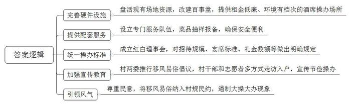
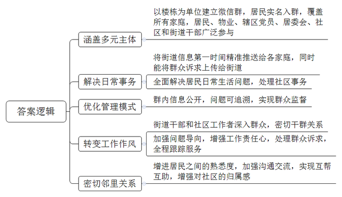
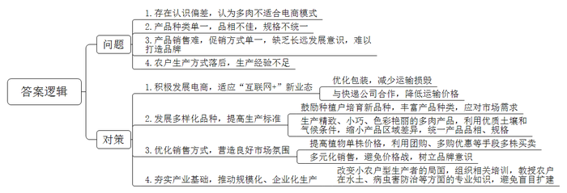
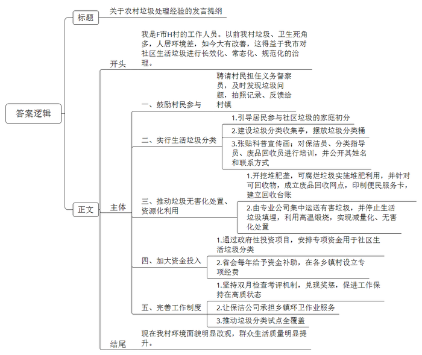
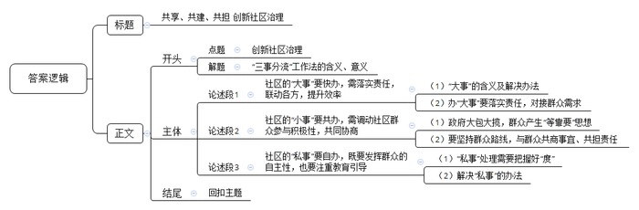

# 2020年0725公务员多省联考《申论》题（陕西B卷）

> 候选采集稿。参考答案及解析来自粉笔页面，不代表官方答案或真实高分答卷；来源使用许可与原卷对应关系仍需人工核实。

## 给定材料

### 材料 material-521a40c179f9a508

西南A村百事堂内，欢声笑语，热闹非凡。村民姚秀莲为孙子办满月酒，花了1000元租用了村里新建的百事堂，宾主尽欢，传为佳话。“在百事堂办酒席，是咱村里的时髦事儿，既省了钱，又吃得开心，体面实惠，我们何乐而不为呢！”姚秀莲乐呵呵地说。去年，A村将原来的棚质结构农贸市场重新改造升级，修缮为百事堂，为全村人操办红白喜事酒席提供场所。百事堂租金便宜，环境亦可媲美酒店。在这里办酒席不仅不跌份儿，还避免了铺张浪费，“小操小办”成了新风尚。

在村里，将村民自筹建设的“王氏宗祠”“陶家祠堂”“东陶老年会”对外开放，改建老年活动中心，现已建有5个百事堂，累计操办白事13场。“我们有专门的服务队伍，每次酒席菜品均抽样到市场监管部门报备，又安全又省事。对婚丧嫁娶招待规模范围、宴席标准、烟酒档次等划出了‘硬杠杠’，引导婚事新办、丧事简办。”A村红白理事会负责人李民说。

“每桌菜品不超过500元，香烟不超过20元，礼金不超过200元，操办红白喜事酒席统一标准，有钱没钱一样办事儿。”A村前街组村民吕丰对这个标准赞不绝口。为遏制人情攀比风，村“两委”在全村推行“移风易俗、文明办红白事”的倡议，并以村“两委干部”分片联村包组和“萤火虫”志愿者服务队形式进组入户宣传。在百事堂统一操办，坚持标准统一、程序简化、杜绝浪费、从简节约，共操办红白喜事酒席16场，同比与在酒店操办节约近5万元。

据了解，当地各乡镇村居自然条件千差万别，有山区与圩区差别、有乡镇面积大小区别、有工业乡镇和农业乡镇分别等。为此，市文明办鼓励利用现有阵地进行改建，鼓励没有场所的地区与餐饮服务单位合作建设，有条件的或群众自愿的可以新建。“有的村自筹资金新建百事堂，有的乡镇出台补贴措施，有的村利用村部食堂……多种渠道多样形式，符合基层实际、利于建设推广，共同目的都是变‘大操大办’为‘小操小办’，真正为村民减负，为群众办实事。”市文明办创建协调科陈浩说。百事堂在给村民带来切实便利的同时，婚事新办、丧事简办等社会风尚更加浓厚，村民人情费用支出明显减轻，乡风文明程度进一步提高，让农民群众有了实实在在的获得感。

百事堂不能一建了之，建是为了用，百事堂如何聚人气，真正融入到当地风俗习俗中，这条路任重而道远。“村民的眼睛都瞅着党员干部，党员干部怎么做，群众就会跟着做。”村民桂祖玉说。党员干部争做移风易俗的引领者，当好火车头，让移风易俗的观念和行动在群众中遍地开花。各乡镇村居召开党员及村民代表大会，党员干部根据移风易俗清单，自觉自愿签订移风易俗承诺书，公开承诺做到婚事新办、丧事简办、小事不办、恶俗禁办，发挥党员干部的示范引领作用，真正引领群众共同移风易俗。

党员干部更需要用喜闻乐见的方式教育引导身边群众转变落后思想，通过“联点共建”、乡镇分片联村包组、“夜访夜谈”等形式，深入居户家中走访看望，面对面宣传移风易俗，高密度多频次讲解节俭办红白喜事的好处和意义。

“在充分尊重民意的基础上，修订完善村规民约，把移风易俗纳入村规民约，有效遏制大操大办现象。”A村党总支书记、村委会主任李开富说。立足服务群众，结合实际，组织发动各村修订村规民约，将移风易俗的内容写入村规民约，引领村民除陋习树新风。

“百事堂场所在哪里选，面积多大适宜，建设资金从哪里来，日常如何维护，还有怎么吸引群众来开展活动，当初这些问题都没有现成的答案，解决这些困难的办法，都是在实际中探索出来的。”市委宣传部副部长、文明办主任梁能文说。“婚丧嫁娶宴请宾朋是人之常情，如果一味地禁止正常的礼尚往来，群众不买账，还影响了干群关系。”某村党委书记刘长英说。村里建设百事堂是根据农民群众的诉求，结合农村移风易俗工作实际，想群众所想，急群众所急，收到事半功倍的效果。

移风易俗是一项长期的系统性工程，既要依靠法治、德治，也离不开村民的自治。在开展移风易俗的过程中，仍然存在一些亟待解决的问题和薄弱环节，比如村民主体作用未充分发挥，村规民约缺乏约束性内容，“四会”组织活动缺乏抓手。面对这些长期想解决而一直未解决的问题，市文明办坚持问题导向，以大力推进百事堂建设为突破口，因势利导搭建平台，让文明乡风深入村民之心。

“大家心里都明白互相攀比、讲排场、撑面子是沉重的负担，但是移风易俗工作难就难在，难以破解群体习惯的力量以及其中牵涉的具体利益。”梁能文说。推进百事堂建设，给村民带来了切实而直接的利益和便利，为群众减负的同时，还有效壮大了村级集体经济收入。

### 材料 material-e2163ac730d7fbbc

四合院作为老北京人世代居住的主要建筑形式，是由东、西、南、北四面房子围合起来形成的内院式住宅，关起门来自成天地。四合院院落宽绰疏阔，四面房屋各自独立，又有游廊连接彼此，庭院方阔，尺度合宜，大小空间分而不隔、互相渗透。院内，四面房门都开向院落，交流沟通便利，拉近了人心、增进了情感，生活气息浓厚，起居十分方便，彼此熟悉，相互帮忙，其乐融融。四合院为创造亲切和睦的生活起了很大作用。

Z街道，上个世纪80年代北京市第一个整体开发建设的大型居住社区，常住居民有3万多户、常住人口达8.8万人，下设16个社区，有223栋居民楼。2018年以来，Z街道党员干部跟居民拉家常、交朋友、问需求，添加居民为微信好友、邀请他们进入每栋楼的微信群。加入楼宇微信群的居民数量超过5万，微信群覆盖了四分之三的居民。大家在群里注明了房间号，近七成住户实名入群。一个楼宇群基本可以保证所有家庭代表入群。这个群里，不仅有左邻右舍、物业人员，还有居委会的管楼干部，以及书记、主任等，辖区内的党员全部入群，街道干部、社区工作人员全部分片入群。

Z街道办事处代主任说，居民入驻了微信群，让高楼变成了“掌上四合院”。街道有事，信息能在第一时间精准推送到群内的每家每户，居民有诉求，也能在第一时间上达街道层面，日常生活里的大事小情都能在群里解决，社区里的大事小情都通过“掌上四合院”找到了良策。

掌上四合院使得社区管理模式和工作作风发生了改变。一些干部习惯“拖”，接到群众诉求能拖就拖、能混就混。现在，进了“四合院”就大不一样了，群里的数字不会说谎、群里的问题都能追溯、干部的表现群里居民都在看着。通过这种方式，街道干部和社区工作者不再是朝九晚五、机关坐班式工作状态，而是走出办公室、走到群众身边，与群众建立了扁平化的直接联系，跟着问题走、带着感情干，通过每一次的诉求处理、全程跟踪服务，赢得群里居民的衷心点赞，干部作风发生了巨大的变化。

Z街道的居民群众更是对“掌上四合院”深有感触。“30多年前，我们从四合院出来上了楼，30年后，我们通过微信群又找回了‘四合院’的感觉！”有居民这样感慨。还有居民说：“在Z街道住了三十年，之前整天抬头不见低头见的邻居，楼上楼下都不知道是谁，这回进了群，终于‘对上号’了，社区真正成了大家的家。更为重要的是，因为有了‘掌上四合院’，曾经陌生的居民们在群里开始熟悉，遇到难事大家互相帮助，有事情大家一起商量，社区真正成了大家的家。”

### 材料 material-dbe58b9bc91d584b

近年来，因为萌萌的体态、超高的颜值、诗意的名字，多肉植物俘获了大众的“芳心”，市场的需求迅速增大。多肉植物之所以能成为产业，电商功不可没。“我们必须要更加适应‘互联网+’这种新业态。”G县商务部门的一位负责人说，“以前我们一般认为，因为植物单株价格低、运输易造成损毁、运费高昂等原因，包括多肉植物在内的花卉业不太适合电商模式，但数据告诉我们这种想法其实不对。”G县多肉产业主要集中在景天科多肉，品种较单一。“大家都卖桃蛋这一个品种，就相互踩价。现在我们这儿的桃蛋已经降到8毛钱一株了，可还是看的人多，买的人少，这可怎么办哟？”说到销售，多肉种植大户老王一筹莫展；G县多肉植物滞销率约为40%，而多肉的销售旺季主要在春秋两季。以前花农们通过降价促销基本能全部出货，但现在这个策略似乎失效了。“有的种植户只是‘抓一把、赶紧跑’，只想快点回本赚钱，我们G县多肉的招牌怎么能打响哟？”老王嘟囔着。

“我们是‘多肉大县’，却不能算‘多肉强县’。”G县多肉协会副会长老叶强调，“国内标准化要求不高，主要依靠品相吸引消费者，因此精致、小巧、色彩艳丽是多肉生产的目标。我们县由于小农户型生产者居多，产品区域差异明显，品相参差不齐，规格难以统一。”

“其实我们G县的土壤和气候是适合大部分多肉植物的。”一位园艺专家在一次花博会上对记者说道，“目前，我们县的多肉种植是以小农户为主，真正企业化生产的极少。而且即使是企业化生产，也是往往在某一个品种的量上面下功夫。一旦市场饱和，恐怕他们也难以应对。此外，我们的多肉种植起步不算晚，但整个花卉产业基础薄弱，相当一部分个体种植户缺乏经验，不知道在水土上做文章、在病虫害防治等方面多下功夫。吃到盲目扩建的亏后，要么改种其他花植，要么干脆迁居外县另起炉灶。”

### 材料 material-283e5f5cda5c6384

退休教师老马是单车骑行爱好者，在村里，经常能看到他骑车的身影。最初他骑车是为了看风景，但自从5年前他有了一个新的身份——“社区人居环境整治义务督察员”后，他就会在骑行时随身带上相机和小本子，既看景也看垃圾，看到哪里有垃圾，就拍下照片，并用小本子记下发现垃圾的具体地址，再反馈给相关村镇处理。

F市是K省省会下辖的县级市，H村（H村属于F市）的社区人居环境在以前并不好，“垃圾靠风刮，污水靠蒸发；房里现代化，屋外脏乱差。”这是当地人对当时社区人居环境的评价，也是老马刚开始担任督察员时，他的相机和小本子所记录的景象。

“以前，房前屋后、路边、河边，都能看到垃圾，一到夏天气味难闻。从去年开始，市里搞垃圾分类，还有污水治理，现在环境比以前好多了。”谈起这些年来的变化，74岁的老周打开了话匣子：“垃圾清运、分类，公厕改造，污水处理，这些都由政府投入，老百姓不用掏一分钱。我现在知道家里的垃圾需要分开装，像菜叶子、剩饭属于可以腐烂的垃圾，像塑料袋属于不可腐烂的垃圾。”老周家门口，有一绿一黄两个小型垃圾桶，分别写着“可腐烂垃圾”和“不可腐烂垃圾”，他觉得社区垃圾的家庭初分，既简单又方便。

现在，各村都设有垃圾分类收集亭，摆放着四种不同颜色的240升标准垃圾分类桶，分别收纳可腐烂、可回收、有害和其他等四类生活垃圾。亭内设有图文并茂的垃圾分类科普宣传画，还有受过培训的保洁员、垃圾分类指导员、废品回收员的姓名和联系方式。

“垃圾分类不是目的，最终是要实现垃圾的无害化处置和资源化利用。”F市农环办韩主任告诉记者，目前F市农村共开挖了205处堆肥垄，像菜叶、瓜皮、树叶等可腐烂垃圾就在此消化堆肥。除了堆肥利用外，F市还对可回收物做到应收尽收，鼓励各乡镇（街道）成立废品回收网点，印制便民服务卡，建立回收台账。同时，F市对有害垃圾进行了无害处置，通过收集、中转后，由专业公司集中运送至有害垃圾处置厂，实行集中无害化处置。2017年9月起，F市停止了生活垃圾填埋的处置方式，利用当地水泥公司的水泥窑高温煅烧，实现了其他类生活垃圾处置的减量化和无害化。

“社区垃圾治理，政府要舍得投入。”韩主任说。2017年F市财政投入1200万元专项资金用于社区环境治理；通过政府性投资项目安排3000万元专项资金用于全域垃圾治理；安排2000万元专项资金用于社区生活垃圾分类。同时，K省省会每年给予一定的资金补助，各乡镇（街道）也设立了专项经费。2019年，F市财政投入用于环境治理的经费达8200万元。

韩主任表示，近年来，政府修订制定了《F市推进社区生活垃圾分类减量化处理和资源化利用工作实施意见》《F市社区生活垃圾治理和环境整治考核奖惩办法》《F市社区生活垃圾全域治理巡查管理办法》等各项工作制度，坚持双月检查考评机制，通过严格考评，兑现奖惩，促进了全市社区生活垃圾治理工作始终保持在高质状态。截至2019年5月，共有13家保洁公司承担着全市17个乡镇（街道）的环卫作业服务，配备了保洁员2514名；全市160个村（居）实现垃圾分类试点全覆盖，已有524个自然村落实了垃圾分类。

老马的照片和小本子清楚地反映了F市社区人居环境的改变：最初骑行一小时能记录十几处卫生死角，而现在常常几个小时也发现不了一处。老马义务督察员的身份也面临着“退休”的风险。他高兴地告诉记者，“F市社区的环境越来越好，现在不仔细去找，很难看到卫生死角了。社区生活垃圾治理长效化、常态化、规范化，社区生态环境改善了，群众生活质量提高了，环境面貌明显改观，生态质量明显提升。”

## 题目

### 第 1 题

**请根据“给定资料**1**”，概括****A****村在倡导婚事新办、丧事简办方面的新举措。（15分）**

关联材料：material-521a40c179f9a508

作答要求：

要求：全面、准确、有条理，字数150-200字。

### 第 2 题

**在****“给定资料**2**”中，有居民说：“30多年前，我们从四合院出来上了楼，30年后，我们通过微信群又找回了****‘四合院’的感觉！”****请根据资料内容，谈谈该小区居民为什么会有这样的感觉？（****20分）**

关联材料：material-e2163ac730d7fbbc

作答要求：

要求：思路清晰，逻辑严谨，条理清楚，字数250-300字。

### 第 3 题

**请根据****“给定资料**3**”，分析G****县****发展多肉植物产业过程中存在的主要问题，并提出解决的对策建议。（****30分）**

关联材料：material-dbe58b9bc91d584b

作答要求：

要求：概括准确，分析深入，对策可行，字数300-400字。

### 第 4 题

**外地有关部门专程到****F市H村学习考察农村垃圾治理方面的经验，假设安排你作专题介绍，请根据“给定资料**4**”，写一份介绍提纲。（35分）**

关联材料：material-283e5f5cda5c6384

作答要求：

要求：全面准确，内容具体，层次分明，字数500-600字。

### 第 5 题

**请根据****“给定资料**5**\-**6**”，围绕社区治理主题，自拟题目，写一篇文章。（50分）**

关联材料：material-521a40c179f9a508

作答要求：

要求：

（1）主题明确，论证充分；

（2）层次分明，逻辑性强；

（3）文字流畅，语言生动；

（4）字数800-1000字。

## 答案与解析

第 1 题

**参考答案（粉笔题库参考内容）**

1.完善硬件设施。盘活现有场地资源，改建百事堂，提供租金低廉、环境有档次的酒席操办场所。

2.提供配套服务。设立专门服务队伍，菜品抽样报备，确保安全便利。

3.统一操办标准。成立红白理事会，对招待规模、宴席标准、礼金数额等做出明确规定。

4.加强宣传教育。村两委推行移风易俗倡议，村干部和志愿者多方式走访入户，宣传节俭操办。

5.引领风气。尊重民意，将移风易俗纳入村规民约，遏制大操大办现象。

**解析**

**参考答案说明**：本参考答案从“完善硬件设施”“提供配套服务”“统一操办标准”“加强宣传教育”和“引领风气”五个方面展开，各条答案要点之间在内容上相互并列，没有交叉。

**考点**：考点概括措施类

**来源**：来源2020年0725公务员多省联考《申论》题（陕西B卷）

粉笔申论页面对本题只提供「解析视频」入口，该入口是会员推广位，页面无视频地址与文字解析。

第 2 题

**参考答案（粉笔题库参考内容）**

1.涵盖多元主体。以楼栋为单位建立微信群，居民实名入群，覆盖所有家庭，居民、物业、辖区党员、居委会、社区和街道干部广泛参与。

2.解决日常事务。将街道信息第一时间精准推送给各家庭，同时能将群众诉求上传给街道；全面解决居民日常生活问题，处理社区事务。

3.优化管理模式。群内信息公开，问题可追溯，实现群众监督。

4.转变工作作风。街道干部和社区工作者深入群众，密切干群关系；加强问题导向，增强工作责任心，处理群众诉求，全程跟踪服务。

5.密切邻里关系。增进居民之间的熟悉度，加强沟通交流，实现互帮互助，增强对社区的归属感。

**解析**

**参考答案说明：**本参考答案从“涵盖多元主体”“解决日常事务”“优化管理模式”“转变工作作风”“密切邻里关系”这五个方面介绍了为什么微信群能让小区居民找回“四合院”的感觉。各条答案要点之间在内容上是并列关系，没有交叉。

  

**考点**：考点原因类

**来源**：来源2020年0725公务员多省联考《申论》题（陕西B卷）

粉笔申论页面对本题只提供「解析视频」入口，该入口是会员推广位，页面无视频地址与文字解析。

第 3 题

**参考答案（粉笔题库参考内容）**

问题：1.存在认识偏差，认为多肉不适合电商模式。2.产品种类单一，品相不佳，规格不统一。3.产品销售难，促销方式单一，缺乏长远发展意识，难以打造品牌。4.农户生产方式落后，生产经验不足。

对策：1.积极发展电商，适应“互联网+”新业态。优化包装，减少运输损毁；与快递公司合作，降低运输价格。

2.发展多样化品种，提高生产标准。鼓励种植户培育新品种，丰富产品种类，应对市场需求；生产精致、小巧、色彩艳丽的多肉产品，利用优质土壤和气候条件，缩小产品区域差异，统一产品品相、规格。

3.优化销售方式，营造良好市场氛围。提高植物单株价格，利用团购、多购优惠等手段多株买卖；多元化销售，避免价格战，树立品牌意识。

4.夯实产业基础，推动规模化、企业化生产。改变小农户型生产者的局面，组织相关培训，教授农户在水土、病虫害防治等方面的专业知识，避免盲目扩建。

**解析**

**参考答案说明：**（1）本参考答案按照题目要求从“问题”和“对策”两个方面进行了分类。其中，“问题”部分从“电商认识偏差”“产品生产差”“产品销售难”“产业生产落后”四方面进行了分条撰写；“对策”部分从“积极发展电商”“发展多样化品种，提高生产标准”“优化销售方式，营造良好市场氛围”“夯实产业基础，推动规模化、企业化生产”四方面进行了分条撰写。（2）各条要点之间在内容上是并列的，没有交叉。

**考点**：考点提出对策类

**来源**：来源2020年0725公务员多省联考《申论》题（陕西B卷）

粉笔申论页面对本题只提供「解析视频」入口，该入口是会员推广位，页面无视频地址与文字解析。

第 4 题

**参考答案（粉笔题库参考内容）**

关于农村垃圾处理经验的发言提纲

我是F市H村的工作人员。以前我村垃圾、卫生死角多，人居环境差，如今大有改善，这得益于我市对社区生活垃圾进行长效化、常态化、规范化的治理。主要经验有：

一、鼓励村民参与。聘请村民担任义务督察员，及时发现垃圾问题，拍照记录、反馈给村镇。二、实行生活垃圾分类。1.引导居民参与社区垃圾的家庭初分。2.建设垃圾分类收集亭，摆放垃圾分类桶。3.张贴科普宣传画；对保洁员、分类指导员、废品回收员进行培训，并公开其姓名和联系方式。三、推动垃圾无害化处置、资源化利用。1.开挖堆肥垄，可腐烂垃圾实施堆肥利用，并针对可回收物，成立废品回收网点，印制便民服务卡，建立回收台账。2.由专业公司集中运送有害垃圾，并停止生活垃圾填埋，利用高温煅烧，实现减量化、无害化处置。四、加大资金投入。1.通过政府性投资项目，安排专项资金用于社区生活垃圾分类。2.省会每年给予资金补助，在各乡镇村设立专项经费。五、完善工作制度。1.坚持双月检查考评机制，兑现奖惩，促进工作保持在高质状态。2.让保洁公司承担乡镇环卫作业服务。3.推动垃圾分类试点全覆盖。

现在我村环境面貌明显改观，群众生活质量明显提升。

**解析**

**参考答案说明：**内容方面，本参考答案的开头部分，先对H村出现的环境转变进行阐述；接着主体部分从“鼓励村民参与”“实行生活垃圾分类”“推动垃圾无害化处置、资源化利用”“加大资金投入”“完善工作制度”五个方面具体展开；最后，结尾部分对垃圾处理工作取得的成效进行了总结。形式方面，本参考答案做到了分段、分条撰写，整体上条理较为清晰。

**考点**：考点总结类

**来源**：来源2020年0725公务员多省联考《申论》题（陕西B卷）

粉笔申论页面对本题只提供「解析视频」入口，该入口是会员推广位，页面无视频地址与文字解析。

第 5 题

**参考答案（粉笔题库参考内容）**

**共享、共建、共担 创新社区治理**

“三事分流”工作法，是由部门负责解决“大事”，即管辖事项及公共服务；村（居）委会为主导，社区组织等共同协商解决“小事”，即村（居）公共事项及公益服务；由群众寻求市场服务或自行解决“私事”，即个人事务和市场服务。

这是社区治理的创新，是政府治理和社会调节、居民自治良性互动的方式，是在社区这个“小世界”中，打造一个最优的时代，实现“大事”能快办，“小事”能共办，“私事”能自办，共享共建共担。

**社区的“大事”要快办，需落实责任，联动各方，提升效率。**“民生无小事，枝叶总关情”，只要是涉及群众切身利益的公共事项及公共服务，都是“大事”，是最基本、最迫切的民生需求。“大事”的解决不是某个干部、某个部门的一家之责，需要协调各部门，加强联动，以此精简环节、提高效率。如北京实施的“街乡吹哨、部门报到”，实现群众需求与部门职能的精准对接。群众有所呼，政府有所应，切实提升群众生活的幸福感和获得感。

**社区的“小事”要共办，需调动社区群众参与积极性，共同协商。**过去，政府为群众办实事办好事，却大包大揽，基层干部疲于奔命，群众产生“等靠要”的依赖思想。发展为了人民，更要依靠人民，社区治理也要坚持群众路线，听民意、汇民智、集民力。如“人居环境整治义务督察员”及时发现、反馈问题，共建美好环境。既有政府的投入与权力赋予，也有群众的责任共担，才能求得自上而下精细管理与自下而上广泛参与的“最大公约数”。

**社区的“私事”要自办，既要发挥群众的自主性，也要注重教育引导。**我们常说“清官难断家务事”，“外界力量”有时并不能弄清“私事”的全貌。与此同时，“私事”也涉及到隐私，若处理不得当，把握不好“度”，反而可能弄巧成拙，激化矛盾。因此，对于家庭私事，倡导“自办”。但这并不意味着政府、社区的袖手旁观、隔岸观火，需要为其提供必要的心理、家庭、教育、法律等普惠性服务，注重教育和引导。

总之，要让“三事分流”工作法真正落实地、见实效，需要系统性、全面性、全方位的过程把控。要深入群众，准确把握群众所思所想所盼；要精准识别，合理分类，明确权责；要全面反馈评估，信息公开，接受监督，真正做到准确“找事”、合理“分事”、高效“办事”、全面“反馈评估”。

社区治理没有终点，只有连续不断的新起点，“治大国如烹小鲜”，要继续提升社区治理水平，真正惠民生、暖民心，让社区成为“人人出力、人人尽责”、共享共建共担的大家庭。

**解析**

**文章分析**

**共享、共建、共担 创新社区治理**

【**标题的优点：**标题中含有“创新社区治理”这一主题词，文章主题突出、清晰。】

（1）“三事分流”工作法，是由部门负责解决“大事”，即管辖事项及公共服务；村（居）委会为主导，社区组织等共同协商解决“小事”，即村（居）公共事项及公益服务；由群众寻求市场服务或自行解决“私事”，即个人事务和市场服务。

（2）这是社区治理的创新，是政府治理和社会调节、居民自治良性互动的方式，是在社区这个“小世界”中，打造一个最优的时代，实现“大事”能快办，“小事”能共办，“私事”能自办，共享共建共担。

【**开头的优点：**★内容方面。范文的开头是紧扣题目给定的“创新社区治理”这一主题展开的。（1）开头直接指出了“三事分流”工作法的含义；（2）指出了此工作法的意义。★文字表达方面。使用了排比的修辞手法以及长短句结合的形式，使语言表达清晰有力、有节奏感。】

**社区的****“大事”要快办，需落实责任，联动各方，提升效率。**（1）“民生无小事，枝叶总关情”，只要是涉及群众切身利益的公共事项及公共服务，都是“大事”，是最基本、最迫切的民生需求。“大事”的解决不是某个干部、某个部门的一家之责，需要协调各部门，加强联动，以此精简环节、提高效率。（2）如北京实施的“街乡吹哨、部门报到”，实现群众需求与部门职能的精准对接。群众有所呼，政府有所应，切实提升群众生活的幸福感和获得感。

【**论述段****1的优点：**★观点句：范文的观点句是紧扣“创新社区治理”这一文章主题提出的。形式上，它在段首处直接写出，位置突出，容易发现。内容上，关键词突出，内容要点明确，可以明显看出它主要介绍了“‘大事’要快办”。★论述内容：（1）指出了“大事”的含义及解决办法；（2）指出了办“大事”要落实责任，要对接群众需求。注意：以上两个方面的内容都是紧扣观点句“社区的‘大事’要快办，需落实责任，联动各方，提升效率”进行分析论述的，层次清晰，论述的针对性强。最后，在论证方法和论据选取方面，讲道理和举例子相结合，做到了丰富多样。】

**社区的****“小事”要共办，需调动社区群众参与积极性，共同协商**。过去，（1）政府为群众办实事办好事，却大包大揽，基层干部疲于奔命，群众产生“等靠要”的依赖思想。（2）发展为了人民，更要依靠人民，社区治理也要坚持群众路线，听民意、汇民智、集民力。如“人居环境整治义务督察员”及时发现、反馈问题，共建美好环境。既有政府的投入与权力赋予，也有群众的责任共担，才能求得自上而下精细管理与自下而上广泛参与的“最大公约数”。

【**论述段****2的优点：**★观点句：范文的观点句是紧扣“创新社区治理”这一文章主题提出的。形式上，它在段首处直接写出，位置突出，容易发现。内容上，关键词突出，内容要点明确，可以明显看出它主要介绍了“‘小事’要共办”。★论述内容：（1）指出了政府大包大揽，群众产生“等靠要”思想。（2）指出了要坚持群众路线，要与群众共商事宜、共担责任。注意：以上两个方面的内容都是紧扣观点句“社区的‘小事’要共办，需调动社区群众参与积极性，共同协商”进行分析论述的，层次清晰，论述的针对性强。最后，在论证方法和论据选取方面，讲道理和举例子相结合，做到了丰富多样。】

**社区的****“私事”要自办，既要发挥群众的自主性，也要注重教育引导**。（1）我们常说“清官难断家务事”，“外界力量”有时并不能弄清“私事”的全貌。与此同时，“私事”也涉及到隐私，若处理不得当，把握不好“度”，反而可能弄巧成拙，激化矛盾。（2）因此，对于家庭私事，倡导“自办”。但这并不意味着政府、社区的袖手旁观、隔岸观火，需要为其提供必要的心理、家庭、教育、法律等普惠性服务，注重教育和引导。

【**论述段****3的优点：**★观点句：范文的观点句是紧扣“创新社区治理”这一文章主题提出的。形式上，它在段首处直接写出，位置突出，容易发现。内容上，关键词突出，内容要点明确，可以明显看出它主要介绍了“‘私事’要自办”。★论述内容：（1）指出了“私事”处理需要把握好“度”。（2）指出了解决“私事”的办法。注意：以上两个方面的内容都是紧扣观点句“社区的‘私事’要自办，既要发挥群众的自主性，也要注重教育引导”进行分析论述的，层次清晰，论述的针对性强。最后，在论证方法上主要采用了讲道理的方式，做到了论述深刻。】

【**论述段之间的关系：**★内容的内在逻辑：范文的论述段之间是依照“并列”的逻辑展开的。论述段1先写了“‘大事’要快办”，论述段2再写了“‘小事’要共办”，论述段3接着写了“‘私事’要自办”。★段与段的外在衔接：三个论述段分别由“‘大事’要快办”“‘小事’要共办”“‘私事’要自办”这一句式引导论述，从形式上看工整对仗。】

总之，要让“三事分流”工作法真正落实地、见实效，需要系统性、全面性、全方位的过程把控。要深入群众，准确把握群众所思所想所盼；要精准识别，合理分类，明确权责；要全面反馈评估，信息公开，接受监督，真正做到准确“找事”、合理“分事”、高效“办事”、全面“反馈评估”。

【**过渡段的优点**：范文过渡段介绍了“三事分流”工作法的具体做法。一方面总体指出“三事分流”工作法要做好过程把控；另一方面具体阐述“找事”“分事”“办事”和“反馈评估”四个步骤，继而引出结尾“社区治理没有终点”。】

 社区治理没有终点，只有连续不断的新起点，“治大国如烹小鲜”，要继续提升社区治理水平，真正惠民生、暖民心，让社区成为“人人出力、人人尽责”、共享共建共担的大家庭。

【**结尾的优点**：范文的结尾回扣了“创新社区治理”这个主题，并发出了呼吁和号召。】

  
  

**考点**：考点文章写作题

**来源**：来源2020年0725公务员多省联考《申论》题（陕西B卷）

粉笔申论页面对本题只提供「解析视频」入口，该入口是会员推广位，页面无视频地址与文字解析。

