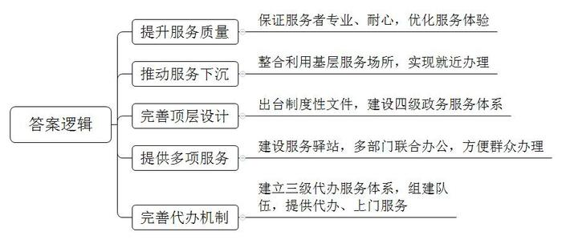
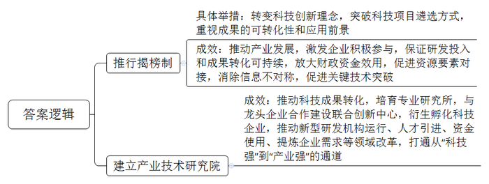
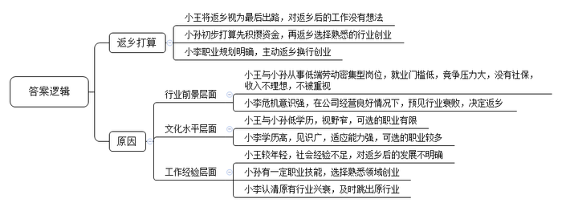
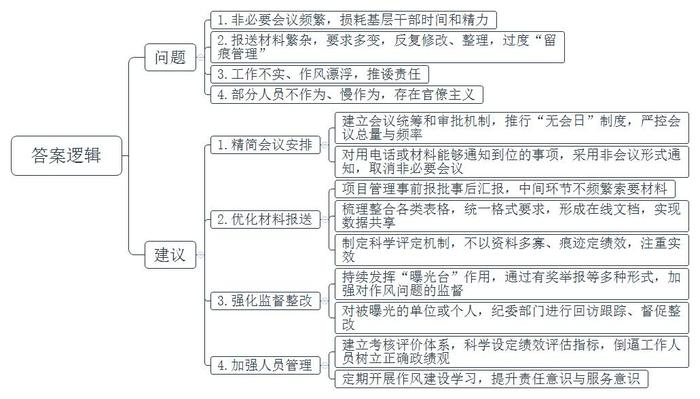
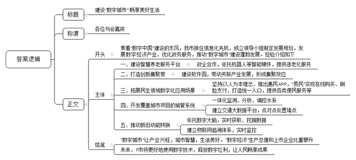

# 2021年公务员多省联考《申论》题（陕西A卷）

<!-- gwy:overview:start -->
> **陕西 · 2021 · 申论 · A类** ｜ 6 题 · 图片 6 处 · 答案随题折叠

导航：[题目](#题目) · [材料 1](#材料-1)
<!-- gwy:overview:end -->

> 候选采集稿。参考答案及解析来自粉笔页面，不代表官方答案或真实高分答卷；来源使用许可与原卷对应关系仍需人工核实。

## 给定材料

### 材料 1

临近傍晚，天色慢慢暗淡下来。X市B区市民中心大厅，人也渐渐稀少了。

45岁的赵琳拿着身份证、银行卡等证件，平静地坐在大厅沙发上等待叫号，准备办理养老保险、医疗保险等业务。不过，当天下午早些时候，赵琳心里却平静不下来，“一想起自己这些繁琐事，都会觉得很麻烦，不知道该怎么办。”

因为户籍与此前工作所在地不同等原因，赵琳特意来此办理关系转入业务。“工作人员也不嫌我烦，很专业很耐心地给我解释清楚，让我们这些来办事的人心里感觉非常温暖。”

12月7日，在X市启航路社区便民服务站，工作人员刘丽丽向记者介绍着上个星期刚搬来的两台自助业务办理终端机。“一个是税务，一个是工商。比如您要办理营业执照，只要带上身份证，从头到尾在这一台机子上就可办理。”

这个刚刚正式投用没几天的便民服务站，成为X市行政审批服务局将服务触角向下延伸的重要载体，“下沉”至此的服务事项也为社区百姓带来了更为便捷的服务。

“以前还说是15分钟服务圈，其实根本用不了15分钟，现在出门走几步路就可以在社区办理，更加方便了。”家住附近小区的王先生说。目前，该服务站不仅可办理工商登记、税务登记以及“一网通办”高频事项，同时提供业务咨询、行政审批服务局综合受理业务转办、“一件事一次办”以及其他帮办、代办服务。

为进一步实现“就近办”，X市通过整合利用现有各类基层服务场所，推动公民个人事项向街道（社区）下沉，指导各区县、开发区采取委托受理、远程审批等方式，将部分人社、卫健、民政、公共服务等事项下沉办理。

“下沉”至街道（社区）的事项看似简单方便，但其背后的支撑却没有那么简单。这个时候，顶层设计就显得尤为关键。其实，X市近年来已出台一系列关于政务服务的制度性文件，包括《打造城市社区“15分钟政务服务圈”实施方案》《X市基层便民服务中心（站）标准化建设指导意见》《关于深化“15分钟政务服务圈”建设着力打造“民有所呼、我有所行”服务品牌实施方案》等，通过推进四级政务服务体系建设，让企业、群众感受到办事方便。

为更好实现“方便办”，X市新建的政务服务驿站，实行工商、税务、城管、卫生等10余个部门联合办公，并提供多项政务服务。在离家只有400多米的新城区长乐西路街道便民服务中心，市民郭和霖短短几分钟就办完了业务。“这个便民服务中心建成后，附近群众办事方便多了。以前买个天然气我要坐7站公交车，现在走路只需5分钟。”

回想起以前办理施工许可证等事项时，在X市工作多年的王崎东坦言确实比较麻烦，前前后后要往政务大厅跑好几趟。不过，前段时间发生的一件事，却改变了他以往的认知。

原来，通过X市“政+”助跑团提供的上门服务，不到1天时间，王崎东办理营业执照就完成了。这让他直呼效率高，“真是省时又省心”。X市在“金钥匙流动服务驿站”基础上打造“政+”助跑团，不仅提供各类代办服务，还运用“线上绿色通道”“云审批”等技术手段，开展上门服务，让企业“不出门就能办成事”。

不仅如此，X市还不断完善代办机制，建立市、区县（开发区）、镇街三级代办服务体系，组建代办员队伍，已累计为企业、群众提供帮办代办服务30余万次，同时，对行动不便和特殊群众提供“上门服务”。

### 材料 2

“要把芯片技术领域的十年经验凝练到一场不到半小时的PPT汇报里，还得接受专家提问，这是一场大考，不敢大意。”恒心科技有限公司陈总说。这场“考试”是由Q市科技局组织，共有32家单位“参考”，以“揭榜制”形式择优确定8家单位。其中，恒心科技有限公司提出的“面向5G技术的芯片攻关类”项目，最终“揭榜”成功。

作为大赛评委，郑教授深有感触：“无论是科研院所、高新企业，还是一些中小型科技企业，都踊跃参加，这证明了这种揭榜制在Q市得到了大家的认可和欢迎。”在Q市科技部门负责人看来，“把需要的关键核心技术项目以及相关技术标准、资助标准、完成时限等张出榜来，英雄不论出处，谁有本事谁揭榜。”——他们需要有实力，能接得住；有情怀，愿意接；有绝招，干得好。

从过去的“委派制”，改为“揭榜制”，不仅是科技创新理念的重大转变，更是科技项目遴选方式的重大突破；省科技厅张副厅长表示：在主体的选择上，一改过去由政府主导遴选项目实施主体的做法，在项目评估中，不仅要看专利或奖项，更要看成果的可转化性和应用前景。陈总说：“这种做法保证了企业持续的研发投入，使成果转化工作不半途而废，毕竟成果转化不是一蹴而就。1元财政资金撬动企业10元投入，放大作用明显。”同样揭榜成功的银创科技有限公司负责人认为，“揭榜制方式，能促进资源要素的对接，消除信息不对称，更好地突破关键技术，从而推动产业发展。”

在Q市还有一块科技体制改革“试验田”——Q市产业技术研究院。作为产研院的“当家人”，马院长从金属材料工程领域的专业科学研究一路走向了更为广阔、也更为艰难的“科技转化”之路。“科技创新既需要仰望星空，也需要脚踏实地，要让技术成果从实验室研究走向更广阔天地。”马院长说，从科学技术到产业成果，跨越科技成果转化的“死亡之谷”，他们就是“桥梁”，一头连着科研、一头连着市场。目前，Q市产研院已培育建设了35家专业研究所，与细分产业领域的龙头企业合作建设了60余家联合创新中心，衍生孵化科技型企业200多家，转移转化技术成果1500多项，服务的企业超过10000家。

“我们既非政府机构又非事业单位，既非高校院所也非成果转化中心，很多人说我们是‘四不像’。”马院长说，通过这块试验田，产研院在新型研发机构运行、人才引进、资金使用、提炼企业需求等领域进行了大刀阔斧的改革和探索。“不与高校争学术之名，不与企业争产品之利，只为打通从‘科技强’到‘产业强’的通道全力以赴。”

### 材料 3

进工厂曾是一代人的梦想，时移世易。数据显示，2018年，外卖骑手平均月薪为7750元左右，制造业员工平均月薪6000元左右。23岁的小王，曾在一个工厂做过装卸工，近来转行外卖骑手，在他看来，工厂工人和外卖员的工作体验是完全不一样的。“每天都待在厂子里，搬东西很累，管理还很严格。”小王坦言，“我们这个年纪的，谁会喜欢这样的工作呢？”

今年33岁的小孙，曾是家乡县城一家汽车工厂的喷漆工人。小孙不是科班出身，最早由师傅带入行，工作四年，月工资从3500元涨到了5000元左右。2018年7月，小孙到省城当外卖员，每月到手收入一度维持在8000元到10000元之间。他满意地说：“这相当于我们当地一家4S店高级汽修技师的收入了。”当高级汽修技师曾是小孙的梦想，但由于理论知识、技能证书等门槛，初中文化的小孙并未选择这条路。不过，今年以来，小孙送外卖的收入再没有回到从前的高收入水平。

转行两个月，作为外卖新手的小王并没有拿到传说中“月入过万”的收入。几乎无门槛的外卖行业正成为吸纳就业的重要蓄水池。小王很无奈地说：“5月份订单量刚涨起来，又新来了很多兼职外卖员。”数据显示，外卖骑手中56%的骑手有第二职业。“我们没有基本的社会保障，只能赚点算点，为以后早做打算。”在他看来，返乡是最后一条路，但也是最现实的一条路。“像我这样只有高中文化的人，在互联网时代很难在大城市找到满意的工作了。”

不过，时至今日，机器虽然已经替代了工厂流水线上的基础岗位，但并未能完全替代快递外卖配送线上的基础岗位。在配送线上的“最后一公里”，在面对面的服务环节，依然需要依赖人工。S大学林教授认为，未来中国服务业的增加值比重和就业份额将继续稳步提升。但一个残酷的现实是，服务业中的高端知识型岗位和低端劳动密集型岗位之间的收入差距将会进一步扩大。谈及未来，小孙说：“先干着，攒点钱，以后看看能不能返乡开个汽车美容店。”

相比小王和小孙，小李却为自己此前的决定感到庆幸。小李是一所知名大学财经专业的毕业生。两年前，他从深圳一家生产自动取款机的公司离职，回到家乡创业。“行业已经要变天了，我必须早做打算。公司当时营业收入、利润增长还不错，但我心里没底。移动支付发展太快了！”小李如此解释自己两年前的担忧。

现金时代，一台台自动取款机就是其生产厂商的“印钞机”。上世纪90年代，存取款都只能在固定的储蓄所；2005年前后，自动取款机开始遍布街头巷尾。2015年，中国成为全球最大的自动取款机销售市场。当年年末，全球自动取款机行业协会会长充满激情地预言，盛宴即将开始。但事后回看，这已是盛宴的尾声。

就在2015年，银行纷纷推出互联网金融战略，并开始减少自助银行、自动取款机，用户使用自动取款机的频次也大幅下滑。与此同时，各个银行的网络金融业务占比大幅提升。根据上市公司的财报，2018年多家自动取款机厂商从净利润下滑开始转向大幅度亏损，2019年亏损进一步加剧，小李感叹：“时代在抛弃你时，连一声招呼都不会打。”

### 材料 4

“每天不是在开会，就是在开会的路上。”频繁又非必要的会议，让C市柳云村党支部书记老文很是头疼。老文工作的村子地处沿海，夏秋之际，台风频繁。“大家白天入户排查情况，宣传防台风要求，还得抽时间应付各种会议。”老文告诉记者，“有的会议只是花几分钟传达一下文件精神，其实用电话或者材料就能通知到位。”

“刚刚签订战略合作协议，实质项目还没落地，就要准备一堆汇报材料。”C市大华街道干部小李对报送“材料”的苦恼，也引起了扶贫干部小吴的共鸣。小吴2018年起驻村负责57户建档立卡贫困户的工作。回想近两年的工作，小吴说，驻村扶贫工作不易，但最让人头疼的，却是应付各项检查以及反复整理、填写、修改各种资料和表格。“最多的时候，我手里同时有20多个表格要填。有一个表，因为不同要求反复修改，弄了大半年。”如果遇到过于重视迎检资料的领导，可能出现以资料多寡、“痕迹”是否明显来定绩效的情况，基层干部就不得不加班加点找资料，熬更守夜补台账。

2020年，C市纪检监察机关紧扣“四风”问题，设立了转变作风“曝光台”。采取有奖举报、外聘专家、记者采访等形式，对工作不实、作风漂浮的给予定期曝光。被曝光的单位或个人，市纪委监委将回访跟踪、督促整改。市新区小学师生则是这一举措的直接受益者。该小学位于上塘路交叉口，2018年新建了一座高架桥，由于未设置隔音屏，800多名师生不得不在滚滚车流带来的噪音中上课。工程完成伊始，学校和学生家长就多次反映问题，希望加装隔音屏。该街道住建科负责人表示，隔音屏属于高架桥附属工程，高架桥是谁建的，隔音屏就该谁来建，而建设主体市建委则表示，该段高架已移交市城管委养护，应由该委负责加装隔音屏。市城管委称，隔音屏在工程建设过程中，是由原建设单位负责实施的，需要增补应由属地政府负责落实。这次一上“曝光台”，市建委马上邀请市信访、城管、环保等部门和街道进行协调。一个多月后，长达近两年的问题得以解决。

市纪委张副书记说，在作风建设方面，近期，C市一举推出了“六项机制”，重点整饬“闭门施策”“推诿扯皮”“政令空转”“留痕管理”“督考过多”“文山会海”等六大顽疾。“我对这样的措施表示肯定。”C市党校刘教授说，不少面向群众的基层政府人员，依然存在不作为、慢作为等现象，而这绝不是小事，甚至会在一定程度上影响政府威信。

### 材料 5

“你好小福，我想订餐。”78岁的孙奶奶按下开关，向机器人小福发出语音指令。“有两荤两素加米饭13元的和两荤一素加米饭10元的两种，您选哪一种？”稚嫩的童声清脆悦耳。“13元的。”“好的，稍后会有工作人员与您联系。”不一会儿，福龄老年服务中心工作人员刘大姐拎着盒饭，一路小跑来到孙奶奶的家。“对我们老人来说这个太好了！我不会用手机，现在只需要对机器人发个语音指令，立马有人上门。”孙奶奶说。

变化，缘于智慧养老服务平台的建成。2019年，坐落于F市北区物联网产业园的乐享科技有限公司利用物联网、云计算及大数据等技术打造了这一平台。该平台的建成是F市绘制“数字城市”蓝图的靓丽一笔。乘着“数字中国”建设的东风，F市抓住信息化先机，积极拥抱数字浪潮，从成立“数字城市”建设领导小组到制定“数字城市”中长期发展规划；从“一枝独秀”的软件园到“百花齐放”的数字经济产业；从最早的办事“跑多趟”到如今“一趟不用跑”……“数字城市”建设蓬勃发展。

2000年6月，F市东区软件园创业楼迎来首批入园企业。“当时，园区内的研发楼宇只有寥寥几栋，产业规模仅12.7亿元。”东区软件园管委会负责人回忆道。如今，东区软件园产业发展突飞猛进，总收入已超千亿元。据F市汪副市长介绍，在空间布局上，F市重点打造环中心城区“东区软件园—西区高新园—北区物联网产业园—南区大数据产业园”的数字经济创新集聚带，带动关联产业发展。

在推进“数字城市”建设过程中，F市坚持人民城市为人民的发展理念，不断拓展众多与百姓息息相关的数字化应用场景。“易民”APP是F市全力打造的数字惠民品牌，居民足不出户轻点手机APP，日常生活用品最快10多分钟送到家，出门购物、地铁进站，“刷脸”几秒钟即可完成付款。上线两年多来，该APP已发展成F市移动互联网的统一便民入口，为市民提供各类高频的便民服务、公共服务、政务服务等近80项。

打开F市数字城管系统，一张覆盖全市所有公用设施、道路交通、市容环境等城市管理项目的“电子地图”便呈现在眼前。在城区水系联排联调中心，工作人员可对城区上千个库、湖、池、河、闸、站实现一体化在线监测实时分析和远程调控。超级“大脑”交通大数据平台则为全市交通编织了一张智慧大网，实现点对点快速处置堵点。

“数字城市”在提高城市治理和人民生活水平的同时，也为F市改造提升传统产业、推动新旧动能转换提供了新机遇，如锦绣家纺公司依托数字大脑，实现“产、供、销、人、财、物”数据的实时获取和智能挖掘，让生产更高效智能；福仙茶业集团建立了物联网追溯体系，对基地种植到终端销售全过程进行实时监控。

产业更兴旺，城市更智慧，生活更美好。F市市委李书记表示，目前，数字经济占地区生产总值的比重提高到45%，数字经济上市企业占全市的一半。展望未来，李书记说，F市将更好地使用数字技术，不断释放数字红利，让人民群众畅享数字城市建设成果。

### 材料 6

1949年3月23日下午，西柏坡阳光明媚，毛泽东同志从住了10个月的小院里走出来，正好碰到迎上来的周恩来同志。他望着远处连绵雄伟的太行山，意味深长地说：“今天是进京赶考的日子。”周恩来答道：“我们都应当考及格，不要退回来。”毛泽东坚定地说：“退回来就失败了。我们决不当李自成！我们共产党人进北平，是要继续革命，建设社会主义，直到实现共产主义。”

2013年7月，习近平总书记在河北省调研时指出：“当年党中央离开西柏坡时，毛泽东同志说是‘进京赶考’。60多年过去了，我们取得了巨大进步，中国人民站起来了，富起来了，但我们面临的挑战和问题依然严峻复杂，应该说，党面临的‘赶考’远未结束。”

2020年10月，党的十九届五中全会审议通过了《中共中央关于制定国民经济和社会发展第十四个五年规划和二〇三五年远景目标的建议》。2021年3月，十三届全国人大四次会议审议通过了《中华人民共和国国民经济和社会发展第十四个五年规划和二〇三五年远景目标纲要》。对于中国发展来说，“五年规划”是党治国理政的重要方式，也是量度中国步伐的显著路碑。从1953年新中国开始实行第一个“五年计划”，到2020年“十三五”规划完成，一个又一个五年，诠释了不同时期的历史标识，推动中华民族迎来了从站起来、富起来到强起来的伟大飞跃。

## 题目

### 第 1 题

**根据材料2，概括X市打造“15分钟政务服务圈”的成功经验。（10分）**

关联材料：材料 1

作答要求：准确、全面、简明、有条理，字数100-150字。

第 1 题 · 答案与解析

**参考答案（粉笔题库参考内容）**

1.提升服务质量。保证服务者专业、耐心，优化服务体验。

2.推动服务下沉。整合利用基层服务场所，实现就近办理。

3.完善顶层设计。出台制度性文件，建设四级政务服务体系。

4.提供多项服务。建设服务驿站，多部门联合办公，方便群众办理。

5.完善代办机制。建立三级代办服务体系，组建队伍，提供代办、上门服务。

**解析**

**参考答案说明：**本参考答案按照“提升服务质量”“推动服务下沉”“完善顶层设计”“提供多项服务”“完善代办机制”这五个方面的内容进行了分条撰写。各条要点之间在内容上相互并列，没有交叉。

**考点**：经验启示类

**来源**：2021年公务员多省联考《申论》题（陕西A卷）

粉笔申论页面对本题只提供「解析视频」入口，该入口是会员推广位，页面无视频地址与文字解析。

### 第 2 题

**根据材料3，概括科技体制机制建设的主要举措和成效。（15分）**

关联材料：材料 2

作答要求：内容全面、条理清晰，字数200\-250字。

第 2 题 · 答案与解析

**参考答案（粉笔题库参考内容）**

1.推行揭榜制。转变科技创新理念，突破科技项目遴选方式，重视成果的可转化性和应用前景。成效：推动产业发展，激发企业积极参与，保证研发投入和成果转化可持续，放大财政资金效用，促进资源要素对接，消除信息不对称，促进关键技术突破。

2.建立产业技术研究院。成效：推动科技成果转化，培育专业研究所，与龙头企业合作建设联合创新中心，衍生孵化科技企业，推动新型研发机构运行、人才引进、资金使用、提炼企业需求等领域改革，打通从“科技强”到“产业强”的通道。

**解析**

**参考答案说明：**本参考答案从“推行揭榜制”“建立产业技术研究院”这两个方面分别阐释主要举措及成效。各条要点之间在内容上相互并列，没有交叉。并且每条要点都按照一个“举措+成效”的形式书写，使得答案条理更清晰。

**考点**：多要素组合类

**来源**：2021年公务员多省联考《申论》题（陕西A卷）

粉笔申论页面对本题只提供「解析视频」入口，该入口是会员推广位，页面无视频地址与文字解析。

### 第 3 题

**根据“给定材料4”，请概括小王、小孙、小李三人各自的“返乡”打算有何不同，并分析其原因。（20分）**

关联材料：材料 3

作答要求：分析透彻、内容全面、准确详实，字数250-300字。

第 3 题 · 答案与解析

**参考答案（粉笔题库参考内容）**

返乡打算不同：小王将返乡视为最后出路，对返乡后的工作没有想法；小孙初步打算先积攒资金，再返乡选择熟悉的行业创业；小李职业规划明确，主动返乡换行创业。

原因：1.行业前景层面。小王与小孙从事低端劳动密集型岗位，就业门槛低，竞争压力大，没有社保，收入不理想，不被重视；小李危机意识强，在公司经营良好情况下，预见行业衰败，决定返乡。2.文化水平层面。小王与小孙低学历，视野窄，可选的职业有限；小李学历高，见识广，适应能力强，可选的职业较多。3.工作经验层面。小王较年轻，社会经验不足，对返乡后的发展不明确；小孙有一定职业技能，选择熟悉领域创业；小李认清原有行业兴衰，及时跳出原行业。

**解析**

**参考答案说明：**本参考答案先分析了小王、小孙、小李三人不同的“返乡打算”，然后分析了三人有不同打算的“原因”。其中“原因”部分分别从“行业前景”“文化水平”“工作经验”这三个层面进行分析，并进行了分条撰写，条理比较清晰。

**考点**：多要素组合类

**来源**：2021年公务员多省联考《申论》题（陕西A卷）

粉笔申论页面对本题只提供「解析视频」入口，该入口是会员推广位，页面无视频地址与文字解析。

### 第 4 题

**“给定材料5”反映了C市个别部门基层组织在工作中存在的形式主义现象，请梳理这些问题，并提出相应的解决办法。（25分）**

关联材料：材料 4

作答要求：紧扣资料，条理清晰，有可行性。字数300-400字。

第 4 题 · 答案与解析

**参考答案（粉笔题库参考内容）**

问题：1.非必要会议频繁，损耗基层干部时间和精力。2.报送材料繁杂，要求多变，反复修改、整理，过度“留痕管理”。3.工作不实、作风漂浮，推诿责任。4.部分人员不作为、慢作为，存在官僚主义。

建议：1.精简会议安排。建立会议统筹和审批机制，推行“无会日”制度，严控会议总量与频率；对用电话或材料能够通知到位的事项，采用非会议形式通知，取消非必要会议。2.优化材料报送。项目管理事前报批事后汇报，中间环节不频繁索要材料；梳理整合各类表格，统一格式要求，形成在线文档，实现数据共享；制定科学评定机制，不以资料多寡、痕迹定绩效，注重实效。3.强化监督整改。持续发挥“曝光台”作用，通过有奖举报等多种形式，加强对作风问题的监督；对被曝光的单位或个人，纪委部门进行回访跟踪、督促整改。4.加强人员管理。建立考核评价体系，科学设定绩效评估指标，倒逼工作人员树立正确政绩观；定期开展作风建设学习，提升责任意识与服务意识。

**解析**

**参考答案说明：**本参考答案按照“问题”和“建议”两方面进行了分类、分条撰写。先从“会议频繁”“材料繁杂”“工作不实”“人员管理”四个方面对问题进行了展开，又从“精简会议安排”“优化材料报送”“强化监督整改”“加强人员管理”四个方面阐明了对策建议。各条要点之间在内容上相互并列，没有交叉。

**考点**：提出对策类

**来源**：2021年公务员多省联考《申论》题（陕西A卷）

粉笔申论页面对本题只提供「解析视频」入口，该入口是会员推广位，页面无视频地址与文字解析。

### 第 5 题

**省里召开“数字城市”建设座谈会，F市被邀请做经验介绍。假设汪副市长参加此次会议，请根据给定材料6，为汪副市长拟写一份发言提纲。（30分）**

关联材料：材料 5

作答要求：

（1）紧扣资料，针对性强；

（2）层次分明，逻辑性强；

（3）格式规范，文体性强；

（4）字数400-500字。

第 5 题 · 答案与解析

**参考答案（粉笔题库参考内容）**

建设“数字城市” 畅享美好生活

各位与会嘉宾：

乘着“数字中国”建设的东风，我市抓住信息化先机，成立领导小组制定发展规划，发展数字经济产业，优化政务服务，推动“数字城市”建设蓬勃发展。经验介绍如下：

一、建设智慧养老服务平台。政企合作，依托机器人等智能硬件，提供适老化服务。二、打造创新集聚带。建设软件园，带动关联产业发展，形成集聚效应。三、拓展民生领域数字化应用场景。坚持以人为本理念，推出惠民APP，“易民”实现在线购买、刷脸支付，打造统一入口，提供各类便民服务等。四、开发覆盖城市项目的城管系统。一体化监测、分析、调控水系；建立交通大数据平台，点对点处置堵点。五、推动新旧动能转换。依托数字大脑，实时获取、挖掘数据；建立物联网追溯体系，实时监控。

“数字城市”让产业兴旺，城市智慧，生活美好。“数字经济”生产总值和上市企业比重攀升。未来，F市将更好地使用数字技术，释放数字红利，让人民畅享成果。

**解析**

**参考答案说明：**（1）本参考答案包括标题、正文，符合发言提纲的格式要求。（2）正文部分，一方面，内容上，围绕着“F市‘数字城市’建设”这一主题，开头写到了F市“数字城市”建设的背景和宏观做法；主体部分从“建设智慧养老服务平台”“打造创新集聚带”“拓展民生领域数字化应用场景”“开发覆盖城市项目的城管系统”“推动新旧动能转换”五个方面介绍了经验；最后结尾部分总结了F市“数字城市”建设的意义以及对未来的展望。另一方面，形式上，本参考答案做到了分段、分条撰写，整体上条理较为清晰。

**考点**：总结类

**来源**：2021年公务员多省联考《申论》题（陕西A卷）

粉笔申论页面对本题只提供「解析视频」入口，该入口是会员推广位，页面无视频地址与文字解析。

### 第 6 题

**给定材料7中的划线句子写到“风后面是风，天空上面是天空，道路的前面还是道路”，请结合给定材料，自选角度，自拟题目，撰写一篇文章。（50分）**

关联材料：材料 6

作答要求：

（1）观点明确，见解深刻；

（2）参考给定资料，但不拘泥于给定资料；

（3）思路清晰，语言流畅；

（4）字数800-1000字。

第 6 题 · 答案与解析

**参考答案（粉笔题库参考内容）**

**赶考**

“风后面是风，天空上面是天空，道路的前面还是道路”，这句诗以充满哲思的笔触揭示了事物发展永无止境的客观规律。时代浪潮奔腾不息，正如1949年毛泽东同志提出“进京赶考”时所预见的那样，赶考之路从无终点。从党和国家的发展征程，到企业的兴衰沉浮，再到个体的人生选择，赶考精神始终是穿越迷雾、行稳致远的核心密码。

**弘扬“赶考”精神，要全面思考、提前规划，常怀居安思危的忧患意识。**“事者生于虑”，唯有未雨绸缪，方能在变局中把握主动。当多数企业沉迷于4G时代的市场红利时，华为提前布局5G技术研发，即便面临外部技术封锁，仍能凭借自主创新的芯片与通信技术占据行业高地。反观曾经风靡一时的自动取款机行业，在移动支付浪潮来临前未能预判趋势，最终从“印钞机”沦为亏损重灾区。无论是企业经营还是个人发展，都需跳出眼前的舒适区，以长远眼光审视行业变革，在机遇来临前做好准备。

**弘扬“赶考”精神，要脚踏实地、永不止步，秉持奋发有为的进取精神。**赶考之路容不得半点虚功，唯有脚踏实地才能行稳致远。“敦煌女儿”樊锦诗将一生奉献给莫高窟保护事业，面对文物保护的时代难题，她率先提出数字化保护构想，带领团队耗时数十年建立莫高窟数字档案，让千年壁画在数字世界永久留存；张桂梅校长扎根滇西北山区，拖着病体创办全国第一所免费女子高中，十余年间走遍山区村寨，帮助两千多名女孩走出大山。她们以“不务则不成”的信念，在平凡岗位上创造了不凡业绩，诠释了赶考精神中脚踏实地的真谛。

**弘扬“赶考”精神，要艰苦奋斗、戒骄戒躁，保持谦虚谨慎的清醒认知。**历史反复证明，骄傲自满是赶考路上的最大障碍。比亚迪在新能源汽车领域的崛起，离不开始终如一的谦逊与拼搏。在燃油车市场占据优势时，比亚迪没有固步自封，而是正视技术短板，投入巨资研发电池与电控系统，历经无数次试验失败，终于在新能源领域实现弯道超车。反观部分曾领跑市场的企业，因固守过往成就、轻视技术革新，在产业变革浪潮中逐渐丧失竞争力，最终被时代淘汰。这警示我们，无论个人还是企业，唯有摒弃自满、保持奋斗姿态，方能在新“赶考”路上行稳致远。

“雄关漫道真如铁，而今迈步从头越。”在时代的“赶考”路上，我们每个人都是答卷人。让我们以一往无前的姿态，书写属于我们这一代人的精彩答卷，向着更加美好的未来奋勇前行。

**解析**

**文章分析**

**赶考**

【**标题的优点**：严格按照题目的要求，以“赶考”为标题。】

（1）“风后面是风，天空上面是天空，道路的前面还是道路”，这句诗以充满哲思的笔触揭示了事物发展永无止境的客观规律。（2）时代浪潮奔腾不息，正如1949年毛泽东同志提出“进京赶考”时所预见的那样，赶考之路从无终点。（3）从党和国家的发展征程，到企业的兴衰沉浮，再到个体的人生选择，赶考精神始终是穿越迷雾、行稳致远的核心密码。

【**开头的优点：**★内容方面：范文的开头是紧扣“赶考”这一主题展开的。首先，开头点出主题，做到了主题明确。其次，对“赶考”这一主题进行了分析阐述：（1）先解释了题干给定句子的内涵；（2）再指出了赶考的特点；（3）最后介绍了赶考精神的重要性。★文字表达方面：使用了“从……到……再到……”等关联词，使语言表达有逻辑性。】

**弘扬“赶考”精神，要全面思考、提前规划，常怀居安思危的忧患意识。**（1）“事者生于虑”，唯有未雨绸缪，方能在变局中把握主动。当多数企业沉迷于4G时代的市场红利时，华为提前布局5G技术研发，即便面临外部技术封锁，仍能凭借自主创新的芯片与通信技术占据行业高地。反观曾经风靡一时的自动取款机行业，在移动支付浪潮来临前未能预判趋势，最终从“印钞机”沦为亏损重灾区。（2）无论是企业经营还是个人发展，都需跳出眼前的舒适区，以长远眼光审视行业变革，在机遇来临前做好准备。

【**论述段1的优点：**★观点句：范文的观点句是紧扣“赶考”这一文章主题提出的。形式上，它在段首处直接写出，位置突出，容易发现。内容上，关键词突出，内容要点明确，可以明显看出主要从“未雨绸缪，提前规划”这个角度展开论述。★论述内容：（1）列举正反两个事例，说明未雨绸缪、提前规划的重要性；（2）再次强调要有长远眼光，提前做好准备。注意：以上两个方面的内容都是紧扣“弘扬‘赶考’精神，要全面思考、提前规划，常怀居安思危的忧患意识”这个观点句进行分析论述的，论述的针对性强，内容层次丰富。在论述方法上采用了讲道理与举例子相结合的方式，论述充实深刻。】

**弘扬“赶考”精神，要脚踏实地、永不止步，秉持奋发有为的进取精神。**（1）赶考之路容不得半点虚功，唯有脚踏实地才能行稳致远。“敦煌女儿”樊锦诗将一生奉献给莫高窟保护事业，面对文物保护的时代难题，她率先提出数字化保护构想，带领团队耗时数十年建立莫高窟数字档案，让千年壁画在数字世界永久留存；张桂梅校长扎根滇西北山区，拖着病体创办全国第一所免费女子高中，十余年间走遍山区村寨，帮助两千多名女孩走出大山。（2）她们以“不务则不成”的信念，在平凡岗位上创造了不凡业绩，诠释了赶考精神中脚踏实地的真谛。

【**论述段2的优点：**★观点句：范文的观点句是紧扣“赶考”这一文章主题提出的。形式上，它在段首处直接写出，位置突出，容易发现。内容上，关键词突出，内容要点明确，可以明显看出主要从“脚踏实地，奋发有为”这个角度展开论述。★论述内容：（1）列举两个典型事例，说明脚踏实地才能行稳致远；（2）再次强调要在平凡岗位上奋发有为。注意：以上两个方面的内容都是紧扣“弘扬‘赶考’精神，要脚踏实地、永不止步，秉持奋发有为的进取精神”这个观点句进行分析论述的，论述的针对性强，内容层次丰富。在论述方法上采用了讲道理与举例子相结合的方式，论述充实透彻。】

**弘扬“赶考”精神，要艰苦奋斗、戒骄戒躁，保持谦虚谨慎的清醒认知。**（1）历史反复证明，骄傲自满是赶考路上的最大障碍。比亚迪在新能源汽车领域的崛起，离不开始终如一的谦逊与拼搏。在燃油车市场占据优势时，比亚迪没有固步自封，而是正视技术短板，投入巨资研发电池与电控系统，历经无数次试验失败，终于在新能源领域实现弯道超车。反观部分曾领跑市场的企业，因固守过往成就、轻视技术革新，在产业变革浪潮中逐渐丧失竞争力，最终被时代淘汰。（2）这警示我们，无论个人还是企业，唯有摒弃自满、保持奋斗姿态，方能在新“赶考”路上行稳致远。

【**论述段3的优点：**★观点句：范文的观点句是紧扣“赶考”这一文章主题提出的。形式上，它在段首处直接写出，位置突出，容易发现。内容上，关键词突出，内容要点明确，可以明显看出主要从“戒骄戒躁，谦虚谨慎”这个角度展开论述。★论述内容：（1）列举正反两个事例，说明戒骄戒躁、保持谦虚谨慎的重要性；（2）再次强调要摒弃自满、不懈奋斗。注意：以上两个方面的内容都是紧扣“弘扬‘赶考’精神，要艰苦奋斗、戒骄戒躁，保持谦虚谨慎的清醒认知”这个观点句进行分析论述的，论述的针对性强，内容层次丰富。在论述方法上采用了讲道理与举例子相结合的方式，论述充实到位。】

【**论述段之间的关系：**★内容的内在逻辑：范文的论述段之间是依照“并列”的逻辑展开的。论述段1先写了“弘扬‘赶考’精神，要全面思考、提前规划，常怀居安思危的忧患意识”，论述段2再写了“弘扬‘赶考’精神，要脚踏实地、永不止步，秉持奋发有为的进取精神”，论述段3接着写了“弘扬‘赶考’精神，要艰苦奋斗、戒骄戒躁，保持谦虚谨慎的清醒认知”。文章整体论述思路清晰。】

“雄关漫道真如铁，而今迈步从头越。”在时代的“赶考”路上，我们每个人都是答卷人。让我们以一往无前的姿态，书写属于我们这一代人的精彩答卷，向着更加美好的未来奋勇前行。

【**结尾的优点：**范文的结尾回扣了“赶考”这个主题，并且进行了总结提升。】

**考点**：文章写作题

**来源**：2021年公务员多省联考《申论》题（陕西A卷）

粉笔申论页面对本题只提供「解析视频」入口，该入口是会员推广位，页面无视频地址与文字解析。

