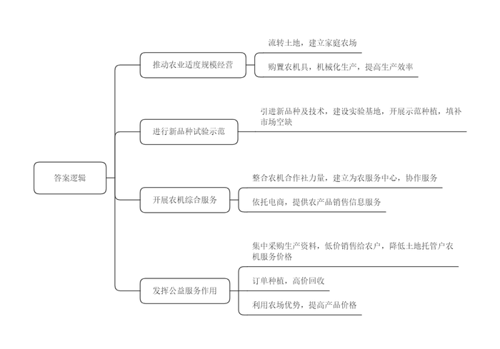
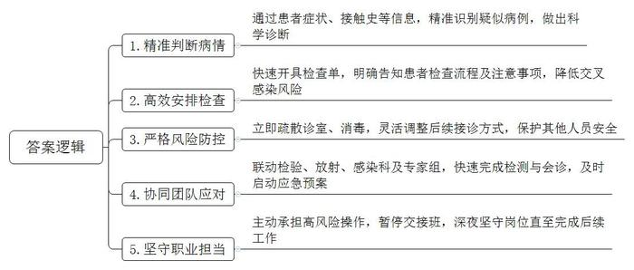
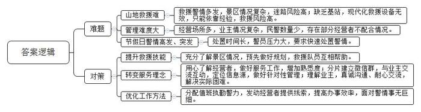
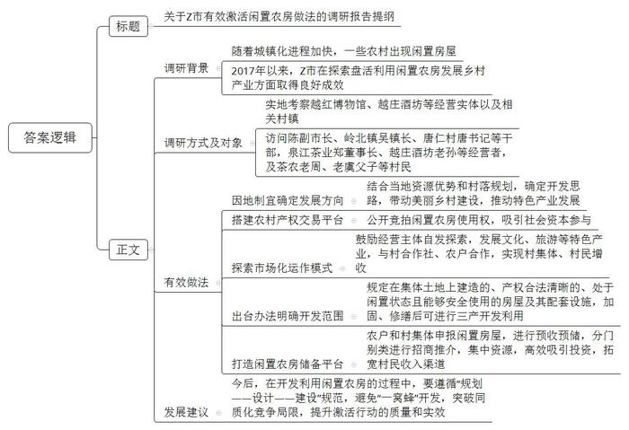
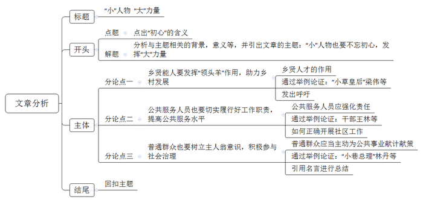

# 2021年公务员多省联考《申论》题（陕西B卷）

<!-- gwy:overview:start -->
> **陕西 · 2021 · 申论 · B类** ｜ 5 题 · 图片 5 处 · 答案随题折叠

导航：[题目](#题目) · [材料 1](#材料-1)
<!-- gwy:overview:end -->

> 候选采集稿。参考答案及解析来自粉笔页面，不代表官方答案或真实高分答卷；来源使用许可与原卷对应关系仍需人工核实。

## 给定材料

### 材料 1

2020年，富硒油菜科研创新团队实验基地在汉阴县绿源家庭农场建成。2015年，怀着对家乡的热爱，石某、李某夫妻俩从南方辞去工作，回到家乡汉阴县平梁镇新河村创业，流转532余亩土地，建立汉阴县绿源家庭农场，开始发展粮油生产、新品种试验示范及农机综合服务。凭借着敢于创新的胆识和勤奋学习的态度，很快，夫妻二人就把自己生产的优质富硒粮油销售到了其他县区及西安市。

5年时间，从创业到兴业，从粮油生产到新品种试验，从提高产品质量到开展优质富硒农产品认证和包装，尽管路途波折，但李某认为，这就是新时代赋予每个年轻创业者的使命。

“没有经验，一切就是摸着石头过河，好在我们都是敢于尝试的人。”通过外出考察、参加职业农民培训，李某的眼界越来越开阔，她说，“现代农业最重要的就是改变生产方式，提高生产效率，我们要在这方面进行探索。”由于丈夫石某本就是机械方面的行家里手，夫妻二人便积极开展了适合山区的适度规模农业机械化生产。他们先后购置旋耕机、油菜收割机、自动插秧机、小麦、水稻收割脱粒一体机等各类大中小农机具70余台套，并积极引进新品种。2020年，汉阴县绿源家庭农场共计引进水稻新品种6个，开展水稻机械插秧、水稻机械直播200余亩；引进玉米新品种3个，种植水果玉米352亩；引进油菜新品种9个，开展油菜机械直播及机械收获2000余亩，开展油菜“一菜两用”技术示范300亩。共计带动新河、西岭、兴隆、棉丰等村100户贫困户开展水稻订单生产2000亩，托管周边镇村土地5000亩，农机作业覆盖10000亩以上。家庭农场实现销售及收入138万元，实现农机作业服务收入100万元，带动周边农户增收节支100余万元，开展农民职业技能培训300余人次。

在自身不断发展的同时，石某、李某心里还时刻想着如何帮助乡亲们发展。为了充分发挥绿源家庭农场社会公益服务作用，农场在种子、化肥、农药等生产资料方面统一集中采购，降低购进成本，以低价销售给农户，并以低于正常作业服务价格的10%对土地托管户农机提供服务。同时，通过实行订单种植，高于市场价回收农产品，还利用家庭农场自身优势，通过品牌效应和网络销售提高农产品销售价值。2019年，绿源家庭农场带动新河、西岭、兴隆、棉丰等村100户贫困户通过订单生产、流转土地、务工等方式，实现了稳定脱贫。

为了更好地服务现代农业，推动农业适度规模经营，绿源家庭农场积极整合全县6家农机专业合作社力量建立平梁镇为农服务中心，共同为全县农业生产提供农机作业服务，农机新技术、新机具的引进推广，开展农业技术试验、示范和推广及现场技术培训。平梁镇为农服务中心依托电子商务网络，开展优质富硒农产品销售信息服务工作，2020年共计销售优质大米100吨、菜籽油20吨，为当地老百姓增加经济收入100万元。以汉阴县绿源家庭农场为核心的汉阴县为农服务中心的建立，健全了县农机服务体系平台，极大地促进了全县农业生产技术水平和农业生产效益的提高。

“科学技术是第一生产力”，李某心里也始终记着这句话，除了积极推广机械化生产，新品种试验也是李某一直尝试的事情。2018年至2020年，汉阴县绿源家庭农场被中国富硒产业研究院选定为安康市富硒油菜科研创新团队实验基地，绿源家庭农场积极引进中油杂19、中油高硒一号、中油高硒二号、中油高维6号、陕油28、秦优28等优质品种，并开展了优质油菜富硒菜薹食用示范300亩，填补了安康市春节蔬菜新品种需求空缺。2020年，在市农业技术推广中心、市富硒产品研发中心、汉阴县农业技术推广站的安排以及中国农科院油料所黄凤洪研究员团队的技术支持下，绿源家庭农场以引进富硒油菜新品种、生产新技术为重点，将基地建成安康市富硒油菜新品种展示基地、富硒油菜薹生产基地、7D功能型菜籽油原料订单生产基地和汉阴县农旅结合示范基地。

作为“新农人”，李某的目标很清晰，她不仅要让自己的农场做到最优，还要带动更多的农民变得优秀，而这仅仅是她目标中的一部分，她表示，接下来，他们要在全面提升汉阴优质大米、菜籽油产品质量的基础上，逐步开展优质富硒农产品认证和包装，大力宣传安康市富硒、生态的农产品，提升产品价值和绿源家庭农场生产效益，更好发挥绿源家庭农场在服务“三农”中的作用。

### 材料 2

以下是H医院廖医生讲述的亲身经历的一件事：

2020年春节的一个深夜，在诊室里，护士小刘对我说：“外边还有三个病人。”她推开诊室的门，一位患者在家属的陪伴下走了进来。我看了一眼挂钟，23点22分。患者三十来岁，他陈述道：“大夫，我发烧了。”患者看起来状态还不错，呼吸平稳，无急性病面容。“低烧6天了，有咳嗽，没痰。”接着，他指着陪伴的人：“我老婆昨天也有点发烧了。”我问：“你最近十四天有去过湖北或接触过从湖北回来的人吗？”这是疫情出现后，每个医生都需要向发热患者问的话。他回答：“1月19日，开车回了趟湖北老家，22日开车返回，过三天就发烧了，在老家没接触过发烧的病人。”

我听得一激灵，“新型冠状病毒”几个字像电流一样闪现脑海。是新冠疑似病例吗？这座大城市还没有发现病例，我会不会过度敏感了。“发烧+传染性+湖北”这三个特点坚定了我的判断。高度疑似患者必须尽快完成血常规和肺CT检查，必须尽可能把医护人员和其他人员的感染风险降到最低。拿定主意后，我加快手上开单的速度，用比平常快一倍的语速交代他俩，两人必须同时做检查，并告诉他们如何以最快的速度缴费、采血，怎样少走弯路到达放射科。我再三叮嘱他们要戴好口罩，除了做检查，不要在其他地方逗留。好在夫妇两人情绪稳定，接受信息能力很强。这让我对处理好这个突发事件多了一份信心。安排好这一切，我长出一口气，快速回忆了一遍有没有什么遗漏的。患者刚离开诊室，我就站起来，急促地交代护士小刘：“打开窗户，开紫灯，尽快退到诊室外面。”我边说着边挡住了下一个患者进来的脚步。他疑惑不解地问：“怎么了，大夫？”我撒了个善意的谎：“诊室每天例行消毒的时间到了。我在外面给您看病吧。”随后我用最快的速度询问完剩下两个发热患者的情况，独自返回诊室开出化验单，引导他们尽快离开了。

时间很快到了零点，那对夫妇还没有回来。我和小刘、检验员小常坐在大厅里。小常打破了平静说：“白细胞不高，淋巴比例降低，不太像普遍病毒感染的血常规表现。甲流、乙流、支原体均为阴性。”这结果预示着患者离疑似病例又进了一步。我有点庆幸自己“绝不放过一个”的想法。突然电话铃声响起，原来放射科主任紧急阅片，确定病人符合最后一步诊断标准，至此，H医院新冠肺炎应急预案正式启动。

我立刻通知了感染科主任，然后加入了启动隔离观察室的工作。与此同时，提请专家组会诊等后续工作也有序展开。等患者夫妇回到诊室，专家组研判结果也出来了：确定为新冠肺炎疑似病例。我们立即安排患者进入收拾妥当的隔离观察室。我随即暂停接诊并消毒，穿好防护服，戴上护目镜、面屏、双层手套，准备咽拭子给患者进行喉部检测。这是整个诊疗过程中传染可能性最大的环节。从刚接诊时的犹豫，到后来肯定的判断，这个时候的我已经没有恐惧了，唯一担忧的是操作不当，辜负了领导和同事们的期望。为了减少人员感染的风险，我和小刘、小常三个人待命，通知下一班值班人员暂不接班，把危险留给了自己。

最终，患者核酸检测结果反馈出来为阳性。这是抗疫战役打响以来，H医院首次确诊新冠肺炎患者，也是这座城市确诊的第一例。护送患者进入隔离病房后，我们拖着疲惫的身体，回到门诊完成消毒。

这就是我，一名普通医生，与新冠病毒的第一次“亲密”接触。很欣慰自己不辱使命，履行了一名医务人员的职业坚守。新的一天是我居家隔离的开始，回想昨天的经历，我有点后怕，但不管怎样，我站好这一班岗了......

### 材料 3

古城派出所辖区，有古城、古塔、世界地质公园等知名景区。“辖区就是景区，景区就是辖区，居民区也是景区”，这给古城民警提出了不小的挑战，最大的挑战是什么？“山地救援！”派出所杨副所长脱口而出。入职20年来，他和同事们平均每年接到山地救援警情百起左右，解救上百名迷路、被困、遇险群众。景区林中古木参天，山势险要，一些缺少经验的游客可能会迷路。由于山中没有基站，手机定位、无人机巡航常常派不上用场，搜救只能靠杨副所长对山中一草一木的记忆。“从哪里出发、附近是什么植物”“见过什么石头、翻过哪些河谷”“正对面能看到哪些景色”……几个问题一问，杨副所长就能判断个八九不离十。

对救援者而言，进山救援同样面临极大的安全挑战。尤其是入冬后，有的地方积雪四五十厘米，一旦落入石缝或者滑下深渊，后果不堪设想。有天凌晨，游客赖先生报警求援，当天山上寒风夹着大雪，能见度仅5米。在地图上标注好大致位置、规划好路线，顶着寒风，踏着齐腰的深雪，杨副所长和同事们凭着经验前去救援。经过一处斜坡时，一名队员脚下打滑差点摔下去，大家拿绳子把他拉上来一看，下面是万丈悬崖。上百次救援，并非每次都能成功。杨副所长说：“如果游客私自进入非游览区域，特别危险，希望游客不要贸然进山。”

古城有4000多家酒吧客栈，杨副所长认识九成以上的客栈经营者，“这家的老板来自南京，他有个女儿”“那家是浙江人”……沿街走一圈，才知道杨副所长所言不虚。别人问他怎么做到的，他说上心了就能记住。刚入职时，古城仅有70多家客栈，剩下的4000多家，都是他看着建起来的。开设客栈要到派出所办证，通过协调办理相关手续，他认识了绝大多数客栈经营者。“登记办证，给人家出主意；遇到纠纷，去帮忙调解。时间久了，大家就都熟了。”杨副所长说，记住人不难，关键还是转变理念，“别只想着怎么管理，多想想怎么服务。”

杨副所长将4000多家客栈分片建立了34个微信群，通过微信群与业主交流互动。尽管这些群每天“嘀嘀嘀”响个不停，杨副所长却很心安。因为只要“嘀嘀嘀”的声音在，就有信息源，也就能有的放矢，抓好旅店行业管理。“要是用脚走，我们14名民警，即便每人每天走访20户，也要半个多月时间，开展其他工作的时间就少了。”杨副所长把客栈经营者当朋友，客栈经营者自然不会把他当外人。在内湖生态保护拆迁过程中，一些客栈经营者拒不配合，杨副所长带领民警赶到现场。“我是派出所民警老杨，我知道生态搬迁大家有想不通的地方，我过来就是想和大家聊聊，有啥实际困难尽管说……”聊了3个多小时，终于做通了工作。

对游客来说，假期漫步在古城大街小巷，也许意味着浪漫与惬意。而大多数人放假时是民警最忙的时间。有时候饭刚吃了一口，就要出警；夜晚遇到警情，经常一宿无眠。李所长说：“越是节假日，对我们快速处置警情的要求就越高。所里只留几个人值守，其他全部布置到岗亭和街面，以便发生警情后5分钟就能出警。”杨副所长说：“为的就是给游客安全感。”11月的一天，一对从外省来的夫妇报警称其儿子小吴离家出走已半年多，最近在古城有活动轨迹，请求帮助寻找。杨副所长立即开展工作，发现小吴于前几日曾在古城某网吧上网。他将小吴照片及基本信息发到每个客栈群后，一家客栈的经营者马上回话，称小吴就在其客栈内，失踪大半年的小吴终于被找到。

“游客的事，都是大事！不管归哪个部门管，只要游客拨打了110，古城派出所就不会不管。”杨副所长说。

### 材料 4

近年来，随着城镇化进程加快，一些农村出现不少闲置房屋。2017年以来，Z市不少地方着力探索盘活利用闲置农房发展乡村产业的有效途径和措施，取得良好成效。为此，Z市发展研究中心组织了调研组进行专题调研。

位于东湖镇新泉村的新泉中学，因优化农村学校布局，多年前已不再办学，老教学楼被列入闲置农房，有人提议拆掉建住宅，但村两委最终统一意见：拆掉太可惜，还是应该盘活利用，壮大村集体经济。东湖镇产茶历史悠久，周边茶农集中，老房子联手茶产业，能发挥盘活利用的效益。确定发展方向为茶产业、发展茶文化后，村里通过镇里的农村产权交易平台公开竞拍老楼使用权。

主楼木楼板开始腐烂，副楼已几乎成了危房——这是泉江茶业有限公司郑董事长与老教学楼初次相遇时的情景。“到这荒村陋屋来干什么？”有人不解。但透过蛛网积尘，郑董事长脑中闪出一个念头：竞拍租下来，改造成专题博物馆，让更多的人到这里感受越红工夫茶的历史文化积淀。2017年11月，越红博物馆正式开放，曾经凋敝的老屋重焕生机。博物馆入口处的接待台，是用老房子的木楼梯板搭就；二楼的品茶室，稍加打量就能认出原先教室的格局模样；楼梯拐角墙上，完整保留着当年捐资兴学的石刻铭文。同时，作为青少年茶文化教育基地，博物馆还常举办特色研学活动。经镇村牵线搭桥，博物馆与村里的专业合作社、农户定点合作，与200多户茶农结对，帮助他们实施绿色无公害茶叶种植管理。“每斤40至60元的收购价，比以前高出一截。”茶农老周说。从闲置教学楼到茶文化综合体的蝶变，折射出闲置农房盘活后“包袱变财富”的改革之效。

Z市陈副市长认为，一些闲置的农村住房、厂房、村集体用房破旧不堪，要修缮很费钱，弃之拆之又可惜；而同时，拓宽农民增收渠道，促进农民收入持续增长，需要建立健全农民财产性收入增长机制。如何唤醒“沉睡”的农房资源，既能给农民增加财产性收入，又能为下乡创业人员提供创业场所？前些年，像越红茶叶博物馆这样的自发探索，开始在Z市乡间不断涌现。2018年8月，Z市出台有关办法，明确规定农村范围内在集体土地上建造的、产权合法清晰的、处于闲置状态且能够安全使用的房屋及其配套设施，实施加固、修缮后可进行旅游、休闲等三产开发利用。

一座占地500多平方米、长期闲置的私塾老建筑，曾是唐仁村唐书记的一块心病。它多年无人问津，只好用于村民堆货，成了村容村貌整治中的一处“死角”。改变发生在2019年7月，乡贤老孙通过镇里的农村产权交易平台中标将这座老建筑改造成融生产销售、非遗传承和文化体验于一体的越庄酒坊。“父亲做了一辈子酒，能在这里把传统古法酿造的流程展示出来，特别有意义。”老孙说。白墙黛瓦、青砖铺地、木格花窗，一年过去，越庄酒坊修旧如旧，开门迎客，成为乡村风貌的一抹亮色。“过去做仓库堆货，年租金不过4000多元，如今涨到6万多元，仅越庄酒坊一个项目，就带动村集体经济实现增收。”唐书记感慨，这座老建筑之所以能成功激活，关键是跟镇里的酿酒特色产业发展与美丽乡村建设挂上了钩，“盘活利用要找对路子，因地制宜，才能真正激发活力、持续产生效益。”

截至2020年底，Z市有激活意愿、尚待开发利用的闲置农房近50万平方米，是扎堆搞农家乐、民宿经营，还是避免“一窝蜂”开发、突破同质化竞争的局限，直接关系到激活行动的质量和实效。陈副市长说：“怎么找准方向、善加利用，至关重要。闲置农房利用改造要遵循‘规划——设计——建设’规范，与村落布点规划、村庄建设规划、土地利用规划相匹配。”古径幽幽，卵石铺面，唐仁村里的唐仁老街历史悠久，沿街百余间传统民宅，不少处于闲置状态。这段时间，唐书记和村干部正忙着与外地客商对接，将闲置农房激活同古村落的新规划有机结合起来，“期待盘活出更多越庄酒坊这样有特色的‘点’，串联带动起美丽乡村建设、特色产业发展的‘面’。”

岭北镇胡家村老虞同儿子住在外地，老宅空置多年。去年上半年，一位村干部建议他把闲置房存进“银行”。闲置农房存“银行”？初听这样的新鲜事，老虞很好奇。这个特殊的“银行”就是镇里的闲置农房储备平台，农户和村集体可供利用的闲置农房，都可登记申报。“正式‘激活’前，房子归自己管，等激活利用了再按租赁合同得收益。”村干部介绍。老虞和儿子商量后，将老宅存进“银行”。没多久，一位外县企业家通过平台相中了老虞等5户村民的闲置房，准备承租修缮，用于民宿经营。8月，老虞与承租人签订了租赁合同，拿到了头一年的租金。这是岭北镇率先试点运行闲置农房储备平台的一个例子，通过平台，镇里对可利用的闲置农房预收预储，分门别类进行招商推介。前不久，北周村废旧织布厂通过平台统一对外推介，由社会资本、乡贤和村集体共同入股出资，将老厂房改造成土特产展销中心。中心运行以来，农产品销售额已达100多万元。“通过储备平台的形式运作，资源更集中，吸引投资主体更有效率。”吴镇长说。

### 材料 5

年近四十、做小生意的杨华，还不知道自己竟有这般能耐：当上香江小区业主委员会主任，重新选聘了小区物业，让小区面貌焕然一新……

在杨华的手机中还保留着以前的小区照片：臭水沟、废水池、乱石裸露、垃圾成堆。比环境更糟糕的，是小区的治安，一年至少发生20多起偷盗案。“小区居民对之前的物业‘只收钱不做事’怨言很大。”业主魏大哥说。眼瞅着生活家园日益脏乱，业主和物业的矛盾不可调和，爱管闲事、在小区里有些声望的杨华建立了一个业主微信群，时常在群里与大家商讨如何能让小区好起来。大家逐渐达成了共识：成立业主委员会，重新选聘物业公司。前年3月，在街道、社区党组织和居委会的支持下，500多户业主投票选举，小区产生了业主委员会，大家选了杨华当主任。一个月后，业主委员会从6家竞标公司中选聘了W物业公司。

“我们在6家竞标公司中，不是实力最强的。”W物业公司罗经理说，“但是，杨华说他们更愿意娶个实在的小媳妇儿，而不愿意娶一个公主。”“罗经理来我们小区考察次数最多，时间最长，是他‘先投入、后回报’的理念打动了业主委员会。”杨华说。进驻小区以来，W物业先后投入44万元安装监控设备、举办百家宴、改造地下停车场等。“在不损害业主利益的前提下，业主委员会和物业公司相互依托，加强沟通，互相理解，最后受益的还是业主。”杨华认为。罗经理还邀请了20多名热心业主，成立了联合监督会，物业公司每季度须向他们汇报工作。“将群众工作的方法，引入到企业管理中。”一位业主这样评价。

杨华认为，小区的治理需要各方面的大力支持。去年1月，因为公交线路调整，原本附近唯一的公交站点香江小区站被取消，给居民出行造成一定影响。杨华和业主委员会的委员们多次到有关部门反映情况，经过多方努力终于恢复了香江小区站，收获了大多数业主的点赞。去年3月，小区内部的景观改造计划也得以顺利完成，杨华号召业主参与，业主们集资5000多元，引入山泉水，买来金鱼苗，业主志愿者义务出工，将原来人人捂鼻的臭水沟变成了亲子乐园的金鱼池。如今，眼前的小区林木繁盛、道路整洁，景观处流水潺潺、鱼翔浅底。

香江小区的成功实践，既给决策者们以启发，也给他们以信心。“近年来，随着交通改善、城市提质，城市外来人口流入大幅增加，加上一些老旧小区管理问题较多，城市基层社区治理尤其是小区治理，成为摆在我们面前的一项紧迫任务。”市委刘书记说，“怎么办？我们总结了香江小区的经验，提出了‘五进小区’的工作重点，即推进党建进小区、‘微改造’进小区、网格化管理进小区、物业管理进小区、文明创建进小区。”

杨华说，“自从市里推进‘五进小区’后，小区居民真正参与小区管理，感觉到自己是小区的主人，业主委员会工作也更加理直气壮。”在街道党工委的支持下，香江小区建立了党建工作站，杨华兼任了党建工作站站长。“目前已有36名党员主动报到”，杨华说。现在，他工作更忙了，也更有劲头了，因为与他并肩为业主们服务的人越来越多。现在，小区楼栋的每个单元，都有1名网格员、1名楼栋长和1名物业联络员。网格员由社区派驻，随时将在小区发现的各种问题上传街道网格办，最终到达市网格中心；楼栋长由居民选举产生，负责解决家长里短；物业联络员是物业公司员工，负责日常公共部分的维护。他们的照片和电话，都醒目地贴在了每个单元门口。

“<u>不忘初心，方得始终</u><u>。就算是一只蚂蚁，也有它的力量！</u>”杨华在朋友圈里这样写道。他说，他只是一个爱管闲事的普通老百姓，但在与党委政府同向而行的过程中，感受到了力量。这力量，将支持他继续前行。

## 题目

### 第 1 题

**根据****“****给定材料**1**”，概括****李某****回乡创业取得成功的主要做法。（15分）**

关联材料：材料 1

作答要求：

要求：全面、准确，不超过200字。

第 1 题 · 答案与解析

**参考答案（粉笔题库参考内容）**

1.推动农业适度规模经营。流转土地，建立家庭农场；购置农机具，机械化生产，提高生产效率。

2.进行新品种试验示范。引进新品种及技术，建设实验基地，开展示范种植，填补市场空缺。

3.开展农机综合服务。整合农机合作社力量，建立为农服务中心，协作服务；依托电商，提供农产品销售信息服务。

4.发挥公益服务作用。集中采购生产资料，低价销售给农户，降低土地托管户农机服务价格；订单种植，高价回收；利用农场优势，提高产品价格。

**参考答案说明**：本参考答案从“推动农业适度规模经营”“进行新品种试验示范”“开展农机综合服务”“发挥公益服务作用”等四个方面进行了分条撰写。各条要点之间在内容上相互并列，没有交叉。

**解析状态：unknown（来源未提供）**

### 第 2 题

**结合****“给定材料**2**”，谈谈廖医生是如何“站好这一班岗”。（20分）**

关联材料：材料 2

作答要求：

要求：全面、准确、条理清楚，不超过200字。

第 2 题 · 答案与解析

**参考答案（粉笔题库参考内容）**

1.精准判断病情。通过患者症状、接触史等信息，精准识别疑似病例，做出科学诊断。

2.高效安排检查。快速开具检查单，明确告知患者检查流程及注意事项，降低交叉感染风险。

3.严格风险防控。立即疏散诊室、消毒，灵活调整后续接诊方式，保护其他人员安全。

4.协同团队应对。联动检验、放射、感染科及专家组，快速完成检测与会诊，及时启动应急预案。

5.坚守职业担当。主动承担高风险操作，暂停交接班，深夜坚守岗位直至完成后续工作。

**参考答案说明：**本参考答案从“精准判断病情”“高效安排检查”“严格风险防控”“协同团队应对”和“坚守职业担当”这五个方面展开，进行了分条撰写。各条答案要点之间在内容上相互并列，没有交叉。

**解析状态：unknown（来源未提供）**

### 第 3 题

**根据****“给定资料**3**”，请谈谈古城民警在工作过程中遇到了哪些难题，他们是如何解决的。（30分）**

关联材料：材料 3

作答要求：

要求：内容全面，条理清晰，不超过350字。

第 3 题 · 答案与解析

**参考答案（粉笔题库参考内容）**

难题：1.山地救援难。救援警情多发，景区情况复杂，迷路风险高；缺乏基站，现代化救援设备无效，只能依靠经验，救援风险高。2.管理难度大。经营场所多，业主情况复杂，民警数量少，存在部分经营者不配合情况。3.节假日警情高发、突发。处置时间长，警员压力大，要求快速处置警情。

对策：1.提升救援技能。充分了解景区情况，预先做好规划，救援队员互相帮助。2.转变服务理念。用心了解经营者，做好服务工作，增加熟悉度；分片建立微信群，与业主交流互动，定位信息源，做好针对性管理；理解业主，真诚沟通、耐心交流，解决实际困难。3.优化工作方法。分配值班执勤警力，发动经营者提供线索，提高办事效率，面对警情事无巨细。

**参考答案说明：**本参考答案整体上分为难题、对策两大类。在“难题”方面，从“山地救援难”“管理难度大”“节假日警情高发、突发”三个方面进行了分条撰写；在“对策”方面，本参考答案从“提升救援技能”“转变服务理念”“优化工作方法”三个方面进行了分条撰写。同时，各条答案要点之间在内容上相互并列，没有交叉。

**解析状态：unknown（来源未提供）**

### 第 4 题

**假设你是调研组成员，请根据****“给定资料**4**”，就Z市有效激活闲置农房的做法写一份调研报告提纲。（35分）**

关联材料：材料 4

作答要求：

要求：层次分明，内容全面；不超过600字。

第 4 题 · 答案与解析

**参考答案（粉笔题库参考内容）**

关于Z市有效激活闲置农房做法的调研报告提纲

一、调研背景：随着城镇化进程加快，一些农村出现闲置房屋。2017年以来，Z市在探索盘活利用闲置农房发展乡村产业方面取得良好成效。为此，Z市发展研究中心组织了专题调研。

二、调研方式及对象：实地考察越红博物馆、越庄酒坊等经营实体以及相关村镇；访问陈副市长、岭北镇吴镇长、唐仁村唐书记等干部，泉江茶业郑董事长、越庄酒坊老孙等经营者，及茶农老周、老虞父子等村民。

三、有效做法：1.因地制宜确定发展方向。结合当地资源优势和村落规划，确定开发思路，带动美丽乡村建设，推动特色产业发展。2.搭建农村产权交易平台。公开竞拍闲置农房使用权，吸引社会资本参与。3.探索市场化运作模式。鼓励经营主体自发探索，发展文化、旅游等特色产业，与村合作社、农户合作，实现村集体、村民增收。4.出台办法明确开发范围。规定在集体土地上建造的、产权合法清晰的、处于闲置状态且能够安全使用的房屋及其配套设施，加固、修缮后可进行三产开发利用。5.打造闲置农房储备平台。农户和村集体申报闲置房屋，进行预收预储，分门别类进行招商推介，集中资源，高效吸引投资，拓宽村民收入渠道。

四、发展建议：今后，在开发利用闲置农房的过程中，要遵循“规划——设计——建设”规范，避免“一窝蜂”开发，突破同质化竞争局限，提升激活行动的质量和实效。

**参考答案说明**：（1）本题是公文题，要求写一份调研报告提纲，不必考虑格式，只写正文即可，但为了保险起见，建议加上标题。（2）本参考答案的内容方面，围绕着“Z市有效激活闲置农房做法”这一主题，先介绍了调研背景、调研方式及对象；接着又从“因地制宜确定发展方向”“搭建农村产权交易平台”“探索市场化运作模式”“出台办法明确开发范围”“打造闲置农房储备平台”五个方面阐述了Z市激活闲置农房的“有效做法”；最后给出了发展建议。形式方面，本参考答案做到了分段、分条撰写，整体上条理较为清晰。

**解析状态：unknown（来源未提供）**

### 第 5 题

**结合****“给定资料**5**”所给的句子，围绕“不忘初心，方得始终****。****就算是一只蚂蚁，也有它的力量！****”这一句话，参考给定资料，联系实际，自拟题目，写一篇文章。（50分）**

关联材料：材料 1、材料 2、材料 3、材料 4、材料 5

作答要求：

要求：

（1）结合给定资料，但不拘泥于给定资料；

（2）观点正确，结构完整；

（3）逻辑清晰，语言流畅；

（4）字数1000-1200字。

第 5 题 · 答案与解析

**参考答案（粉笔题库参考内容）**

**“小”人物** **“大”力量**

白居易曰：“所以表不忘初心，而必果本愿也。”诚哉斯言，初心不改，才能实现其本来的愿望。于国家而言，初心是复兴，是伟大的中国梦；于个人而语，初心是回馈社会、造福他人，是“人可生如蚁而美如神”的信念，就算是一个平凡人，只要秉持服务于民的初心，就能创造价值，彰显力量。

**乡贤能人要发挥“领头羊”作用，助力乡村发展。**乡村人才应当依托自身优势，坚持科学发展理念，为乡村振兴贡献坚实力量。乡贤能人作为乡村地区德才兼备的能人贤者，是引领建设现代化乡村的主力军。“中国好人”方敬倾尽200多万元积蓄资助家乡贫困学生，助推乡村教育发展；“小草皇后”梁伟，践行“添绿自然，产业报国”的梦想，带领立马村的村民走上脱贫致富之路。乡村的振兴发展，在现代乡贤的奋斗之路中找到了生动的注脚。在未来，乡贤能人也应各尽所能，各展其长，心怀家乡，反哺桑梓，为创建和谐美好新农村而不懈奋斗。

**除了乡贤能人，公共服务人员也要切实履行好工作职责，提高公共服务水平。**公共服务者应当以人民利益为先，强化责任意识，脚踏实地，发挥主观能动性，优化工作方式方法，提高群众满意度。抗击新冠肺炎疫情战中，专家张忠德临危受命，带队接管危重患者最多的病区，引入中医治疗方案，点亮无数患者生的希望；干部王林换位调研，在与骑手和滴滴司机的同甘共苦中，与群众平视对话，真正做到了脚下有泥土，心中有真情。若不是各行各业的公共服务人员都自愿坚守岗位，无私奉献，“想百姓之所想，急百姓之所急”便只能成为一纸空谈。

其实，除了乡贤能人、公共服务人员这些具有特殊角色的人物，人皆可成圣贤，人皆可成尧舜，点滴的光源，也能汇聚成太阳。

**普通群众也要树立主人翁意识，积极参与社会治理。**普通群众应当主动为公共事业献计献策，共商解决办法，发挥监督作用，打造共建共治共享的美好家园。从让“全国人民穿好衣”的黄宝妹，到一生献给乡村教育事业的张桂梅校长；从“草原上的好牧民”廷·巴特尔到扎根基层四十余年的“小巷总理”林丹。新时代的今天，凝结着每一位普通群众的辛勤付出。习近平总书记强调：“新时代属于每一个人，每一个人都是新时代的见证者、开创者、建设者”。这就需要我们在平凡的岗位上发挥主动性、积极性、创造性，时刻牢记责任感和使命感，擘画新时代的发展蓝图，共同谱写第二个百年的奋斗华章。

顾炎武说：“天下兴亡，匹夫有责”。无数事实证明，支撑起中国脊梁的恰恰是这一个个鲜活的小人物。数以万计的普通民众在各自的位置上拼搏前行，他们为推动时代变革贡献出卓越的力量。

**文章分析**

**“小”人物 “大”力量**

【**标题的优点**：首先，范文的标题突出了“‘小’人物也要不忘初心，发挥‘大’力量”这一主题。其次，它在形式上采用了对称式结构，“大”与“小”形成对比，使标题更加鲜明、饱满。】

（1）白居易曰：“<u>所以表不忘初心</u>，而必果本愿也。”诚哉斯言，初心不改，才能实现其本来的愿望。<u>于国家而言</u>，初心是复兴，是伟大的中国梦；<u>于个人而语</u>，初心是回馈社会、造福他人，是“人可生如蚁而美如神”的信念，（2）<u>就算是一个平凡人</u>，<u>只要秉持服务于民的初心</u>，<u>就能创造价值</u>，<u>彰显力量</u>。

【**开头的优点**：★内容方面。范文的开头是紧扣主题“‘小’人物也要不忘初心，发挥‘大’力量”这一主题展开的。首先，开头引用古人的话引出“初心”。其次，具体解读了“初心”在当前的具体体现，指出了：（1）初心的含义，（2）引出观点。★文字表达方面。使用了“只要……就……”等关联词，使语言表达有逻辑性。】

**乡贤能人要发挥****“领头羊”作用，助力乡村发展。**（1）<u>乡村人才应当依托自身优势，坚持科学发展理念</u>，为乡村振兴贡献坚实力量。<u>乡贤能人作为乡村地区德才兼备的能人贤者，是引领建设现代化乡村的主力军</u>。（2）“中国好人”<u>方敬</u>倾尽200多万元积蓄资助家乡贫困学生，助推乡村教育发展；“小草皇后”<u>梁伟</u>，践行“添绿自然，产业报国”的梦想，带领立马村的村民走上脱贫致富之路。（3）乡村的振兴发展，在现代乡贤的奋斗之路中找到了生动的注脚。在未来<u>，乡贤能人也应各尽所能</u>，各展其长，心怀家乡，反哺桑梓，为创建和谐美好新农村而不懈奋斗。

【**论述段****1的优点**：★观点句：范文的观点句是紧扣“‘小’人物也要不忘初心，发挥‘大’力量”这一文章主题提出的。形式上，它在段首处直接写出，位置突出，容易被发现；内容上，关键词突出，内容要点明确，可以明显看出它是从“乡贤能人”这一主体入手，表明“乡贤能人应助力乡村发展”。★论述内容：本段主要围绕“‘小’人物也要不忘初心，发挥‘大’力量”这一主题进行分析阐述，指出了：（1）乡贤人才的作用，（2）通过举例论证，（3）发出呼吁。注意：以上三个方面的内容都是紧扣观点句“乡贤能人要发挥‘领头羊’作用，助力乡村发展”进行分析论述的，针对性强、内容层次丰富。并且，这三个方面的论述有内在逻辑顺序：先写“重要性”，再“举例论证”，接着“发出呼吁”。最后，在论证方法和论据选取方面，讲道理和举例子相结合，做到了丰富多样。】

**除了乡贤能人，公共服务人员也要切实履行好工作职责，提高公共服务水平。**（1）<u>公共服务者应当以人民利益为先</u>，<u>强化责任意识</u>，脚踏实地，发挥主观能动性，优化工作方式方法，提高群众满意度。（2）抗击新冠肺炎疫情战中，<u>专家张忠德临危受命</u>，带队接管危重患者最多的病区，引入中医治疗方案，点亮无数患者生的希望；<u>干部王林换位调研</u>，在与骑手和滴滴司机的同甘共苦中，与群众平视对话，真正做到了脚下有泥土，心中有真情。若不是各行各业的公共服务人员都自愿坚守岗位，无私奉献，“想百姓之所想，急百姓之所急”便只能成为一纸空谈。

【**论述段****2****的优点**：★观点句：范文的观点句是紧扣“‘小’人物也要不忘初心，发挥‘大’力量”这一文章主题提出的。形式上，它在段首处直接写出，位置突出，容易被发现；内容上，关键词突出，内容要点明确，可以明显看出它是从“公共服务人员”这一主体入手，表明“公共服务人员应提高服务水平”。★论述内容：本段主要围绕“‘小’人物也要不忘初心，发挥‘大’力量”这一主题进行分析阐述，指出了：（1）公共服务人员应强化责任，（2）通过举例论证。注意：以上两个方面的内容都是紧扣观点句“公共服务人员也要切实履行好工作职责，提高公共服务水平”进行分析论述的，针对性强、内容层次丰富。最后，在论证方法和论据选取方面，讲道理和举例子相结合，做到了丰富多样。】

其实，除了乡贤能人、公共服务人员这些具有特殊角色的人物，人皆可成圣贤，人皆可成尧舜，点滴的光源，也能汇聚成太阳。

**普通群众也要树立主人翁意识，积极参与社会治理。**（1）<u>普通群众应当主动为公共事业献计献策</u>，共商解决办法，发挥监督作用，打造共建共治共享的美好家园。（2）从让“全国人民穿好衣”的<u>黄宝妹</u>，到一生献给乡村教育事业的<u>张桂梅校长</u>；从“草原上的好牧民”<u>廷·巴特尔</u>到扎根基层四十余年的“小巷总理”<u>林丹</u>。新时代的今天，凝结着每一位普通群众的辛勤付出。（3）<u>习近平总书记强调</u>：“新时代属于每一个人，每一个人都是新时代的见证者、开创者、建设者”。这就需要我们在平凡的岗位上发挥主动性、积极性、创造性，时刻牢记责任感和使命感，擘画新时代的发展蓝图，共同谱写第二个百年的奋斗华章。

【**论述段****3****的优点**：★观点句：范文的观点句是紧扣“‘小’人物也要不忘初心，发挥‘大’力量”这一文章主题提出的。形式上，它在段首处直接写出，位置突出，容易被发现；内容上，关键词突出，内容要点明确，可以明显看出它是从“普通群众”这一主体入手，表明“普通群众应积极参与社会治理”。★论述内容：本段主要围绕“‘小’人物也要不忘初心，发挥‘大’力量”这一主题进行分析阐述，指出了：（1）普通群众应当主动为公共事业献计献策，（2）通过举例论证，（3）引用名言进行总结。注意：以上三个方面的内容都是紧扣观点句“普通群众也要树立主人翁意识，积极参与社会治理”进行分析论述的，针对性强、内容层次丰富。最后，在论证方法和论据选取方面，讲道理和举例子相结合，做到了丰富多样。】

【**论述段之间的关系**：★内容的内在逻辑：论述段从“乡贤能人”“公共服务人员”“普通群众”这三个主体出发，论述在不同领域可发挥自己的力量。★段与段的外在衔接：论述段2后的过渡段“除了乡贤能人、公共服务人员这些具有特殊角色的人物，人皆可成圣贤”，承接了论述段1、2的内容，并引出论述段3。起到了过渡衔接的作用；并且论述段，使用了“除了……”“也……”等关联词进行了衔接。】

顾炎武说：（1）“天下兴亡，<u>匹夫有责</u>”。（2）无数事实证明，<u>支撑起中国脊梁的恰恰是这一个个鲜活的小人物</u>。数以万计的普通民众在各自的位置上拼搏前行，他们为推动时代变革贡献出卓越的力量。

【**结尾的优点**：（1）再次提到了“‘小’人物也要不忘初心，发挥‘大’力量”；（2）进行总结。】

**解析状态：unknown（来源未提供）**

