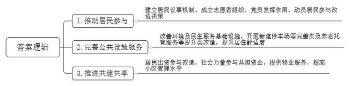
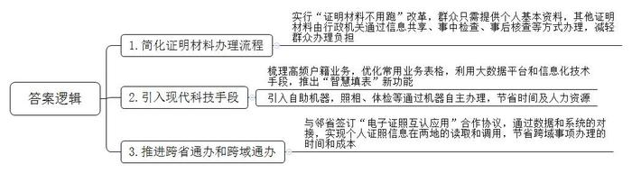
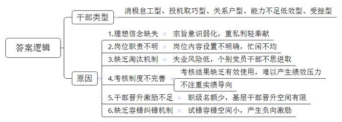
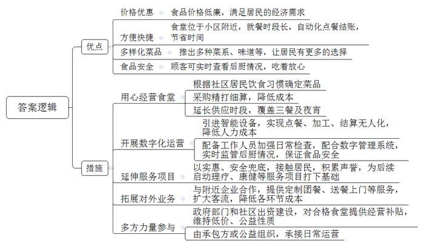
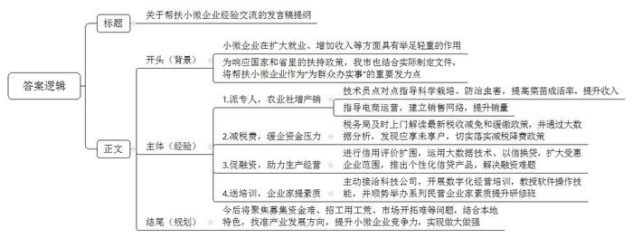
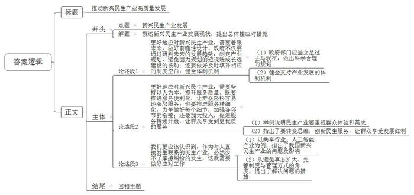

# 2022年公务员多省联考《申论》题（陕西A卷）

<!-- gwy:overview:start -->
> **陕西 · 2022 · 申论 · A类** ｜ 6 题 · 图片 6 处 · 答案随题折叠

导航：[题目](#题目) · [材料 1](#材料-1)
<!-- gwy:overview:end -->

> 候选采集稿。参考答案及解析来自粉笔页面，不代表官方答案或真实高分答卷；来源使用许可与原卷对应关系仍需人工核实。

## 给定材料

### 材料 1

去年，陈阿姨执意要搬回D市W社区的老房住，这让特意接她到新家养老的儿子有些不解：“老人家非说回去住着更舒心。”

W社区建于上世纪80年代，被D市市政府选为老旧社区改造试点。根据社区老人较多的情况，社区进行了适老化改造：楼梯旁安了扶手，每层平台转角处放有折叠椅，还有新建的阳光餐厅、无障碍助浴室……陈阿姨看后觉得非常适合自己，坚决要搬回来和老邻居在一起。

为什么这么改？“都是大家在‘进步议事港’议出来的。社区60%以上居民都是老人，老人的需求必须考虑到。”街道党工委饶书记说。“进步议事港”是改造之初街道建立的居民议事机制。改不改、改什么、怎么改，都由居民来决定。刚开始，一些居民积极性不高，有居民不愿参与对改造方案的讨论，或者就是简单表态不同意。

“只有群众参与进来，社区才有活力。”饶书记说，“我们在社区成立了志愿者组织，要求党员在社区改造中发挥作用。”杨老师是一位老党员，去年刚退休，“社区改造与我们每位居民切身利益息息相关，大家都应该出力加油。”杨老师积极加入志愿者组织，成为一名社区改造的义务宣讲员。已经搬家的周老太不同意加装电梯，“我房子都出租了，改造跟我没什么关系。”只要有一户不同意，一栋楼都装不了电梯，这让楼里居住的其他老人很着急。为了说动周老太，杨老师愣是穿过大半个城市，上门数十趟。“杨老师不厌其烦地给我讲道理、分析改造好处，我被这份真诚打动了。”周老太最后欣然在电梯安装协议书上签了字。

走进改造后的社区，过去坑坑洼洼的路面变得平坦宽敞，蜘蛛网般的电线全部入地，路灯全部亮起来了……陈阿姨竖起大拇指：“环境一天比一天好，住得越来越舒心！”让居民点赞的，除了环境变化，还有民生服务设施的提升完善：新划定100个停车位，新安装81个监控摄像头，新建三处电动车棚……“不光改‘面子’，更要改‘里子’。”D市住建局张局长说。本轮社区改造不仅有市政配套等基础类改造，更多的是新建停车场、加装电梯等完善类改造，以及养老托育服务等提升类改造。基础类要应改尽改，完善类、提升类则要因地制宜，按需改造。为此，市政府制定了老旧社区改造统一标准，还特别提出从实际出发，一区一策。社区的老人休养中心是新建的提升类项目，一开业就迎来10位老人入住。“这地方过去是一个宾馆的闲置库房，物业承包后改造为休养中心，社区老年人比较多，身体有些小毛病，休养中心帮助他们进行日常调养。”饶书记说。

如今的W社区焕然一新，投入的改造资金可不少。按照市政府的规划，市政府财政资金重点补助基础类改造内容。可是提升社区环境、引入公共服务这些完善类、提升类改造，所需资金也不是个小数目，由谁来承担？“居民要出一点，居民出资参与改造，可以提高社区居民的主人翁意识和归属感，为后续管理埋下了伏笔。”饶书记说，“更重要的是让社会力量参与进来，各方合理共担改造资金。目前，我们街道已在全市率先引入社会资本，委托前程集团参与改造。”

“目前我们在社区已投入改造资金200多万元，开始提供物业服务。”前程集团城区更新事业部刘经理说。W社区的小区长期没有物业，一开始刘经理还很担心居民对缴物业费会有抵触。然而，小区物业费缴纳率之高却超出了刘经理的预期。老潘就是缴纳物业费的“积极分子”：“我们先体验了几个月的免费服务，确实感受到了物业入驻后的便利，尤其是在疫情防控期间消毒检测等服务做得很到位。”如今，小区各出入口都安装了门禁，还有保安值班，实现封闭式管理，为控制人员流动、防控疫情起到了关键作用，居民们都很安心。

“很多社区都是我们城市高速发展的产物，虽然逐渐老旧了，但经过精心改造后将旧貌换新颜，依然是我们城市的动人风景。”张局长说，“只要找对思路，就会让老旧社区重新焕发生机活力，让老年居民过上更加幸福的生活，推动改革发展成果更多更公平地惠及全体人民。”

### 材料 2

L市A区交通职业技术学院驾校报名处的大厅里，陆续有人前来报考网约车驾驶员从业资格。“两年前，我来申请过一次。当时的工作人员要求去相关部门开具无犯罪记录、无交通肇事记录等证明材料，流程十分繁琐，有些材料一时难以办理，无奈之下只好放弃。”回忆以往的经历，来办证的小顾说，听说最近网约车驾驶员资格认证做了改革，个人不需要再提交各类证明，他就想着再试试。

进了报名大厅，小顾在工作人员的引导下，拍了照片，提交了个人基本资料，就办好了报名手续，全程不到3分钟。驾校教务科杨科长介绍：“从前，网约车驾驶员资格认定需要提供好几项证明材料，涉及公安、交管等多个单位，需要报名人自行去开具。现在A区实行‘证明材料不用跑’改革，群众报名网约车驾驶员资格，只要提供个人基本资料，驾校帮助提交到市交通局，其中涉及的无犯罪记录、无交通肇事记录等证明材料，由区交通局联系区公安局等单位，统一为学员开具办理。有些事前的证明手续，可以由申请人提交书面承诺，承诺的真实性由行政机关通过信息共享、事中检查、事后核查等方式监管。”

近年来，A区还在“放管服”改革中借用现代科技手段，不断创新便民举措，让群众办事不再难、不再烦。这天，大学刚毕业来到A区工作的小王要为自己办理落户手续。他拿出手机，登录“A区政务通”，点击选择“户籍业务自助预约填表”，填上自己的姓名、身份证号等基本信息后，其他各项信息就自动生成了。填表完成后，系统立刻跳转到预约办理环节，前后只花了2分钟左右。“过去办理户籍相关业务，群众需要在派出所户籍窗口手工填写申请人姓名、出生日期、户籍地等10多项信息，至少耗时15分钟。”区户籍部门相关负责人说，“如遇到填写错误的情况，就得重新填表，耗时又费力；遇到不会填写的项目，窗口还需安排专门人力现场指导，有些群众因此产生不满情绪。”为方便群众办理业务，户籍管理部门精心梳理了夫妻投靠落户、技能人才落户、出生申报等14项高频户籍业务，优化群众填写的常用业务表格，依托大数据平台和信息化技术手段，创新推出“智慧填表”新功能。

科技赋能带来的办事便利不仅仅在事前，也体现在办理过程中。“网上办”“掌上办”与“自助办”相结合，群众享受的方便越来越多。周末，市民陈先生来到市车辆管理所准备办理驾驶证换证业务。来到车管所大厅后，先进入自助体检机，几分钟后便完成了体检。而后，他使用自助照相机完成了证件照拍摄。最后，他带着材料来到业务窗口处，经检查无误后，这次换证业务便完成了。“现在车管所大厅里的自助机器非常方便，照相、体检都可通过机器自助办理，以前可能需要半天甚至好几天才能办完的业务，如今半个小时左右就完成了！”陈先生说，“而且休息日也可以来自助办理相关业务，不用专门请假，省时又省心！”

推进政务服务“跨省通办”“跨域通办”，既是法治政府建设、推进“放管服”改革的重要内容，也是促进要素自由流动、便利群众生活的重要支撑。近年来，A区在改革中不断创新优化服务，满足“移动人群”办事需求，让政务服务便捷度和满意度不断提升。黄先生是邻省M市人，在A区开了一家公司，最近因业务拓展需要变更公司营业执照经营范围。“以前，非L市的电子身份证信息在邻省的工商登记系统中可能无法被识别，只能拿着身份证去现场办理。”黄先生说。这次显然不同，他打开“A区政务通”，亮出电子身份证，经扫码识别，有关信息便上传至L市政务平台，完成了变更登记。黄先生享受到这样的便利，得益于去年L市与M市两个地方的“电子证照互认应用”合作协议，通过数据、系统的对接，初步实现了个人证照信息两地的读取、调用。“其实不仅仅是跨域事项的办理和电子证照的互认。作为普通公民，我深刻地体会到去政府部门办事时，流程越来越简便，规则越来越清晰，指导越来越细致，政府通过优化政务服务，让群众办事越来越便利，法治获得感越来越强烈。”黄先生说。

### 材料 3

“躺平”本来是网络词汇，现在用来表示部分人看淡竞争、主动追求低欲望的生活。这种消极心态看似是享受无压力的理想生活，实则是不担当、不作为，不思进取。

有一类干部多是部门副职或是老前辈，年龄大了，临近退休。他们凭借着昔日的地位、资历和关系等，抱着得过且过的心态混日子，不思进取，不求上进，消极怠工，提前进入退休状态，对工作是能应付就应付，对个人成就、荣誉等看得很淡，不丢掉工作、工资照发是其底线。与其他年龄段相比，50—59岁的党员干部最容易出现混日子的“躺平”现象。

还有的干部干工作投机取巧、偷奸耍滑。有利的抢着干，不利的绕着走，干工作不积极，有功劳却不放过。正如一位乡干部讲的：这类人的心思不在工作上，主观上不愿意做事，服务群众靠“表演”，“只喊号子不拉纤，撸起袖子一边看”，落实工作时，虚字当头、空字挂帅，把说了当做了，把做了当成了，只求过得去、不求过得硬。

还有一类干部，是单位或部门少数“有背景”的关系户，自恃背后有“人”，有恃无恐，不愿做事，不想干活儿，单位或部门领导也不敢给他们派活儿。这类人不需要干多少事，晋升晋级却不受影响，工资福利也一点不少，“躺平还能赢”！

有的干部办事效率低下，遇事不会做，碰到问题解决不了，其主观上也愿意做事，但工作能力相对不足。这类人多数年龄较大，文化程度较低，不易接受新事物，也不愿学习新知识新技能，因此政策理解力差，执行力弱，工作效率低，大小事都请示报告，却始终不得工作要领，不能有效胜任工作。对待这类人，单位或部门领导不敢也不愿交办其重要任务，使其逐渐沦为不会做事的“躺平”人。

有的干部原本是有干劲、愿干事、能干事的人，但在某次工作中出现了比较严重的过失或错误，受到了处分，有的是在提拔晋升时遭遇失败，受到挫折和打击，使其干事创业的积极性主动性严重受挫。这些人经受“打击”或“挫折”之后，工作时要么是思前恐后，畏首畏尾，要么是灰心丧气，积极性受挫，觉得“啥都不干难找缺陷，不做事情不担风险”，逐渐成为不敢做事、不愿做事的“躺平”人。

个别党员干部理想信念不坚定，“人民至上”观念弱化。认识不到所从事工作的崇高意义，把工作看作是个人的事，而不是人民群众的事，面对工作总是先考虑个人得失，一做事就觉得吃亏不舒服，忘记了理想信念和为人民服务的宗旨，主动选择“躺平”，安于现状、得过且过、不思进取。

调研中发现，个别基层干部并不是严格按照定岗定责来划分的，而是人随事走，遇到紧急、重要的任务时，比如疫情防控时、再比如秸秆禁烧时，基层大量人员会从现有岗位被抽调去补位，也就是说，相当一部分基层干部并不只是完全从事本岗位工作，还承担着相当多的岗位之外的特殊任务或临时任务。这种岗位职责设置不明的情况，有时就会导致忙闲不均的情况发生，有的忙死，有的闲死，投机取巧、偷奸耍滑。

长期以来，考核评价被视为工作的“指挥棒”，当前的干部考核评价制度仍存在一定程度的不足。一是个别地方和部门对考核结果缺乏有效使用，除了按照规定比例选拔出来的少数优秀干部，其余的干部基本都是合格，不合格的干部基本没有，考核内容只停留在纸面而没有落实到具体管理工作中，难以对考核对象产生切实有效的绩效压力。二是个别地方和部门在考核时不注重实绩导向，干多干少一个样，干好干坏一个样，甚至出现了多干多吃亏、少干不吃亏、“躺平还能躺赢”的怪现象。

目前，还存在干部能上不能下，难进更难出，只要不违法犯罪，不犯大的错误，就很难丢掉工作，基本没有失业风险。正因如此，当前“铁饭碗”思想仍根深蒂固，一些人认为即使不做事也不会丢工作。缺乏干部淘汰机制的“铁饭碗”相当于一颗“定心丸”，成为滋生“躺平”思想的温床，公职人员退出通道不畅，导致个别党员干部安于现状，甘当“躺平式干部”。

基层干部晋升“天花板效应”明显，这一问题在县（市）区基层体现得更为突出，有学者称之为“科级天花板”现象。虽然现在已经进行了职务职级并行改革，拓宽了基层干部职业发展空间，增加了晋升路线，但是晋升激励不足问题依然存在。按照现有规定，职级名额、数量依单位层级和人员数量而定，越往基层，名额越少，而且职级或被领导职务人员兼任，或用以解决基层存量人员待遇，实际留给普通干部的名额有限，基层干部晋升难以突破“天花板效应”。

容错纠错制度作为激发干部改革创新的制度安排，但现阶段我们的试错容错空间相对较小，这就导致部分党员干部趋利避害，选择少做事甚至是不做事以减少出错。有限的容错空间，对党员干部产生了负向激励，于是一些党员干部就秉持“多一事不如少一事”原则，出现了不敢做事、不愿做事的不良作风，成为“躺平式干部”。

### 材料 4

早上，在D区社区食堂，滋啦滋啦的油煎声中，黄澄澄的油条出锅了！看着酥脆，闻着喷香，看下价格，只要1元一根。中午，在附近写字楼上班的赵先生买了份套餐，鸡肉配空心菜，一荤一素，只要8元。虽然不住在这个社区，但赵先生每天中午都在这儿用餐，因为又便宜又方便。价格实惠是D区社区食堂的重要特征。D区社区食堂是老邱开办的，在老邱看来，虽然价格便宜，但只要用心经营，社区食堂一样可以赚钱。社区除了当地居民，还有很多湖南、四川的外来人口，因此食堂推出了湘菜和川菜。一开始食堂只做午餐，随着固定的顾客越来越多，现在延长供应时段，覆盖早中晚餐和夜宵，销量增加也意味着收益增加。每天一大早，老邱就要扎进菜市场采购食材，“卖相好的食材更贵，但对于社区食堂来说没有必要，你看，这个南瓜形状不太好看，但很新鲜，不妨碍质量和味道。”老邱说，“我们就是在这样的精打细算中降低成本。细水长流地赚钱，也是一种重要的商业模式。”

近年来，D区不少居民小区渐渐兴起了这种服务居民的社区食堂。价格实惠、用餐便利，有效解决了附近居民的就餐问题。在一家名为“睦邻小食堂”的社区食堂里，一个全自动的煮面机械臂正熟练地取面、投面、翻转汤篓、加上浇头，一碗热气腾腾的本帮汤面就新鲜出炉。“我们可以自己在电子面板上选择味道，有荤有素，挺符合我们胃口的，也比较有营养。”前来取餐的李先生笑着说道，他把餐品放到AI摄像头下，每道菜品价格自动显示，刷脸或出示餐卡，就能轻松完成支付。这家社区食堂是社区物业开办的，通过数字化运营，有效降低人力成本。“数字化运营还能保证食品安全。”食堂负责人颜女士表示，按照市政府的统一要求，为加强日常检查，社区为每个开业运营的社区食堂配备了一名工作人员。同时食堂还安装了一套数字管理系统，将后厨操作规范、环境监管整合为一体，能实时查看食堂后厨情况，让顾客吃着放心。“我们做社区食堂特别注重声誉，要既实惠又安全。”颜女士说，“其实社区食堂赚钱不多，但通过社区食堂，我们可以近距离地接触居民，为以后启动理疗，康健、看护、家政等服务项目打下基础。”

酸辣土豆丝3元、青椒炒肉6元、花卷0.5元……D区佳苑社区便民大食堂食品价格实惠，老年人就餐还能打折，如此物美价廉，食堂运营会不会亏本？事实上，不少社区食堂在初期单凭自身运营很难做到盈亏平衡。实现价廉物美，需要政府部门、社区及社会力量的支持。“建这个食堂的初衷就是解决老年人吃饭问题，不以营利为目的。”社区康主任说，“社区居民一共1200多人，其中60岁以上老年人就有360多人，年轻人上班后照顾家庭的时间少了，老年人吃饭问题就凸显出来。”为了更好照顾老人，减少年轻人后顾之忧，社区决定筹建食堂。在这里，60岁以上老年人每个月伙食费300元，其中由社区出210元，个人只需交90元，相当于打了三折。“建设社区食堂是民生工程，社区集体经济发展了，自然要改善民生，让每一个居民受益。”康主任介绍，去年佳苑社区集体经济收入超过7800万元，用在社区居民身上的民生支出有5500多万元，其中就包括对社区食堂的补贴。“我们也经营对外业务，附近有工业园，他们对我们的食堂比较放心，我们就与园内一些企业合作，定制团餐，送餐上门。”康主任说，客流扩大后，采购、运营、管理等环节的成本也有效降低了。

“D区人口六百多万，三成居民是60岁以上老人，自己做饭不仅麻烦，也不安全；还有很多年轻人，平时工作压力大、生活节奏快，往往没空进厨房，这是D区在发展中出现的新问题。社区食堂是解决群众实际问题的一个重要途径。”D区民政局陈局长说，“市政府安排财政资金，对考核合格的社区食堂进行补贴，不过还是有些食堂难以支撑。”龙湖新村的助老食堂由政府部门出资建设，日常运营则由一家公益组织负责。“我们长期从事帮扶老人等群体的公益工作，共有1000多名志愿者，食堂建好后，政府部门第一时间想到由我们来承接。”负责运营的社会公益组织负责人董先生说。在助老食堂，60岁以上老人每人每餐只需5元，而每顿饭成本就要10元左右，“成立初期，食堂每月亏损1万元左右。这让我们压力很大。”董先生说，后来食堂从政府那里领到了经营补贴，暂时缓解了食堂的经营困难，但董先生还是对未来有些担忧，“社区食堂不是一个单纯盈利的商业机构，还带有一定的社会福利性质，要走市场化道路，提升自身造血能力，也要政府的政策扶持，对它进行补血。”

### 材料 5

走进市现代农业示范园区，农民专业合作社负责人老杨正在大棚内侍弄自己培育的瓜果蔬菜苗，一盆盆幼苗在阳光的照射下茁壮生长。“市农村农业局派了技术员点对点指导我们科学栽培、防治虫害，我们的菜苗成活率比以前高多了。去年一年，光种苗我们合作社就卖了500多万株，抛去各种成本，一年下来能有40多万元的纯利润。”说起去年的收入，老杨掩不住内心的喜悦。“以前我们只知道种自家的田，后来随着时代发展，几户人家成立起合作社。”老杨说，种植规模不断扩大，但种植的作物怎么卖出去却让自己觉得力不从心，幸好市里有关部门一路跟着服务，“商务局派了工作人员指导我们怎样做电商，建立销售网络，让我们不愁卖不出去。”

老杨说的是市帮扶小微企业行动中的一部分。小微企业是国民经济和社会发展的重要基础，在扩大就业、增加收入、改善民生、促进稳定等方面具有举足轻重的作用。“近年来，国家和省里都出台了一系列的政策，扶持小微企业发展，我们市也结合自身实际情况制定了相关的文件，把帮扶小微企业当作‘为群众办实事’活动的重要内容来抓。”王市长说。

“作为小企业，我们市场竞争力小，面对突如其来的新冠肺炎疫情，企业发展资金压力很大，市税务局及时上门解读最新的税收减免和缓缴政策，帮助减免了40多万元税款，解了燃眉之急。”未来食品公司蔡经理感激地说。未来食品公司主要经营糕点糖果批发。去年，该企业实现利润总额274万元，原本按25%的税率应缴纳企业所得税61.87万元，由于该企业符合小微企业条件，享受小微企业普惠性减税降费政策，实际仅缴纳企业所得税19.75万元，减免税额达42.12万元。“有些我们这样的小微企业并不了解国家税务政策的变化，是市税务局通过大数据分析，发现了我们这些应享未享户，切实给我们带来了国家减税降费政策的温暖。”

“小微贷情系小微”，在当地一家银行，有这样一面锦旗，7个字饱含了一个企业家对银行有力支持小微企业发展的衷心感谢。送锦旗的纳税人老魏是市里一家五金模具厂的老板。受新冠肺炎疫情影响，该企业连续停业2个月，生产经营面临巨大困难。市政府组织多家金融机构主动服务受困企业，提供个性化融资支持服务。银行刘行长说：“我们积极配合市政府的行动，通过信用评价扩围，运用大数据分析技术和‘以信换贷’方式，将受惠企业范围由纳税信用A级和B级扩大至M级，推出多种个性化的信贷产品，最大限度赋能企业渡过难关。”2021年，全市共有183家小微企业获得信用贷款，融资难、融资贵问题得到极大缓解。老魏的模具厂获得了银行线上发放的47.9万元低息信用贷款。“这笔贷款是旱日的甘霖，我们立即用这笔贷款购买开工原材料、支付人员工资等，给我们复工复产带来莫大的信心。”老魏说。

市综合市场石材批发店的老板老黄，凭着不怕吃苦的劲儿，生意越来越好，老伴一笔笔手工记账，很快就赶不上他们生意的节奏了。可石材批发店人手不多，专门雇人记账成本太高。“近年来，随着国家跨入数字时代，数字化运营成为企业的必由之路。”王市长说，“但我们市小微企业离真正的数字化运营还很远，这成为企业发展的一个瓶颈。”市政府主动接洽一家科技公司，对全市小微企业开展数字化经营的专门培训。“目的是帮助小微企业尽快跟上数字化运营的时代步伐，不断做优做强。这是我们为群众办实事的具体实践。”王市长介绍道。首场培训选在小微企业集中的市综合市场，大家热情高涨，包括老黄在内的近百名企业家参加了数字化运营培训班。老黄很快学会使用数字记账软件，每日、每周、每月的顾客人数、收款笔数、单笔款项等一目了然。看到这些企业如此踊跃参加培训班，市政府又顺势而为举办一系列民营企业家素质提升研修班，也受到众多小微企业的热捧。

“我们市小微企业居多，今后市委、市政府还打算聚焦募集资金难、招工用工荒、市场开拓难等问题，采取实际行动提升小微企业竞争能力。我们要结合本地特色谋发展，比如农村农业局正在协调推进建设商业化育种能力，加大培育抗病虫害的高产果苗，充分发挥本地瓜果个大果甜的特色，目前已经和几所农业科研院校进行了初步接洽。市里还打算找准产业发展方向，通过打造长途蔬菜冷链物流配送体系、发展蔬菜深加工产业等，凝聚小微企业脚踏实地做大做强产业链。”王市长说。

### 材料 6

“早就想买新能源汽车，可总是担心充电难。看到写字楼地库新增了10多个公共充电桩，我终于下定决心了！”受益于充电桩建设不断提速，K市市民李先生前不久得偿所愿，买下一台新款纯电动汽车。随着新能源汽车在K市越来越受欢迎，充电桩建设也发展迅猛，已经建成充电桩三万多个，车桩比接近2:1。“市政府的规划是车桩比要达到1:1，但新能源汽车越来越多，充电桩建设的速度还是跟不上。”K市工信局崔局长说，“我市的充电桩建设已经取得很大进展，但也正面临‘成长的烦恼’。”

“家里的车位按年续租、没有产权。按以往经验，物业很难允许安充电桩，可这次却痛快地签了安装协议。”前不久，小钱终于在家门口安上了充电桩。这得益于K市出台的相关规定：用户安装充电桩时，物业需指定专人配合新能源汽车生产企业和属地供电公司勘查现场，提供相关材料，配合办理相关手续。“装是装上了，可是一波三折，等了两周多时间。”小钱说，在小区安充电桩要办理建设用地规划许可证、建设工程规划许可证和施工许可证等，需要写一堆表格；用电和施工要进行可行性勘查，电力、消防、物业等都得到场，协调时间有难度；物业也设置隐形门槛，以走流程为借口拖着不肯办……“电力负荷不够，可以申请扩容，但扩容这笔钱谁来掏？”物业唐经理也有自己的顾虑。近年来，部分老旧小区已由市供电公司进行电力扩容改造，但改造后又出现了新问题：“私桩无人值守，管理隐患和安全风险都不容小觑，而且责权不清，出事谁负责呢？”

扫码、缴费、插枪……在城市的新能源汽车充电站里，看着手机屏幕上显示出“正在充电”的字样，出租车司机钟师傅终于长舒了一口气。此前，他送客人到城郊，看到只有百分之三十的电，就用手机导航寻找充电桩，发现周边充电桩很少，最近的离自己也有五六千米。钟师傅开过去一看，却是慢充电桩，充好电要五个多小时，怕耽误接生意，只好继续寻找。最后终于找到了这家充电站，这里是快充电桩，不到一个小时就可以充好。“市区大概一两千米就有快充电桩，城郊就少很多，而且像这个充电站离主干道很远，开车找过来很不容易。”钟师傅的手机里装着四个充电桩应用软件，钟师傅解释说：“我们市的充电桩分属不同平台运营。就怕着急用的时候周围没有熟悉的充电平台，多下载几个应用软件，才能方便寻找和使用，就是操作起来比较繁琐，费时费力。”

“新能源车主最怕啥？怕车子开半路没电。比没电更可怕的是啥？找到充电桩却充不了电。”张先生因为在充电站没法充电，只好打拖车救援电话。原来，这家充电站有100多个充电桩，张先生按操作说明，多次扫码充电，均显示乱码，现场也找不到管理人员。“有的充电桩设备老化，但又没有及时清理，手机软件上显示还在，但实际上无法充电了。”一家充电桩运营公司的周经理说，“有的则是运营公司倒闭了。充电桩的安装成本和运营成本都很高，虽然有政府补贴，但如果公司的规划和实际脱节，公司就很难坚持下去，拆除也要一大笔钱，有的公司就弃置不管了。”

“这是谁的车子，怎么停了这么久？”在一家停车场，保安小刘焦急地大喊。这家停车场共有150多个车位，其中21个是充电车位。由于充电桩是分时段差异化收费，在平时（8时至16时，电价0.6元/度）和峰时（16时至24时，电价超过1元/度），来充电的新能源车较少，而这期间正值商业广场经营高峰期，车位紧张，很多汽油车就会停到新能源车位上。但到了谷时（0时至8时，电价0.3元/度），前来充电的新能源车会增多，部分原先停在新能源车位上的汽油车没有及时开走，使得新能源车充不了电。“经常出现纠纷，我们也很头疼。”小刘说。

小小充电桩，一头连着产业，一头连着民生。“充电桩关系到清洁能源革命和绿色交通发展。”崔局长说，“<u>成长的烦恼总是在成长中化解的</u>，发展带来新问题，而发现、认识问题是发展的新契机，解决问题又会带来新发展。”

## 题目

### 第 1 题

**根据给定资料**1**，概括W社区采取了****哪****些改造措施，让社区焕发出新活力。（****10分）**

关联材料：材料 1

作答要求：

要求：全面、准确、有条理，不超过150字。

第 1 题 · 答案与解析

**参考答案（粉笔题库参考内容）**

1.推动居民参与。建立居民议事机制，成立志愿者组织，党员发挥作用，动员居民参与改造决策。

2.完善公共设施服务。改善环境及民生服务基础设施，开展新建停车场等完善类及养老托育服务等提升类改造，提升居住舒适度。

3.推进共建共享。居民出资参与改造，社会力量参与共担资金，提供物业服务，提高小区管理水平。

**参考答案说明**：本参考答案从“推动居民参与”“完善公共设施服务”“推进共建共享”三个角度展开，各条答案要点之间在内容上相互并列，没有交叉。

**解析状态：unknown（来源未提供）**

### 第 2 题

**根据给定资料**2**，谈谈A区在深化放管服行动中有哪些可以借鉴的经验。(15分)**

关联材料：材料 2

作答要求：

要求：全面，准确，有条理。200-300字。

第 2 题 · 答案与解析

**参考答案（粉笔题库参考内容）**

1.简化证明材料办理流程。实行“证明材料不用跑”改革，群众只需提供个人基本资料，其他证明材料由行政机关通过信息共享、事中检查、事后核查等方式办理，减轻群众办理负担。

2.引入现代科技手段。梳理高频户籍业务，优化常用业务表格，利用大数据平台和信息化技术手段，推出“智慧填表”新功能；引入自助机器，照相、体检等通过机器自主办理，节省时间及人力资源。

3.推进跨省通办和跨域通办。与邻省签订“电子证照互认应用”合作协议，通过数据和系统的对接，实现个人证照信息在两地的读取和调用，节省跨域事项办理的时间和成本。

**参考答案说明**：本参考答案从从“简化证明材料办理流程”“引入现代科技手段”“推进跨省通办和跨域通办”三个方面展开，各条答案要点之间在内容上相互并列，没有交叉。

**解析状态：unknown（来源未提供）**

### 第 3 题

**根据给定****资****料**3**，总结躺平式干部有哪些类型，并分析躺平的原因。（25分）**

关联材料：材料 3

作答要求：

要求：紧扣资料，分析透彻，150-200字。

第 3 题 · 答案与解析

**参考答案（粉笔题库参考内容）**

干部类型：消极怠工型、投机取巧型、关系户型、能力不足低效型、受挫型。

原因：1.理想信念缺失。宗旨意识弱化，重私利轻奉献。2.岗位职责不明。岗位内容设置不明确，忙闲不均。3.缺乏淘汰机制。失业风险低，个别党员干部不思进取。4.考核评价制度不完善。考核结果缺乏有效使用，难以产生绩效压力；不注重实绩导向。5.干部晋升激励不足。职级名额少，基层干部晋升空间有限。6.缺少容错纠错机制。试错容错空间小，产生负向激励。

**参考答案说明：**本参考答案分为“干部类型”和“原因”两个方面。其中，原因从“理想信念缺失”“岗位职责不明”“缺乏淘汰机制”“考核评价制度不完善”“干部晋升激励不足”“缺少容错纠错机制”六个方面展开。各条答案要点之间在内容上相互并列，没有交叉。

**解析状态：unknown（来源未提供）**

### 第 4 题

**根据给定****资****料**4**，总结D区社区食堂有哪些优点，并谈谈其如何扭亏为盈。（20分）**

关联材料：材料 4

作答要求：

要求：紧扣资料，切实可行，措施得当，300-400字。

第 4 题 · 答案与解析

**参考答案（粉笔题库参考内容）**

优点：1.价格实惠。食品价格低廉，满足居民的经济需求。2.方便快捷。食堂位于小区附近，就餐时段长，自动化点餐结账，节省时间。3.多样化菜品。推出多种菜系、味道等，让居民有更多的选择。4.食品安全。顾客可实时查看后厨情况，吃着放心。

措施：1.用心经营食堂。根据社区居民饮食习惯确定菜品；延长供应时段，覆盖三餐及夜宵；采购精打细算，降低成本。2.开展数字化运营。引进智能设备，实现点餐、加工、结算无人化，降低人力成本；配备工作人员加强日常检查，配合数字管理系统，实时监管后厨情况，保证食品安全。3.延伸服务项目。以实惠、安全兜底，接触居民，积累声誉，为后续启动理疗、康健等服务项目打下基础。4.拓展对外业务。与附近企业合作，提供定制团餐、送餐上门等服务，扩大客流，降低各环节成本。5.多方力量参与。政府部门和社区出资建设，对合格食堂提供经营补贴，维持低价、公益性质；由承包方或公益组织，承接日常运营。

**参考答案说明：**本参考答案宏观上从“优点”和“措施”两个方面展开。其中，优点从“价格实惠”“方便快捷”“多样化菜品”“食品安全”这四个方面进行了分条撰写。措施从“用心经营食堂”“开展数字化运营”“延伸服务项目”“拓展对外业务”“多方力量参与”这五个方面进行了分条撰写。各条答案要点之间在内容上相互并列，没有交叉。

**解析状态：unknown（来源未提供）**

### 第 5 题

**省里召开帮扶小微企业经验交流会，市长要在会上发言，你是市政府办公室工作人员，请根据给定资料**5**，为市长拟写一份发言提纲。（30分）**

关联材料：材料 5

作答要求：

要求：内容全面，逻辑清晰，结构完整，语言流畅，400-500字。

第 5 题 · 答案与解析

**参考答案（粉笔题库参考内容）**

关于帮扶小微企业经验交流的发言稿提纲

一、背景：小微企业在扩大就业、增加收入等方面具有举足轻重的作用。为响应国家和省里的扶持政策，我市也结合实际制定文件，将帮扶小微企业作为“为群众办实事”的重要发力点。

二、经验：1.派专人，农业社增产销。技术员点对点指导科学栽培、防治虫害，提高菜苗成活率，提升收入；指导电商运营，建立销售网络，提升销量。2.减税费，缓企资金压力。税务局及时上门解读最新税收减免和缓缴政策，并通过大数据分析，发现应享未享户，切实落实减税降费政策。3.促融资，助力生产经营。进行信用评价扩围，运用大数据技术、以信换贷，扩大受惠企业范围，推出个性化信贷产品，解决融资难题。4.送培训，企业家提素质。主动接洽科技公司，开展数字化经营培训，教授软件操作技能，并顺势举办系列民营企业家素质提升研修班。

三、结尾：今后将聚焦募集资金难、招工用工荒、市场开拓难等问题，结合本地特色，找准产业发展方向，提升小微企业竞争力，实现做大做强。

**参考答案说明：**（1）本题虽然是写“发言提纲”，不必考虑格式，但是为了保险起见，建议加上标题。（2）正文部分，从内容来看，围绕着“帮扶小微企业”这一主题，本参考答案开头部分写出了帮扶小微企业的背景；主体部分从“派专人，农业社增产销”“减税费，缓企资金压力”“促融资，助力生产经营”“送培训，企业家提素质”四个方面给出了具体的经验做法；最后结尾部分给出了未来工作计划。从形式来看，本参考答案做到了分段、分条撰写，整体上条理颇为清晰。

**解析状态：unknown（来源未提供）**

### 第 6 题

**给定资料**6**中划线部分提到“成长的烦恼总是在成长中化解的”，请结合对这句话的理解，联系实际，自选角度，自拟题目，写一篇议论性文章。（50分）**

关联材料：材料 1、材料 2、材料 3、材料 4、材料 5、材料 6

作答要求：

要求：观点明确，结构完整，内容充实，语言流畅，900-1000字。

第 6 题 · 答案与解析

**参考答案（粉笔题库参考内容）**

**推动新兴民生产业高质量发展**

新兴民生产业的飞速发展，为经济提升和满足人民需求带来双重机遇。但繁华的背后，却渐渐暴露出了规划滞后、制度缺失、服务品质低等系列问题。民生产业关乎民生，问题待解决，前路需笃行，要推动新兴民生产业高质量发展，不仅需要具备前瞻性思维和应对解决纠纷的能力，更要不断提升服务水平，始终将人民放在心中。

**更好地应对新兴民生产业，需要着眼未来，做好前瞻性设计。政府不仅要通过研判未来的发展趋势，制定产业规划，避免因为规划的短视造成长远建设的被动；还要做好及时填补相应的制度空白，健全体制机制。**“凡事预则立，不预则废”。因此，在面对新兴民生产业时，政府部门必须通过研究产业的过去与现在，根据产业发展规模和速度的趋势，制定出具有可预见性的计划与部署，并且提前出台支撑产业发展的政策体系，为新事物打造良好的发展环境。

**更好地应对新兴民生产业，需要坚持以人为本，提升服务质量。既要推进服务便利化，让群众轻松容易地获取服务；也要推进服务精细化，力争做好每个细节，加强各环节的衔接；还要加大投入，促进服务持续升级，让群众享受到更优质的服务。**正如新材料产业通过特殊技术，为人们提供衣食住行新体验；新零售产业打通线上线下，给消费者带来更加贴心的服务。我们既要转变思维，想人民之所想，创新服务内容，还要查缺补漏，持续优化服务水平，让人民群众充分享受新兴民生产业发展红利。

**我们更应该认识到，作为与人直接发生联系的民生产业，必然少不了摩擦纠纷的发生，这就需要做好应对工作。**“前途是光明的，道路是曲折的”。从共享行业泄露个人信息，到人工智能冲击传统产业，再到新能源汽车充电难……不可否认，我国在新兴民生产业发展过程中存在问题，制约了产业的进一步发展。如何快速解决并避免类似情况发生呢？一方面，我们要全面了解并根据实际情况，快速给出合理处置，做好解释工作，避免事态扩大；另一方面，要认真分析问题产生的深层次原因，通过完善制度、规范管理等方式堵塞漏洞，构建长效处理机制。

春天的道路依然充满泥泞。回顾过去，我们曾经面对很多看似难以克服的问题，但发展本身正是一个不断解决问题的过程。相信通过不断提高治理能力，新兴民生产业的发展必将蹄疾步稳、充满活力。

**文章分析**

**推动新兴民生产业高质量发展**

【**标题的优点：**标题中含有主题词，使文章主题更突出、清晰。】

（1）<u>新兴民生产业的飞速发展</u>，<u>为经济提升和满足人民需求带来双重机遇</u>。（2）但繁华的背后，<u>却渐渐暴露出了规划滞后、制度缺失、服务品质低</u>等系列问题。（3）民生产业关乎民生，问题待解决，前路需笃行，要推动新兴民生产业高质量发展，不仅<u>需要具备前瞻性思维和应对解决纠纷的能力</u>，更要<u>不断提升服务水平</u>，<u>始终将人民放在心中</u>。

【**开头的优点：**★内容方面。范文的开头是紧扣题目给定的“新兴民生产业发展”这一主题展开的。（1）介绍了新兴民生产业发展的良好态势及影响；（2）指出了当前新兴民生产业发展中存在的问题；（3）从整体上指出了推动新兴民生产业发展的措施。★文字表达方面。使用了“不仅……还”“但……”“不仅……更”等连接词，使语言表达具有严谨的逻辑性。】

**更好地应对新兴民生产业，需要着眼未来，做好前瞻性设计。政府不仅要通过研判未来的发展趋势，制定产业规划，避免因为规划的短视造成长远建设的被动；还要做好及时填补相应的制度空白，健全体制机制**。“凡事预则立，不预则废”。因此，在面对新兴民生产业时，（1）<u>政府部门必须通过研究产业的过去与现在</u>，<u>根据产业发展规模和速度的趋势</u>，<u>制定出具有可预见性的计划与部署</u>，（2）并且<u>提前出台支撑产业发展的政策体系</u>，<u>为新事物打造良好的发展环境</u>。

【**论述段****1的优点：**★观点句：范文的观点句是紧扣“新兴民生产业发展”这一文章主题提出的。形式上，它在段首处直接写出，位置突出，容易发现。内容上，关键词突出，内容要点明确，可以明显看出是从“前瞻规划”角度，对“促进新兴民生产业发展”展开了论述。★论述内容：（1）政府部门应当立足过去与现在，做出科学合理的规划；（2）健全支持产业发展的体制机制。注意：以上两个方面的内容都是紧扣“更好地应对新兴民生产业，需要着眼未来，做好前瞻性设计。政府不仅要通过研判未来的发展趋势，制定产业规划，避免因为规划的短视造成长远建设的被动；还要做好及时填补相应的制度空白，健全体制机制”这个观点句进行分析论述的，论述的针对性强，内容层次丰富。在论述方法上采用了摆事实、讲道理相结合的方式，论述清晰透彻。】

**更好地应对新兴民生产业，需要坚持以人为本，提升服务质量。既要推进服务便利化，让群众轻松容易地获取服务；也要推进服务精细化，力争做好每个细节，加强各环节的衔接；还要加大投入，促进服务持续升级，让群众享受到更优质的服务**。（1）正如新材料产业通过特殊技术，<u>为人们提供衣食住行新体验</u>；新零售产业打通线上线下，<u>给消费者带来更加贴心的服务</u>。（2）我们<u>既要转变思维</u>，<u>想人民之所想</u>，<u>创新服务内容</u>，<u>还要查缺补漏</u>，<u>持续优化服务水平</u>，<u>让人民群众充分享受新兴民生产业发展红利</u>。

【**论述段****2的优点：**★观点句：范文的观点句是紧扣“新兴民生产业发展”这一文章主题提出的。形式上，它在段首处直接写出，位置突出，容易发现。内容上，关键词突出，内容要点明确，可以明显看出是从“提升服务质量”角度，对“促进新兴民生产业发展”展开了论述。★论述内容：（1）举例说明民生产业要重视群众体验和需求；（2）指出了要转变思维，创新民生服务，让群众享受发展红利。注意：以上两个方面的内容都是紧扣“更好地应对新兴民生产业，需要坚持以人为本，提升服务质量。既要推进服务便利化，让群众轻松容易地获取服务；也要推进服务精细化，力争做好每个细节，加强各环节的衔接；还要加大投入，促进服务持续升级，让群众享受到更优质的服务”这个观点句进行分析论述的，论述的针对性强，内容层次丰富。在论述方法上采用了摆事实、讲道理相结合的方式，论述清晰透彻。】

**我们更应该认识到，作为与人直接发生联系的民生产业，必然少不了摩擦纠纷的发生，这就需要做好应对工作**。（1）“前途是光明的，道路是曲折的”。从共享行业泄露个人信息，到人工智能冲击传统产业，再到新能源汽车充电难……不可否认，<u>我国在新兴民生产业发展过程中存在问题</u>，<u>制约了产业的进一步发展</u>。（2）如何快速解决并避免类似情况发生呢？一方面，<u>我们要全面了解并根据实际情况</u>，<u>快速给出合理处置</u>，<u>做好解释工作</u>，<u>避免事态扩大</u>；另一方面，<u>要认真分析问题产生的深层次原因</u>，<u>通过完善制度、规范管理等方式堵塞漏洞</u>，<u>构建长效处理机制</u>。

【**论述段****3的优点：**★观点句：范文的观点句是紧扣“新兴民生产业发展”这一文章主题提出的。形式上，它在段首处直接写出，位置突出，容易发现。内容上，关键词突出，内容要点明确，可以明显看出是从“应对摩擦纠纷”角度，对“促进新兴民生产业发展”展开了论述。★论述内容：（1）以共享行业、人工智能产业为例，指出了我国新兴民生产业的问题及影响；（2）从避免事态扩大、完善制度与管理方式的角度，提出了解决问题的措施。注意：以上两个方面的内容都是紧扣“我们更应该认识到，作为与人直接发生联系的民生产业，必然少不了摩擦纠纷的发生，这就需要做好应对工作。当纠纷发生时，要快速反应，第一时间处理；同时，针对频发、易发的纠纷，要在工作中总结出明确的处理方法、流程，提升处置效果”这个观点句进行分析论述的，论述的针对性强，内容层次丰富。在论述方法上采用了摆事实、讲道理相结合的方式，论述清晰透彻。】

【**论述段之间的关系：**三个论述段分别从“前瞻规划”“提升服务质量”“应对摩擦纠纷”等三个角度，对文章主题“新兴民生产业发展”展开了论述，在内容上，彼此之间呈现出并列的逻辑。】

春天的道路依然充满泥泞。回顾过去，我们曾经面对很多看似难以克服的问题，但发展本身正是一个不断解决问题的过程。相信通过<u>不断提高治理能力</u>，<u>新兴民生产业的发展必将蹄疾步稳、充满活力</u>。

【**结尾的优点：**范文的结尾回扣了“新兴民生产业发展”这个主题，并且进行了总结升华。】

**解析状态：unknown（来源未提供）**

