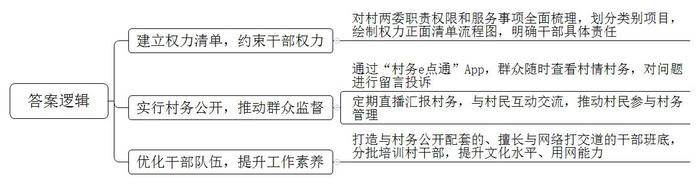
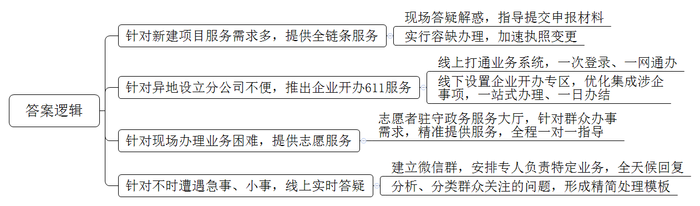
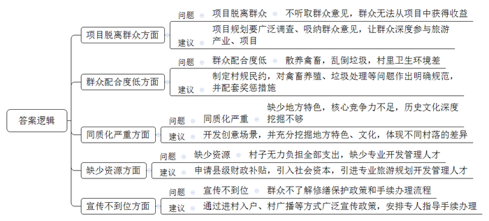
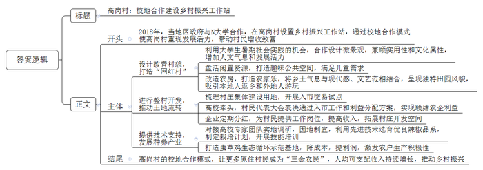
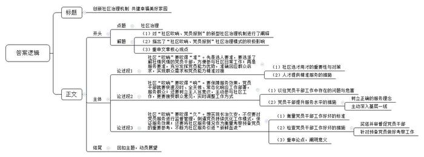

# 2023年公务员多省联考《申论》题（陕西B卷）

> 候选采集稿。参考答案及解析来自粉笔页面，不代表官方答案或真实高分答卷；来源使用许可与原卷对应关系仍需人工核实。

## 给定材料

### 材料 material-062a73ff31df658a

金秋十月的一天，“村务e点通”的二维码贴到E县李家村每户村民的门口。“唐会计，我上个月来村里两趟都没找到你，想请你帮我查查今年做了多少次杂工？能摊多少钱？”村民老李着急地说。“不好意思，李老爹，让你白跑了。之前我到镇里报账，镇长在县里开会，也是跑了三趟才签上字。不过，今后不用跑了，在手机‘村务e点通’APP上就能请镇长审批报账了。看，你今年做杂工8次，共计1560元。”唐会计教老李下载了“村务e点通”，并告诉他如何查询，“这个‘村务e点通’能查看全村的杂工情况，还有村里的‘一事一议’、贫困户等情况，方便得很。如果发现问题，还可以实名或者匿名留言、投诉。”

“好侄子，你权力大，给我个低保，还不是你张嘴一句话？”这天，患有脑溢血后遗症的村民周大爷和老伴一起来到村委会，找到小他们一辈的李家村党支部李书记。“叔，您看，村务公开栏上贴着村干部小微权力28项规范，每一项都很清楚，不是我一个人说了算。村里大小事都要讨论，结果要投票，过程要公示。”李书记指着村务公开栏耐心解释。以往乡村工作在亲缘关系面前总是容易撞墙，现在李书记说这些话底气越来越足，这源于县里规范村级小微权力运行所建立的权力清单。针对村党支部、村委会职责权限和服务事项，县里对村级小微权力进行全面梳理，归纳了6大类28项，形成了小微权力正面清单，绘制了流程图，明确了村干部的具体责任。“有了这个清单，挡住了人情，保护了干部。村干部能干什么，不能干什么，该怎么干，都是按照图表来，谁也不敢藏着掖着。现在，看似工作流程多了，但事实上工作变简单了，流程更顺畅，群众心里明白，也换来村干部自身清白。”李书记说。

李小妹打算办理子女落户时，村干部正挨家挨户给村民派发小微权力清单宣传册，她在册子上看到了办理子女落户的流程图。于是，李小妹按要求准备好材料交到了村委会。“村干部代办相关事项，两天就办好了。”她高兴地说。

“我承诺，严格按照小微权力清单制度规范履职，严格遵守各项制度规定，做到廉洁自律、公私分明、干净干事、清白做人……”这天，李家村新一届的村干部通过“村务直播间”直播平台集中亮相，向村民宣读廉洁履职承诺，接受村民的监督。此后，村委会将村务公开的程序、过程和结果从线下运行转为线上公开“晒”，定期通过村务直播平台向村民汇报村里重点工作，并与村民互动交流。“为什么我们第一组的村民分红这么少？”“因为第一组村民在田园综合体项目中未被征地，只能享受第二部分公共土地投股收益分成。”李书记在“村务直播间”回答村民的提问，这已是他第八次直播互动了。“村级事务定期直播，无论在村里居住，还是在外居住的村民，都能参与村务监督，既可以保障群众知情权、参与权和监督权，也能促进群众参与村务管理的积极性、主动性和能动性。”李书记说。

“以前开大会，我们村民即使有自己的想法或意见，但碍于面子或担心邻里关系，也不好意思说出来。”村民刘老伯说道，“如今在‘村务直播间’上，我们可以匿名发言，顾虑也就不存在了，大家都可以畅所欲言。这个‘村务直播间’非常赞！”

“互联网在农村的普及为村务公开提供了良好土壤。推行互联网村务公开需要与之配套的、擅长与网络打交道的干部班底。为此，县里还分批次组织村干部参加培训，提高他们的文化水平、用网能力。”县纪委陈书记表示，“村级事务与群众生活息息相关，群众最关心的就是村干部做事是否公平公正、村级资金如何使用。通过‘村务e点通’等途径，把村里每个月的工作、开支等向群众公开，彻底打消群众疑虑，更好维护干群关系，村务工作才能更有效开展。我们将继续借助各种平台发挥群众监督作用，完善村级监督管理制度，为推进乡村振兴提供‘廉动力’。”

### 材料 material-205255bb510bff16

“我们的项目是外商独资商业项目，2022年9月结构封顶，预计2023年底就能建成交付。很感谢Y区行政审批服务局提供项目管家全链条VIP服务，在项目建设过程中协调召开专题会现场答疑解惑，指定代办员指导提交各类申报材料；在项目后期协调市级相关单位，实行容缺办理，为企业第一时间办理营业执照变更。”英格卡购物中心项目开发陈总监直言满意。近年来，Y区行政审批服务局以“优营商环境、创服务品牌”为目标，健全体系、创新模式、规范流程，为企业和办事群众提供优质高效的服务，为经济社会高质量发展提供了保障。

“在工作人员的帮助下，短短3天时间，我就拿到了5家分公司的营业执照，真是方便！”融通军民服务社有限公司代理人康某说。前不久，康某到Y区行政审批服务局咨询办理分公司相关事宜。得知分公司选址在C区、B区等地后，工作人员在网上提交申请，帮其联系相关登记机关完成审核。随后，康某收到了邮寄过来的营业执照。原以为跑多个地方才能办成的事，只跑了一趟。

近年来，Y区行政审批服务局推出企业开办“611”服务。线上，依托S省政务服务网打通税务、人社、海关等业务系统，实现“一次登录、一网通办”；线下，设置企业开办专区，将设立登记、公章刻制、银行开户、社保登记、发票申领、公积金登记等涉企事项优化集成，实现6个环节一站式办理、一日办结，为企业开办再提速。“我们还推出免费刻制印章、邮寄、复印、提供税务UK设备等‘四免服务’，每年为企业节省成本超1000万元。”Y区行政审批服务局工作人员说。

“企业开办怎么进行全程电子化操作？”“办理食品经营许可证有什么新政策？”带着这些疑问，市民王先生早早来到Y区行政审批服务局。王先生一进门，“红马甲”志愿者小杨就迎了上来。了解王先生需求后，小杨认真解释政策，耐心解答疑问，帮王先生在自助申报区电脑上操作，顺利完成了申报。“第一次办理，我以为会很麻烦。有了志愿者一对一指导，整个过程不到20分钟，我很满意！”王先生说。

像小杨一样，每天有40多位“红马甲”志愿者在政务服务大厅导办台、咨询引导区、填单区、自助服务区、文印区等处穿梭，针对办事群众的不同需求，精准提供咨询引导、帮办代办、智慧讲解、爱心帮助等服务，做到了“进门有人管、咨询有人问、办事有人带”。2022年以来，Y区行政审批服务局已累计为企业和群众提供志愿服务1万余次。

“电梯使用登记证怎么办理？”“个转企怎么操作？”……晚上9时，Y区行政审批服务局审批一科王科长打开手机，微信群消息一个接一个跳了出来。置顶的25个微信群，是王科长带领科室人员创建的。“之前，我们为长期办理业务的企业和群众建了一个QQ群，定期在群里宣传政策、答疑解惑，大家反馈都挺好。为了更加方便企业和群众办事，我们想到了建微信群。”王科长说。这25个微信群，每个群安排一个对接人负责一类业务，全天候为3500余家企业答疑解惑，通过前端服务实现急事及时解决、小事线上解决。

在一次次回复中，王科长和同事不断总结归纳，定期召开业务分析会，把群众关注的问题进行分类，形成了一套精简处理模板，用过硬的业务水平更好服务群众。“党的二十大报告对我们的工作提出要求，让我们目标更坚定、干劲更足了。接下来，我和同事会继续学习贯彻党的二十大精神，不断提升服务群众、服务企业、服务发展的水平能力，最大程度利企便民。”王科长说。

### 材料 material-d684f051c2481471

为优化文旅产业布局，促进乡村旅游升级发展，J县宽石镇召开了一场关于乡村旅游规划调整升级的座谈会，听取各方的意见建议。以下是座谈会的主要发言记录：

县发展和改革局陈副局长：乡村旅游的落脚点应该是乡村，游客去农村主要还是想体验乡村特色和风情。开展乡村旅游规划，千万不能摒弃乡村的质朴与自然，不能按照城市规划的思路去规划设计，把农村建得跟城市一样。规划还是要着眼于“游客为什么来、什么游客来、游客怎么来、游客来了干什么、怎样让游客介绍人来”这几个问题。

村民老赵：镇里要在我们村搞旅游项目，都不听听我们的想法，我感觉跟我们也没有太大关系，虽然这几年村里是整洁了一些，生活也便利了一些，但外面的人来旅游，我们也做不了什么，没有实际的收益。我觉得让村民们能赚到钱才实在，否则我还是愿意去城里打工，我们那儿的好多人跟我的想法一样。

石茂村村委会主任：我们规划得再好，可有些村民就是不太配合，还是喜欢把鸡鸭养得到处都是，卫生也没处理干净，垃圾随处乱倒，有的村民养的狗还追着人家到处跑，外面的人来了自然不会高兴，不告你就算不错了。

灰石村驻村第一书记：我感觉，我们镇乡村旅游的主题内容同质化比较严重，比如花海，除了规模不一样，其他大抵相同；农家乐，就是简单的餐饮，加上棋牌、钓鱼，就没有其他内容了；采摘、观光活动的体验感也是千篇一律，体现不了我们这个地方的特色农业和文化。旅游产业的核心竞争力不足，历史文化深度挖掘不够，乡村核心的魂、自身的特色、差异化竞争等方面鲜有挖掘。

江流村村委会主任：我们村经过调研了解、征求意见，筹划建设“造田公社”景观，计划以农业种植为基础，将农田开发成可观、可玩、可学的各类创意场景，这个还是比较有特色的。可是，规划前期就需要不少资金投入，单纯从村里去开支，肯定是不够的，还是希望县里多支持。另外，最好有懂行的人来帮我们做一些旅游开发管理的事情。

市规划设计院潘工程师：乡村旅游规划设计要融入当地县镇、服务于村庄，处理好传统村落、基本农田保护与开发的关系，避免大拆大建、无效投入，所以规划就非常重要。如果规划和周遭环境产生对抗、格格不入，不能很好地尊重村民意愿，这样的规划哪怕自身再优秀，也不是好作品，这都需要专业的规划人才深入乡村实地去感受、体验，寻找最佳的解决方案。

村民老牛：村里说我家的老宅比较有特色，要保护修缮起来，政府会出一部分钱，但我们对这一块的政策不太了解，手续怎么办都不知道，村里也没什么人说得清楚，都是传来传去，走了不少弯路，也没有彻底解决问题，能不能有专门的人来指导我们怎么做。

县文化体育和旅游局钱副局长：乡村旅游规划要对建设以后的事情有个统筹考虑。有的地方往往注重硬环境建设，却忽视软环境治理，管理跟不上，配套服务也不行，个别还发生过安全事故，谁敢再去啊；有的地方基础设施和配套服务都完善了，但游客量却没有增加，收益也不可观，主要是没有对受众人群、出游目的、消费能力等进行系统分析，宣传推介就更加无从说起了。

宽石镇镇长：乡村旅游规划不能各自为政，要以“一盘棋”思想抓好统筹，根据各村的实际情况制定规划，再把散落的珍珠串成项链，形成我们镇的特色旅游项目。这样，游客到了我们镇，就可以根据实际需要选择项目，比如红色旅游、文化旅游、生态旅游等。

### 材料 material-9c1e151c6800752b

“我觉得这个地方可以设计成座椅”“这个地景材料要去库房看，有没有农村用的筛子”……这天，高岗村一幢古色古香的民居内，年轻的学生们正在热烈讨论乡村微景观设计。

这里是N大学设在高岗村的乡村振兴工作站，自2018年该校大学生暑期社会实践首次接触高岗村以来，今年已经是第5个年头。小王是建筑专业大四学生，三年前，在学长的带动下，他报名参与高岗村微景观设计。“我们的每一个设计细节都既注重实用，也注重文化的保留。希望通过我们的设计改造，给高岗村带来人文气息，也带来发展的活力。”小王指着不远处一个儿童游乐场说，“这是我们送给孩子们的秘密花园，原来这里是村里废弃的采石场，我们从孩子们的需求出发，设计了这样一个乡村儿童公园和公共活动空间。”接下来，他还要为孩子们设计一段梅花桩小路，路边用农村物件设计地景和座椅等，尽可能充满趣味。

大四学生小杨是15人小组的支队长，“这是我第三次参与暑期实践，大家住在农村，与村民也建立了良好的关系。”小杨说，自己印象最深的，是三年前为村民高大姐设计农家乐的事。原本这是一间普通的瓦房，小杨和学姐们将其设计成白墙红屋顶，并在大小错落的窗边设计了墙绘。“房子看起来很有乡土气息，但是一些细节又很有现代感、文艺范。设计里巧妙地嵌入了很多农用工具，呈现了田园风貌。”高大姐对设计非常满意。“以前，村子里的人都快走光了，更别说外面有人来，白天晚上都很冷清。”自从乡村振兴工作站设立后，仅仅两三年光景，老村落就有了新气象。曾经做过厨师的她，把这个小院打造成了全村第一个农家乐。“这两年几乎每天游客满座，我是尝到甜头了。”高大姐乐呵呵地说。村子发展好了，好多像她一样原先在外打工的人都回来了。

“以前的高岗村全村常住人口仅138人。三年前，第一期农房改造完毕后，高岗村重现活力，如今成了全区的‘网红村’。”高岗村乡村振兴工作站蔡站长表示。2018年，当地区政府与N大学合作，在高岗村设置乡村振兴工作站，采取整村开发模式，梳理村庄周边农田，收储闲置农房，并对梳理出的100余亩集体建设用地，进行入市交易试点。2019年，在N大学公共管理学院的牵头推动下，村民代表大会表决通过了《农村集体经营性建设用地入市工作方案》《承包地承包户补偿方案及集体增值收益分配使用方案》，让高岗村多个项目通过土地流转方式实现了农企利益联结，企业每年给村集体和农户分红，并聘用流转土地的农民参加生产劳动，既增加了村民收入又拓展了村庄开发空间。

去年暑假，N大学生物学院刘院长率领专家团队来到高岗村调研。发现高岗村的土壤很适合种植高品质辣椒。刘院长利用组织培养与细胞克隆技术繁育辣椒优质种苗，选育优良品系，为高岗村制定了优质的辣椒栽培计划，并对村民开展相关技能培训。村民掌握技能后，种出的辣椒非常鲜美，外表特别漂亮，很快就脱销了。今年愿意栽培辣椒的人越来越多，预计产量会达到100吨，产值约500万元。“刘院长不仅给我们带来了先进的辣椒种植技术，还帮我们村打造了虫草鸡生态循环示范基地。”高岗村农业带头人老李介绍道。基地利用高蛋白昆虫黑水虻和富含花青素的紫金草搭配饲养生态鸡，降低了20%至30%的饲料成本，提升了养鸡的利润。去年基地饲养5000只鸡，全村集体收入增加近20万元。周边农户积极性都很高，愿意和科技团队合作开展生态养殖，目前正扩建40亩鸡舍，还会带动更多农户参与养殖。

蔡站长算了一下账，闲置农房农地的租金、入股开展合作经营的股金、就地就业创业的薪金，让更多原住村民成了“三金农民”，三年来该村人均可支配收入年均增长8%。“在高岗实践的基础上，我们又开始向周边乡村推广校地合作模式，未来还会出现更多的‘高岗村’。”

## 题目

### 第 1 题

**根据****“给定资料**1**”****，****请说说****E****县在规范村级小微权力运行方面有哪些做法？（****15分****）**

关联材料：材料 material-062a73ff31df658a

作答要求：

要求：

（1）全面、准确、有条理；

（2）150-200字。

### 第 2 题

**根据****“给****定资料**2**”，请谈谈企业群众在办事中遇到了哪些问题，****Y****区行政审批服务局采取了什么措施予以解决。（****20分）**

关联材料：材料 material-205255bb510bff16

作答要求：

要求：

（1）全面、准确、有条理；

（2）200-250字。

### 第 3 题

**根据****“给定资料**3**”，请梳理当前宽石镇乡村旅游规划中的问题，并提出相应的改进建议。（****30分****）**

关联材料：材料 material-d684f051c2481471

作答要求：

要求：

（1）问题梳理全面、准确、有条理；

（2）所提建议与问题相对应，具体明确，切实可行；

（3）250-350字。

### 第 4 题

**区里拟将高岗村校地合作建设乡村振兴****工作****站****推动乡村振兴的情况，作为典型案例上报市里。根据****“给定资料**4**”，请撰写一份案例介绍材料。(35分)**

关联材料：材料 material-9c1e151c6800752b

作答要求：

要求：

（1）紧扣资料，内容全面，结构完整；

（2）条理清晰，语言流畅；

（3）400-500字。

### 第 5 题

**请深入理解****“给定资料**5**”划线句子“社区‘吹哨’，既要吹得‘准’，还要吹得‘响’****、****吹得****‘久’”，联系社区治理实际，自选角度，自拟题目，写一篇文章。(50分)**

关联材料：材料 material-062a73ff31df658a

作答要求：

要求：

（1）观点明确，见解深刻；

（2）思路清晰，论证充分，语言流畅；

（3）参考“给定资料5”，但不拘泥于给定资料；

（4）1000-1100字。

## 答案与解析

第 1 题

**参考答案（粉笔题库参考内容）**

1.建立权力清单，约束干部权力。对村两委职责权限和服务事项全面梳理，划分类别项目，绘制权力正面清单流程图，明确干部具体责任。

2.实行村务公开，推动群众监督。通过“村务e点通”App，群众随时查看村情村务，对问题进行留言投诉；定期直播汇报村务，与村民互动交流，推动村民参与村务管理。

3.优化干部队伍，提升工作素养。打造与村务公开配套的、擅长与网络打交道的干部班底，分批培训村干部，提升文化水平、用网能力。

**解析**

**参考答案说明**：本参考答案从“建立权力清单，约束干部权力”“实行村务公开，推动群众监督”和“优化干部队伍，提升工作素养”这三个方面展开。各条答案要点在内容上相互并列，没有交叉。

**考点**：考点概括措施类

**来源**：来源2023年公务员多省联考《申论》题（陕西B卷）

粉笔申论页面对本题只提供「解析视频」入口，该入口是会员推广位，页面无视频地址与文字解析。

第 2 题

**参考答案（粉笔题库参考内容）**

1.针对新建项目服务需求多，提供全链条服务。现场答疑解惑，指导提交申报材料；实行容缺办理，加速执照变更。

2.针对异地设立分公司不便，推出企业开办611服务。线上打通业务系统，一次登录、一网通办；线下设置企业开办专区，优化集成涉企事项，一站式办理、一日办结。

3.针对现场办理业务困难，提供志愿服务。志愿者驻守政务服务大厅，针对群众办事需求，精准提供服务，全程一对一指导。

4.针对不时遭遇急事、小事，线上实时答疑。建立微信群，安排专人负责特定业务，全天候回复；分析、分类群众关注的问题，形成精简处理模板。

**解析**

**参考答案说明：**本参考答案从“针对新建项目服务需求多，提供全链条服务”“针对异地设立分公司不便，推出企业开办611服务”“针对现场办理业务困难，提供志愿服务”“针对不时遭遇急事、小事，线上实时答疑”这四个方面展开进行了分条撰写。各条要点之间在内容上相互并列，没有交叉。

**考点**：考点多要素组合类

**来源**：来源2023年公务员多省联考《申论》题（陕西B卷）

粉笔申论页面对本题只提供「解析视频」入口，该入口是会员推广位，页面无视频地址与文字解析。

第 3 题

**参考答案（粉笔题库参考内容）**

1.问题：项目脱离群众。不听取群众意见，群众无法从项目中获得收益。建议：项目规划要广泛调查、吸纳群众意见，让群众深度参与旅游产业、项目。

2.问题：群众配合度低。散养禽畜，乱倒垃圾，村里卫生环境差。建议：制定村规民约，对禽畜养殖、垃圾处理等问题作出明确规范，并配套奖惩措施。

3.问题：同质化严重。缺少地方特色，核心竞争力不足，历史文化深度挖掘不够。建议：开发创意场景，并充分挖掘地方特色、文化，体现不同村落的差异。

4.问题：缺少资源。村子无力负担全部支出，缺少专业开发管理人才。建议：申请县级财政补贴，引入社会资本，引进专业旅游规划开发管理人才。

5.问题：宣传不到位。群众不了解修缮保护政策和手续办理流程。建议：通过进村入户、村广播等方式广泛宣传政策，安排专人指导手续办理。

**解析**

**参考答案说明：**本参考答案分别围绕“项目脱离群众”“群众配合度低”“同质化严重”“缺少资源”“宣传不到位”五个方面的问题及对应的建议展开，进行了分条撰写；各条具体要点之间在内容上相互并列，没有交叉。

**考点**：考点提出对策类

**来源**：来源2023年公务员多省联考《申论》题（陕西B卷）

粉笔申论页面对本题只提供「解析视频」入口，该入口是会员推广位，页面无视频地址与文字解析。

第 4 题

**参考答案（粉笔题库参考内容）**

高岗村：校地合作建设乡村振兴工作站

2018年，当地区政府与N大学合作，在高岗村设置乡村振兴工作站，通过校地合作模式使高岗村重现发展活力，带动村民增收致富。具体情况如下：

一、设计改善村貌，打造“网红村”。利用大学生暑期社会实践的机会，合作设计微景观，兼顾实用性和文化属性，增加人文气息和发展活力；盘活闲置资源，打造趣味公共空间，满足儿童需求；改造农房，打造农家乐，将乡土气息与现代感、文艺范相结合，呈现独特田园风貌，吸引本地人返乡和外地人游玩。

二、进行整村开发，推动土地流转。梳理村庄集体建设用地，开展入市交易试点；高校牵头，村民代表大会表决通过入市工作和利益分配方案，实现联结农企利益；企业定期分红，为村民提供工作岗位，提高收入，拓展村庄开发空间。

三、提供技术支持，发展种养产业。对接高校专家团队实地调研，因地制宜，利用先进技术选育优良辣椒品系，制定栽培计划，开展技能培训；打造虫草鸡生态循环示范基地，降成本，提利润，激发农户生产积极性。

高岗村的校地合作模式，让更多原住村民成为“三金农民”，人均可支配收入持续增长，推动乡村振兴。

**解析**

**参考答案说明：**（1）本题要求撰写“一份案例介绍材料”，需注意格式，介绍材料的一般格式为：标题+正文。（2）正文部分，一方面从内容上来看，围绕着“高岗村校地合作”这一主题，本参考答案的开头先写到了“高岗村校地合作的背景、意义”；主体部分从“设计改善村貌，打造‘网红村’”“进行整村开发，推动土地流转”“提供技术支持，发展种养产业”这三个方面介绍了具体经验；结尾写到了对高岗村校地合作的总结。另一方面，形式上，本参考答案做到了分段、分条撰写，整体上条理较为清晰。

**考点**：考点总结类

**来源**：来源2023年公务员多省联考《申论》题（陕西B卷）

粉笔申论页面对本题只提供「解析视频」入口，该入口是会员推广位，页面无视频地址与文字解析。

第 5 题

**参考答案（粉笔题库参考内容）**

**创新社区治理机制 共建幸福美好家园**

“社区吹哨、党员报到”是将有履职能力的党员集聚至本人居住的社区，实现“社区一吹哨、党员马上到；居民有‘点单’，党员立‘接单’”的新型社区治理机制。这种治理模式打通了服务群众的“最后一公里”，解决了群众最关心、最直接、最现实的民生问题，营造了文明和谐的生活氛围。在未来的社区治理中，我们既要吹得“准”，还要吹得“响”，更要吹得“久”，以此保障人民的美好幸福生活。

**社区****“吹哨”要吹得“准”。先是选人要准，要选派了解社情民情的党员干部，方便参与社区日常工作；再是服务要准，充分发挥党员能力优势，准确回应群众诉求，实现群众需求和党员能力精准对接。**人才是发展建设的第一要素，一谈到人才避不开的就是选才和用才。选才“不当”会造成“痛失街亭，北伐无望”的苦果，用人“不善”也会造成“兵败垓下，自刎乌江”的恶果。社区治理也是一样，在社区治理力量的选择中，要先选择本社区的党员干部，还要扬长避短、化短为长、人尽其才、才尽其用，更要听民生、记民需、落民诉，帮助他们解决实际问题，描绘社区温暖底色。

**社区****“吹哨”要吹得“响”。要保障服务效果，党员干部就要快速及时、全天候、常态化响应工作部署，服务群众；还要树立主人翁意识，主动参与社区工作，更要接受群众意见，实时调整工作方式。**以往，某些党员干部在参与社区治理时存在“慢作为”的问题，提供的服务严重滞后于群众的需求，时效性差，导致群众情绪不满，还有部分党员干部“懒作为”，收到群众诉求后消极怠工，影响群众对社区工作的认可度。因此，在社区“吹哨”中，党员干部首先要树立正确的服务观念，从“要我服务”转变为“我要服务”，还要根据工作难度合理分配时间，提前规划，提高工作效能。此外，还应主动深入社区一线，关注群众想法，借助民智优化工作，打造高质量服务。

**社区****“吹哨”要吹得“久”。想实现长治久安，不仅要对党员服务进行监督管理，倒逼党员持续优化工作模式，保证服务效果；还要将社区服务情况作为衡量考察预备党员的重要参考，不断为社区服务引进“新鲜血液”。**工作好不好，主要看群众是哭还是笑，哭和笑是工作的满意度，是工作人员的评分表。要想社区“吹哨”久久为功，要利用建设“云平台”，收集并记录党员服务记录、群众满意度等信息，要将群众的“哭”作为监督管理的依据，惩戒不干实事的党员干部；要将“笑”作为激励标准，奖励创新上进的党员干部；更要将“哭和笑”用于培养考察预备党员，实现能者上劣者下。只要我们做好监督、考评、激励、培养，就一定能为基层选拔出更多的坚实力量，真正实现“问需于民，问政于民”。

保障和改善民生没有终点，只有连续不断的新起点，我们要不断创新社区治理机制，让党旗飘扬在小区一线，让党的光辉照耀你我！

**解析**

**文章分析**

**创新社区治理机制 共建幸福美好家园**

【**标题的优点：**一方面，标题中含有主题词，使文章主题突出、清晰。另一方面，对称式结构，为标题增添了些许亮点。】

（1）“社区吹哨、党员报到”是将有履职能力的党员集聚至本人居住的社区，实现“社区一吹哨、党员马上到；居民有‘点单’，党员立‘接单’”的新型社区治理机制。（2）这种治理模式打通了服务群众的“最后一公里”，解决了群众最关心、最直接、最现实的民生问题，营造了文明和谐的生活氛围。（3）在未来的社区治理中，我们既要吹得“准”，还要吹得“响”，更要吹得“久”，以此保障人民的美好幸福生活。

【**开头的优点：**★内容方面。范文的开头是紧扣题目给定的“社区治理”这一主题展开的。（1）首先对“社区吹哨、党员报到”的新型社区治理机制进行了阐释。（2）接着指出了“社区吹哨、党员报到”社区治理模式的积极影响。（3）最后重申文章核心观点。★文字表达方面。使用了“既要”“还要”“更要”等连接词，增强了论述逻辑的严谨性。】

**社区****“吹哨”要吹得“准”。先是选人要准，要选派了解社情民情的党员干部，方便参与社区日常工作；再是服务要准，充分发挥党员能力优势，准确回应群众诉求，实现群众需求和党员能力精准对接。**（1）人才是发展建设的第一要素，一谈到人才避不开的就是选才和用才。选才“不当”会造成“痛失街亭，北伐无望”的苦果，用人“不善”也会造成“兵败垓下，自刎乌江”的恶果。社区治理也是一样，在社区治理力量的选择中，要先选择本社区的党员干部，还要扬长避短、化短为长、人尽其才、才尽其用，（2）更要听民生、记民需、落民诉，帮助他们解决实际问题，描绘社区温暖底色。

【**论述段****1****的优点：**★观点句：范文的观点句是紧扣“社区治理”这一主题提出的。形式上，它在段首处直接写出，位置突出，容易发现。内容上，关键词突出，内容要点明确，可以明显看出主要论述“社区‘吹哨’要吹得‘准’”。★论述内容：（1）一方面介绍了社区选才用才的重要性与对策；（2）另一方面介绍了人才提供精准服务的措施。注意：以上两个方面的内容都是紧扣“社区‘吹哨’要吹得‘准’。先是选人要准，要选派了解社情民情的党员干部，方便参与社区日常工作；再是服务要准，充分发挥党员能力优势，准确回应群众诉求，实现群众需求和党员能力精准对接”这个观点句进行分析论述的，论述的针对性强，内容层次丰富。在论述方法上主要采用了讲道理、举例子相结合的方式。】

**社区****“吹哨”要吹得“响”。要保障服务效果，党员干部就要快速及时、全天候、常态化响应工作部署，服务群众；还要树立主人翁意识，主动参与社区工作，更要接受群众意见，实时调整工作方式。**（1）以往，某些党员干部在参与社区治理时存在“慢作为”的问题，提供的服务严重滞后于群众的需求，时效性差，导致群众情绪不满，还有部分党员干部“懒作为”，收到群众诉求后消极怠工，影响群众对社区工作的认可度。（2）因此，在社区“吹哨”中，党员干部首先要树立正确的服务观念，从“要我服务”转变为“我要服务”，还要根据工作难度合理分配时间，提前规划，提高工作效能。此外，还应主动深入社区一线，关注群众想法，借助民智优化工作，打造高质量服务。

【**论述段****2****的优点：**★观点句：范文的观点句是紧扣“社区治理”这一主题提出的。形式上，它在段首处直接写出，位置突出，容易发现。内容上，关键词突出，内容要点明确，可以明显看出主要论述“社区‘吹哨’要吹得‘响’”。★论述内容：（1）一方面介绍了以往党员干部工作中存在的问题与危害；（2）另一方面介绍了党员干部提升服务水平的措施，包括两个层次，一是树立正确的服务理念，二是主动深入基层一线。注意：以上两个方面的内容都是紧扣“社区‘吹哨’要吹得‘响’。要保障服务效果，党员干部就要快速及时、全天候、常态化响应工作部署，服务群众；还要树立主人翁意识，主动参与社区工作，更要接受群众意见，实时调整工作方式”这个观点句进行分析论述的，论述的针对性强，内容层次丰富。在论述方法上主要采用了讲道理、举例子相结合的方式。】

**社区****“吹哨”要吹得“久”。想实现长治久安，不仅要对党员服务进行监督管理，倒逼党员持续优化工作模式，保证服务效果；还要将社区服务情况作为衡量考察预备党员的重要参考，不断为社区服务引进“新鲜血液”。**（1）工作好不好，主要看群众是哭还是笑，哭和笑是工作的满意度，是工作人员的评分表。（2）要想社区“吹哨”久久为功，要利用建设“云平台”，收集并记录党员服务记录、群众满意度等信息，要将群众的“哭”作为监督管理的依据，惩戒不干实事的党员干部；要将“笑”作为激励标准，奖励创新上进的党员干部；更要将“哭和笑”用于培养考察预备党员，实现能者上劣者下。（3）只要我们做好监督、考评、激励、培养，就一定能为基层选拔出更多的坚实力量，真正实现“问需于民，问政于民”。

【**论述段****3****的优点：**★观点句：范文的观点句是紧扣“社区治理”这一主题提出的。形式上，它在段首处直接写出，位置突出，容易发现。内容上，关键词突出，内容要点明确，可以明显看出主要论述“社区‘吹哨’要吹得‘久’”。★论述内容：（1）首先介绍了衡量党员干部工作好坏的标准；（2）其次介绍了检查党员干部工作好坏的措施，包括两个层次，一是奖惩并举督促党员干部，二是针对预备党员做好考察工作；（3）最后重申论点，阐明意义。注意：以上三个方面的内容都是紧扣“社区‘吹哨’要吹得‘久’。想实现长治久安，不仅要对党员服务进行监督管理，倒逼党员持续优化工作模式，保证服务效果；还要将社区服务情况作为衡量考察预备党员的重要参考，不断为社区服务引进‘新鲜血液’”这个观点句进行分析论述的，论述的针对性强，内容层次丰富。在论述方法上主要以讲道理为准，做到了鞭辟入里，逻辑清晰。】

【**论述段之间的关系**：★内在逻辑上：文章先论述“社区‘吹哨’要吹得‘准’”，再论述“社区‘吹哨’要吹得‘响’”，最后论述“社区‘吹哨’要吹得‘久’”，在语义上层层递进，清晰严谨。】

保障和改善民生没有终点，只有连续不断的新起点，我们要不断创新社区治理机制，让党旗飘扬在小区一线，让党的光辉照耀你我！

【**结尾的优点：**范文的结尾回扣了“社区治理”这个主题，并且进行了展望，发出了号召。】

**考点**：考点文章写作题

**来源**：来源2023年公务员多省联考《申论》题（陕西B卷）

粉笔申论页面对本题只提供「解析视频」入口，该入口是会员推广位，页面无视频地址与文字解析。

