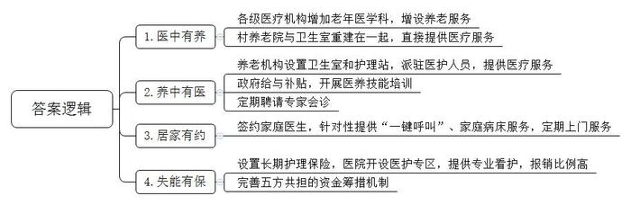
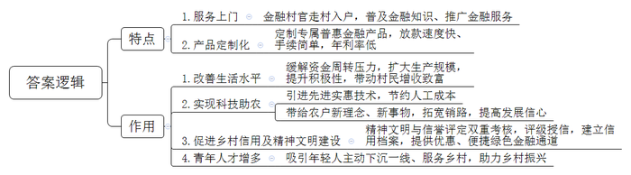
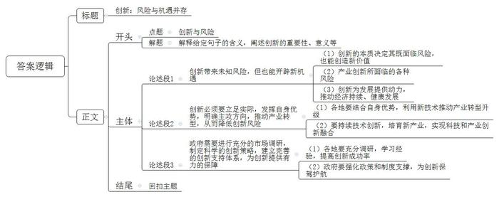

# 2024年公务员多省联考《申论》题（陕西B卷）

> 候选采集稿。参考答案及解析来自粉笔页面，不代表官方答案或真实高分答卷；来源使用许可与原卷对应关系仍需人工核实。

## 给定材料

### 材料 material-908d9f73232ff639

近年来，A县充分发挥养老机构资源优势和医疗机构技术优势，坚持“医中有养、养中有医、居家有约、失能有保”，积极探索“医养一体、两院融合”农村养老新路径。以下是有关部门就这项工作进行调研座谈时，部分干部群众的发言摘要。

某镇中心卫生院周院长：我们卫生院有60张床位，过去长期使用率不足60%。3年前，一位老人看病后由于家中无人照料，提出继续住院接受护理的意愿。我们一摸底，发现全镇约有140名失能、半失能老人。但以前卫生院没有养老服务功能，附近的养老机构、幸福院里也没有专业的医护人员，无法满足这些老人的入住需求。正好赶上县里出台“医养一体、两院融合”政策，我们就把50张床位申请用于承担医养结合功能。随着老人入住，现在床位使用率升至100%。增加医养结合床位，可谓“一举多得”。

县卫健局办公室费主任：目前，老年人大多数都是居家和社区养老，形成了“9073”格局，即90%左右的老年人居家养老，7%的老年人依托社区支持养老，3%的老年人入住机构养老。对于居家养老群众，我们推行家庭医生签约服务，有针对性地开展健康教育、健康体检、健康管理服务。其中，对居家行动不便的农村老人实行“一键呼叫”服务，即在老人手机上设置快捷键，可一键拨通家庭医生电话；对部分患病老人实行家庭病床服务，并把部分服务费用列入医保报销范围，目前有300多人次享受了这项服务。同时，我们还定期为居家老人提供血压检查、心电图监测等上门服务，极大缓解了居家养老的就医负担。

某医养服务公司护理员老赵：昨天我们跟着签约医生一起去了86岁的张奶奶家。8年前，张奶奶因脑卒中导致瘫痪在床。她家孩子都在外地工作，身边只有老伴陪伴。我们公司根据她的实际情况，由专业康复师和医生量身制定护理计划。目前，老人处于康复阶段，我们每两天就上门一次给她做康复护理，像她这种情况，平均每天需要90元护理费，但长护险可以减免54元，个人仅负担36元，这个费用大家基本都能负担得起。

县卫健局白局长：长期以来，医不能养、养不能医是基层的共性难题，养老、看病两头跑，增加了老百姓的负担，无形中束缚了大家的手脚。为解决这一问题，我们以老年人的健康需求为导向，不断充实完善医养结合、长期照护、安宁疗护及老年健康服务等方面的政策体系，以居家为基础、社区为依托、机构为支撑，推动形成了规模适度、功能完善、覆盖城乡的医养结合服务框架，探索出一条医养结合的新路径。现在，全县3家二级以上综合医院全部开设了老年医学科、7家乡镇卫生院增设了养老服务职能，鼓励各级医疗卫生机构为乡村养老机构提供服务，同时，大力推进“两个机构、一门服务”养老机构建设，在乡村养老机构、幸福院中增设卫生室和护理站，派驻医护人员提供医疗服务，全力保障群众基本健康需求。

某村养老院刘院长：村里原来的养老院地方小，医疗条件差，距离村卫生室也不近。前年，按照县里明确的“资源共享、优势互补、群众自愿、市场运作”原则，我们把村养老院和卫生室重建在一起。按照县里《“医养一体、两院融合”机构养老试行办法》，我们拿到了每张床位1500元的建设补贴，以后还可以按入住人数拿到每人每年600元的运营补贴。现在，村卫生室的5名医护人员不但负责给全村百姓看病，还负责对养老院的老人进行专业护理、医疗保健。其他工作人员也都参加了县里组织的医养技能培训。同时，我们还与县医院建立医联体，定期聘请专家来给老年人会诊。入住的老年人突发疾病或大病时也可以第一时间得到医院专业救治。现如今，在养老院看病，能用新农合报销，村里很多老人都申请搬进来。

村民老张：过去因为父母都瘫痪在床，我只能辞去工作照顾老人。村干部知道我家的情况后，帮助我们申请了长期护理险鉴定，还帮忙联系让二老住进了县医院“长护险”医护专区。在这里，一天三顿有人把饭菜端到跟前，护理人员定时给擦脸洗手、打扫卫生，照料起来比我们做儿女的还细心周到，两位老人身体状况好了很多。我母亲原来还有两块褥疮，经过两个多月的专业看护，她的褥疮没了。一旦老人病情有变化，随时有专业的医生护士处理。现在国家的政策好，我们的医疗专护费用能报销65%，每人每月支付1200元左右，家里减轻了不少负担，我也能安心出去工作了。

县医保中心史主任：县里已连续3年把“长护险全覆盖”作为为民办实事项目写入县政府工作报告，由各级部门具体抓落实。它综合考虑个人、医保基金和财政承受能力等因素，建立“全民缴费+财政补贴+医保统筹基金+福彩公益金补助+社会捐助”五方共担的资金筹措机制，确保资金筹集稳定，有效降低了群众负担。例如，城乡居民护理险，个人、财政、福彩基金和医保基金统筹额度分别为3元、3元、4元和40元。

### 材料 material-103e6c86de461ce9

普惠金融，顾名思义，就是将优惠的金融服务提供给更多的人，特别是急需资金支持的⼩微企业、“三农”和偏远地区的人们。普惠金融服务如何落地？在多山多水的F市，为了将金融服务送到山间、沿海的家家户户，当地探索形成了别具特色的“背包银行”模式。什么是“背包银行”？“就是银行的客户经理背上包包就进村了，挨家挨户去普及金融知识、推广金融服务。”F市某国有银行支行刘行长说。

2019年以来，为发展普惠金融，助推乡村振兴，F市每年都选派100名优秀的信贷客户经理到100个特色产业村担任金融村官，他们背上背包，走出柜台，走进村组农户和田间地头，向这片乡村热土浇灌金融活水。

蟹苗养殖培育是七房村的主导产业，每年三四月份，正是养殖户采购蟹苗、饲料，扩大生产经营的时节，不少养殖户都面临较大的资金周转压力。2023年3月，金融村官⼩梅根据前期调研的结果，在充分掌握了蟹苗养殖信用户相关情况的基础上，向上级部门申请了专属金融产品“蟹苗贷”。“我们⼀直把服务‘三农’作为普惠金融的重点，不仅放款速度快，手续简单，年利率也低，比市面上大多数金融贷款要低1.5至4个点，按照借10万元来算，一年能省至少1500元。”小梅说。有了金融支持，七房村蟹苗养殖规模大幅度提高，村民的养殖意愿越发强烈。“2023年养殖收入增加了快一倍，好多村民都买了小车，今年又引入了新的蟹苗品种，规模进一步扩大，村民们日子越来越好啦！”小梅的声音难掩喜悦。

“虽然我是残疾人，但我致富的决心可不比其他人差！”村民老陈原是西界村建档立卡贫困户，早年间因意外不幸失去左手，劳力较差。在得知老陈打算养猪却苦于没有启动资金后，金融村官小刘积极对接，了解到他有丰富的养殖技术和经验，且家里边有约600平方米的场地可以用来办养猪场后，小刘为其制定了无抵押的信贷支持计划，发放了扶贫小额贷款。今年，老陈想扩大养殖规模，小刘继续为其争取资金支持，又发放了贷款5万元供其购买猪仔，目前养殖规模已增加到了300头。有了信贷资金支持，勤劳肯干的老陈成了村里的致富能手。

“打药用上无人机，原本几天的工作现在两小时就能完成了，高科技的东西就是不一样，多亏了我们的金融村官小李啊！”老钟指着不远处正在喷洒农药的无人机，开心地说道。老钟是茗香茶厂的老板，随着茶园的扩大，传统的人工喷药方式费时费力，如何改造升级？农民出身的老钟没了主意。一天，小李到家闲聊，老钟把他的困扰告诉了小李。虽然这项业务和金融服务无关，但小李总觉得可以为老钟做点什么。他上网查阅相关资料，了解到植保无人机可将农药喷洒到茎叶背面和根部，能节约农药并有利于减少农药残留和环境污染。在帮助老钟明确了升级方向后，小李又借助省行资源帮助他成功引入了先进实惠的无人机施药技术。“现在，我们这个无人机每启动一次，就可以节约人工成本1万元左右。”老钟对这项新技术赞不绝口，“我们对很多新鲜事物不了解，是小李把城里一些新的东西、新的理念带给了我们。最近他又教会了我直播带货，现在我的茶都卖到国外去了……”老钟对未来的发展充满了信心。

“背包银行不仅为农村送去了普惠金融服务，对农村的信用建设、精神文明建设也起到了很大的促进作用。”刘行长说，随着金融村官对各村情况的摸底了解，F市对上万户农村家庭进行了评级、授信，初步建立了农户信用档案，半数以上农村家庭被认定为“信用户”，可以享受到更优惠、便捷的绿色金融通道。由于大部分农民无抵押、无担保，在评估“信用户”的时候，F市就采用精神文明与信誉评定双重考核标准，把邻里和谐、孝道等道德元素纳入考核，在推进乡村信用建设的同时，也推进了农村的精神风貌。

“在背包银行模式形成之初，我们担心年轻人不愿意舍弃城里的舒适生活奔赴偏远的农村，几年过去了，事实证明我们的担心是多余的。这些高素质的青年才俊到了乡村之后，工作踏实，头脑灵活，方法多样，都能够下沉一线，真心地服务农民。”刘行长说，去年以来，越来越多的年轻人主动报名要加入背包队伍，参与到乡村振兴的时代浪潮中，“我们看到这么多年轻人愿意走向农村、服务乡村，既有喜悦也有欣慰，准备在F市更多的村庄开启普惠金融背包之旅。”

### 材料 material-e55c3e569f812c6e

兴旺区是K市最早向城市化过渡的地区之一，辖区内老旧小区很多，老旧小区改造一直是区里的重点项目。违章现象整治、道路修复铺装、水电管网改造……改造后的小区居住环境明显提升，但仍面临一系列问题亟待解决。

东瑞园小区是兴旺区首批完成改造升级的小区之一，但家住该小区的王阿姨却被管道漏水问题困扰了数月。“这是共用管道，应该由物业来维修，可是我跟物业反映了两个月，至今还没有安排人来修。”王阿姨说，“每次他们都说知道了，但就是没见人来修过。”对于物业公司的不作为，同一小区的住户老赵表示自己已经司空见惯了。据他介绍，虽然小区门口设有升降杆，但平时并不启用。一些外来车辆进入小区，挤占了小区的车位，使得小区内部车辆经常“无处落脚”。还有一些业主为了自己停车方便，使用各种方法占车位，有用电动车、自行车或三轮车占位的，还有安装地锁的。他多次向物业反映这些问题，但一直没有得到妥善解决。

“这个小区以前是没有物业的，去年小区改造后我们才进驻，但这个物业费收取却非常费力。有些业主认为物业就是看个门、扫扫地，还有些业主认为只要不收费用，怎么管理都无所谓。”东瑞园小区物业公司张经理无奈地说，“老旧小区本来就因为基础设施不完善容易出问题，平时需要维修花钱的地方有很多，即使全额收齐物业费也不一定能保持运转，更别提盈利了，这样‘入不敷出’，也制约了我们提高服务品质的积极性。”

“大部分老旧住宅小区未归集房屋维修基金，这样就没有后期公共部分维护保养的钱了。按照规定，维修基金降至总量的30%就应该续筹，但许多业主认为，买房时已交了钱，后续不愿再交。一些房屋经多次转手后，新业主也不愿意交费。”社区工作人员小刘说，“《物业管理条例》只对新开发楼盘进行规定，没有涉及既有住宅和改造后的老旧小区。我们希望市里可以针对老旧小区物业管理出台一些政策，填补公共维修资金缺口。”

迎泽公寓小区有20多年了，去年底刚刚完成改造，但大部分居民对拆除防护网一事意见很大。“我不同意拆防护网，太不安全了。”住户陈女士说，“有的住户担心拆了防护网之后孩子不安全，就把窗户钉死了；有的住户防护网上面还有雨棚，拆了后雨就飘到屋里；而我当时装的防护网质量比较好，花了七八千元，好好的拆掉很可惜。当时我们业主代表到居委会，讲了防护网拆除后的安全隐患。提出如果一定要拆，要统一替换成隐形防护网。但是最终没有让我们如愿，拆是拆了，却没有再装。”陈女士指着楼上的几户窗户说：“你看，楼上几户有小孩的，又都重新装上了，这外观不是又破坏了吗？”

兴旺区旧改资金主要靠政府财政投入，一年能争取到的专项资金约1.2亿元，但需要改造的老旧小区项目超过140个，平均到每个小区只有80万元，每栋楼不足10万元，旧改项目的利润对施工单位来说是“聊胜于无”。由于资金来源单一、投入缺少机制保障，不少地方只能将资金主要用于老旧小区水电气热、楼梯楼体等满足居民基本生活和安全的基础类改造。物业管理、绿化停车、托老托幼等完善类、提升类改造则难以兼顾，整体居住品质并未得到根本改善。

“不少老旧小区地处城市核心地段、文化底蕴厚重，具备商业开发价值，可挖掘闲置房屋再利用、有偿服务等‘造血点’，建立政府与居民、社会力量合理共担改造资金的机制。”兴旺区住建局干部小王介绍，“去年我们把建融家园这个老旧小区改造成高品质长租公寓后，很快被抢租一空；正街社区挖掘街区历史底蕴，打造‘超级1号街’怀旧主题文创园，促进了文旅产业发展。”小王还介绍，“停车场、临街门面和住房是旧改的重要‘造血点’，但常常存在产权不一的问题，导致后期收益归属不清，还需要出台相应的配套政策，健全‘造血’机制，吸引社会资本投入运营。”

### 材料 material-3c4b76454d56a736

在裕民社区“爱上锅巴饭”的后厨，老曹忙活着给客人制作餐点，门店里络绎不绝的客人，让老曹没有休息的时间，一年前还在外漂泊的他，如今已经是小店的老板；梅姐是裕民信合花园物业公司的一名员工，曾经在家待业的她如今通过应聘完成了从“家庭主妇”到“职场女性”的转变。

这样的“变形记”每天都在裕民社区上演。

“我们裕民社区是在县城‘南扩北升’基础上建起来的‘年轻’社区，属于易地搬迁社区。去年，我们社区被评为第五批国家级充分就业社区，这实属不易啊。我们社区外来人口多、人口流动性大，劳动力供大于求的矛盾在我们这个社区表现得尤为突出。”社区党支部张书记说，“我和这些搬迁群众一样，都是这个小区的新人，这里就业岗位不多，做好原住居民以及搬迁群众稳岗就业工作，就是我到任后要破解的首要难题。”

就业岗位不多，那就想办法开发新的岗位。为了实现就业岗位“开源”，社区规划办全员出动拉项目、谈项目、筹资金；社区市场监督协管员成了“店小二”，负责协助个体工商户、小微企业在社区内申请创业补贴、办理相关证照。社区营商环境的优化，带来的是源源不断的就业岗位。“短短两年，我们社区就促成一个大型超市、一批商户的开业和发展，为居民提供了收银员、理货员等600余个工作岗位，我们还引进1个公园、1个景观廊桥项目的建设和4个楼盘的开发，这能为社区居民提供建筑类岗位300余个。”社区建设办翁主任说。此外，裕民社区还与辖区企业、商户签订《促进充分就业合作协议书》，双方共享求职招聘信息，鼓励企业、个体工商户为本社区群众优先就业、就近就业积极创造条件。

农村搬迁劳动力绝大多数没有一技之长，文化素质参差不齐，转移就业难度大。促进搬迁劳动力充分就业，社区的出路在哪里？

家住裕民社区的叶女士原本是一名普通的家庭主妇，待业在家的她日常喜欢刷短视频。令她没有想到的是，一年前参加的电商中高级培训班改变了她的生活，让她的日常爱好变成了谋生手段，从此打开了直播带货的大门。

裕民社区通过开展职业培训，让原本就业“单选题”变为了择业“多选题”。根据失业人员的培训需求，社区主动联系县人社局组织开展技能培训。“2022年，我们依托县职业培训学校和电商中心，组织220名搬迁群众参加月嫂、烹饪、电商直播等培训，进一步提高了社区群众的就业能力、增加了失业人员的就业砝码，90%的群众都通过培训开创了自己就业的新路……”张书记信心满满地说，“这些培训都是免费的，大家积极性都很高。我们就是要让搬迁群众头脑灵起来、信心强起来、思想活起来！”

夏大姐是裕民社区第四网格的网格长，定期做好片区劳动力的摸排登记和后期跟进服务是她的重要工作之一。无论春夏秋冬，夏大姐得空就去入户走访，平日里群众咨询电话不断，定期她还要发放调查问卷，对社区的家庭劳动力状况、就业情况、搬迁群众的技能水平和培训意愿等情况做摸排，并将摸底情况分门别类建立台账。平时她都会随身携带自制的“劳动力小册子”，随时翻看补充，还经常“点对点”推荐合适岗位，就业后一个月内还会回访。夏大姐说：“看似简单的工作，其实需要耗费大量的心血。”

“政策咨询、岗位推荐、技能培训、创业扶持、托底安置”，裕民社区办公室的任务栏上赫然写着这些大字。在裕民社区的公共就业服务平台，居民只需要“走进一扇门”，便可办好就业创业相关的事情。此外，针对就业困难人员，裕民社区还实施“一人一档”“一人一策”，重点解决帮扶问题。2022年，58岁的老周找到夏大姐，想要找份工作，但他既无年龄优势又无技术长处。这样一个几乎“不可能完成的任务”，却在夏大姐及社区工作人员的共同努力下圆满完成。最终，老周在社区里的一家公司当上了保安。“安置一人，稳定一家，和谐一片”，这是夏大姐在工作中的深切感受。

“目前，我们社区4028名劳动力的就业率达到了97%，失业人员再就业率达到了98%，认定就业困难人员的就业率达到了100%。”张书记兴奋地介绍说，“在创建充分就业社区的过程中，老百姓找到了好工作，日子更有奔头；企业解决了用工需求，发展更有底气；社区收获了群众的肯定和沉甸甸的荣誉，大家做好工作也更有劲了。”

如今的裕民社区已经实现了充分就业目标，但张书记却不敢有丝毫的懈怠，他说：“接下来，我们要密切跟踪就业形势发展变化，重点关注现有就业人员的稳岗问题，扎扎实实做好当前和下一阶段稳就业工作，更好地服务社区居民。”

## 题目

### 第 1 题

**根据给定资料**1**，请谈谈A县探索“医养一体、两院融合”模式的新举措。（15分）**

关联材料：材料 material-908d9f73232ff639

作答要求：

要求：

（1）全面、准确、有条理；

（2）150-200字。

### 第 2 题

**根据给定资料**2**，请谈谈F市“背包银行”模式的特点及其作用。（20分）**

关联材料：材料 material-103e6c86de461ce9

作答要求：

要求：

（1）全面、准确、有条理；

（2）200-250字。

### 第 3 题

**根据给定资料**3**，请梳理****兴旺****区老旧小区改造后存在的问题，并提出解决建议。（****30分）**

关联材料：材料 material-e55c3e569f812c6e

作答要求：

要求：

（1）紧扣资料，全面准确，逻辑清晰；

（2）300-350字。

### 第 4 题

**县****里组织了****“社区充分就业经验交流座谈会”，裕民社区张书记将在会上发言，请根据给定资料**4**，为张书记拟写一份发言提纲。（35分）**

关联材料：材料 material-3c4b76454d56a736

作答要求：

要求：

（1）紧扣资料，准确全面，逻辑清晰；

（2）400-500字。

### 第 5 题

**请深刻理解给定资料**5**中划线句子“创新是有风险的，但它又是规避风险的最好方式”，联系实际，自选角度，自拟题目，写一篇文章。（50分）**

关联材料：材料 material-908d9f73232ff639

作答要求：

要求：

（1）观点明确，见解深刻；

（2）参考给定资料，但不拘泥于给定资料；

（3）1000-1100字。

## 答案与解析

第 1 题

**参考答案（粉笔题库参考内容）**

1.医中有养。各级医疗机构增加老年医学科，增设养老服务；村养老院与卫生室重建在一起，直接提供医疗服务。

2.养中有医。养老机构设置卫生室和护理站，派驻医护人员，提供医疗服务；政府给与补贴，开展医养技能培训；定期聘请专家会诊。

3.居家有约。签约家庭医生，针对性提供“一键呼叫”、家庭病床服务，定期上门服务。

4.失能有保。设置长期护理保险，医院开设医护专区，提供专业看护，报销比例高；完善五方共担的资金筹措机制。

**解析**

**参考答案说明：**本参考答案从“医中有养”“养中有医”“居家有约”“失能有保”四个方面展开，各条答案要点之间在内容上相互并列，没有交叉。

**考点**：考点概括措施类

**来源**：来源2024年公务员多省联考《申论》题（陕西B卷）

粉笔申论页面对本题只提供「解析视频」入口，该入口是会员推广位，页面无视频地址与文字解析。

第 2 题

**参考答案（粉笔题库参考内容）**

特点：1.服务上门。金融村官走村入户，普及金融知识、推广金融服务。2.产品定制化。定制专属普惠金融产品，放款速度快、手续简单，年利率低。

作用：1.改善生活水平。缓解资金周转压力，扩大生产规模，提升积极性，带动村民增收致富。2.实现科技助农。引进先进实惠技术，节约人工成本；带给农户新理念、新事物，拓宽销路，提高发展信心。3.促进乡村信用及精神文明建设。精神文明与信誉评定双重考核，评级授信，建立信用档案，提供优惠、便捷绿色金融通道。4.青年人才增多。吸引年轻人主动下沉一线、服务乡村，助力乡村振兴。

**解析**

**参考答案说明**：在内容上，一方面分别从“背包银行”具有“服务上门”“产品定制化”这两方面特点展开，另一方面指出“背包银行”在推动乡村振兴过程中起到的“改善生活水平”“实现科技助农”“促进乡村信用及精神文明建设”“青年人才增多”这四个方面的作用。在形式上，分条撰写，每条要点之间内容上没有交叉。

**考点**：考点多要素组合类

**来源**：来源2024年公务员多省联考《申论》题（陕西B卷）

粉笔申论页面对本题只提供「解析视频」入口，该入口是会员推广位，页面无视频地址与文字解析。

第 3 题

**参考答案（粉笔题库参考内容）**

1.问题：物业公司收费难、不盈利，服务质量差。对策：强化物业管理，提高居民对物业服务价值的认可，引导居民配合缴费，政府部门加强监管，督促物业公司提高服务水平。

2.问题：公共维修资金缺口大，公共区域维护难。对策：完善政策规定，修改完善《物业管理条例》，针对老旧小区物业管理出台政策，填补维修基金缺口。

3.问题：忽视居民诉求，强制拆除防护网。对策：重视居民意愿，搭建居民沟通议事平台，及时反馈居民诉求，安装隐形防护网，避免安全隐患。

4.问题：资金来源单一，投入缺少机制保障，改造不到位。对策：推动商业开发，挖掘闲置房屋再利用等“造血点”，政府、居民、社会力量共担改造资金。

5.问题：设施产权不一，后期收益归属不清。对策：健全“造血”机制，出台配套政策，明确设施产权，确定后期收益归属，吸引社会资本投入运营。

**解析**

**参考答案说明：**本参考答案分别围绕“物业公司”“公共维修资金”“居民诉求”“资金来源”“产权”五个方面的问题及对应的对策展开，进行了分条撰写；各条具体要点之间在内容上相互并列，没有交叉。

**考点**：考点提出对策类

**来源**：来源2024年公务员多省联考《申论》题（陕西B卷）

粉笔申论页面对本题只提供「解析视频」入口，该入口是会员推广位，页面无视频地址与文字解析。

第 4 题

**参考答案（粉笔题库参考内容）**

裕民社区充分就业经验发言提纲

背景：裕民社区是年轻的易地搬迁社区，外来人口多、流动性大，劳动力供求矛盾突出，稳岗就业工作是首要任务。通过努力，社区获评第五批国家级充分就业社区。

经验：一、开发新岗位。社区规划办全员招商引资，市场监督协管员协助个体工商户、小微企业申请创业补贴、办理证照，优化营商环境；与辖区企业、商户签订协议书，共享求职招聘信息，实现本社区群众优先、就近就业。二、开展免费职业培训。根据失业人员培训需求，联系县人社局，依托县职业培训学校和电商中心，组织多种技能培训，提升群众就业能力，增强参培积极性和信心。三、定期摸排登记、跟进服务。网格员常态化入户走访，接听咨询电话，定期发放问卷，摸底就业相关情况，分门别类建立台账，针对性推荐岗位，就业后及时回访。四、搭建平台、精准服务。搭建公共就业服务平台，一站式解决群众就业创业问题；针对就业困难人员，“一人一档”“一人一策”，重点帮扶，实现社区和谐稳定。

结语：目前，社区就业率97%，失业人员再就业率98%，就业困难人员就业率100%，实现充分就业目标。未来密切跟踪就业形势，重点关注稳岗问题，始终做好就业工作。

**解析**

**参考答案说明**：（1）格式方面，本参考答案写到了“标题”“正文”两个部分。（2）正文部分，一方面从内容上来看，围绕“社区充分就业”这一主题，本参考答案的开头先写到了裕民社区开展就业工作的背景；主体部分从“开发新岗位”“开展免费职业培训”“定期摸排登记、跟进服务”“搭建平台、精准服务”这四个方面给出了具体的经验；结尾进行了总结、展望。另一方面，形式上，本参考答案做到了分段、分条撰写，整体上条理较为清晰。

**考点**：考点总结类

**来源**：来源2024年公务员多省联考《申论》题（陕西B卷）

粉笔申论页面对本题只提供「解析视频」入口，该入口是会员推广位，页面无视频地址与文字解析。

第 5 题

**参考答案（粉笔题库参考内容）**

**创新：风险与机遇并存**

“创新是有风险的，但它又是规避风险的最好方式。”这句话深刻揭示了创新在现代社会发展中的核心地位。创新不仅是推动社会进步的重要动力，也是企业和个人在激烈竞争中脱颖而出的关键。然而，创新并非坦途，它伴随着风险与挑战，但正是这种不确定性，促使我们不断探索、不断突破，最终实现更大的安全与发展。

**创新带来未知风险，但也能开辟新机遇**。创新的本质是对未知的探索和尝试，往往会面临技术尚未成熟、市场需求不确定等多重风险，但创新可以实现新的市场需求，创造新的价值，从而开辟出一片蓝海。一方面，产业创新必然伴随着大量资金、劳动力等资源要素的投入，一旦失败则会带来较大的经济损失，而新质生产力的出现也可能会对传统行业及人群产生较大冲击，造成“创造性毁灭”。另一方面，创新又是发展的第一动力，有助于摆脱传统的经济增长方式，克服发展瓶颈，寻求新的增长点，推动经济持续、健康发展，降低发展风险。

因此，发展中要尽力平衡好创新和风险的辩证关系，贯彻落实“坚持稳中求进、以进促稳、先立后破”的科学发展论。

**创新必须要立足实际，发挥自身优势，明确主攻方向，推动产业转型，从而降低创新风险**。各地优势资源禀赋不同，优势产业各异，要在稳住传统产业“基本盘”的基础上，用新技术改造提升传统产业，推动特色产业和主导产业的转型发展，推进现代化产业体系建设。同时，要持续打好技术攻坚战，进一步挖掘壮大新兴产业、培育未来产业，比如新能源、新材料、人工智能、大数据等领域，在新赛道上继续奋勇争先，实现科技创新和产业创新深度融合。

另外，**政府需要进行充分的市场调研，制定科学的创新策略，建立完善的创新支持体系，为创新提供有力的保障**。各地要充分调研研究，学习借鉴先进经验，全面把握行业发展趋势、市场需求变化、技术革新方向以及竞争格局演变推动创新，提高创新成功率。另外，政府应聚焦重点领域和关键环节，强化人才、资金、技术等政策支撑，推动资源要素集聚，加快完善知识产权保护、市场准入等相关制度机制，持续优化营商环境，打通堵点卡点，为产业创新发展保驾护航。

机遇与风险并存，困难与希望同在。创新之路虽然布满未知的风险，但它亦是穿越风险迷雾的最亮灯塔，唯有平衡好创新和风险的关系，稳健前行，不失速度与谨慎，才能在不断变化中保持竞争力。

**解析**

**文章分析**

**创新：风险与机遇并存**

【**标题的优点：**首先，范文的标题突出了“创新与风险”这一主题。其次，形式上，文字简洁明快，不拖沓。】

（1）“创新是有风险的，但它又是规避风险的最好方式。”这句话深刻揭示了创新在现代社会发展中的核心地位。创新不仅是推动社会进步的重要动力，也是企业和个人在激烈竞争中脱颖而出的关键。（2）然而，创新并非坦途，它伴随着风险与挑战，但正是这种不确定性，促使我们不断探索、不断突破，最终实现更大的安全与发展。

【**开头的优点：**★内容方面。范文的开头是紧扣“创新与风险”这一主题展开的。首先，开头点出主题，做到了主题明确。其次，对“创新与风险”这一主题进行了分析阐述：（1）强调了创新的重要性；（2）引出核心观点，阐明创新既伴随风险，又能助力实现更大的安全与发展。★文字表达方面。使用了“不仅是……也是……”等连接词，使语言表达更有气势。】

**创新带来未知风险，但也能开辟新机遇**。（1）创新的本质是对未知的探索和尝试，往往会面临技术尚未成熟、市场需求不确定等多重风险，但创新可以实现新的市场需求，创造新的价值，从而开辟出一片蓝海。（2）一方面，产业创新必然伴随着大量资金、劳动力等资源要素的投入，一旦失败则会带来较大的经济损失，而新质生产力的出现也可能会对传统行业及人群产生较大冲击，造成“创造性毁灭”。（3）另一方面，创新又是发展的第一动力，有助于摆脱传统的经济增长方式，克服发展瓶颈，寻求新的增长点，推动经济持续、健康发展，降低发展风险。

【**论述段****1的优点：**★观点句：范文的观点句是紧扣“创新与风险”这一文章主题提出的。形式上，它在段首处直接写出，位置突出，容易发现。内容上，关键词突出，内容要点明确，可以明显看出是从“创新和风险的辩证关系”的角度展开论述。★论述内容：（1）先介绍创新的本质决定其既面临风险，也能创造新价值；（2）接着介绍产业创新所面临的各种风险；（3）最后，指出创新为发展提供动力，推动经济持续、健康发展。注意：以上三个方面的内容都是紧扣“创新带来未知风险，但也能开辟新机遇”这个观点句进行分析论述的，论述的针对性强，内容层次丰富。在论述方法上主要采用了讲道理的方式，论述清晰透彻。】

因此，发展中要尽力平衡好创新和风险的辩证关系，贯彻落实“坚持稳中求进、以进促稳、先立后破”的科学发展论。

【**过渡段****的优点：**本段承上启下，既总结性指出要平衡创新和风险的关系，还引出下文对降低创新风险和保障持续创新的论述。】

**创新必须要立足实际，发挥自身优势，明确主攻方向，推动产业转型，从而降低创新风险**。（1）各地优势资源禀赋不同，优势产业各异，要在稳住传统产业“基本盘”的基础上，用新技术改造提升传统产业，推动特色产业和主导产业的转型发展，推进现代化产业体系建设。（2）同时，要持续打好技术攻坚战，进一步挖掘壮大新兴产业、培育未来产业，比如新能源、新材料、人工智能、大数据等领域，在新赛道上继续奋勇争先，实现科技创新和产业创新深度融合。

【**论述段****2的优点：**★观点句：范文的观点句是紧扣“创新与风险”这一文章主题提出的。形式上，它在段首处直接写出，位置突出，容易发现。内容上，关键词突出，内容要点明确，可以明显看出是从“降低创新风险”的角度展开论述。★论述内容：（1）先介绍各地要结合自身优势，利用新技术推动产业转型升级；（2）接着指出要持续创新技术，培育新产业，实现科技和产业创新融合。注意：以上两个方面的内容都是紧扣“创新必须要立足实际，发挥自身优势，明确主攻方向，推动产业转型，从而降低创新风险”这个观点句进行分析论述的，论述的针对性强，内容层次丰富。在论述方法上采用了举例子、讲道理相结合的方式，论证充实有力。】

另外，**政府需要进行充分的市场调研，制定科学的创新策略，建立完善的创新支持体系，为创新提供有力的保障**。（1）各地要充分调研研究，学习借鉴先进经验，全面把握行业发展趋势、市场需求变化、技术革新方向以及竞争格局演变推动创新，提高创新成功率。（2）另外，政府应聚焦重点领域和关键环节，强化人才、资金、技术等政策支撑，推动资源要素集聚，加快完善知识产权保护、市场准入等相关制度机制，持续优化营商环境，打通堵点卡点，为产业创新发展保驾护航。

【**论述段****3的优点：**★观点句：范文的观点句是紧扣“创新与风险”这一文章主题提出的。形式上，它在段首处直接写出，位置突出，容易发现。内容上，关键词突出，内容要点明确，可以明显看出是从“政府为创新提供保障”的角度展开论述。★论述内容：（1）先指出各地要充分调研，学习经验，提高创新成功率；（2）接着强调了政府要强化政策和制度支撑，为创新保驾护航。注意：以上两个方面的内容都是紧扣“政府需要进行充分的市场调研，制定科学的创新策略，建立完善的创新支持体系，为创新提供有力的保障”这个观点句进行分析论述的，论述的针对性强，内容层次丰富。在论述方法上主要采用了讲道理的方式，论述清晰有力。】

【**论述段之间的关系：**★内容的内在逻辑：范文的三个论述段整体上呈现递进的逻辑，论述段1先整体上阐明“创新和风险的辩证关系”；论述段2和论述段3接着论述了如何降低创新风险和如何保障持续创新。★段与段的外在衔接：论述段1后面的过渡句起到了承接论述段1，引出论述段2和论述段3的作用。】

机遇与风险并存，困难与希望同在。创新之路虽然布满未知的风险，但它亦是穿越风险迷雾的最亮灯塔，唯有平衡好创新和风险的关系，稳健前行，不失速度与谨慎，才能在不断变化中保持竞争力。

【**结尾的优点：**范文的结尾回扣了“创新与风险”这个主题，并且进行了总结升华。】

**考点**：考点文章写作题

**来源**：来源2024年公务员多省联考《申论》题（陕西B卷）

粉笔申论页面对本题只提供「解析视频」入口，该入口是会员推广位，页面无视频地址与文字解析。

