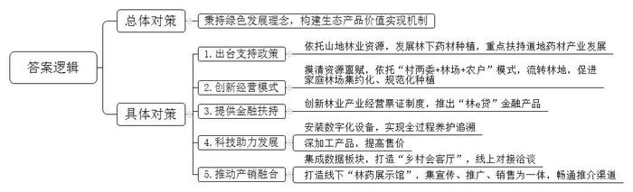
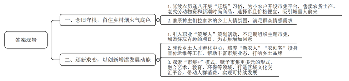
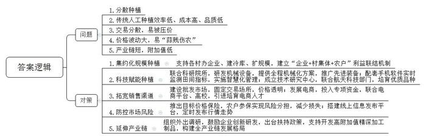
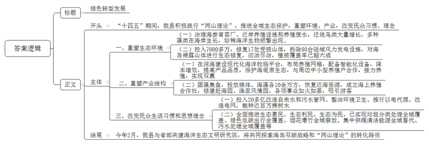
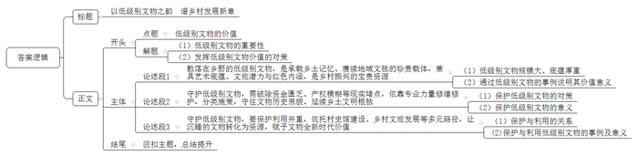

# 2025年公务员多省联考《申论》题（陕西B卷）

> 候选采集稿。参考答案及解析来自粉笔页面，不代表官方答案或真实高分答卷；来源使用许可与原卷对应关系仍需人工核实。

## 给定材料

### 材料 material-3d0e67585bb6a282

山路蜿蜒，青山葱郁。在A县正绿家庭林场，漫山遍野的黄精长势喜人，犹如一片“绿色金矿”，林场负责人小康正在省农科院高级实验师、省级科技特派员张老师的指导下细心查看黄精长势。三十多年前，小康的父亲就开始在这大山中造林、育林。岁月流转，昔日播下的绿意如今蔚然成林，孕育出生机勃勃的森林宝库。如何让这大山里的森林资源转化为产业优势？2021年，在当地村“两委”、驻村干部和科技特派员的帮助下，通过大量的前期走访和实地调研，小康决定充分利用林下空间，在父亲亲手栽植的250多亩森林下种植仿野生黄精。

“黄精从选种、移栽、除草、除虫到采挖，都很有讲究，整个过程复杂且生长周期一般在3到5年，需要有足够的耐心，才能确保长出来的黄精果体大、根茎饱满。”谈起黄精种植，小康如数家珍。

正绿家庭林场是A县依托山地林业资源发展林药产业的一个缩影。A县素有“九山半水半分田”之称，耕地资源十分有限。如何做到不与粮争田的同时又能增加农民收入？A县念好“山字经”，将视角从田间地头转向林间树下，围绕林药产业的发展，出台了一系列的支持政策，大力发展林下药材种植，重点扶持黄精、灵芝、石斛等道地药材产业的发展。从此，林药产业开始了新起点。

林下生金，产业开花，思路一变，豁然开朗。A县充分发挥山地林业资源优势，大力扶持中药材发展，通过农村“资源体检”，摸清全县21个乡镇245个村优质特色林药产品等资源禀赋，依托“村两委+林场+农户”的引领带动模式，流转林地2000多亩，促进家庭林场集约化、规范化种植，巧把青山变“金山”、药材变药“财”，林药种植年产值超3500万元。

走进A县振芳家庭林场，山间树木星罗棋布，林下套种的30亩紫灵芝已进入成熟期，预计将带来约6万元收入。这批紫灵芝的丰收，要得益于A县“林e贷”的发放。去年5月，A县创新林业产业经营票证制度，推出“林e贷”金融产品。振芳家庭林场通过“林e贷”获得综合授信300万元。“两年前，我们就在林下仿野生种植紫灵芝，效益不错。现在，林药产业有了资金助力，我就更有信心了，第一时间就将种植面积扩大到了30亩。”林场负责人老李自豪地说。

“还有，林药产业有了科技助力，发展就更快了。现在，我在林场全部装上了摄像头等数字化设备，实现从苗到果的全过程养护追溯。还在科技特派员的帮助下对产品进行深加工，加工后的产品售价大大超过切片、孢子粉等初始产品价格。”老李兴奋地说。

好药在深山，市民难买到，农民难卖出。为让好药材卖出好价钱，A县积极作为，集成乡村党建、资源资产、招商项目、道地药材4大数据板块，创新打造线上“乡村会客厅”，推动产销深度融合，促进林业增效、农民增收、农村发展，林药产业有了稳定客源。

“以前到A县洽谈林药产销合作，需要在几个乡镇间来回跑，还不一定都能达成合作，耗费了大量时间精力。现在有了这个‘乡村会客厅’小程序，动动手指就能直接线上对接洽谈，一次性谈成了十几个项目，真的方便多了。”刚与几个乡镇家庭林场达成合作意向的外地客商吴经理说道。

A县还积极打造线下“林药展示馆”。“林药展示馆集宣传、推广、销售为一体，有效畅通了全县药材产品推介渠道。馆内设立了黄精、灵芝、石斛等10个综合展区，介绍A县家庭林场和种植大户的优质药材，可视化展示特色产品80余种，让广大客商和用户能在馆内直观感受和体验产品品质。”罗馆长介绍，林药展示馆有效促进了产销对接，推动了林药价值转化，提高了产销效率和效益，“我们诚挚地邀请大家来品鉴林下好药，感受别样的‘土特产’。”近日，A县县委组织部牵头组织的“助力乡村振兴——寻找乡村合伙人”项目推介会在林药展示馆成功举办，100余名商会代表、乡贤人才参会，26个精选产品在会上推介，现场签署意向性合作协议20份。

A县经济发展的潜力在于山，兴旺在于林。“我们秉持绿色发展理念，积极构建生态产品价值实现机制。作为省级林下经济重点县，我们以创建国家级生态文明建设示范区为新起点，在放大生态效益上下足功夫，做大做强林药种植产业，着力构建山林资源就地价值转换和增值增效的林下经济发展新格局，不断拓宽‘山绿’与‘民富’共赢发展的新路径，旧产业取得了新成就。”A县县委袁书记说。

### 材料 material-bd0f85f89afc2e51

农历逢八，L镇乡村市集的热闹如期而至。十里八乡的人们早早备齐要卖的货品，凌晨四五点就从家里出发，到市集上支摊、摆放货物。“赶场”可是小镇和周边乡村民众的“大事”。无论家离得远的，还是离得近的，都来赶个热闹，就算什么都不买，也要在市集上吃饱喝足了再回去。“图的就是热闹和生活的烟火气。”常来市集的小连说。

满满当当的市集里，有刚从地里摘下来的、从河里捞上来的农货土产，有老式胶鞋、锄头和铁镐，也有新潮时尚的服饰单品。人声鼎沸的摊位前，熙熙攘攘的人流中，出现了越来越多城里人的身影。“现在好多小物件城里都不好买，市集上的选择多，而且总有些新鲜玩意，价格还非常便宜。”家住市区的小齐，只要工作不忙，都会开车带着母亲去市集买菜，“市集的蔬菜、杂粮、家畜都是周边农户自己种养的，既新鲜又美味。”“有时候不是爱逛市集，而是喜欢这里的人。”同样从市区来的章先生说。在顾客挑选商品和付钱的间隙，摊主们经常会拉家常。

“蔬菜都是我们自己家种的，现摘现卖，特别新鲜。”

“我摆摊30多年啦，好多人爱吃我做的包子，凌晨3点多就起来准备，都是现做的。”

……

在这里，买到的不只是商品，更是一份好心情。

乡村市集，作为农村或小城镇定期商品交易的市场，似乎停留在人们久远的记忆里。但现在，L镇乡村市集带着清新的潮流之风，重回大众视野，除了绿色新鲜的农产品，还有农耕体验、手工艺品制作等好玩有趣的项目。“市集是融入乡村生活最舒服的姿势”，周末，小曹驱车专程从另一座城市赶来，在他的眼里，“这是一种另类的休闲方式”。

而让年轻人乐此不疲的乡村市集，除了这份烟火气，还有一份新奇。L镇在传统市集日之外，还玩出了许多“花样”，不定期组织主题市集：主打自然野趣的农夫市集，卖的大多是绿色有机、城里人吃不到的稀奇果蔬；主打民俗风情的非遗市集，不仅能淘到制作精美的国潮文创产品，还能跟着非遗手艺人现场DIY；主打新潮时尚的露营市集，不仅能在现场开派对、享用美食，还能看露天电影、听乐队演奏。或古风或时尚的不同主题各自绽放，L镇乡村市集也因此被省里评为首批精品乡村市集。

L镇还引入了新潮的职业“策展人”。单是去年下半年，小昀就带着她的团队，为L镇乡村市集策划了三场活动。在“收获秋天·晒秋”快闪艺术市集里，有泼墨书法、乡村画作，充满多巴胺色彩；在“放牧的小孩”主题市集里，有剪纸、手绘和草垛游乐园等。“创意市集不该只是城市的配套，我们想做个拓荒的人，让乡村亮起创意市集的灯。”小昀说，他们在为更多年轻人打样，传递乡村发展也拥有更多的声音。

L镇交通便利，乡村市集早先是周边村民出于交换需求自发形成的。现在，镇里将市集作为其乡土品牌的延伸，为小农户开设市集平台，带着1000多农户奔向共富。“我毕业后回到家乡，成为了一名‘新农人’，想着帮助村民打开农产品的销路。这几年，我们团队通过发展观光采摘、电商销售等新业态，带领很多乡亲走上了创收之路。”作为L镇乡土人才孵化中心的负责人，小严的身影也经常活跃在市集上。近几年来，像小严这样的“农创客”“新农人”，越来越多地投身于品牌创建、包装宣传、电商运维等工作中，为L镇丰富市集业态、打响乡土品牌注入了新鲜血液。

借市集造势，L镇在不断探索更多的“市集+”模式。“赶集是我们这里的一种特色文化，最初的市集是农耕时代摆地摊式的以物易物。”L镇党委桑书记说。而现在，L镇赋予乡村市集更加多元化的形式，融合艺术、公共教育、生态环保、文创等等，成为区域的文化交汇平台。

不久前，为期十天的“柿子红了”主题创意市集在L镇开展，最多时，一天车流量突破2000辆，摊位营收额累计破100万元。一个市集，让L镇被更多人看到。“这个春日，我们准备将‘生态音乐节’与创意市集相结合，带动人群进入消费场景。”桑书记说，“我们想把市集的流量，变成乡村发展的‘留量’。”

从绵延不绝的烟火气到层出不穷的新创意，L镇乡村市集一面逐新，一面念旧，在新与旧的交融中不断发展，迎来新生。

### 材料 material-2abd8b02e115cd08

芒种时节，正是一年中农事最繁忙的时候。在K县H村，随处可见采收大蒜的忙碌场景。几年前，H村种蒜致富的消息传开，周边村庄纷纷效仿。K县顺势大力推广，支持各村办企业、建冷库、扩规模，变一家一户分散种植为集约化规模种植，大蒜种植面积迅速扩大。“我们在上级的支持下，探索建立了‘企业+村集体+农户’利益联结机制，村集体和村民分别以集体土地和承包土地入股，每年可以拿到不少盈利分红，大家伙儿的热情可高了。”村主任老刘说。截至目前，H村种植大蒜5千亩，带动K县其他地区种植大蒜超过70万亩。

“以前，种蒜是个辛苦事儿，一亩地要栽2万多粒蒜瓣，得把瓣尖冲上，一瓣瓣用力按到地里，再盖上一层薄土。栽好后也不能立即浇水，得等蒜瓣长出新根再浇，蒜瓣才不容易下沉。‘连跪带爬’干一天，最多也就七分地。”老刘比划着说。2017年，K县联合科研院所，研发了适用于大蒜耕种的机械设备，为大蒜种植和收获环节提供全程机械化解决方案。“现在，我家的20多亩大蒜，无论种还是收，一台机器一天就能全部干完，比请人便宜多了！”老刘说。走进H村农业产业园，大蒜覆膜机、收获机、植保无人机和水肥一体化等先进装备已在园区大面积推广。“打开手机上安装的软件，就能第一时间掌握地里的风向、温度、土壤湿度等指标。”老刘说。

“过去，村民们常年在一块地上施肥打药，地越种越薄，大蒜品质提不上去，客户越来越少，蒜农们着急。县里了解到这种情况后，就依托H村成立了大蒜工程技术研究中心。”中心陈主任介绍，“中心与航天科技部门紧密合作，将大蒜种子或试管种苗送到太空，利用太空特殊的环境进行诱变育种，成功培育出了集高产、优质、抗病性强于一体的太空大蒜。”

H村的大蒜专业批发市场里，叫卖议价声此起彼伏。早些年，K县蒜农卖蒜得“看人脸色”。“丰收时，农民们把大蒜编成串儿，到处售卖，被客商压价是常事。为了解决这个问题，我们建设了一批大蒜批发市场，这样交易场所就固定了，价格也就更透明了。”K县农业农村局曹局长说。

线下市场人头攒动，线上小店生意同样火爆。近年来，K县每年拿出10万元专项资金，与电商平台合作，对有意向从事电商业务的大中专毕业生、复转军人、农民等开展多种形式的培训。同时与高校合作，请来大学生“电商专员”，负责网店建设、运营维护等，为村里培育了一批电商“领头羊”。小张就是其中之一，在他公司的厂房内，工人们忙着将大蒜扒皮、去秆、装袋，接货的卡车络绎不绝。“大家加快速度，这批大蒜马上就要发货了。”小张招呼着工人。

大蒜价格容易波动，有时就像坐过山车，忽上忽下。为防止“蒜贱伤农”，2020年起，K县就推出大蒜目标价格保险，让蒜农通过参保实现风险分担，减轻由自然灾害或市场波动等带来的损失。“近年来，我县还搭建了线上信息发布平台，定时发布大蒜行情走势，蒜农足不出户就能够实时掌握全国大蒜市场信息。”曹局长介绍。

H村大蒜加工Q公司的无菌车间里，操作台上的大蒜蒜瓣粘连，乌黑透亮。“原蒜直接发酵，就成了黑蒜，具有较好的抗氧化功效。”Q公司齐总经理拿起一颗黑蒜展示，“口感柔软，偏甜酸无刺激，这是卖得比较好的一款单品。”不仅如此，以大蒜素胶囊、大蒜多糖等为代表的深加工产品也越来越受到市场的欢迎。“这几年，政府还经常组织我们外出调研，鼓励我们创新研发，并在贷款融资、对接技术人才等方面出台政策，支持我们做大做强，确实不错。未来我们还将进一步开发大蒜功能食品、大蒜生物医药制品等高附加值的精深加工制品。”齐总经理说。目前，H村聚集了很多像Q公司这样的大蒜加工公司，构建起了集标准化种植、科研开发、保鲜储存、精深加工及国际市场流通等为一体的大蒜全产业链发展格局。

“这些年，通过将种植大蒜的一产、加工大蒜的二产、销售大蒜的三产充分融合，发挥全产业链优势，打响‘金蒜盘’，实现了整个产业的高质量发展。”K县梁县长说。

### 材料 material-dcc4da7db79001fb

“十四五”期间，C县积极践行“绿水青山就是金山银山”的“两山理论”，推进全域生态保护，不仅重塑了生态环境和产业结构，还改变了民众的生活习惯和思想理念。

乘船经过C县的东三岛，一群群海鸥在空中盘旋，追着轮船飞翔。得益于附近海域良好的生态环境。

成千上万只海鸥在这里安家、觅食、嬉戏、繁衍，东三岛因此得名“万鸟岛”。曾几何时，这里长期被海参育苗厂和近岸养殖设施占据，养殖废水直排大海，近海脏得没法看，居民苦不堪言。

经过持续治理，C县区域内东方白鹳、黄嘴白鹭、苍鹰等迁徙鸟类大量增长，境内已发现的鸟群种类数量占全国的24.2%。除了鸟类，大叶藻等藻类也在海岸生长，白江豚等珍稀海洋生物频繁出现，斑海豹数量明显增多。

变化不限于此。南二岛东南海岸的一处山体上，遍布着紫椴、胡枝子、紫穗槐等，随着海风翻起层层“波浪”。“三年前，山上光秃秃的，一下雨就往下冲泥水，落碎石头。”C县公用事业服务中心园林科张科长介绍说。

近年来，当地累计投入7000多万元，对17处受损山体采用高次团粒喷播技术进行治理修复，将分布在4处岛屿的80台陆域风力发电设施拆除，对北五岛、西三岛裸露山体进行生态修复，实现海岛裸露山体“应治尽治”。原本的风机所在地，被碧桃、樱花、松柏等覆盖。如今岛上植被覆盖率超过六成，与美丽的海滨景色相得益彰。

从东三岛乘船继续向东行驶80多海里，来到了海洋深处的东五岛海域，多座钢质庞然大物矗立海中。这是现代化海洋牧场平台“经海”系列网箱。“平台配备了自主研发的自动投饵机、水下自动洗网机器人、各类智能传感器、养殖大数据管理系统等智能化设备。”海洋牧场事业部卢经理说。依托自动投饵、水下检测、成鱼回收、云数据处理等多项技术，这里的养殖效率成倍提升，人工成本大幅下降。

20世纪80年代以来，当地开展以栉孔扇贝养殖为主的渔业养殖，短时间内实现了从温饱到小康的跨越。但经过多年的发展，C县近海海域养殖密度过大，近海污染及养殖产品大面积死亡现象时有发生。现代化海洋牧场平台的出现，解了“燃眉之急”。

从滩涂到海洋，从浅蓝到深蓝，养殖换了底色，渔民换了“战场”。东五岛村党支部魏书记说，海洋牧场不仅节约成本、提高产品品质，还能确保养殖活动不会对海底原生态造成过多破坏。

海洋牧场网箱及平台建成后，运营方还与周边中小型养殖户签订合同。养殖户按照公司要求，养到一定规格后，公司负责收购，并投入海洋牧场网箱中“接力养殖”，实现了养殖户和海洋牧场的“双赢”。曾经以养殖海参和扇贝为主业的东四岛也迎来“新生”。他们“固藻集鱼”，先后向海洋投放礁体10余万方，布设海藻10余万株。近海区域资源渐渐恢复，螃蟹、八蛸、辣螺、海螺等重现，这也成为吸引游客的金字招牌。东四岛村党支部孙书记感慨，生态恢复后，村里的发展一步紧跟一步，相继成立海上养殖合作社，修建赶海园，建设渔家风情园，各项事业如火如荼。

“为提升海岛环境，C县近几年累计投入20多亿元用于改造自来水和污水管网、整治环境卫生、推行以电代煤、推进电网改造，栽种各类树木近100万棵。”C县文副县长介绍，独具特色的海岛风貌和生态环境，使C县得到更多游客的青睐。

在东四岛村，一排分类清晰的垃圾投放设施整齐地排列在路边。过去，受海岛环境限制和长久以来形成的生活习惯影响，C县一度面临生活垃圾量大、难处理的“垃圾围岛”困局。一些垃圾堆放在海边垃圾场，不仅气味难闻，影响居民生活，还给登岛游客留下不好的印象。2021年以来，C县构建起符合海岛实际的垃圾分类处理模式，实现了全域覆盖、全程闭环、全民参与，破解了“垃圾围岛”的困局。生态环保绿色理念体现于日常生活的各个方面。在岛外车辆“禁进”、岛内车辆“控牌”的背景下，C县先后投资6700余万元，逐步淘汰所有燃油公交车，由新能源客车替代。“我们已实现新能源公交车、旅游包车、共享汽车绿色低碳出行全覆盖，每年可减少二氧化碳排放2800余吨，进一步优化了海岛生态环境和空气质量，绿色出行理念也已深入人心。”县交通与住房建设管理局白副局长介绍。除此之外，县里还实现了烟花爆竹全域禁放、集中供暖清洁能源全域替代、污水处理全域覆盖等，全面推进生态惠民、生态利民、生态为民。

今年2月，省部共建的海洋生态文明研究院在C县揭牌成立。这是C县践行绿色发展理念、探索双碳路径、打造国际零碳岛的一次新尝试，各方将共同探索海岛双碳战略及实现路径，推动海洋碳汇产业向更高层次发展，这也将助力C县对“两山理论”转化路径的探索提升到一个新的层次。

## 题目

### 第 1 题

**根据****“给定资料**1**”，概括A县发展林药产业的主要做法。****（****15分****）**

关联材料：material-3d0e67585bb6a282

作答要求：

要求：

（1）准确，全面，有条理；

（2）字数200-250字。

### 第 2 题

**“****给定资料**2**”****中提到****“L镇乡村市集一面逐新，一面念旧，在新与旧的交融中不断发展，迎来新生”****，谈谈****L镇乡村市集是如何在念旧与逐新中持续发展的。****（****20分****）**

关联材料：material-bd0f85f89afc2e51

作答要求：

要求：

（1）理解准确，内容全面，逻辑清晰；

（2）字数250-300字。

### 第 3 题

**根据****“****给定资料**3**”****，请谈谈****K县大蒜产业发展中遇到了哪些问题，又是如何解决的。（30分****）**

关联材料：material-2abd8b02e115cd08

作答要求：

要求：

（1）提炼准确，归纳合理；

（2）层次分明，分条表述；

（3）字数300-400字。

### 第 4 题

**省里召开践行****“****两山理论****”****，推动转型发展成果展。****C县拟参加展览，通过图文展板介绍其推动绿色转型发展的相关做法、成效。请根据****“****给定资料**4**”****，为该展板拟写一个标题，并撰写文字部分的内容。（****35分）**

关联材料：material-dcc4da7db79001fb

作答要求：

要求：

（1）紧扣资料，内容全面；

（2）条理清晰，语言生动；

（3）字数400-600字。

### 第 5 题

**“****给定资料**5**”****划线句子中提到：****“****低级别并不意味着低价值。****”****请结合对这句话的思考，联系实际，自选角度，自拟题目，写一篇文章。****（****50分****）**

关联材料：material-3d0e67585bb6a282

作答要求：

要求：

（1）观点明确，见解深刻；

（2）参考给定资料，但不拘泥于给定资料；

（3）字数1000-1100字。

## 答案与解析

第 1 题

**参考答案（粉笔题库参考内容）**

A县秉持绿色发展理念，构建生态产品价值实现机制。

1.出台支持政策。依托山地林业资源，发展林下药材种植，重点扶持道地药材产业发展。

2.创新经营模式。摸清资源禀赋，依托“村两委+林场+农户”模式，流转林地，促进家庭林场集约化、规范化种植。

3.提供金融扶持。创新林业产业经营票证制度，推出“林e贷”金融产品。

4.科技助力发展。安装数字化设备，实现全过程养护追溯；深加工产品，提高售价。

5.推动产销融合。集成数据板块，打造“乡村会客厅”，线上对接洽谈；打造线下“林药展示馆”，集宣传、推广、销售为一体，畅通推介渠道。

**解析**

**参考答案说明**：本参考答案宏观上分为“总体对策”和“具体对策”两个方面。在“具体对策”方面，又从“出台支持政策”“创新经营模式”“提供金融扶持”“科技助力发展”“推动产销融合”五个角度展开，各条答案要点之间在内容上相互并列，没有交叉。

**考点**：考点概括措施类

**来源**：来源2025年公务员多省联考《申论》题（陕西B卷）

粉笔申论页面对本题只提供「解析视频」入口，该入口是会员推广位，页面无视频地址与文字解析。

第 2 题

**参考答案（粉笔题库参考内容）**

一、念旧守根，留住乡村烟火气底色。1.延续农历逢八开集“赶场”习俗，为小农户开设市集平台，售卖农货土产、老式劳动物资和新潮时尚商品，选择多且价格便宜，吸引城里人前来。2.维系摊主们拉家常的乡土人情氛围，满足群众情感需求。

二、逐新求变，以创新增添发展动能。1.引入职业“策展人”策划活动，不定期组织主题市集，增添好玩有趣的项目，为市集增加创意。2.建设乡土人才孵化中心，培养“新农人”“农创客”投身宣传运维等工作，帮助丰富市集业态，打响乡土品牌。3.探索“市集+”模式，赋予市集更多元的形式，融合艺术、教育、环保等领域，打造区域文化交汇平台，带动人群消费，实现可持续发展。

**解析**

**参考答案说明：**本参考答案从“念旧守根，留住乡村烟火气底色”“逐新求变，以创新增添发展动能”两个方面展开，其中，“念旧守根，留住乡村烟火气底色”从“延续农历逢八开集‘赶场’习俗”“维系摊主们拉家常的乡土人情氛围”两个层次展开；“逐新求变，以创新增添发展动能”从“引入职业‘策展人’策划活动”“建设乡土人才孵化中心”“探索‘市集+’模式”三个层次展开。条答案要点之间在内容上相互并列，没有交叉。

**考点**：考点概括措施类

**来源**：来源2025年公务员多省联考《申论》题（陕西B卷）

粉笔申论页面对本题只提供「解析视频」入口，该入口是会员推广位，页面无视频地址与文字解析。

第 3 题

**参考答案（粉笔题库参考内容）**

问题：1.分散种植。2.传统人工种植效率低、成本高、品质低。3.交易分散，易被压价。4.价格波动大，易“蒜贱伤农”。5.产业链短，附加值低。

对策：1.集约化规模种植。支持各村办企业、建冷库、扩规模，建立“企业+村集体+农户”利益联结机制。2.科技赋能种植。联合科研院所，研发机械设备，提供全程机械化方案，推广先进装备；配套手机软件实时监测田间指标，实施智慧化管理；成立技术研究中心，联合航天科技部门，培育优质品种。3.拓宽销售渠道。建设批发市场，固定交易场所，价格透明；发展电商，投入专项资金，联合电商平台、高校，引进培育电商人才。4.防控市场风险。推出目标价格保险，农户参保实现风险分担，减少损失；搭建线上信息发布平台，定时发布行情走势。5.延伸产业链。组织外出调研，鼓励企业创新研发，出台扶持政策，支持开发高附加值精深加工制品，构建全产业链发展格局。

**解析**

**参考答案说明****：**本参考答案宏观上从“问题”和“对策”两个方面展开。在“问题”方面，围绕“分散种植”“传统种植”“销售渠道”“市场风险”“产业链条”五个方面进行分条撰写；在“对策”方面，围绕“集约化规模种植”“科技赋能种植”“拓宽销售渠道”“防控市场风险”“延伸产业链”这五个方面展开。各条要点之间在内容上相互并列，没有交叉。

**考点**：考点多要素组合类

**来源**：来源2025年公务员多省联考《申论》题（陕西B卷）

粉笔申论页面对本题只提供「解析视频」入口，该入口是会员推广位，页面无视频地址与文字解析。

第 4 题

**参考答案（粉笔题库参考内容）**

绿色转型发展

“十四五”期间，我县积极践行“两山理论”，推进全域生态保护，重塑环境、产业，改变民众习惯、理念。

一、重塑生态环境。（一）治理海参育苗厂、近岸养殖设施和养殖废水，迁徙鸟类大量增长，多种藻类在海岸生长，珍稀海洋生物频繁出现。（二）投入7000多万，修复17处受损山体，拆除80台陆域风力发电设施，对海岛裸露山体进行生态修复，应治尽治，植被覆盖率已超六成。二、重塑产业结构。（一）在深海建设现代化海洋牧场平台，布局养殖网箱，配备智能化设备，降本增效，提高产品品质，保护海底原生态，与周边中小型养殖户合作，接力养殖，实现双赢。（二）固藻集鱼，投放礁体、海藻各10余万方，恢复近海资源，成立海上养殖合作社，修建赶海园、渔家风情园，各项事业如火如荼，吸引游客。三、改变民众生活习惯和思想理念。（一）投入20多亿改造自来水和污水管网、整治环境卫生、推行以电代煤、改造电网，栽种近百万棵树木。（二）全面推进生态惠民、生态利民、生态为民，已实现垃圾分类处理全域覆盖、绿色低碳出行全覆盖、烟花爆竹全域禁放、集中供暖清洁能源全域替代、污水处理全域覆盖等。

今年2月，我县与省部共建海洋生态文明研究院，将共同探索海岛双碳战略和“两山理论”的转化路径。

**解析**

**参考答案说明**：（1）格式方面，本参考答案写到了“标题”“正文”两个部分。（2）正文部分，一方面从内容上来看，围绕“C县绿色转型发展”这一主题，本参考答案开头部分先介绍了C县进行绿色转型的宏观做法和成效；接着主体部分从“重塑生态环境”“重塑产业结构”“改变民众生活习惯和思想理念”三个方面介绍了具体做法和成效；最后结尾部分介绍了未来的发展规划。另一方面，形式上，本参考答案做到了分段、分条撰写，整体上条理较为清晰。

**考点**：考点总结类

**来源**：来源2025年公务员多省联考《申论》题（陕西B卷）

粉笔申论页面对本题只提供「解析视频」入口，该入口是会员推广位，页面无视频地址与文字解析。

第 5 题

**参考答案（粉笔题库参考内容）**

**以低级别文物之韵** **谱乡村****发展****新****章**

“参天之木，必有其根；怀山之水，必有其源。”中华文明的根脉，不只藏于恢弘的宫殿庙堂，更深植于遍布乡野的低级别文物。这类文物看似朴素不起眼，却是历史鲜活的见证，更是中华文明坚实的基石。低级别从不等于低价值，只有重新审视低级别文物的多元价值，在保护中传承、在活化中利用，才能让这些文化瑰宝持续焕发光彩。

**散落在乡野的低级别文物，是承载乡土记忆、赓续地域文脉的珍贵载体，兼具艺术底蕴、文旅潜力与红色内涵，是乡村振兴的宝贵资源。**这类遗存星罗棋布，占全国不可移动文物总量九成以上，底蕴厚重。皖南乡村的清代砖雕门楼，人物花鸟刀法细腻，尽显徽派民间雕刻艺术；四川邛崃某未定级古道驿站遗址，修复后成徒步打卡热点，带火周边农家乐；江西于都乡间老屋的红军标语，斑驳字迹记录峥嵘岁月，成为红色教育课堂……这些低级别文物虽无盛名加持，却集艺术之美、发展之力、信仰之光于一体，是乡村振兴取之不尽的文化财富。

认清它们的价值只是第一步，守住才是根本。历经长年风雨侵蚀，大量低级别文物损毁严重，唯有拿出务实可行的举措，才能让历史遗存留存当下、流传后世。

**守护低级别文物，需破除资金匮乏、产权模糊等现实堵点，依靠专业力量修缮修护，分类施策，守住文物历史原貌、延续乡土文明根脉。**对此，一方面要组建由古建专家和传统匠人构成的修复团队，严格遵循“修旧如旧”原则，最大程度保留文物的原始风貌；另一方面要为每处文物建立信息档案、编制保护方案，厘清产权归属，实行“一物一策”精准保护。同时，还要建立多元投入机制，拓宽资金来源，并将监管前置到工程建设环节，从源头杜绝错拆误拆。如此，这些承载乡愁的文化印记方能免于湮灭，乡土文脉得以薪火相传。

**守护低级别文物，要保护利用并重，依托村史馆建设、乡村文旅发展等多元路径，让沉睡的文物转化为资源，赋予文物全新时代价值。**保护并非是将文物束之高阁，利用也绝非破坏性开发，二者相辅相成、缺一不可。望月村将废弃古祠改造为村史馆，村民可沉浸式触摸本土人文历史，使古祠变身为“精神家园”。浙江松阳通过“拯救老屋行动”，修缮数百栋闲置古民居发展精品民宿，实现古建保护与群众增收双赢。实践充分证明，让文物从保下来走向活起来，才能让其融入当代生活，赋能乡村发展。

低级别不等于低价值。唯有认清其文化分量，以务实举措守护历史原貌，以创新路径激活内在潜能，方能使这些乡野遗存在岁月长河中历久弥新、灼灼其华。

**解析**

**文章分析**

**以低级别文物之韵 谱乡村发展新章**

【**标题的优点：**标题中含有主题词，使文章主题更突出、清晰。】

（1）“参天之木，必有其根；怀山之水，必有其源。”中华文明的根脉，不只藏于恢弘的宫殿庙堂，更深植于遍布乡野的低级别文物。这类文物看似朴素不起眼，却是历史鲜活的见证，更是中华文明坚实的基石。（2）低级别从不等于低价值，只有重新审视低级别文物的多元价值，在保护中传承、在活化中利用，才能让这些文化瑰宝持续焕发光彩。

【**开头的优点：**★内容方面：范文的开头是紧扣“低级别文物的价值”这一主题展开的。首先，开头点出主题，做到了主题明确。其次，对“低级别文物的价值”这一主题进行了分析阐述：（1）指出低级别文物的重要性；（2）阐述发挥低级别文物价值的对策。★文字表达方面：使用了“不只……更……”“只有……才能……”等关联词，使语言表达有逻辑性。】

**散落在乡野的低级别文物，是承载乡土记忆、赓续地域文脉的珍贵载体，兼具艺术底蕴、文旅潜力与红色内涵，是乡村振兴的宝贵资源。**（1）这类遗存星罗棋布，占全国不可移动文物总量九成以上，底蕴厚重。（2）皖南乡村的清代砖雕门楼，人物花鸟刀法细腻，尽显徽派民间雕刻艺术；四川邛崃某未定级古道驿站遗址，修复后成徒步打卡热点，带火周边农家乐；江西于都乡间老屋的红军标语，斑驳字迹记录峥嵘岁月，成为红色教育课堂……这些低级别文物虽无盛名加持，却集艺术之美、发展之力、信仰之光于一体，是乡村振兴取之不尽的文化财富。

【**论述段****1****的优点：**★观点句：范文的观点句是紧扣“低级别文物的价值”这一文章主题提出的。形式上，它在段首处直接写出，位置突出，容易发现。内容上，关键词突出，内容要点明确，可以明显看出它是从“低级别文物的价值”这个角度展开论述。★论述内容：（1）指出低级别文物规模大、底蕴厚重；（2）通过低级别文物的事例说明其价值意义。注意：以上两个方面的内容都是紧扣“散落在乡野的低级别文物，是承载乡土记忆、赓续地域文脉的珍贵载体，兼具艺术底蕴、文旅潜力与红色内涵，是乡村振兴的宝贵资源”这个观点句进行分析论述的，论述的针对性强，内容层次丰富。最后，在论述方法上采用了讲道理和举例子相结合的方式，论述充实有力。】

认清它们的价值只是第一步，守住才是根本。历经长年风雨侵蚀，大量低级别文物损毁严重，唯有拿出务实可行的举措，才能让历史遗存留存当下、流传后世。

【**过渡段的优点：**范文过渡段主要分析了守护“低级别文物”的紧迫性，此外，还要注意过渡段首句的“认清它们的价值只是第一步，守住才是根本”是用来引起下文的过渡句。】

**守护低级别文物，需破除资金匮乏、产权模糊等现实堵点，依靠专业力量修缮修护，分类施策，守住文物历史原貌、延续乡土文明根脉。**（1）对此，一方面要组建由古建专家和传统匠人构成的修复团队，严格遵循“修旧如旧”原则，最大程度保留文物的原始风貌；另一方面要为每处文物建立信息档案、编制保护方案，厘清产权归属，实行“一物一策”精准保护。同时，还要建立多元投入机制，拓宽资金来源，并将监管前置到工程建设环节，从源头杜绝错拆误拆。（2）如此，这些承载乡愁的文化印记方能免于湮灭，乡土文脉得以薪火相传。

【**论述段****2****的优点：**★观点句：范文的观点句是紧扣“低级别文物的价值”这一文章主题提出的。形式上，它在段首处直接写出，位置突出，容易发现。内容上，关键词突出，内容要点明确，可以明显看出它是从“低级别文物的保护”这个角度展开论述。★论述内容：（1）阐述保护低级别文物的对策；（2）指出保护低级别文物的意义。注意：以上两个方面的内容都是紧扣“守护低级别文物，需破除资金匮乏、产权模糊等现实堵点，依靠专业力量修缮修护，分类施策，守住文物历史原貌、延续乡土文明根脉”这个观点句进行分析论述的，论述的针对性强，内容层次丰富。最后，在论述方法上主要采用了讲道理的方式，论述清晰深刻。】

**守护低级别文物，要保护利用并重，依托村史馆建设、乡村文旅发展等多元路径，让沉睡的文物转化为资源，赋予文物全新时代价值。**（1）保护并非是将文物束之高阁，利用也绝非破坏性开发，二者相辅相成、缺一不可。（2）望月村将废弃古祠改造为村史馆，村民可沉浸式触摸本土人文历史，使古祠变身为“精神家园”。浙江松阳通过“拯救老屋行动”，修缮数百栋闲置古民居发展精品民宿，实现古建保护与群众增收双赢。实践充分证明，让文物从保下来走向活起来，才能让其融入当代生活，赋能乡村发展。

【**论述段****3****的优点：**★观点句：范文的观点句是紧扣“低级别文物的价值”这一文章主题提出的。形式上，它在段首处直接写出，位置突出，容易发现。内容上，关键词突出，内容要点明确，可以明显看出它是从“低级别文物需保护与利用并重”这个角度展开论述。★论述内容：（1）阐述保护与利用的关系；（2）介绍保护与利用低级别文物的事例及意义。注意：以上两个方面的内容都是紧扣“守护低级别文物，要保护利用并重，依托村史馆建设、乡村文旅发展等多元路径，让沉睡的文物转化为资源，赋予文物全新时代价值”这个观点句进行分析论述的，论述的针对性强，内容层次丰富。最后，在论述方法上采用了讲道理和举例子相结合的方式，论述充实透彻。】

【**论述段之间的关系：**★内容的内在逻辑：范文的论述段之间是依照并列的逻辑展开的。论述段1先写了“散落在乡野的低级别文物，是承载乡土记忆、赓续地域文脉的珍贵载体，兼具艺术底蕴、文旅潜力与红色内涵，是乡村振兴的宝贵资源”，论述段2接着写了“守护低级别文物，需破除资金匮乏、产权模糊等现实堵点，依靠专业力量修缮修护，分类施策，守住文物历史原貌、延续乡土文明根脉”，论述段3最后写了“守护低级别文物，要保护利用并重，依托村史馆建设、乡村文旅发展等多元路径，让沉睡的文物转化为资源，赋予文物全新时代价值”。这三个论述段分别按照低级别文物的“价值”“保护”“保护与利用并重”展开，整体论述思路清晰。】

低级别不等于低价值。唯有认清其文化分量，以务实举措守护历史原貌，以创新路径激活内在潜能，方能使这些乡野遗存在岁月长河中历久弥新、灼灼其华。

【**结尾的优点：**范文的结尾回扣了“低级别文物的价值”这个主题，并且进行了总结提升。】

**考点**：考点文章写作题

**来源**：来源2025年公务员多省联考《申论》题（陕西B卷）

粉笔申论页面对本题只提供「解析视频」入口，该入口是会员推广位，页面无视频地址与文字解析。

