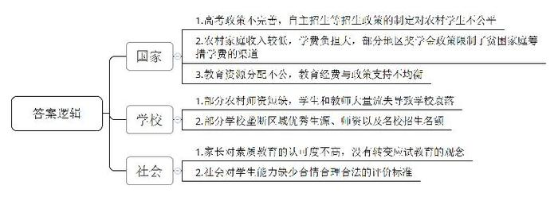
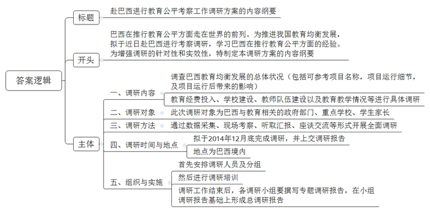
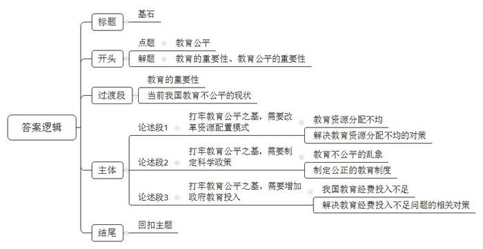

# 2014年青海省公考《申论》题

<!-- gwy:overview:start -->
> **青海 · 2014 · 申论 · 统考** ｜ 3 题 · 图片 3 处 · 答案随题折叠

导航：[题目](#题目) · [材料 1](#材料-1)
<!-- gwy:overview:end -->

> 候选采集稿。参考答案及解析来自粉笔页面，不代表官方答案或真实高分答卷；来源使用许可与原卷对应关系仍需人工核实。

## 给定材料

### 材料 1

2013年5月，高考临近，四川绵阳的女孩小静突然决定放弃高考，其父母急得坐卧不安，一天几个电话找人劝说。女孩的反应倒很平静：“上四年大学，一年得花两万多，到头来工作还是不好找，不如现在出去打工。”小静说，在她就读的乡镇高中，升学率低，上好大学难，弃考的同学屡见不鲜，“除非你考上一线名校，否则念书的路也不平坦。”

### 材料 2

2012年8月27日下午，甘肃省定西县的老陈一人坐在家里看着14英寸的电视，孩子出门去准备上大学的生活用具，老婆去张罗孩子的学费。老陈拿出了孩子兰州交通大学的录取通知书，算了一算，一年学费要交7000元。7000元，上哪去找呀？老陈苦笑着。孩子考上大学，原本是一件高兴的事，可是老陈的心却泡在了苦水里。

当地县教育局的同志大概算过一笔账，完成大学阶段教育，4年时间，得花6万元。如果以一个农村家庭每年存3000元来算，这些钱需要20年才能积累起来，这是一个多么可怕的负担啊！

### 材料 3

无独有偶，2013年9月，正是本科二批大学入学的时间，在福建武夷山市的农村，许多筹措不到大学入学学费的家庭正在发愁，当地设立的各种奖学金，大多数也只给上本科一批的学生奖励。

### 材料 4

在河南焦作市修武县范村小学一年级教室里，一个中年教师正在教室里轻轻走动，3个小学生正坐在课桌前朗读古诗，这正是这个班的全部学生。更为夸张的是，整个范村小学，也只有两个老师、4个学生。

范村小学的建校纪念碑上清楚地显示，学校2004年建校，落成不过数年。范村小学校长说，这所学校在建校之初有100多名学生，但是，学生却一年比一年减少。2008年开始，减少人数更加明显。在农村从教20多年的张老师说，学生的严重流失是学校衰落的根本原因，很多家长为了寻求更好的教学质量，纷纷舍近求远，把孩子送到外县上学。

校长说，整个乡都缺老师。这里很多老师都到县城里教书了，留在农村小学的老师年纪都偏大，40多岁都算是年轻老师，20多岁的年轻老师根本见不到。拥有国家正式编制、教龄只有1至3年，却想着要“跳槽”到城镇或市区学校工作，或“晋升”考研、考公务员，这是相当多的农村初任教师的心理状态。

### 材料 5

作为北京大学某文科院系2009级1班的班长，陆铭在入学前一直以为，通过高考选拔获得中国这所顶尖大学通行证的同龄人，多数该有着和他类似的成长经历：出身农村，家境贫寒，独立自强，品学兼优。可拿到班级花名册时，陆铭却发现，全班60多位同学，农村籍学生只有5个左右。

过去10多年间，我国高等教育规模不断增大，但农村生源在重点大学所占比例却逐年下降。例如北京大学2013年农村生源比例仅占14.2%，清华2010级农村生源，也仅占17%。

### 材料 6

2006年，河北名校衡水中学，这所将应试教育发挥到极致的军营式河北省超级中学，考上北大清华的学生共42名，占据两所高校分配给河北省名额的33.87%。42人中就包括了仝十一妹。这让她觉得尤其幸运，因为她的小学、初中分别在乡村与县城度过。中考后，一个偶然的机会，母亲为她报考了衡水中学。“如果我当时留在县城念高中，我肯定考不上北大。”仝十一妹说，同年，她所毕业的县城中学年级排名第一的学生，也只是考上了南方一所二线名校。

据悉，全国十三所外国语学校，每年最优秀的学生都可直接保送进入北大清华。陕西超级中学调研数据显示，2010年，北大清华在陕西自主招生名额的98.9%，保送名额的97.3%，被西安的五大名校垄断。裸分考上北大清华的几率越来越小。

超级中学在入学时根据单独招考成绩排定，排在最前的直接入学，后面的根据相差的分数交纳赞助费，此外还普遍存在拼爹妈的条子生、择校生。农村孩子，尤其是远离省会城市的农村孩子，即便再努力，表现再好，考入超级中学的不多。

超级中学是各省重点中学的升级版，它们大多位于省会城市，拥有丰厚的教育经费与政策支持，像抽水机般吸纳当地及周边县城最优秀的学生与最优秀的老师，每年几乎垄断了其所在省份北大清华的名额。

### 材料 7

据北大招生办的信息，2010年北大在某省招收的70名文理科学生中，只有10人没有任何加分，其余60人则通过自主招生加分、政策性加分、保送的途径迈入北大。清华大学招生办主任说，今年通过清华自主招生初审的考生中约1/4学生来自于县级或县级以下中学。此前复旦大学校长也坦言，自主招生对农村学生不公平。除了出行住宿等高成本外，考试内容也成了农村学生通过自主招生的“绊脚石”。

自主招生的考题涉及面广，往往是城市孩子才可能接触到的事物，比如五线谱、歼十……清华社科2010级的陈美诗则在自主招生考试中遇到了一道关于费孝通在哪里上大学的题目，她说：“我在进清华前连费孝通是谁都不知道，这题清华附中的孩子可就都知道了。”

### 材料 8

艺术加分与寒门子弟更是绝缘。来自北大招生办的资料显示，最近五年北大招收的体育特长生绝大部分来自东部地区，七成来自大中城市，来自农村的只有6%；而艺术特长生，迄今没有一位来自农村。

有微博流传着这样一段话，“有人说，农村考生高分低能，而北京上海考生综合素质高，所以低分进北大复旦乃情理之中。这是匪夷所思的理论！既然要求综合素质高，那就应该让高考考查综合素质！凭什么会弹钢琴就叫综合素质，会种田会养猪就不叫综合素质？没有人弹钢琴，照样可以生活；但没有人种地，我们怎么活？”这段自嘲式的调侃与嘲讽所折射出的，正是当前中国教育公平的困境，而在这一困境中，政府有之，学校有之，社会有之。

### 材料 9

一直以来，“重点”、“一级重点”，是浙江学生和家长判断一所高中优劣的重要标准。但从现在起，老牌“省重点中学”的评选历史宣告结束，取而代之的是“省普通高中特色示范学校”的评选。

2014年3月，首批浙江省一级普通高中特色示范学校的评估结果揭晓，杭州外国语学校、杭州高级中学等32所学校入围。对照浙江省一级重点高中目录，记者发现有100多所老牌的一级重点高中缺席首批一级特色示范高中。而杭七中、杭州绿城育华学校等个别二级重点中学，却意外出现在这次的公示名单上。

二级重点中学能“意外”入围，杭七中校长楼平表示，主要是因为特色示范高中的评选不设门槛，所有普高都能自由申报。而且新的评估在对学校进行全方位考察的同时，忽略高考成绩因素，只对高中毕业生学业水平有高要求。比如省一级特色示范学校，要求“近三年，高中毕业生学业水平考试必考科目合格率达到99%以上”等，这给了许多非一级重点中学冒出来的机会，只要努力发展学校特色，课程多样化，就有希望“跳级”。

这块牌子如此不容易，但面临中考的家长们暂时还不买账。杭州采荷中学一位初三家长很直白地对记者说：“特色很丰满，成绩很骨感啊。很多像我这样的爸妈，还是盯牢分数和一本率的，没特色但有升学率的高中，照样挤破头的。”

### 材料 10

继2013年3月北京海淀区五道口华清嘉园出现一套37平方米，叫价350万元的天价学区房之后，6月20日上午一条微博再次引发网友围观，微博称“景山东街一套400平的学区房报价1.3亿，折合32.5万/平”。另一套仅13平米的学区房，报价270万，合20.39万/平。而如此高价的原因在于这里能上“北京最牛小学”实验二小。

为了让孩子不输在起跑线上，优质幼儿园报名时家长彻夜排队，这个尘埃落定，马上又要一掷千金买学区房，让孩子成为地段生。从某种意义上讲，学区房是房地产市场的衍生品，同样也是现行教育体制下的一个独特的现象。“如果孩子进不了一个好学区或者好小学，可能进不了好初中；进不了好初中，就考不上好高中；考不上好高中，就考不上好大学；考不上好大学……”家有学龄儿童的李女士一语道破了无数家长的心声。

在教育资源分配不均的大背景下，优质学位意味着优质的教育资源，高投入的硬件设施，优质的师资和好的生源。毕竟，孩子的大部分时间是在学校度过，他的知识素养和性格形成很大程度上与学校的教育水平相关。家长并非教育专家，还要养家糊口，无论在知识上还是精力上很难给予孩子比学校更丰富的教育，因此买高价学区房读名校，是一种无奈的选择，也是一种最优选择。

### 材料 11

随着我国城镇化进程和剩余劳动力转移的加快，进城务工的农民工数量逐年增加，农民工子女的教育问题也日益凸显。据统计，2009年我国义务教育阶段农民工随迁子女适龄人数达到997.1万人。如何给这些孩子一张安稳的书桌，让他们像城市的孩子一样接受义务教育，健康成长，是促进教育公平必须解决的重大课题。

有学者认为，当前我国正处于人口大迁徙时期，如果不能保障流动人口子女受到良好的教育，我国的现代化将难以实现。即便不从实现现代化这一“功利化”的角度出发，从维护法律尊严和保障公民权利的角度讲，我国也应该推动教育公平，使异地高考尽快落地。

在2012年12月启动的国家教育改革试点中，解决异地高考列入了试点，进行试点的地区是山东、湖南和重庆。而到2014年高考前夕，有21个省、直辖市、自治区公布了自己的异地高考政策。

### 材料 12

2013年9月28日，北京市教委宣布，继2013年进城务工人员随迁子女在京可以参加中等职业学校招生录取后，从2014年逐步放开随迁子女在京参加高等职业学校招生录取。明年，有居住证明及稳定住所、稳定职业及社保满6年，子女有学籍且连读高中3年的，可参加高职考试。

但是，根据北京市教委公布的实施办法，必须符合五大条件，分别是：进城务工人员持有北京市暂住证或工作居住证；在京有合法稳定住所；在京有合法稳定职业已满6年；在京连续缴纳社会保险已满6年（不含补缴）；随迁子女具有本市学籍且已在京连续就读高中阶段教育3年学习年限。这五大条件，除了办理暂住证相对容易些，其他四项条件并不容易达到，比如在京连续缴纳社会保险已满6年，且不含补缴。

据报道，全国多家高职高专院校在第一轮填报志愿中为“零报考”。此前，大城市和东部地区的高职院校曾因招生不足，想办法从西部地区“挖人”。而2013年西部地区的高职院校“零报考”、录取分数线“跳水”等现象也在加剧。此前有数据显示，在北京，每年被高校（主要是高职校）录取后不报到的新生至少有三五千人。

### 材料 13

巴西是目前世界上惟一一个把各级政府对教育的投入比例明文写入宪法的国家。1995年，巴西在基础教育阶段启动了一项“助学补助金计划”，即政府向贫困儿童的母亲发放一定数额的现金补助，条件是她们得让孩子在学校保持就学，不得辍学。2001年“助学补助金计划”成为一个联邦项目开始在全国范围推广，由教育部协调。人均每月收入低于30美元的政府贫困线成为筛选受益人的标准，这约为当时最低工资的一半。到2001年末，该项目覆盖了5562个市的98%的贫困家庭，使480万家庭的820万儿童受益，政府总计补助金额达到7亿美元。

补助金计划不仅在教育系统，而且在反贫困和反社会边际化的行动中发挥了重要作用。该计划对就学人数的增加、留级和辍学率的降低都产生了积极效果。全国10岁至14岁的童工人数减少了73.7万，降幅达25.6%，有80万名儿童返回课堂。“补助金计划”被联合国机构、美洲开发银行和世界银行称作是加强对穷人社会保护的一项“最佳实践”。

### 材料 14

2006年4月23日，温家宝总理在重庆视察时说：“体现社会公平最主要的就是教育的公平。”2007年8月31日，胡锦涛主席在全国教师代表座谈会上指出：“要把促进教育公平作为国家基本教育政策。”而“教育公平是社会公平的重要基础”这一判断更是写进了党的十七大报告。教育公平，已经成为教育领域乃至全社会高度关注的话题之一。在教育上体现公平、正义，让每个人都有享受教育的机会，这是国家的政策，也是构建社会主义和谐社会的要求。

2010年7月，中央发布《国家中长期教育改革和发展规划纲要（2010-2020年）》。在这个描绘中国教育未来10年改革发展路线图的纲领性文件中，鲜明地提出“把促进公平作为国家基本教育政策”，教育公平的理念贯穿始终。

2013年8月29日，国务院总理李克强主持召开国家科技教育领导小组第一次全体会议时强调，教育公平具有起点公平的意义，是社会公平的重要基础；推进教育公平，关键还得靠改革。

2013年9月9日，国务院总理李克强在第29个教师节即将到来之际，专门赴大连看望大连第二十中学新疆班师生，并与大连市支援西部地区及西部在大连进修的教师座谈。李克强强调“让每个孩子都能接受义务教育，一个都不能少”。

2013年10月，教育部部长袁贵仁在《努力让全体人民享有更好更公平的教育》的专题报告中指出，今后，将继续实施“支援中西部地区招生协作计划”，扩大“农村贫困地区定向招生专项计划”规模，降低部属高校在属地的招生比例，将更多优质高等教育资源惠及农村学生。要求各地各高校因地制宜，出台政策，完善规则和办法，建立健全逐步提高重点高校招收农村学生比例的长效机制。同时，严格规范自主招生、艺术体育类文艺特长生的招生行为，进一步规范高考加分政策，为农村学生营造公平竞争的环境。

## 题目

### 第 1 题

**“给定资料8”中提到“这段自嘲式的调侃与嘲讽所折射出的，正是当前中国教育公平的困境，而在这一困境中，政府有之，学校有之，社会有之。”请结合“给定资料”，从国家、学校、社会三个层面，概括指出当前中国教育公平困境的原因所在。（20分）**

关联材料：材料 1、材料 2、材料 3、材料 4、材料 5、材料 6、材料 7、材料 8、材料 9、材料 10、材料 11、材料 12、材料 13、材料 14

作答要求：

要求：概括简明、全面准确、逻辑清晰；200字左右。

第 1 题 · 答案与解析

**参考答案（粉笔题库参考内容）**

国家：1.高考政策不完善，自主招生等招生政策的制定对农村学生不公平。2.农村家庭收入较低，学费负担大，部分地区奖学金政策限制了贫困家庭筹措学费的渠道。3.教育资源分配不公，教育经费与政策支持不均衡。

学校：1.部分农村师资短缺，学生和教师大量流失导致学校衰落。2.部分学校垄断区域优秀生源、师资以及名校招生名额。

社会：1.家长对素质教育的认可度不高，没有转变应试教育的观念。2.社会对学生能力缺少合情合理合法的评价标准。

**解析**

**参考答案说明：**答案从“国家”“学校”“社会”三个层面进行了分条撰写，每个层面又分为小条，标注序号。各条要点之间在内容上是并列关系，没有交叉。满足了题目“逻辑清晰”的要求。

**考点**：原因类

**来源**：2014年青海省公考《申论》题

### 第 2 题

**据“给定资料13”可知，巴西在推行教育公平方面走在了世界的前列，假设你作为某赴巴西考察的教育行政部门工作人员，请你为本次考察设计一份调研方案的内容纲要。（30分）**

关联材料：材料 13

作答要求：

要求：全面、系统；操作性强；350-400字。

第 2 题 · 答案与解析

**参考答案（粉笔题库参考内容）**

赴巴西进行教育公平考察工作调研方案的内容纲要

巴西在推行教育公平方面走在世界的前列。为推进我国教育均衡发展，拟于近日赴巴西进行考察调研，学习巴西在推行教育公平方面的经验。为增强调研的针对性和实效性，特制定本调研方案的内容纲要。

一、调研内容：调查巴西教育均衡发展的总体状况（包括可参考项目名称，项目运行细节，及项目运行后带来的影响），教育经费投入、学校建设、教师队伍建设以及教育教学情况等进行具体调研。

二、调研对象：此次调研对象为巴西与教育相关的政府部门、重点学校、学生家长。

三、调研方法：通过数据采集、现场考察、听取汇报、座谈交流等形式开展全面调研。

四、调研时间与地点：拟于2014年12月底完成调研，并上交调研报告。地点为巴西境内。

五、组织与实施：首先安排调研人员及分组；然后进行调研培训；调研工作结束后，各调研小组要撰写专题调研报告，在小组调研报告基础上形成总调研报告。

**解析**

**参考答案说明：**（1）本题虽然是写“内容纲要”，不必写格式，但为了保险起见，建议加上标题。（2）正文部分，围绕着“赴巴西进行教育公平考察活动”这一主题，本参考答案的开头先写到了“本次考察的背景、目的”等；主体部分从“调研内容”“调研对象”“调研方法”“调研时间与地点”“组织与实施”五个方面来写。

**考点**：方案类

**来源**：2014年青海省公考《申论》题

### 第 3 题

**“大道之行也，天下为公”，毫无疑问，教育公平不仅是自孔子、柏拉图等东西方仁人志士千百年间不断追求并为之奋斗的目标，也是当前我国构建和谐社会和长远发展的基石，其重要性不言而喻。阅读材料，结合当前我国实际，以“基石”为题，写一篇800-1000字的论述性文章。（50分）**

关联材料：材料 1、材料 2、材料 3、材料 4、材料 5、材料 6、材料 7、材料 8、材料 9、材料 10、材料 11、材料 12、材料 13、材料 14

作答要求：

要求：中心明确，内容充实，条理清晰，分析恰当，说服力强。

第 3 题 · 答案与解析

**参考答案（粉笔题库参考内容）**

**基石**

哲人黑格尔说过：一个民族有一些关注天空的人，他们才有希望；一个民族只是关心脚下的事情，注定没有未来。教育是人类传承文明和知识、培养年轻一代、创造美好生活的根本途径；教育寄托着亿万家庭对美好生活的期盼，承载着中华民族伟大复兴的希望；教育公平，是孔子、柏拉图等东西方仁人志士追求千百年的奋斗目标，是我国构建和谐社会和长远发展的基石。

教育是一个民族最根本的事业，涉及千家万户，惠及子孙后代，关系国家的前途命运和长治久安。发展教育是建设人力资源强国，实现全面建设小康社会的根本途径。大道之行也，天下为公。毫无疑问，教育公平是构建和谐社会的基石。然而，我国教育目前却深陷不公平的泥淖。区域、城乡之间教育失衡、投入不均衡、教育资源分配不合理、教育成本高等问题丛生，甚至出现权力寻租，腐败滋生。为促进社会和谐发展，必须上下齐动，斩断种种教育不公荆棘，打牢教育公平之基。

**打牢教育公平之基，需要改革资源配置模式。**当前，我国城乡、区域、阶层等教育资源配置不均问题突出，寒门子弟上学难，上好学更难。解决这些问题最行之有效的方法，就是将教育资源向远郊地区、普通中小学和民办中小学倾斜，对不同需求的个人和群体投入不同的教育资源。鼓励各种社会力量和政府合作办学，妥善解决外来人口子女入学问题。在城乡间调配教师资源，为农村学校为师资提供与城市同等的待遇，并对教学成果给予激励，以实现教育资源的配置公正。

**打牢教育公平之基，需要制定科学政策。**名校点“招”变点“钞”成为当下热议话题，这一现象加剧了乱收费现象，导致腐败滋生，使受教育机会更加不平等。为此，还要完善公正的教育制度，通过完善的法律实现教育的公平。强化对招生特权的约束与惩处，对公众诟病已久的“点招”等教育腐败亮剑。针对“特殊类型招生”腐败重灾区，加大教育领域的制度规范和执法监察力度。同时，打破重点学校与非重点学校的二元格局，对中小学实行平等的教育政策。

**打牢教育公平之基，需要增加政府教育投入。**我国教育经费投入不足，尤其是农村教育经费的不足，加剧了城乡教育的不平衡。政府应当均衡安排义务教育经费，支持和引导地方各级人民政府增加对义务教育的投入。另外，完善扶贫助学机制，确保困难家庭子女就学。为缩小教育的城乡差距和区域差距，可通过国家助学贷款、农村校舍改造、农村薄弱学校改造等措施，矫正此前农村教育投资严重短缺、城乡教育差距严重等问题，让“寒门学子”享有教育的机会。

百年大计，教育为本。教育为社会和谐发展的基础工程之一，教育公平是和谐社会的重要基石。李克强总理“让每个孩子都能接受义务教育，一个都不能少”，向我们传递了一个明确的信号，要实现教育公平。只有将教育基石打牢，才能使社会和谐发展，才能为国家的强大、民族的复兴书写浓墨重彩的绚丽篇章！

**解析**

**文章分析**

**基石**

【**标题的优点：**严格按照题目的要求，以“基石”为标题。

（1）哲人黑格尔说过：一个民族有一些关注天空的人，他们才有希望；一个民族只是关心脚下的事情，注定没有未来。教育是人类传承文明和知识、培养年轻一代、创造美好生活的根本途径；教育寄托着亿万家庭对美好生活的期盼，承载着中华民族伟大复兴的希望；（2）教育公平，是孔子、柏拉图等东西方仁人志士追求千百年的奋斗目标，是我国构建和谐社会和长远发展的基石。

【**开头的优点：★**内容方面：范文的开头是紧扣“教育公平”这一主题展开的。首先，开头即点出主题，做到了主题明确。其次，对“教育公平”这一主题进行了分析阐述，指出了（1）“教育的重要性”；（2）“教育公平的重要性”。文字表达方面：使用长短句，使语言表达有节奏感。

（1）教育是一个民族最根本的事业，涉及千家万户，惠及子孙后代，关系国家的前途命运和长治久安。发展教育是建设人力资源强国，实现全面建设小康社会的根本途径。大道之行也，天下为公。毫无疑问，教育公平是构建和谐社会的基石。（2）然而，我国教育目前却深陷不公平的泥淖。区域、城乡之间教育失衡、投入不均衡、教育资源分配不合理、教育成本高等问题丛生，甚至出现权力寻租，腐败滋生。为促进社会和谐发展，必须上下齐动，斩断种种教育不公荆棘，打牢教育公平之基。

【**过渡段的优点**：范文过渡段分析了“教育的重要性”和“当前我国教育不公平的现状”，此外，还要注意过渡段末尾的“为促进社会和谐发展，必须上下齐动，斩断种种教育不公荆棘，打牢教育公平之基”是用来引起下文的过渡句。】

**打牢教育公平之基，需要改革资源配置模式。**（1）当前，我国城乡、区域、阶层等教育资源配置不均问题突出，寒门子弟上学难，上好学更难。（2）解决这些问题最行之有效的方法，就是将教育资源向远郊地区、普通中小学和民办中小学倾斜，对不同需求的个人和群体投入不同的教育资源。鼓励各种社会力量和政府合作办学，妥善解决外来人口子女入学问题。在城乡间调配教师资源，为农村学校为师资提供与城市同等的待遇，并对教学成果给予激励，以实现教育资源的配置公正。

【**论述段1的优点：**★观点句：范文的观点句是紧扣“教育公平”这一文章主题提出的。形式上，它在段首处直接写出，位置突出，容易发现。内容上，内容要点明确，可以明显看出它是从“教育资源”入手，指出了“改革资源配置模式”。★论述内容：（1）介绍了“教育资源分配不均”；（2）介绍了“解决教育资源分配不均的对策”。注意：以上两个方面的内容都是紧扣“打牢教育公平之基，需要改革资源配置模式”这个观点句进行分析论述的，论述的针对性强，内容层次丰富。在论述方法和论据的选取上做到了讲道理和举例子相结合，做到了丰富多样。】

**打牢教育公平之基，需要制定科学政策。**（1）名校点“招”变点“钞”成为当下热议话题，这一现象加剧了乱收费现象，导致腐败滋生，使受教育机会更加不平等。（2）为此，还要完善公正的教育制度，通过完善的法律实现教育的公平。强化对招生特权的约束与惩处，对公众诟病已久的“点招”等教育腐败亮剑。针对“特殊类型招生”腐败重灾区，加大教育领域的制度规范和执法监察力度。同时，打破重点学校与非重点学校的二元格局，对中小学实行平等的教育政策。

【**论述段2的优点：**★观点句：范文的观点句是紧扣“教育公平”这一文章主题提出的。形式上，它在段首处直接写出，位置突出，容易发现。内容上，内容要点明确，可以明显看出它是从“教育政策”等入手，指出了“科学制定政策”。★论述内容：（1）介绍了“教育不公平的乱象”；（2）介绍了“制定完善教育制度”。注意：以上两个方面的内容都是紧扣“打牢教育公平之基，需要制定科学政策”这个观点句进行分析论述的，论述的针对性强，内容层次丰富。在论述方法和论据的选取上做到了讲道理和举例子相结合，做到了丰富多样。】

**打牢教育公平之基，需要增加政府教育投入。**（1）我国教育经费投入不足，尤其是农村教育经费的不足，加剧了城乡教育的不平衡。（2）政府应当均衡安排义务教育经费，支持和引导地方各级人民政府增加对义务教育的投入。另外，完善扶贫助学机制，确保困难家庭子女就学。为缩小教育的城乡差距和区域差距，可通过国家助学贷款、农村校舍改造、农村薄弱学校改造等措施，矫正此前农村教育投资严重短缺、城乡教育差距严重等问题，让“寒门学子”享有教育的机会。

【**论述段3的优点**：★观点句：范文的观点句是紧扣“教育公平”这一文章主题提出的。形式上，它在段首处直接写出，位置突出，容易发现。内容上，内容要点明确，可以明显看出它是从“教育投入”等入手，指出了“加大教育投入”。★论述内容：（1）介绍了“我国教育经费投入不足”；（2）介绍了“解决教育经费投入不足问题的相关对策”。注意：以上两个方面的内容都是紧扣“打牢教育公平之基，需要增加政府教育投入”这个观点句进行分析论述的，论述的针对性强，内容层次丰富。在论述方法和论据的选取上做到了讲道理和举例子相结合，做到了丰富多样。】

【**论述段之间的关系**：★内容的内在逻辑：范文的论述段之间是依照并列逻辑展开的。论述段1先写了“教育资源配置”，论述段2再写了“教育政策”，论述段3接着写了“教育投入”。】

百年大计，教育为本。教育为社会和谐发展的基础工程之一，教育公平是和谐社会的重要基石。李克强总理“让每个孩子都能接受义务教育，一个都不能少”，向我们传递了一个明确的信号，要实现教育公平。只有将教育基石打牢，才能使社会和谐发展，才能为国家的强大、民族的复兴书写浓墨重彩的绚丽篇章！

【**结尾的优点**：范文的结尾回扣了“教育公平”这一主题。（1）再次强调了“教育公平”的重要性；（2）并发出了展望。】

**考点**：文章写作题

**来源**：2014年青海省公考《申论》题

