# 2014年青海省公务员录用考试《行测》题

<!-- gwy:overview:start -->
> **青海 · 2014 · 行测 · 统考** ｜ 120 题 · 图片 90 处 · 答案随题折叠

| 题型模块 | 题量 | 题号 |
| --- | ---: | ---: |
| 常识判断 | 15 | 1–15 |
| 言语理解与表达 | 40 | 16–55 |
| 数量关系 | 10 | 56–65 |
| 判断推理 | 40 | 66–105 |
| 资料分析 | 15 | 106–120 |
| **合计** | **120** | |

导航：[题型与作答说明](#题型与作答说明) · [题目](#题目) · [材料 1](#材料-1)
<!-- gwy:overview:end -->

> 候选采集稿。参考答案及解析来自粉笔页面，不代表官方答案或真实高分答卷；来源使用许可与原卷对应关系仍需人工核实。

## 题型与作答说明

常识判断

（15题）

根据题目要求，在四个选项中选出一个最恰当的答案。

言语理解与表达

（40题）

本部分包含表达与理解两方面的内容，请根据题目要求，在四个选项中选出一个最恰当的答案

数量关系

（10题）

在这部分试题中，每道题呈现一段表现数字关系的文字，要求你迅速、准确的计算出答案。

判断推理

（40题）

本部分包含图形推理、定义判断、类比推理和逻辑判断四个部分，根据要求选出符合要求的一项。

资料分析

（15题）

所给出的图、表、文字或综合性资料具有若干问题要你回答。你应根据资料提供的信息进行分析、比较、计算和判断处理。

## 题目

### 第 1 题

中国共产党80年的历史中，针对每一次重大事变或重要方针路线曾提出过许多动员口号，下列动员口号按时间排序正确的是：

①人才强国 ②尊重人才 ③四有新人 ④以人为本

A. ②①④③

B. ②③①④

C. ③④①②

D. ③②④①

第 1 题 · 答案与解析

**参考答案（粉笔题库参考内容）**

B

**解析**

本题考查毛中特。

①人才强国即人才强国战略。由胡锦涛同志在2002年《2002—2005年全国人才队伍建设规划纲要》明确指出：抓住机遇，迎接挑战，走人才强国之路，是增强综合国力和国际竞争力，实现中华民族伟大复兴的战略选择。

②“尊重知识、尊重人才”，是中共党史上的80句口号之一。1977年5月24日，邓小平与中央两位同志谈话时指出：“我们要实现现代化，关键是科学技术要能上去。发展科学技术，不抓教育不行。靠空讲不能实现现代化，必须有知识，有人才。”

③“四有新人”是1980年5月26日，中共中央副主席邓小平给《中国少年报》和《辅导员》杂志的题词：“希望全国的小朋友，立志做有理想、有道德、有知识、有纪律的人，立志为人民作贡献，为祖国作贡献，为人类作贡献。”中演变而来的。

④以人为本，是2003年10月中共召开的十六届三中全会上提出，是科学发展观的核心，是中国共产党人坚持全心全意为人民服务的党的根本宗旨的体现。“坚持以人为本”，是中国共产党十六届三中全会《决定》提出的一个新要求。正确的顺序应为②③①④。

故正确答案为B。

**考点**：党的历史

**来源**：2014年青海省公务员录用考试《行测》题第1题

### 第 2 题

关于当代中国历史，下列描述正确的是：

A. 新中国成立后，我国由半殖民地半封建社会转变为社会主义社会

B. 深圳、珠海、汕头、大连是我国最早的4个经济特区

C. 1977年我国正式恢复已经中断多年的高考制度

D. 中美建交是二十世纪八十年代的一件大事

第 2 题 · 答案与解析

**参考答案（粉笔题库参考内容）**

C

**解析**

本题考查毛中特。

A项错误，1949年10月新中国成立，我国由半殖民地半封建社会转为新民主主义社会，新民主主义社会是过渡时期，是过渡到社会主义的准备阶段，从1949年10月新中国成立到1956年社会主义改造基本完成，社会主义制度建立，中国社会的性质是新民主主义社会；

B项错误，我国最早的4个经济特区为：深圳、珠海、厦门、汕头；

C项正确，1977年，由于“文化大革命”的冲击而中断了十年的中国高考制度得以恢复，中国由此重新迎来了尊重知识、尊重人才的春天；

D项错误，20世纪70年代末，邓小平同志高瞻远瞩，抓住机遇，促成中美于1979年1月1日建立正式外交关系，从而结束了长达30年的不正常状态。

故正确答案为C。

**考点**：党的历史

**来源**：2014年青海省公务员录用考试《行测》题第2题

### 第 3 题

下列哪组事件全都发生在“二战”期间：

A. 中途岛战役、华沙战役

B. 索姆河战役、北非登陆

C. 西西里登陆、萨拉热窝事件

D. 斯大林格勒会战、珍珠港事件

第 3 题 · 答案与解析

**参考答案（粉笔题库参考内容）**

D

**解析**

A项错误，华沙战役开始于1918年第一次世界大战结束后不久，发生在1920年7月23日—8月25日，是波苏战争中的决定性战役，最后波兰战胜，华沙被解救；

B项错误，索姆河战役是第一次世界大战中规模最大的一次会战，发生在1916年7月1日到11月18日间；

C项错误，萨拉热窝事件是在1914年6月28日巴尔干半岛的波斯尼亚发生，此日为塞尔维亚之国庆日，奥匈帝国皇位继承人斐迪南大公夫妇被塞尔维亚族青年普林西普枪杀。这次事件使奥匈帝国向塞尔维亚宣战，成为了第一次世界大战的导火线；

D项正确，斯大林格勒会战发生于1942年7月17日至1943年2月2日，珍珠港事件发生于1941年12月7日。

故正确答案为D。

**来源**：2014年青海省公务员录用考试《行测》题第3题

### 第 4 题

古人信奉“五德终始说”，认为朝代与金、木、水、火、土五行相对应，朝代更替源于五行相克。周朝尚红色、属火，那么秦朝尚黑色，属：

A. 金

B. 木

C. 水

D. 土

第 4 题 · 答案与解析

**参考答案（粉笔题库参考内容）**

C

**解析**

五行相克，指的是事物的相互克制、制约或抑制的关系，木克土，土克水，水克火，火克金，金克木。五行在中医理论中是指构成天地万物的五种基本物质，用以说明世界万物的起源和世界是物质多样性的统一体。五行中每一“行”都有“克我”“我克”的关系。周属火，秦克周，根据五行相克次序，故秦承水德，以此类推，汉承土德，魏承木德，晋承金德，隋承水德，唐承土德，明承火德，清承水德。

故正确答案为C。

**考点**：文化常识

**来源**：2014年青海省公务员录用考试《行测》题第4题

### 第 5 题

下列地质景观与景区对应错误的是：

A. 丹霞地貌——贵州赤水

B. 火山口湖——云南洱海

C. 花岗岩山地——黄山莲花峰

D. 喀斯特地貌——云南石林

第 5 题 · 答案与解析

**参考答案（粉笔题库参考内容）**

B

**解析**

A项正确，丹霞地貌系指由产状水平或平缓的层状铁钙质混合不均匀胶结而成的红色碎屑岩（主要是砾岩和砂岩），在差异风化、重力崩塌、流水溶蚀、风力侵蚀等因素综合作用下形成的有陡崖的城堡状、宝塔状、针状、柱状、棒状、方山状或峰林状的地形。2010年8月2日凌晨，联合国世界遗产委员会（WHC）在巴西举行的第34届世界遗产大会上一致通过湖南崀山、广东丹霞山、贵州赤水、福建泰宁、江西龙虎山、浙江衢州江郎山“捆绑”申报的“中国丹霞”列为世界自然遗产。

B项错误，我国的四大火山口湖为长白山天池、湖光岩、西樵山火口湖和大屯火山口湖。云南洱海为断层陷落湖。

C项正确，在花岗岩石体基础上，各种外动力形成的形态特殊的地貌类型称为花岗岩地貌。花岗岩山丘大多具有山势挺拔、沟谷深邃、岩石裸露、多球状岩块、多弧形岩壁、多崩块的特征。花岗岩山地丘陵区大多是风景名胜区。黄山莲花峰就是其中的代表之一。

D项正确，喀斯特地貌是具有溶蚀力的水对可溶性岩石进行溶蚀等作用所形成的地表和地下形态的总称，又称岩溶地貌。中国喀斯特地貌分布广、面积大。主要分布在西部地区的碳酸盐岩出露地区，面积为91万130万平方千米。其中以广西、贵州和云南东部所占的面积最大，是世界上最大的喀斯特区之一。

本题为选非题，故正确答案为B。

**考点**：自然地理

**来源**：2014年青海省公务员录用考试《行测》题第5题

### 第 6 题

下列关于生物的说法正确的是：

A. 植物是异养型生物

B. 木耳属于植物界

C. 哺乳动物是恒温动物

D. 病毒的细胞为原核细胞

第 6 题 · 答案与解析

**参考答案（粉笔题库参考内容）**

C

**解析**

本题考查科技常识。

A项错误，异养生物是相对于自养生物说的，植物一般都属于自养生物（猪笼草等除外），它们可以从自然界吸收无机物合成有机物，而异养生物只能靠吸收有机物来维持生命，比如我们人类；

B项错误，植物是生物界中的一大类，可分为孢子植物和种子植物，有动物所没有的叶绿素和基质，能进行光合作用。木耳属于大型真菌，因为它们的细胞内无叶绿体，不能制造有机物，只能靠现成的有机物生活，异养型，是分解者；

C项正确，体温不因外界环境温度而改变始终保持相对稳定的动物，叫做恒温动物。如绝大多数鸟类和哺乳动物；

D项错误，病毒无细胞结构，既不属于真核细胞，也不属于原核细胞，属于无细胞结构的生物，不能独立存活，具有寄生性。

故正确答案为C。

本题相关知识点：原核细胞是组成原核生物的细胞。这类细胞主要特征是没有以核膜为界的细胞核，同时也没有核膜和核仁，只有拟核，进化地位较低。

**考点**：生物常识

**来源**：2014年青海省公务员录用考试《行测》题第6题

### 第 7 题

下列药品中，没有杀毒消菌作用的是：

A. 生理盐水

B. 紫药水

C. 双氧水

D. 碘酒

第 7 题 · 答案与解析

**参考答案（粉笔题库参考内容）**

A

**解析**

A项错误，生理盐水，是指生理学实验或临床上常用的渗透压与动物或人体血浆的渗透压相等的氯化钠溶液。生理盐水浓度用于两栖类动物时是0.67%～0.70%，用于哺乳类动物和人体时是0.85%～0.9%人们平常点滴用的氯化钠注射液浓度是0.9%，可以当成生理盐水来使用。生理盐水的作用是避免细胞破裂，它的渗透压和细胞外的一样，所以不会让细胞脱水或者过度吸水；

B项正确，甲紫属于三苯甲烷类染料消毒剂，和微生物酶系统发生氢离子的竞争性对抗，使酶成为无活性的氧化状态，从而发挥杀菌作用。主要对革兰氏阳性菌如葡萄球菌、白喉杆菌，以及绿脓杆菌、白念珠菌、表皮癣菌有杀灭作用；

C项正确，过氧化氢化学式为，俗称双氧水。外观为无色透明液体，是一种强氧化剂，其水溶液适用于伤口消毒及环境、食品消毒；

D项正确，碘酊也叫碘酒，碘和碘化钾的酒精溶液。能渗入皮肤杀死细菌（2%～3%碘酊用作皮肤消毒，1%碘酊用作口腔黏膜消毒）。

本题为选非题，故正确答案为A。

**考点**：生物常识

**来源**：2014年青海省公务员录用考试《行测》题第7题

### 第 8 题

下列器官与所属的功能系统对应错误的是：

A. 骨髓：运动系统

B. 甲状腺：内分泌系统

C. 肝脏：消化系统

D. 扁桃体：免疫系统

第 8 题 · 答案与解析

**参考答案（粉笔题库参考内容）**

A

**解析**

A项错误，运动系统由骨、骨连结和骨骼肌三种器官组成。骨以不同形式连结在一起，构成骨骼。形成了人体的基本形态，并为肌肉提供附着，在神经支配下，肌肉收缩，牵拉其所附着的骨，以可动的骨连结为枢纽，产生杠杆运动；

B项正确，内分泌系统由内分泌腺和分布于其它器官的内分泌细胞组成。内分泌腺是人体内一些无输出导管的腺体。主要的内分泌腺包含甲状腺，此外还有甲状旁腺、肾上腺、垂体、松果体、胰岛、胸腺和性腺等；

C项正确，消化系统由消化道和消化腺两大部分组成。消化道包括口腔、咽、食道、胃、小肠（十二指肠、空肠、回肠）和大肠（盲肠、结肠、直肠、肛管）等部分。消化腺主要有唾液腺、胃腺、肝脏、胰腺、肠腺。其中肝脏可以分泌胆汁、储存在胆囊中将大分子的脂肪初步分解成小分子的脂肪，称为物理消化，也称作“乳化”；

D项正确，免疫系统是机体执行免疫应答及免疫功能的重要系统。由免疫器官含扁桃体、免疫组织、免疫细胞和免疫分子组成，是防卫病原体入侵最有效的武器，它能发现并清除异物、外来病原微生物等引起内环境波动的因素。但其功能的亢进会对自身器官或组织产生伤害。

本题为选非题，故正确答案为A。

**考点**：生物常识

**来源**：2014年青海省公务员录用考试《行测》题第8题

### 第 9 题

下列生化指标与体检项目对应正确的是：

A. 转氨酶——血常规检查

B. 总胆固醇——血脂检查

C. 血肌酐——肝功能检查

D. 血小板——肾功能检查

第 9 题 · 答案与解析

**参考答案（粉笔题库参考内容）**

B

**解析**

A项错误，血常规检查是临床上最基础的化验检查之一。血常规检查项目包括红细胞、白细胞、血红蛋白及血小板数量等。因而，血常规检查不包括转氨酶，而转氨酶为肝功能的检查项目；

B项正确，血脂检查是对血液（血浆）中所含脂类进行的一种定量测定方法。血脂是血浆中的中性脂肪（甘油三酯和胆固醇）和类脂（磷脂、糖脂、固醇、类固醇）的总称,广泛存在于人体中。它们是生命细胞的基础代谢必需物质；

C项错误，肝功能有两层意思，一是指肝脏的生理功能，即解毒功能、代谢功能、分泌胆汁、免疫防御功能等；另一方面是指医院检验科里的医学检验项目，包括胆红素、白蛋白、球蛋白、转氨酶、r-谷氨酰转肽酶等等；

D项错误，常用尿液显微镜检查和化学检查以及血液的某些化学检查等指标来衡量肾功能的变化。常用的测定项目有：尿样、尿比重、尿沉渣镜检、尿素氮、肌酐、非蛋白氮定量以及酚红排泄实验等。

故正确答案为B。

**考点**：生物常识

**来源**：2014年青海省公务员录用考试《行测》题第9题

### 第 10 题

上海至洛杉矶的直飞航班正常飞行时间为11小时30分左右，而返程则需约14小时15分左右，造成这种现象的主要原因是：

A. 地势高低

B. 两地时差

C. 地球磁场

D. 空中风向

第 10 题 · 答案与解析

**参考答案（粉笔题库参考内容）**

D

**解析**

造成这种现象的主要原因是：

（1）风向原因。顺风逆风有明显的区别，在顺风中飞行时，飞机的实际速度为空速加风速，而逆风时反之。

（2）航路问题。特别是在远程航线，为了安全，飞机并不是直线飞行。

（3）地球自转的因素。如果向西飞，加上地球自转就会很快到达，反之，向东飞存在需要追赶地球自转的因素。

所以，在往返西部和东部地区时，即使为同一航线往返，受空中风向的影响，由上海飞洛杉矶的飞行时间较返程的时间更短。

故正确答案为D。

**考点**：生活常识

**来源**：2014年青海省公务员录用考试《行测》题第10题

### 第 11 题

下列说法不正确的是：

A. 民间文学一般为口头形式

B. 小提琴曲《梁祝》以民间传说为素材

C. “信天游”是我国西北地区的一种民歌形式

D. “乐府双璧”指的是《孔雀东南飞》和《长恨歌》

第 11 题 · 答案与解析

**参考答案（粉笔题库参考内容）**

D

**解析**

所谓“乐府双璧”即《木兰诗》和《孔雀东南飞》的合称。《木兰诗》又名《木兰辞》，是北朝民歌；《孔雀东南飞》又名《古诗为焦仲卿妻作》，是汉代古乐府民歌杰作之一，也是现存下来的最早的一首长篇叙事诗。《孔雀东南飞》取材于东汉献帝年间发生在庐江郡（今属安徽省）的一桩婚姻悲剧，D项错误。

A、B、C三项均正确。

本题为选非题，故正确答案为D。

**考点**：文学常识

**来源**：2014年青海省公务员录用考试《行测》题第11题

### 第 12 题

下列关于激光的说法不正确的是：

A. 激光器输出的光颜色极纯，是因为波长分布范围很宽

B. 激光的理论基础起源于爱因斯坦的“受激辐射”理论

C. 激光对人体的伤害中，以对眼睛的伤害最为严重

D. 激光的波长取决于发出激光的活性物质

第 12 题 · 答案与解析

**参考答案（粉笔题库参考内容）**

A

**解析**

A项错误，激光器输出的光，波长分布范围非常窄，因此颜色极纯。以输出红光的氦氖激光器为例，其光的波长分布范围可以窄到纳米，是氪灯发射的红光波长分布范围的万分之二。由此可见，激光器的单色性远远超过任何一种单色光源。

B、C、D三项均正确。

本题为选非题，故正确答案为A。

**考点**：物理常识

**来源**：2014年青海省公务员录用考试《行测》题第12题

### 第 13 题

煤、石油与天然气并称为“三大化石燃料”，下列关于它们的说法错误的是：

A. 天然气易溶于石油而难溶于水

B. 石油的密度一般比水小

C. “乌金”是煤的美称

D. 石油的导电性较好

第 13 题 · 答案与解析

**参考答案（粉笔题库参考内容）**

D

**解析**

导电必须产生离子，就是说必须是酸性或者碱性，或者是盐类也可以；但是油属于烃类，属于不会导电的碳和氢组成的碳氢化合物。由此可见，石油中并不含有能使物体导电的电子、离子等，所以石油不是导体，因此它不导电。所以D项错误。

A、B、C三项均正确。

本题为选非题，故正确答案为D。

**考点**：生活常识

**来源**：2014年青海省公务员录用考试《行测》题第13题

### 第 14 题

下列行为不违反国家规定的是：

A. 农民甲某外出打工，将其承包的耕地租给同村乙某用于挖塘养鱼

B. 在承包期内，丙某将所承包的林地改作耕地，种植蔬菜和中药材

C. 牧民丁某的草场在承包期内发生沙化，遂与人合作进行采砂作业

D. 某地为发展渔业，将“围湖造田”围垦形成的耕地重新开挖成湖

第 14 题 · 答案与解析

**参考答案（粉笔题库参考内容）**

D

**解析**

退田还湖是将围垦湖边或湖内淤地改造成的农田恢复为湖面的工程措施。内陆湖泊具有调节江河流量的作用，有利于生态平衡。但是，20世纪70年代以来，中国各湖泊的围湖造田势头愈来愈大，已经对湖泊的调节能力产生了重大负面影响。1998年长江特大洪水期间，作为原来对长江洪水具有调节能力的洞庭湖、鄱阳湖和洪湖等湖泊，都因围湖造田而失去调节能力。《中华人民共和国水法》和《中华人民共和国河道管理条例》都规定，不能盲目围垦，应逐步退田还湖。这是中国自从春秋战国以来，第一次从围湖造田，自觉主动地转变为大规模的退田还湖，给洪水让路。D项正确。

故正确答案为D。

**考点**：其他法律法规

**来源**：2014年青海省公务员录用考试《行测》题第14题

### 第 15 题

下列关于有限责任公司治理结构的说法不正确的是：

A. 一般情况下股东会由董事会或执行董事负责召开

B. 经理由股东会任命和解聘，对股东会负责

C. 监事不得由董事和高级管理人员兼任

D. 股东会是公司的权力机构

第 15 题 · 答案与解析

**参考答案（粉笔题库参考内容）**

B

**解析**

A项正确，根据《公司法》第四十条第一、二款规定：“有限责任公司设立董事会的，股东会会议由董事会召集，董事长主持；董事长不能履行职务或者不履行职务的，由副董事长主持；副董事长不能履行职务或者不履行职务的，由半数以上董事共同推举一名董事主持。有限责任公司不设董事会的，股东会会议由执行董事召集和主持。”

B项错误，根据《公司法》第四十九条规定：“有限责任公司可以设经理，由董事会决定聘任或者解聘。经理对董事会负责，行使下列职权······”

C项正确，根据《公司法》第五十一条第四款规定：“ 董事、高级管理人员不得兼任监事。”

D项正确，根据《公司法》第三十六条规定：“有限责任公司股东会由全体股东组成。股东会是公司的权力机构，依照本法行使职权。”

本题为选非题，故正确答案为B。

**考点**：劳动法和经济法

**来源**：2014年青海省公务员录用考试《行测》题第15题

### 第 16 题

在戏剧行业整体上陷入困境时仍具活力的越剧和黄梅戏，在戏剧复苏的今天却\_\_\_\_\_\_，令人扼腕。事实上不止越剧和黄梅戏，评剧、楚剧、粤剧等观众人口在中国位居前列的剧种，近年在新剧目创作中都出现相似的问题。

填入画横线部分最恰当的一项是：

A. 乏善可陈

B. 一落千丈

C. 败走麦城

D. 销声匿迹

第 16 题 · 答案与解析

**参考答案（粉笔题库参考内容）**

A

**解析**

本题的破题点是在最后一句“近年在新剧目创作中都出现相似的问题”。“却”是转折关联词，关联词前后句意相反，空格处应是具有消极倾向的词，但据此不能锁定答案。前文提到“活力”，后文提到新剧目的创作出现问题，由此可知问题是没有创新。

故正确答案为A。

【词汇拓展】

乏善可陈：没有什么好称道的。含有不太满意的意思。

一落千丈：原指琴声陡然降落。后用来形容声誉、地位或经济状况急剧下降。含贬义。

败走麦城：比喻陷入绝境，形容事事能成功的人也有失败的时候。

销声匿迹：指隐藏起来，不公开露面。用于人或事物。

**考点**：关联关系-转折关系、对应关系-前后呼应、成语填空

**来源**：2014年青海省公务员录用考试《行测》题第16题

### 第 17 题

为保证经济增长和控制通货膨胀，世界各国对成品油价均有不同程度的管制，但是在原油价格持续飙升的情况下，很多国家的财政补贴开始显得\_\_\_\_\_\_。而且，问题的关键并不在于国家财力能否承担，而是补贴政策本身会进一步拉升油价，由此陷入恶性循环。

填入画横线部分最恰当的一项是：

A. 不合时宜

B. 举步维艰

C. 于事无补

D. 力不从心

第 17 题 · 答案与解析

**参考答案（粉笔题库参考内容）**

D

**解析**

根据“各国对成品油价均有不同程度的管制”得出政府是要管这件事的，又由“问题的关键并不在于国家财力能否承担，而是补贴政策本身会进一步拉升油价，由此陷入恶性循环”得出政府的政策并不能很好地解决这件事情，有心无力。

故正确答案为D。

【词汇拓展】

不合时宜：不合时事所需要或与世情不相投合。

举步维艰：指行走困难行动不方便，形容处境或行动十分艰难。意为生活比较艰难或者做事情困难重重，每一步都遇到困难。

于事无补：对事情毫无补益。

力不从心：心里想做，可是力量够不上。用于谦辞。

**考点**：对应关系-前后呼应、成语填空

**来源**：2014年青海省公务员录用考试《行测》题第17题

### 第 18 题

调查显示，国人最信奉“生命在于运动”，最倾向“通过睡觉解乏”，又普遍认为最应该“年年体检”，但是\_\_\_\_\_\_，有多达六成人没有运动习惯，晚十点前就寝者只有一成人，身体不适不及时就医者超过七成。

填入画横线部分最恰当的一项是：

A. 事与愿违

B. 众所周知

C. 知易行难

D. 事出有因

第 18 题 · 答案与解析

**参考答案（粉笔题库参考内容）**

C

**解析**

通过“最信奉”“最倾向”“最应该”得出国人对于该如何保健是十分明白的，“但是”表示转折，空格处表意与前文相反。通过空格之后的例证可知，国人虽知保健之道，但并没有落到实处。

故正确答案为C。

【词汇拓展】

事与愿违：事实与愿望相反，指事情没能按照预想的方向发展。含贬义。

众所周知：大家普遍知道的。用于书面语。

知易行难：认识事情的道理较易，实行其事较难。

事出有因：事情的发生是有原因的。

**考点**：关联关系-转折关系、成语填空

**来源**：2014年青海省公务员录用考试《行测》题第18题

### 第 19 题

尽管目前科学家对暗物质还了解不多，不过，正在进行的探索，或许将成为人类解开一个宏大谜题的\_\_\_\_\_。在将来的某一天，我们不仅有望弄清暗物质自身的神秘构成，更有机会借此\_\_\_\_\_到大爆炸的宏伟一刻，彻底解开万物起源之谜。

依次填入划横线部分最恰当的一项是：

A. 钥匙 追溯

B. 线索 返回

C. 关键 重回

D. 前奏 回溯

第 19 题 · 答案与解析

**参考答案（粉笔题库参考内容）**

D

**解析**

第一空，无法排除选项。

第二空，本题的破题点是“大爆炸的宏伟一刻”，是个时间点。A项“追溯”指探寻事物本质，不符合句意，排除。B项“返回”指回到某地，不符合句意，排除。C项“重回”指重新回到，与第二空“到”语义重复，排除。

故正确答案为D。

词汇拓展：

追溯：比喻回首或钩沉往事，探寻本质或源泉。

返回：回到原来的地方。

重回：重新回到。

回溯：回顾、回忆。

**考点**：实词填空、对应关系-前后呼应、词的辨析-搭配对象

**来源**：2014年青海省公务员录用考试《行测》题第19题

### 第 20 题

国学内容浩如烟海、博大精深，即使皓首穷经、焚膏继晷也无法\_\_\_\_\_\_。同时，国学本身毕竟是古代社会留下来的历史文化遗产，精华与糟粕并存。因此，国学研究应有一个\_\_\_\_\_\_的过程。

依次填入画横线部分最恰当的一项是：

A. 曲尽其妙 去伪存真

B. 一应俱全 披沙拣金

C. 兼容并包 大浪淘沙

D. 博古通今 千锤百炼

第 20 题 · 答案与解析

**参考答案（粉笔题库参考内容）**

A

**解析**

本题考查成语的含义。第一空，“即使皓首穷经、焚膏继晷”的主语是人，所以填的应是人无法怎么样，显然和“一应俱全”不能搭配，故排除B项。

第二空，根据文段表述“国学本身毕竟是古代社会留下来的历史文化遗产，精华与糟粕并存”可知有好有坏，那就应该对好的发扬、坏的舍弃，故“去伪存真”一词填入恰当。“大浪淘沙”比喻在激烈的斗争中经受考验、筛选，文段并无“激烈斗争”之意，排除C项。“千锤百炼”比喻经历多次艰苦斗争的锻炼和考验，也指对文章和作品进行多次精心的修改，此处修饰国学研究不恰当，排除D项。

故正确答案为A。

【成语积累】

曲尽其妙：曲：委婉，细致；尽：全部表达。把其中微妙之处委婉细致地充分表达出来。形容表达能力很强。含褒义。

去伪存真：除掉虚假的，留下真实的。含褒义。

一应俱全：一切齐全，应有尽有。用于书面语。

披沙拣金：拨开沙子，挑选金子。比喻从大量的东西中选取精华。

兼容并包：指广泛收罗，将所有各方面都包容在一起。

大浪淘沙：比喻在激烈的斗争中经受考验、筛选。

博古通今：通晓古今的事情。形容知识丰富。

千锤百炼：比喻经历多次艰苦斗争的锻炼和考验。也指对文章和作品进行多次精心的修改。含褒义。

**考点**：关联关系-因果关系、对应关系-前后呼应、成语填空、词的辨析-搭配对象

**来源**：2014年青海省公务员录用考试《行测》题第20题

### 第 21 题

报刊、广播、电视等传统媒体不再是信息唯一的大规模传播渠道，普通人也能成为主动的发声者，既可以\_\_\_\_\_\_，更可以独家进行报道，甚至成为社会舆论的焦点。然而，有的人发出的却是噪声，甚至是不实之词、\_\_\_\_\_\_ ，直接影响到了社会的和谐。

依次填入画横线部分最恰当的一项是：

A. 各抒己见 恶意中伤

B. 众声喧哗 造谣生事

C. 慷慨陈词 捕风捉影

D. 集思广益 风言风语

第 21 题 · 答案与解析

**参考答案（粉笔题库参考内容）**

A

**解析**

本题考查成语含义。第一空：文中提到“传统媒体不再是信息唯一的大规模传播渠道”，表明普通人也可以发表自己的看法，“既······更······甚至······”层层递进，写出普通人发声的三种方式，仅是对发声方式的客观描述，不含感情色彩，且横线部分的表意最轻。B项中的“众声喧哗”指大声说笑或叫喊，感情倾向略消极，排除；C项中的“慷慨陈词”所表达的感情色彩过于激昂，排除；D项中的“集思广益”指广泛收集意见，而普通人是要说出自己的看法，排除。

第二空，与“不实之词”构成并列，且后果是“影响到社会的和谐”，即此处所填的词义是对他人带有攻击性或不好的影响，易挑起事端，故“恶意中伤”符合文意。

故正确答案为A。

【成语积累】

各抒己见：各人充分发表自己的意见。

恶意中伤：用恶毒的话污蔑、陷害人。含贬义。

造谣生事：制造谣言，挑起事端。含贬义。

慷慨陈词：指意气激昂地陈述自己的见解。含褒义。

集思广益：指集中群众的智慧，广泛吸收有益的意见。含褒义。

风言风语：没有根据的、不怀好意的、带有讥讽的话。另指私下议论或暗中散布某种言论。含贬义。

捕风捉影：强调说话做事没有事实根据。

**考点**：成语填空、词的辨析-感情色彩、词的辨析-程度轻重

**来源**：2014年青海省公务员录用考试《行测》题第21题

### 第 22 题

研究历史要“有一分证据说一分话”，如同警察破案，必须掌握足够的证据，使各种证据之间形成\_\_\_\_\_\_的逻辑关系。因为是凭证据说话，因此，研究历史依靠的是搜集证据、分析证据和论证证据关系的能力，而不是看你能提出怎样\_\_\_\_\_\_的观点。

依次填入画横线部分最恰当的一项是：

A. 真实 尖锐

B. 合理 新鲜

C. 准确 独特

D. 严密 超前

第 22 题 · 答案与解析

**参考答案（粉笔题库参考内容）**

B

**解析**

本题考查实词辨析。第一空，逻辑关系是根据各种证据推导出的，因此用“真实”“准确”语义过重，排除A、C项。形成逻辑关系，各个论证就必然是严密的，此处用“严密”语义重复，排除D项。第二空验证B项。

故正确答案为B。

**考点**：关联关系-因果关系、实词填空、词的辨析-程度轻重

**来源**：2014年青海省公务员录用考试《行测》题第22题

### 第 23 题

今天，手机、个人电脑、网站成为我们日常生活的主导，但是我们仍然可以从每天的\_\_\_\_\_\_生活中发现乐趣和美好。在法国插画师桑德琳眼里，垃圾袋、街边的栏杆、破旧的墙壁乃至地下通道的水龙头，都能创造出一个\_\_\_\_\_\_的“魔力”世界。

依次填入画横线部分最恰当的一项是：

A. 呆板 另类

B. 无聊 神奇

C. 简单 崭新

D. 平凡 疯狂

第 23 题 · 答案与解析

**参考答案（粉笔题库参考内容）**

C

**解析**

本题考查实词辨析。第一空，从法国插画师的例子中可以看出，我们可以在日常琐碎的生活中发现乐趣、美好。“呆板”“无聊”语义过于消极，排除A、B两项。

第二空，在桑德琳眼中日常生活是另一种场景，是不一样的。所以选“崭新”更为贴切。

故正确答案为C。

**考点**：实词填空、对应关系-前后呼应、词的辨析-感情色彩、词的辨析-词义侧重

**来源**：2014年青海省公务员录用考试《行测》题第23题

### 第 24 题

文明的进展并不完全像是一股奔腾直前、日趋佳境的巨流。如果我们用一种相当大的比例尺把它绘制成图，也许会具有上述外观。但这种广泛的看法往往会\_\_\_\_\_\_ 细节，而我们对这一过程的全部理解却必须\_\_\_\_\_\_\_于这种细节。假如我们从绵延几万年的全部人类历史来看，新时代的出现往往是相当突然的。

依次填入画横线部分最恰当的一项是：

A. 淡化 超越

B. 忽视 定位

C. 模糊 着眼

D. 无视 立足

第 24 题 · 答案与解析

**参考答案（粉笔题库参考内容）**

C

**解析**

本题考查实词的辨析。第一空，“淡化”指减弱或减轻，通常搭配为淡化记忆、淡化感情，而根据文段的表述，这些细节是真实存在的，并不会因图的缩放而消减，故排除A项；“无视”指不放在眼里，在此语义过重，且“无视”带有主观故意性，而文章并没有这种感情倾向，故排除D项；与前文“比例尺”对应，比例尺放大自然就会使细节模糊不清晰，并非主观上的“忽视”，所以B项也可排除。故基本锁定C项。

以第二空做验证，要想完全理解这一过程，并非仅仅找到细节就可以了，而要从细节入手，以细节为突破点，全面理解。因此“着眼”可以体现出对细节的关注之意，符合语境。

故正确答案为C。

**考点**：实词填空、对应关系-前后呼应、词的辨析-搭配对象、词的辨析-程度轻重

**来源**：2014年青海省公务员录用考试《行测》题第24题

### 第 25 题

唐宋元750年的历史时期，是中国古典绘画成长、成熟并走向繁盛的辉煌时期，各种典范性的风格和样式不断地被创造和衍生出来，其间开宗立派的名家风格，被后世画家奉为传承和发展的\_\_\_\_\_\_和基点，后人遵从这些规范，并根据时代的需求和个人的才情，不断生发、变革和\_\_\_\_\_\_，推出新的范本，从而使中国绘画掀起一波又一波师古开新的浪潮。

依次填入画横线部分最恰当的一项是：

A. 圭臬 创新

B. 范本 继承

C. 精华 创造

D. 楷模 延续

第 25 题 · 答案与解析

**参考答案（粉笔题库参考内容）**

A

**解析**

本题考查实词辨析。

第一空，关联词“和”表并列，空格处所填的词应是“基点”的同义词，意思是中国古典绘画的标准、基础。精华：（事物）最重要、最好的部分；楷模：榜样、模范、法式。精华和楷模，侧重点都是好。而文中所要强调的是以此为标准和准则。故排除C、D两项。

第二空，关联词“和”连接“生发”“改革”，空格处应与“生发”“变革”是同义并列关系词，且通过“推出新的范本”也可得出，不断突破常规，故选“创新”最为恰当。“继承”“延续”均无创新、改变的含义。“创造”是从无到有的产生，文中是在原有基础上改变，故B项也可排除。

故正确答案为A。

【词语拓展】

圭臬：比喻标准、准则和法度；可以据此作出决定或判断的根据。

**考点**：关联关系-因果关系、关联关系-并列关系、实词填空、词的辨析-搭配对象

**来源**：2014年青海省公务员录用考试《行测》题第25题

### 第 26 题

完善民间投资的配套设施和实施细则，增加了民资的投资选择余地，对于缺乏投资渠道的民间资本可以起到\_\_\_\_\_\_作用，避免民间资本集中于住房、股票等\_\_\_\_\_\_的投资领域，也可激活民间的创业热情，弥补政府资金的不足。

依次填入画横线部分最恰当的一项是：

A. 衔接 动荡

B. 疏导 基础

C. 支持 活跃

D. 分流 狭窄

第 26 题 · 答案与解析

**参考答案（粉笔题库参考内容）**

D

**解析**

本题考查的是实词辨析能力。第一空，文段中“避免民间资本集中”说明第一空是集中的反义词，因此答案锁定在“疏导”和“分流”中，排除选项A、C。第二空，文段中“住房”和“股票”是两种比较单一、狭窄的领域，不是基础领域，排除B项。

故正确答案为D。

【词语拓展】

第一空：“衔接”一般指用某个物体连接两个分开的物体，把事物首尾连接。“疏导”指使淤塞的水流或阻塞的道路畅通；也比喻开导、打通人的思想。“支持”意思比较多，分别是①支撑，撑住；②把持；③主持；④开支，供应；⑤对付，应付；⑥支援，赞同鼓励。“分流”意思比较多，分别是①水分道而流；②比喻分为不同流派；③行人车辆等分道行走；④子孙分支繁衍；⑤不同，异势；⑥传布，传播。

第二空：“动荡”比喻情况或局势不安定。“基础”的意思有①埋墙基为基，立柱墩为础；建筑物的地下部分；②事物发展的根本或起点；③经济基础。“活跃”的意思有①行动积极、踊跃；②气氛、情绪蓬勃而热烈，或使气氛、情绪蓬勃而热烈，变得精力充沛或兴奋起来；③积极活动、运动；④打破僵局。“狭窄”指狭小，窄小。

**考点**：实词填空、对应关系-前后呼应、词的辨析-搭配对象

**来源**：2014年青海省公务员录用考试《行测》题第26题

### 第 27 题

文化在世界上的分布，反映了权力的分布。贸易可能会、也可能不会跟着国旗走，但文化几乎总是\_\_\_\_\_\_着权力。历史上，一个文明权力的扩张通常总是伴随着其文化的\_\_\_\_\_\_，而且这一文明几乎总是运用它的这种权力向其他社会推行其价值观和体制。

依次填入画横线部分最恰当的一项是：

A. 依附 渗透

B. 追随 繁荣

C. 附和 普及

D. 配合 伸张

第 27 题 · 答案与解析

**参考答案（粉笔题库参考内容）**

B

**解析**

本题考查实词辨析能力。本文段阐述了文化和权力的关系。第一空，分析文段可知，划线处应填入一个中性词，可排除感情色彩属于贬义的“依附”和“附和”，即排除A、C两项。第二空，词语搭配，文化繁荣是固定搭配。

故正确答案为B。

【词语拓展】

第一空词语解析“依附”表示的意思有：①依靠，依赖；②归属，投靠；③依随，取决于；④紧贴，附着。“追随”一般指跟随。“附和”指对别人的言行因赞同而表示应和、追随，大多用于贬义。“配合”指各方面分工合作来完成共同的任务，或指合在一起显得合适、相称。

第二空词语解析“渗透”的意思有：①渗入，透过；②比喻某种事物或势力逐渐进入其他方面。“繁荣”表示的意思有两种①昌盛，蓬勃发展；②使繁荣。“普及”一般指大面积地传播，存在的范围很广。“伸张”表示的意思有两种：①发展，扩展；②阐明，发挥。

**考点**：关联关系-转折关系、实词填空、词的辨析-感情色彩、词的辨析-搭配对象

**来源**：2014年青海省公务员录用考试《行测》题第27题

### 第 28 题

就像传记文学一样，传记片最见作者\_\_\_\_\_\_之处，是对人物生平材料的剪裁和取舍。经典传记片《巴顿将军》虽然冠名“巴顿”，却没有像编年史一样横跨几十年地展现这个人物，而仅仅只是截取了“二战”期间巴顿的天才与自傲，一位美国“二战”英雄的\_\_\_\_\_\_便跃然于银幕之上。

依次填入画横线部分最恰当的一项是：

A. 功力 风采

B. 能力 风姿

C. 实力 风度

D. 心力 风骨

第 28 题 · 答案与解析

**参考答案（粉笔题库参考内容）**

A

**解析**

本题考查实词辨析能力。

第一空，“功力”表示①功效；②功夫和力量，多指在技艺或学术上的造诣。“能力”指完成一项目标或者任务所体现出来的素质。“实力”指实在的力量。一种是硬实力，一种是软实力。“心力”指心思和能力；精神与体力；思维能力，才智。分析文段由“最见作者\_\_\_\_\_”的地方，用“功力”最为恰当。

第二空，“风采”意为风度、神采，多指美好的举止态度。“风姿”指风度仪态。“风度”中的风，即风骚，也就是国风和离骚。度是指气量，内涵。风度指人的言谈、举止、神情、姿态等，非常美好。“风骨”是中国古代文论的基本概念和术语，实质是对文学作品内容和文辞的美学要求。

故正确答案为A。

**考点**：实词填空、对应关系-前后呼应、词的辨析-词义侧重

**来源**：2014年青海省公务员录用考试《行测》题第28题

### 第 29 题

一座城市要想拥有自己独特的文化地标，不应盲目跟风、简单复制，而要深入挖掘和凝练与众不同的城市文化，让建筑\_\_\_\_\_\_文化，让文化光辉建筑。只有\_\_\_\_\_\_了深厚文化\_\_\_\_\_\_的建筑，只有与环境协调统一，才能称得上是“地标”，否则就只是钢筋混凝土和玻璃组成的没有灵魂的躯壳。

依次填入画横线部分最恰当的一项是：

A. 折射 体现 内涵

B. 展现 蕴含 精神

C. 丰富 沉淀 精髓

D. 弘扬 承载 底蕴

第 29 题 · 答案与解析

**参考答案（粉笔题库参考内容）**

D

**解析**

本题考查实词辨析能力。第一空与“让文化光辉建筑”构成并列结构，空格处与“光辉”一词形成并列对应。“光辉”在此处可理解为使建筑变得熠熠生辉、灿烂耀眼，因此空格处不能仅仅是“折射”“展现”文化，排除A、B两项；而建筑本身没有办法去丰富固有的文化，只能是文化丰富建筑，排除C项；故锁定答案D项。对后面两空验证，建筑作为文化的载体，用“承载”十分恰当；“深厚文化底蕴”亦为常见固定搭配。

故正确答案为D。

**考点**：实词填空、对应关系-前后呼应、词的辨析-搭配对象

**来源**：2014年青海省公务员录用考试《行测》题第29题

### 第 30 题

词语如同一面镜子，客观地呈现世界，也呈现出语言的使用者对世界的认知，面对世界\_\_\_\_\_\_的变化，新语汇也如雨后春笋般萌生。从“限行”到“限购”，从“蚁族”到“高富帅”，这些语言长河最前端的浪花，或是\_\_\_\_\_\_ ，消失在生活的沙滩中；或是\_\_\_\_\_\_ ，进入长久的思想潮汐，形塑整个时代的思维。

依次填入画横线部分最恰当的一项是：

A. 一日千里 昙花一现 润物无声

B. 日新月异 惊鸿一瞥 万古长青

C. 瞬息万变 一花独放 万紫千红

D. 白驹过隙 稍纵即逝 旷日持久

第 30 题 · 答案与解析

**参考答案（粉笔题库参考内容）**

A

**解析**

本题考查成语辨析的能力。第一空，根据文段的语境，世界的“变化”，指的是一种状态的改变，不是时间的改变，因此排除C、D两项。第二空，根据文段的语境，文段说“消失在生活的沙滩中”，说明仅有短暂的存在，选择“昙花一现”。第三空，根据文段的语境，文段说“进入长久的思想潮汐”，“进入”表示互相影响和改变，“润物无声”符合语境。

故正确答案为A。

【词语拓展】

第一空，“一日千里”原形容马跑得很快，后来比喻进展极快。“日新月异”新指更新、异指不同。该成语指每天都在更新，每月都有变化，指发展或进步迅速，不断出现新事物、新气象。“瞬息万变”，瞬指一眨眼、息指呼吸。该成语指在极短的时间内就有很多变化，形容变化很多很快。“白驹过隙”白驹指白色骏马，比喻太阳；隙指缝隙。该成语指像小白马在细小的缝隙前跑过一样，形容时间过得极快。

第二空，“昙花一现”昙花即优昙钵花，开放时间很短。比喻美好的事物或景象出现了一下，很快就消失了。“惊鸿一瞥”指美女或所仰慕的女子动人心魄的目光。“一花独放”即一种花独自开放。与“百花齐放”相对，常比喻缺少各种不同形式、风格的艺术作品。“稍纵即逝”，纵指放；逝指消失。稍微一放松就消失了，形容时间或机会等很容易流逝。

第三空，“润物无声”来自杜甫的《春夜喜雨》，本意指初春的毛毛小雨落下时无声无息，引申为有大胸怀者，做了贡献而不张扬，默默奉献。“万古长青”，万古指千秋万代。千秋万代都像松柏一样永远苍翠，比喻崇高的精神或深厚的友谊永远不会消失。“万紫千红”形容百花齐放，色彩艳丽，也比喻事物丰富多彩。“旷日持久”，旷指荒废、耽误。该成语指荒废时间，拖得很久。

**考点**：对应关系-前后呼应、成语填空、词的辨析-搭配对象

**来源**：2014年青海省公务员录用考试《行测》题第30题

### 第 31 题

埃及阿斯旺古采石场保留着原始的风貌，\_\_\_\_\_\_ 着历史的印记；意大利的天堂采石场，洞穴幽奥堪称奇迹；巴黎地下采石场改造成的公共墓穴，是让人\_\_\_\_\_\_的另类采石遗迹；而摩尔多瓦共和国的米列什蒂米齐地下酒城，则让废弃的采石场\_\_\_\_\_\_了新活力。

依次填入画横线部分最恰当的一项是：

A. 凝刻 匪夷所思 焕发

B. 凝集 百思不解 诱发

C. 刻画 莫名其妙 发扬

D. 刻镂 难以言说 激发

第 31 题 · 答案与解析

**参考答案（粉笔题库参考内容）**

A

**解析**

本题考查实词和成语辨析的能力。通读文段，根据从易原则和词语搭配，由第三空中“焕发活力”为固定搭配，可迅速找出答案。

故正确答案为A。

【词语拓展】

第一空，“凝刻”指凝聚，雕刻。“凝集”指凝结，聚集。“刻画”指雕刻与绘画及塑造英雄人物形象的意思。“刻镂”：锲而不舍，金石可镂，意思是说只要坚持不停地用刀刻，就算是金属、玉石也可以雕出花饰。

第二空，“匪夷所思”：“匪”指不是，“夷”指平常，指言谈行动离奇古怪，不是一般人根据常情所能想象的。“百思不解”指百般思索也无法理解。“莫名其妙”意为说不出其中的奥妙，指事情很奇怪，说不出道理来。“难以言说”指很难用语言来表达。

第三空，“焕发”散发出年轻的健康所特有的红润；显示出热情洋溢、精神愉快的状态，一般是指精神面貌，如精神焕发。“诱发”，由一种（疾病或事件等）导致发生另一种（疾病或事件等）。“发扬”，发展和提倡（优良作风、传统等）。“激发”指激之使奋起。

**考点**：对应关系-前后呼应、混搭填空、词的辨析-搭配对象

**来源**：2014年青海省公务员录用考试《行测》题第31题

### 第 32 题

民主化、信息化、全球化浪潮叠加，思想观念的裂变塑造了一个时代生机蓬勃的心灵图景，也提示我们，多元时代更需要凝聚共识，当观点\_\_\_\_\_\_，看法不尽相同时，共识是社会交流的基础。但多元并非意味着正确的价值不复存在，包容也不意味着可以\_\_\_\_\_\_公理。正因此我们对现在的认识可以各持己见，但对公平正义的追求却应\_\_\_\_\_\_。

依次填入画横线部分最恰当的一项是：

A. 众说纷纭 轻视 不谋而合

B. 莫衷一是 漠视 殊途同归

C. 无所适从 藐视 不约而同

D. 五花八门 无视 异曲同工

第 32 题 · 答案与解析

**参考答案（粉笔题库参考内容）**

B

**解析**

本题考查成语辨析的能力。第一空，根据文段语境，横线部分的意思应与“看法不尽相同”相似，故应填入表达大家有不同的观点意思的成语。“众说纷纭”指人多嘴杂、议论纷纷，“无所适从”指不知怎么办才好，通常都搭配人，故排除A、C两项。

第二空搭配公理，“无视”语意过重，故排除D项，基本锁定答案为B项。

以第三空做验证，“殊途同归”填入后意思恰当。

故正确答案为B**。**

**考点**：混搭填空、词的辨析-搭配对象、词的辨析-程度轻重

**来源**：2014年青海省公务员录用考试《行测》题第32题

### 第 33 题

“宫斗剧”的盛行及其与当下社会的微妙对应，典型地体现了我们在现实困境中面对传统时的\_\_\_\_\_\_。在\_\_\_\_\_\_的“复古”潮流中，各种名目的“传统”泥沙俱下。那些植根于封建帝制基础上、早应被淘汰的历史沉渣，却都随着“复古”潮理直气壮地\_\_\_\_\_\_。

依次填入画横线部分最恰当的一项是：

A. 手忙脚乱 纷至沓来 沉渣泛起

B. 不知所措 风起云涌 东山再起

C. 手足无措 蜂拥而至 卷土重来

D. 无所适从 此起彼伏 死灰复燃

第 33 题 · 答案与解析

**参考答案（粉笔题库参考内容）**

C

**解析**

本题考查成语辨析的能力。通读全文，根据就近原则，第二空后“泥沙俱下”说明这些东西是一起来到的，但“纷至沓来”是一个接一个来，故排除A项；“风起云涌”形容事物迅速发展，声势浩大，与“潮流”搭配不当，故排除B项；“此起彼伏”指这里起来，那里落下，无法对应泥沙俱下，故排除D项。故正确答案为C。

【词语拓展】

第一空成语，“手忙脚乱”形容遇事慌张，不知如何是好。“不知所措”指不知道怎么办才好。形容处境为难或心神慌乱，“手足无措”指手脚不知放到哪儿好，形容举动慌张，或无法应付。“无所适从”形容不知听从哪一个好，指不知怎么办才好。

第二空成语，“纷至沓来”形容接连不断的到来。“风起云涌”形容大风刮起，乌云涌现，比喻新事物相继兴起，声势很盛。“蜂拥而至”形容很多人乱哄哄地朝一个地方聚拢。“此起彼伏”形容接连不断。

第三空成语，“沉渣泛起”指已经沉底的渣滓重新浮上水面。“东山再起”指再度出任要职，也比喻失势之后又重新得势。“卷土重来”比喻失败之后，重新恢复势力。“死灰复燃”指冷灰重新烧了起来，原比喻失势的人重新得势，现常比喻已经消失了的恶势力又重新活动起来。

**考点**：对应关系-前后呼应、成语填空

**来源**：2014年青海省公务员录用考试《行测》题第33题

### 第 34 题

穿越八百载风雨，大足的千手观音已“＿＿＿＿＿＿＿＿”。幸得文物修复师的双双妙手，方令这尊“大足石刻的精华”才保有＿＿＿＿＿＿的希望。可惜，妙手救得了石像，却难以医治这一行当＿＿＿＿＿＿＿的顽疾。文物修复师队伍极为窘迫的现状之下，是我们对文物命运的担忧，更是对文物修复技艺如何传承的追问。

依次填入画横线部分最恰当的一项是：

A. 病入骨髓 否极泰来 难以为继

B. 病入膏肓 重现风采 后继乏人

C. 病骨支离 重见天日 后继无人

D. 病魔缠身 枯木逢春 青黄不接

第 34 题 · 答案与解析

**参考答案（粉笔题库参考内容）**

B

**解析**

本题考查成语辨析的能力。

第一空，说文物已经到了很难挽救的地步，C项“病骨支离”形容病中体瘦骨露，衰弱无力。D项“病魔缠身”指长期患病。以上两个词均没有到无法挽救的地步，语义程度太轻，排除C、D两项。

第二空，说经过修复，可让大足的千手观音“重现当年的风采”，B项“重现风采”符合文意，当选。A项“否极泰来”指逆境达到极点，就会向顺境转化，不符合文意，排除。

故正确答案为B。

成语拓展：

第一空成语解析：“病入骨髓”病到骨头里。形容病势严重，无法医治。也比喻事态严重，无法挽救。“病入膏肓”膏肓：古人把心尖脂肪叫“膏”，心脏与膈膜之间叫“肓”。形容病情十分严重，无法医治。比喻事情到了无法挽救的地步。“病骨支离”支离：残缺不全，引申为憔悴、衰残瘦弱的样子。形容病中体瘦骨露，衰弱无力。“病魔缠身”指长期患病。

第二空成语解析：“否极泰来”逆境达到极点，就会向顺境转化。指坏运到了头好运就来了。“重现风采”指重新展现出风度神采。“重见天日”重新看到了天和太阳。比喻脱离黑暗，重见光明。“枯木逢春”枯干的树遇到了春天，又恢复了活力。比喻垂危的病人或事物重新获得生机。

第三空成语解析：“难以为继”难于继续下去。“后继乏人”缺乏后人来继承前人的事业，形容事业缺少接班人。“后继无人”继：接续;继承。没有继承的人。“青黄不接”青：田时的青苗;黄：成熟的谷物。旧粮已经吃完，新粮尚未接上。也比喻人才或物力前后接不上。

**考点**：对应关系-前后呼应、成语填空

**来源**：2014年青海省公务员录用考试《行测》题第34题

### 第 35 题

大众是聪明而挑剔的，对那些\_\_\_\_\_\_、故作高深的东西，那些\_\_\_\_\_\_、不着边际的东西，往往会表示“不感冒”而转头走开，讲空话、大话、套话、老话、重复话、累赘话，只会让生动活泼的理论变得\_\_\_\_\_\_，让富有内涵的理论显得胶柱鼓瑟。

依次填入画横线部分最恰当的一项是：

A. 弄虚作假 好高骛远 一潭死水

B. 声张造势 天马行空 死气沉沉

C. 故弄玄虚 不切实际 面目可憎

D. 扭捏作态 徒有虚名 生吞活剥

第 35 题 · 答案与解析

**参考答案（粉笔题库参考内容）**

C

**解析**

本题考查成语辨析的能力。第一空后顿号表并列，说明该词和“故作高深”意思相近。“故作高深”指故意让人看不明白、看不懂；“弄虚作假”指耍花招欺骗人；“声张造势”指大肆张扬，制造声势；“故弄玄虚”指故意玩弄花招，迷惑人，让人看不懂；“扭捏作态”指具有矫揉造作或夸张的性格，不是天然或自然的。由此可知，只有C项符合文意。

第二空，“不切实际”与“不着边际”构成并列，指与实际不符。

第三空，“生动活泼”与“面目可憎”可构成反义并列，符合语境。

故正确答案为C。

**考点**：关联关系-并列关系、成语填空

**来源**：2014年青海省公务员录用考试《行测》题第35题

### 第 36 题

现在一些国家的法律体系中之所以出现越来越多的“软法”，根本原因就在于，在一个多元化的社会，道德价值的多元化决定了人们在处理社会关系时很难达成一致意见，将一些普遍遵循的道德规范变成共同的行为准则，不仅可以避免多元化社会道德评判混乱的现象，同时也可以在一定程度上引导公民的行为，让他们时刻意识到自己行为的“合法性”。

这段文字的主要观点是：

A. “软法”有利于凝聚共同价值观

B. “软法”顺应了社会多元化发展

C. “软法”对道德准则有强化作用

D. “软法”可以判定行为的合法性

第 36 题 · 答案与解析

**参考答案（粉笔题库参考内容）**

C

**解析**

文段总共只有一句话，由“之所以······根本原因就在于······”可以判断文段主要在解释“软法”越来越多的根本原因——“避免多元化社会道德评判混乱的现象”，“一定程度上引导公民的行为”，即强调“软法”对道德准则的强化作用。

因此，结合选项应该选择C项，即“软法”对道德准则有强化作用为文段主要观点。

A项和B项均不是“软法”的作用，排除；D项没有提到“道德准则”也排除。

故正确答案为C。

**考点**：关联词-因果

**来源**：2014年青海省公务员录用考试《行测》题第36题

### 第 37 题

近年来，我国经济快速发展、综合国力明显增强，国际地位随之不断提升，特别是国际金融危机发生之后，“中国奇迹”“中国道路”越来越成为国际社会的热门话题，中文学习热在许多国家悄然兴起。因此，只要我们认真研究我国的发展实践和经验，不断丰富和发展中国特色社会主义理论体系，打造中国话语体系的基础就会越来越牢固。

对这段文字主旨理解最准确的是：

A. 目前，打造中国话语体系面临着重大历史机遇

B. 目前金融危机是巩固中国话语体系基础的契机

C. 中国话语体系的素材来自我国快速发展的经济

D. 中国话语体系的基础是中国特色社会主义理论

第 37 题 · 答案与解析

**参考答案（粉笔题库参考内容）**

D

**解析**

文段第一句“近年来······悄然兴起”是打造中国话语体系的背景，第二句“因此”后面是重点，也是文段的主旨所在，强调丰富和发展中国特色社会主义理论体系是打造中国话语体系的基础。

因此，结合选项应该选择D。D项是对原文的凝练概括。

A项“面临着重大历史机遇”只是打造中国话语体系的背景，B项“金融危机”明显不是文段的重点，C项为“素材”的说法没有根据。

故正确答案为D。

**考点**：关联词-因果

**来源**：2014年青海省公务员录用考试《行测》题第37题

### 第 38 题

决定健康的因素是多样的，经济学家常使用健康生产函数来表示健康状况与投入要素（包括健康禀赋、医疗保健、生活方式、社会经济状况、环境等）之间的关系。其中，健康禀赋差异是先天的、不可避免的。从宏观上分析区域之间的健康差异要从收入、教育和医疗保健利用等方面的差异着眼。

这段文字意在强调：

A. 人口健康禀赋差异是不可改变的

B. 分析人口健康应着眼非先天因素

C. 区域间存在不同的健康生产函数

D. 投入要素决定了区域间健康差异

第 38 题 · 答案与解析

**参考答案（粉笔题库参考内容）**

B

**解析**

第一句引出文段的讨论对象“决定健康的因素”。第二句强调“健康禀赋差异是先天的、不可避免的”。第三句在此基础上说明分析健康差异要从收入、教育和医疗保健利用等方面的差异着眼，为文段的重点所在。B项“分析人口健康应着眼非先天因素”即要从收入、教育和医疗保健利用等方面的差异着眼，B项正确，因此，结合选项应该选择B项。

A项和C项不是文段重点，D项“投入要素”包括先天因素和非先天因素，而作者主要是强调非先天因素的作用。

故正确答案为B。

**考点**：关联词-对策

**来源**：2014年青海省公务员录用考试《行测》题第38题

### 第 39 题

当人们闻气味时，如果感觉到挥发在空气中的化学物质，就会对这种刺激性的气味作出反应。植物也会对气味产生反应，最明显的实例是果实成熟时的情形——如果将一枚成熟的果实和一枚尚未成熟的果实放在一个袋子里，未成熟的果实会更快成熟。这是因为成熟的果实会散发出一种“成熟信息素”——乙烯，青涩的果实“闻”到这种气息后，也开始变得成熟。这种情形在自然界很普遍，当一枚果实开始成熟时，它会释放这种“成熟信息素”，周围的果实一旦“嗅到”这种气息，接着，整棵树甚至整片树林的果实几乎会随之成熟。

这段文字意在说明：

A. 植物会释放信息素

B. 果实是如何成熟的

C. 植物间会传递信息

D. 植物和人也有共性

第 39 题 · 答案与解析

**参考答案（粉笔题库参考内容）**

C

**解析**

文段开篇阐述人们闻气味时会做出反应，随后引出植物对气味同样会做出类似反应的观点，并通过“最明显的实例”进行举例说明，即未成熟的果实会通过成熟果实发出的“成熟信息素”做出成熟反应，并且这种植物之间通过信息素作出反应的情形在自然界普遍存在。结合例子可知，文段重点强调植物会通过识别彼此之前散发的各类信息素来做出反应。结合选项，对比择优来看，C项“植物间会传递信息”即植物之间会相互识别信息内容，贴近文段阐述重点，当选。

A项，“信息素”为举例内容非重点，且文段重点强调的是植物会识别这类气息而做出反应，而不是仅表述植物会散发此类信息素，选项偏离重点，排除；

B项，“果实成熟”为举例内容非重点，排除；

D项，“植物和人也有共性”表述不明确，文段强调的是植物和人一样会对气味做出反应，排除。

故正确答案为C。

**考点**：分述句特征-举例子

**来源**：2014年青海省公务员录用考试《行测》题第39题

### 第 40 题

野生动物个体在环境中的绝大部分行为，都可以回溯到它的基因；个体间不同文化传承即便存在，影响也通常微乎其微。如果两群狼面对同一场景做出了不同反应，那是因为它们的遗传特征不同，而不是因为它们各自经历了不同的狼群历史、有不同的狼群文化。就算有动物因为和人的相处而从人类这里习得了复杂的行为，当它们回归野外时也几乎不可能把自己学会的“人类技巧”教给其他同类，改变原有文化。

 这段文字主要说明：

A. 文化对野生动物行为的影响甚微

B. 野生动物的行为主要源于遗传

C. 与人相处对野生动物的影响甚微

D. 野生动物没有真正意义上的文化

第 40 题 · 答案与解析

**参考答案（粉笔题库参考内容）**

B

**解析**

首句指出观点“野生动物个体在环境中的绝大部分行为，都可以回溯到它的基因”，后面又举出了“狼群”的例子进行解释说明，尾句进一步指出动物学习到的人类技巧无法教给其他同类，论证了首句观点，因此文段为总分结构，整个文段想要说明野生动物做出不同的行为是因为遗传特征不同，对应B项。

A项指的是“文化的影响小”，而文段指的是影响野生动物的主要因素是基因，因此文化不是重点，排除；

C项提到的“与人相处”属于后文论证的内容，非重点，排除；

D项“没有真正意义上的文化”表述过于绝对，排除。

故正确答案为B。

**考点**：分述句特征-举例子

**来源**：2014年青海省公务员录用考试《行测》题第40题

### 第 41 题

飞鸟、游鱼、爬行动物和其他哺乳动物跟我们至少有一个共同点，那就是它们都会睡眠。睡眠是我们生命中起着支配作用的一部分，而且显然是命运攸关的。虽然睡眠令哲学家、作家和科学家为之着迷已有好几个世纪，但真正意义上的科学研究是直到上世纪50年代才起步的。从那时以来，睡眠科学揭示了诸多有关睡眠结构与模式的奥秘。但即便如此，它的起源和功能在很大程度上依然充满着尚未解开的谜团。

作者接下来最不可能讨论的是：

A. 人为什么要睡觉

B. 多长时间才算睡够

C. 睡眠受什么掌控

D. 卧具对睡眠的影响

第 41 题 · 答案与解析

**参考答案（粉笔题库参考内容）**

D

**解析**

本题为接语选择题，应在通读全文的基础上，重点关注最后讨论的核心话题。文段开篇引出“睡眠”这一话题，并强调其重要性，随后指出睡眠相关的科学研究在上世纪50年代才起步，最后强调对于睡眠的起源和功能在很大程度上依然充满着尚未解开的谜团。故接下来要围绕睡眠的起源和功能展开，A选项“人为什么要睡觉”即论述睡觉会带来哪些好处，即睡觉的功能，B项“多长时间才算睡够”，C项“睡眠受什么掌控”均是围绕睡眠展开，和最后讨论的话题一致，可能论述。D项强调“卧具”对睡眠的影响，与最后讨论的话题无关，故接下来不可能论述。

本题为选非题，故正确答案为D。

**考点**：接语选择题

**来源**：2014年青海省公务员录用考试《行测》题第41题

### 第 42 题

决定茶叶品质的主要是影响色泽的叶绿素，以及产生苦味、影响口感的茶多酚、氨基酸和一些酯类物质。春天时，由于太阳光不甚强烈，所以新长出的茶树叶芽需要产生更多的叶绿素来进行光合作用，自然也就显得更绿一些。而作为发育枝条尖端的部位，“建设”细胞所需的氨基酸和酯类物质都会聚集于此，由于温度的影响，这时细胞的生长发育会比较缓慢，因而大量的提供鲜味口感的氨基酸都被积累了下来。当然，代谢不紧不慢地进行，也让茶多酚这些次生代谢产物积累在一个适合的水平上，所以这时的茶叶口感最好。

这段文字主要介绍了：

A. 决定茶叶口感的主要因素

B. 氨基酸在茶树新陈代谢中的作用

C. 春天新茶叶品质好的原因

D. 温度和气候对于茶叶口感的影响

第 42 题 · 答案与解析

**参考答案（粉笔题库参考内容）**

C

**解析**

第一句是总括句，阐述决定茶叶品质的是茶叶的色泽和口感。第二句论述了春天叶绿素的光合作用使茶叶色泽更绿一些，第三、四句论述了春天氨基酸、酯类物质和代谢速度影响茶叶的口感，这些都在说明为什么春天的茶叶品质好。选项C是对主旨含义的概括。

故正确答案为C。

**考点**：分述句特征-其他

**来源**：2014年青海省公务员录用考试《行测》题第42题

### 第 43 题

风电场的机型选择非常重要，可根据当地的风况选择适当容量的风力发电机型。从经济效益出发，单机容量大，单位装机千瓦值就低，便更要考虑其年发电量的多少，不能盲目求大。若单机容量过大，额定风速太高，而年平均风速不能满足其工作时间的要求，则发电量低反而白白浪费了投资。同一风电场的风力机组应尽可能品种少，以利于运行和维修，在有条件的情况下，应该选择质量可靠的国产风力机组，完全依赖进口风力机，不仅造价高，且售后服务麻烦，备品备件供货不便，都将影响风电场的运行。

对这段文字理解正确的是（    ）。

A. 单机容量与经济效益不成正比

B. 风电场建设不能完全依赖出口

C. 选择风力发电机不能盲目贪大

D. 国产风力机组优于进口的机组

第 43 题 · 答案与解析

**参考答案（粉笔题库参考内容）**

C

**解析**

A选项，由文段第二句“从经济效益出发，单机容量大······反而白白浪费了投资”体现不出单机容量与经济效益之间的关系，A选项错误，故排除。

B选项，由文段最后一句话“完全依赖进口风力机······将影响风电场的运行”文段意思只是说完全依赖进口风力机有诸多危害，体现不出“风电场建设不能完全依赖出口”，B选项错误，故排除。

C选项，由文段第二句“不能盲目求大”可知C项为正确答案。

D选项，由文段最后一句“应该选择质量可靠的国产风力机组，完全依赖进口风力机，不仅造价高，且售后服务麻烦，备品备件供货不便，都将影响风电场的运行”文段并没有比较两者的优劣，D选项错误，故排除。

故正确答案为C。

**考点**：细节判断题

**来源**：2014年青海省公务员录用考试《行测》题第43题

### 第 44 题

看病难的实质是病人为获得治疗疾病信息，需要付出很多时间，精力和费用，而最后得到的服务质量并不如意，医患矛盾和冲突由此产生。美国著名经济学家肯尼思·阿罗，在其标志卫生经济学诞生的划时代论文中指出，风险和不确定性是医疗卫生所有特点产生的根源。他指出，正是由于不确定性的存在，使得信息成为医疗卫生中最重要的要素。病人从医生那里要求获得的最重要服务，便是信息。信息在医生与病人之间的不对称分配，是病人需要求医的根本原因。

这段文字概括最恰当的是：

A. 卫生经济学具有划时代的意义

B. 信息是医疗卫生最重要的因素

C. 完善医疗信息服务是重中之重

D. 信息不对称是医患矛盾的根源

第 44 题 · 答案与解析

**参考答案（粉笔题库参考内容）**

D

**解析**

本题为中心理解题。

文段第一句论述话题：“看病难的实质是病人想获得治疗疾病信息，但是并不满意，医患矛盾和冲突由此产生”。文段第二、三、四句是对第一句的论述。文段尾句呼应第一句，是总分总结构的文段，首尾是重点。

因此，结合选项应该选择D。D项是对主旨句的凝练压缩，“根源”对应“根本原因”。

A项，“卫生经济学”为文段举例内容，非重点，排除。

B项，内容对应文段举例中学者的观点，非重点，排除。

C项，“完善医疗信息服务”范围过大，医疗信息服务内容包括医疗、预防、保健、康复、健康教育等方面，既包括对患者的治疗信息，也包括对民众的科普信息等，而文中问题仅为医患之间的信息不对称，此对策没有针对性，排除。

故正确答案为D。

**考点**：分述句特征-引入铺垫

**来源**：2014年青海省公务员录用考试《行测》题第44题

### 第 45 题

一些动植物为跟上环境变化的脚步，正在通过各种方式与气候变化赛跑。落基山脉地区的芥末等植物从1973年到2011年，开花时间提前了13天，与40年前相比，阿拉斯加的鲑鱼到上游产卵区繁衍后代的时间提前了约两个星期。澳大利亚的车桑子的叶片在过去一百多年里变窄了约2毫米。动植物的这些反应，说明它们自身具有适应气候变化的能力。可见气候变化并不可怕，关键是变化的速度要在自然界的动植物所能承受的范围之内，也就是说要让它们能够跟上这场赛跑，不会因为落后太多而灭绝。

与这段文字意思不相符的是：

A. 气候变化越来越快，动植物所能承受的范围将越来越小

B. 植物提前开花、叶片变窄等是适应气候变化的生存策略

C. 全球气候变化对于自然界生物来说，是巨大的生存压力

D. 自然界的动植物为避免灭绝，正在与全球气候变化赛跑

第 45 题 · 答案与解析

**参考答案（粉笔题库参考内容）**

A

**解析**

A项“动植物所能承受的范围将越来越小”在文段中未被提及，属无中生有。

B项根据文段第2～5句可以得出；C项通过文段可以总结概括出来，生物要跟全球气候变化赛跑以避免被灭绝，可以说全球气候变化给自然界生物带来巨大的生存压力；D项由文段最后一句可直接得出。

本题为选非题，故正确答案为A。

**考点**：细节判断题

**来源**：2014年青海省公务员录用考试《行测》题第45题

### 第 46 题

圆珠笔画是由一根根笔迹纤细的线条累加而成的，明暗对比细腻。因为圆珠笔的油墨不可擦去，观看者可以从作品中看出每一笔的轨迹，这也就对圆珠笔绘画有了更严格的要求：每一笔画都需力求一笔到位，不可修改。又由于圆珠笔画的明暗层次感，绘画者在用圆珠笔绘画时对力的把握控制至关重要，其绘画难度也大大高于其他绘画作品。可以说，一个娴熟的圆珠笔画家，至少可以证明他在绘画能力上是完全合格的。

这段文字意在说明：

A. 圆珠笔画作品具有独特的审美价值

B. 圆珠笔画技法是最难以掌握的技法

C. 圆珠笔画能够体现画家的绘画功底

D. 圆珠笔画的水平直接反映绘画水平

第 46 题 · 答案与解析

**参考答案（粉笔题库参考内容）**

C

**解析**

本题为意图主旨化。文段为分总结构，总结的部分为文段的主旨，也就是文段的最后一句“可以说，一个娴熟的圆珠笔画家，至少可以证明他在绘画能力上是完全合格的”为文段的主旨句。因此，结合选项应该选择C项。C项是对主旨句的同义替换。

A、B、D三项对圆珠笔画的描述均不是文段重点。当选项里没有意图选项，即没有基于主旨延伸的选项时，可以选择主旨作为答案，本题无其他基于主旨的延伸选项。

故正确答案为C。

**考点**：关联词-因果

**来源**：2014年青海省公务员录用考试《行测》题第46题

### 第 47 题

其实大部分游客都认为，通过开发古村落能够实现其保护、旅游、教育、扶贫四大功能，完全可以实现保护与开发共赢。但是通过调研发现，由于古村落的开发，大都存在没有系统的保护规划、村民缺少保护和传承意识、古村落所在地经济落后、政府重视程度不够、保护资金不足的问题，再加上古村落内外交通不够便利、旅游产品质量没有保证、古村落的体验活动不能够满足大部分游客的需求、精神享受程度不够高，这一切都给古村落的开发和保护带来很大的影响。

这段文字的主要观点是：

A. 主客观的原因使古村落很难实现双赢

B. 要保护和开发古村落的想法不切实际

C. 解决古村落目前面临的问题迫在眉睫

D. 目前古村落的保护和开发任重而道远

第 47 题 · 答案与解析

**参考答案（粉笔题库参考内容）**

D

**解析**

文段第二句出现典型的强转折关联词“但是”，转折之后更重要。转折之后的内容是对“古村落保护和开发”现状的论述，总结概括得到“一系列的原因制约着古村落的保护和开发”。D项“目前古村落的保护和开发任重而道远”表述与原文中心一致。

A项中的“双赢”不明确，应指保护和开发两方面，排除；

B项“不切实际”过于绝对，排除；

C项“迫在眉睫”文段中没有体现，排除。

故正确答案为D。

**考点**：关联词-转折

**来源**：2014年青海省公务员录用考试《行测》题第47题

### 第 48 题

波普尔提出了“可证伪性”理论，他认为任何学说要成为科学理论，必要条件是它必须是可证伪的，也就是说可以通过反例来证明其伪。“天鹅是白的”这个命题是可证伪的，如果找到一只黑天鹅，这个命题就会被证明是错的；“如果我从小开始学钢琴，现在一定能够成为一名钢琴家”，这个命题是不可证伪的，现在的“我”无法重新走一遍人生，也就无法验证其真伪。只有经过多次验证，不能被推翻的理论才能成为科学。即使成为科学的理论，某种意义上仍然是假说。科学家的正确态度应该是，不断试图推翻自己建立的学说，寻求对自己学说的批评，探究更正确的学说。唯有此，才能不断接近真理。

与这段文字中波普尔的理论不相符的是：

A. 可证伪性是科学与非科学理论的分界标准

B. 任何科学理论都是针对问题所作的一种假说

C. 在科学活动中不能把现有理论当作终极真理来顶礼膜拜

D. 任何事物的内在规律或“本质”都是可以认识和可预见的

第 48 题 · 答案与解析

**参考答案（粉笔题库参考内容）**

D

**解析**

本题要求选出不相符的。D项属无中生有，在文段中未提及，当选。

A项由文段第一句“任何学说要成为科学理论，必要条件是它必须是可证伪的”可以得到；B项由文段倒数第二句“即使成为科学的理论，某种意义上仍然是假说”总结得到；C项由文段最后一句“科学家的正确态度应该是，不断试图推翻自己建立的学说，寻求对自己学说的批评，探究更正确的学说”说明“不能把现有理论当作终极真理来顶礼膜拜”。

本题为选非题，故正确答案为D。

**考点**：细节判断题

**来源**：2014年青海省公务员录用考试《行测》题第48题

### 第 49 题

自我提升可能是一种被打上“生物遗传”与“基因性状”烙印的心理现象，因具有潜在的适应价值而被保存在人类的基因中。其实，真实、准确的自我认识才是个体获得幸福和成功的必要前提，一个适应良好的个体应当对自我有着正确的认识，那些头脑中常存错觉、不能清醒认识自我的人，往往容易受到心理疾病的侵扰。然而日常生活中，大多数人都会“透过玫瑰色的眼镜”看待自己，其典型表现便是寻求积极自我认识、避免消极反馈评价的积极错觉。而这些积极错觉和自我欺骗又被科学研究证实是不无裨益的。

这段文字旨在说明：

A. 自我提升不能造就幸福

B. 自我提升是种遗传现象

C. 自我提升可能造成错觉

D. 自我提升是一把双刃剑

第 49 题 · 答案与解析

**参考答案（粉笔题库参考内容）**

D

**解析**

文段开头引出自我提升这一概念，随后通过“其实”和“然而”引出的两个分句，较为全面地分别阐述了自我提升的弊与利，D项是对文段中心的凝炼压缩，当选。

A项中的“不能造就”表述过于绝对，排除；B项是对自我提升概念的错误解读，排除；C项只阐述了自我提升中的一方面，排除。

故正确答案为D。

**考点**：关联词-并列、关联词-转折

**来源**：2014年青海省公务员录用考试《行测》题第49题

### 第 50 题

“极端主义”大多固守一隅而放弃全面、客观、公正的视角，习惯性地从一个角度、一个方面、一个层次看问题。\_\_\_\_\_\_，“极端主义”审视和思考问题的方法，违背了事物存在的现实逻辑。作为一种偏激的价值观，“极端主义”的判断扭曲了事物的本来面貌，有悖于行为的内在规律。作为一种情绪化的社会心态，“极端主义”的言行不仅是对他人权利的漠视和侵犯，更容易激化社会矛盾，对于我们这样一个正走向现代化的大国，十分不利。

填入划线部分最恰当的一句是：

A. 作为一种片面的方法论

B. 作为一种狭隘的认识论

C. 作为一种错误的认识论

D. 作为一种主观的方法论

第 50 题 · 答案与解析

**参考答案（粉笔题库参考内容）**

A

**解析**

语句填空题，横线位于文段中间，重点关注其与前后文的联系。根据横线前“放弃全面、客观、公正的视角，习惯性地从一个角度、一个方面、一个层次看问题”可知，极端主义的特点，即看问题片面、狭隘，根据横线后“‘极端主义’审视和思考问题的方法”可知，“极端主义”是一种看待问题的方法，故横线处应体现出片面的看待问题的方法，对应A项“片面的方法论”。

B、C两项均强调“认识论”，并非“方法论”，排除；

D项强调“主观”，文段强调“片面”，非重点，排除。

故正确答案为A。

**考点**：横线在中间

**来源**：2014年青海省公务员录用考试《行测》题第50题

### 第 51 题

在新加坡，政府不会为个人发放养老金，个人所能花的钱就是自己年轻时积存的公积金，而公积金的多少完全取决于自己的工资收入。在这种机制下，每个人都要为自己的养老负责，年轻时就必须努力工作，为自己的老年生活进行储蓄和准备。该制度不仅比较有效地解决了新加坡的养老难题，而且对新加坡的社会经济稳定发展提供了重要的保证。

这段文字意在强调：

A. 新加坡公积金制度强调了每个人养老都需要靠自己

B. 新加坡公积金制度减少了政府在养老上的财政支出

C. 新加坡公积金制度鼓励人在年轻的时候要努力工作

D. 新加坡公积金制度有助于保证社会经济的稳定发展

第 51 题 · 答案与解析

**参考答案（粉笔题库参考内容）**

D

**解析**

本题为意图主旨化，找出文段中的主旨句。文段第一句为客观陈述，属于背景铺垫。第二句说明了每个人必须努力工作，为自己老年生活储蓄和准备。第三句有递进关联词“不仅……而且……”，递进后更为重要，也为主旨句。D项为主旨概括选项。

A、B、C三项强调的均不是文段的重点，属无关选项。

故正确答案为D。

**来源**：2014年青海省公务员录用考试《行测》题第51题

### 第 52 题

当下中国流行歌曲的歌词创作往往是风格化的定制，纯粹的辞藻堆砌，缺乏意义和体验的明确指向，与当代诗语言的追求相悖。如果说当代诗力求使因滥用而失去功能的语言回到原初，那么很多流行歌曲则加速播散着滥用对语言的消融。古典音乐的情况同样不容乐观。不久前听了一部当代著名作曲家创作的关于孙中山生平的交响声乐作品，宏达饱满的音乐之下，唱词的薄弱显得十分突出，它的脚本仅是孙中山语录摘编。

这段文字体现的观点是：

A. 当下中国音乐面临着构思和风格等诸多限制

B. 当下中国音乐创作过程中的文学性严重缺失

C. 当下中国音乐创作过程缺乏明确的意义指向

D. 今后中国音乐应该在文学中挖掘发展的空间

第 52 题 · 答案与解析

**参考答案（粉笔题库参考内容）**

B

**解析**

文段为“分-分”结构。文段首先从中国流行歌曲的角度，论述其歌词创作滥用语言、消融语言功能的问题。第二层从古典音乐的角度，论述其唱词亦十分薄弱。概而言之，即当下中国音乐创作的软肋在于歌词语言的匮乏及失去应有的韵味。结合选项可知，正确答案为B。

A项中“构思和风格”文中无从体现；C项的表述为文段第一层的内容，概括不够全面；D项为过度推断。

故正确答案为B。

文段来源：《音乐创作，疏远了什么》

**考点**：关联词-并列

**来源**：2014年青海省公务员录用考试《行测》题第52题

### 第 53 题

①引发剧烈的山崩地裂，引发大面积地震和惊天海啸，从而带来遍地浩劫

②引起像温泉及间歇泉那样的地热现象

③火山区的地下活动至今仍未停止

④当达到超级火山爆发的限度时，其喷发力可将岩浆喷到25公里的高空

⑤平时看起来水火不容的力量似乎在和谐地同时工作

⑥表面休眠中的火山将地下的水体加热煮沸，形成奇异的化学反应，不停息地溶解着岩石层

将以上6个句子重新排列，语序正确的是：

A. ⑥⑤④②③①

B. ⑤③①④⑥②

C. ④⑤②⑥①③

D. ③⑤⑥②④①

第 53 题 · 答案与解析

**参考答案（粉笔题库参考内容）**

D

**解析**

我们分别看各句，根据首尾句原则，作出首句选择，适合做首句的为：背景铺垫、援引观点、设问。在③④⑤⑥四句话中，③为客观陈述，属于背景铺垫。而⑥、⑤、④根据内容一致性原则，前面应该有衔接的语句，排除A、B、C三项。

故正确答案为D。

**考点**：确定顺序、确定首句-首句特征

**来源**：2014年青海省公务员录用考试《行测》题第53题

### 第 54 题

①经过漫长冬季，茶树养分充分积累，初春气温低，茶树生长速度缓慢，不需要施农药，芽质比较好

②“明前茶”的声誉，正是来自于它的品质和稀有

③作为茶叶主要品质标准的茶氨基酸含量最高，含苦涩味的茶多酚则相对较低

④在江南茶叶产区，早发品种往往在惊蛰和春分开始萌芽，清明前可以采摘

⑤清明前江南一带普遍较低的气温又限制了茶树叶芽的数量，使得能达到采摘标准的茶叶产量很少

⑥中国各地农业生产一向以节气为农事安排的指导，茶叶也不例外

将以上6个句子重新排列，语序正确的是：

A. ③②⑥④⑤①

B. ⑥④①③⑤②

C. ⑥④②⑤①③

D. ④⑤⑥①③②

第 54 题 · 答案与解析

**参考答案（粉笔题库参考内容）**

B

**解析**

首先观察选项，对比首句，⑥句引出文段重点讨论的概念——茶叶，③句具体讲茶叶的品质，④句以江南茶叶产区为例进行详细说明采摘时间，故对比而言，⑥句更适合作文段首句，③句和④句是具体解释说明茶叶的情况，不适合作首句，排除A项和D项。再观察可知，②句分别提出两个概念“品质”和“稀有”，故后文应该先讲“品质”后讲“稀有”，①③两句在讲“品质”，⑤句在讲“稀有”，故①③句应在⑤句之前，排除C项。

故正确答案为B。

**考点**：确定顺序、确定首句-首句特征

**来源**：2014年青海省公务员录用考试《行测》题第54题

### 第 55 题

拜偶像是大众心理的一个特征，社会学家韦伯说，“民众宗教为了取得期望的潜在影响，常常是直接依赖于拜偶像，因为它倾向于对民众的要求作出让步，而民众在任何地方都是希望魔术和偶像崇拜的。”拜偶像不仅仅是一种个人行为，它折射的是\_\_\_\_\_\_\_\_\_，无论在日常生活还是在政治生活中，当人们对自己感到无力和无助时，他们就幻想非理性的奇迹。然而，这恰恰又会使他们陷入更深的无助与非理性期待之中。如果想要恢复失去的自信和理性，就必须拒绝这些陷阱和幻觉。

填入划线部分最恰当的一句是：

A. 一个社会良知的丧失

B. 一种集体无意识状态

C. 一个社会理性的缺失

D. 一种群体的盲目表达

第 55 题 · 答案与解析

**参考答案（粉笔题库参考内容）**

C

**解析**

横线上的句子起承上启下的作用。横线前“拜偶像不仅仅是一种个人行为”提示该空应该填与个人行为相反的一词，群体或社会都可以。横线后“他们就幻想非理性的奇迹”，说明拜偶像是一种非理性的追求，因此本题答案选择C。

A项，拜偶像是一种精神上的麻痹，不代表良知的丧失。

B项，这是一种集体的意识，但不是完全没有意识，而是将意识寄托在虚无的偶像上。

D项，“盲目表达”没有从文段找到对应的提示信息。

故正确答案为C。

**考点**：横线在中间

**来源**：2014年青海省公务员录用考试《行测》题第55题

### 第 56 题

自行车运动员在400米长的环形跑道上骑行了两圈，他前一半时间的平均速度是6米/秒，后一半时间的平均速度是10米/秒，问他第一圈用时为多少秒：

A. 50

B. 60

C. 70

D. 80

第 56 题 · 答案与解析

**参考答案（粉笔题库参考内容）**

B

**解析**

根据题干条件可知，运动员骑行两圈的平均速度为：米/秒，故骑行两圈所用时间为：(400×2）÷8=100秒。前一半时间50秒，其速度为6米/秒，故一共可骑行50×6=300米。距离一圈还剩100米，所用时间为：100÷10=10秒。故骑行第一圈一共需要50+10=60秒。

故正确答案为B。

**考点**：普通行程

**来源**：2014年青海省公务员录用考试《行测》题第56题

### 第 57 题

甲、乙、丙、丁四个工厂联合完成一批玩具的生产任务，如果四个工厂同时工作，需要10个工作日完成；如果交给甲、乙两个工厂，需要24个工作日完成；如果交给乙、丙两个工厂，所需时间比交给甲、乙两个工厂少用9个工作日。已知甲、乙两厂每天生产的件数差与丙、丁两厂每天生产的件数差相同，问如果单独交给丁工厂，需要多少个工作日完成：

A. 30

B. 48

C. 60

D. 80

第 57 题 · 答案与解析

**参考答案（粉笔题库参考内容）**

B

**解析**

设整法，设总工作量为240，甲乙丙丁的效率分别为甲、乙、丙、丁，由此可得：

甲+乙+丙+丁=24

甲+乙=10（得到：丙+丁=14）

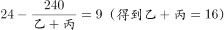

|甲-乙|=|丙-丁|

式子复杂难计算时，考虑代入法：

A项：当丁单独生产需要30天时，即丁的效率为240÷30=8，则丙=6，根据1、2、4三个式子得到：甲=4，乙=6，与列式3矛盾，故排除；

B项：当丁单独生产需要48天时，即丁的效率为240÷48=5，则丙=9，根据1、2、4三个式子得到：甲=3，乙=7，与列式3完全吻合，故B项正确；

四个选项，只要有一个正确即为正确选项。

故正确答案为B。

**考点**：给完工时间型

**来源**：2014年青海省公务员录用考试《行测》题第57题

### 第 58 题

有一枚棋子从棋盘的起点走到终点，每次只能从起点向终点方向走9格或者从终点向起点方向走7格，问该棋盘至少有多少格（起点和终点各算一格），才能保证从起点出发的棋子都能走到终点并返回起点：

A. 9

B. 10

C. 15

D. 16

第 58 题 · 答案与解析

**参考答案（粉笔题库参考内容）**

D

**解析**

本题可以采取代入排除法，排除求解。
 假设棋盘有9格，从起点第1格出发，前进8格就能到达终点第9格，无法走9格，排除；
 假设棋盘有10格，从起点第1格出发，前进9格刚好到达终点第10格，但是退7格后到达第3格，无法返回起点，排除；
 假设棋盘有15格，从起点第1格出发，前进9格到达第10格，退7格到达第3格，再次前进9格到达第12格，退7格到达第5格······要想第15格为终点，必须从第6格前进9格，而每次后退7格到达的都是奇数格，所以终点不可能是第15格，排除。
 只剩答案D可选。
 如果棋盘有16格，从起点第1格出发，先前进9格再后退7格到达第3格，然后前进9格退7格到达第5格，再前进9格退7格到达第7格，最后前进9格到达终点第16格，列式表示为1+3×（9-7）+9=16；
 从终点返回，先退7格到达第9格，再退7格到达第2格，前进9格退7格到达第4格，然后前进9格退7格到达第6格，再前进9格退7格到达第8格，最后退7格回到起点第1格，列式表示为16-7-7+3×（9-7）-7=1。
 故正确答案为D。

**来源**：2014年青海省公务员录用考试《行测》题第58题

### 第 59 题

箱子里有乒乓球和网球若干，若每次取出乒乓球4个，网球2个，若干次后正好都取完；若每次取出乒乓球5个，网球3个，则两球取尽后，还剩余5个乒乓球，那么乒乓球和网球共有多少个：

A. 40

B. 45

C. 53

D. 58

第 59 题 · 答案与解析

**参考答案（粉笔题库参考内容）**

D

**解析**

第一种取法：每次同时取乒乓球4个和网球2个，则总数应为6的倍数，选项无答案，说明取两种球并不是同时取，而是依次取球，总数=6n+4；

第二种取法：每次取乒乓球5个，网球3个，则两球取尽后，还剩余5个乒乓球，则总数=8m+5（取网球以后停止取球）或总数=8m+5+5（取网球以后，又取了5个乒乓球，停止取球）。观察选项只有D项符合。

故正确答案为D。

**考点**：和差倍比问题

**来源**：2014年青海省公务员录用考试《行测》题第59题

### 第 60 题

小李以每分钟80米的速度从家中步行去上班，走了路程的20%之后，他又前行了2分钟，这时他发现尚有四分之三的路程，问小李以该速度步行到单位还需多少分钟：

A. 15

B. 20

C. 30

D. 40

第 60 题 · 答案与解析

**参考答案（粉笔题库参考内容）**

C

**解析**

在小李走了全程的1/5后，又走了2分钟，还剩下的路程。可知小李所走的2分钟走了全程的。剩下的即为，故还需要30分钟才能到达终点。

故正确答案为C。

**考点**：普通行程

**来源**：2014年青海省公务员录用考试《行测》题第60题

### 第 61 题

某书店打折区有文学类书10种，理科类书5种，法律类书3种。三类书的打折价格分别统一为10元，20元和30元。小明身上有30元，他打算全部用来买书，且同一种书不重复购买。问可以有多少种选择：

A. 150

B. 162

C. 167

D. 173

第 61 题 · 答案与解析

**参考答案（粉笔题库参考内容）**

D

**解析**

30元购买书籍可以分成三种情况：可购买3种文学类书籍，或1种文学类和1种理科类书籍，或1种法律类书籍。

当购买3种文学类书籍时，一共有种情况数；

当购买1种文学类和1种理科类书籍时，一共有种情况数；

当购买一种法律类书籍时，一共有种情况数。

故小明可以有120+50+3=173种选择。

故正确答案为D。

**考点**：基础排列组合

**来源**：2014年青海省公务员录用考试《行测》题第61题

### 第 62 题

某项工程若由甲、乙两队合作需105天完成，甲、丙两队合作需60天，丙、丁两队合作需70天，甲、丁两队合作需84天。问这四队的工作效率由低到高的顺序是什么：

A. 乙丁甲丙

B. 乙甲丙丁

C. 丁乙丙甲

D. 乙丁丙甲

第 62 题 · 答案与解析

**参考答案（粉笔题库参考内容）**

A

**解析**

根据题干条件，甲丙合作需要60天，甲丁合作需要84天，甲的工作效率一定，故可推知丙的效率要高于丁的效率，由此排除B项；丙丁合作需要70天，甲丁合作需要84天，同理可以推知，丙的效率应高于甲的效率，由此排除C、D项，只有A项符合。

故正确答案为A。

**考点**：给完工时间型

**来源**：2014年青海省公务员录用考试《行测》题第62题

### 第 63 题

A、B两条流水线每小时均能装配1辆汽车。A流水线每装配3辆汽车要用1小时维护，B流水线每装配4辆汽车要用1.5小时维护。问两条流水线同时开始工作，装配200辆汽车需用多少小时：

A. 134

B. 135

C. 136

D. 137

第 63 题 · 答案与解析

**参考答案（粉笔题库参考内容）**

B

**解析**

由题意可知，A流水线每装配3辆汽车需要4个小时；B流水线每装配4辆汽车需要5.5个小时。设一轮为44小时，则在一轮之内，A流水线可装配汽车33辆，B流水线可装配汽车32辆，共装配汽车33+32=65辆。三轮可装配汽车65×3=195辆，还剩5辆汽车还需A、B两流水线3个小时完成，故一共需用时44×3+3=135小时。

故正确答案为B。

**考点**：周期相遇问题、给具体单位型

**来源**：2014年青海省公务员录用考试《行测》题第63题

### 第 64 题

兄弟五人年龄均不相等。已知今年五个人的平均年龄为50岁，较年长的三个人平均年龄为55岁，较年轻的三个人平均年龄为44岁。问大哥今年至少多少岁：

A. 57

B. 58

C. 59

D. 60

第 64 题 · 答案与解析

**参考答案（粉笔题库参考内容）**

D

**解析**

已知今年五人的平均年龄为50岁，则五人的年龄总和为250岁；其中较年长三人的平均年龄为55岁，则较年长三人的年龄总和为165岁；较年轻三人的平均年龄为44岁，则较年轻三人的年龄总和为132岁。则排名中间的人的年龄为(132+165)-250=47岁。则较年长两人的年龄和为165-47=118岁，大哥今年至少118÷2+1=60岁。

故正确答案为D。

**考点**：构造数列

**来源**：2014年青海省公务员录用考试《行测》题第64题

### 第 65 题

八名棋手进行单循环比赛，每两人只对局一次，其中七人已经分别赛过7、6、5、4、3、2、1盘。问另外一人比赛了几盘：

A. 0

B. 2

C. 4

D. 6

第 65 题 · 答案与解析

**参考答案（粉笔题库参考内容）**

C

**解析**

如图所示，ABCDEFGH分别对应8位棋手，每条直线对边代表两两比赛一场。其中棋手A已比赛7场，棋手B已比赛6场，棋手C已比赛5场，棋手D已比赛4场，棋手F已比赛3场，棋手G已比赛2场，棋手H已比赛1场。要满足题干对战情况，另一棋手E需已比赛4场。

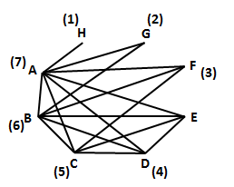

故正确答案为C。

**来源**：2014年青海省公务员录用考试《行测》题第65题

### 第 66 题

从所给四个选项中，选择最合适的一个填入问号处，使之呈现一定的规律性的是：

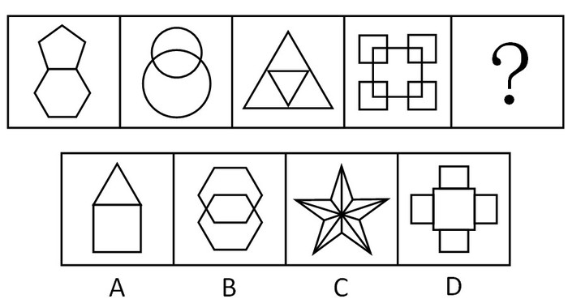

A. A

B. B

C. C

D. D

第 66 题 · 答案与解析

**参考答案（粉笔题库参考内容）**

A

**解析**

本题考点为组内图形间的特点，题干图形中各部分的位置关系分别为相连、相交、相连、相交，所以问号处应该选一个相连的图，排除B选项，再观察，题干图形都是一笔画，排除C、D项。

故正确答案为A。

**考点**：数量规律-线、特殊规律-图形间关系

**来源**：2014年青海省公务员录用考试《行测》题第66题

### 第 67 题

从所给四个选项中，选择最合适的一个填入问号处，使之呈现一定的规律性：

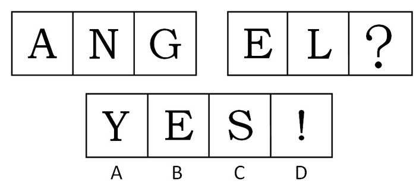

A. A

B. B

C. C

D. D

第 67 题 · 答案与解析

**参考答案（粉笔题库参考内容）**

C

**解析**

题目中图形规则，考虑属性。进一步观察可发现，存在曲直规律，分别是“直，直，曲+直”，第二组图形中前两幅图都是直线图形，第三幅图应该选择曲线+直线图形，只有C项符合。

故正确答案为C。

**考点**：属性规律-曲直性、文字/字母/数字类

**来源**：2014年青海省公务员录用考试《行测》题第67题

### 第 68 题

请从所给的四个选项中，选择最合适的一项填在问号处，使之呈现一定的规律性：

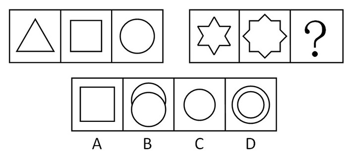

A. A

B. B

C. C

D. D

第 68 题 · 答案与解析

**参考答案（粉笔题库参考内容）**

A

**解析**

本题考查线条数。第一组图形中第二幅图的线条数=第一幅线条数+第三幅线条数=3+1=4；第二组图形中第二幅图的线条数=第一幅+第三幅=12+？=16，所以第三幅图应该是由4条线条组成。

故正确答案为A。

**考点**：数量规律-线

**来源**：2014年青海省公务员录用考试《行测》题第68题

### 第 69 题

从所给四个选项中，选择最合适的一个填入问号处，使之呈现一定的规律性：

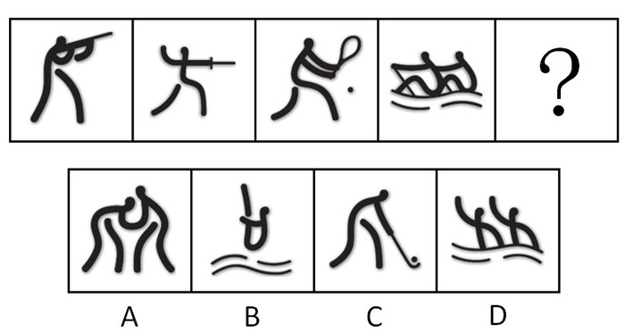

A. A

B. B

C. C

D. D

第 69 题 · 答案与解析

**参考答案（粉笔题库参考内容）**

C

**解析**

元素组成凌乱，观察所有题干图形的特点，所有人物的手部都和运动器材相连接，选项中只有C选项符合此特点。

故正确答案为C。

**来源**：2014年青海省公务员录用考试《行测》题第69题

### 第 70 题

请从所给的四个选项中，选择最合适的一项填在问号处，使之呈现一定的规律性：

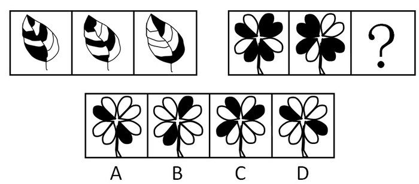

A. A

B. B

C. C

D. D

第 70 题 · 答案与解析

**参考答案（粉笔题库参考内容）**

A

**解析**

本题考点为元素叠加中的黑白叠加。左侧图形中，第三个图形由前两个图形黑白叠加构成。根据左侧图形可知黑白叠加规律为黑+黑=黑，白+黑=白，黑+白=白，白+白=黑。右侧图形符合此规律的只有A项。

故正确答案为A。

**考点**：样式规律-黑白运算

**来源**：2014年青海省公务员录用考试《行测》题第70题

### 第 71 题

请从所给的四个选项中，选择最合适的一项填在问号处，使之呈现出一定的规律性：

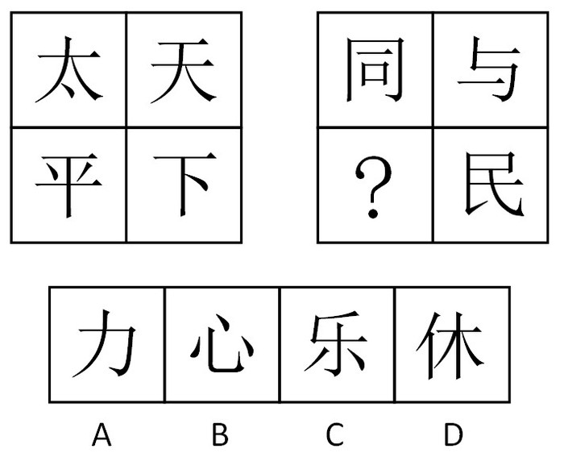

A. A

B. B

C. C

D. D

第 71 题 · 答案与解析

**参考答案（粉笔题库参考内容）**

B

**解析**

第一组图第一行“太”和“天”笔画相加得8，第二行“平”和“下”笔画相加得8；第二组图第一行“同”和“与”笔画相加得9，第二行“？”处和“民”笔画相加也应得9，问号处应选一个笔画为4笔的汉字。

故正确答案为B。

**考点**：数量规律-线、文字/字母/数字类

**来源**：2014年青海省公务员录用考试《行测》题第71题

### 第 72 题

左边给定的是一个纸盒的成型图，它可以从右边哪一项折叠而成？请把它找出来：

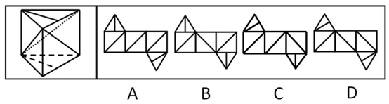

A. A

B. B

C. C

D. D

第 72 题 · 答案与解析

**参考答案（粉笔题库参考内容）**

D

**解析**

观察原图形为三棱体。A项中三个侧面的斜线两两平行，而观察已知图形发现有两个侧面的斜线是相交关系，排除；B项中顶面三角形的位置应该对应的是侧面斜线为右斜方向的，即中间的四方形，排除；C项中顶面三角形左侧的斜边应该为三角形面与对角线相交的其中一个面的公共边，排除；D项将三角形面转化成与正方形面相连，则三角形中的线条与正方形面中的两条平行线段相交，当选。

故正确答案为D。

**来源**：2014年青海省公务员录用考试《行测》题第72题

### 第 73 题

从所给四个选项中，选择最合适的一个填入问号处，使之呈现一定的规律性：

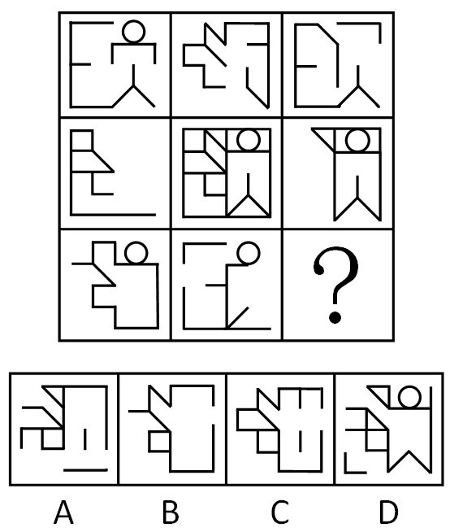

A. A

B. B

C. C

D. D

第 73 题 · 答案与解析

**参考答案（粉笔题库参考内容）**

B

**解析**

本题题型属于平面题型中的九宫格。元素组成相似，考查元素。观察方式为“米”字形观察，对角线及十字线两端图形叠加都为中间图形。

故正确答案为B。

**考点**：样式规律-加减同异

**来源**：2014年青海省公务员录用考试《行测》题第73题

### 第 74 题

把下面的六个图形分为两类，使每一类图形都有各自的共同特征或规律，分类正确的一项是：

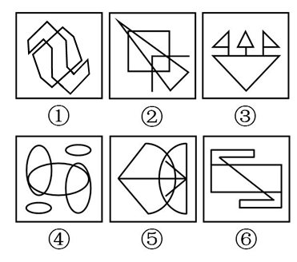

A. ①②③，④⑤⑥

B. ①④⑥，②③⑤

C. ①②⑥，③④⑤

D. ①⑤⑥，②③④

第 74 题 · 答案与解析

**参考答案（粉笔题库参考内容）**

B

**解析**

元素组成凌乱，考查属性。

观察可发现，①④⑥为中心对称图形，分为一组；②③⑤为轴对称图形，分为另一组。

故正确答案为B。

**考点**：属性规律-对称性

**来源**：2014年青海省公务员录用考试《行测》题第74题

### 第 75 题

把下面的六个图形分为两类，使每一类图形都有各自的共同特征或规律，分类正确的一项是：

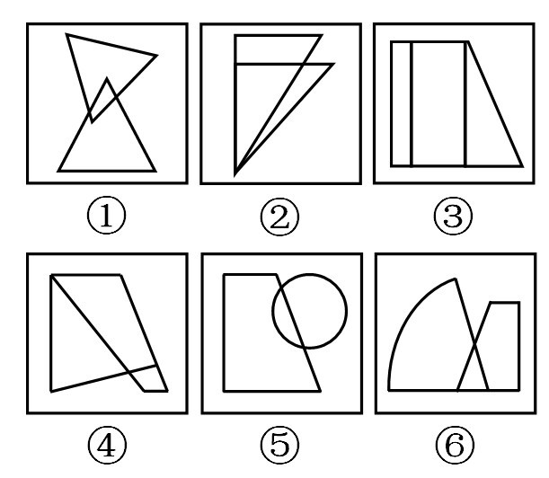

A. ①②③，④⑤⑥

B. ①③⑥，②④⑤

C. ①④⑤，②③⑥

D. ①⑤⑥，②③④

第 75 题 · 答案与解析

**参考答案（粉笔题库参考内容）**

D

**解析**

本题考点为组内图形间的特点。

观察可发现，其中①⑤⑥组中的两个图形重叠部分的面积小于非重叠部分，②③④组中的两个图形重叠部分的面积大于非重叠部分。

故正确答案为D。

**考点**：特殊规律-图形间关系

**来源**：2014年青海省公务员录用考试《行测》题第75题

### 第 76 题

琥珀规则是指某种事物沉寂或出现多年后，其价值被重新发现。

根据上述定义，下列选项符合琥珀规则的是：

A. 在1899年王懿荣发现甲骨文以前，甲骨一直被作为龙骨入药

B. 1937年《奥林匹克宣言》手稿遗失，半个世纪后被重新发现

C. 古希腊人首先提出日心说，1800多年后哥白尼也提出该学说

D. 如老王所料，他珍藏多年的邮票市场成交价每枚超过了万元

第 76 题 · 答案与解析

**参考答案（粉笔题库参考内容）**

A

**解析**

第一步：找关键词。

琥珀规则定义条件包括：（1）某种事物沉寂或出现多年后；（2）其价值被重新发现。

第二步：逐一分析选项。

A项，甲骨被作为龙骨入药符合（1），发现甲骨文后甲骨有了新的价值，不仅是药材还是研究古代文化的物品，符合条件；

B项，半个世纪后重新找到《奥林匹克宣言》手稿，但是其价值并未重新发现，不符合（2）；

C项，日心说不是事物，不符合（1）；

D项，老王已经料到收藏的邮票有收藏价值，不符合（2）。

故正确答案为A。

**考点**：单定义-其他句式

**来源**：2014年青海省公务员录用考试《行测》题第76题

### 第 77 题

社会方言是指在某一社会团体，社会阶层或次文化群体中被使用的语言。

根据上述定义，下列选项未使用社会方言的是：

A. 张老太太没事就喜欢找人“唠嗑”

B. “黑马”成色如何就看今晚决赛

C. 他也就是一个“打酱油”的角色

D. 小李在学校里结识了几位“死党”

第 77 题 · 答案与解析

**参考答案（粉笔题库参考内容）**

A

**解析**

第一步：找关键词。

社会方言定义条件为：某一社会团体，社会阶层或次文化群体中被使用的语言。

第二步：逐一分析选项。

A项，“唠嗑”属北方方言，指两个及两个以上的人聚在一起，就某些问题或事情进行闲谈、聊天，是语言发展不平衡性而在地域上的反映，属于地域方言，不是某一社会团体或者社会阶层或次文化群体中被使用的语言，不属于社会方言，当选。

B项，“黑马”是从英语中借鉴来的，原指体育界一鸣惊人的后起之秀，后指实力难测的竞争者或在某一领域独树一帜的人，是社会阶层的通用语言，属于社会方言，排除。

C项，“打酱油”意为跟自己无关，或者也可以解释为无力解决的问题或者事情。此词来源于网络，符合来源于次文化群体使用言语，排除；

D项，“死党”意为一个人特别好的朋友，是年轻人对好朋友的一种称呼，符合社会阶层使用语言，属于社会语言，排除。

本题为选非题，故正确答案为A。

**考点**：主客体

**来源**：2014年青海省公务员录用考试《行测》题第77题

### 第 78 题

视觉对比是由光刺激在空间上的不同分布引起的视觉经验。它可能是由于光线的不同强度在空间上的不同分布引起的，也可能是由于一个物体的颜色受到其周边物体颜色的影响而发生色调改变引起的。

根据上述定义，下列属于视觉对比的是：

A. 日光灯的光线每秒闪动100次，人们却看不出它在闪动

B. 在注视亮着的电灯后，闭上眼睛，眼前会出现一个灯的光亮形象

C. 长时间观察挂钟时，会感觉指针从上往下走时比从下往上走时快

D. 同样灰度的正方形放在白色背景下比放在黑色背景下显得暗得多

第 78 题 · 答案与解析

**参考答案（粉笔题库参考内容）**

D

**解析**

第一步：找关键词。

视觉对比定义条件包括：（1）光刺激在空间上的不同分布引起的视觉经验；（2）光线的不同强度在空间上的不同分布引起的或物体的颜色受到其周边物体颜色的影响而发生色调改变引起的。

第二步：逐一分析选项。

A项，日光灯光线闪动没有体现光刺激空间上的不同分布，同时不满足（1）、（2），排除；

B、C项亦然，排除；

D项，同样灰度的正方形放在不同的空间给人不同的视觉效果，符合（1），同时满足（2），即是受到白色背景和黑色背景影响而产生的视觉差异，当选。

故正确答案为D。

**考点**：原因结果

**来源**：2014年青海省公务员录用考试《行测》题第78题

### 第 79 题

投射作用是指个人将自己不喜欢或不被社会所接受的冲动欲望、思想观念、性格特点等转嫁到他人身上，认为他人也有同样的特质。

根据上述定义，下列属于投射作用的是：

A. 吃不到葡萄说葡萄酸

B. 推己及人

C. 爱屋及乌

D. 以小人之心度君子之腹

第 79 题 · 答案与解析

**参考答案（粉笔题库参考内容）**

D

**解析**

第一步：找关键词。

关键词包括：“不喜欢或不被社会所接受”，“冲动欲望、思想观念、性格特点”，“转嫁到他人身上，认为他人也有同样的特质”。

第二步：逐一分析选项。

A项，并不是自己不喜欢或者不被社会所接受的，排除；

B项，推己及人意为用自己的心意去推想别人的心意，也不是自己不喜欢或者不被社会所接受的，排除；

C项，是自己喜欢的，不符合关键词，排除；

D项，意为拿卑劣的想法去推测正派人的心思，卑劣的想法是不被社会所接受的思想观念，同时用这种思想去推测别人属于认为他人也有同样的性质，当选。

故正确答案为D。

**考点**：主客体

**来源**：2014年青海省公务员录用考试《行测》题第79题

### 第 80 题

菜单成本指的是商家调整产品价格而产生的成本。

根据上述定义，下列选项属于菜单成本的是：

A. 某百货公司进行店面装修，为此提高部分商品价格、转嫁开支

B. 某手机生产商下调产品价格销量大增，为此对生产线进行扩建

C. 某汽车生产商对某车型进行升级后，提高了该车型的市场售价

D. 某保险公司增加险种受到顾客欢迎，但因此理赔成本也增加了

第 80 题 · 答案与解析

**参考答案（粉笔题库参考内容）**

B

**解析**

第一步：找出定义关键词。

关键词为“调整产品价格”，“产生的成本”，“调整产品价格”是因，“产生的成本”为果，属于因果关系。

第二步：逐一分析选项。

A项：因为店面装修而提升价格，不符合定义；

B项：因为价格降低带来销量大增，进而对生产线扩建，扩大生产线需要产生成本，符合定义；

C项：因为对车型升级而提高价格，不符合定义；

D项：因为增加险种受到顾客欢迎，客户群体大了引起理赔成本增加，同样不符合定义。

故正确答案为B。

**考点**：原因结果

**来源**：2014年青海省公务员录用考试《行测》题第80题

### 第 81 题

经济成本流指的是公司将整个业务流程的成本进行一体化，并像管理单一成本的流动那样管理整个业务流程所发生的支出。

根据上述定义，下列属于经济成本流的是：

A. 代理商为降低库存压力，对完成既定销售额的零售商给予奖励

B. 某购物网站与一物流公司签约，由其承包所有的网购货运业务

C. 超市允许供货商使用超市货架存货，以降低供货商的仓储成本

D. 某厂商与供应商签约，规定原材料费按一年一付，以提高效率

第 81 题 · 答案与解析

**参考答案（粉笔题库参考内容）**

B

**解析**

第一步：找关键词。

经济成本流定义条件包括：（1）公司将整个业务流程的成本进行一体化；（2）像管理单一成本的流动那样管理整个业务流程所发生的支出。

第二步：逐一分析选项。

A项，降低库存、奖励不是整个业务流程的成本一体化，不符合（1），排除；

B项，与物流公司签约，承包所有货运业务，涉及整个业务流程，整个业务流程支出可以像单一成本流动那样管理，符合定义，当选；

C项，未涉及整个业务流程，未管理经济成本流，不符合定义，排除；

D项，未涉及整个采购业务流程，不符合定义，排除。

故正确答案为B。

**考点**：单定义-其他句式

**来源**：2014年青海省公务员录用考试《行测》题第81题

### 第 82 题

贸易转移效应是指数个国家形成关税同盟后，由于取消了同盟国之间的关税但保留了对非同盟国的关税，从而产生了同盟国成员的低效率高成本生产取代了非同盟成员的高效率低成本生产的效应。

根据上述定义，下列不会产生贸易转移效应的是：

A. 甲国对进口农产品征收高额关税

B. 甲国加入某国家集团自由贸易区

C. 甲国针对乙国橡胶给予关税优惠

D. 甲国针对乙国汽车征收反倾销税

第 82 题 · 答案与解析

**参考答案（粉笔题库参考内容）**

A

**解析**

第一步：找出定义关键词。

贸易转移效应的定义条件包括：（1）数个国家形成关税同盟；（2）取消了同盟国之间的关税但保留了对非同盟国的关税；（3）同盟国成员的低效率高成本生产取代了非同盟成员的高效率低成本生产的效应。意为由于关税差异导致的贸易从采购低成本的产品向采购高成本无关税的产品转化，简单来讲就是关税引起的有国家差别的贸易影响。

第二步：逐一分析选项。

A项，针对进口农产品征收高额关税，是针对所有国家而非特定国家，不符合定义，当选；

B项，加入了某国家集团自由贸易区，享受税收优惠条件，符合定义，排除；

C项，甲国对乙国给予关税优惠，符合定义，排除；

D项，甲国对乙国汽车征收反倾销税，提高了乙国汽车的总价格，贸易受到关税影响且分国度，符合定义，排除。

本题为选非题，故正确答案为A。

**考点**：原因结果

**来源**：2014年青海省公务员录用考试《行测》题第82题

### 第 83 题

再社会化是指有意放弃原已习得的价值观和行为规范，重新确立和接受新的价值观和行为规范。

根据上述定义，下列不是典型的再社会化的是：

A. 一些移居海外的中国人很快适应了当地生活

B. 新兵在部队经过训练后逐步成为合格的军人

C. 新生代农民工对城市有强烈的认同和归属感

D. 许多服刑人员经过教育能认罪伏法遵守监规

第 83 题 · 答案与解析

**参考答案（粉笔题库参考内容）**

C

**解析**

第一步：找关键词。

再社会化的定义条件包括：（1）有意放弃原已习得的价值观和行为规范；（2）重新确立和接受新的价值观和行为规范，关键点：改变。

第二步：逐一分析选项。

A项，移居海外的中国人适应当地生活，必然接受国外文化和习惯符合（1）、（2）；

B项，由普通人在训练后成为合格军人过程中必然接受了军队文化和观念，符合（1）、（2）；

C项，新生代农民对城市有强烈的认同和归属感，只是说新生代农民自己本身的观念并未涉及改变，不符合定义；

D项，服刑人员在教育后能认罪伏法遵守监规，是改变，符合（1）、（2）。

本题为选非题，故正确答案为C。

**考点**：单定义-其他句式

**来源**：2014年青海省公务员录用考试《行测》题第83题

### 第 84 题

双盲试验是指试验的执行者和接受者在进行试验以及观察结果时，均不知所用的是有效物还是无关的对照物。

根据上述定义，下列使用双盲试验的是：

①工商部门抽查不同商家销售的月饼质量

②公安部门组织目击者对嫌疑犯进行辨认

③卫生部门对某种新型药物疗效进行检验

A. ①②

B. ②③

C. ①③

D. ①②③

第 84 题 · 答案与解析

**参考答案（粉笔题库参考内容）**

C

**解析**

第一步：找关键词。

关键词包括：“执行者和接受者”，“进行试验以及观察结果时，均不知所用的是有效物还是无关的对照物”。

第二步：逐一分析选项。

①工商部门抽查月饼质量，商家和工商部门事前并不知道结果，符合定义；

②目击者在辨认前知道嫌疑犯长相，不符合定义；

③同①，符合定义。

故正确答案为C。

**考点**：单定义-其他句式

**来源**：2014年青海省公务员录用考试《行测》题第84题

### 第 85 题

诱发运动是心理学中有关运动知觉的概念。它是指一个物体正在运动时，人们感觉其相邻的一个相对静止的物体也在运动。根据上述定义，下列属于诱发运动的是（    ）。

A. 两列相向行驶的火车会车时，坐在车上的乘客会觉得车速提高了很多

B. 两张相同照片先后在屏幕上快速出现时，人们常感觉是同一张照片

C. 点亮蜡烛后，注视着烛心的火苗，会发现火苗在不断地跳动

D. 仰望夜空时，由于浮云的运动，人们感觉月亮也在运动

第 85 题 · 答案与解析

**参考答案（粉笔题库参考内容）**

D

**解析**

第一步：判断题干中的关键词。

关键词：一个物体运动，另一个相对静止的物体感觉也在运动。

第二步：逐一分析选项。

A项，两列相向行驶的火车均在运动，不符合定义关键词。

B项，两张图片都在屏幕上快速出现，都在运动，不符合定义关键词。

C项，烛心的火苗在跳动，而不存在相对静止的物体感觉也在运动，不符合定义关键词。

D项，月亮并未运动，只是由于浮云运动给人以错觉，误以为月亮在运动，符合定义。

故正确答案为D。

**考点**：原因结果

**来源**：2014年青海省公务员录用考试《行测》题第85题

### 第 86 题

显微镜：放大镜

A. 凸透镜：哈哈镜

B. 复印机：扫描仪

C. 录像机：照相机

D. 导航仪：后视镜

第 86 题 · 答案与解析

**参考答案（粉笔题库参考内容）**

C

**解析**

第一步：判断题干词语间逻辑关系。

“显微镜”“放大镜”是并列关系，并且两者的工作原理相同。

第二步：判断选项词语间逻辑关系。

A项中“凸透镜”“哈哈镜”构成并列关系，但是二者的工作原理不相同，与题干不相符，排除；

B项中“复印机”“扫描仪”构成并列关系，但是二者的工作原理不相同，与题干不相符，排除；

C项中“录像机”“照相机”构成并列关系，两者的工作原理相同，与题干相符，当选；

D项中“导航仪”“后视镜”构成并列关系，但是二者的工作原理不相同，与题干不相符，排除。

故正确答案为C。

**考点**：逻辑关系-并列关系

**来源**：2014年青海省公务员录用考试《行测》题第86题

### 第 87 题

神采奕奕：闷闷不乐

A. 眉清目秀：面黄肌瘦

B. 眉飞色舞：垂头丧气

C. 白发苍苍：眉目如画

D. 悠然自得：勃然大怒

第 87 题 · 答案与解析

**参考答案（粉笔题库参考内容）**

B

**解析**

第一步：判断题干词语间逻辑关系。

“神采奕奕”和“闷闷不乐”构成一组反义词，并且都是形容人的精神状况。

第二步：判断选项词语间逻辑关系。

A项中“眉清目秀”形容人容貌清秀，“面黄肌瘦”形容人营养不良时的样子，不构成反义词，与题干逻辑不一致，排除；

B项中“眉飞色舞”和“垂头丧气”前者表示高兴，后者表示悲伤，构成一组反义词，与题干逻辑一致，当选；

C项中“白发苍苍”形容人苍老，“眉目如画”形容容貌端正秀丽，不构成反义词，与题干逻辑不一致，排除；

D项中“悠然自得”指心情舒畅，形容心态，“勃然大怒”表示突然大发脾气，形容情绪，不构成反义词，与题干逻辑不一致，排除。

故正确答案为B。

**考点**：语义关系-反义关系

**来源**：2014年青海省公务员录用考试《行测》题第87题

### 第 88 题

防火墙：隔离网

A. 暖气片：电热毯

B. 手表：罗盘

C. 存储器：计算器

D. 孔明灯：节能灯

第 88 题 · 答案与解析

**参考答案（粉笔题库参考内容）**

A

**解析**

第一步：判断题干词语间逻辑关系。

“防火墙”“隔离网”都有隔离作用，功能一致，存在对应关系。

第二步：判断选项词语间逻辑关系。

A项中“暖气片”“电热毯”都有取暖功能，功能一致，存在对应关系，与题干相符，当选；

B项中“手表”指示时间，“罗盘”指示方向，二者功能不相同，与题干不相符，排除；

C项中“存储器”用来存储，“计算器”用来计算，二者功能不相同，与题干不相符，排除；

D项中“孔明灯”用来观赏和祈福，“节能灯”用来照明，二者功能不相同，与题干不相符，排除。

故正确答案为A。

**考点**：逻辑关系-对应关系

**来源**：2014年青海省公务员录用考试《行测》题第88题

### 第 89 题

应聘者：招聘会：招聘者

A. 原告：判决书：被告

B. 医生：挂号处：病人

C. 生产者：销售者：经营者

D. 甲方：签约仪式：乙方

第 89 题 · 答案与解析

**参考答案（粉笔题库参考内容）**

D

**解析**

第一步：判断题干词语间逻辑关系。

题干词语之间是对应关系。招聘者在招聘会上招聘应聘者，招聘会是一个活动过程。

第二步：判断选项词语间逻辑关系。

A项，判决书不是一个活动过程，排除；

B项，挂号处不是医生的活动场所，医生活动场所是科室，排除；

C项，生产者、销售者和经营者是并列关系，排除；

D项，甲方和乙方在签约仪式上签约，且签约仪式是一个活动过程，当选。

故正确答案为D。

**考点**：逻辑关系-对应关系

**来源**：2014年青海省公务员录用考试《行测》题第89题

### 第 90 题

围棋：棋子：棋盘

A. 二胡：琴弦：琴弓

B. 窗帘：帘子：窗轨

C. 书法：毛笔：宣纸

D. 茶具：茶壶：茶杯

第 90 题 · 答案与解析

**参考答案（粉笔题库参考内容）**

A

**解析**

第一步：判断题干词语间逻辑关系。

棋子和棋盘是围棋的组成部分，第一个词与后两个词是组成关系。

第二步：判断选项词语间逻辑关系。

A项：琴弦和琴弓是二胡的组成部分，第一个词与后两个词是组成关系，与题干逻辑关系一致，当选；

B项：窗帘是由帘布和窗轨组成，而非帘子，与题干逻辑关系不一致，排除；

C项：毛笔和宣纸是书写书法的工具，第一个词与后两个词是对应关系，与题干逻辑关系不一致，排除；

D项：茶壶和茶杯都是茶具的一种，第一个词与后两个词是种属关系，与题干逻辑关系不一致，排除。

故正确答案为A。

**考点**：逻辑关系-包容关系

**来源**：2014年青海省公务员录用考试《行测》题第90题

### 第 91 题

教材：学生：课堂

A. 教练：运动员：赛场

B. 法律：法官：法院

C. 袈裟：僧侣：寺院

D. 武器：军人：战场

第 91 题 · 答案与解析

**参考答案（粉笔题库参考内容）**

D

**解析**

第一步:判断题干词语间逻辑关系。

“教材”与“学生”构成工具要素的对应关系，“学生”与“课堂”构成主体和地点的对应关系。

第二步:判断选项词语间逻辑关系。
A项:“教练”和“运动员”构成并列关系，“运动员”和“赛场”构成主体和地点的对应关系，与题干逻辑关系不一致，排除；

B项:“法律”是“法官”裁决的依据，某种程度上可以是法官利用的工具，“法官”和“法院”构成主体和地点的对应关系，但是法律是抽象的，教材是具体的，与题干逻辑关系不符，排除；

C项:“袈裟”是“僧侣”穿在身上的一种服饰，“僧侣”和“寺院”构成主体和地点的对应关系，与题干逻辑关系不符，排除；

D项:“军人”使用“武器”，“军人”与“武器”构成工具要素的对应关系，“军人”和“战场”构成主体和地点的对应关系，武器也是具体的，比较B项和D项，D项与题干逻辑关系更为一致，当选。

故正确答案为D。

**考点**：逻辑关系-对应关系

**来源**：2014年青海省公务员录用考试《行测》题第91题

### 第 92 题

（    ）对于 摄像 相当于 短信 对于（    ）

A. 相机 手机

B. 胶卷 留言

C. 摄影 微信

D. 照相 通讯

第 92 题 · 答案与解析

**参考答案（粉笔题库参考内容）**

C

**解析**

将选项逐一代入，判断各选项前后部分的逻辑关系。

A 项：相机具有摄像功能，手机具有短信功能，前后均为功能对应关系，但是顺序反了，排除；

B 项：胶卷是摄像过程中需要用到的工具，为工具对应关系；短信具有留言的作用，为功能对应关系，二者逻辑关系不一致，排除；

C 项：摄影和摄像是并列关系，短信和微信是并列关系，二者逻辑关系一致，都具有功能相似的关系，当选；

D 项：照相和摄像构成并列关系，短信和通讯构成对应关系，短信是通讯的一种方式，二者逻辑关系不一致，排除。

故正确答案为C。

**考点**：逻辑关系-并列关系

**来源**：2014年青海省公务员录用考试《行测》题第92题

### 第 93 题

（    ） 对于 修订 相当于 粉刷 对于 （    ）

A. 完善；油漆

B. 删减；装修

C. 文档；墙面

D. 法规；刷子

第 93 题 · 答案与解析

**参考答案（粉笔题库参考内容）**

B

**解析**

将选项逐一代入，判断各选项前后部分的逻辑关系。

A项，前后二者之间无对应逻辑关系，排除；

B项，删减是修订的一种方式，构成种属关系，粉刷是装修的一种，构成种属关系，二者逻辑关系一致，当选；

C项，文档修订与墙面粉刷的逻辑关系一致，文档要对应墙面，排除；

D项，法规和修订构成要素间的对应关系，修订法规构成动宾关系；粉刷用的工具是刷子，构成要素间的对应关系，但是前后二者顺序互换，逻辑关系不一致，排除。

故正确答案为B。

**考点**：逻辑关系-包容关系

**来源**：2014年青海省公务员录用考试《行测》题第93题

### 第 94 题

堵车 对于 （    ） 相当于 （    ） 对于 寒流

A. 迟到；降温

B. 交通；对流

C. 车流；寒潮

D. 红灯；冬季

第 94 题 · 答案与解析

**参考答案（粉笔题库参考内容）**

C

**解析**

将选项逐一代入，判断各项前后部分的逻辑关系。

A项中“堵车”可能导致“迟到”，“堵车”和“迟到”构成或然的因果关系，“寒流”来了必然“降温”，“寒流”和“降温”构成必然因果关系，前后逻辑关系不一致，排除；

B项中“交通”不畅可能导致“堵车”，二者构成或然因果关系，“对流”和“寒流”无逻辑关系，前后逻辑关系不一致，排除；

C项中“车流”汇聚造成堵车，“寒流”汇聚形成“寒潮”，前后逻辑关系一致，当选；

D项中“红灯”可能造成“堵车”，“寒流”是一种海洋洋流，常发生在“冬季”，前后逻辑关系不一致，排除。

故正确答案为C。

**考点**：逻辑关系-对应关系

**来源**：2014年青海省公务员录用考试《行测》题第94题

### 第 95 题

黄金 对于 （    ） 相当于 （    ） 对于 大衣。

A. 白银；衣服

B. 金属；鞋帽

C. 首饰；牛皮

D. 价格；商标

第 95 题 · 答案与解析

**参考答案（粉笔题库参考内容）**

C

**解析**

将选项逐一代入，判断各项前后部分的逻辑关系。

A项，“黄金”与“白银”构成并列关系，“大衣”是“衣服”的一种，二者是包容关系中的种属关系，前后逻辑关系不一致。

B项，“黄金”是“金属”的一种，二者是包容关系中的种属关系，“鞋帽”与“大衣”构成并列关系中的反对关系，前后逻辑关系不一致。

C项，“首饰”用“黄金”打造，“黄金”和“首饰”构成原材料与成品的对应关系，“大衣”用牛皮制成，“牛皮”和“大衣”构成原材料与成品的对应关系，前后逻辑关系一致。

D项，“黄金”用“价格”表示价值，“大衣”用“商标”表示价值，但是“商标”和“大衣”的顺序颠倒，导致前后逻辑关系不一致。

故正确答案为C。

**考点**：逻辑关系-对应关系

**来源**：2014年青海省公务员录用考试《行测》题第95题

### 第 96 题

天文学家研究发现，1亿年前银河系与一个较小的星系或者巨大的暗物质结构发生相撞，至今仍处在“振动”，仿佛波浪一样，相比之下，环绕银河系中央的速度则达到每秒220公里。

如果以下各项为真，最能加强上述观点的是：

A. 银河系恒星分布存在南北差异，而其他星系恒星则均匀分布

B. 银河系是宇宙中最大的星系，高速运动中此类撞击在所难免

C. 天文学家发现，银河系周围有数百个巨型暗物质结构在活动

D. 有文献记载，曾有天文学家也认为银河系曾遭遇过此类撞击

第 96 题 · 答案与解析

**参考答案（粉笔题库参考内容）**

B

**解析**

第一步：找到论点论据。

论点：1亿年前银河系与一个较小星系或者巨大的暗物质结构发生相撞，至今仍处在“振动”。

本题无明显论据。

第二步：逐一分析选项。

A项：说明银河系及其他星系的分布情况，与银河系是否与其他星系相撞无关，属于无关选项，排除；

B项：说明银河系是宇宙中最大的星系，发生类似碰撞是不可避免的，说明银河系确实有可能与其他星系相撞，补充论据加强论点，当选；

C项：表明银河系周围有数百个巨型暗物质结构在活动，但无法证明其一定会与银河系相撞，属于无关选项，排除；

D项：阐述的是天文学家的看法，无法证明其真实性，属于无关选项，排除。

故正确答案为B。

**考点**：补充论据

**来源**：2014年青海省公务员录用考试《行测》题第96题

### 第 97 题

生物钟基因是控制生物钟的特殊基因，它们相互作用控制其他基因时而活跃时而沉寂，形成睡眠节奏。科学家实验发现，长时间照明会扰乱幼鼠脑细胞中调节睡眠与苏醒节律的生物钟。一些医院的婴儿护理室为方便照料新生儿，习惯把他们安置在长时间有照明的环境中，科学家担心这种长明环境可能导致新生儿睡眠和苏醒的节律发生紊乱。

下列哪项为真，可以成为科学家担心的前提条件？

A. 很多婴儿只在护理室中短期停留就会交到父母身边

B. 用于照射幼鼠的光线与婴儿护理室的光线强度相同

C. 人体内生物钟机制与实验所用老鼠基本相同

D. 被长时间照明扰乱了生物钟的幼鼠即便被放回到正常环境也很难恢复

第 97 题 · 答案与解析

**参考答案（粉笔题库参考内容）**

C

**解析**

第一步：找出论点论据。

论点：长明环境可能导致新生儿睡眠和苏醒的节律发生紊乱。

论据：长时间照明会扰乱幼鼠脑细胞中调节睡眠与苏醒节律的生物钟。

第二步：逐一判断选项。

A项，长明环境只会短期存在，与长明环境是否影响新生儿生物钟无关，属于无关选项。

B项，讨论的是光线强度，而论点论据讨论的都是照明的时间，与强度关系未知，属于无关选项。

C项，说明人体和老鼠的生物钟机制基本相同，即具有可比性，在论点论据之间搭桥，加强了论证，为正确选项。

D项，讨论的是生物钟被扰乱之后的恢复，属于无关选项。

故正确答案为C。

**考点**：加强-实验类、搭桥

**来源**：2014年青海省公务员录用考试《行测》题第97题

### 第 98 题

研究者受萤火虫的启发，用合成生物技术将荧光基因重组到一种农杆菌中，利用与其一种名为拟南芥的微小植物传递DNA，来培育发光的拟南芥。他们认为如果这项技术应用在树木上，将会使未来的树木发光，并作为路灯使用，这将极大地节约能源。

以下哪项为真，最能削弱上述结论：

A. 研究者将荧光基因重组到一种农杆菌中，利用其与树木传递DNA，但这种细菌会影响树木的生长寿命

B. 拟南芥能够很好地与农杆菌中的荧光基因融合，但一般的树木难以与这种基因结合

C. 这种利用生物技术实现的廉价光源非常节能，据分析其产生的能量比电池更加密集

D. 繁华街道中由于车辆密集，这种发光植物很难显现出来，只有在林荫小道中才能发挥照明作用

第 98 题 · 答案与解析

**参考答案（粉笔题库参考内容）**

B

**解析**

第一步：找到论点论据。

论点：这项技术应用在树木上，将会使树木发光，并作为路灯使用，极大地节约能源。

论据：将荧光基因重组到一种农杆菌中，利用拟南芥传递DNA，可以培养发光的拟南芥。

第二步：判断削弱方式。

论点讨论的是发光树木，而论据的主体是发光拟南芥，二者不一致，优先考虑进行拆桥，削弱论证。

第三步：逐一分析选项。

A项说明该技术影响了树木的寿命，与发光效果无关，属于无关选项；

B项说明荧光基因可以与拟南芥融合，但无法与树木融合，在论点论据之间进行了拆桥，削弱了论证，为正确选项；

C项描述了该技术节能和密集能量的优点，加强了论点；

D项阐述发光树木只能在林荫小道中发挥作用，但又肯定了其照明作用的可实现，加强了论点。

故正确答案为B。

**考点**：拆桥

**来源**：2014年青海省公务员录用考试《行测》题第98题

### 第 99 题

最新研究发现，狼和狗的关键性区别，是食用人类食物这一特点。经过几个世纪，食用人类食物导致了狗具备消化淀粉的基因，它们因此能依靠人类剩余的饭菜繁衍下来，并最终对它们实现了驯化，即在形态、生理功能、行为习惯，对人类的态度等方面都发生大幅度的变化，成为家畜。

以下哪项为真，不能质疑上述说法：

A. 如果人们在野外捕捉了狼的幼崽，并对它们进行驯化，时间长了小狼的行为也会发生变化，并且会和人类亲近

B. 长期的野外观察表明，当狼群缺少可猎食的动物时也会挖掘植物的块茎充饥

C. 在牧区许多牧羊犬和其主人一样以肉食为主，并不吃淀粉类食物，并且世代如此

D. 狗从农业社会开始食用人类的饭菜，因此狗比狼对人类更友好，更愿意在人类定居点的周围徘徊

第 99 题 · 答案与解析

**参考答案（粉笔题库参考内容）**

D

**解析**

第一步：找到论点论据。

论点：狼和狗的关键性区别，是食用人类食物这一特点。

论据：食用人类食物使狗具备了消化淀粉的基因，它们因此能依靠人类剩余的饭菜繁衍下来，并最终被驯化。

第二步：逐一分析选项。

A项说明狼的幼崽也可以被驯化，与人类亲近，否认了食物的作用，削弱了论点；

B项说明狼也食用淀粉类食物，故食物上与狗没有很大差别，削弱了论点；

C项说明牧羊犬以肉食为主，不吃淀粉类食物，并且世代如此，否认了论据的真实性，削弱了论据；

D项阐述了狗从农业社会开始食用人类饭菜，因此比狼对人类更友好，加强了论点。

本题为选非题，故正确答案为D。

**考点**：削弱选非题

**来源**：2014年青海省公务员录用考试《行测》题第99题

### 第 100 题

在温室气体的作用下，全球平均温度越来越高，并伴有绝对湿度的全球性增加，大部分热带和中纬度地区可能经历极热天气和极高湿度。在过去50年内，人的劳动量下降到90%；到2050年，这一数值估计下降到80%；到2200年，劳动量将下降到40%以下。因此得出结论，人类的劳动量将在未来的湿热环境中下降。

以下哪项为真，最能质疑上述结论：

A. 湿热天气对户外人员的劳动影响较大，不太影响室内人员

B. 随着劳动保护和机械能力的提升，环境对人的影响越来越小

C. 气候湿度增高比温度升高更能对人类劳动能力产生负面影响

D. 气候问题主要限制了热带和中低纬度地区的人类活动

第 100 题 · 答案与解析

**参考答案（粉笔题库参考内容）**

B

**解析**

第一步：找到论点和论据。

论点：人类的劳动量将在未来的湿热环境中下降。

论据：全球平均温度越来越高，并伴有绝对湿度的全球性增加，人的劳动量逐渐下降。

第二步：判断削弱方式。

论点讨论的是人类的劳动量，而论据举证的是人的劳动量只是因素之一，故可以考虑补充新论据来削弱论点。

第三步：逐一分析选项。

A项说明湿热天气对室内人员影响不大，但又肯定了对室外人员影响较大，对论点有微弱的加强作用；

B项说明随着劳动保护和机械能力的提升，环境对人的影响变小，即湿热天气对人的影响变小，补充了新论据，削弱了论点；

C项讨论的是湿度增高与温度升高的负面影响孰大孰小，与论题无关，属于无关项；

D项气候对人类活动有限制作用，加强了论点。

故正确答案为B。

**考点**：削弱论点

**来源**：2014年青海省公务员录用考试《行测》题第100题

### 第 101 题

研究发现，做梦可能是一种治疗过程，能够减轻或消除痛苦的记忆。研究人员先让被试者观看可以激发情绪的图片，在被试者进入梦乡以后，再对他们的大脑进行扫描，结果发现控制情绪的大脑区域在出现梦境的快速眼动期活跃性降低。

如果以下各项为真，最能支持科学家观点的是：

A. 痛苦的梦会抑制大脑情绪区域活跃性

B. 快速眼动期并未完全驱散不良的记忆

C. 快乐情绪会激发大脑情绪区域活跃性

D. 保持心理健康是睡眠的一种重要功能

第 101 题 · 答案与解析

**参考答案（粉笔题库参考内容）**

A

**解析**

第一步：找到论点和论据。

论点：做梦可能是一种治疗过程，能够减轻或消除痛苦的记忆。

论据：发现控制情绪的大脑区域在出现梦境的快速眼动期活跃性降低。

第二步：逐一分析选项。

A项中说明痛苦的梦会抑制大脑情绪区域的活跃性，阐明做梦和痛苦之间是有一定联系的，支持论点，当选；

B项中说明快速眼动期并未完全驱散不良的记忆，对题干论点有削弱作用，排除；

C项中只提到快乐情绪与大脑情绪区域活跃性有关系，属于无关选项，排除；

D项中提到心理健康与睡眠的关系，属于无关选项，排除。

故正确答案为A。

**考点**：补充论据

**来源**：2014年青海省公务员录用考试《行测》题第101题

### 第 102 题

在对待异地高考问题上，甲方认为，异地高考能够有效促进教育公平，突破户籍制度的桎梏；乙方认为，异地高考将导致大城市人口恶性膨胀。

如果以下各项为真，不能作为上述双方观点论据的是：

A. 教育资源分配不均和招生制度不合理是教育不公的根源

B. 一旦放开异地高考，无法避免“高考移民”泛滥的问题

C. 各省高考实行自主命题，要求学生回原籍高考并不公平

D. 异地高考操作难度很大，牵扯到方方面面的利益和事情

第 102 题 · 答案与解析

**参考答案（粉笔题库参考内容）**

D

**解析**

第一步：首先分析题干，找到论点论据。

甲方的观点是：异地高考能够有效促进教育公平，突破户籍制度的桎梏，支持异地高考。

乙方的观点是：异地高考将导致大城市人口恶性膨胀，不支持异地高考。

第二步：逐一分析选项。

A项，提出教育不公平的原因是资源分配不均和招生制度不合理，异地高考就是解决资源分配不均的方式，因此支持甲方观点；

B项，异地高考无法避免“高考移民问题”，从而不支持异地高考，与乙方的观点相同；

C项，提及异地高考促进教育公平，支持甲方的观点；

D项，说明异地高考操作难度大，但是跟公平和人口膨胀没有关系，因此与甲、乙观点无关，不能作为论据。

本题为选非题，故正确答案为D。

**来源**：2014年青海省公务员录用考试《行测》题第102题

### 第 103 题

某国研究人员在废水处理池中种植甘草后发现，甘草生长茂盛，吸收水中的磷化物效果特别明显，而且制氧能力也非常优异，因此研究人员认为种植甘草有利于净化水质。

以下哪项为真，最能削弱上述结论：

A. 相比野生甘草，人工种植的甘草在废水中只能吸收一小部分磷化物

B. 废水中包含大量的硫化物，目前来看，甘草不能有效分解这类氧化物

C. 甘草主要生长在干旱或半干旱地区，土壤多为碱性或中性，而废水主要为酸性

D. 甘草中所含的物质能够与污水中的某些氧化物发生反应，释放氧气，但甘草自身进行光合作用时也会耗费氧气

第 103 题 · 答案与解析

**参考答案（粉笔题库参考内容）**

B

**解析**

第一步：找到论点和论据。

论点：种植甘草有利于净化水质。

论据：甘草生长茂盛，吸收水中的磷化物效果特别明显，而且制氧能力也非常优异。

第二步：逐一分析选项。

A项比较野生甘草与人工甘草吸收磷化物效果，属于无关项；

B项废水中含大量硫化物，而甘草吸收的是磷化物，所以甘草不能有效分解硫化物，属于削弱项；

C项主要提及甘草生长环境，是否能在其他环境生长，我们不得而知，属于无关项；

D项提及甘草制氧能力，与其是否有利于净化水质无关，属于无关项。

故正确答案为B。

**考点**：削弱论点

**来源**：2014年青海省公务员录用考试《行测》题第103题

### 第 104 题

根据贝格曼定律，温血动物身体上每单位表面面积发散的热量相等，因此大型化动物能获得更小的体表面积与体积之比，在体温调节中比小型动物消耗的能量少。所以，在同种动物中，生活在较冷气候中的种群其体型比生活在较暖气候中的种群大。

如果以下各项为真，最能削弱上述观点的是：

A. 较冷气候中的动物种群的冬眠时间比较长

B. 温血动物身体表面发散热量并不是非常多

C. 动物体型的增大必然导致绝对散热量增加

D. 较冷地区也存在许多体型较小的温血动物

第 104 题 · 答案与解析

**参考答案（粉笔题库参考内容）**

C

**解析**

第一步：分析题干，找到论点和论据。

论点：在同种动物中，生活在较冷气候中的种群其体型比生活在较暖气候中的种群大。

论据：温血动物身体上每单位表面面积发散的热量相等，因此大型化动物能获得更小的体表面积与体积之比，在体温调节中比小型动物消耗的能量少。

第二步：逐一分析选项。

A 项：说的是较冷气候中动物种群冬眠时间，与题干无关，属于无关选项；

B 项：主要提及温血动物表面发散热量，属于无关选项；

C 项：说明动物体型增大导致绝对散热量增加，削弱论据，当选；

D 项：只提到较冷地区存在许多体型较小的温血动物，与题干无关，属于无关选项。

故正确答案为C。

**考点**：削弱论据

**来源**：2014年青海省公务员录用考试《行测》题第104题

### 第 105 题

猫的气味是老鼠的天然威慑剂，老鼠会灵敏地觉察这种味道并主动远离天敌。然而研究人员发现，当老鼠感染了寄生虫后，寄生虫不但抑制了老鼠对猫气味的恐惧，甚至会使得老鼠向猫靠近，从而大大增加了老鼠被猫捕杀的概率。因此，研究人员推断：寄生虫可使老鼠丧失对猫的恐惧感。

以下哪项如果为真，最能解释上述推断：

A. 恐惧和亲和可能不是完全不相关的情感

B. 寄生虫的代谢产物会抑制老鼠对于猫气味的本能恐惧反应

C. 寄生虫侵入老鼠体内后，寄生在老鼠大脑中负责恐惧和其他情感行为的区域

D. 寄生虫需进入猫的消化系统才能繁衍后代，所以只有使老鼠被猫捕食才能完成繁衍

第 105 题 · 答案与解析

**参考答案（粉笔题库参考内容）**

B

**解析**

第一步：找出题干现象。

老鼠感染寄生虫后会丧失对猫的恐惧感。

第二步：逐一分析选项。

A项中提及恐惧和亲和可能不是完全不相关的情感，与题干无关，无法解释题干现象，排除；

B项中在感染寄生虫与抑制对猫的恐惧间建立关系，说明确实寄生虫会让老鼠丧失对猫的恐惧感，能够解释题干现象，当选；

C项中只提及寄生虫寄生在老鼠大脑中负责恐惧和其他情感行为的区域，是否能丧失对猫的恐惧感不得而知，无法解释题干现象，排除；

D项中说寄生虫的繁衍问题，与题干无关，无法解释题干现象，排除。

故正确答案为B。

**考点**：原因解释

**来源**：2014年青海省公务员录用考试《行测》题第105题

## 材料 1

### 第 106 题

2007年艺术表演团体、图书馆和群众文化机构文化事业费投入总金额占全国文化事业费投入总金额的比重是：

A. 33.40%

B. 36.09%

C. 63.91%

D. 66.60%

第 106 题 · 答案与解析

**参考答案（粉笔题库参考内容）**

D

**解析**

由题干“2007年······占······的比重是”，可判定本题为现期比重计算问题。定位表格可得，2007年全国文化事业费投入总金额为198.96亿元，艺术表演团体、图书馆和群众文化机构文化事业费投入金额分别为49.74、39.54、43.23亿元，则所求比重为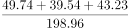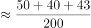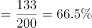，与D项最接近。

故正确答案为D。

**考点**：现期比重、统计表

**来源**：2014年青海省公务员录用考试《行测》题第106题

### 第 107 题

2009年，我国中东部地区文化事业费投入的同比增速约为：

A. 14.7%

B. 17.4%

C. 21.7%

D. 27.1%

第 107 题 · 答案与解析

**参考答案（粉笔题库参考内容）**

B

**解析**

由题干“2009年······的同比增速约为”，可判定本题为增长率计算问题。定位表格可得，2008年我国中东部地区文化事业费投入189.28亿元，2009年为222.17亿元。根据，2009年中东部地区文化事业费投入的同比增速为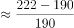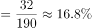，与B项最接近。

故正确答案为B。

**考点**：一般增长率、统计表

**来源**：2014年青海省公务员录用考试《行测》题第107题

### 第 108 题

2008年，文化事业费投入同比增速高于全国平均水平的是：

A. 西部地区

B. 艺术表演团体

C. 图书馆

D. 群众文化机构

第 108 题 · 答案与解析

**参考答案（粉笔题库参考内容）**

A

**解析**

由题干“2008年······同比增速高于全国平均水平的是”，可判定本题为增长率比较问题。定位表格可得2007、2008年各项文化事业费投入金额，根据，计算各项增长率进行比较即可。2007年全国文化事业费投入金额为198.96亿元，2008年为248.04亿元，增长率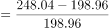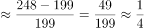。

A西部地区：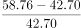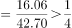；

B艺术表演团体：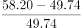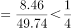；

C图书馆：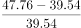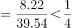；

D群众文化机构：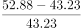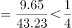。

比较可知，只有西部地区的文化事业费投入同比增速高于全国平均水平。

故正确答案为A。

**考点**：一般增长率、统计表

**来源**：2014年青海省公务员录用考试《行测》题第108题

### 第 109 题

2009年，艺术表演团体文化事业费投入占全国总投入的比重比图书馆：

A. 高近3个百分点

B. 低近5个百分点

C. 高近5个百分点

D. 低近3个百分点

第 109 题 · 答案与解析

**参考答案（粉笔题库参考内容）**

A

**解析**

由题干“2009年······占全国总投入的比重比······”，结合选项为高/低+百分点，可判定本题为现期比重比较问题。定位表格可得，2009年全国文化事业费投入292.32亿元，艺术表演团体投入63.62亿元，图书馆投入55.08亿元。则所求比重差为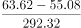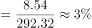，即高近3个百分点。

故正确答案为A。

**考点**：现期比重、统计表

**来源**：2014年青海省公务员录用考试《行测》题第109题

### 第 110 题

能够从资料中推出的是：

A. 2007-2009年，我国文化事业费投入同比增长率逐渐上升

B. 2007-2009年，其他机构文化事业费投入同比增长率逐渐上升

C. 2006年图书馆文化事业费投入占全国的比重高于2009年

D. 2006-2009年，平均每年的群众文化机构投入增长金额近10亿元

第 110 题 · 答案与解析

**参考答案（粉笔题库参考内容）**

C

**解析**

A项：定位表格可得2006-2009年全国文化事业费投入金额，根据，2007年我国文化事业费投入同比增长率为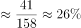，2009年为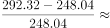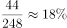。26%＞18%并非逐年上升，错误；

B项：定位表格可得2006-2009年其他机构文化事业费投入金额，根据，2007年其他机构文化事业费投入同比增长率为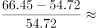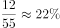，2008年为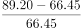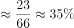，2009年为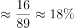。35%＞18%，并非逐年上升，错误；

C项：定位表格可得，2006年全国文化事业费投入158.03亿元，图书馆投入31.95亿元，2009年全国投入292.32亿元，图书馆投入55.08亿元。则2006年图书馆文化事业费投入占全国的比重为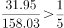，2009年为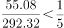，2006年图书馆文化事业费投入占全国的比重高于2009年，正确；

D项：定位表格可得，2006年群众文化机构投入增长金额为32.28亿元，2009年为68.12亿元，平均增长量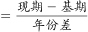，则平均每年增长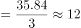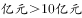，错误。

故正确答案为C。

**考点**：统计表、综合分析

**来源**：2014年青海省公务员录用考试《行测》题第110题

## 材料 2

2013年1-5月，全国规模以上快递服务企业业务量累计完成31.2亿件，同比增长61%；业务收入累计完成514.1亿元，同比增长34.3%。其中，同城业务收入累计完成57.7亿元，同比增长58.6%；异地业务收入累计完成292.6亿元，同比增长27.1%；国际及港澳台业务收入累计106.3亿元，同比增长31%；其他快递业务收入57.4亿元，同比增长63.7%。

        2013年1-5月，东、中、西部地区规模以上快递业务收入的比重分别为82.3%、9.4%和8.3%，业务量比重分别为80.6%、11.5%和7.9%。与上年同期相比，东部地区快递业务收入比重上升了0.5个百分点，快递业务量比重下降了0.4个百分点；中部地区快递业务收入比重下降了0.2个百分点，快递业务量比重上升了0.7个百分点；西部地区快递业务收入比重下降了0.3个百分点，快递业务量比重下降了0.3个百分点。

        2013年5月，规模以上快递业务量完成7.4亿件，同比增长51.4%；业务收入完成120.8亿元，同比增长35.4%。

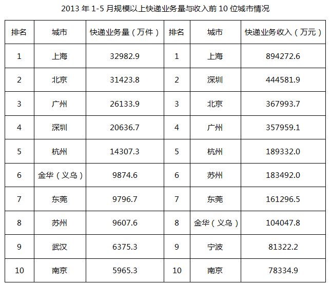

### 第 111 题

2013年1-5月，规模以上快递业务量超过全国总业务量10%以上的城市有几个？

A. 1

B. 2

C. 3

D. 4

第 111 题 · 答案与解析

**参考答案（粉笔题库参考内容）**

B

**解析**

由“超过全国总业务量10%以上······”，可判定本题为现期比重问题。定位材料第一段“2013年1-5月，全国规模以上快递服务企业业务量累计完成31.2亿件”，可知全国总业务量的10%=31.2亿×10%=3.12亿件。定位表格材料，2013年1-5月，只有上海和北京的规模以上快递业务量超过3.12亿件。

故正确答案为B。

**考点**：现期比重、综合资料

**来源**：2014年青海省公务员录用考试《行测》题第111题

### 第 112 题

2012年1-5月，规模以上快递业务完成的异地业务收入约是同城业务收入的多少倍？

A. 3

B. 4

C. 5

D. 6

第 112 题 · 答案与解析

**参考答案（粉笔题库参考内容）**

D

**解析**

由“2012年1-5月······异地业务收入约是同城业务收入的多少倍”，可判定本题为基期倍数问题。定位材料第一段“2013年1-5月······同城业务收入累计完成57.7亿元，同比增长58.6%；异地业务收入累计完成292.6亿元，同比增长27.1%”，可知2012年1-5月，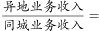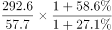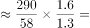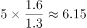。

故正确答案为D。

**考点**：基期倍数、综合资料

**来源**：2014年青海省公务员录用考试《行测》题第112题

### 第 113 题

2013年1-5月，规模以上快递业务收入占行业总收入的比重排序正确的是：

A. 异地业务＞国际及港澳台业务＞其他快递业务

B. 异地业务＞其他快递业务＞同城业务

C. 国际及港澳台业务＞其他快递业务＞同城业务

D. 国际及港澳台业务＞异地业务＞同城业务

第 113 题 · 答案与解析

**参考答案（粉笔题库参考内容）**

A

**解析**

由“2013年1-5月，规模以上快递业务收入占行业总收入的比重排序正确的是”，可判定本题为排序类问题。由于，总体量一定时，部分量越大，比重越大。定位材料第一段“2013年1-5月······同城业务收入累计完成57.7亿元······异地业务收入累计完成292.6亿元······国际及港澳台业务收入累计完成106.3亿元······其他快递业务收入57.4亿元”，可知按收入大小和比重大小排序应为：异地业务>国际及港澳台业务>同城业务>其他快递业务。

故正确答案为A。

**考点**：排序类、综合资料

**来源**：2014年青海省公务员录用考试《行测》题第113题

### 第 114 题

关于2012年1-5月规模以上快递业务状况，不能从上述资料中推出的是：

A. 同城业务收入占行业总收入比重

B. 东部地区单件快递业务收入

C. 西部地区快递业务量

D. 异地快递业务量

第 114 题 · 答案与解析

**参考答案（粉笔题库参考内容）**

D

**解析**

A项：定位文字材料第一段“2013年1-5月······业务收入累计完成514.1亿元，同比增长34.3%。其中，同城业务收入累计完成57.7亿元，同比增长58.6%；”可知部分量、总体量及同比增长率，根据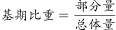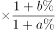，可求出2012年1-5月同城业务收入占行业总收入比重，可以推出；

B项：定位文字材料第一段“2013年1-5月，全国规模以上快递服务企业业务量累计完成31.2亿件，同比增长61%；业务收入累计完成514.1亿元，同比增长34.3%”，根据，可求出2012年1-5月全国规模以上快递服务企业业务量和业务收入。定位文字材料第二段“2013年1-5月，东······业务收入的比重分别为82.3%······业务量比重分别为80.6%······与上年同期相比，东部地区快递业务收入比重上升了0.5个百分点，快递业务量比重下降了0.4个百分点”，可求出2012年1-5月东部地区的快递业务收入比重和快递业务量比重，根据部分量=总体量×比重，可求出2012年1-5月东部地区的快递业务收入和快递业务量。根据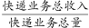，可求出东部地区单件快递业务收入，可以推出；

C项：根据B选项，可求出2012年1-5月全国规模以上快递服务企业业务量，定位文字材料第二段“2013年1-5月······西部······业务量比重分别为7.9%······与上年同期相比······西部地区快递业务量比重下降了0.3个百分点”，可推出西部地区2012年1-5月快递业务量所占比重，根据部分量=总体量×比重，可求出2012年1-5月西部地区的快递业务量，可以推出；

D项：材料只给出了异地快递的业务收入，未给出业务量相关数据，无法求出2012年的数据，不能推出。

故正确答案为D。

**考点**：综合分析、综合资料

**来源**：2014年青海省公务员录用考试《行测》题第114题

### 第 115 题

关于2013年1-5月规模以上快递业务，能够从上述资料中推出的是：

A. 上海平均每件快递业务的收入约为30多元

B. 5月快递业务量低于同年1-4月的平均水平

C. 快递业务收入排前10名的城市中有3个来自广东

D. 快递业务量与快递业务收入均排前10名的城市有8个

第 115 题 · 答案与解析

**参考答案（粉笔题库参考内容）**

C

**解析**

A项：定位表格材料，2013年1-5月，上海快递业务量32982.9万件，快递业务收入894272.6万元，平均每件快递业务的收入约为元/件，错误；

B项：定位文字材料第一段“2013年1-5月，全国规模以上快递服务企业业务量累计完成31.2亿件”，定位文字最后一段“2013年5月，规模以上快递业务量完成7.4亿件”，则1-4月快递业务量的平均水平为亿件，低于5月快递业务量，错误；

C项：定位表格材料，快递业务收入排前十的有深圳、广州、东莞三个城市来自广东，正确；

D项：定位表格材料，快递业务量和业务收入均排前十的有上海、北京、广州、深圳、杭州、金华（义乌）、东莞、苏州、南京，共9个城市，错误。

故正确答案为C。

**考点**：综合分析、综合资料

**来源**：2014年青海省公务员录用考试《行测》题第115题

## 材料 3

中非贸易额2008年突破了1000亿美元，其中中国对非洲出口508亿美元，自非洲进口560亿美元。2000年至2008年，中非贸易占中国对外贸易总额的比重由2.2%升至4.2%。2009年，中非贸易额910.7亿美元。2010年1月至11月，中非贸易额达1148.1亿美元，同比增长43.5%。

        截至2009年年底，中国对非洲直接投资存量已大幅增长到93.3亿美元。

### 第 116 题

2008年，中国对非洲贸易逆差为：

A. 25亿美元

B. 34亿美元

C. 48亿美元

D. 52亿美元

第 116 题 · 答案与解析

**参考答案（粉笔题库参考内容）**

D

**解析**

定位文字材料第一段可知：2008年，中国对非洲出口508亿美元，自非洲进口560亿美元。则2008年，中国对非洲贸易逆差=自非洲进口额-对非洲出口额=560-508=52亿美元。

故正确答案为D。

**考点**：简单加减计算、综合资料

**来源**：2014年青海省公务员录用考试《行测》题第116题

### 第 117 题

2000-2010年，中非贸易额超过600亿美元的年份有几个？

A. 3

B. 4

C. 5

D. 6

第 117 题 · 答案与解析

**参考答案（粉笔题库参考内容）**

B

**解析**

根据材料图1，2000-2009年中非贸易额超过600亿美元的年份为2007年，2008年，2009年；定位文字材料第一段可知：2010年1月至11月，中非贸易额达1148.1亿美元，则2010年全年中非贸易额一定超过600亿美元。符合条件的年份一共有4个。

故正确答案为B。

**考点**：直接找数、综合资料

**来源**：2014年青海省公务员录用考试《行测》题第117题

### 第 118 题

2009年12月，中非贸易额约为多少亿美元？

A. 76

B. 94

C. 111

D. 800

第 118 题 · 答案与解析

**参考答案（粉笔题库参考内容）**

C

**解析**

根据题干“2009年12月······中非贸易额······”，结合文字材料第一段“2009年，中非贸易额910.7亿美元。2010年1月至11月，中非贸易额达1148.1亿美元，同比增长43.5%”，可判定本题为基期和差问题。代入公式：，则2009年12月贸易额=2009年全年贸易额-2009年1月至11月贸易额800=110.7，最接近C项。

故正确答案为C。

**考点**：基期和差、综合资料

**来源**：2014年青海省公务员录用考试《行测》题第118题

### 第 119 题

截至2009年年底，中国对非洲直接投资存量超过10亿美元的行业有几个？

A. 4

B. 5

C. 6

D. 7

第 119 题 · 答案与解析

**参考答案（粉笔题库参考内容）**

A

**解析**

根据题干“······超过10亿美元的行业”，结合材料文字第二段“截至2009年年底，中国对非洲直接投资存量已大幅增长到93.3亿美元。”和材料图2，可判定本题为比重问题。中国对非洲直接投资存量为10亿美元时，占总存量的比重，则当投资存量所占比重大于10.7%时，符合题干的要求。根据材料图2，有采矿业（29.2%）、制造业（22.0%）、建筑业（15.8%）、金融业（13.9%）4个行业符合要求。

故正确答案为A。

**考点**：现期比重、综合资料

**来源**：2014年青海省公务员录用考试《行测》题第119题

### 第 120 题

能够从资料中推出的是：

A. 2010年中非全年贸易额同比增长了43.5%

B. 2001-2010年中非贸易额呈逐年上升趋势

C. 2008年中国的对外贸易总额略低于2万亿美元

D. 2000-2008年中非贸易年均增长额超过100亿美元

第 120 题 · 答案与解析

**参考答案（粉笔题库参考内容）**

D

**解析**

A项：定位文字材料第一段可知：2010年1月至11月，中非贸易额同比增长43.5%，并不是2010年全年，错误；

B项：定位材料图1，可发现2009年中非贸易额低于2008年，错误；

C项：定位文字材料第一段可知：2008年中国对非洲出口508亿美元，自非洲进口560亿美元，中非贸易占中国对外贸易总额的比重为4.2%，则2008年中国对外贸易总额亿美元，错误；

D项：定位文字材料第一段可知：2008年中国对非洲出口508亿美元，自非洲进口560亿美元，则2008年中非贸易总额=508+560=1068亿美元；定位材料图1可知：2000年中非贸易总额&lt;200亿美元，则2000-2008中非贸易增长总额>1068-200=868亿美元，，正确。

故正确答案为D。

**考点**：综合分析、综合资料

**来源**：2014年青海省公务员录用考试《行测》题第120题

