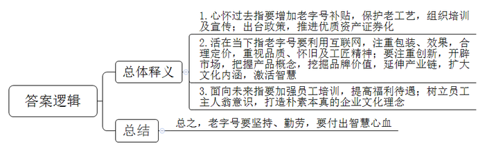
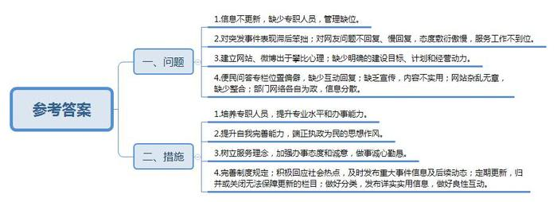
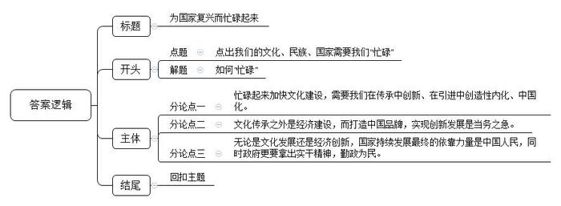

# 2017年公务员多省联考《申论》题（青海卷）

<!-- gwy:overview:start -->
> **青海 · 2017 · 申论 · 统考** ｜ 3 题 · 图片 3 处 · 答案随题折叠

导航：[题目](#题目) · [材料 1](#材料-1)
<!-- gwy:overview:end -->

> 候选采集稿。参考答案及解析来自粉笔页面，不代表官方答案或真实高分答卷；来源使用许可与原卷对应关系仍需人工核实。

## 给定材料

### 材料 1

对于经历了物质极度匮乏时期的人来说，不管是酯香浓郁的老酱油，还是质地厚重的雪花膏，各式各样的“中华老字号”都超越了本身功能性的意义，成为一个时代最温情的记忆。

新中国成立初期，我国大约拥有“中华老字号”16000家；1991年原国内贸易部的老牌企业全行业的认定中，有1600余家老牌企业被授牌；但到了2006年商务部重新认定时，第一批中华老字号的数量只剩434家。

由于以前保护意识不强，在城市市政建设中，部分老字号的原址被拆除，只能搬迁他地或仅能保留部分原址，经营空间不断萎缩。而对于老字号来说，这无疑是个大问题——老字号首先还得是那个老店啊！现在这年代不差好的商品、好的服务，经常光顾老店的顾客多是因为那份感情，在熟悉的地方逛一逛、坐一坐，要的是那份感觉。一旦搬迁，部分老字号就可能失去了原来空间中提供给自己生存发展必需的养分，从此一蹶不振。

同时，还有相当一部分的老字号因为遭受知识产权侵权和恶性商业竞争，逐渐退到了时代和市场的边缘，而经营良好的老字号更是深受其害。

“地价租金太贵，经营方式跟不上，还有不少其他历史包袱。我们是国企，启动改制之后老职工安置问题等等，都使得我们负担不起，无法迈开步子前进。要不就是我们真的太老了，老到思路打不开，脚步跟不上。我们不缺勤奋苦干，每天起早贪黑，两头见星星，可还是只能勉强保本。产品更新慢，老顾客留不住，年轻人不愿来。”一位老字号国企负责人无奈地表示，“我们也想过要改，可看到前段时间另外一个老字号就因为改制搞到管理权都没办法集中，没办法决策如何发展了，我们就怕了。这样改还不如老老实实守住自留地。”

随着保护老字号呼声的增多，各地政府也有所行动。在北京、上海、天津和江浙这些老字号聚集的地方，地方政府对老字号的补贴较多，也更加注重对传统老工艺的保护，还曾举办电子商务学习培训并组织老字号企业“走出去”，出境办展宣传。“老字号、老工艺是一个时代、一个国家的珍贵财富，不能因为我们的懈怠而消失。”一位工作人员说。

2017年1月，商务部、发改委等16个部门联合印发了《关于促进老字号改革创新发展的指导意见》，这对创新动力不足、业绩欠佳的部分老字号企业来说是一个重大利好。

在2016年，10余家老字号公司陆续登陆股市新三板。推进老字号核心优质资产证券化，支持符合条件的老字号上市首发股票或到全国中小企业股份转让系统挂牌，成为老字号利用多层次资本市场做大做强的契机。

“保护归保护，但关键还是要看自己。其实，老字号与普通企业一样，优胜劣汰。”一位企业家如是说。

扬州市某著名日化用品厂是最早在政府牵头下，与网络电商平台合作，发展官方旗舰店的老字号企业之一。面对自身电视传媒广告营销能力偏弱的实际，厂家充分利用电商平台巨大的客户流量，用细腻的文字、复古精致的网页装修，不仅唤起了老顾客对自己的记忆，也增加了年轻人对“祖母级”国货化妆品的了解和信任。简而不陋的包装，朴实温和的效果，亲民实惠的价格，带动了系列产品的热销，不仅使这家经历百年风雨的老字号重新焕发活力，更掀起了一股“国货热”。

而在某龙头饮料公司董事长看来，抓住机遇、求新求变将会带来更好的发展。是的，老字号不缺情怀，但不能一味消费情怀。在人们眼中，老字号是“品质”“怀旧”“工匠精神”等的代名词。在特定年代，老字号创造的商业辉煌，为发展工业、振兴经济、传承传统优秀文化、丰富人们物质精神生活、撑起民族复兴希望立下了汗马功劳。这些都是值得我们骄傲并永远铭记的。但再老的字号，也不是金字招牌，不能躺在历史的功劳簿上高枕无忧地睡大觉。身处这样一个“互联网+”时代，利用好它，你可以足不出户，不费周折地闻达于天下；脱离这个时代，哪怕就是皇帝的女儿也愁嫁。

### 材料 2

某著名老饭店在2016年推出了全新菜单，减少了固定菜品，增加了门店自选菜品、创新菜品以及应季养生菜。新的菜单采用了二维码推介，顾客通过手机扫描，就可以了解到菜品的相关典故、口味等。这样的菜单，既新奇又复古。

当年，某药品老字号推出了均价高达20多元的高端中草药牙膏，引得业界一片哗然。要知道哪怕是外国牙膏的均价也不超过10元一支，而你一个刚刚踏进门槛的中草药公司，哪来这么足的底气？而事实证明了这家老字号的英明：它以中草药为卖点的牙膏推出不到两年的时间就实现营销收入逾4亿元。如今，牙膏已经比公司的传统产品更加流行。其实在推出牙膏前，公司的产品已经成熟，产品的利润空间变得十分有限，急需找到新的利润增长点。人们对公司中药产品品质的信赖和对口腔养护越来越高的要求更坚定了公司开辟新市场的决心。把握好产品概念，深入挖掘品牌价值，延伸产业链，通过一款产品，成功地扩大了品牌文化内涵，激活了自身智慧发展因子。

近日，一则“百年中药老字号旗下的草药咖啡馆在杭州开业”的新闻吸引了人们的注意。中药店卖咖啡？这不是包子店卖披萨、拿美声演小品吗？跨界混搭得这么狠，恐怕又是为了博人眼球、怒刷存在感的营销炒作吧？

然而事实并非如此。草药咖啡馆是用咖啡机萃取中草药，卖的是有20种汉方草药的饮品，每一款饮品都由中医团队专门研发，有的还采用了中药保密配方。这样的单品一经推出，便引起轰动效应，让广大消费者慕名前来，一品为快。而这其中，不乏一些已将“老字号”视为“老古董”的“90后”，甚至“95后”。

不得不承认，一些老字号跟不上步伐，渐渐掉了队。要如何既留住老一代，又赢得年轻人？传承固然重要，但如果墨守成规、固步自封，是走不出日薄西山的颓势的。

老字号品牌资产累积很深，要长久发展，<u>既要心怀过去，也要活在当下，还要面向未来。</u>

### 材料 3

在2016年，国内手机市场可谓是血雨腥风、凶险莫测。而有一个公司却能从制造复读机、音乐播放器的小厂，变成手机行业的最势不可挡的新贵，它靠的是什么？

答案是出色的品质、美观大方的外形和简洁稳定的系统。虽然说手机是快速消费品，但谁不想手机能用长一点且运行流畅呢？以品质为信念，经典而又永不过时。

公司推出的手机皮实耐用，还颇具颜值，多次赢得年度颜值担当、年度最薄、年度最佳拍照手机等称号。这一切的背后，是一个公司对创新的执着追求和辛勤付出。勤恳创新才有生命力，作为科技公司，这一点显得更加重要。始终用品质说话，用品质给消费者购买的欲望与冲动。

公司会定期对员工进行综合技能、职业道德、敬业精神等相关方面的培训；而在工资福利方面，也是住房福利、年底奖金、业绩分红，一样不缺。让员工有主人翁意识，这是最朴素本真的企业文化理念。

广告，不仅要金钱实力，更需智慧经营。于是乎，电视台、商场、地铁口……分布广泛，真正做到了营销无死角。广告谁都会打，但怎样才能打出好的效果？这不是简单依靠酷炫的特效和当红的明星就能做到的。不断调研考量，把握准消费者的心理，选择好的电视台、收视率高的节目，想出好的创意，配上朗朗上口的广告词，效果立竿见影。让别人不能忘记你，这是宣传的最高境界。

公司的成功，可以说是既原始又创新，既笨拙又聪明。不急不躁，遇到困难，不执拗，不退缩，认定的事情，坚持去做，直到成功。而近年来靠硬件配置的堆砌似乎让很多手机厂商迷失了方向，不假思索地堆砌硬件配置制造卖点的手法已经显得有些简单粗暴，而且似乎难以长久维持。

成功没有捷径，要付出勤劳的汗水，还要付出智慧和心血。做产品和做人一样，没有谁随随便便就能成功。

### 材料 4

前不久，一位网友打开本县某局官网吃了一惊：网站首页赫然滚动播放着一行字幕——“今天心情非常的不好！”经曝光后，该网站终于在“休眠”大半年后发布一条公告，称网站正在建设中，现处于试运行阶段。

还有更让人哭笑不得的：举报本地河流被工厂有毒废弃物污染的问题，官网回应：“没毒，鱼虾都活着”；而另一位网友的咨询更是得到了“请把我局第一次回复内容读三遍，若还不理解，最好屈尊到户籍窗口咨询”这样的“神回复”。

其实经营好官方网站、官方微博，对公共事务管理服务工作有着不可估量的作用。尤其是在新媒体时代，利用好新媒体，能低成本地加强和群众的互动及官方宣传，抢占舆论制高点，看到最鲜活的民意，延伸管理触角，扫除公共服务的死角，冲破时间、空间等限制，改善自身形象，树立新的管理发展理念。

然而，部分地区由于没有明确的考核任务，少数机关单位思想观念陈旧、行动迟缓，甚至把网站、政务微博等当成负担。建立网站、开通微博就只是出于“别人有的我也要有”的攀比心理，并没有明确的建设目标和计划，也缺少经营的动力。部分网站、微博经过网络装修后，确实非常醒目，但做得好不好，关键还是看“内涵”，“颜值”并不能压倒一切。数据显示，在2016年一项随机抽查的746个各级政府网站中，仍有112个网站不合格，其中还有“沉睡”5年以上的“僵尸”网站。

经过比较不难发现：有的网站各个栏目一应俱全，但位于页面正中并且时常更新的却是政务信息宣传栏，而直接与老百姓相关的问答栏就只能“偏安一隅”，互动回复也寥寥无几。如果有事怎么办？相信不少人的回答依然是“有事找百度”，而非官网官微。这其中固然有现在资讯发达、信息渠道丰富的原因，但不可忽视的是，部分地区部门宣传不到位，相关内容不实用。部分网站、微博公布的信息是一股脑地全盘奉上，没有分类、没有关键字、没有索引，显得杂乱无章，不够用心。而“一个衙门一个网站”浪费了网络资源的同时，也让老百姓望洋兴叹，不知如何“下”网。

一些地区部门在面对突发事件时在官网和微博的表现依然滞后、笨拙，这更是让自己处于非常被动的舆论位置。在面对网友反映的问题说完“您好，我们会尽快为您处理”后再无下文，不回复，慢回复，或者“神”回复，种种不给力的表现，使得本该成为社情收集器的官网官微反而成为“舆情堰塞湖”。

信息化时代，能否运用好新媒体，可以看出一个机关是否具有自我完善的能力和执政为民的思想作风。把这当成勤政的一个细节来做，是切实降低行政成本、建立“友好型”政府、不折腾、不怠慢群众、实现自盈利的明智之举，而一些地方和部门懒得改变、懒得回应、懒得经营，折射出的是权力的傲慢和对民意的漠视。

当然，很多机关单位并不是不想经营好网站、微博，但不懂网络宣传，缺乏专职人员的现状束缚了他们的手脚。

某市在经历“神回复”被“群嘲”的惨痛教训后，痛定思痛，由市政府办公厅发布了对政府网站信息内容建设的意见，明确各部门网站对社会热点必须积极回应，重大事件要第一时间在网站发布信息，并及时发布后续动态进展。信息内容原则上每周至少更新一次，对于内容更新没有保障的栏目要及时归并或关闭。“我们多动手，群众少跑腿”，秉持这样的理念，网站分类分栏逐渐清晰，信息越来越详实实用，跟群众的良性互动也越来越多，得到了很多群众的“点赞”。站在普通百姓的角度看，除了做事的水平能力，他们更看重的是政府办事的态度和诚意。只要拿出诚心，勤勤恳恳地做实事，哪怕不那么完美，群众也不会吝惜掌声和称赞。

### 材料 5

勤能补拙似乎一直是至理名言，然而，一个著名咨询集团合伙人却不这样认为，他语出惊人：勤可致拙。我的很多同行失败就失败在太勤奋。因为太过勤奋，而没有时间和精力去思考。我总是想着懒，而不是懒得想。有时候这就是效率。毕竟，人生那么短，事情却这样多，不略过那些不打紧的事情，把好钢用在刀刃上，生活只会越忙越糟，越糟越忙，恶性循环。所以要养成一种好习惯，一种智慧，才能成为自己的主人。当然，这要注意区分躺在沙发上一动不动，抱怨沙发太硬的家伙和为了躺得更舒服而起身发明懒人沙发的人。

另一位网评家也表达了相同的看法：人勤于思考，才会分清事情主次轻重，珍惜自己的精力，做到低成本、高效益……总之，这样的人长于把握一切、不急不躁、有条不紊，善于从繁杂和忙乱中解脱自己，这是一种人生艺术。

有的人含着银匙长大，各方面都无比顺利，甚至可以用现在流行的一句话来形容——堪称人生赢家。而放弃大好前程、安逸生活不要，却选择了一条看上去无比折腾的人生道路，这不是自己找事做吗？从某种意义上来说，这确实是。然而，人生是越努力才会越幸运。每天给自己找一点事儿做，每天勤奋一点点，努力一点点，收获一点“小确幸”，终有一天会积累人生的“大满足”。而天天不做事，最后可能会没事做，或者做不了、做不完。

不去思考必须思考的问题，不去做必须做的事情，如果这发生在我们身上，就是怯弱、狭隘和封闭，是最最消极的。我们的灵魂和心会被蚕食，我们的思想将被撕裂成碎片，而我们只能在其中跌跌撞撞，疲于拾掇缝补，苟且喘息。所以，我们会在碎片中生活，会在原地踏步中越来越忙碌。

别让脑袋停止思考。人和人，甚至人和动物在肉体上都没多大区别，差的就是灵魂。若不思索，甚至没有追求，随遇而安，你就必须接受所有后果，那就是被其他人或自然支配。

我们付出了巨大的努力才看清楚我们所在的这颗蓝色星球的模样，才弄清楚我们怎样进化成人，才变得有一点点的能力和空闲去利用、去支配自然获得片刻的闲暇以实现我们心中小小的偷懒的欲念。但现在的时刻，我们的文化、我们的民族、我们的国家，需要我们忙碌起来，而不是一直在缅怀过去、一直在不经过大脑地轻松娱乐。毕竟，在人类文明的长河里，我们总是历尽艰辛，万分努力，才让一切看起来不那么费劲。

## 题目

### 第 1 题

**“给定资料2”中提到，老字号“既要心怀过去，也要活在当下，还要面向未来”，请根据“给定资料1～3”，谈谈你对这句话的理解。（20分）**

关联材料：材料 1、材料 2、材料 3

作答要求：

要求：全面、准确、简明，有条理。不超过200字。

第 1 题 · 答案与解析

**参考答案（粉笔题库参考内容）**

1.心怀过去指要增加老字号补贴，保护老工艺，组织培训及宣传；出台政策，推进优质资产证券化。

2.活在当下指老字号要利用互联网，注重包装、效果，合理定价，重视品质、怀旧及工匠精神；要注重创新，开辟市场，把握产品概念，挖掘品牌价值，延伸产业链，扩大文化内涵，激活智慧。

3.面向未来指要加强员工培训，提高福利待遇；树立员工主人翁意识，打造朴素本真的企业文化理念。

总之，老字号要坚持、勤劳，要付出智慧心血。

**解析**

**参考答案说明：**思路方面，本参考答案按照词句解释题“总体释义+总结”的答题思路展开。内容方面，本参考答案分别对“心怀过去”“活在当下”“面向未来”作出了解释；然后进行了总结。词句表达方面，本参考答案加上了“总之”连接词来承接上下文。

**考点**：词句解释类

**来源**：2017年公务员多省联考《申论》题（青海卷）

### 第 2 题

**“给定材料4”中谈到一些地方官方网站、官方微博没有起到应有的作用。请据此指出这些地方的官方网站和官方微博存在哪些问题，应当如何改进？（30分）**

关联材料：材料 1、材料 2、材料 3、材料 4、材料 5

作答要求：

要求：针对性强、简明，建议合理，有条理。不超过300字。

第 2 题 · 答案与解析

**参考答案（粉笔题库参考内容）**

一、问题：1.信息不更新，缺少专职人员，管理缺位。2.对突发事件表现滞后笨拙；对网友问题不回复、慢回复，态度敷衍傲慢，服务工作不到位。3.建立网站、微博出于攀比心理；缺少明确的建设目标、计划和经营动力。4.便民问答专栏位置偏僻，缺少互动回复；缺乏宣传，内容不实用；网站杂乱无章，缺少整合；部门网络各自为政，信息分散。二、措施：1.培养专职人员，提升专业水平和办事能力。2.提升自我完善能力，端正执政为民的思想作风。3.树立服务理念，加强办事态度和诚意，做事诚心勤恳。4.完善制度规定；积极回应社会热点，及时发布重大事件信息及后续动态；定期更新，归并或关闭无法保障更新的栏目；做好分类，发布详实实用信息，做好良性互动。

**解析**

**参考答案说明：**本参考答案宏观上分成了“问题”和“对策”两个要素。在“问题”内部，又从“管理”“态度”“网站建设”“网站内容”等不同的层面进行了分条撰写。各条要点之间在内容上相互并列，没有交叉。在“对策”内部，又从“加强管理”“完善能力”“端正态度”“加强网站建设和完善网站内容”等不同的方面进行了分条撰写。各条要点之间在内容上相互并列，没有交叉。

**考点**：提出对策类

**来源**：2017年公务员多省联考《申论》题（青海卷）

### 第 3 题

**根据你对“给定资料5”中划线部分“但现在的时刻，我们的文化，我们的民族、我们的国家，需要我们忙碌起来，而不是一直缅怀过去、一直在不经过大脑地轻松娱乐”的理解，自选角度，自拟题目，写一篇文章。（50分）**

关联材料：材料 1、材料 2、材料 3、材料 4、材料 5

作答要求：

要求：结合给定资料，但不拘泥于给定资料，联系实际；观点正确，内容充实；结构完整，思路清晰，语言流畅；字数1000字左右。

第 3 题 · 答案与解析

**参考答案（粉笔题库参考内容）**

**为国家复兴而忙碌起来**

中华文化有优雅音韵与深刻内涵，却被快餐文化、娱乐文化蚕食，失去了风韵与气度；我国经济正在转型升级，国家亟需创新发展。在这本应忙碌起来加油干的时刻，我们很多年轻人却每天在“忙然又茫然”中虚度青春，直言人生“压力山大”，身心俱疲……

我们要忙碌起来！**思考上要勤奋、快速，要在坚守、继承、创新中梳理过去、辨明方向；但在行动上不能“瞎忙”，要慢下来，把握节奏，分清主次、提高效率，着力解决必须解决的问题**。

**忙碌起来加快文化建设，需要我们在传承中创新、在引进中创造性内化、中国化**。我们伟大灿烂的古典文化不能在各种狭隘的宫斗剧，各种浮躁的搞笑段子、视频、娱乐中被曲解、被滥用，我们要耐心、细心挖掘传统文化之美、文明价值。而面对外来文化，我们要独立而自信。我们大量翻译和引进外国文献和文化产品的同时，要避免在盲从和模仿中丧失文化自信和创造力的风险。我们的民族正在复兴，文化的生命在于新陈代谢、有机更新，不断创造新文化。我们的文化要在传承古典精华、引进消化再创造中涅槃。

**文化传承之外是经济建设，而打造中国品牌，实现创新发展是当务之急**。民族复兴离不开经济支撑，离不开中国企业的创新，离不开中国民族品牌。当前，中国高铁、华为通讯、OPPO手机等一批新兴民族品牌以专精研发、工匠精神、有智慧的营销策略而闻名于世。但同时，一些传统老字号也面临保护不足、创新乏力、发展后劲不足的问题。这方面，毫无疑问，政府的保护和帮扶要到位。但更重要的还是企业自身要反思总结，扬长避短。要善用互联网，利用新技术，发展新经济，在产品开发、品牌打造、市场营销各方面适应新市场、提高经营能力和智慧。

**无论是文化发展还是经济创新，国家持续发展最终的依靠力量是中国人民，同时政府更要拿出实干精神，勤政为民**。

无所作为的官方微博、官方网站折射出的是庸政、懒政的思想，既怠慢了群众，也损害了政府“俯首甘为孺子牛”的亲民形象。空谈误国，实干兴邦。政府公职人员、领导干部应该时刻关注百姓民生，倾听民意、体察民情，想群众之所想，及时发布有效信息。不摆“花架子”，不搞“假名堂”，用严格的考评机制将“假忙碌”之人淘汰出公职队伍，真正实现“为人民服务”的第一宗旨。

为了不在大时代中沉沦，我们要忙碌起来，要积极努力、勤于思考、善于创新创造。这种忙碌是为了不那么辛苦而辛苦，为了越努力越幸运而奋斗。这种忙碌也是为了致敬先辈，他们曾经为了我们今日的闲暇历尽艰辛、万分努力。我日夜期盼的朋友们，你们在哪？快来吧！时间到了！该为国家复兴而忙碌了！

**解析**

**文章分析**

**为国家复兴而忙碌起来**

【**标题的优点：**首先，范文的标题“为国家复兴而忙碌起来”突出了“忙碌”这一主题。其次，形式上，文字简洁明快。】

<u>中华文化有优雅音韵与深刻内涵</u>，<u>却被快餐文化、娱乐文化蚕食</u>，<u>失去了风韵与气度</u>；<u>我国经济正在转型升级</u>，<u>国家亟需创新发展</u>。（2）<u>在这本应忙碌起来加油干的时刻</u>，<u>我们很多年轻人却每天在“忙然又茫然”中虚度青春</u>，直言人生“压力山大”，身心俱疲……

【**开头的优点：**★内容方面。范文的开头是紧扣题目给定的“但现在的时刻，我们的文化、我们的民族、我们的国家，需要我们忙碌起来，而不是一直在缅怀过去，一直在不经过大脑地轻松娱乐”这句话展开的。首先，**开头点出主题，做到了主题明确。其次，对“忙碌”这一主题进行了分析阐述，指出了（1）“忙碌”的背景。（2）“忙碌”中存在的问题。**★文字表达方面：使用了“却”等关联词，使语言表达有逻辑性。】

我们要忙碌起来！**思考上要勤奋、快速，要在坚守、继承、创新中梳理过去、辨明方向；但在行动上不能“瞎忙”，要慢下来，把握节奏，分清主次、提高效率，着力解决必须解决的问题**。

【**过渡段的优点：**范文过渡段分析了如何“忙碌”的对策这一方面**的内容**，用来引起下文。】

**忙碌起来加快文化建设，需要我们在传承中创新、在引进中创造性内化、中国化**。（1）<u>我们伟大灿烂的古典文化不能在各种狭隘的宫斗剧</u>，<u>各种浮躁的搞笑段子、视频、娱乐中被曲解、被滥用</u>，<u>我们要耐心、细心挖掘传统文化之美、文明价值</u>。（2）而<u>面对外来文化</u>，<u>我们要独立而自信</u>。<u>我们大量翻译和引进外国文献和文化产品的同时</u>，<u>要避免在盲从和模仿中丧失文化自信和创造力的风险</u>。我们的民族正在复兴，<u>文化的生命在于新陈代谢、有机更新，不断创造新文化</u>。我们的文化要在传承古典精华、引进消化再创造中涅槃。

【**论述段1的优点：**★观点句：范文的观点句是紧扣“忙碌”这一文章主题提出的。形式上，它在段首处直接写出，位置突出，容易发现。内容上，关键词突出，内容要点明确，可以明显看出它是从“加快文化建设”入手，指出了“如何忙碌”。★论述内容：（1）介绍了“我们要挖掘传统文化之美”；（2）介绍了“我们要独立而自信的面对外来文化”；注意：以上几个方面的内容都是紧扣“忙碌起来加快文化建设，需要我们在传承中创新、在引进中创造性内化、中国化”这个观点句进行分析论述的，论述的针对性强，内容层次丰富。最后，在论述方法和论据的选取上做到了讲道理与举例子相结合，做到了丰富多样。】

**文化传承之外是经济建设，而打造中国品牌，实现创新发展是当务之急**。（1）<u>民族复兴离不开经济支撑</u>，<u>离不开中国企业的创新</u>，<u>离不开中国民族品牌</u>。当前，中国高铁、华为通讯、OPPO手机等一批新兴民族品牌以专精研发、工匠精神、有智慧的营销策略而闻名于世。但同时，<u>一些传统老字号也面临保护不足、创新乏力、发展后劲不足的问题</u>。这方面，毫无疑问，政府的保护和帮扶要到位。但更重要的还是<u>企业自身要反思总结，扬长避短</u>。<u>要善用互联网，利用新技术，发展新经济</u>，在<u>产品开发、品牌打造、市场营销各方面适应新市场、提高经营能力和智慧</u>。

【**论述段2的优点：**★观点句：范文的观点句是紧扣“忙碌”这一文章主题提出的。形式上，它在段首处直接写出，位置突出，容易发现。内容上，关键词突出，内容要点明确，可以明显看出它是从“加快经济建设”入手，指出了“如何忙碌”。★论述内容：（1）介绍了“经济建设的重要性”；（2）介绍了“新兴民族品牌发展迅猛”；（3）介绍了“传统老字号发展存在的问题”；（4）介绍了“企业应该如何发展”注意：以上几个方面的内容都是紧扣“文化传承之外是经济建设，而打造中国品牌，实现创新发展是当务之急”这个观点句进行分析论述的，论述的针对性强，内容层次丰富。最后，在论述方法和论据的选取上做到了讲道理与举例子相结合，做到了丰富多样。】

**无论是文化发展还是经济创新，国家持续发展最终的依靠力量是中国人民，同时政府更要拿出实干精神，勤政为民**。

<u>（1）无所作为的官方微博、官方网站折射出的是庸政、懒政的思想</u>，（2）<u>既怠慢了群众</u>，<u>也损害了政府“俯首甘为孺子牛”的亲民形象</u>。空谈误国，实干兴邦。（3）政府公职人员、领导干部<u>应该时刻关注百姓民生</u>，<u>倾听民意、体察民情，想群众之所想，及时发布有效信息</u>。不摆“花架子”，不搞“假名堂”，<u>用严格的考评机制将“假忙碌”之人淘汰出公职队伍</u>，真正实现“为人民服务”的第一宗旨。

【**论述段3的优点：**★观点句：范文的观点句是紧扣“忙碌”这一文章主题提出的。形式上，它位置突出，容易发现。内容上，关键词突出，内容要点明确，可以明显看出它是从“中国政府”入手，指出了“如何忙碌起来促进国家发展”。★论述内容：（1）介绍了“无所作为政府的问题”；（2）介绍了“无所作为政府产生的危害”；（3）介绍了“政府应该如何为群众忙碌，有所作为”；注意：以上几个方面的内容都是紧扣“政府更要拿出实干精神，实干为民”这个观点句进行分析论述的，论述的针对性强，内容层次丰富。最后，在论述方法和论据的选取上做到了讲道理与举例子相结合，做到了丰富多样。】

【**论述段之间的关系**：★内容的内在逻辑：范文的论述段之间是依照“如何忙碌起来促进国家复兴发展”的逻辑展开的。论述段1先写了“忙碌起来加快文化发展”，论述段2再写了“忙碌起来加快经济发展”，论述段3接着写了“中国人民尤其是中国青年人如何忙碌起来促进国家复兴发展”。★段与段的外在衔接：论述段2的段首处的过渡句“文化传承之外是经济建设”，起到了承接论述段1、引出了论述段2的作用。论述段3的段首处的过渡句“无论是文化发展还是经济创新”，起到了承接论述段2、引出了论述段3的作用。】

为了不在大时代中沉沦，（1）我们<u>要忙碌起来</u>，要积极努力、勤于思考、善于创新创造。这种<u>忙碌</u>是为了不那么辛苦而辛苦，为了越努力越幸运而奋斗。这种<u>忙碌</u>也是为了致敬先辈，他们曾经为了我们今日的闲暇历尽艰辛、万分努力。（2）我日夜期盼的朋友们，你们在哪？快来吧！时间到了！<u>该为国家复兴而忙碌了</u>！

【**结尾的优点**：范文的结尾回扣了“忙碌”这一主题。（1）再次总结了“如何忙碌”；（2）发出了号召希望。】

**考点**：文章写作题

**来源**：2017年公务员多省联考《申论》题（青海卷）

