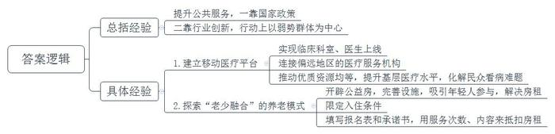
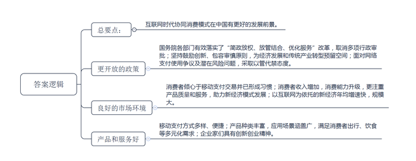
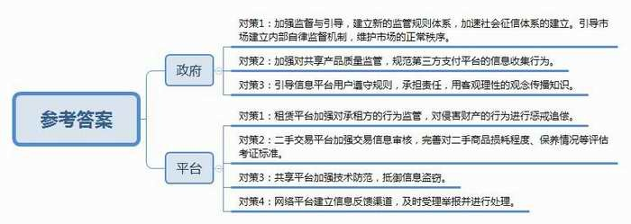
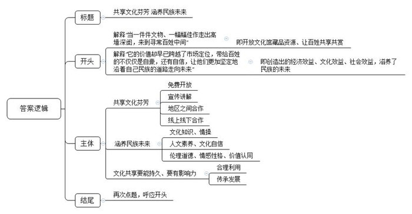

# 2018年公务员多省联考《申论》题（青海卷）

<!-- gwy:overview:start -->
> **青海 · 2018 · 申论 · 统考** ｜ 4 题 · 图片 4 处 · 答案随题折叠

导航：[题目](#题目)
<!-- gwy:overview:end -->

> 候选采集稿。参考答案及解析来自粉笔页面，不代表官方答案或真实高分答卷；来源使用许可与原卷对应关系仍需人工核实。

## 给定材料

### 材料 material-7c0ba5f71721bdce

2016年开始，A省省立医院尝试建立了“移动医疗平台”。上线临床医技科室53个，医生500余名，连接西南多省的市县医院及基层社区卫生服务中心100余家。2016年底，位于丁南边陲的瑶族自治县人民医院骨科的张医生遇到一疑难病例。通过A省省立医院建立的“移动医疗平台”，张医生与省立医院医生联动，很快拿出会诊结论，确定了下一步治疗方案。

“移动医疗平台”让基层医院分享到优质的医疗资源，让基层患者分享到高水平的诊疗医术。通过它，让优质医疗资源上下贯通，提升基层医疗服务能力，一定程度上化解了民众“看病难、看病贵”的难题，提高了公众对医疗卫生服务的满意度。

在新技术不断出现的今天，提升公众对公共服务的满意度，既需要国家拿出顶层设计，也需要各行各业多一些改革探索，多一些奇妙创意，多一些以弱势群体为中心的行动自觉。

目前，B市一家养老机构探索“老少融合”养老新模式。养老院里不光住老人，年轻人也能入住。不过，年轻人必须为老人提供多种形式的志愿服务，通过累积服务时间来兑换住宿权和抵扣房租。

这家养老机构坐落在一栋大楼里。一楼是医院，老人的居住区分布在高层的几个楼层，共有300个床位。而在老人的居室之间，第13层则是专门开辟出来供年轻人居住的公益房——“志愿者之家”。走进“志愿者之家”，首先看到的是公共活动区，区内干净整洁、设施齐全，配有桌球、跑步机、电视、沙发、冰箱等。该机构负责人表示，他们开设公益房的目的，就是为了吸引年轻人参与养老事业，增强敬老、爱老、助老之风，同时也为年轻人解决房租太贵的现实问题。

年轻人怎样才能住进养老院的公益房呢？该负责人表示，首先要具备养老服务的热情，然后要通过院方考核，最终达成入住协议。获得入住“志愿者之家”资格的志愿者需要填写《志愿者报名表》《志愿者承诺书》，承诺每周参与志愿服务不低于一定次数。志愿者住进养老院的公益房，是不是就意味着可以免费入住，不用负担房租了呢？答案并非如此。年轻人要想抵扣房租，就要付出劳动。据介绍，目前租金抵扣的方式是：志愿者每周参与一定次数的服务活动且完成服务内容，即可获得具有租金抵扣资格的印花，凭印花抵扣房租，印花的多少决定抵扣房租的多少。

### 材料 material-fb10b97b9d69c90d

网络支付，给用户带来极大便利的同时，也带来了大量沉淀资金的使用争议，增加了洗钱、套现、赌博、欺诈等非法活动的风险。一位业内人士说，只有在企业资质上设闸，才能有效杜绝这些不良现象。是否给第三方支付企业一个名分，给一个什么样的名分，成为了争论的焦点。幸运的是，争论归争论，有关部门没有一禁了之。

何时做加法，何时做减法，是一门公共管理的艺术，需要智慧，需要眼光，需要技巧，更需要视野。加法或是减法，不一样的切入角度，体现不一样的心态和思维逻辑，直接决定了最终的成败。党的十八大以来，国务院各部门取消或下放行政审批事项六百多项；取消中央指定地方实施行政审批事项近三百项。“简政放权、放管结合、优化服务”的改革得到了有效落实。面对新经济的商业模式、经营方式等与传统产业的不同，政府把更多精力转向监管，本着鼓励创新、包容审慎的原则，为经济发展和转型留出了空间。

如今的中国常看到这样的场景：出门上班前，通过打车软件叫一辆车；坐在车上，通过手机浏览最新最火的帖子；下班回家太累不想做饭，通过APP平台请位厨艺达人到家做饭；没有一个房间也可以开酒店，没有一辆车也可以开出租车公司，没有一件商品也可以开商场。如今许多年轻人更喜欢把钱节省下来，用在上面所描述的生活方式上，或者去培养自己的初创企业。在中国，看到消费者在支付终端前摇晃手机或通过扫描二维码完成交易是极寻常的事。

调查显示，中国消费者在全球最倾心于移动支付系统的2016年，中国移动支付的金额是美国的50倍以上。同时，随着收入增加，消费者对如何消费变得更注重产品质量，还强调服务，这也为新经济模式提供了进一步发展的动力。预计未来五年，中国市场以互联网为依托的新经济年均增长速度将达到40%左右，到2020年其规模占GDP的比重将达到10%以上，美国媒体称，互联网时代协同消费模式在中国比在其他任何地方看起来都拥有更加光明的未来。这种很好的氛围意味着全球互联网经济行业中的很多创新都将在中国诞生，而不是美国的硅谷，中国将成为教会全世界该如何分享的艺师，中国人民一次又一次证明了他们不缺创新或创业精神。

### 材料 material-9cfe91c181d94ad9

互联网的风起云涌，不仅从根本上颠覆了许多传统行业，同时也创造了新的行业和机遇。21世纪初，有学者提出了互联网时代协同消费的理念和发展模式，并将其分为若干阶段。最初，是代码共享，即通过互联网向用户提供信息，但信息流是单向的，用户不能参与其中进行评论与交流。当互联网进入Web2.0时代，用户开始通过网络平台与陌生人分享信息、表达观点。但其分享局限于内容或信息，不涉及实物交易，一般也不存在金钱报酬，仅仅是生活共享或是内容共享。

在新经济模式中，个体成为自由劳动者，劳动力价值能得到充分实现并完全由自己支配。供求双方通过互联网发布自己可供分享或需求的物品，不仅能为特定的供给者或需求者提供可选择的交易对象，还有助于掌握交易对象更多的信息，避免不公平交易，降低了交易成本。对闲置物资的再利用使得前期投入的成本要么已得到回收，要么当做沉没或折旧成本而收费较低廉，从而令闲置物资的边际成本更低，显现出更大的成本和资源利用效率优势。由于这一系列商业活动完全有别于过往经济行为，加强政府的监督与引导，显得尤为重要，建立新的监管规则体系迫在眉睫。在新的规则出台之前，可以运用相关的法理，借鉴现行的法律法规，引导市场建立内部自律监督机制，维护市场的正常秩序。

## 题目

### 第 1 题

**根据给定资料**1**，简述资料中的做法在改善和提高公共服务方面有哪些可借鉴的经验。（15分）**

关联材料：材料 material-7c0ba5f71721bdce

作答要求：

要求：

（1）紧扣材料，内容具体；

（2）逻辑清晰，层次分明；

（3）不超过200字。

第 1 题 · 答案与解析

**参考答案（粉笔题库参考内容）**

提升公共服务，一靠国家政策；二靠行业创新，行动上以弱势群体为中心。

1.建立移动医疗平台。实现临床科室、医生上线；连接偏远地区的医疗服务机构；推动优质资源均等，提升基层医疗水平，化解民众看病难题。

2.探索“老少融合”的养老模式。开辟公益房，完善设施，吸引年轻人参与，解决房租；限定入住条件；填写报名表和承诺书，用服务次数、内容来抵扣房租。

**解析**

**参考答案说明：**本参考答案形式上呈“总分”结构，先介绍了提升公共服务的总体经验；其次分别从“建立移动医疗平台”和“探索‘老少融合’的养老新模式”两个方面介绍了具体经验，各条要点在内容上相互并列，没有交叉。

**考点**：考点经验启示类

**来源**：来源2018年公务员多省联考《申论》题（青海卷）

### 第 2 题

**根据给定资料**2**，分析为什么“互联网时代协同消费模式在中国比在其他任何地方看起来都拥有更加光明的未来。”（20分）**

关联材料：材料 material-fb10b97b9d69c90d

作答要求：

要求：紧扣资料，分析透彻、表达准确。不超过300字。

第 2 题 · 答案与解析

**参考答案（粉笔题库参考内容）**

互联网时代协同消费模式在中国有更好的发展前景，表现为：

1.更开放的政策：国务院各部门有效落实了“简政放权、放管结合、优化服务”改革，取消多项行政审批；坚持鼓励创新、包容审慎原则，为经济发展和传统产业转型预留空间；面对网络支付使用争议及潜在风险问题，采取以管代禁态度。

2.良好的市场环境：消费者倾心于移动支付交易并已形成习惯；消费者收入增加，消费能力升级，更注重产品质量和服务，助力新经济模式发展；以互联网为依托的新经济年均增速快，规模大。

3.产品和服务好。移动支付方式多样、便捷；产品种类丰富，应用场景涵盖广，满足消费者出行、饮食等多元化需求；企业家们具有创新创业精神。

**解析**

**参考答案说明：**本参考答案从“更开放的政策”“良好的市场环境”“产品和服务好”等三方面入手，对相关原因进行展开。各条的要点之间是并列关系，内容之间不存在重复、交叉。

**考点**：考点原因类

**来源**：来源2018年公务员多省联考《申论》题（青海卷）

### 第 3 题

**根据给定资料**3**\-**4**，针对当前互联网协同消费经济存在的问题，提出相应的对策。（35分）**

关联材料：材料 material-9cfe91c181d94ad9

作答要求：

要求：紧扣资料，对策可行，不超过300字。

第 3 题 · 答案与解析

**参考答案（粉笔题库参考内容）**

参考答案一：

一、完善制度法律，加强监督监管。1. 借鉴现行法律法规，引导市场建立自律监督机制，完善监管规则，维护市场秩序，避免不正当竞争。2.完善“互联网+”劳务等领域的法律制度，界定劳动关系，保障劳动权益。

二、保障财产信息安全。1.鼓励企业采取科学商业管理模式，创造消费者。2. 督促租赁平台监管租赁方，及时追责违法行为。3. 把控产品质量，监管第三方支付平台信息收集，加强信息安全保护。

三、加强信用道德建设。1. 引导用户遵守规则，承担责任，用客观理性理念传播知识。2.完善社会征信体系，提升信任感，提升二手交易平台信誉，完善二手商品评估考证标准。

参考答案二：

政府：一、加强监督与引导，建立新的监管规则体系，加速社会征信体系的建立。引导市场建立内部自律监督机制，维护市场的正常秩序。二、加强对共享产品质量监管，规范第三方支付平台的信息收集行为。三、引导信息平台用户遵守规则，承担责任，用客观理性的观念传播知识。

平台：一、租赁平台加强对承租方的行为监管，对侵害财产的行为进行惩戒追偿。二、二手交易平台加强交易信息审核，完善对二手商品损耗程度、保养情况等评估考证标准。三、共享平台加强技术防范，抵御信息盗窃。四、网络平台建立信息反馈渠道，及时受理举报并进行处理。

**解析**

**参考答案说明：**答案根据政府和平台这两个不同的主体进行了分条撰写。且每条要点之间内容上没有交叉。

**考点**：考点提出对策类

**来源**：来源2018年公务员多省联考《申论》题（青海卷）

粉笔申论页面对本题只提供「解析视频」入口，该入口是会员推广位，页面无视频地址与文字解析。

### 第 4 题

**根据你对给定资料**6**中划线部分“当一件件文物、一幅幅佳作走出高墙深闺，来到寻常百姓中间，虽然它的容颜依旧，它的价值却早已跨越了市场定位，带给百姓的不仅仅是自豪，还有自信，让他们更加坚定地沿着自己民族的道路走向未来”的理解。自拟题目，写一篇文章。（50分）**

关联材料：材料 material-7c0ba5f71721bdce

作答要求：

要求：

（1）自选角度，立意明确；

（2）联系实际，不拘泥于给定资料；

（3）思路清晰，语言流畅；

（4）不超过1000字。

第 4 题 · 答案与解析

**参考答案（粉笔题库参考内容）**

**共享文化芬芳 涵养民族未来**

全国美术馆实行免费开放、私人艺术馆举办巡展、故宫博物院镇馆藏品频频集体“出宫”……十八大以来，以开放文化馆藏品资源、让百姓共享共赏为主旋律的文化惠民工程不断推进，公共文化服务体系建设进入新阶段。在我看来，不管是历史文物还是名人佳作都是国家的文化资源、全民的精神财富，让人民群众共享应成为基本共识与原则。这一努力所创造出的经济效益、文化效益、社会效益，滋养了民族的未来。

何谓共享文化芬芳？**首先要免费向社会公众开放，拆除门槛，创造机会，让共享更普惠、更广泛；其次要加强宣传讲解文物佳作背后的故事，让共享更系统、更深刻；最后还要加强地区之间合作、线上线下结合，让共享更丰富、更便捷**。博物馆、美术馆、文化馆等公共文化设施免费开放是时代大势，也是群众文化需求的必然。事实证明，政府这项文化惠民工程深得民心，真正实现了公共文化资源服务广大群众的理念。进一步来讲，民众在欣赏文物佳作的同时，将文化内化于心，才是政策的本意。所以，门票虽免费，服务不能免，方能吸引观众、留住观众。比如提供讲解咨询、推动各地区馆际交流等，还可以借助微信、微博、移动客户端等技术手段，展现馆藏资源，方便民众随时随地查阅、分享和收藏。

文化共享，它的价值早已跨越了市场定位，还有着更为深广的意义。即**文化已融入到寻常百姓的日常生活中去，人们从中丰富了文化知识、陶冶了情操，汲取到有助于现实生活的灵感，进而提升了全民的人文素养和文化自信，孕育出全民族相通的伦理道德、情感性格和价值认同。**我们在《诗词大会》选手的妙语连珠中领悟到了诗词的优美和大义，我们在毛笔筷子等器物中见识了古代工匠的智慧和技艺，我们在原始古朴的贺兰山岩画前，触摸到了远古先民对生活的勇气和情感……当这些优秀文化融入生活，转化为人民的情感认同和行为习惯时，就会推动全民性的价值提升。同时，中华儿女因这源远流长的文化纽带，紧紧连在一起，烧烙出了不可磨灭的华夏印记，磨合出了无比坚定的民族认同。

为了让文化共享的芬芳更可持续，释放出更多价值，并进一步扩大中华文化影响力，我们**要合理利用这些优秀文化，在传承中发展它，做大、做强、做优文化产业**。在现代文明里，市场是最好的保护，使用是最好的传承。文物、佳作如果只是放在馆内静态展示，容易造成机构因经费短缺陷入难以为继的境地，更遑论与公众共享了。所以，我们要以现代商业意识推动文化资源向文化资本转变，让优秀文化资源真正“活起来”“活得精彩”“活得长久”，走上一条可持续发展道路。这既需要我们舍得投入人财物，科学开发利用文化资源，打响东方文化品牌，也需要我们建立健全机制体制，规范文化产业市场，呈现出更多优质产品。

文化为人类连接了昨天和今天，也为走向明天提供了精神食粮。对于一个民族而言，文化是集体记忆，更是前行力量。我们必须清醒地认识到，历史文化传统决定了一个民族的道路选择，不忘本来，方能更加坚定地走向未来。

**解析**

**文章分析**

**共享文化芬芳 涵养民族未来**

【**标题的优点：**首先，范文的标题“共享文化芬芳 涵养民族未来”突出了“文化共享”这一主题。其次，它在形式上采用对称式结构，前半句点出主题，后半句点出了意义，使标题更加完整、饱满。】

全国美术馆实行免费开放、私人艺术馆举办巡展、故宫博物院镇馆藏品频频集体“出宫”……（1）十八大以来，以开放文化馆藏品资源、让百姓共享共赏为主旋律的文化惠民工程不断推进，公共文化服务体系建设进入新阶段。在我看来，（2）不管是历史文物还是名人佳作都是国家的文化资源、全民的精神财富，让人民群众共享应成为基本共识与原则。（3）这一努力所创造出的经济效益、文化效益、社会效益，滋养了民族的未来。

【**开头的优点：**★内容方面。范文的开头是紧扣题目给定的“当一件件文物、一幅幅佳作走出高墙深闺，来到寻常百姓中间，虽然它的容颜依旧，它的价值却早已跨越了市场定位，带给百姓的不仅仅是自豪，还有自信，让他们更加坚定地沿着自己民族的道路走向未来”这句话展开的。首先，开头点出主题，做到了主题明确。其次，对“文化共享”这一主题进行了分析阐述，（1）先指出了“十八大以来，文化惠民工作的成果”；（2）接着指出了“文化的重要意义”；（3）最后指出了“文化共享的积极作用”。★文字表达方面：使用了“不管……还是……”等关联词，使语言表达有逻辑性。此外，使用了比喻这一修辞手法，使文字表达更加形象、有力。】

何谓共享文化芬芳？**首先要免费向社会公众开放，拆除门槛，创造机会，让共享更普惠、更广泛；其次要加强宣传讲解文物佳作背后的故事，让共享更系统、更深刻；最后还要加强地区之间合作、线上线下结合，让共享更丰富、更便捷**。（1）博物馆、美术馆、文化馆等公共文化设施免费开放是时代大势，也是群众文化需求的必然。事实证明，（2）政府这项文化惠民工程深得民心，真正实现了公共文化资源服务广大群众的理念。进一步来讲，民众在欣赏文物佳作的同时，将文化内化于心，才是政策的本意。所以，（3）门票虽免费，服务不能免，方能吸引观众、留住观众。比如提供讲解咨询、推动各地区馆际交流等，还可以借助微信、微博、移动客户端等技术手段，展现馆藏资源，方便民众随时随地查阅、分享和收藏。

【**论述段****1****的优点：**★观点句：范文的观点句是紧扣“文化共享”这一文章主题提出的。形式上，它在段首处直接写出，位置突出，容易发现。内容上，关键词突出，内容要点明确，可以明显看出它是从“具体方式”入手，指出了“文化共享的措施”。★论述内容：（1）先介绍了“公共文化设施免费开放是一种趋势”；（2）接着介绍了“政府的文化惠民工程深得民心”；（3）最后介绍了“通过合作提升服务质量吸引观众、留住观众”。注意：以上三个方面的内容都是紧扣“首先要免费向社会公众开放，拆除门槛，创造机会，让共享更普惠、更广泛；其次要加强宣传讲解文物佳作背后的故事，让共享更系统、更深刻；最后还要加强地区之间合作、线上线下结合，让共享更丰富、更便捷”这个观点句进行分析论述的，论述的针对性强，内容层次丰富。最后，在论述方法和论据的选取上做到了讲道理、举例子相结合，做到了丰富多样。】

文化共享，它的价值早已跨越了市场定位，还有着更为深广的意义。即**文化已融入到寻常百姓的日常生活中去，人们从中丰富了文化知识、陶冶了情操，汲取到有助于现实生活的灵感，进而提升了全民的人文素养和文化自信，孕育出全民族相通的伦理道德、情感性格和价值认同**。（1）我们在《诗词大会》选手的妙语连珠中领悟到了诗词的优美和大义，我们在毛笔筷子等器物中见识了古代工匠的智慧和技艺，我们在原始古朴的贺兰山岩画前，触摸到了远古先民对生活的勇气和情感……当这些优秀文化融入生活，转化为人民的情感认同和行为习惯时，就会推动全民性的价值提升。同时，（2）中华儿女因这源远流长的文化纽带，紧紧连在一起，烧烙出了不可磨灭的华夏印记，磨合出了无比坚定的民族认同。

【**论述段****2****的优点：**★观点句：范文的观点句是紧扣“文化共享”这一文章主题提出的。形式上，它在段首处直接写出，位置突出，容易发现。内容上，关键词突出，内容要点明确，可以明显看出它是从“积极影响”入手，指出了“文化共享的重要意义”。★论述内容：（1）先介绍了“优秀文化融入生活推动全民性的价值提升”；（2）接着介绍了“中华儿女因文化相连，进而产生民族认同”。注意：以上两个方面的内容都是紧扣“文化已融入到寻常百姓的日常生活中去，人们从中丰富了文化知识、陶冶了情操，汲取到有助于现实生活的灵感，进而提升了全民的人文素养和文化自信，孕育出全民族相通的伦理道德、情感性格和价值认同”这个观点句进行分析论述的，论述的针对性强，内容层次丰富。最后，在论述方法和论据的选取上做到了讲道理、举例子相结合，做到了丰富多样。】

为了让文化共享的芬芳更可持续，释放出更多价值，并进一步扩大中华文化影响力，我们**要合理利用这些优秀文化，在传承中发展它，做大、做强、做优文化产业**。（1）在现代文明里，市场是最好的保护，使用是最好的传承。文物、佳作如果只是放在馆内静态展示，容易造成机构因经费短缺陷入难以为继的境地，更遑论与公众共享了。所以，我们要以现代商业意识推动文化资源向文化资本转变，让优秀文化资源真正“活起来”“活得精彩”“活得长久”，走上一条可持续发展道路。（2）这既需要我们舍得投入人财物，科学开发利用文化资源，打响东方文化品牌，也需要我们建立健全机制体制，规范文化产业市场，呈现出更多优质产品。

【**论述段****3****的优点：**★观点句：范文的观点句是紧扣“文化共享”这一文章主题提出的。形式上，它在段首处直接写出，位置突出，容易发现。内容上，关键词突出，内容要点明确，可以明显看出它是从“保护传承文化”入手，指出了“文化共享的措施”。★论述内容：（1）先介绍了“市场思维对于激活文化资源的意义”；（2）接着介绍了“运用市场思维保护文化的具体措施”。注意：以上两个方面的内容都是紧扣“我们要合理利用这些优秀文化，在传承中发展它，做大、做强、做优文化产业”这个观点句进行分析论述的，论述的针对性强，内容层次丰富。最后，在论述方法和论据的选取上做到了讲道理、举例子相结合，做到了丰富多样。】

文化为人类连接了昨天和今天，也为走向明天提供了精神食粮。（1）对于一个民族而言，文化是集体记忆，更是前行力量。（2）我们必须清醒地认识到，历史文化传统决定了一个民族的道路选择，不忘本来，方能更加坚定地走向未来。

【**结尾的优点：**（1）范文的结尾回扣了“共享文化”这一主题；（2）发出了号召、阐述了深远意义】

**考点**：考点文章写作题

**来源**：来源2018年公务员多省联考《申论》题（青海卷）

