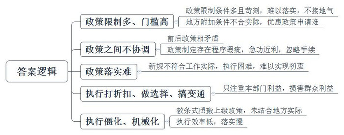
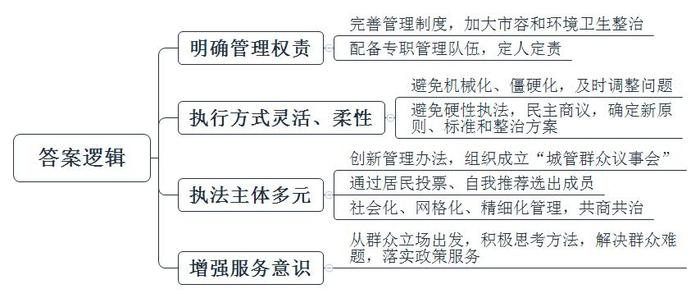
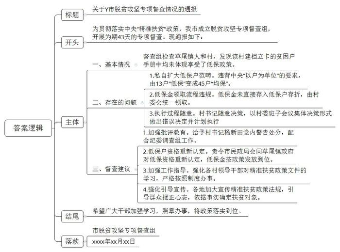
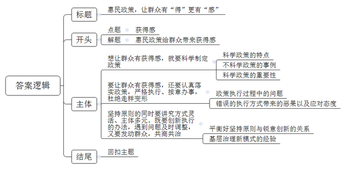

# 2019年青海省公考《申论》题（省市州级）

<!-- gwy:overview:start -->
> **青海 · 2019 · 申论 · 省市州级** ｜ 4 题 · 图片 4 处 · 答案随题折叠

导航：[题目](#题目)
<!-- gwy:overview:end -->

> 候选采集稿。参考答案及解析来自粉笔页面，不代表官方答案或真实高分答卷；来源使用许可与原卷对应关系仍需人工核实。

## 给定材料

### 材料 material-46ec4d8ed5307526

在北方某省的一个乡镇，上级要求村里建设村级综合性文化服务中心，包括图书阅览室、文体活动室、党员活动室等。除贫困村和人口较少的村外，绝大多数村的服务中心面积要求不低于200平方米，并下达了达标率的考核指标。

一名乡镇干部告诉记者，“相当一部分村的办公场所总共不超过90平方米，很难达到200平方米的面积要求。”

为了满足要求，抽检组到达之前，有的乡镇租用民房，摆上器材、桌子、图书等，凑够了200平方米。然而，检查还要求房子“不能有生活气息”。检查组到后发现，墙上有处插座插着手机充电器，尽管上面落满了灰尘，但最终仍被认为“有生活气息，不能算入村级综合性文化服务中心面积。”

这名乡镇干部说，“本来200平方米的要求已很难满足，再加上村里没有家具等生活用品的空宅几乎没有，在达标率的考核限制下，这么不接地气的政策不是逼基层造假吗？”

H省一家生物质燃料企业负责人说，近年来，国家出台了一些扶持生物质能源产业发展的政策。公司在向当地发改委、环保等部门申请优惠政策或补贴资金时，常被卡在“在当地拥有自有厂房和设备”这条地方制定的附加条件上。企业资金紧张，租用厂房生产，短期很难自建厂房。“就因这个条款，企业投产三年来，除获得农机部门的3万元政策补贴外，其余优惠政策都没能享受到。”

采访中有中小企业反映，一些优惠政策出台了，但申请不到。C市一家从事“互联网+政务”业务的科技企业负责人说，市里一个行政部门提供了18类扶持的项目，企业一一比对后发现，限制条件太多，没有一项可以享受到。“这个扶持项目原计划覆盖300家企业，实际后来享受到的只有80家。”

### 材料 material-f91f7803a89c1290

根据政策要求，W市各区从2013年开始，对辖区沿街商户实行市容和环境卫生责任区制度管理，加大对居民占用公共空间、流动摊点等的整治，每个社区还要配备一名正式的城管队员定人定责。政策要求合情合理，可到基层执行时却遇了难。

该市某区和平路街道茂林路社区党委书记唐海川回忆，当时街道城管中队进行了多次治理，但收效甚微，“检查人员一来，他们就往回收，人走了就又出摊。执法本是为群众打造舒适环境，但往往不被理解。”

执法人员因为不被理解而委屈，居民对街道管理现状也不满意。上级的政策规定要执行，但不能机械化、僵硬化，对执行过程中出现的问题，需要及时调整施策，茂林路社区想出了成立“城管群众议事会”的办法。通过居民投票、自我推荐，茂林路社区选出了10名热心社区工作的议事会成员，包括社区网格员、街道城管网格员、物业工作人员、经营户代表和社区居民，由过去的城管单方执法，转变为“众人的事众人商量”。

2018年3月，茂林路社区一商业街占道经营、餐饮油烟污染等问题严重，城管没有硬性执法，而是由“城管群众议事会”召开了商讨会，商量解决办法。环保治污的红线不可破，占道经营影响安居的行为要停止，这两个原则得到各方认可，最终形成了新的经营规范6项标准和整治方案，得到大家的拥护和执行。

截至目前，茂林路社区“城管群众议事会”共召开会议26次，参加居民585人次，受理具体问题191项，完成181个项目。和平路街道负责人解琛认为，“好政策要落实好，对于遇到的各种问题，要站在群众立场想办法，问题才能迎刃而解，政策服务群众的‘最后一米’才能打通。”

### 材料 material-8a57076e121e9de8

3月19日，春回大地，阳光明媚，Y市草尾镇人和村8组村民刘和华来到村务公开栏前，“人和村2018年度享受低保待遇名单……，共有13户34人”，看完后，刘和华不由得感叹道：“还是这样公开好，大家看了清清楚楚、明明白白，心里没有疙瘩了。”

说起这个低保评定，人和村村支部书记杨新田心里憋了一肚子话要说：“去年挨了处分后，有一阵子还真没有缓过神来，从那以后，我认识到了自己的问题，加强了学习。在以后的低保评定中严格按制度办事，一是一、二是二，村民支持度反而提高了。”

杨新田说的这个事情发生在2018年初，当时Y市成立脱贫攻坚专项督查组，开展为期43天的专项督查，督查组在草尾镇人和村进行督查时发现疑点，该村建档立卡的贫困户手册中均没有体现享受了低保政策，随即询问该村村干部。

“中央的政策要求低保以户为单位，应保尽保。我们村的实际情况是，一个贫困家庭大多是其中的一个人丧失劳动能力，如果让这个家庭的成员都享受低保，那么没有享受低保的贫困户就会对享受了低保的家庭中有劳动能力的人吃低保有意见。”人和村的村干部跟督查组讲起了自己的难处。

“那你们村是怎么解决这个问题的？”督察干部问道。

“为了平息这一矛盾和可能出现的争端，我们村委根据实际情况想出了贫困户每户一个代表来享受低保的方法。不过因为我们的分配程序还没有做到位，既不敢让申请了低保金的贫困户们知道钱来了，也不好发放下去，所以从上面领来的低保金还一分不少地放在村委。”人和村村支部书记杨新田讲起了自己的“土办法”。

“既然想办法评定了，怎么没有看到相关资料？”

“因为这个法子不符合上面的要求，我们也不敢写到资料里面去，而且这低保的钱也不敢发放。”杨新田对督查干部说，“实不相瞒，这笔钱一分都没有到我们自己的口袋里，我们这么做只是为了方便工作，贫困户各有各的难处，只有‘一碗水端平’，大家才不会心生意见。”

督察组的同志听完眉头紧锁，杨新田的说法不仅有牵强附会之意，而且跟中央精准扶贫政策是相违背的。他们现场对杨新田等村干部进行了批评教育，迅速将问题上报，并将问题线索汇总移送Y市纪委。

“我向组织坦白，恳请组织宽大处理。”2018年1月24日，杨新田在接受Y市纪委办案干部第一次的调查谈话时，主动交代了事情的前因后果。

2017年7月，草尾镇人和村严格按照相关程序，从推荐的40户贫困户中确定13户享受低保。在确定名单后，有不少组长提出“获得低保的贫困户太少、贫困只是相对贫困、还是不够公平、有些贫困户会有意见”等问题。“要不干脆每个贫困户家里都发一个人的低保，这样人人有份，自然没有意见了。”后来，人和村又召开村委会议讨论，将申请低保的40户贫困户都纳入低保金发放范畴，还根据村里的情况增加了5户名额。村支部书记杨新田在会上“拍板”，按照评议出的13户低保对象来做好相关资料，提交上级部门审核；13户低保户所领取低保金的存折放在村里，低保金由村里统一领取后，再重新分配给村委评定的45户低保户（含评议的13户）。就这样，人和村13户“低保”变成了45户“均保”。

“在执行上级政策上当不得‘好好先生’，杨新田虽然没有将低保金装进自己的口袋，也没有发现在评议过程中优亲厚友，他一方面严格按照程序评选出13户低保户；另一方面却在执行政策过程中走样，随意变通，以召开村委班子会议集体决策的形式研究出不符合政策的错误决定，并计划执行错误的分配方式，这是严重的违纪行为。”Y市纪委监委办案干部说。

2018年2月，Y市纪委监委给予杨新田党内警告处分，责令Y市民政局会同草尾镇政府对低保户资格进行重新认定，将低保资金按政策发放到位，并向其他贫困户做好政策宣传工作。

## 题目

### 第 1 题

**根据给定资料**1**～**3**，概括政策执行过程中主要存在哪些问题。（20分）**

关联材料：材料 material-46ec4d8ed5307526

作答要求：

要求：内容全面、简明准确、条理清晰，不超过200字。

第 1 题 · 答案与解析

**参考答案（粉笔题库参考内容）**

一、政策限制多、门槛高。政策限制条件多且苛刻，难以落实，不接地气；地方附加条件不合实际，优惠政策申请难。

二、政策之间不协调。前后政策相矛盾；政策制定存在程序瑕疵，急功近利，忽略手续。

三、政策落实难。新规不符合工作实际，执行困难，难以实现初衷。

四、执行打折扣、做选择、搞变通。只注重本部门利益，损害群众利益。

五、执行僵化、机械化。教条式照搬上级政策，未结合地方实际；执行效率低，落实慢。

**解析**

**参考答案说明：**答案从“政策限制多、门槛高”“政策之间不协调”“政策落实难”“执行打折扣、做选择、搞变通”“执行僵化、机械化”等不同的问题进行了分条撰写。各条要点之间在内容上是并列关系、无交叉。

**考点**：考点问题类

**来源**：来源2019年青海省公考《申论》题（省市州级）

粉笔申论页面对本题只提供「解析视频」入口，该入口是会员推广位，页面无视频地址与文字解析。

### 第 2 题

**根据给定资料6，总结茂林路社区在政策执行方面的成功经验。（20分）**

关联材料：材料 material-f91f7803a89c1290

作答要求：

要求：内容全面、简明准确、条理清晰，不超过200字。

第 2 题 · 答案与解析

**参考答案（粉笔题库参考内容）**

一、明确管理权责。完善管理制度，加大市容和环境卫生整治；配备专职管理队伍，定人定责。

二、执行方式灵活、柔性。避免机械化、僵硬化，及时调整问题；避免硬性执法，民主商议，确定新原则、标准和整治方案。

三、执法主体多元。创新管理办法，组织成立“城管群众议事会”；通过居民投票、自我推荐选出成员；社会化、网格化、精细化管理，共商共治。

四、增强服务意识。从群众立场出发，积极思考方法，解决群众难题，落实政策服务。

**解析**

**参考答案说明：**答案从“明确管理权责”“执行方式灵活、柔性”“执法主体多元”“增强服务意识”等不同的经验进行了分条撰写。各条要点之间在内容上是并列关系。

**考点**：考点经验启示类

**来源**：来源2019年青海省公考《申论》题（省市州级）

粉笔申论页面对本题只提供「解析视频」入口，该入口是会员推广位，页面无视频地址与文字解析。

### 第 3 题

**根据给定资料4，请你以Y市脱贫攻坚专项督查组的名义拟写一篇通报。（30分）**

关联材料：材料 material-8a57076e121e9de8

作答要求：

要求：文体正确、结构完整、内容全面、条理清晰，不超过500字。

第 3 题 · 答案与解析

**参考答案（粉笔题库参考内容）**

关于Y市脱贫攻坚专项督查情况的通报

为贯彻落实中央“精准扶贫”政策，我市成立脱贫攻坚专项督查组，开展为期43天的专项督查。现通报如下：

一、基本情况。督查组检查草尾镇人和村，发现该村建档立卡的贫困户手册中均未体现享受了低保政策。

二、存在的问题。1.私自扩大低保户范畴。违背中央“以户为单位”的要求，由13户“低保”变成45户“均保”。2.低保金领取流程违规。低保金未直接存入低保户存折，由村委会统一领取。3.执行过程随意。村书记随意决策，以村委班子会议集体决策形式做出错误决定并计划执行。

三、督查建议。1.加强批评教育。给予村书记杨新田党内警告处分，配合纪委调查组工作。2.低保户资格重新认定。责令市民政局会同草尾镇政府对低保资格重新认定，低保金按政策发放到位。3.加强工作指导。强化各村领导干部对精准扶贫政策文件的学习，严格按照制度办事。4.强化引导宣传。各地加大宣传精准扶贫政策法规，引导群众摆正心态，依据事实确定扶贫对象。

希望广大干部加强学习，照章办事，将政策落实到位。

市脱贫攻坚专项督查组

xxxx年xx月xx日

**解析**

**参考答案说明：**（1）格式方面，本参考答案结合题目中的“文体正确”“结构完整”这些要求，写到了“标题”“正文”“落款”。（2）正文部分，一方面从内容来看，围绕着“Y市脱贫攻坚专项督查”这一主题，本参考答案的开头先概括了“Y市开展督查工作”的目的及背景；主体部分首先从“扩大低保户范畴”“低保金违规领取”“执行走样、随意变通”等几个方面指出了脱贫攻坚过程中存在的问题，其次从“加强批评教育”“资格重新认定”“加强工作指导”“强化引导宣传”等几个方面指出了督查建议。另一方面，形式上，本参考答案做到了分段、分条撰写，整体上条理较为清晰。（3）本参考答案在语言表达上做到了简洁、流畅、严肃，符合“通报”这一文种的语言风格。

**考点**：考点总结类

**来源**：来源2019年青海省公考《申论》题（省市州级）

粉笔申论页面对本题只提供「解析视频」入口，该入口是会员推广位，页面无视频地址与文字解析。

### 第 4 题

**根据你对给定资料**5**中划线部分“有获得却无感”的认识和思考，自拟题目，写一篇议论文。（50分）**

关联材料：材料 material-46ec4d8ed5307526

作答要求：

要求：

（1）自选角度，立意明确；

（2）联系实际，不拘泥于给定资料；

（3）思路清晰，语言流畅；

（4）不超过1000字。

第 4 题 · 答案与解析

**参考答案（粉笔题库参考内容）**

**惠民政策，让群众有“得”更有“感”**

建设农村文化服务中心、推行低保政策、养老金上涨、油电气降价、增值税减少……如今，我们看到了越来越多的“政策红包”，人们向往的美好生活似乎触手可及。但是，很多政策虽能让群众“获得”，但却难以让群众“有感”。**这就需要政策首先应****“抓得准”，在制定时贴合民生实际，不与既定政策相冲突；还需要政策“做得实”，既要严格执行、照章办事、坚守原则，又要民主集中、灵活变通、柔性人性。**

**惠民政策之所以要有****“得”****更有****“感”，是因为部分惠民政策制定时不切实际，违反既定政策；执行时打折扣、做选择、搞变通。**这自然会抵消群众的获得感、幸福感，让群众很难心怀感激，反而怨声载道。

**想让群众有获得感，就要科学制定政策。一方面政策要符合客观实际、百姓需求；另一方面，政策之间要协调配合，避免相互冲突。**比如，之前某地为实现“低碳生活”，强制要求市民拉闸限电，以保证政府承诺的指标，结果美好的环保初衷却降低了百姓生活质量。再如，某市一个招商引资的项目顺利完工，最后却发现违反了文物保护等相关政策，导致了大量资源浪费。所以，只有科学规划政策、合理制定政策，才能让政策落地生根，让百姓真正得实惠。

**要让群众有获得感，还要认真落实政策，严格执行、按章办事，杜绝走样变形。**政策执行在现实中常有诸多变化：有的选择性执行，对政策挑肥拣瘦，对自己有利的多执行，对自己不利的束之高阁；有的添加式执行，添加一些原来政策没有的东西，往往是为了本地区、本部门甚至小集团的利益；有的走过场式执行，搞形式主义，满足于以会议贯彻会议，以文件落实文件。这些“上有政策、下有对策”的行为，都使政策执行效果大打折扣，需要我们特别警惕。

**当然，坚持原则的同时要讲究方式灵活、主体多元。既要创新执行的办法，遇到问题及时调整，又要发动群众，共商共治。**严格落实政策，不等于机械、僵化、死板，而应在不违背原则的前提下进行创新。当前，基层有不少治理的新模式值得借鉴：从动员群众参与网格化管理，到利用新技术的智能化管理、信息化管理，比如“天眼”行动，再到走红网络的“朝阳群众”、“海淀网友”等群众监督力量……都为我们提供了政策落实的方法，也实践了共享共治的理念。

无论政策的制定，还是政策的落实都关乎百姓的“得”与“感”。我们希冀，未来的惠民政策不仅想民所想、急民所急，更能原则与灵活并重，政府与百姓同行，真正画好社会治理和改善民生的同心圆！

**解析**

**文章分析：**

**惠民政策，让群众有“得”更有“感”**

【**标题的优点：**首先，范文的标题突出了“获得感”这一主题。其次，形式上，文字简洁明快。】

（1）建设农村文化服务中心、推行低保政策、养老金上涨、油电气降价、增值税减少……如今，我们看到了越来越多的“政策红包”，人们向往的美好生活似乎触手可及。但是，（2）很多政策虽能让群众“获得”，但却难以让群众“有感”。（3）**这就需要****政策首先应“抓得准”****，****在制定时贴合民生实际****，****不与既定政策相冲突****；还需要****政策“做得实”****，既要****严格执行、照章办事、坚守原则****，又要****民主集中、灵活变通、柔性人性****。**

【**开头的优点：**★内容方面。范文的开头是紧扣“获得感”这一主题展开的。首先，**开头点出主题，做到了主题明确**。其次，**对“获得感”这一主题进行了分析阐述：（****1****）先指出了“我国惠民政策所取得的成绩”；（****2****）接着指出了“当前我国政策存在的问题”；（****3****）最后指出了“如何做到让政策给群众带来获得感”**。★文字表达方面。使用了“但是……”“还……”“既要……又要……”等关联词，使语言表达有逻辑性。】

**惠民政策之所以要有“得”更有“感”，是因为****部分惠民政策制定时不切实际****，****违反既定政策****；****执行时打折扣、做选择、搞变通****。**这自然会抵消群众的获得感、幸福感，让群众很难心怀感激，反而怨声载道。

【**过渡段的优点：**范文过渡段分析了我国部分“惠民政策”的问题、危害，为下文的对策段落做好了铺垫。】

**想让群众有获得感，就要科学制定政策。一方面政策要符合客观实际、百姓需求；另一方面，政策之间要协调配合，避免相互冲突。**比如，（1）之前某地为实现“低碳生活”，强制要求市民拉闸限电，以保证政府承诺的指标，结果美好的环保初衷却降低了百姓生活质量。再如，某市一个招商引资的项目顺利完工，最后却发现违反了文物保护等相关政策，导致了大量资源浪费。所以，（2）只有科学规划政策、合理制定政策，才能让政策落地生根，让百姓真正得实惠。

【**论述段****1****的优点：**★观点句：范文的观点句是紧扣“获得感”这一文章主题提出的。形式上，它在段首处直接写出，位置突出，容易发现。内容上，关键词突出，内容要点明确，可以明显看出它是从“制定科学政策”入手，指出了“如何让群众有获得感”。★论述内容：（1）介绍了“不科学政策的危害”；（2）介绍了“科学政策的重要性”。注意：以上两个方面的内容都是紧扣“想让群众有获得感，就要科学制定政策”这个观点句进行分析论述的，论述的针对性强，内容层次丰富。最后，在论述方法和论据的选取上做到了讲道理、举例子，做到了丰富多样。】

**要让群众有获得感，还要认真落实政策，严格执行、按章办事，杜绝走样变形。**（1）政策执行在现实中常有诸多变化：有的选择性执行，对政策挑肥拣瘦，对自己有利的多执行，对自己不利的束之高阁；有的添加式执行，添加一些原来政策没有的东西，往往是为了本地区、本部门甚至小集团的利益；有的走过场式执行，搞形式主义，满足于以会议贯彻会议，以文件落实文件。（2）这些“上有政策、下有对策”的行为，都使政策执行效果大打折扣，需要我们特别警惕。

【**论述段****2****的优点：**★观点句：范文的观点句是紧扣“获得感”这一文章主题提出的。形式上，它在段首处直接写出，位置突出，容易发现。内容上，关键词突出，内容要点明确，可以明显看出它是从“执行政策”入手，指出了“如何让群众有获得感”。★论述内容：（1）先介绍了“政策执行过程中的问题”；（2）再介绍了“错误的执行方式带来的恶果以及应对态度”。注意：以上两个方面的内容都是紧扣“要让群众有获得感，还要认真落实政策，严格执行、按章办事，杜绝走样变形”这个观点句进行分析论述的，论述的针对性强，内容层次丰富。最后，在论述方法和论据的选取上做到了讲道理、举例子，做到了丰富多样。】

**当然，坚持原则的同时要讲究方式灵活、主体多元。既要创新执行的办法，遇到问题及时调整，又要发动群众，共商共治。**（1）严格落实政策，不等于机械、僵化、死板，而应在不违背原则的前提下进行创新。当前，（2）基层有不少治理的新模式值得借鉴：从动员群众参与网格化管理，到利用新技术的智能化管理、信息化管理，比如“天眼”行动，再到走红网络的“朝阳群众”、“海淀网友”等群众监督力量……都为我们提供了政策落实的方法，也实践了共享共治的理念。

【**论述段****3****的优点：**★观点句：范文的观点句是紧扣“获得感”这一文章主题提出的。形式上，它在段首处直接写出，位置突出，容易发现。内容上，关键词突出，内容要点明确，可以明显看出它是从“创新政策执行方法与发动群众”入手，指出了“如何让群众有获得感”。★论述内容：（1）先介绍了“平衡好坚持原则与锐意创新的关系”；（2）再介绍了“基层治理新模式的经验”。注意：以上两个方面的内容都是紧扣“坚持原则的同时要讲究方式灵活、主体多元。既要创新执行的办法，遇到问题及时调整，又要发动群众，共商共治”这个观点句进行分析论述的，论述的针对性强，内容层次丰富。最后，在论述方法和论据的选取上做到了讲道理、举例子，做到了丰富多样。】

【**论述段之间的关系**：★内容的内在逻辑：范文的论述段之间是依照“递进”的逻辑展开的。论述段1先写了“制定科学政策”，论述段2再写了“不仅要有科学政策，更要有严格的执行”，论述段3接着写了“不仅要严格执行政策，还要讲究方式方法”。★段与段的外在衔接：论述段1、2、3段首句中的“要……”“还要……”“当然……”体现出三个段落之间层层递进的关系，使得论述思想层层深入。】

（1）无论政策的制定，还是政策的落实都关乎百姓的“得”与“感”。（2）我们希冀，未来的惠民政策不仅想民所想、急民所急，更能原则与灵活并重，政府与百姓同行，真正画好社会治理和改善民生的同心圆！

【**结尾的优点**：（1）范文的结尾回扣了“获得感”这一主题；（2）发出呼吁，阐述了“惠民政策”的深远意义。】

**考点**：考点文章写作题

**来源**：来源2019年青海省公考《申论》题（省市州级）

粉笔申论页面对本题只提供「解析视频」入口，该入口是会员推广位，页面无视频地址与文字解析。

